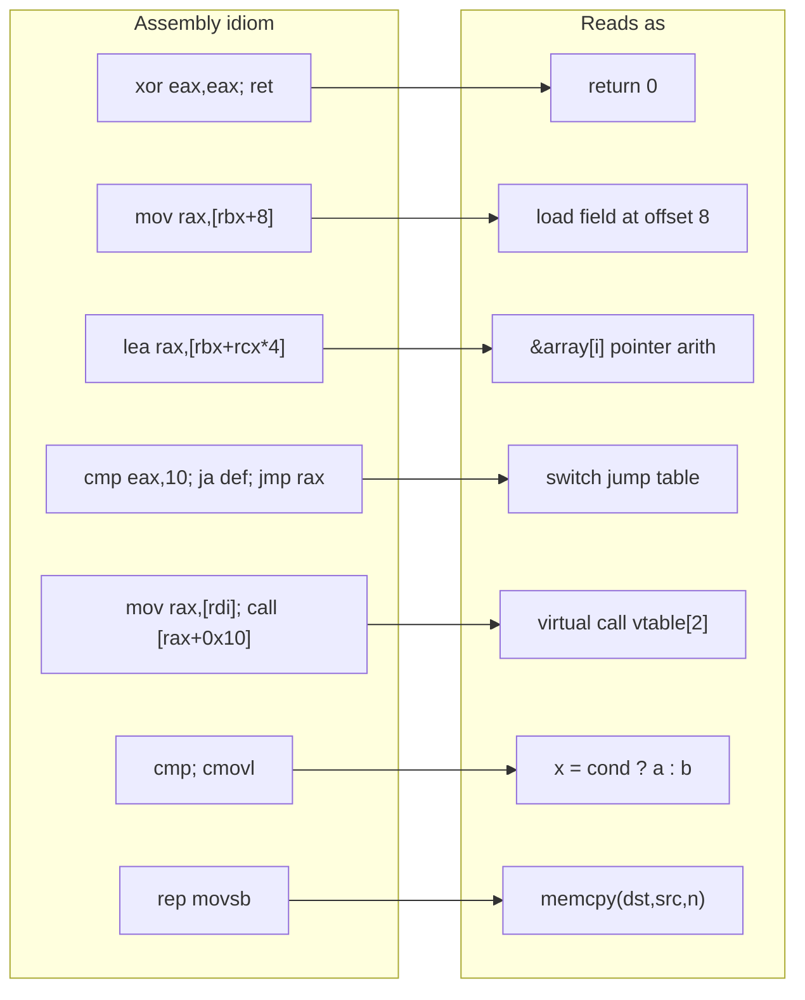

# x86/x64 Assembly for the LLM Era

> Tags: assembly, x86, x64, calling-conventions, flags, addressing-modes, stack-frames, idiosync | Difficulty: Beginner to Intermediate | Prerequisites: you can read pseudocode and C, and you have a disassembler open

## Overview

Most modern decompilers never show you raw assembly. Ghidra, IDA, and Binary Ninja convert code to pseudocode. You click the assembly pane only when the pseudocode lies.

This page gives you the minimum fluent reading of x86/x64 assembly. It covers the register model, flags, addressing modes, the instructions that appear most in decompiled functions, stack frames, the three calling conventions you meet most, and the compiler idioms that look cryptic until you name them.

You do not need to write assembly fluently. You need two skills:

1. Map an assembly idiom to the high-level construct it compiles from.
2. Spot when the disassembler or the decompiler guessed wrong.

Everything on this page applies to both Intel and AT&T syntax. Ghidra and IDA default to Intel-like syntax. radare2 and objdump default to AT&T syntax. The operand order differs. The semantics do not. `mov eax, [rbx]` in Intel means `rbx` holds an address and `eax` receives the value at that address. `mov (%rbx), %eax` in AT&T is the same instruction.

A decompiler collapses registers into named variables. The variable name hides the register. When a variable reads as garbage, return to the disassembly and trace the register.

## Setup

You need one disassembler you can drive by keyboard. Pick any of these:

| Tool | Syntax style | Notes |
|---|---|---|
| Ghidra 12.2 | Intel-like | Best free option. Byte viewer plus listing view. |
| IDA 9.5 | Intel-like | Fastest for large binaries. Flip views with Tab. |
| Binary Ninja 6.0 | Intel-like | Good HLIL and IL layers between asm and pseudocode. |
| radare2 6.2.4 or rizin 0.9.1 | AT&T by default | `pd` for disassembly, `pdf` for a function, `e asm.syntax=intel` to switch. |
| objdump (binutils) | AT&T by default | `objdump -d -M intel binary` for Intel syntax. |

For the drills at the end of this page, compile C to assembly. You do not need to run the assembly. The compiler output is the exercise input.

```bash
# Ubuntu, one command per example
sudo apt install gcc g++ build-essential

# Compile a single function to assembly, Intel syntax
gcc -O2 -S -masm=intel drill.c -o drill.s
cat drill.c
gcc -O2 -S -masm=intel drill.c | less

# Same, but keep the object and disassemble it
cat > drill.c <<'EOF'
int add(int a, int b) { return a + b; }
EOF
gcc -O2 -c drill.c -o drill.o
objdump -d -M intel drill.o
```

Practice target: any small C program you wrote yourself. Compile it at `-O0` and `-O2`. Compare the output. `-O2` shows you the idioms that appear in real shipped binaries.

## Step-by-Step

### Register Model

x86-64 has sixteen general-purpose registers. Learn them in groups.

| Group | Registers | Role |
|---|---|---|
| Accumulator | rax | Return value, arithmetic center |
| Argument/count | rcx, rdx, r8, r9 | First four integer arguments (SysV) |
| Base/index | rbx, rsi, rdi, rbp, rsp | Callee-saved bases, stack, frame |
| Index | r8-r15 | General use, arguments 3 and 4 in SysV |

Each 64-bit register has aliases at smaller widths:

| Width | 64-bit | 32-bit | 16-bit | 8-bit |
|---|---|---|---|---|
| rax | rax | eax | ax | al, ah |
| rcx | rcx | ecx | cx | cl, ch |
| rdx | rdx | edx | dx | dl, dh |
| rbx | rbx | ebx | bx | bl, bh |
| rsi | rsi | esi | si | sil |
| rdi | rdi | edi | di | dil |
| rbp | rbp | ebp | bp | bpl |
| rsp | rsp | esp | sp | spl |
| r8-r15 | r8-r15 | r8d-r15d | r8w-r15w | r8b-r15b |

The rule that trips people up: writing to a 32-bit register zeroes the upper 32 bits of the 64-bit register. `mov eax, 5` produces `rax = 5`, not `rax = 5` with garbage above. This is architectural on x86-64. Writing to an 8-bit or 16-bit register does not zero anything.

Memory addressing uses two registers at once. `[rbx + rcx*4 + 8]` reads the value at address `rbx + rcx*4 + 8`. The scale factor can only be 1, 2, 4, or 8. This is the byte size of the pointed-to type. A `double` array uses scale 8. An `int` array uses scale 4. A pointer array uses scale 8.

### Flags

The flags register holds one-bit state from arithmetic instructions. You read flags in two situations: conditional jumps and conditional moves.

| Flag | Meaning | Set by |
|---|---|---|
| ZF | Zero. Result was zero. | Most arithmetic and logic ops |
| SF | Sign. Result's high bit was set. | Most arithmetic and logic ops |
| CF | Carry. Unsigned borrow or overflow. | add, sub, shl, shr |
| OF | Overflow. Signed overflow occurred. | add, sub, imul |
| PF | Parity. Low byte had even parity. | Rarely used by compilers |

Comparison uses `cmp` or `test`. Neither writes a result. `cmp a, b` computes `a - b` and sets flags. `test a, b` computes `a & b` and sets flags. `test eax, eax` is the idiom for "check if eax is zero". It sets ZF when eax is zero.

Signed comparisons use `jge`, `jl`, `jg`, `jle`. Unsigned comparisons use `jae`, `jb`, `ja`, `jbe`. Signed and unsigned jumps are different instructions. A decompiler that shows `if (a < b)` on unsigned values got the type wrong.

### Instruction Classes You Actually Meet

#### Data movement

| Instruction | Meaning | Notes |
|---|---|---|
| `mov dst, src` | Copy value | Most common instruction in any function |
| `lea dst, [addr]` | Load effective address | Does NOT dereference. Computes an address. `lea rax, [rbx+8]` means `rax = rbx + 8`. Common for array indexing and frame access. |
| `push src` / `pop dst` | Stack push and pop | Stack grows down on x86. |
| `xchg a, b` | Swap two operands | Rare from compilers. Common in obfuscation. |

`lea` is the instruction that confuses everyone. `mov rax, [rbx+8]` reads memory. `lea rax, [rbx+8]` computes the address `rbx+8` and puts it in `rax`. No memory read happens. Decompilers use `lea` to express pointer arithmetic that does not involve a load.

#### Arithmetic and logic

| Instruction | Meaning |
|---|---|
| `add`, `sub`, `imul`, `idiv`, `div` | Integer arithmetic |
| `and`, `or`, `xor`, `not`, `neg` | Bitwise logic |
| `inc`, `dec` | Increment and decrement |
| `cmp`, `test` | Compare and test. No result written. |

`xor eax, eax` is the idiomatic zero. It sets eax to zero and clears flags in one instruction. Compilers emit it everywhere. When you see `xor eax, eax` followed by `ret`, the function returns 0.

#### Shifts and rotates

| Instruction | Meaning |
|---|---|
| `shl dst, n` | Shift left. Multiply by 2^n. |
| `shr dst, n` | Shift right. Logical. Zero fill. |
| `sar dst, n` | Shift right arithmetic. Sign extend. |
| `rol`, `ror` | Rotate. Rare from compilers. |

`shl eax, 3` multiplies eax by 8. `shr eax, 3` divides by 8 for unsigned values. `sar` divides by 8 for signed values. The shift count can come from `cl` only in the one-operand form, or from an immediate or register in the two-operand form.

#### Branches and calls

| Form | Meaning |
|---|---|
| `call target` | Push return address, jump to target. |
| `jmp target` | Unconditional jump. |
| `jcc target` | Conditional jump. `jcc` stands for any of the 16 condition codes. |
| `call qword ptr [rax]` | Indirect call through a pointer in memory. Vtable dispatch and function pointers. |
| `jmp qword ptr [rax+8]` | Indirect jump. Tail call through a pointer. |
| `ret` | Pop return address and jump to it. `ret n` also cleans n bytes of stack arguments. |

Direct calls target a fixed address. Indirect calls load the target from memory or a register. `call qword ptr [rax]` is how C++ virtual functions dispatch. `call qword ptr [rip+offset]` calls through the import table (IAT) in a PE file.

#### Conditional moves

| Instruction | Meaning |
|---|---|
| `cmovz dst, src` | Move if zero flag set. |
| `cmovnz dst, src` | Move if not zero. |
| `cmovl`, `cmovle`, `cmovg`, `cmovge` | Signed variants. |
| `cmova`, `cmovae`, `cmovb`, `cmovbe` | Unsigned variants. |

Compilers emit `cmov` instead of a branch when both sides of an `if` are cheap. `dst = (a < b) ? x : y` compiles to a compare followed by `cmovl`. A decompiler that shows an `if` statement for a `cmov` sequence is technically correct but obscures the branchless nature. This matters in crypto code where constant-time behavior is a requirement.

#### SIMD

You meet SSE and AVX in string functions, crypto, and any code compiled with vectorization.

| Register | Width | Notes |
|---|---|---|
| xmm0-xmm15 | 128-bit | SSE2 baseline on x86-64 |
| ymm0-ymm15 | 256-bit | AVX |
| zmm0-zmm31 | 512-bit | AVX-512, rare in shipped code |

| Instruction family | Purpose |
|---|---|
| `movdqa`, `movdqu` | Aligned and unaligned 128-bit moves |
| `movaps`, `movups` | Aligned and unaligned moves for floating point |
| `pcmpeqb`, `pcmpgtb` | Byte compares. Produce all-ones or all-zeros masks. |
| `paddb`, `psubb`, `pand`, `por`, `pxor` | Byte/word/dword/qword integer SIMD arithmetic |
| `pmovmskb` | Extract sign bits from a vector into a 16-bit mask |
| `pshufb` | Byte shuffle within each 16-byte lane. SSSE3. |

`rep movsb` copies rcx bytes from rsi to rdi. `rep stosb` fills rcx bytes at rdi with al. These are the string idioms. Modern compilers replace them with SIMD loops for large copies. For small fixed sizes, you see straight-line `mov` chains.

### Stack Frames and Calling Conventions

#### The stack frame

x86-64 stacks grow down. `rsp` points to the top of the stack, the lowest valid address. `push` decrements rsp then stores. `pop` loads then increments rsp.

A typical function prologue on SysV AMD64:

```asm
push    rbp
mov     rbp, rsp
sub     rsp, 0x30          ; reserve 48 bytes of locals
mov     [rbp-8], rdi       ; save argument 1
mov     [rbp-16], rsi      ; save argument 2
```

`rbp` becomes the frame pointer. `[rbp-8]`, `[rbp-16]` are local slots. `[rbp+16]` is the first stack argument (arguments 1-6 in registers, 7+ on stack). `[rbp+8]` is the return address.

Leaf functions (no calls) often omit the frame pointer:

```asm
sub     rsp, 0x20
mov     [rsp], rdi
mov     eax, [rsp]
add     rsp, 0x20
ret
```

Here `[rsp]`, `[rsp+8]`, `[rsp+16]` are the locals. No rbp setup. Faster and smaller.

#### SysV AMD64 (Linux, macOS, most Unix)

| Argument | Register |
|---|---|
| 1 | rdi |
| 2 | rsi |
| 3 | rdx |
| 4 | rcx |
| 5 | r8 |
| 6 | r9 |
| 7+ | stack |

Return value in rax. Second return value (for structs or __int128) in rdx.

Caller cleans the stack. The caller allocates space for stack arguments and cleans them after the call returns. No callee cleanup.

Stack must be 16-byte aligned at the `call` instruction. This means rsp is 16-byte aligned after the return address push inside the callee. Prologues that use `sub rsp, N` pick N so the total stays aligned.

Callee-saved registers: rbx, rbp, r12-r15. The callee must preserve these. If a function uses them, it pushes them in the prologue and pops them before ret.

Caller-saved (volatile): rax, rcx, rdx, rsi, rdi, r8-r11. The callee may clobber these freely.

Variadic functions (printf, scanf) require al to hold the number of vector registers used. The compiler sets `al` before calling variadic functions. If you see `xor eax, eax` before a call, it is clearing al for a variadic call with no vector args.

#### Microsoft x64 (Windows)

| Argument | Register |
|---|---|
| 1 | rcx |
| 2 | rdx |
| 3 | r8 |
| 4 | r9 |
| 5+ | stack |

Return value in rax. Same as SysV.

Callee cleans the stack. The callee removes stack arguments before ret. This is the opposite of SysV. You will see `ret 0x20` or `add rsp, 0x28` before `ret` in Windows functions.

Home space: the caller always allocates 32 bytes of shadow space on the stack for the callee to spill rcx, rdx, r8, r9. This space exists even if the function uses all four register arguments.

Stack must be 16-byte aligned at the `call` instruction. Same rule as SysV.

Callee-saved registers: rbx, rbp, rdi, rsi, r12-r15, xmm6-xmm15. More registers are callee-saved than SysV. The callee preserves rdi and rsi, which are caller-saved in SysV.

#### thiscall and fastcall (32-bit and legacy)

These appear in 32-bit code and old Windows binaries. x86-64 does not use them.

| Convention | this pointer | Other args | Stack cleanup |
|---|---|---|---|
| thiscall (MSVC 32-bit) | ecx | stack | callee |
| fastcall (MSVC 32-bit) | ecx, edx | stack | callee |
| stdcall (Win32 API) | n/a | stack | callee |
| cdecl (default C) | n/a | stack | caller |

In 32-bit thiscall, `ecx` holds `this`. The remaining arguments go on the stack right-to-left. The callee cleans the stack with `ret N`. In disassembly, look for `mov ecx, [ebp+8]` at the start of a method. That is the thiscall pattern.

In 64-bit Windows, member functions use the Microsoft x64 convention with `this` in rcx. No separate thiscall exists.

### Compiler Idioms

#### Switch jump tables

A `switch` statement with dense case values compiles to a jump table:

```asm
cmp     eax, 10
ja      default_case
lea     rcx, [rip+jump_table]
movsxd  rax, dword ptr [rcx+rax*4]
add     rax, rcx
jmp     rax
```

The jump table is an array of 32-bit offsets relative to its own base. `movsxd` sign-extends each offset. `add rax, rcx` converts the offset to an absolute address. `jmp rax` dispatches.

In the decompiler, this appears as a `switch` statement. In the disassembly, it is a computed jump. If the table bounds check is missing, the binary has a jump-table out-of-bounds bug. CVE-class bugs come from this pattern.

Sparse switch statements (cases far apart) compile to comparison chains or binary search trees instead of jump tables.

#### Vtable calls

C++ virtual dispatch:

```asm
mov     rax, [rdi]        ; load vtable pointer from object
mov     rax, [rax+0x10]   ; load function pointer at vtable offset 0x10
call    rax               ; call it
```

`[rdi]` is the vtable pointer. The vtable is an array of function pointers. The offset `0x10` selects which virtual function. Each entry is 8 bytes on x64.

In IDA, you can name vtables and see the class hierarchy. In Ghidra, vtables appear as data references. In raw disassembly, it is just two loads and an indirect call.

Interface calls in COM follow the same pattern. `QueryInterface`, `AddRef`, `Release` are the first three vtable entries at offsets 0, 8, 16.

#### String operations

Fixed-size copies inline the copy:

```asm
mov     rax, [rsi]
mov     [rdi], rax
mov     rax, [rsi+8]
mov     [rdi+8], rax
```

This copies 16 bytes. Compilers unroll small fixed-size copies into straight-line movs. For variable-size copies, they call memcpy or emit a `rep movsb` loop.

`strlen` compiles to a SIMD loop that loads 16 bytes at a time and uses `pmovmskb` to find a zero byte. The pattern is recognizable: `movdqu`, `pcmpeqb` against zero, `pmovmskb`, `tzcnt` or `bsf` on the mask.

`memset` for small constant sizes inlines to a series of stores. For large or variable sizes, it calls memset or emits `rep stosb`.

#### memset and memset patterns

Zeroing a structure:

```asm
xor     eax, eax
mov     [rbx], rax
mov     [rbx+8], rax
mov     [rbx+16], rax
```

Three stores of zero. The compiler knows the size and inlines it. For larger structs, it calls memset or emits a vectorized loop.

Filling with a pattern:

```asm
mov     eax, 0xCCCCCCCC   ; MSVC debug fill
mov     [rbx], rax
mov     [rbx+8], rax
```

0xCC is the MSVC debug break. 0xCD is the MSVC debug int3. Debug builds fill uninitialized stack and heap with these patterns. Seeing 0xCC in a release binary means you are looking at debug code or a crash dump.

## Usage

### Reading a stripped function's prologue

A stripped function has no name. The prologue tells you what kind of function it is.

Step 1: Look at the first instruction.

| First instruction | What it means |
|---|---|
| `push rbp; mov rbp, rsp` | Standard frame. Locals accessible via rbp. |
| `sub rsp, N` | Leaf function or optimized frame. Locals via rsp. |
| `push rbx; push rsi; push rdi` | Saves callee-saved registers. Function uses them. |
| `endbr64` | CET indirect branch tracking. Function can be called indirectly. |
| `mov [rsp+8], rcx` | Windows x64 home space spill. Function stores its first argument. |

Step 2: Look at the stack allocation.

| Pattern | Meaning |
|---|---|
| `sub rsp, 0x20` | Small frame. Few locals. |
| `sub rsp, 0x100` or larger | Large locals. Array or struct on stack. |
| `sub rsp, rax` | Variable-length allocation. alloca or VLA. |

Step 3: Look at the argument registers.

| Pattern | Meaning |
|---|---|
| `mov [rbp-8], rdi` | Saves arg 1 (SysV). |
| `mov [rbp-8], rcx` | Saves arg 1 (Windows). |
| `mov eax, edi` | Uses arg 1 directly. Leaf function. |
| `mov rax, gs:[0x30]` | Reads TEB. PEB access for process info. |

Step 4: Look at calls in the first few instructions.

| Pattern | Meaning |
|---|---|
| `call memset` or `call memcpy` | Structure initialization or copy. |
| `call __security_check_cookie` | Stack canary check. Function has buffers. |
| `call _alloca_probe` | Stack probe for large frame. |

### The asm-to-pseudocode map

When the decompiler shows you something and you want to verify against the asm, this table maps the pseudocode construct to the asm pattern.

| Pseudocode | Assembly pattern |
|---|---|
| `return 0;` | `xor eax, eax; ret` |
| `return x;` | `mov rax, [rbp-8]; ret` or `mov eax, edi; ret` |
| `a = b;` | `mov rax, [rbp-8]; mov [rbp-16], rax` |
| `a += b;` | `add dword ptr [rbp-8], eax` or load-add-store |
| `if (a == 0)` | `cmp dword ptr [rbp-8], 0; jne else` |
| `if (a < b)` | `mov eax, [rbp-8]; cmp eax, [rbp-16]; jge else` |
| `while (cond)` | Loop head with conditional jump back |
| `for (i = 0; i < n; i++)` | `xor ecx, ecx` init, `cmp ecx, [n]`, `inc ecx`, `jl loop` |
| `a[i] = x;` | `mov eax, [rbp-8]; movsxd rcx, eax; mov [rbx+rcx*4], edx` |
| `ptr->field = x;` | `mov rax, [rbp-8]; mov dword ptr [rax+offset], edx` |
| `func(a, b)` | Load args into rdi, rsi (SysV) or rcx, rdx (Win), then `call func` |
| `obj->method()` | `mov rax, [obj]; mov rax, [rax+vtable_offset]; call rax` |
| `switch (x)` | `cmp`, `ja default`, jump table with `movsxd` + `jmp rax` |
| `x ? a : b` | `cmp`, `cmov` sequence |



### Practice drills

These drills take about thirty minutes each. Compile the C, read the asm, write what the asm does in English, then check against the C.

Drill 1: function prologue reading. Take any function from a binary you have. Read the first ten instructions. Write down: is it SysV or Windows? Does it use a frame pointer? How many arguments does it take? Which registers does it save?

Drill 2: calling convention identification. Compile the same function with `gcc -O2 -S -masm=intel` on Linux and with `cl /FA` on Windows (or use an online compiler explorer). Compare the prologues. Note the argument registers and stack cleanup.

Drill 3: jump table recognition. Write a `switch` with ten cases. Compile at `-O2`. Find the jump table in the output. Trace the `movsxd` + `add` + `jmp rax` sequence. Draw the table.

Drill 4: idiom spotting. Take a decompiled function from Ghidra. Find five assembly idioms in it: a `lea` that is pointer arithmetic, a `cmov` that is a ternary, a `rep movsb` that is a memcpy, a vtable call, a stack canary check. Name each one.

Drill 5: flag tracing. Take a conditional jump. Trace backward to find the `cmp` or `test` that set the flags. Determine if the comparison is signed or unsigned. Check if the decompiler got the type right.

Drill 6: stripped function naming. Take a stripped binary. Pick a function with no name. Read the prologue, the calls it makes, and the strings it references. Propose a name. Check your name against what the function actually does by reading more of the body.

## Pitfalls

1. **Confusing `mov` and `lea`.** `mov` reads memory. `lea` computes an address. This is the most common misread.

2. **Ignoring operand size.** `mov eax, 1` and `mov rax, 1` are different instructions. `eax` writes zero the upper bits. `ax` and `al` do not.

3. **Reading AT&T as Intel.** `mov %eax, (%rbx)` in AT&T means `mov [rbx], eax` in Intel. The source and destination are reversed. Check your disassembler's syntax setting.

4. **Assuming all calls are direct.** `call rax` and `call qword ptr [rbx]` are indirect. They go through function pointers or vtables. The target is not visible in the disassembly.

5. **Missing the frame pointer omission.** Optimized functions often skip `push rbp; mov rbp, rsp`. Locals are at `[rsp+N]` not `[rbp-N]`. The offsets change after every push and pop.

6. **Confusing signed and unsigned jumps.** `jl` is signed less-than. `jb` is unsigned below. The same `cmp` instruction sets flags for both. The jump opcode tells you which comparison the programmer intended.

7. **Reading `rep movsb` as a loop.** It is a single instruction that repeats. The loop counter is rcx. The direction flag must be clear (it is by default). Do not look for a backward jump.

8. **Ignoring red zone.** The 128 bytes below rsp on SysV are the red zone. Leaf functions can use `[rsp-8]` through `[rsp-128]` without adjusting rsp. This is legal on SysV but not on Windows.

9. **Assuming callee cleanup.** SysV callers clean the stack. Windows callees clean it. If you see `ret 0x20` it is Windows. If the caller has `add rsp, 0x20` after the call it is SysV.

10. **Trusting the decompiler's types.** Decompilers guess signedness, pointer types, and struct layouts. The asm does not lie. When the pseudocode looks wrong, read the asm.

## See Also

- `../03-decomp/triage-and-mapping.md` — function mapping before you read assembly
- `../03-decomp/decompile-workflow.md` — the decompile loop where assembly verification fits
- `../03-decomp/verification-loop.md` — deterministic checks that catch decompiler errors
- `../05-tools/tool-catalog.md` — disassembler and decompiler options
- `../07-advanced/anti-analysis.md` — obfuscated assembly and anti-disassembly tricks
- `../06-topics/deobfuscation.md` — OLLVM and VMProtect assembly patterns
- `../06-topics/malware-analysis.md` — reading assembly in the context of malware triage
- `../08-case-studies/real-world-recipes.md` — end-to-end examples that use assembly reading
