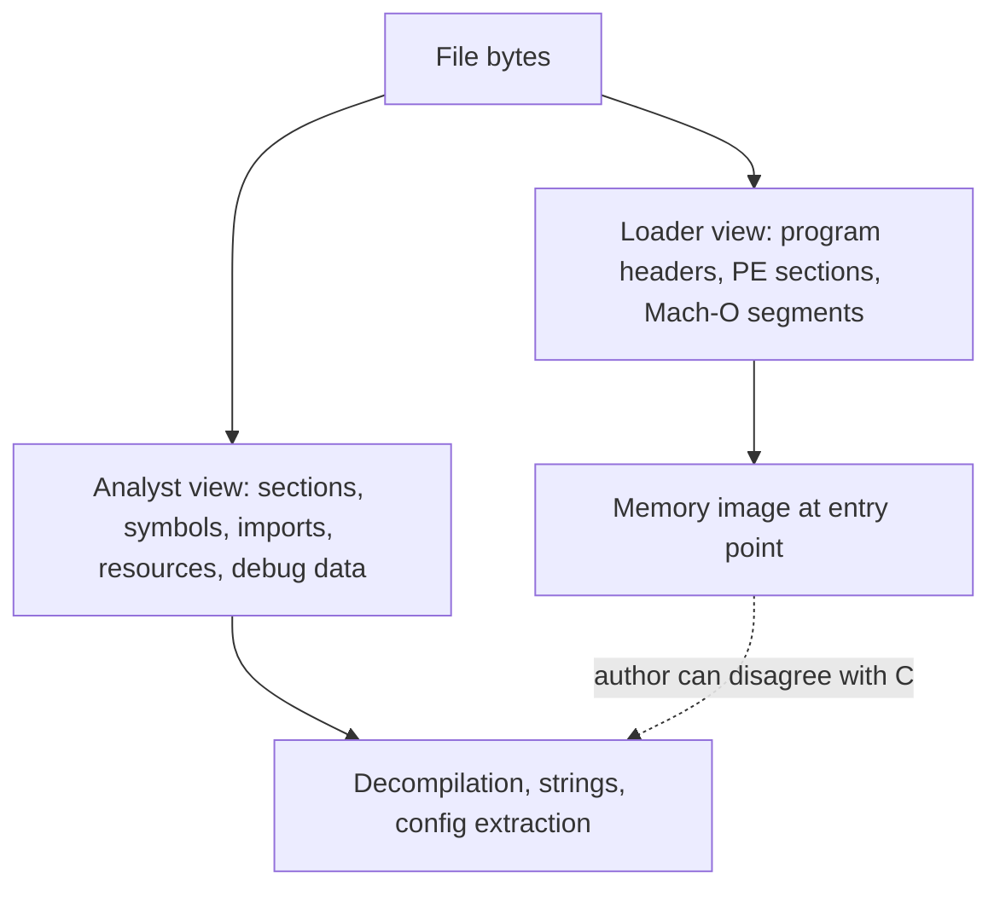
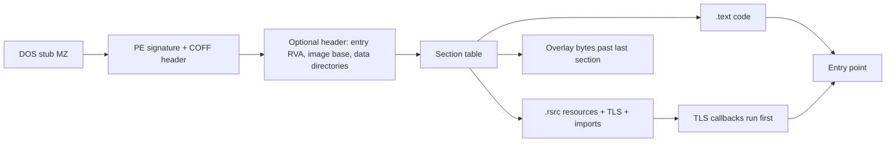
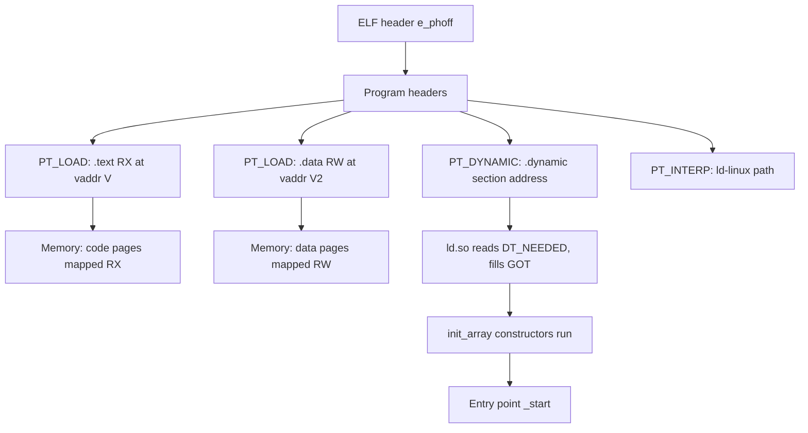

# PE, ELF, and Mach-O Anatomy

> Tags: pe, elf, macho, binary-format, loaders, relocations, tls, packed-binaries | Difficulty: Intermediate | Prerequisites: Linux shell, `file`, `readelf`, `objdump`; optional Python 3.11+

## Overview

Every native executable is one of three container formats. PE on Windows. ELF on Linux and most BSDs and embedded targets. Mach-O on macOS and iOS.

Each format answers two different questions.

1. **What does the loader need?** The minimal metadata that maps bytes to memory and wires up addresses.
2. **What does the analyst need?** Sections, symbols, imports, resources, and metadata the loader ignores.

The second view is where reverse engineering happens. A file can be perfectly valid for the loader and still hide everything from a casual read. Format knowledge tells you which fields are authoritative, which are cosmetic, and which are lies the author wrote on purpose.

This page covers the anatomy of all three formats, the sections-versus-segments split, how imports and relocations work, the format-specific structures that matter (TLS callbacks, .NET metadata, Rich headers, program headers, init_array, load commands, codesign), and what packed files look like at the format level. It ends with how format knowledge changes what you ask an LLM.

## Setup

### Tools that read formats

| Tool | Reads | Notes |
|---|---|---|
| `file`, `readelf`, `objdump` | ELF mostly | binutils. Fast triage. `objdump` also reads PE |
| `llvm-readobj`, `llvm-objdump` | PE, ELF, Mach-O, COFF | Clang tools. Better diagnostics than GNU tools on PE |
| LIEF | PE, ELF, Mach-O, DEX, ART | `pip install lief`. Python API for programmatic format work |
| Detect It Easy (DIE) | PE, ELF, Mach-O | Packer, compiler, and protector signatures |
| Ghidra 12.2 / IDA 9.5 / Binary Ninja 6.0 | all three | Loaders synthesize sections and segments; check them against raw headers |
| pyelftools, pefile, macholib | one each | Small Python parsers. Good for scripts you feed to an agent |

Primary docs: Microsoft Learn for PE (`learn.microsoft.com/en-us/windows/win32/debug/pe-format`), the ELF specification (`refspecs.linuxfoundation.org/elf/elf.pdf`), and Apple documentation plus the `mach-o` sources on opensource.apple.com and github.com/apple-oss-distributions.

## How It Works

### Loader view versus analyst view

The loader needs three things.

1. **A memory map.** Where each blob of file bytes lands in virtual memory, and at what alignment.
2. **A relocation plan.** Which file offsets hold absolute addresses that must be fixed up at load time.
3. **An entry plan.** Where execution starts and which constructors and imports run first.

Everything else is for the analyst, the linker, or the author.

On ELF, program headers define the memory map. Sections are a debug aid. On PE, sections carry both roles and the section table is often edited or faked. On Mach-O, segments hold sections, and the kernel's loader plus dyld cooperate in a way that surprises most analysts: file pages are mapped lazily from the file itself.



### Imports, exports, relocations

**Imports** are the binary's requests for functions it does not contain. Three resolution models exist.

- **Static linking.** No imports. Everything is inside. Rare for malware targets; common for Go, Rust, and musl builds.
- **Dynamic linking through a symbol table.** ELF `.dynsym`/`.dynstr` and Mach-O `LC_SYMTAB` plus `dyld_info`. PE uses the Import Directory with ILT/IAT thunks.
- **Lazy or delayed binding.** PLT/GOT on ELF. `__la_symbol_ptr` and dyld stubs on Mach-O. The import table on PE is usually bound eagerly but can be deferred by malware.

**Exports** are the addresses the binary offers to other modules. DLLs export heavily. Executables rarely do, but malware frequently adds exports to hide names. In ELF, `.dynsym` doubles as the export table.

**Relocations** fix absolute addresses the linker could not know. Types:

- **Relative relocations.** Add the load base to a stored offset. Position-independent code uses these.
- **Absolute relocations.** Rare and dangerous for the author; common in packed code.
- **Copy relocations.** ELF only. The dynamic linker copies a data object from a shared library into the main executable's BSS.

When you read a relocation entry, you know the loader will write an address there. When decompiling, the decompiler already applied that model. If the decompiler shows a constant where a relocation existed, check whether it is a real constant or a fixed-up pointer.

### PE specifics

A PE file starts with the DOS stub, `MZ` magic, and `e_lfanew` pointing to the `PE\0\0` signature. The COFF header declares machine, number of sections, and characteristics such as `IMAGE_FILE_DLL`. The optional header carries the image base, entry point RVA, subsystem, data directories, and the section alignment values.

Analyst-relevant structures:

- **TLS directory.** `IMAGE_DIRECTORY_ENTRY_TLS`. TLS callbacks run before the real entry point. Malware uses them so the main entry looks innocent. Every PE triage must list TLS callbacks. The Ghidra 12.2 release notes mention TLS enforcement as a new feature; check whether the loader now flags them.
- **Resource directory.** `IMAGE_DIRECTORY_ENTRY_RESOURCE`. Holds icons, version info, manifests, and attacker payloads. Look for appended or nested executables, unusual section names in resources, and version strings that contradict the binary.
- **Import directory.** `IMAGE_DIRECTORY_ENTRY_IMPORT`. The IAT is what the code actually calls. Malware clears or empties the import table and resolves APIs at runtime through `LoadLibrary`/`GetProcAddress` hashes or manual PE parsing.
- **Export directory and delay-load directory.** Exports are rare in EXEs but common in DLLs. Delay-loads split imports into a second table malware sometimes misses or analysts forget.
- **.NET metadata directory.** `IMAGE_DIRECTORY_ENTRY_COM_DESCRIPTOR`. Its presence means the file is a .NET assembly, not native code. The CLI header points to metadata streams (`#Strings`, `#US`, `#Blob`, `#GUID`). Native tools like Ghidra decompile the CLR stub, not your C#. Redirect to ilspycmd or dnSpyEx. See `../06-topics/managed-code-re.md`.
- **Rich header.** The data between the DOS stub and the PE signature. It encodes which Microsoft linker objects were linked and their build IDs. It fingerprints the compiler toolchain. Malware sometimes zeroes or forges it. Tool: `richprint` in Didier Stevens' suite, or LIEF's `pe.rich_header`.
- **Overlay.** Bytes after the last section. Installers, self-extractors, and malware stash data there. Compare `file size` against `last section raw end`.

Section names on PE are a hint, not a fact. `.text`, `.data`, `.rsrc` are conventional. Packed or hand-built binaries use names like `. UPX0`, `MPRESS1`, or random strings. A section whose raw size is zero but virtual size is large is a classic packer signal: the loader zero-fills it at runtime.



### ELF specifics

ELF separates two header types. The ELF header at offset zero describes the file. Program headers (`PT_LOAD`, `PT_DYNAMIC`, `PT_INTERP`, `PT_TLS`, `PT_GNU_STACK`, and others) describe the memory image. Section headers describe the file for linkers and debuggers.

The mapping that matters: each `PT_LOAD` segment becomes a contiguous run of memory with `p_vaddr`, `p_offset`, `p_filesz`, and `p_memsz`. If `p_memsz > p_filesz`, the tail is zero-filled BSS. Sections can be reordered or absent in a stripped binary, but program headers cannot be wrong or the loader fails.

Key sections and what to ask about them:

- `.text` — executable code. May be split into `.plt`, `.text`, `.init`, `.fini`.
- `.dynsym` + `.dynstr` — the dynamic symbol table. Names of imported and exported functions. Stripped binaries still have these for shared libraries.
- `.symtab` + `.strtab` — the full symbol table. Gone after `strip`. Presence means unstripped or partially stripped.
- `.dynamic` — `DT_NEEDED` libraries, `DT_RPATH`/`DT_RUNPATH`, `DT_FLAGS`. The RUNPATH is a hijack target.
- `.plt` / `.got` / `.got.plt` — the lazy-binding machinery. `.plt` stubs jump through `.got.plt` entries that the dynamic linker fills on first call. In static analysis, `.plt` calls look like calls to stubs; resolve them through `.rela.plt`.
- `.init_array` / `.fini_array` / `.preinit_array` — constructor and destructor function pointer arrays. `__libc_start_main` runs `.init_array` before `main`. Malware puts constructors here exactly like PE TLS callbacks. Check them first.
- `.eh_frame` — unwind tables. Survives stripping. Ghidra and IDA use it to recover function boundaries on stripped binaries.
- `.comment`, `.note.gnu.build-id` — compiler version and build hash. Useful for toolchain fingerprinting.

Segment-to-memory intuition: read `readelf -lW` and you have the loader's plan. `readelf -SW` gives the file's section map. They overlap but are not the same thing. A section like `.note` may sit in a non-loadable segment.



### Mach-O specifics

A Mach-O file starts with the magic (`0xFEEDFACE`, `0xFEEDFACF` for 64-bit, byte-swapped variants for big-endian and fat). The header is followed by a variable-length list of **load commands**. The load command count is in the header, so the parser knows exactly how many commands to read.

Important load commands:

- `LC_SEGMENT` / `LC_SEGMENT_64` — a segment with a name, vmaddr, vmsize, fileoff, filesize, and a list of sections inside it. `__TEXT`, `__DATA`, `__LINKEDIT` are conventional. `__PAGEZERO` reserves the null page. `__LINKEDIT` holds symbol and code-signature data at the end of the file.
- `LC_SYMTAB` — symbol table offset and count. Local symbols die on strip. Dynamic symbols live in `LC_DYSYMTAB`.
- `LC_DYSYMTAB` — indirect symbol table, which entries the stubs use.
- `LC_LOAD_DYLIB`, `LC_LOAD_WEAK_DYLIB`, `LC_REEXPORT_DYLIB`, `LC_RPATH` — dependencies and search paths. `LC_RPATH` is the hijack vector on macOS.
- `LC_MAIN` — modern entry point. Points to `main` through dyld. Older binaries use `LC_UNIXTHREAD` with a full register state.
- `LC_CODE_SIGNATURE` — offset and size of the embedded CMS signature blob. Verification happens at exec time by `amfid` and the kernel.
- `LC_ENCRYPTION_INFO` / `LC_ENCRYPTION_INFO_64` — FairPlay DRM on App Store binaries. `cryptoff`/`cryptsize` mark the encrypted range. `cryptid` nonzero means encrypted. `frida-ios-dump` and `ipsw` handle this.
- `LC_FUNCTION_STARTS`, `LC_DATA_IN_CODE` — compact function-boundary and data-in-code maps. Survive stripping and help analysis.
- `LC_DYLD_INFO` / `LC_DYLD_INFO_ONLY` — rebases, binds, and exports in a compact format. This is what dyld actually uses for lazy binding on modern binaries.

Sections inside segments follow the `segment,section` naming: `__TEXT,__text`, `__DATA,__data`, `__DATA_CONST,__const`. Analysts and tools index by both parts.

**Codesign.** The signature is a CMS blob appended in `__LINKEDIT`. It covers pages of the binary by hash. Any byte change invalidates it. For analysis this means: stripping or patching requires re-signing (`codesign -s -` on macOS) or the kernel refuses to load the binary on arm64. On macOS analysis VMs, ad-hoc re-signing is routine. `codesign -dv --verbose=4` and `codesign -d --entitlements` extract the signature and entitlements. Entitlements are a plist inside the signature and often reveal capabilities the binary claims.

**Universal binaries.** A fat binary has magic `0xCAFEBABE` (or `0xBEBAFECA` byte-swapped) followed by `nfat_arch` records, each with a CPU type, subtype, offset, size, and alignment. `lipo -info` lists slices; `lipo -thin arm64` extracts one. Ghidra and IDA import fat binaries and let you pick a slice. For AI work, always name which slice you are feeding the model. arm64 and x86_64 slices of the same binary decompile differently and produce different pseudocode.

### Packed versus normal layout signals

Packing is a format-level signal before it is a behavior signal. Look for:

| Signal | Normal binary | Packed binary |
|---|---|---|
| Entry point | Inside `.text` or `__TEXT,__text` | In a small stub section or the last section |
| Section count | 5–15 typical | Few huge sections, or one section named `UPX0`/`.vmp` |
| Section raw vs virtual size | Roughly equal | Raw size near zero, virtual size huge |
| Import table | Names resolved DLLs/functions | Tiny or empty. One or two suspicious imports |
| Entropy | Code ~6, data varies | One section near 8.0 across the board |
| TLS/ctors/init_array | Few entries | Many, or an entry that jumps to the unpacker |
| Overlay | Small or none | Large appended blob |
| Rich header / build-id | Present and consistent | Zeroed, forged, or inconsistent with claimed compiler |

A normal binary's entry point calls `main` through `__libc_start_main` (ELF) or `WinMainCRTStartup` (PE). A packed binary's entry point calls `VirtualAlloc`, `VirtualProtect`, or `mmap`, then a loop that XORs or decompresses bytes into the allocated region, then jumps to it. The unpacked code never exists on disk, only in memory.

Detection tools: DIE signatures, `peframe`, `pestudio` for PE, `binwalk -E` for entropy graphs, and `upx -t` for UPX specifically. capa rules catch packer behaviors too.

## Step-by-Step

### First look at any binary

1. Identify format and architecture.

```bash
file target.bin
```

2. For ELF, get program headers, dynamic section, and symbols.

```bash
readelf -hW target.bin        # ELF header
readelf -lW target.bin        # program headers, the memory map
readelf -dW target.bin        # dynamic section: NEEDED, RUNPATH, FLAGS
readelf -sW target.bin        # symbols (dynsym always, symtab if unstripped)
readelf -x .init_array target.bin 2>/dev/null || true
```

3. For PE on Linux, use `objdump` or LIEF. Install `pefile` for Python work.

```bash
objdump -x target.exe         # headers, imports, sections
pip install pefile
python3 -c "import pefile; pe=pefile.PE('target.exe'); print(pe.dump_info())" | head -100
```

4. For Mach-O on Linux, LIEF is the practical choice.

```bash
pip install lief
python3 - <<'EOF'
import lief
b = lief.parse("target.bin")
print(b)
for s in b.segments:
    print(s.name, hex(s.virtual_address), s.virtual_size)
for c in b.commands:
    print(type(c).__name__)
EOF
```

5. Check packing signals.

```bash
python3 -c "import lief; b=lief.parse('target.bin'); print([ (s.name, s.sizeof_raw_data, s.virtual_size) for s in b.sections ])"
diec target.bin               # Detect It Easy CLI, if installed
```

6. Feed the format facts to the LLM as a structured preamble. Do not paste raw hex. Write a short document: format, arch, entry point, sections with sizes, imports, TLS callbacks, init_array entries, suspicious overlays.

### Asking the LLM the right questions

Format knowledge changes the prompt in three ways.

**Name the right structure.** "What does the TLS callback at RVA 0x140001000 do?" is answerable. "What does the binary do at startup?" gets a guess that misses the callback. Same for "which functions are in `.init_array`" versus "what runs before main."

**Ask about relocations, not addresses.** A decompiler shows fixed-up addresses. Ask "which GOT entries does this function resolve through PLT stub 0x401050" instead of "what is at 0x401050." The second question invites the model to treat a PLT stub as a real function.

**Demand section evidence.** When the model claims a function is malicious, ask which section it lives in and whether that section is executable. A claim about code in `.rdata` is a red flag for hallucination.

A good preamble looks like:

```text
Format: PE32+ x86-64, image base 0x140000000
Entry point: RVA 0x1A40 (in .text)
TLS callbacks: 1, at RVA 0x1800 (in .text, before entry)
Sections: .text (RX, 0x400-0x12000), .rdata (R, 0x12000-0x18000), .data (RW), .rsrc
Imports: kernel32!VirtualAlloc, kernel32!CreateFileW, ws2_32!connect, ...
Overlay: 0 bytes. Rich header present.
```

### Worked example: triage a suspicious PE

1. `file` says `PE32+ executable for MS Windows, x86-64`.
2. `objdump -x` shows one TLS callback and an import table with only `LoadLibraryA` and `GetProcAddress`.
3. Section table shows `.text` raw size 0x200, virtual size 0x8000. That mismatch is the packer signal.
4. The Rich header names `Microsoft Visual C++ 2019` but the section layout does not match a normal MSVC build.
5. Feed the preamble to the model. Ask it to decompile only the TLS callback and the section that has nonzero raw data. Do not ask about the empty `.text`.
6. After dumping the real code from memory (see `../03-decomp/triage-and-mapping.md` and `../07-advanced/anti-analysis.md`), re-run the preamble with the unpacked image.

## Pitfalls

- **Sections are not memory.** On ELF, section headers can be absent or wrong after `strip --strip-all` variants. Program headers are authoritative. On PE, section raw data can be encrypted while virtual data is what runs.
- **The import table is not the truth.** Malware resolves APIs dynamically. An empty IAT means "resolve at runtime," not "no imports." Check for `GetProcAddress`, hash-based resolution loops, or manual export-table walking.
- **TLS callbacks and init_array are invisible in `main`.** Both formats have pre-entry hooks. A decompiler that starts at the PE entry point or ELF `_start` misses them. List them explicitly before decompiling.
- **The .NET directory changes everything.** If `IMAGE_DIRECTORY_ENTRY_COM_DESCRIPTOR` is nonzero, the file is managed. Native analysis of the CLR stub produces plausible-looking garbage. Switch to ILSpy or dnSpyEx.
- **Fat binaries have two personalities.** Analyzing the wrong slice wastes tokens. Always record `lipo -info` output and the chosen slice.
- **Codesign lies by omission.** An ad-hoc signature (`codesign -s -`) proves nothing about origin. A valid signature from an unknown team ID is still suspicious. Entitlements are self-declared.
- **The Rich header can be forged.** It records link-time objects, but a determined author can write arbitrary values. Treat it as a hint, not proof.
- **Stripped is not unanalyzable.** `.eh_frame` on ELF and `LC_FUNCTION_STARTS` on Mach-O recover function boundaries. Ghidra and IDA do this automatically. Ask the model about function boundaries, not symbol names.
- **Overlay bytes are easy to miss.** `file` reports the PE/ELF size, not the last section end. Compare them. An overlay can hide a second payload or config.
- **Endianness and bitness.** Mach-O fat headers, ELF `EI_DATA`, and PE `Machine` field all encode this. A 32-bit ELF on x86-64 is a different target. State it in the preamble.

## See Also

- `../03-decomp/triage-and-mapping.md` — turning format facts into a function map
- `../03-decomp/decompile-workflow.md` — the decompile loop after triage
- `../03-decomp/verification-loop.md` — verifying claims the model makes about sections and imports
- `../06-topics/managed-code-re.md` — .NET metadata and ILSpy workflow
- `../06-topics/apple-ios-re.md` — Mach-O, dyld caches, FairPlay, Frida
- `../06-topics/mobile-android-re.md` — DEX and APK, the fourth major format
- `../06-topics/deobfuscation.md` — packed and obfuscated binaries
- `../07-advanced/anti-analysis.md` — anti-dump and TLS callback evasion
- `../05-tools/tool-catalog.md` — which decompiler to pair with which format
