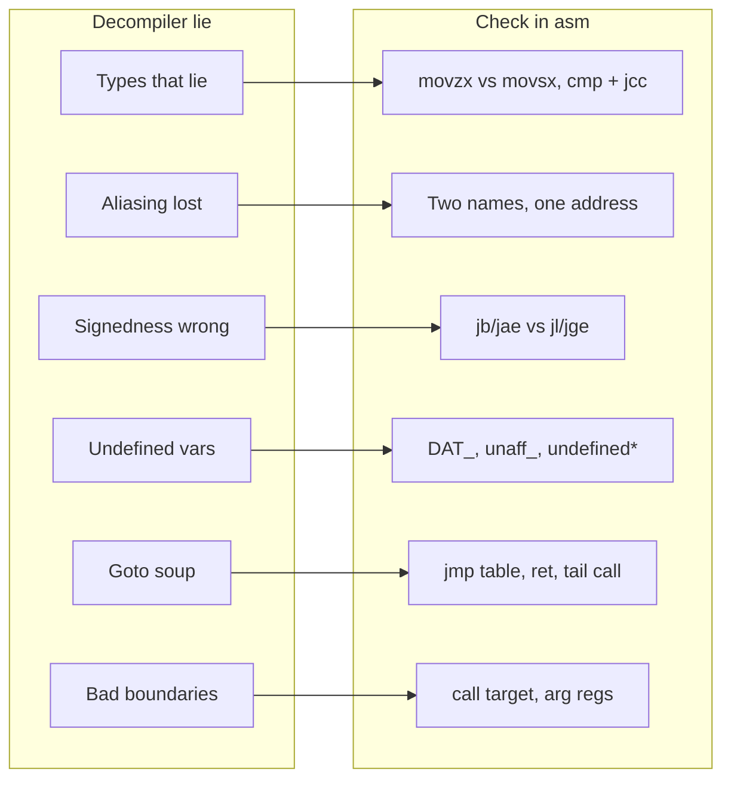
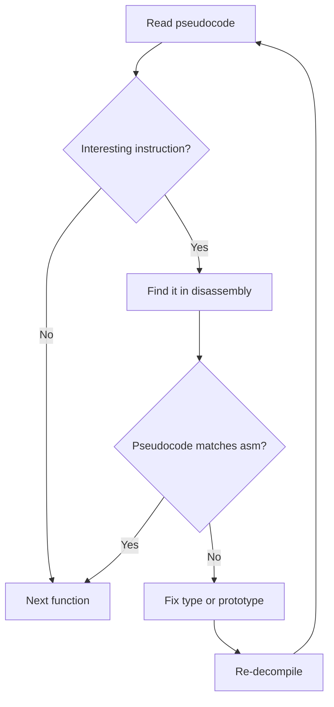

# Reading Decompiler Pseudocode Critically

> Tags: decompilation, pseudocode, ghidra, ida, binary-ninja, verification, types, signedness | Difficulty: Intermediate | Prerequisites: Basic assembly reading, one decompiler open on a real binary (Ghidra 12.2, IDA 9.5, or Binary Ninja 6.0), willingness to look at raw disassembly

## Overview

Decompiler pseudocode is a hypothesis, not a fact.

Ghidra, IDA's Hex-Rays engine, and Binary Ninja all convert machine code into C-like text. The output reads like C. It is not C. Every decompiler guesses at types, aliasing, control flow, and data layout. The guesses are often wrong in ways that look plausible.

The NDSS 2026 study "Decompiling the Synergy" found that decompiler output degrades sharply above roughly 40 lines of code and that LLM-assisted reads can amplify confidence without adding correctness. The DecompileBench paper (arXiv:2505.11340) measured LLMs as more readable than decompilers but trailing by about 52.2 percent on correctness. Both results are reported from the source papers.

Your job is to read the pseudocode and keep asking: where did the decompiler guess? Pseudocode is a map with invented roads. Check the terrain before you drive on it.

This page covers the six error classes decompilers get wrong most often, the verification habits that catch them, the red flags specific to LLM-written pseudocode, a personal "known-wrong" list format, and exercises for building the skill.

## How It Works

### The six classic error classes

Every decompiler makes these mistakes. Learn the shapes and you will spot them in seconds.

#### 1. Types that lie

The decompiler invents a type to make the code look clean. The type is often wrong.

- A 32-bit register moved into a pointer slot becomes `void *` or a `char *` by default.
- A size field compared against a constant becomes `int` even when the binary uses unsigned wrap-around.
- A struct member accessed at offset `0x10` may really be a different struct's member, an array element, or raw bytes.
- Ghidra shows unresolved data as `DAT_00123456`, `undefined1`, or `uRam00000000`. These are placeholders, not types.
- IDA uses `dword_`, `qword_`, `byte_`, `unk_`, and `off_` prefixes. `dword_` means 4 bytes were seen. It does not mean the field is a signed 32-bit integer.

Rule: treat every pointer cast and every struct field name as a guess until you verify it against the assembly.

#### 2. Aliasing the decompiler cannot see

The decompiler assumes distinct names mean distinct storage. The machine code does not.

- Two "different" stack slots can overlap because the compiler reused the frame after a scope ended.
- A pointer stored to the stack can alias a local the decompiler still treats as a separate variable.
- `*(int *)(param_1 + 8)` and a named struct field `s.field_8` may be the same memory. The decompiler picks one spelling and drops the other.
- Register parameters are often spilled to the stack and then read back through a different alias.

Look for: writes through one name followed by reads through another name that the decompiler did not connect. The connection exists in the machine code. The decompiler lost it.

#### 3. Integer width and signedness

This is the most common source of wrong conclusions.

- `cmp eax, 0x10; jb` is unsigned "below." The decompiler may print `if (a < 0x10)` which reads as signed. Check the jump: `jb/jae` is unsigned, `jl/jge` is signed.
- `movzx` means zero-extend. `movsx` means sign-extend. The decompiler usually gets this right, but it will not warn you when the choice matters.
- A 64-bit comparison on a value the decompiler typed as `int` silently truncates.
- Division and modulo on signed values emit extra instructions for sign correction. If the pseudocode shows a plain `/` on a value that could be negative, check whether the decompiler modeled it correctly.

When the pseudocode decides a branch on a comparison, always look at the actual conditional jump in the disassembly and read its mnemonic.

#### 4. Uninitialized or undefined variables

Decompilers emit placeholders for data they cannot resolve:

- Ghidra: `undefined1`, `undefined4`, `in_FS_OFFSET`, `DAT_`, `s_` string pointers into unknown regions.
- IDA: `unk_`, `asc_`, `off_`, `aAbcd` string labels.
- Binary Ninja: `data_`, `string_`, unnamed globals.

A variable named `unaff_RBX` in Hex-Rays output means "the function uses RBX but the decompiler could not prove it is a parameter or a saved register." It is a warning, not a name.

Ghidra's `in_FS_OFFSET` is a real thing: it marks accesses through the TLS base on Windows x64. Do not "fix" it into a normal pointer without checking.

#### 5. Control flow that becomes goto soup

Optimized code has irreducible control flow, computed jumps, exception tables, and tail calls. Decompilers respond with `goto`, labels, and `do { } while (0)` blocks.

- Ghidra produces `goto LAB_xxxx` chains and `switch` statements with `goto` inside the cases.
- Hex-Rays produces `goto LABEL_x`, `__PAIR__`, and odd `do-while` wrappers.
- Binary Ninja's HLIL is cleaner but still emits `goto` for switch fallthrough and indirect jumps.

A `goto` in pseudocode is not a bug in the binary. It is the decompiler admitting it could not structure the flow. Before you trust the logic, look at the CFG or the raw assembly.

#### 6. Function boundaries and calling conventions

- A function that tail-calls another may be shown as a call plus return, or the callee may be inlined into the caller's pseudocode.
- The decompiler may split one logical function into two because a basic block was unreachable from its own analysis.
- Calling convention recovery is heuristic. On x86-64 Windows, the first four integer args are RCX, RDX, R8, R9. On System V, they are RDI, RSI, RDX, RCX, R8, R9. Get this wrong and every argument name is wrong.
- On ARM64, X0-X7 are argument registers. Ghidra sometimes treats them as scratch.

If the pseudocode signature looks wrong, fix the prototype in the decompiler and re-decompile. The signature is an input, not an output.

### What each decompiler is bad at

| Decompiler | Strength | Weakness |
|---|---|---|
| Ghidra 12.2 | Broad ISA coverage, free, PyGhidra scripting | Verbose output, `goto` heavy, slow analysis on large binaries |
| IDA Pro 9.5 (Hex-Rays) | Clean pseudocode, mature type system, FLIRT signatures | Proprietary, expensive, opaque predicates handled variably |
| Binary Ninja 6.0 | Fast analysis, HLIL/MLIL/LLIL layers, clean API | Smaller community, some type recovery quirks |
| radare2 6.2.4 / rizin 0.9.1 | CLI-native, scriptable, free | Pseudocode quality trails Ghidra and IDA |

The weakness column matters more than the strength column for verification work. Know what your tool gets wrong before you read its output.

This is the map from error class to assembly signature:



### The verification habit

For every non-trivial function, run this check:

1. Read the pseudocode once for the general idea.
2. Find the "interesting" instruction. It is usually a comparison, a memory write, a call to an import, or a bit test.
3. Locate that instruction in the disassembly. In Ghidra, press `;` or use the listing. In IDA, press `F5` then click through to the asm. In Binary Ninja, switch to the disassembly view.
4. Confirm the decompiler's claim matches the machine code. Check the operand size, the signedness, the address.
5. If it does not match, fix the type or the prototype in the decompiler and re-decompile.

This habit takes about 30 seconds per function. It catches most type and signedness errors.

The habit is a decision loop:



## Step-by-Step

### Step 1: Build your known-wrong list

Keep a file per decompiler version. Add an entry every time you find a decompiler lie.

Format:

```markdown
## Ghidra 12.2 — known-wrong

- Symptom: `if (param_1 < 0)` shown for `cmp eax, 0; jb`
  Real meaning: unsigned below, so the branch is `param_1 < 0` only if param_1 is signed and the comparison is `jl`
  Fix: check jump mnemonic, apply correct type, re-decompile

- Symptom: `unaff_RBX` used without declaration
  Real meaning: RBX holds a value from the caller or is a callee-saved register
  Fix: rename to a meaningful name, mark as parameter or local

- Symptom: `do { } while(0)` wrapping a switch
  Real meaning: decompiler could not recover the CFG
  Fix: read the CFG view, or check the raw assembly for the jump table
```

Start with the entries above. Add your own as you work. After a month the list will be the most valuable document you own.

### Step 2: Check callers before you trust a function

A function's pseudocode depends on its prototype. The prototype depends on its callers.

- If a function takes a pointer, find one caller and check whether the caller passes a pointer to a struct, an array, or raw bytes.
- If a function returns a value, find one caller and check whether the return is used as a pointer, an int, or a status code.
- If a function is variadic, the decompiler may guess wrong. Check the call sites for the number of arguments.

Cross-references are your ground truth. The pseudocode is the story. The xrefs are the evidence.

### Step 3: Check xrefs for the interesting instruction

When you find an instruction that matters — a call to `CreateFile`, a write to a license flag, a comparison against a magic value — do not stop at the function. Check who calls it and who reads the result.

In Ghidra: right-click the function, "References → Show References to Address."
In IDA: press `X` on the function name.
In Binary Ninja: the xrefs panel on the right.

If the pseudocode says `IsLicensed()` returns a bool, but the caller checks `if (result == 1)`, the decompiler may have typed the return as `bool` when it is really an `int` with multiple states.

### Step 4: Fix the type, re-decompile, compare

Most type errors are fixable in seconds.

- Ghidra: Window → Data Type Manager. Or right-click a variable → Edit Data Type.
- IDA: Local Types window (`Shift+F1`). Or press `Y` on a variable.
- Binary Nitro: Types view on the right.

Change the type, re-decompile the function (`F5` in IDA, right-click → Decompile in Ghidra), and compare. If the pseudocode changes meaningfully, the original type was wrong.

### Step 5: Audit LLM-written pseudocode specifically

When an agent rewrites pseudocode into "clean" C, it adds new errors. The decompiler's lies are honest. The LLM's lies are confident.

Red flags in LLM output:

- **Invented names.** The LLM names a variable `licenseKey` because the context suggests it. The binary has no such name. Check every name against the decompiler's original output.
- **Invented logic.** The LLM "simplifies" a loop and drops a bounds check. Or it adds a null check the binary never had. Diff the LLM's version against the original pseudocode line by line.
- **Wrong API calls.** The LLM writes `memcpy` where the binary calls `strncpy`, or `malloc` where the binary calls `calloc`. Check every external call against the import table.
- **Fabricated comments.** The LLM writes "// check license" on a line that does something else. The comment is not evidence.
- **Over-cleaned control flow.** The LLM removes `goto` and presents structured code. If the original had `goto`, the structure was probably wrong.
- **Missing side effects.** The LLM drops a global write or a register clobber because it "looks like" a local operation.

Rule: LLM pseudocode is a second decompiler, not ground truth. Treat it like Ghidra output from a tool you do not trust yet.

### Step 6: Exercises

Do these on a binary you know well. A crackme or a small open-source tool compiled with `-O2` is ideal.

1. **Signedness hunt.** Find five conditional jumps in the disassembly. For each, write down whether it is signed or unsigned. Then find the corresponding line in the pseudocode. Does the pseudocode match?
2. **Type recovery.** Pick a function that takes a pointer. Change the parameter type in the decompiler to `char *` and re-decompile. What changes? Now try `void *`. What changes? Which type produces the most sensible pseudocode?
3. **Alias hunt.** Find a function with a local array and a pointer write into it. Check whether the decompiler treats the array and the pointer target as separate variables. If it does, the alias is real.
4. **Goto analysis.** Find a function with `goto` in the pseudocode. Open the CFG view. Can you draw the control flow as structured code? If not, the `goto` is honest.
5. **LLM audit.** Take a function, paste the decompiler output into an LLM, and ask it to "clean up" the pseudocode. Then diff the LLM output against the original. Count the invented names, dropped checks, and wrong calls.
6. **Boundary check.** Find a function that calls another function. Check the callee's prototype against the call site. Does the decompiler agree?

## Pitfalls

- **Do not trust the decompiler's names.** `sub_401000` is not a name. `FUN_00100040` is not a name. `DAT_00405000` is not a name. Names are placeholders.
- **Do not trust the decompiler's types.** A `char *` might be a `struct *`. An `int` might be an `enum`. A `bool` might be a `DWORD`.
- **Do not trust the decompiler's control flow.** `goto` means "I could not structure this." It does not mean "the binary is weird."
- **Do not trust the decompiler's string recovery.** A string shown as `"password"` might be encrypted, obfuscated, or assembled byte by byte. Check the bytes.
- **Do not trust LLM "improvements."** An LLM that rewrites pseudocode is a second decompiler with different bugs. Diff everything.
- **Do not skip the assembly for the interesting instruction.** If the pseudocode says `if (x == 0xDEADBEEF)`, find the `cmp` in the disassembly and check the operand size.
- **Do not assume the decompiler version you used last month is the same today.** Ghidra 12.2 fixed bugs that 11.x had. IDA 9.5 added new decompilers. Update your known-wrong list when you update the tool.
- **Do not let the decompiler's confidence fool you.** Pseudocode that looks clean is not necessarily correct. Clean output is what the decompiler produces when it has no better idea.

## See Also

- [Verification Loop](../03-decomp/verification-loop.md) — the deterministic check that decides whether a claim is true
- [Triage and Mapping](../03-decomp/triage-and-mapping.md) — how to find the functions worth reading carefully
- [Decompile Workflow](../03-decomp/decompile-workflow.md) — the human+AI loop this page feeds into
- [Context Engineering](../02-collab/context-engineering.md) — how to chunk decompilation for LLM consumption
- [Tool Catalog](../05-tools/tool-catalog.md) — decompiler versions and capabilities
- [Deobfuscation](../06-topics/deobfuscation.md) — when the pseudocode is wrong because the binary is wrong
- [Real-World Recipes](../08-case-studies/real-world-recipes.md) — end-to-end examples of this workflow
