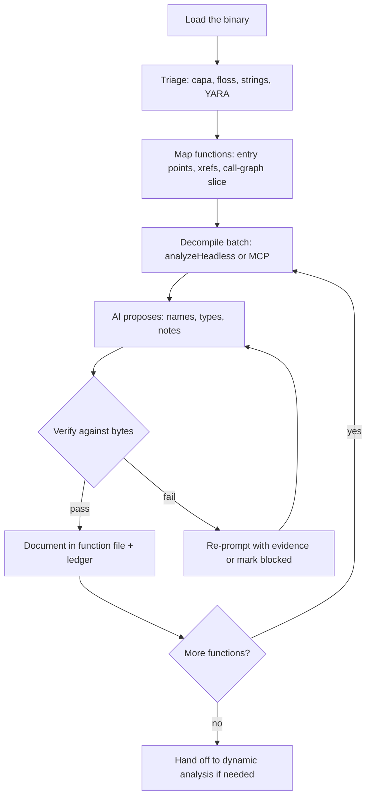

# Decompiling a Binary Piece by Piece: The Human+AI Loop

> Tags: decompilation, ghidra, ida-pro, binary-ninja, mcp, batch-analysis | Difficulty: Intermediate | Prerequisites: one working decompiler bridge (see `../05-tools/mcp-catalog.md`) and basic binary-format knowledge

## Overview

This page describes a repeatable loop for decompiling a binary with AI assistance.
The loop works in Ghidra, IDA Pro, and Binary Ninja.
The human drives. The model proposes names, types, and explanations.
Deterministic tools verify every proposal.

The canonical loop has seven stages:



1. Load the binary.
2. Triage the binary.
3. Map the functions.
4. Decompile in batches.
5. Let the AI name functions and recover types.
6. Verify each proposal against the bytes.
7. Document what you learn.

You repeat the loop once per function or once per batch.
The output is a folder of per-function notes plus an evidence ledger.
The ledger survives context compaction.

Why this works:

- LLMs degrade above about 40 lines of code (NDSS 2026 study "Decompiling the Synergy"). Small functions survive the degradation.
- Naming is the task where AI helps most. LLM rename accuracy was 85 percent versus 66 percent for humans on known algorithms, but only 57 percent versus 65 percent overall. Names are plausible, not verified.
- Open-ended prompts fail. "Find the vulnerability" produced hallucinated answers and wasted time in measured studies.
- Half of cited functions in agent RE reports were wrong in a SentinelOne measurement. Verify every claim.

## Setup

Pick one decompiler. Do not run three decompilers on the same binary until the first pass finishes.

### Option A: Ghidra 12.2 headless

Ghidra 12.2 is current as of October 2026. It needs Java 21.
Set a larger heap for big binaries:

```bash
export GHIDRA_HEADLESS_MAXMEM=8G
export GHIDRA_HOME=/opt/ghidra_12.2_PUBLIC
```

Create the project and import the binary once:

```bash
$GHIDRA_HOME/support/analyzeHeadless ~/re-projects malware-sample1 \
  -import /path/to/sample.exe \
  -analysisTimeoutPerFile 3600 \
  -postScript ExportFunctions.java
```

`analyzeHeadless` arguments, in order:

- Project location directory.
- Project name.
- `-import <file>` to import a new binary, or `-process <name>` to reopen an existing one.
- `-postScript <script>` to run an analyzer script after auto-analysis.
- `-scriptPath <dir>` for your own scripts.
- `-deleteProject` to remove the project after the run.

Write `ExportFunctions.java` as a `GhidraScript` that iterates `currentProgram.getFunctionManager().getFunctions(true)`, decompiles each with `DecompInterface`, and writes one file per function.

### Option B: Ghidra plus MCP

For interactive sessions, run a Ghidra MCP server and connect your agent.
Current candidates:

| Server | Repo | Note |
|---|---|---|
| LaurieWired/GhidraMCP | github.com/LaurieWired/GhidraMCP | Original server. v2.0 added headless PyGhidra mode. Requires Ghidra 12.1.4 |
| bethington/ghidra-mcp | github.com/bethington/ghidra-mcp | About 219 tools. GUI plus headless. Java 21 and Ghidra 12.1.4 |
| cyberkaida/reverse-engineering-assistant | github.com/cyberkaida/reverse-engineering-assistant | ReVa. Deliberately small tool surface to fight hallucination |
| symgraph/GhidrAssistMCP | github.com/symgraph/GhidrAssistMCP | Native Java MCP. Headless analyzeHeadless mode |
| mrphrazer/ghidra-headless-mcp | github.com/mrphrazer/ghidra-headless-mcp | Headless only. Read-only default |

Install example for LaurieWired/GhidraMCP:

```bash
uvx --from git+https://github.com/LaurieWired/GhidraMCP ghidra-mcp
```

In the agent harness (Claude Code, Codex, or another MCP client), register the server in the MCP config. Keep the transport on stdio or loopback. Do not expose the HTTP transport without authentication.

### Option C: IDA Pro 9.5

IDA 9.5 is current as of October 2026. The official Hex-Rays IDA MCP was announced in September 2026.

Install:

```bash
uvx ida-hcli mcp install
```

Requirements: IDA 9.4 or later with idalib, Python 3.11 or later.
The official server uses "code mode." It exposes only a few tools such as `open_database` and `execute_python`.
The agent writes IDAPython instead of calling hundreds of per-operation tools. Hex-Rays claims about 20 percent fewer tokens on an internal benchmark. This is a vendor claim. Treat it as unverified.

For batch work, `idalib` workers run headless. No GUI is needed.
Alternative headless servers:

| Server | Repo | Note |
|---|---|---|
| blacktop/ida-mcp-rs | github.com/blacktop/ida-mcp-rs | Rust headless IDA MCP. Lean profile. Tracks IDA 9.5 |
| mrexodia/ida-pro-mcp | github.com/mrexodia/ida-pro-mcp | Community server. Now recommends the official one |
| trailofbits/idac | github.com/trailofbits/idac | IDA CLI for agents. JSON output. Alpha status |

### Option D: Binary Ninja 6.0

Binary Ninja 6.0 "Krypton" shipped in September 2026 with a native MCP server.
Two variants exist:

- GUI server inside the app over HTTP. All editions including free. Default `http://127.0.0.1:24642/mcp` with a bearer token.
- Headless `binaryninja_mcp` over stdio. Commercial and Ultimate editions. macOS and Linux only.

The GUI server exposes disassembly, Pseudo C (HLIL), MLIL, LLIL, function metadata, types, and memory reads.
Docs: https://docs.binary.ninja/guide/mcp.html

For scripted batch export without MCP, use the Binary Ninja Python API (`binaryninja` module) in a headless script. Iterate `bv.functions`, call `func.hlil` or the decompiler, and write files.
Sidekick (`sidekick.api`) offers a managed agent layer with a transaction log where every edit is revertable. It is a commercial product. Pricing is not verified here.

## Usage

### The per-function loop

Work on one function at a time. A function under about 40 lines of pseudocode is the safe unit.

1. Decompile the function. Save the pseudocode.
2. Send the pseudocode plus context to the model. Give the context explicitly: caller names, string references, import calls, struct guesses.
3. Ask for bounded outputs only:
   - Propose a function name.
   - Propose parameter and variable names.
   - Propose C types and struct layouts.
   - Explain the control flow in three sentences.
   - Flag constants that look like magic numbers.
4. Verify each proposal. See the verification section below.
5. Write the verified result into the output folder.
6. Update the evidence ledger.

Prompt template for naming:

```text
You are naming one function in a stripped PE binary.

Function address: 0x4012F0
Decompiler: Ghidra 12.2
Callers: FUN_00401000, FUN_00401180
Strings referenced: "Software\\Microsoft\\Windows\\CurrentVersion\\Run"
Imports called: RegOpenKeyExA, RegSetValueExA

Pseudocode:
<paste decompiled C here>

Return JSON only:
{"name": "snake_case_name", "confidence": 0.0-1.0,
 "evidence": ["list of concrete observations"],
 "uncertainties": ["what you could not determine"]}
```

Rules for the prompt:

- Paste pseudocode, not raw assembly. Feed the decompiler output to the LLM.
- Include at most 3 callers and 5 strings. More context causes greedy fetching.
- Demand evidence for every claim. An answer without evidence is a guess.
- Ask for JSON. Structured output is easier to verify mechanically.

### Batch decompilation

For large binaries, do not paste 5,000 functions into one prompt.
Export all functions first, then process in batches of 20 to 50 functions.

Batch workflow with Ghidra headless:

```bash
$GHIDRA_HOME/support/analyzeHeadless ~/re-projects sample \
  -process sample.exe \
  -postScript ExportFunctions.java \
  -scriptPath ~/re-scripts
```

`ExportFunctions.java` writes `out/functions/<addr>_<name>.c` per function plus `out/index.tsv` with columns: address, name, size, callers, callees, strings.

Then run the agent over `out/functions/` in batches. A small script can split the batch and call the model API, or the agent harness can read the files directly.

For IDA, use `idalib` in a Python script or the `ida-mcp` code mode where the agent writes IDAPython such as:

```python
import idautils, ida_hexrays, ida_funcs
for ea in idautils.Functions():
    f = ida_funcs.get_func(ea)
    c = ida_hexrays.decompile(f)
    open(f"out/{ea:x}.c", "w").write(str(c))
```

For Binary Ninja headless, the Python API gives the same shape:

```python
import binaryninja as bn
bv = bn.load("/path/to/binary")
for func in bv.functions:
    hlil = func.hlil
    open(f"out/{func.start:x}.hlil.c", "w").write(str(hlil))
```

### Verification per proposal

Every AI proposal gets one of three verdicts: VERIFIED, REFUTED, or INCONCLUSIVE.
This mirrors the reverify tool (github.com/2akouwu/reverify), which returns exactly these verdicts for LLM claims about a binary.

Verification actions, cheapest first:

| Claim type | Verification action |
|---|---|
| Function name | Check strings, imports, constants, and callers. Does the name match observed behavior? |
| Variable type | Check how the decompiler uses it. Check struct field offsets. |
| "This is crypto" | Identify the constants. AES S-boxes, SHA constants, RC4 patterns are recognizable. |
| "This parses X format" | Find the magic bytes or field offsets in the code. |
| Control-flow claim | Re-read the pseudocode. Check the CFG in the tool. |
| Any address or string claim | Re-derive it from the binary with a deterministic tool. The re-ground tool (github.com/shouvikkkk/re-ground) does this pattern. |

Write the verdict into the ledger. Never promote an unverified claim into the notes as fact.

## Organizing Output

Two layouts work. Pick one per project and stay consistent.

### Layout A: one markdown file per function

```
analysis/
  index.md                 # progress checklist and stats
  functions/
    00401000_FUN_00401000.md
    004012F0_reg_write_run_key.md
  evidence/
    ledger.tsv             # every claim and its verdict
    batch1-prompts.md      # what you sent the model
  notes/
    overview.md            # architecture summary
    protocols.md           # cross-function findings
```

Each function file uses a fixed template:

```markdown
# 0x004012F0 — reg_write_run_key

- Address: 0x004012F0
- Size: 0x120 bytes
- Callers: FUN_00401000, FUN_00401180
- Status: verified | partial | blocked

## Pseudocode
<paste or link to .c file>

## AI proposals
| Item | Proposal | Verdict | Evidence |
|---|---|---|---|
| name | reg_write_run_key | verified | writes to HKCU\\...\\Run via RegSetValueExA |
| param1 | hKey | verified | passed to RegSetValueExA as first arg |
| local_8 | valueName | inconclusive | plausible but unproven |

## Notes
<your own observations>
```

Why markdown: it diffs cleanly in git, reads well in any editor, and the agent harness can read it directly.

### Layout B: SQLite evidence store

Use SQLite when the binary is large or when multiple sessions write results.
ProtoForge (github.com/cy3erm/ProtoForge) uses a SQLite evidence store for protocol RE. The same pattern fits function-level work.

```sql
CREATE TABLE functions (
  addr TEXT PRIMARY KEY,
  name TEXT,
  size INTEGER,
  status TEXT,          -- pending|named|typed|verified|blocked
  pseudocode_path TEXT,
  session TEXT,
  updated_at TEXT
);

CREATE TABLE claims (
  id INTEGER PRIMARY KEY AUTOINCREMENT,
  func_addr TEXT,
  claim_type TEXT,      -- name|type|behavior|constant
  claim_text TEXT,
  verdict TEXT,         -- verified|refuted|inconclusive
  evidence TEXT,        -- address, string, or tool output
  model TEXT,
  created_at TEXT
);
```

Export pseudocode to files anyway. Keep SQLite for claims and status. Markdown for human reading.

### Evidence ledger

The ledger is the most important file in the project.
It must survive context compaction and session restarts.

Minimum columns in `ledger.tsv`:

```text
func_addr	claim_type	claim	verdict	evidence	session	date
0x4012F0	name	reg_write_run_key	verified	RegSetValueExA on HKCU Run key	2026-11-05	s1
0x4012F0	type	param2_is_wchar	refuted	call passes DWORD not pointer	s1	2026-11-05
```

Rules:

- One row per claim. Never edit a verdict. Add a new row that supersedes it.
- Evidence must point to something checkable: an address, a string, a tool output, a byte offset.
- A claim with no evidence is INCONCLUSIVE by definition.

## Tracking Progress Across Sessions

Long binaries span many sessions. Context compaction loses working state. The SentinelLABS study found compaction cut input tokens by about 86 percent but degraded recovery of higher-level objects.

Mitigations that work:

1. Keep the ledger outside the model context. Write it to disk after every batch.
2. Keep a checklist in `index.md`. Update it at the end of every session.
3. Write a `session-log.md` entry before you stop. Record what you did, what failed, and what is next.
4. On session start, read `index.md` and `ledger.tsv` first. Do not re-derive state from memory.
5. Use VerifiedIDA (github.com/SentineLabs/verified-ida) if you work in IDA. It anchors annotations to evidence and keeps a ledger that survives compaction.

Checklist template for `index.md`:

```markdown
# Analysis progress — sample.exe

Binary: sample.exe (PE32+, x64, 412 KB, stripped)
Started: 2026-11-05
Tool: Ghidra 12.2 + ghidra-mcp
Model: Claude Opus 4.8 via Claude Code

## Stats
- Functions total: 1,847
- Functions decompiled: 312
- Functions named: 98
- Functions verified: 41
- Blocked: 7 (VMProtect sections, see notes/vm.md)

## Phase status
- [x] Load and auto-analyze
- [x] Triage (imports, strings, sections)
- [x] Export all functions to out/functions/
- [ ] Name functions in .text (batch 1-6 done, 7-40 pending)
- [ ] Recover struct types for network functions
- [ ] Map the C2 protocol
- [ ] Document findings

## Session log
- 2026-11-05 s1: exported functions, named 98, verified 41. Next: batch 7.
```

Session-start prompt for the agent:

```text
Read index.md and evidence/ledger.tsv in the current directory.
Summarize progress in 5 bullets.
Then continue with the next pending batch in functions/.
Do not re-analyze functions already marked verified in the ledger.
```

## When to Stop and Hand Off to Dynamic Analysis

Static decompilation has a ceiling. Stop the static loop and switch to dynamic tools when any of these conditions hold:

| Signal | What it means | Next tool |
|---|---|---|
| Decompiler output is garbage for a whole region | Obfuscation, VMProtect, Themida, or heavy optimization | Dynamic: x64dbg, Frida, or a VM-aware sandbox |
| You cannot tell what a function does after 3 AI passes | The function needs runtime data: arguments, return values, memory state | Frida hook or debugger breakpoint |
| Packed or self-modifying code | Static analysis sees the unpacker stub only | CAPEv2 or ANY.RUN for unpacking, then re-import the dump |
| Anti-debug or anti-VM checks | Static path is a decoy | Run in a VM. Patch checks only after you understand them |
| You need a concrete input to reach a code path | Symbolic or concrete execution needed | angr, Triton, or Qiling for the bounded path |
| A claim stays INCONCLUSIVE after re-checking | Static evidence is insufficient | Dynamic trace to settle it |

The handoff is not failure. It is the loop working.
Static analysis maps the terrain. Dynamic analysis answers the questions static analysis cannot.

Dynamic tooling with AI bridges in 2026:

- Frida plus kahlo-mcp (github.com/FuzzySecurity/kahlo-mcp): session lifecycle MCP for Frida. The most serious Frida MCP found.
- x64dbg plus x64dbg-mcp-server (github.com/duty1g/x64dbg-mcp-server): debugger control from the agent.
- angr plus angr_mcp (github.com/sandbornm/angr_mcp): symbolic execution from the GUI session.
- CAPEv2 or ANY.RUN for automated unpacking and sandbox detonation.

Rule of thumb: if a function survives three verification attempts and the model still cannot explain it, the answer is probably in runtime behavior. Stop asking the decompiler.

## Pitfalls

- Do not paste raw assembly to the model. Feed decompiler pseudocode.
- Do not ask open-ended questions. "Find the vulnerability" fails. Ask "what does this function do with its second argument."
- Do not trust names the model proposes. LLM rename accuracy drops to 57 percent overall on real binaries.
- Do not let the agent write comments back into the IDB or Ghidra project during untrusted-binary sessions. Persistent comment injection is a documented attack (GhidraMCP issues #140/#141).
- Do not run the sample on your main machine. Use a VM or container. Prompt injection through binary strings is documented (arXiv 2605.30667, 2605.30677, 2607.12507).
- Do not expose MCP servers on non-loopback interfaces without authentication.
- Do not skip the ledger. Context compaction will lose your state.
- Do not batch more than 50 functions per prompt. Larger batches cause greedy fetching and context saturation.
- Do not treat DecBench or Retrobench scores as predictions for your binary. Different tasks, different binaries.
- Do not use RetDec or Snowman for new work. Both are effectively dead.
- Do not assume the decompiler is right. IDA, Ghidra, and Binary Ninja all mis-type functions. The AI inherits those errors.
- Do not let the agent mark its own work verified. Verification must be a deterministic step you control.
- Do not forget `-analysisTimeoutPerFile`. A stuck auto-analysis step blocks the whole batch.
- Do not compare HLIL, MLIL, and pseudocode C interchangeably. Pick one per project. Pseudocode C is the most readable for the model.

## See Also

- ../01-setup/agent-sandboxing.md — isolation for untrusted binaries
- ../02-collab/context-engineering.md — context strategy for long RE sessions
- ../03-decomp/triage-and-mapping.md — the triage and function-mapping stages
- ./batch-decompilation.md — batch export and prompt patterns
- ./verification-loop.md — deterministic verification of LLM claims
- ./decomp-orchestration.md — orchestrating agents over decompilation work
- ../04-recomp/matching-decomp.md — compile-and-diff verification (objdiff)
- ../07-advanced/anti-analysis.md — packed and obfuscated binaries
- ../07-advanced/ai-security-threats.md — prompt injection and MCP attacks
- ../07-advanced/model-selection.md — which model for which RE task
