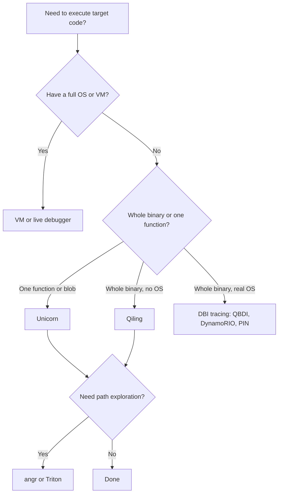
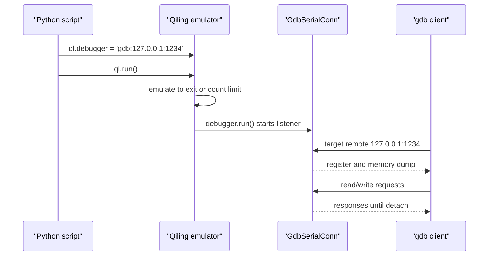

# Emulation: Unicorn, Qiling, and Beyond

> Tags: emulation, unicorn, qiling, qbdi, dynamorio, intel-pin, triton, angr, symbolic-execution, coverage | Difficulty: intermediate | Prerequisites: ../03-decomp/triage-and-mapping.md, ../06-topics/firmware-iot-re.md

## Overview

Emulation sits between static analysis and a real run. The CPU executes your target's instructions on your host. You control every byte of memory and every register.

Use emulation when you need answers a debugger cannot give cheaply:

- A firmware blob with no OS and no debugger target.
- A single function inside a binary you do not want to run live.
- Shellcode or a packed payload you need to step through safely.
- A target that detects VMs, sandboxes, or debuggers. Emulation often defeats timing and hardware-probe checks.
- A decompilation hypothesis you want to execute and compare against the original.

The emulator is not a replacement for a VM. A VM boots the real OS and runs the real binary. Emulation reconstructs the parts of the environment you choose to model. Syscalls, the loader, and device hardware are all your problem.

The tools on this page form a ladder:

| Layer | Tool | What it gives you |
|---|---|---|
| CPU only | Unicorn | Execute code. No OS. You map memory and registers |
| Dynamic binary instrumentation | QBDI, DynamoRIO, Intel PIN | Run the real binary. Trace, count, and patch instructions |
| User-mode OS | Qiling | Full ELF or PE execution with syscalls and a rootfs |
| Symbolic and concolic | Triton, angr | Execution plus path constraints and an SMT solver |



## Setup

Install the Python-facing tools into a virtualenv. Keep them out of the agent's base environment so the dependency versions stay pinned.

```bash
python3 -m venv ~/venvs/emu
source ~/venvs/emu/bin/activate
pip install unicorn qiling angr "triton-library"
```

Notes:

- `unicorn` is the CPU core used by many tools. Version 2.1.4 was current on 2026-11-05.
- `qiling` 1.4.6 is current on 2026-11-05. It wraps Unicorn and adds the OS layer.
- `angr` 10.0.5 is current on 2026-11-05. It ships a built-in MCP server (`pip install "angr[llm]"`, then `angr-mcp`). See ../05-tools/mcp-catalog.md.
- `triton-library` 1.0.0rc4 is the current pip release. It is a release candidate. Pin the version.
- QBDI is not on PyPI. Install from the GitHub release wheels at github.com/QBDI/QBDI, or use `pip install qbdi` if your platform ships a compatible wheel. Unverified for a 2026 release. Check the release page first.
- Intel PIN ships with DynamoRIO-style clients but has no active LLM ecosystem. Use it when a published Pintool already does the job.
- DynamoRIO builds from source at github.com/DynamoRIO/dynamorio. Its `drcachesim` and `opcode_mix` clients give instruction counts without writing a tool.

## Usage

### Unicorn: function-level emulation

Unicorn is a CPU emulator. It knows architectures and registers. It knows nothing about syscalls, loaders, or the heap. You map memory, write bytes, set registers, and run.

Supported architectures include x86, x86-64, ARM, ARM64, MIPS, PPC, SPARC, RISCV, M68K, and EVM. Check `unicorn.UC_ARCH_*` in the installed package.

A minimal x86-64 harness for a position-independent shellcode blob:

```python
from unicorn import Uc, UC_ARCH_X86, UC_MODE_64
from unicorn import UC_HOOK_CODE, UC_HOOK_MEM_UNMAPPED
from unicorn.x86_const import *

code = open('payload.bin', 'rb').read()
BASE = 0x400000
STACK = 0x7fff0000
STACK_SIZE = 0x10000

mu = Uc(UC_ARCH_X86, UC_MODE_64)
mu.mem_map(BASE, 0x10000)
mu.mem_map(STACK - STACK_SIZE, STACK_SIZE)
mu.mem_write(BASE, code)

# stack and a fake return address
mu.mem_write(STACK - 8, (BASE + len(code)).to_bytes(8, 'little'))
mu.reg_write(UC_X86_REG_RSP, STACK - 8)

trace = []
def hook_code(uc, address, size, user_data):
    trace.append(address)

mu.hook_add(UC_HOOK_CODE, hook_code)

# stop when rip reaches the end marker
END = BASE + len(code)
try:
    mu.emu_start(BASE, END, count=1_000_000)
except Exception as e:
    print('emu error:', e)

print('executed', len(trace), 'instructions')
print('rax =', hex(mu.reg_read(UC_X86_REG_RAX)))
print('syscall args: rdi=%#x rsi=%#x' % (
    mu.reg_read(UC_X86_REG_RDI), mu.reg_read(UC_X86_REG_RSI)))
```

Handle unmapped memory. Without a handler, the first access to an unmapped page raises `UcError` and stops the run. Add the hook before `emu_start`:

```python
def hook_mem_invalid(uc, access, address, size, value, user_data):
    # map a page on demand
    page = address & ~0xfff
    try:
        uc.mem_map(page, 0x1000)
    except Exception:
        return False
    return True

mu.hook_add(UC_HOOK_MEM_UNMAPPED | UC_HOOK_MEM_PROT,
            hook_mem_invalid)
```

Return `True` from the hook to let Unicorn retry the access. Return `False` to abort.

Intercept syscalls yourself. Unicorn does not know what `syscall` does on Linux. Two approaches:

1. Hook the `syscall` instruction with `UC_HOOK_INSN` and implement the syscall number in Python.
2. Detect when RIP lands on an unmapped `int 0x80` or `syscall` stub you placed, then emulate the ABI.

```python
from unicorn.x86_const import UC_X86_INS_SYSCALL

def hook_syscall(uc, user_data):
    nr = uc.reg_read(UC_X86_REG_RAX)
    # implement open/read/write/exit or return ENOSYS
    uc.reg_write(UC_X86_REG_RAX, -38 & 0xffffffffffffffff)  # ENOSYS
    # advance rip past the 2-byte syscall insn if needed

mu.hook_add(UC_HOOK_INSN, hook_syscall, None, 1, 0, UC_X86_INS_SYSCALL)
```

Use `count=` to bound runaway loops. Use `timeout=` (microseconds) for wall-clock limits. Always cap both on hostile input.

For a bare-metal firmware function with MMIO, map the peripheral address ranges and hook `UC_HOOK_MEM_READ` / `UC_HOOK_MEM_WRITE` to log hardware access. The MMIO log is often the fastest way to identify which driver block touches which register.

Source: https://github.com/unicorn-engine/unicorn, https://www.unicorn-engine.org/docs/

### Qiling: full user-mode OS emulation

Qiling runs a whole ELF or PE binary inside an emulated OS. It implements the loader, syscalls, and a POSIX or Windows API surface. Rootfs directories supply the libraries the binary needs.

Install the rootfs images from the examples or build your own from a real filesystem:

```bash
git clone --depth 1 https://github.com/qilingframework/qiling ~/qiling
ls ~/qiling/examples/rootfs/x8664_linux/bin/x86_64/ubuntu/bin/ | head
```

Run a Linux x86-64 binary:

```python
from qiling import Qiling
from qiling.const import QL_ARCH, QL_OS, QL_VERBOSE

ql = Qiling(
    ["/bin/ls", "-la", "/"],
    rootfs="~/qiling/examples/rootfs/x8664_linux",
    verbose=QL_VERBOSE.DEBUG,
    ostype=QL_OS.LINUX,
    archtype=QL_ARCH.X8664,
    console=False,
)
ql.run()
```

Run raw shellcode with no ELF:

```python
shellcode = open('payload.bin', 'rb').read()
ql = Qiling(code=shellcode, archtype=QL_ARCH.X8664, ostype=QL_OS.LINUX,
            rootfs="~/qiling/examples/rootfs/x8664_linux")
ql.run()
```

Hook a specific API or symbol. `ql.os.set_api` intercepts OS API calls. `hook_symbol` patches an ELF symbol. `hook_address` and `hook_code` give instruction-level control.

```python
# log every open() call
ql.os.set_api('open', lambda ql, pathname, flags, mode: print('open', pathname) or 0)

# hook a function by symbol name in the loaded ELF
ql.hook_symbol(lambda ql, addr, size: print('hit foo at', hex(addr)), 'foo')

# trace every instruction in a range (expensive; keep it bounded)
ql.hook_code(lambda ql, addr, size, ud: print(hex(addr)), begin=0x401000, end=0x402000)
```

Bound the run:

```python
ql.run(count=500_000)          # instruction count
ql.run(timeout=5_000_000)      # microseconds
ql.run(begin=entry, end=ret_addr)
```

Save and restore state. Qiling supports pickling the whole `ql` object, which captures memory, registers, and syscall state:

```python
import pickle
with open('snapshot.pkl', 'wb') as f:
    pickle.dump(ql, f)

with open('snapshot.pkl', 'rb') as f:
    ql2 = pickle.load(f)
ql2.run()
```

GDB stub. Set `ql.debugger` before `ql.run()` to enable the built-in gdbserver. The debugger attaches after the emulation completes, so it is best for post-mortem inspection, not interactive single-stepping.

```python
ql.debugger = 'gdb:127.0.0.1:1234'
ql.run()
```

Then in another terminal:

```bash
gdb -q -ex 'target remote 127.0.0.1:1234' -ex 'info registers' -ex 'x/20i $pc'
```

The stub runs after emulation finishes. It does not step live. Use it to inspect the final CPU and memory state.



For interactive debugging during the run, use QBDI or DynamoRIO on the real binary instead. The Qiling gdb stub is a post-run inspector.

Supported targets: Linux, FreeBSD, macOS, Windows PE, UEFI, DOS, QNX, bare-metal MCU, Android, and EVM. Check `QL_OS` and `QL_ARCH` in `qiling/const.py`.

Source: https://github.com/qilingframework/qiling, https://docs.qiling.io

### QBDI: instruction-level tracing on a real process

QBDI is a dynamic binary instrumentation engine built on LLVM. It runs the real binary under the real OS. You get per-instruction callbacks without writing a kernel module or patching code.

Install:

```bash
pip install qbdi   # if a wheel exists for your platform
# or download the release from github.com/QBDI/QBDI/releases
```

Trace instructions with the Python API:

```python
import qbdi

vm = qbdi.VM.get_current()
vm.add_vmap(0x400000, 0x100000, qbdi.PERM_RWX)

# run the current process image
vm.run(range(0x400000, 0x401000), 0x401000)
```

For counting basic blocks or instructions, use the C++ API or the `qbdi` Python bindings with a `VM` and an `InstCallback`. The `InstCallback` receives `vm`, `gprState`, `fprState`, and `data`. Read `gprState.pc` for the current address and `gprState.gpr` for registers.

QBDI is the right tool when you need coverage on a live process and cannot afford a full VM. It is also scriptable from Frida through `frida-qbdi`, which lets you inject QBDI into a running process.

Source: https://github.com/QBDI/QBDI

### DynamoRIO and Intel PIN: coverage and opcode mixes

DynamoRIO is a C++ DBI platform. It is heavier than QBDI but has mature tooling. The `drcachesim` client records instruction and memory traces. The `opcode_mix` client counts instruction types. The `basic_counts` client counts executed instructions per block.

```bash
# build DynamoRIO
cd ~/dynamorio && mkdir build && cd build
cmake .. && make -j$(nproc)

# run a target under drcachesim
bin64/drrun -t drcachesim -offline -- /path/to/target
# produces a raw trace in the current directory

# opcode mix (histogram of executed opcodes)
bin64/drrun -t opcode_mix -- /path/to/target
```

Intel PIN is x86/x64 only. It uses C++ Pintools. The `pinatrace` and `pinatrace++` tools are included. PIN is slower to write against than QBDI but has a large existing tool ecosystem.

Source: https://github.com/DynamoRIO/dynamorio, https://www.intel.com/content/www/us/en/developer/articles/tool/pin-a-dynamic-binary-instrumentation-tool.html

### Triton: concolic execution

Triton is a concolic execution engine. It runs a binary under Intel PIN, taints data, builds symbolic expressions, and lets you solve path constraints with Z3 or Bitwuzla. It is the standard tool for breaking VMProtect-style obfuscation and for recovering the input that reaches a target address.

Install:

```bash
pip install triton-library   # 1.0.0rc4 at time of writing
```

The Triton 1.0 Python API uses `TritonContext`. You feed it instructions one at a time. There is no automatic OS loader in the Python API; you provide memory and registers.

```python
from triton import *

ctx = TritonContext(ARCH.X86_64)

# map code into Triton memory
ctx.setConcreteMemoryAreaValue(0x400000, code_bytes)
ctx.setConcreteRegisterValue(ctx.registers.rip, 0x400000)

# symbolize the input buffer
ctx.symbolizeMemory(MemoryAccess(0x7fff0000, CPUSIZE.QWORD), 'input')

# process instructions
for insn_bytes in disassemble(code_bytes):
    ctx.processing(Instruction(insn_bytes, 0x400000))

# get the path constraints
for pc in ctx.getPathConstraints():
    print(pc)

# solve for a target register value
model = ctx.getModel(ctx.getSymbolicRegister(ctx.registers.rax).getAst() == 0xdead)
print(model)
```

Triton is not a fuzzer. It is a constraint engine. You drive it: pick a target address, negate the branch predicate that blocks it, solve, and replay. TritonDSE (github.com/quarkslab/tritondse) wraps this loop.

Source: https://github.com/JonathanSalwan/Triton, https://triton-library.github.io

### angr: symbolic execution with an MCP server

angr is the most complete symbolic execution framework. It loads binaries, lifts to VEX IR, explores paths, and can solve for inputs that reach a target state. Version 10.x has a Rust core and a built-in MCP server.

Install and run the MCP server:

```bash
pip install "angr[llm]"
angr-mcp   # or: python -m angr.mcp --transport stdio
```

Basic symbolic execution:

```python
import angr

p = angr.Project('/path/to/binary', auto_load_libs=False)

# find the address that prints the flag
flag_addr = 0x401234
avoid_addr = 0x401000

simgr = p.factory.simulation_manager(p.factory.entry_state())
simgr.explore(find=flag_addr, avoid=avoid_addr)

if simgr.found:
    state = simgr.found[0]
    print(state.posix.dumps(0))  # stdin that reaches flag_addr
```

angr is slow on real binaries. Use it for small functions, CTF-style challenges, or targeted path queries. For bulk deobfuscation, use Triton or QBDI first.

Source: https://github.com/angr/angr, https://docs.angr.io

## AI Use Cases

### Generate emulation harnesses

The most common AI task is writing the Unicorn or Qiling harness for a new target. Give the agent the binary format, the entry point, and the syscall stubs you need. It writes the Python.

Prompt pattern:

```
Target: ARM64 ELF, stripped, no libc. Entry at 0x40000.
Write a Unicorn harness that:
- maps 0x40000-0x80000 for code
- maps a 64KB stack at 0x7fff0000
- hooks unmapped memory and logs the faulting address
- stops after 100000 instructions or when r0 == 0
Output: a single Python file, no external deps beyond unicorn.
```

The agent gets the skeleton right. You fix the syscall numbers and the memory map.

### Lift shellcode

Feed raw shellcode to an LLM and ask for a Unicorn or Qiling harness. The agent disassembles mentally, identifies syscall numbers, and writes the stub. Verify by running the harness and checking the syscall trace.

### Generate syscall stubs for Qiling

Qiling implements many syscalls but not all. When a binary hits an unimplemented syscall, Qiling raises `QlErrorSyscallNotFound`. Give the agent the syscall number and the binary's usage pattern. It writes a Python stub using `ql.os.set_api` or `ql.os.syscall_map`.

### Coverage-guided prompt refinement

Run QBDI or DynamoRIO to get a coverage trace. Feed the uncovered blocks to the agent. Ask it to write a Frida or QBDI script that reaches them. This is the same loop as fuzzing but with the agent as the mutator.

### Decompilation verification

Use Unicorn as an execution oracle. The agent writes a C reimplementation of a function. Compile it. Run both the original and the candidate under Unicorn with the same inputs. Compare register and memory state. This is the pattern used by reverify and DecompPipeline.

## Pitfalls

### Missing syscalls

Unicorn has no syscall layer. Qiling has one, but it is incomplete. A binary that calls `ioctl`, `prctl`, or a custom driver syscall will fail. Emulation is not a substitute for a real kernel.

Mitigation: hook the syscall instruction and return `ENOSYS` or a canned value. Log every syscall number and stub the ones you see. For malware, assume the binary checks for sandbox artifacts and branches on syscall results.

### Anti-emulation checks

Protected binaries check for emulation artifacts:

- CPUID returns a hypervisor bit or an unexpected vendor string.
- `rdtsc` timing differs from bare metal.
- Debug registers are readable when they should not be.
- `int 3` or `int 0x2d` behaves differently under a debugger.
- Memory layout differs from a real process (ASLR, stack alignment, TLS).

Unicorn and Qiling do not model all of these. A binary that checks `cpuid` leaf 1 bit 31 will see a bare-metal answer unless you patch it. A binary that times `rdtsc` around a loop will see emulation speed, not hardware speed.

Mitigation: patch the checks in the emulator, or use a real VM for the first pass and emulation for the second.

### Incomplete rootfs

Qiling needs a rootfs with the libraries the binary links against. A stripped rootfs causes `QlErrorFileNotFound` on the dynamic loader. Build the rootfs from a real system image or use the provided examples. For statically linked binaries, you can use an empty rootfs.

### Threading and signals

Unicorn is single-threaded. Qiling supports `multithread=True` but it is experimental. Signals are not fully modeled. A binary that relies on `fork`, `clone`, or POSIX signals will not work correctly.

### Instruction set gaps

Unicorn supports many architectures but not all instructions. Rarely used extensions (AVX-512, certain ARMv8.1 features) may raise `UC_ERR_INSN_INVALID`. Check the Unicorn docs for the exact feature set.

### Snapshot size

Qiling snapshots pickle the entire emulated memory. A 1GB rootfs produces a multi-GB snapshot. Use `libcache=True` and keep snapshots on disk, not in memory.

### Performance

Unicorn is 10-100x slower than native execution. Qiling adds syscall overhead. Triton and angr are slower still. Emulation is for correctness, not speed. If you need to run a fuzzing campaign, use a real VM or DynamoRIO on bare metal.

## See Also

- `../03-decomp/verification-loop.md` — use emulation as an execution oracle for decomp claims
- `../03-decomp/triage-and-mapping.md` — decide when emulation is needed
- `../06-topics/firmware-iot-re.md` — firmware blobs and bare-metal targets
- `../06-topics/deobfuscation.md` — VMProtect and Themida deobfuscation with Triton
- `../07-advanced/anti-analysis.md` — anti-VM and anti-emulation checks
- `../05-tools/tool-catalog.md` — full tool comparison
- `../05-tools/mcp-catalog.md` — angr-mcp and other MCP servers
- `./frida-deep-dive.md` — live-process instrumentation
- `../01-setup/malware-isolation.md` — CAPEv2 and cloud sandboxes
- `./emulation-unicorn-qiling.md` — emulation as a verification oracle
