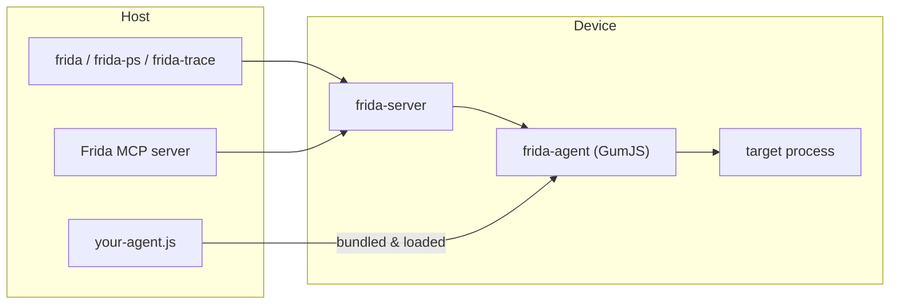
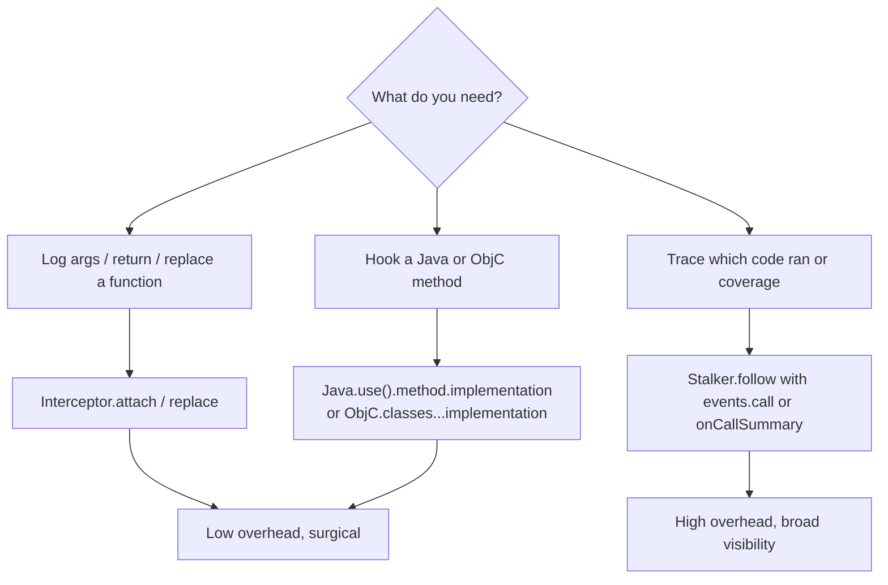

# Frida Deep Dive: Stalker, Interceptor, Java Bridge

> Tags: frida, dynamic-analysis, stalker, interceptor, java-bridge, objc-bridge, android, ios, mcp | Difficulty: Intermediate | Prerequisites: `../06-topics/mobile-android-re.md`, `../06-topics/apple-ios-re.md`, `../07-advanced/anti-analysis.md`

Frida is a dynamic instrumentation toolkit. A host-side script drives a small agent inside the target process. This page covers the pieces you actually need for field work in 2026: the core object model, when to use `Interceptor` versus `Stalker`, the Java and Objective-C runtime bridges, the `frida-tools` CLI, the three Frida MCP servers and which one to pick, how to get an LLM to write your hooks, and where the performance cliff is on large apps.

Frida 17.x is the current line. Version observed during research: 17.25.2 (frida.re/news, November 2026). Two breaking changes matter. First, the Java and Objective-C bridges are no longer baked into the GumJS runtime. They are separate npm packages, `frida-java-bridge` and `frida-objc-bridge` (frida.re/docs/javascript-api). Second, GumJS scripts run on QuickJS or V8 depending on build, and import-based scripts need bundling with `frida-compile` or a compatible bundler (frida-c2-mcp uses esbuild because `frida-compile` crashes on Android Termux under SELinux W^X).

## Overview

### What Frida is

Frida injects a JavaScript agent into a live process. The agent can call functions, replace method implementations, read memory, spawn threads, and trace code. You control it from a host through the `frida` CLI, through the Python bindings, through `frida-tools` utilities, or through an MCP server.

The mental model:



### Three instrumentation layers

| Layer | API | Cost | Use for |
|---|---|---|---|
| Function hooks | `Interceptor.attach`, `Interceptor.replace` | Low | Arguments, return values, bypass a check |
| Runtime bridges | `Java.*`, `ObjC.*` | Medium | Managed methods, class enumeration, heap scans |
| Code tracing | `Stalker.follow` | High | Which functions ran, coverage, argument-free tracing |

Pick the cheapest layer that answers your question. `Stalker` on a hot loop will slow the target 10x or worse. `Interceptor` on a Java method is usually enough for hooking `checkRoot()`.

### What an AI agent can and cannot do with Frida

LLMs are good at writing Frida scripts for bounded tasks. "Hook this method and log its arguments" works well. "Find the license check" does not. The failure mode is the same as everywhere in this wiki: the agent proposes plausible-looking code, and nothing verifies it ran. Always confirm the hook fired. `console.log` in the script is your ground truth. If the target never calls the function you hooked, you learned nothing.

## Setup

### Install frida-tools

```bash
pip install frida-tools
frida --version
frida-ps --version
```

`frida-tools` pulls in `frida` (the Python bindings), `frida-ps`, `frida-trace`, `frida-discover`, `frida-kill`, `frida-ls-devices`, `frida-ls`, `frida-itrace`, and `frida-create`. The CLI version must match the `frida-server` on the device exactly. Check the server release page for the matching version.

### frida-server on device

Android (rooted device or emulator):

```bash
# download frida-server-<ver>-android-arm64.xz from github.com/frida/frida/releases
unxz frida-server-<ver>-android-arm64.xz
adb push frida-server-<ver>-android-arm64 /data/local/tmp/frida-server
adb shell "su -c 'chmod 755 /data/local/tmp/frida-server'"
adb shell "su -c '/data/local/tmp/frida-server &'"
adb shell "su -c 'frida-ps -U'"   # should list processes
```

iOS (jailbroken): push the matching `frida-server` for your device architecture. Run it as root or via launchd. On non-jailbroken iOS there is no general path. See `../06-topics/apple-ios-re.md`.

### Remote or named process

```bash
frida-ps -Uau                          # USB devices, all apps
frida-ps -H 192.168.1.10:27042         # remote frida-server over TCP
frida -U -f com.example.app -l hook.js # spawn suspended, load script, resume
frida -U -n com.example.app -l hook.js # attach to running process
```

`-f` spawns the app suspended. Your script loads before `main`. Use this for early instrumentation. `-n` attaches to an already-running process. Use this when the app detects spawn-time instrumentation or when you missed the launch window.

### The agent file

A minimal agent is a plain JavaScript file. `frida -l` loads it. For anything that imports `frida-java-bridge` or `frida-objc-bridge`, bundle first:

```bash
npm init -y
npm install frida-java-bridge frida-objc-bridge
npm install -g frida-compile
frida-compile agent.ts -o agent.bundle.js
frida -U -n com.example.app -l agent.bundle.js
```

`frida-compile` produces a single JS file with the bridges inlined. `frida` will also run plain JS without bundling if you do not import bridges.

## How It Works

### Interceptor.attach: the workhorse

`Interceptor.attach(target, callbacks)` plants an inline hook on a native function. `onEnter` fires before the call, `onLeave` fires after. `args` is an array of `NativePointer`. `retval` is the return value.

```javascript
const libc = Process.getModuleByName("libc.so");
Interceptor.attach(libc.getExportByName("open"), {
  onEnter(args) {
    this.path = args[0].readUtf8String();
    console.log("[+] open(" + this.path + ")");
  },
  onLeave(retval) {
    console.log("    -> " + retval);
  }
});
```

For ARM Thumb functions the address needs the low bit set correctly. `Module.getExportByName` handles this. Do not hand-compute addresses for Thumb code.

`Interceptor.replace(target, replacement)` substitutes the whole function. Useful for stubbing a check:

```javascript
const check = Module.getExportByName("libtarget.so", "check_license");
Interceptor.replace(check, new NativeCallback(function () {
  return 1;
}, "int", []));
```

`new NativeCallback` builds a JS function callable from native code. It is how you replace a native function entirely. For Java methods use `Java.use(...).method.implementation = ...` instead (see below).

### Interceptor on Java and Objective-C methods

You do not use `Interceptor` directly on managed methods. You hook the bridge wrapper:

```javascript
// Android
Java.perform(() => {
  const TokenManager = Java.use("com.example.auth.TokenManager");
  TokenManager.refresh.implementation = function () {
    console.log("[+] TokenManager.refresh called");
    return this.refresh();
  };
});
```

```javascript
// iOS
const viewDidLoad = ObjC.classes.VIEWCONTROLLER["- viewDidLoad"];
Interceptor.attach(viewDidLoad.implementation, {
  onEnter() {
    console.log("[+] viewDidLoad");
  }
});
```

`method.implementation = function(){}` replaces the method. `method.implementation` returns a `NativePointer` you can pass to `Interceptor.attach`. Both work. The implementation assignment is simpler.

### Stalker: tracing, not hooking

`Stalker.follow(threadId, options)` makes Frida's code tracer instrument every basic block a thread executes. It is the tool for "what code actually ran" questions. It is expensive.

```javascript
Stalker.follow(Process.getCurrentThreadId(), {
  events: {
    call: true,    // log every call target
    ret: false,
    exec: false,   // every instruction. almost never what you want
    block: false,  // every basic block
    compile: false // every compiled block (useful for coverage)
  },
  onCallSummary(summary) {
    for (const target in summary) {
      console.log(target + ": " + summary[target]);
    }
  }
});
```

`onCallSummary` gives you `{targetAddress: count}` for the window. It is cheaper than `onReceive`, which gives you raw `GumEvent` blobs you parse with `Stalker.parse`. Prefer `onCallSummary` for counting calls. Use `onReceive` only when you need order or per-event detail.

`Stalker.exclude` and `Stalker.addCallProbe` give finer control. `Stalker.trustThreshold` controls how many times a block must run before Frida trusts it (default 1, set to -1 for no trust). `Stalker.invalidate(address)` forces recompilation of a block when your transform callback changes behavior.



### When Stalker beats Interceptor

Use `Stalker` when:

- You do not know which function to hook. You need the set of callees.
- You want coverage for a fuzzing or reachability task.
- The target checks for inline hooks. `Interceptor` patches prologues. `Stalker` recompiles blocks without touching the original bytes.
- You want call counts or call graphs without per-call JavaScript overhead.

Use `Interceptor` when:

- You know the function.
- You need argument or return value inspection.
- You want to modify behavior (force a return, rewrite an argument).
- You are on a hot path and Stalker would be too slow.

The trap: `Stalker.follow` on the main thread of a large app will make the app unusable and generate gigabytes of events. Always scope it: pick a thread, limit events, exclude ranges, or follow for a short window then `Stalker.unfollow`.

### The Java bridge

`Java.perform(fn)` attaches the current thread to the ART or Dalvik VM and runs `fn`. `Java.performNow(fn)` is the same but does not wait for the class loader. Use `perform` for anything that calls `Java.use`. Use `performNow` inside callbacks where the VM is already attached.

Key API surface (frida.re/docs/javascript-api):

| Call | What it does |
|---|---|
| `Java.available` | Boolean. Is a VM loaded? Check first. |
| `Java.androidVersion` | String. For example "14" |
| `Java.use("com.example.Foo")` | Get a wrapper for a class. Methods callable, `$new()` to construct. |
| `Java.enumerateLoadedClassesSync()` | Array of loaded class names. |
| `Java.enumerateMethods("*pattern*")` | Glob search across methods. Supports `/i`, `/s`, `/u` flags. |
| `Java.choose("com.example.Foo", {onMatch, onComplete})` | Heap scan for live instances. Expensive on large heaps. |
| `Java.choose` returns `stop` to cancel early | Use this on big heaps. |
| `Java.cast(handle, klass)` | Wrap a raw pointer as an instance. |
| `Java.retain(obj)` | Keep an instance alive across calls. |
| `Java.array("int", [1,2,3])` | Build a Java array. |
| `Java.backtrace()` | Java stack trace. More readable than native. |
| `Java.registerClass(spec)` | Define a new Java class at runtime. For implementing interfaces. |
| `Java.openClassFile(path)` | Load a .dex file manually. |
| `Java.isMainThread()` | Am I on the UI thread? |
| `Java.scheduleOnMainThread(fn)` | Run fn on the main thread. |

Method hooking idioms:

```javascript
// All overloads at once
Activity.onResume.implementation = function () { /* ... */ };

// Specific overload by signature
const overloads = Activity.onResume.overloads;
overloads[0].implementation = function () { /* ... */ };

// Call the original
TokenManager.refresh.implementation = function () {
  const result = this.refresh();
  return result;
};
```

`this` inside the replacement is the Java object instance. Arguments are `arguments[0..n]`. For static methods `this` is the class wrapper.

`Java.use` throws if the class is not loaded. Wrap in try/catch or use `Java.enumerateLoadedClassesSync` first. Classes loaded after script start need `Java.enumerateClassLoaders` or a hook on the class loader.

### The Objective-C bridge

`ObjC.available` checks for an ObjC runtime. `ObjC.classes` maps class names to bindings.

```javascript
const NSString = ObjC.classes.NSString;
const s = NSString.stringWithString_("hello");
console.log(s.toString());
```

Method names use underscores for colons: `stringWithString:` becomes `stringWithString_`. Multi-arg selectors chain: `initWithContentsOfFile:byReference:` becomes `initWithContentsOfFile_byReference_`.

```javascript
// Hook a method
const viewDidLoad = ObjC.classes.MyViewController["- viewDidLoad"];
Interceptor.attach(viewDidLoad.implementation, {
  onEnter(args) {
    console.log("[+] viewDidLoad");
  }
});

// Or replace implementation
ObjC.classes.MyViewController["- viewDidLoad"].implementation = function () {
  // do nothing, skip original
};
```

`ObjC.chooseSync(spec)` synchronously enumerates live instances. `ObjC.enumerateLoadedClassesSync()` lists classes. `ObjC.schedule(ObjC.mainQueue, fn)` runs on the main queue. `ObjC.api` exposes the raw runtime C API.

Both bridges moved out of the core runtime in Frida 17. You must bundle `frida-java-bridge` and `frida-objc-bridge` with `frida-compile` or equivalent. Plain scripts that only use `Interceptor`, `Stalker`, `Process`, `Module` do not need them.

### frida-tools CLI reference

| Command | Purpose |
|---|---|
| `frida` | Interactive REPL or `-l script.js` one-shot. `-U` USB, `-H host:port` remote, `-f` spawn, `-n` attach by name, `-p` attach by PID. |
| `frida-ps` | List processes. `-U` USB, `-H` remote, `-a` applications, `-i` installed. |
| `frida-trace` | Auto-generate hooks on matching functions. `-i 'open*'` intercepts functions matching glob. `-m 'lib*.so!*'` scopes to modules. `--runtime=v8` for V8. |
| `frida-discover` | List devices and processes in one shot. |
| `frida-kill` | Kill a process by name or PID on device. |
| `frida-ls-devices` | List connected devices. |
| `frida-ls` | List files on device (like `ls`). |
| `frida-itrace` | Instruction-level trace. Writes ITRC format. Very verbose. |
| `frida-create` | Scaffold a new agent project. |
| `frida-compile` | Bundle agent TS/JS with bridges into one file. |

`frida-trace` is the fastest way to see what a process calls:

```bash
frida-trace -U -n com.example.app -i 'open*' -i 'read*'
```

It generates JavaScript on the fly and prints a call log. Useful for triage before writing a custom agent.

## Step-by-Step

### Hook a Java method and log arguments

```javascript
// agent.js
Java.perform(() => {
  const Login = Java.use("com.example.auth.LoginManager");
  Login.login.implementation = function (username, password) {
    console.log("[+] login(" + username + ", " + password + ")");
    const result = this.login(username, password);
    console.log("    -> " + result);
    return result;
  };
});
```

```bash
frida -U -f com.example.app -l agent.js --no-pause
```

`--no-pause` resumes the app immediately after the script loads. Without it, `frida` drops you into a REPL and the app stays suspended until you type `%resume`.

### Enumerate and hook all overloads

```javascript
Java.perform(() => {
  const Activity = Java.use("android.app.Activity");
  Activity.onResume.overloads.forEach(function (overload) {
    overload.implementation = function () {
      console.log("[+] onResume overload: " + overload.argumentTypes);
      return overload.apply(this, arguments);
    };
  });
});
```

`overload.argumentTypes` is an array of type names. `overload.apply(this, arguments)` calls the original.

### Trace calls for 5 seconds then stop

```javascript
const threadId = Process.getCurrentThreadId();
Stalker.follow(threadId, {
  events: { call: true },
  onCallSummary(summary) {
    const entries = Object.entries(summary).sort((a, b) => b[1] - a[1]);
    entries.slice(0, 20).forEach(([addr, count]) => {
      const mod = Process.findModuleByAddress(ptr(addr));
      console.log(addr + " " + count + "x " + (mod ? mod.name : "?"));
    });
  }
});

setTimeout(() => {
  Stalker.unfollow(threadId);
  Stalker.garbageCollect();
  console.log("[+] trace complete");
}, 5000);
```

This follows the current thread for 5 seconds, prints the top 20 call targets, then stops. `Stalker.garbageCollect()` frees the translated code cache.

### Bypass SSL pinning on Android

A common first hook. The exact class names vary by app and OkHttp version. This is a template, not a guarantee.

```javascript
Java.perform(() => {
  // OkHttp3 CertificatePinner
  try {
    const CertificatePinner = Java.use("okhttp3.CertificatePinner");
    CertificatePinner.check.overload("java.lang.String", "java.util.List").implementation = function () {
      console.log("[+] CertificatePinner.check bypassed");
    };
  } catch (e) { console.log("[-] okhttp3 pinning not found: " + e); }

  // TrustManagerImpl (Android system)
  try {
    const TrustManagerImpl = Java.use("com.android.org.conscrypt.TrustManagerImpl");
    TrustManagerImpl.verifyChain.implementation = function (untrusted) {
      console.log("[+] TrustManagerImpl.verifyChain bypassed");
      return untrusted;
    };
  } catch (e) { console.log("[-] TrustManagerImpl not found: " + e); }
});
```

Verify the bypass worked by watching for successful HTTPS requests in the app's traffic. The hook firing is not proof the app trusts the cert. Some apps pin at the native layer (BoringSSL in a `.so`).

### Hook an ObjC method on iOS

```javascript
// agent.js — bundle with frida-objc-bridge
const target = ObjC.classes.UIApplication["- delegate"];
// Or hook a specific class method
const hook = ObjC.classes.NSURLSession["- dataTaskWithRequest:completionHandler:"];
Interceptor.attach(hook.implementation, {
  onEnter(args) {
    const request = new ObjC.Object(args[2]);
    console.log("[+] request: " + request.URL().absoluteString().toString());
  }
});
```

`args[0]` is `self`, `args[1]` is the selector, `args[2]` onwards are the method arguments. Wrap native pointers in `new ObjC.Object(ptr)` to call methods on them.

## MCP Servers for Frida

Three Frida MCP servers exist. They serve different workflows.

### Comparison

| Server | Repo | Transport | Scope | Best for |
|---|---|---|---|---|
| kahlo-mcp | github.com/FuzzySecurity/kahlo-mcp | stdio | Android via adb + frida-server | Full session lifecycle, reusable modules, event streaming |
| frida-mcp (dnakov) | github.com/dnakov/frida-mcp | stdio | Any Frida target | Simple process/attach/script injection, REPL |
| frida-c2-mcp | github.com/s4dp4nd4/frida-c2-mcp | HTTP | On-device Android (Termux) and jailbroken iOS | No client-side Frida, multi-device, agent-driven |

### kahlo-mcp

The most complete Frida MCP. It manages devices, processes, targets, jobs, events, artifacts, and a versioned module store. It is Android-focused. It requires `adb` and a matching `frida-server` on the device.

Setup:

```bash
cd kahlo-mcp
npm install
npm run build
# edit config.json: set adbPath, dataDir
# push frida-server matching package.json frida version to device
```

Register `dist/index.js` as a stdio MCP server. Key tools:

- `kahlo_devices_list`, `kahlo_devices_health` — device readiness.
- `kahlo_processes_list` — find the process name.
- `kahlo_targets_ensure` — attach or spawn. `mode="spawn"` suspends the app until you resume.
- `kahlo_jobs_start` — run an isolated script. Accepts inline `source` for fast iteration.
- `kahlo_events_fetch` — poll structured events with cursor pagination.
- `kahlo_modules_*` — versioned module store for reusable hooks.

The stdlib (`ctx.stdlib`) inside kahlo jobs provides Java object inspection, stack traces, Intent parsing, and hook helpers. Call `kahlo_mcp_about` to get the full contract.

Use kahlo-mcp when you want the agent to manage the full Frida lifecycle: discover the device, spawn the app, inject a hook, collect events, iterate. It is the closest to a production Frida agent.

### dnakov/frida-mcp

The original Frida MCP. Python, stdio, `pip install frida-mcp`. Requires Frida 16+.

It exposes process management (list, attach, spawn, resume, kill), device management, an interactive JavaScript REPL, script injection with progress tracking, and resources for Frida version and process/device lists. It is simpler than kahlo-mcp. It does not have a module store or event cursor pagination.

Use it when you want a minimal MCP that lets the agent run Frida commands without kahlo's structure. It is a good starting point for a quick agent session.

### s4dp4nd4/frida-c2-mcp

Runs the entire Frida stack on-device. Android in Termux, iOS on rootless jailbreak. Exposes streamable HTTP MCP on port 6767. No client-side Frida install needed.

```bash
# Android in Termux
gemini mcp add --transport http frida-c2-mcp http://<DEVICE_IP>:6767/mcp
```

The agent connects over HTTP and gets process listing, app control, attach sessions, and script execution. Scripts are bundled on-device with `esbuild` (Android) or `frida-compile` (iOS) because `frida-compile` crashes on Android Termux under SELinux W^X.

Use frida-c2-mcp when you want the agent to instrument a phone without a laptop in the loop, or when you are orchestrating multiple devices. It is a proof of concept. No authentication, no TLS. Run on a trusted LAN only.

### Which to pick

- **Single Android device, deep session control:** kahlo-mcp.
- **Quick agent hookup, any platform:** dnakov/frida-mcp.
- **On-device or multi-device orchestration:** frida-c2-mcp.
- **iOS without client-side Frida:** frida-c2-mcp is the only option of the three.

For non-MCP workflows, `objection` (github.com/sensepost/objection) is still the fastest way to explore an app interactively. It wraps Frida with a REPL and pre-built commands for Android and iOS.

## Writing Frida Scripts with LLM Assistance

### Prompt patterns that work

Give the model the exact method signature and the runtime. Do not ask it to "find the vulnerability".

Good prompts:

```text
Write a Frida script that hooks com.example.auth.TokenManager.refresh()
and logs the return value. Use Java.perform. Assume Android 14, ART.
```

```text
This ObjC method signature is -[NSURLSession dataTaskWithRequest:completionHandler:].
Write a Frida script that logs the request URL in onEnter. Use frida-objc-bridge.
```

```text
Hook libc.so open() and log the first argument as a UTF-8 string.
Only log paths containing ".dex" or ".so".
```

Bad prompts:

```text
Analyze this app and find the license check.     # too open-ended
Write a Frida script for SSL pinning bypass.      # too generic, many variants
Hook everything in this class.                    # too broad, performance
```

The pattern: one bounded hook, one runtime, one observable output. The model can write that reliably.

### Common LLM errors in Frida scripts

- **Wrong bridge import.** The model may write `Java.perform` without bundling `frida-java-bridge`. Frida 17 requires the import. Tell the model to bundle or to use only core APIs.
- **Method name with colons not converted.** ObjC `stringWithString:` must be `stringWithString_` in JS. The model sometimes forgets.
- **Java.use on unloaded class.** Throws `ClassNotFoundException`. Wrap in try/catch or enumerate first.
- **Overload ambiguity.** `method.implementation` replaces all overloads. For a specific one, use `method.overloads[i].implementation` or `method.overload(signature).implementation`.
- **NativeCallback signature mismatch.** Wrong argument or return types cause crashes. Always specify types explicitly.
- **Stalker without unfollow.** The script ends but the thread keeps tracing. Always pair `follow` with `unfollow` or a timeout.
- **this.context misuse.** `this.context` in Interceptor callbacks has registers, but the model may treat it as a plain object. It is a NativePointer-derived struct.
- **Java.choose on huge heaps.** Returns millions of instances. Add a `stop` return or filter by class first.
- **Assuming Frida 16 API.** `Java.enumerateMethods` with `/i`, `/s`, `/u` flags is Frida 17. Older versions differ.

### Verification loop for Frida scripts

1. Run the script. Watch `console.log` output.
2. If no output, the target never called the function. Try `frida-trace` to confirm the function exists and is called.
3. If output appears but is wrong, check argument types. Java objects are not strings. Use `.toString()`.
4. If the app crashes, your hook is wrong. Check overload resolution and `this` binding.
5. For bypasses, verify the protected behavior actually changed. A hook firing is not a bypass succeeding.

## Pitfalls

### Anti-Frida detection

Apps detect Frida through several channels. See `../07-advanced/anti-analysis.md` for the full anti-analysis catalog.

| Detection | How it works | Bypass notes |
|---|---|---|
| Process scan | Looks for `frida-server`, `frida-agent`, `gum-js-loop` in `/proc` | Rename the server binary, use a gadget or embedded agent |
| Port scan | Checks port 27042 (default frida-server) | Change the port with `-l 0.0.0.0:PORT` |
| Thread names | GumJS threads have recognizable names | Custom Frida build or gadget mode |
| Memory scan | Searches for Frida signatures in memory | Stalker-based hooks leave fewer inline patches than Interceptor |
| `/proc/self/maps` | Looks for `frida-agent` or `gadget` mappings | Inject into an existing module or use a gadget with a benign name |
| Timing checks | Frida hooks add latency | Use `Interceptor.attach` with CModule callbacks for hot paths |
| Java method checks | Apps verify method integrity | Hook the verifier, not the check |

The safest approach for high-assurance targets is a custom Frida build with renamed symbols, or a gadget embedded in the APK. For most CTF and research targets, the standard `frida-server` plus a rename is enough.

### Performance pitfalls on large apps

- **Stalker on the main thread.** The UI freezes. Events flood. Limit to a worker thread or a short window.
- **Java.choose on large heaps.** A heap scan on a 500MB app can take minutes and stall the GC. Use `enumerateLoadedClasses` first, then `choose` on a specific class.
- **Logging every call.** `console.log` in a hot hook floods the host. Buffer and flush periodically, or use `send()` with a custom handler.
- **Interceptor on hot native functions.** `open`, `read`, `write` fire thousands of times per second. Filter in `onEnter` before doing expensive work.
- **Java.perform overhead.** Each `Java.perform` attaches the thread to the VM. In a tight loop, hoist it outside or use `Java.performNow` inside callbacks.
- **Stalker event volume.** `events.exec` or `events.block` on a busy thread generates gigabytes. Use `events.call` or `onCallSummary`.
- **Memory leaks in agents.** `Java.retain` without `$dispose` leaks. `Interceptor.attach` without `detach` accumulates listeners. Unload the script to clean up.
- **frida-compile size.** Bundled agents with both bridges can be several MB. Load time matters on slow devices.

### Other pitfalls

- **SELinux on Android 14+.** `frida-compile` and V8-based tooling can crash under W^X policy. Use `esbuild` or the frida-c2-mcp approach.
- **Architecture mismatch.** `frida-server` must match the device ABI. arm64 device needs arm64 server. x86 emulator needs x86 server.
- **Version mismatch.** `frida` Python package and `frida-server` must match exactly. Check `frida --version` against the server release.
- **Root detection before instrumentation.** Some apps check for root before you can hook. Spawn with `-f` and hook the check early, or use a Magisk module to hide root.
- **Multi-process apps.** Android apps can have `:remote` processes. `frida -n` attaches to one. Enumerate with `frida-ps -Uai` and attach to each.
- **Objection is not a replacement for understanding.** It is a REPL wrapper. If you cannot write the Frida script yourself, you will not debug the agent's script when it fails.

## See Also

- [Android reverse engineering](../06-topics/mobile-android-re.md)
- [iOS reverse engineering](../06-topics/apple-ios-re.md)
- [Anti-analysis techniques](../07-advanced/anti-analysis.md)
- [Malware analysis](../06-topics/malware-analysis.md)
- [Tool catalog](../05-tools/tool-catalog.md)
- [MCP catalog](../05-tools/mcp-catalog.md)
- [Claude Code setup](../02-collab/claude-code-setup.md)
- [Verification loop](../03-decomp/verification-loop.md)
- [Context engineering](../02-collab/context-engineering.md)

External references:

- frida.re/docs — official Frida documentation
- frida.re/docs/javascript-api — JavaScript API reference
- frida.re/docs/stalker — Stalker deep dive
- github.com/frida/frida — Frida source
- github.com/frida/frida-tools — CLI tools
- github.com/frida/frida-compile — script bundler
- github.com/FuzzySecurity/kahlo-mcp — kahlo-mcp
- github.com/dnakov/frida-mcp — original Frida MCP
- github.com/s4dp4nd4/frida-c2-mcp — on-device Frida MCP
- github.com/sensepost/objection — objection REPL
