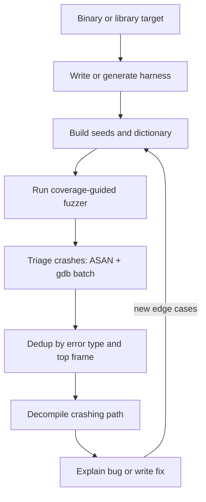

# Fuzzing Binary Targets

> Tags: fuzzing, aflplusplus, libfuzzer, honggfuzz, harness, qemu-mode, persistent-mode, grammar-fuzzing, crash-triage, asan | Difficulty: Intermediate | Prerequisites: Linux RE sandbox built, one binary you can run, a seed corpus or the ability to generate one

## Overview

Fuzzing finds crashes and hangs by running a target many times on mutated inputs. Coverage-guided fuzzers record which code paths each input reaches. They keep inputs that cover new paths. Over time they walk deeper into parsers, decompressors, and state machines that manual reverse engineering would take weeks to trace.

Fuzzing complements decompilation. The decompiler tells you what a function intends. The fuzzer tells you where the assumptions break. A crash gives you a concrete input and a crashing PC. That is a much better starting point for a human or an agent than a stack of pseudocode.

This page covers coverage-guided fuzzers (AFL++, libFuzzer, honggfuzz), harness writing for file-format and function targets, persistent and QEMU modes, structure-aware fuzzing, crash triage with ASAN and gdb, LLM assists, and when fuzzing beats manual RE.

## Fuzzer Landscape

| Fuzzer | Repo | Instrumentation | Best for |
|---|---|---|---|
| AFL++ | github.com/AFLplusplus/AFLplusplus | Compile-time (afl-cc/afl-clang-fast), QEMU mode, Unicorn mode | Binary and source targets. The default choice |
| libFuzzer | inside LLVM, github.com/llvm/llvm-project | LLVM SanitizerCoverage, in-process | Source targets you can compile. Fast |
| honggfuzz | github.com/honggfuzz/honggfuzz | Intel PT, compile-time | Source targets. Alternative mutation engine |
| Nautilus | github.com/RUB-SysSec/nautilus-fuzzer | AFL++ fork with grammar mutations | Structured formats with a grammar file |
| Fuzz4All | github.com/nnicklaus/fuzz4all | Universal fuzzer, grammar-aware | Format targets without source |
| Fuzzilli | github.com/googleprojectzero/fuzzilli | Custom mutator for JS engines | JavaScript engines only |

Verify current versions before you cite them. Fuzzer projects change fast. Check each repo's releases page.

### AFL++ versus libFuzzer

Choose AFL++ when:

- The target is a closed binary you cannot recompile.
- You want QEMU mode, persistent mode, or the fork server.
- The target reads a file or stdin and exits.

Choose libFuzzer when:

- You have source code or can compile a harness against a library.
- You want in-process fuzzing with coverage guidance and ASAN in the same build.
- You want corpus minimization built in.

AFL++ can fuzz source code through `afl-clang-fast`, but it is slower than libFuzzer for in-process work. libFuzzer cannot fuzz closed binaries. Use AFL++ QEMU mode there.

### honggfuzz

honggfuzz is a solid third option and less common in 2026. Its Intel PT mode gives hardware coverage without recompilation on supported CPUs. Its mutation engine differs from AFL++'s, which can help on targets where AFL++ stalls. Prefer AFL++ first. Try honggfuzz if AFL++ makes no progress after a few hours.

## Setup

### Install AFL++

Ubuntu 24.04+: build from source. The release tarball is the safest route.

```bash
sudo apt-get install -y build-essential python3-dev git curl bison flex libglib2.0-dev \
  libpixman-1-dev meson ninja-build clang llvm libtool libtool-bin \
  automake autoconf gettext zlib1g-dev libcapstone-dev libgoogle-perftools-dev \
  libfreetype6-dev libdbus-1-dev libbsd-dev
cd /opt
git clone https://github.com/AFLplusplus/AFLplusplus
cd AFLplusplus
git checkout v4.20c   # check latest tag on the releases page
git submodule update --init --recursive
make distrib
sudo make install
echo 'export PATH="$HOME/.local/bin:$PATH"' >> ~/.bashrc
source ~/.bashrc
afl-fuzz -h | head -5
```

`make distrib` installs to `~/.local` by default.

### Install libFuzzer

libFuzzer ships with LLVM. Install clang and the sanitizer runtime:

```bash
sudo apt-get install -y clang llvm libclang-rt-dev
clang --version
```

Compile a fuzz target with `-fsanitize=fuzzer,address` for coverage-guided fuzzing with ASAN.

### Install honggfuzz

```bash
cd /opt
git clone https://github.com/honggfuzz/honggfuzz
cd honggfuzz
git checkout master   # check latest release tag
make
sudo make install
```

honggfuzz installs to `/usr/local/bin` by default.

## Harness Writing

A harness is the entry point the fuzzer calls. For AFL++, the harness is usually a wrapper that feeds the mutated input to the target. For libFuzzer, the harness is a `LLVMFuzzerTestOneInput` function.

### AFL++ harness for a file-format target

Use `afl-showmap` to confirm coverage, then `afl-fuzz` with `@@` substitution.

Target reads a file:

```bash
mkdir -p seeds findings
echo -n "PARSE_ME" > seeds/seed1
afl-fuzz -i seeds -o findings -m none -t 5000+ -- ./target @@
```

Target reads stdin: omit `@@`.

Target needs a fixed argument before the file:

```bash
afl-fuzz -i seeds -o findings -m none -t 5000+ -- ./target --process --input @@
```

### AFL++ harness for a library function

When the target is a library or a function inside a binary, write a small C harness that calls the function directly.

```c
#include <stdio.h>
#include <stdlib.h>
#include <stdint.h>

extern int parse_buffer(const uint8_t *data, size_t len);

int main(int argc, char **argv) {
    if (argc < 2) return 1;
    FILE *f = fopen(argv[1], "rb");
    if (!f) return 1;
    fseek(f, 0, SEEK_END);
    long size = ftell(f);
    fseek(f, 0, SEEK_SET);
    uint8_t *buf = malloc(size);
    fread(buf, 1, size, f);
    fclose(f);

    parse_buffer(buf, size);

    free(buf);
    return 0;
}
```

Compile with AFL++ instrumentation:

```bash
afl-cc -O2 -g -o harness harness.c -L/path/to/lib -ltarget -Wl,-rpath,/path/to/lib
```

For a `.so` without a clean API, use `dlopen` and `dlsym` instead of linking. Declare the function pointer type, load the library, resolve the symbol, then call it the same way.

### libFuzzer harness

```c
#include <stdint.h>
#include <stddef.h>

extern int parse_buffer(const uint8_t *data, size_t len);

int LLVMFuzzerTestOneInput(const uint8_t *data, size_t size) {
    if (size < 4) return 0;  // reject tiny inputs
    parse_buffer(data, size);
    return 0;
}
```

Compile and run:

```bash
clang -g -O1 -fsanitize=fuzzer,address harness.c -o fuzzer
./fuzzer corpus/ -max_total_time=3600 -artifact_prefix=crashes/
```

Key libFuzzer flags:

- `-max_total_time=N` — stop after N seconds.
- `-max_len=N` — cap input size.
- `-rss_limit_mb=N` — memory cap per run.
- `-artifact_prefix=dir/` — where crashes go.
- `-print_final_stats=1` — summary at exit.

### Harness for a function inside a binary

When the function is inside a large binary and you cannot recompile, use AFL++ QEMU mode below or extract the function into a harness with Unicorn emulation. See [emulation-unicorn-qiling.md](../04-dynamic/emulation-unicorn-qiling.md).

## Persistent Mode

Persistent mode keeps the fuzzer process alive across many test cases. The target function runs in a loop inside the same process. This avoids fork/exec overhead and is much faster than fork-server mode for small inputs.

### AFL++ persistent mode

Add `__AFL_LOOP` to your harness:

```c
#include <stdio.h>
#include <stdlib.h>
#include <stdint.h>

extern int parse_buffer(const uint8_t *data, size_t len);

int main(int argc, char **argv) {
    uint8_t buf[65536];
    while (__AFL_LOOP(10000)) {  // up to 10000 iterations per fork
        ssize_t len = read(0, buf, sizeof(buf));
        if (len <= 0) break;
        parse_buffer(buf, len);
    }
    return 0;
}
```

Compile with `afl-clang-fast` and run:

```bash
afl-fuzz -i seeds -o findings -m none -- ./harness
```

`__AFL_LOOP` is defined in `afl-compiler-rt.h`. Include it or let `afl-clang-fast` inject it.

### Deferred forkserver

`__AFL_INIT` plus `__AFL_FUZZ_INIT` lets you initialize once and read the test case from shared memory. This is the fastest AFL++ mode.

```c
#include <afl-compiler-rt.h>

__AFL_FUZZ_INIT();

int main(int argc, char **argv) {
    __AFL_INIT();
    // expensive init here
    while (__AFL_LOOP(10000)) {
        unsigned char *buf = __AFL_FUZZ_TESTCASE_BUF;
        int len = __AFL_FUZZ_TESTCASE_LEN;
        parse_buffer(buf, len);
    }
}
```

`__AFL_FUZZ_TESTCASE_BUF` and `__AFL_FUZZ_TESTCASE_LEN` give you the input without reading stdin.

## QEMU Mode

QEMU mode lets AFL++ fuzz closed binaries without recompilation. It runs the target under a patched QEMU that adds coverage instrumentation at the basic-block level.

```bash
# Fuzz a closed binary that reads a file
afl-fuzz -Q -i seeds -o findings -m none -t 10000+ -- ./target @@

# Fuzz a closed binary that reads stdin
afl-fuzz -Q -i seeds -o findings -m none -t 10000+ -- ./target
```

`-Q` enables QEMU mode. `-m none` disables memory limits because QEMU needs more memory. `-t` sets the timeout higher because QEMU is slower.

QEMU mode is slower than native instrumentation, reported at roughly 2-10x. It is still the only option for closed binaries. For ARM or MIPS firmware, QEMU mode is the standard approach.

### Unicorn mode

AFL++ also has Unicorn mode, which uses the Unicorn engine for coverage. It is faster than QEMU mode on some targets but less mature. Try it if QEMU mode is too slow:

```bash
afl-fuzz -U -i seeds -o findings -m none -t 10000+ -- ./target @@
```

## Structure-Aware Fuzzing

Grammar mutators mutate inputs at the structure level instead of the byte level. They preserve magic bytes, lengths, and field boundaries. This reaches deeper states in parsers that byte-level mutation cannot.

### AFL++ custom mutators

AFL++ supports custom mutators as shared libraries. The mutator implements `afl_custom_mutator` and gets called instead of the default havoc stage.

```c
// my_mutator.c
#include <stdint.h>
#include <stdlib.h>
#include <string.h>

unsigned char *afl_custom_mutator(
    uint8_t *buf, size_t buf_size,
    uint8_t **out_buf, size_t *out_buf_size,
    uint8_t *add_buf, size_t add_buf_size,
    uint8_t *fuzz_buf, size_t fuzz_buf_size)
{
    uint8_t *out = malloc(buf_size);
    memcpy(out, buf, buf_size);

    // Preserve magic at offset 0-3.
    // Mutate length field at offset 4-5.
    // Mutate payload sparsely after offset 8.
    if (buf_size > 8) {
        out[4] ^= (uint8_t)(rand() & 0xFF);
        out[5] ^= (uint8_t)(rand() & 0xFF);
        for (size_t i = 8; i < buf_size; i++) {
            if (rand() % 4 == 0) out[i] ^= (uint8_t)(rand() & 0xFF);
        }
    }

    *out_buf = out;
    *out_buf_size = buf_size;
    return 1;
}
```

Compile as a shared library and point AFL++ at it:

```bash
gcc -shared -fPIC -o my_mutator.so my_mutator.c
export AFL_CUSTOM_MUTATOR_LIBRARY=./my_mutator.so
afl-fuzz -i seeds -o findings -m none -- ./target @@
```

### Dictionary files

AFL++ dictionaries (`-x`) tell the fuzzer about magic bytes and keywords. They are simpler than custom mutators and often enough.

```
# my_format.dict
"PARSE_ME"
"\x89PNG"
"\x7fELF"
"width"
"height"
"\x00\x00\x00\x01"
```

### Nautilus and Fuzz4All

For grammar-based fuzzing without writing a mutator, use Nautilus or Fuzz4All.

Nautilus is an AFL++ fork that takes a grammar file and mutates at the grammar level:

```bash
# nautilus-fuzz -g grammar.json -i seeds -o findings -- ./target @@
```

Fuzz4All is a universal fuzzer that learns grammars from examples:

```bash
# pip install fuzz4all
# fuzz4all --input-corpus seeds/ --target-binary ./target --grammar grammar.json
```

Both are research tools. Check their repos for current status and build instructions.

## Crash Triage

Fuzzers produce crashes in `findings/crashes/` (AFL++) or the artifact prefix (libFuzzer). Most are duplicates. Triage them before you spend time on them.

### ASAN builds

Build the target or harness with AddressSanitizer for memory-error detection:

```bash
clang -g -O1 -fsanitize=address -fno-omit-frame-pointer harness.c -o harness_asan
# or with AFL++
afl-clang-fast -g -O1 -fsanitize=address harness.c -o harness_asan
```

Run crashes under ASAN to get a clean report:

```bash
./harness_asan findings/crashes/id:000000,sig:11,src:000000,time:12345,execs:6789,op:havoc
```

ASAN reports show the error type (heap-buffer-overflow, use-after-free, and so on), the allocation and free stacks, and the access stack with the exact offset.

### gdb batch triage

Run gdb in batch mode to get a backtrace for each crash. Save output for the LLM:

```bash
for crash in findings/crashes/id:*; do
  echo "=== $(basename $crash) ===" >> triage.txt
  gdb -batch -ex "run $crash" -ex "bt" -ex "info registers" ./target >> triage.txt 2>&1
done
```

### Deduplication

Crashes with the same top frame and same error type are usually duplicates. Group them:

```bash
grep -A1 "Program received signal" triage.txt | sort | uniq -c | sort -rn
```

For ASAN crashes, dedup by the error type and the top frame in the access stack:

```bash
grep "ERROR: AddressSanitizer" findings/crashes/*/asan.log 2>/dev/null | sort | uniq -c
```

Keep one crash per unique (error type, top frame) pair. Discard the rest.

### Minimization

AFL++ can minimize a crash:

```bash
afl-tmin -i findings/crashes/id:000000 -- ./target @@
```

libFuzzer can minimize a crash:

```bash
./fuzzer -minimize_crash=1 -runs=100000 crash-file
```

A smaller input is easier to analyze and easier to report.

## LLM Assists

LLMs help at three points: harness generation, seed corpus analysis, and crash triage.

### Harness generation

Give the LLM the binary's exports, strings, and decompiled entry point. Ask for a harness that calls the right function.

```
Target: ./libtarget.so
Exports: parse_buffer, parse_header, parse_chunk
Strings: "PARSE_ME", "width", "height", "version"
Entry point: parse_buffer(const uint8_t *data, size_t len)

Write a C harness that:
1. Reads a file from argv[1]
2. Calls parse_buffer with the file contents
3. Returns 0 on success, 1 on error

The harness must compile with afl-clang-fast.
```

For libFuzzer, ask for `LLVMFuzzerTestOneInput` that rejects inputs under a minimum size and calls the target function. Verify the harness compiles and runs on known inputs before you start fuzzing. A broken harness wastes hours.

### Seed corpus analysis

Give the LLM a sample of seed inputs and the binary's strings. Ask for a dictionary or grammar.

```
Binary strings (filtered):
"PARSE_ME"
"width"
"height"
"version"
"\x89PNG"
"\x7fELF"

Sample inputs (hex):
seed1: 50 41 52 53 45 5f 4d 45 00 01 00 00
seed2: 89 50 4e 47 0d 0a 1a 0a 00 00 00 0d

Write an AFL++ dictionary file with magic bytes and keywords.
Write a grammar description for a structure-aware mutator.
```

The LLM can also suggest seed inputs from the binary's test data or documentation.

### Crash triage

Give the LLM the ASAN report or gdb backtrace. Ask for the bug type, the root cause, exploitability, and a fix.

```
ASAN report:
[paste report]

Binary: ./target
Function: parse_buffer

Analyze this crash:
1. What is the bug type?
2. What is the root cause?
3. Is it exploitable?
4. Suggest a fix.
```

The LLM is good at explaining crashes. It is bad at verifying them. Always reproduce the crash yourself before you trust the analysis.

### LLM-generated harnesses from decompilation

For a closed binary, decompile the target function first, then ask the LLM to write a harness that reproduces its logic in C. Compile with `afl-clang-fast`. This is slower than QEMU mode but gives you source-level instrumentation and ASAN. See [decompile-workflow.md](../03-decomp/decompile-workflow.md).

## When Fuzzing Beats Manual RE

Fuzzing is the right tool when:

- The target is a parser, decompressor, or decoder. These have many edge cases and state transitions.
- The input format is complex but the code is straightforward. Fuzzing explores the format space faster than reading.
- You need to find crashes, not understand the algorithm.
- The target is a library function with a clean API. A harness is easy to write.

Manual RE is the right tool when:

- The target is a small, well-understood function. Fuzzing overhead is not worth it.
- The target has heavy anti-analysis. Fuzzing triggers anti-debug or anti-VM checks.
- The target is a protocol with encryption or authentication. Fuzzing the ciphertext space is useless.
- You need to understand the algorithm, not just find crashes.

### The hybrid workflow

1. Decompile the target function. Understand the input format.
2. Write a harness that calls the function directly.
3. Fuzz with AFL++ or libFuzzer.
4. Triage crashes with ASAN and gdb.
5. For each unique crash, decompile the crashing path and explain the bug.
6. Use the crash as a starting point for manual RE or a fix.

This combines the speed of fuzzing with the understanding of manual RE.



## Pitfalls

- **No seeds, no coverage.** Fuzzing without seeds is random search. Generate seeds from the binary's strings, test data, or documentation.
- **Harness bugs waste time.** A harness that crashes on valid input or misses the target function produces garbage. Test the harness on known inputs first.
- **Timeouts and hangs.** Set `-t` high enough for slow targets but low enough to catch hangs. AFL++ default is 1000ms. QEMU mode needs 10000ms+.
- **Memory limits.** `-m none` disables ASAN's memory limit. Use it for ASAN builds. For non-ASAN builds, set `-m 2048` or higher.
- **QEMU mode is slow.** Expect a large slowdown. Use it only when you cannot recompile.
- **Crash dedup is hard.** Many crashes are the same bug. Dedup by error type and top frame before you analyze.
- **LLM harnesses are unverified.** Always compile and test the harness before you fuzz. The LLM may hallucinate function signatures.
- **Fuzzing is not a substitute for manual RE.** Fuzzing finds crashes. It does not explain them. You still need to decompile and analyze.

## See Also

- [emulation-unicorn-qiling.md](../04-dynamic/emulation-unicorn-qiling.md) — Unicorn and Qiling for function-level emulation
- [gdb-gef-pwndbg.md](../04-dynamic/gdb-gef-pwndbg.md) — gdb scripting for crash triage
- [verification-loop.md](../03-decomp/verification-loop.md) — verifying agent output before you trust it
- [decompile-workflow.md](../03-decomp/decompile-workflow.md) — the decompilation loop that feeds fuzzing
- [triage-and-mapping.md](../03-decomp/triage-and-mapping.md) — finding entry points for harnesses
- [linux-elf-re.md](../06-topics/linux-elf-re.md) — ELF internals for harness writing
- [protocol-reverse.md](../06-topics/protocol-reverse.md) — protocol fuzzing and grammar recovery
- [malware-analysis.md](../06-topics/malware-analysis.md) — safe fuzzing of hostile binaries
- [anti-analysis.md](../07-advanced/anti-analysis.md) — when fuzzing triggers anti-debug
- [daily-workflows.md](../09-ops/daily-workflows.md) — fitting fuzzing into the RE day
