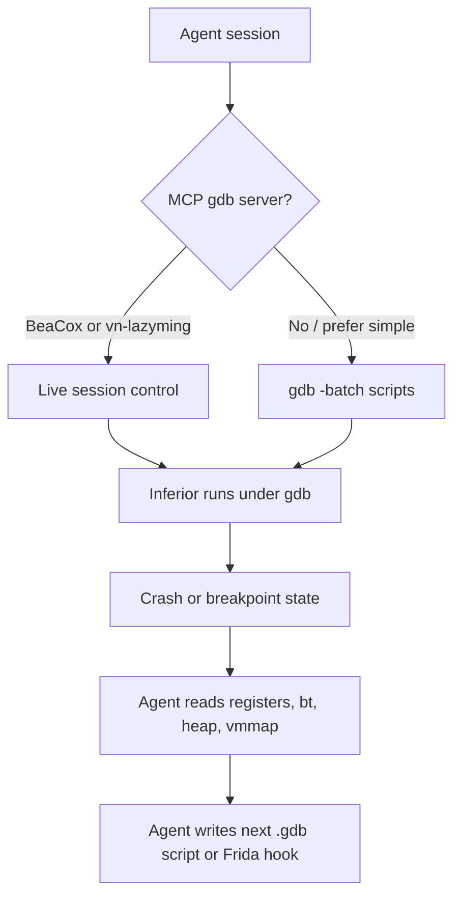
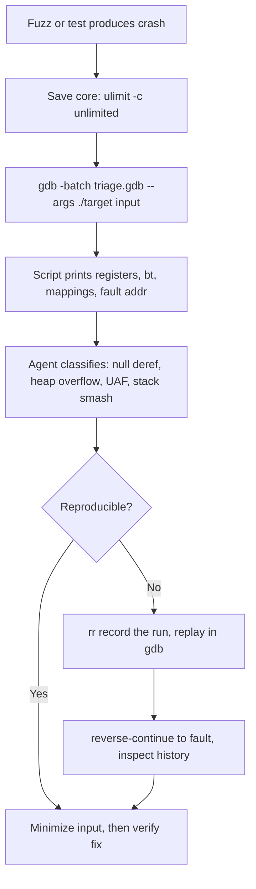
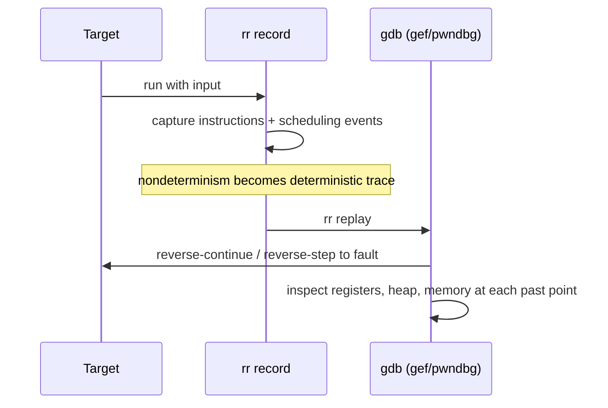

# gdb, gef, and pwndbg for Linux RE

> Tags: gdb, gef, pwndbg, dynamic-analysis, exploit-dev, heap, rr, record-replay, batch-mode, gdb-mcp | Difficulty: Intermediate | Prerequisites: Linux ELF basics, a debugger installed, one target binary

## Overview

gdb is the debugger on almost every Linux reverse-engineering bench. Stock gdb is terse. Two Python plugins change that.

- **gef** (GDB Enhanced Features) adds exploit-development views on top of gdb. It targets heap analysis, ROP discovery, and register context. It stays close to stock gdb commands.
- **pwndbg** adds the same class of features plus a rich auto-updating context pane. It also supports LLDB as an experimental backend.

You install one plugin, not both. gef and pwndbg both monkey-patch the gdb prompt, register hundreds of commands, and override the `context` display. Loading both produces unpredictable output and doubled startup time.

Choose gef when you want a lighter, script-first environment and you write most analysis as Python inside gdb. Choose pwndbg when you want the densest ready-made context display and built-in heap commands for glibc and other allocators. Both are MIT licensed.

This page covers the feature split, the gef Python API, pwndbg heap and context commands, the gdb MCP landscape, scripted crash triage and ROP inspection, rr record-replay, and batch mode for CI-style analysis.

## gef versus pwndbg: Feature Split

| Area | gef | pwndbg |
|---|---|---|
| Upstream | github.com/hugsy/gef | github.com/pwndbg/pwndbg |
| License | MIT | MIT |
| Stars (2026-11) | about 8.4k | about 11k |
| Debuggers | gdb only | gdb (stable) and LLDB (experimental) |
| Requirements | Python 3 in gdb | GDB 12.1+ with Python 3.10+ for pwndbg-gdb. LLDB 19+ with Python 3.12+ for pwndbg-lldb |
| Context display | Registers, stack, code, plus optional heap pane | Full context pane: registers, stack, disassembly, memory map, args, breakpoints, canary, hex, and heap |
| Heap commands | `heap`, `heap-analysis-helper`, chunk listing | `heap`, `hi`, `arena`, `arenas`, `tcache`, `tcachebins`, `bins`, `fastbins`, `unsortedbin`, `smallbins`, `largebins`, `mp`, `top_chunk`, `vis_heap_chunks`, `malloc_chunk`, `find_fake_fast`, `try_free` |
| Allocator support | glibc focused | glibc plus allocator modules for mallocng, jemalloc, musl, and slab (see pwndbg docs `docs/commands/allocators/`) |
| ROP tools | `ropper` integration was removed from current docs. Use `vmmap` plus external ROPgadget | `rop` command wraps ROPgadget. `ropper` also present |
| Canary | `canary` command | `canary` command plus automatic display in context |
| Scripting surface | First-class Python API. `GenericCommand`, `gef.*` modules, `gef-extras` | Python API exists but is less documented. Most automation uses `gdb.execute` and plain commands |
| Extensions | `~/.gef-extras/` scripts, `gef-extras` repo | `pwndbg` is a package. Custom commands live in your own Python inside the pwndbg environment |
| Maintenance | Active, pushed 2026-08 | Very active, pushed 2026-11-04 |

Notes on the split:

- pwndbg's heap command set is deeper. It walks arenas, bins, and tcache entries and prints chunk headers directly. gef covers the same ground with fewer commands.
- gef's Python API is the better base for scripted analysis. This matters when the agent writes custom GDB commands.
- pwndbg's context pane gives the agent one command (`context`) that dumps most state. gef splits state across several commands. For AI consumption, one dense command is easier to parse.
- pwndbg also ships an LLDB build. On macOS targets, LLDB plus pwndbg is the only path. gef does not support LLDB.
- gef is a single large script. pwndbg is a package tree with a `pwndbg.aglib` layer. pwndbg's architecture is easier to extend programmatically, but its API is not as stable a contract.

## Setup

### Install gef

```bash
bash -c "$(curl -fsSL https://raw.githubusercontent.com/hugsy/gef/main/scripts/gef.sh)"
```

The script finds your gdbinit file (`~/.gdbinit` or `~/.config/gdb/gdbinit`), backs it up, and appends a `source` line for `gef.py`. Restart gdb to load it.

### Install pwndbg

pwndbg documents several install paths. The documented install script is `docs/install.sh` in the repository. On Debian and Ubuntu it installs build dependencies and clones the package. Read `docs/install.sh` and `docs/setup.md` in github.com/pwndbg/pwndbg before running it. The supported GDB line is 12.1 or newer.

Quick check after install:

```bash
gdb ./target
gdb-pwndbg> pwndbg  # prints version and build info
gdb-pwndbg> context
```

For gef the equivalent check:

```bash
gdb ./target
gef-pwndbg ❯ checksec
gef-pwndbg ❯ context registers
```

### Batch mode notes

Both plugins load from `~/.gdbinit`. Batch runs inherit them unless you pass `-nx`. See the Batch Mode section below.

## gef Python API for Scripted Analysis

gef is written in Python and registers itself as a library inside GDB. You write a Python file, load it with `source`, and it becomes a new gef command.

Minimal command skeleton (from gef docs, `docs/api.md`):

```python
@register
class CrashTriage(GenericCommand):
    """Dump crash-relevant state."""
    _cmdline_ = "crash-triage"
    _syntax_  = _cmdline_

    @only_if_gdb_running
    def do_invoke(self, argv):
        # gef.arch gives the current architecture object
        print(f"arch={gef.arch}")
        print(f"pc={gef.arch.pc:#x}")
        # gef.memory reads inferior memory safely
        # gef.heap walks the glibc heap
        # gef.ui and gef.dbg handle output
```

Load it in gdb:

```text
gef➤ source /path/to/crash_triage.py
[+] Loading 'CrashTriage'
gef➤ crash-triage
```

API surface worth knowing (see `docs/api/gef.md` in the repo):

- `gef.arch` — current architecture. Exposes `pc`, `sp`, registers, endianness.
- `gef.memory` — read/write inferior memory, page maps, hexdump helpers (`p8`–`p64`, `u8`–`u64`).
- `gef.heap` — glibc heap walker used by the `heap` command.
- `gef.elf` / `gef.binary` — ELF metadata, symbols, PIE base.
- `gef.checksec()` — protection check as a callable.
- `gef.hexdump()` — formatted memory dumps for reports.
- `gef.gdb_disassemble()`, `gef.gdb_execute_external()` — wrap gdb builtins.
- Decorators: `only_if_gdb_running`, `only_if_gdb_target_local`, `experimental_feature`, `only_if_events_supported`.
- `gef.config` — read and set gef settings from scripts (`gef config` command mirrors it).

### Custom commands for automation

A useful pattern is a command that captures state once and returns parseable text:

```python
@register
class CrashSnapshot(GenericCommand):
    _cmdline_ = "crash-snapshot"
    _syntax_ = "crash-snapshot [outfile]"

    @only_if_gdb_running
    def do_invoke(self, argv):
        out = argv[0] if argv else "/tmp/crash_snapshot.txt"
        with open(out, "w") as f:
            f.write(gdb.execute("info registers", to_string=True))
            f.write(gdb.execute("bt", to_string=True))
            f.write(gdb.execute("x/8gx $rsp", to_string=True))
        print(f"snapshot -> {out}")
```

`gdb.execute(..., to_string=True)` returns gdb output as a string. That is the bridge between gef commands and structured output the agent can consume.

### gef-extras

gef supports external command packs. The community collection lives at github.com/hugsy/gef-extras. gef also auto-loads scripts placed in `~/.gef-extras/`. Put one Python file per command there and restart gdb. Check the current directory layout in the gef repo docs before relying on auto-load behavior. The layout has changed across releases.

## pwndbg Context Display and Heap Commands

pwndbg prints a context pane on every stop. It shows registers, disassembly around `$pc`, stack contents, memory map summary, arguments when debug info exists, breakpoints, the canary value, and heap state. Disable parts of it in `~/.gdbinit` or with `pwndbg config`.

Key commands beyond the context pane:

| Command | What it does |
|---|---|
| `vmmap` | Memory map with per-region annotations. Also powers `search` over memory |
| `xinfo`, `nearpc`, `telescope` | Inspect memory around symbols or the stack pointer with tagging |
| `heap` | Walk the current heap chunk by chunk. Options `-v` verbose, `-s` simple, `--count N` |
| `hi` (`heapinfo`) | Heap summary for one address or the active heap |
| `bins`, `fastbins`, `unsortedbin`, `smallbins`, `largebins`, `tcache`, `tcachebins` | Bin contents with chunk addresses |
| `arena`, `arenas` | malloc arena info |
| `mp` | `mp_` struct: malloc tunables and hooks |
| `top_chunk` | Top chunk header |
| `vis_heap_chunks` (alias `vis`) | Visual chunk map of the heap |
| `malloc_chunk ADDR` | Decode one chunk header at `ADDR` |
| `find_fake_fast` | Locate candidate fake fastbin chunks |
| `try_free ADDR` | Simulate what `free(ADDR)` would do on the current heap state. Treat as stateful. Verify behavior in your version |
| `rop` | ROPgadget over loaded executable regions. Options for grep, memory limit, symbols |
| `onegadget` | List one-gadget candidates for the loaded libc |
| `leakfind`, `search` | Hunt for pointers into interesting regions |
| `canary`, `checksec`, `got`, `sigreturn`, `patch`, `cyclic` | Exploit-dev helpers |
| `ipython` | Drop into IPython inside the inferior session. Useful for scripted analysis |

Heap commands assume the process is alive and the heap is initialized. `OnlyForSaneHeap` guards print an error instead of garbage when the heap state is inconsistent.

## gdb MCP Servers

The gdb MCP landscape is young and fragmented. Unlike Ghidra, IDA, and Binary Ninja, there is no dominant, widely adopted gdb MCP server as of 2026-11. Most community servers are small, single-maintainer projects. Tool catalog notes that gdb has no first-party MCP and community wrappers were immature. That is still mostly true, with one exception worth watching.

### BeaCox/gdb-mcp

BeaCox/gdb-mcp is the most complete option found. MIT licensed. Last pushed 2026-10-30. Version 0.4.0. Source: github.com/BeaCox/gdb-mcp.

What it does:

- Drives gdb through GDB/MI, not by scraping terminal output.
- Multi-session. Each target gets an explicit `session_id`.
- Tools for local executables, core files, `attach`, `gdbserver` connect and managed launch.
- Pwn-oriented tools for stripped binaries: `gdb_pwn_context`, `gdb_checksec`, `gdb_vmmap_structured`, `gdb_rva_info`, `gdb_telescope`, `gdb_nearpc`, `gdb_got`, `gdb_piebase`.
- rr integration: `gdb_rr_record`, `gdb_start_rr_replay_session`, `gdb_reverse_continue_and_context`, `gdb_reverse_step_and_context`.
- Safety model: read and control tools on by default. Raw gdb eval, inferior calls, and memory writes need `--unsafe` or `GDB_MCP_ALLOW_UNSAFE=1`.
- HTTP backend binds loopback only. Remote exposure requires explicit auth flags.

Install for Claude Code:

```bash
claude mcp add --scope user gdb -- uvx gdb-mcp
# or pinned:
claude mcp add --scope user gdb -- \
  uvx --from git+https://github.com/BeaCox/gdb-mcp.git@v0.4.0 gdb-mcp
```

Codex equivalent is in the repo README (`codex mcp add gdb -- uvx gdb-mcp`).

### Other servers

| Repo | State | Notes |
|---|---|---|
| vn-lazyming/gdb_mcp | Active, low stars | Lightweight bridge to a gdb session you already have open. Auto-detects gef or pwndbg. Lets the agent send commands to your live session |
| Ipiano/gdb-mcp | 52 stars, last push 2026-03 | MIT. Stale. Feature set unclear from repo metadata |
| 0xmortuex/gdbstub-mcp | Active, 1 star | MCP over QEMU's gdbstub. No gdb binary needed. Kernel-debug oriented |
| ycqaq233/gdb-mcp-server | Last push 2026-05 | Advertises pwndbg integration. Unverified depth |
| Zeraissh/stm32-gdb-mcp | Active, 2 stars | GDB plus OpenOCD for STM32 hardware |

The generic advice: prefer BeaCox/gdb-mcp for new work, or drive gdb through the agent's shell tool with batch scripts. The shell path is less structured but has zero new dependencies and works with gef and pwndbg today.



## Automated Crash Triage

The reliable pattern is deterministic gdb batch work plus agent reasoning over the output.



A triage gdb script that works with plain gdb, gef, or pwndbg:

```gdb
# triage.gdb — run with: gdb -batch -x triage.gdb --args ./target input.bin
set pagination off
set confirm off
set print pretty on

run

printf "\n=== CRASH ===\n"
printf "\n=== REGISTERS ===\n"
info registers rip rsp rbp rax rbx rcx rdx rsi rdi
printf "\n=== BACKTRACE ===\n"
bt 12
printf "\n=== FAULT CONTEXT ===\n"
x/4i $pc
x/8gx $rsp
printf "\n=== MAPS ===\n"
info proc mappings
printf "\n=== DONE ===\n"
quit
```

Notes:

- After `run`, if the inferior stops on SIGSEGV, gdb prints `Program received signal SIGSEGV` and the following commands run. If the program exits cleanly, the same commands run against the final state. Check output for `exited` versus `SIG` before trusting register dumps.
- `$pc` on x86-64. Adjust register names per architecture (`$pc`, `$x0`, `$ra`).
- With pwndbg loaded, `context` replaces the manual dumps. With gef, `context registers` and `vmmap` give the same data. Keep one script variant per plugin or detect the plugin in Python.
- To get the faulting address, read `$_siginfo._sifields._sigfault.si_addr` in gdb 12+ or parse it from the signal line. Mark this in output so the agent can use it.
- Bound the output. `bt 12`, not `bt`. Full `info proc mappings` is fine. Do not dump large memory ranges into the transcript.

Batch crashes produce cores reliably when the core pattern allows it:

```bash
ulimit -c unlimited
echo '/tmp/cores/core.%p.%e.%t' | sudo tee /proc/sys/kernel/core_pattern
```

Then replay any core later: `gdb -batch -c /tmp/cores/core.123 ./target`.

For the agent side, give it a fixed prompt contract:

```text
Read /tmp/crash.log. It is gdb batch output from ./target.
Classify the crash. Report: fault address, instruction, top 3 frames,
whether the address is in a mapped writable region, and the likely bug type.
Do not propose a fix. Do not invent symbol names.
```

## ROP-Chain Inspection

Two jobs: find gadgets and validate a chain against the live process.

Finding gadgets in batch:

```bash
# pwndbg inside gdb
gdb -batch -ex 'set pagination off' -ex 'pwndbg' \
    -ex 'starti' -ex 'rop --depth 10' --args ./target
```

Or run ROPgadget/ropper externally against the binary or libc. pwndbg's `rop` command searches loaded memory regions, which matters for PIE and libc gadgets. gef users should run ROPgadget per `vmmap` region.

Validating a chain in gdb:

```gdb
# assume chain.txt holds raw addresses, one per line
tbreak *main
run
python
import gdb
lines = [l.strip() for l in open("chain.txt") if l.strip()]
for i, a in enumerate(lines):
    gdb.execute(f"set {{long}}($rsp+{i*8}) = {a}")
end
x/16gx $rsp
si
x/3i $pc
quit
```

Check `checksec` first. PIE, NX, canary, and RELRO decide whether a chain can work at all. gef and pwndbg both ship `checksec`. ASLR state matters: gdb disables ASLR by default (`set disable-randomization on`). That makes local chains deterministic but hides real-world layout. For remote work, re-run under `setarch -R` only when you control the target.

## rr Record and Replay

rr is Mozilla's record-and-replay debugger. It records a run once, then replays it deterministically under gdb with reverse execution. Source: github.com/rr-debugger/rr, MIT, about 10.7k stars, actively maintained.

Use it for bugs that do not reproduce on demand: race conditions, heap corruption that depends on allocation timing, crashes seen once in the field.

```bash
# record (needs perf counters, rr falls back when absent)
rr record -- ./target input.bin

# replay: launches gdb attached to the trace
rr replay
```

Inside the replayed gdb session (gef and pwndbg load normally):

```text
(gdb) reverse-continue    # run backward to previous stop or signal
(gdb) reverse-stepi       # step one instruction backward
(gdb) reverse-next        # step over backward
(gdb) run                 # restart from the beginning of the trace
(gdb) record              # start a nested recording? no — use rr's own commands
```

Also useful: `rr ps` lists recorded sessions. `rr fail` shows why a recording failed. For repeatable checkpoints inside a session, try gdb `checkpoint` and `restart` during `rr replay`. Support varies by rr version. Check `man rr` for the current flag set, including chaos-mode scheduling options.

Constraints:

- Linux only. x86 and x86-64 primarily. AArch64 support exists. Check rr docs for your architecture.
- rr disables ASLR during recording and needs `setarch` personality. It refuses to record some binaries.
- Recording is slow, often 10x or more. Use it for the repro attempt, not for every fuzz iteration.
- Multi-threaded programs record scheduling events, so races replay faithfully. That is the point.
- rr traces are large. Put them on fast local disk and delete after triage.
- gef works inside `rr replay` because replay is just gdb with a process backend. pwndbg should also load. Verify heap commands on your version.



## Batch Mode for CI-Style Analysis

The CI pattern: run gdb headless over a corpus, emit structured results, let the agent or a script classify.

```bash
#!/usr/bin/env bash
# triage-all.sh — one line of output per input file
set -u
BIN=./target
for f in corpus/*; do
  gdb -batch -nx \
      -ex "set pagination off" \
      -ex "source $HOME/.local/share/gef/gef.py" \
      -ex "run < $f" \
      -ex "printf \"FILE=$f \\" \
      -ex "printf \"PC=%p \\", \$pc" \
      -ex "bt 3" \
      --args "$BIN" > "logs/$(basename $f).log" 2>&1
  grep -q "SIGSEGV\|SIGABRT" "logs/$(basename $f).log" && echo "CRASH $f"
done
```

Important flags:

- `-batch` — exit after commands. No prompt.
- `-nx` — skip `~/.gdbinit`. Required when you want a clean, fast run or a specific plugin only.
- `-x file` / `-ex "cmd"` — run gdb commands. `-x` before `-ex` order matters.
- `-ex "source path/to/gef.py"` — load gef without touching gdbinit. pwndbg has an equivalent source path. Check `docs/setup.md`.
- `--args prog args` — everything after is the inferior command line.
- `-p PID` attach, `-c core` core file, `-readnever` for faster core loads when you do not need memory.
- `set confirm off`, `set pagination off` — mandatory in batch.
- `set logging file` + `set logging on` — capture output inside gdb itself.

Gotchas:

- gdb batch exits 0 even when the inferior crashes or a command errors. Detect crashes by grepping output for `SIG` or by having the script `shell touch /tmp/crashed`.
- gef and pwndbg slow startup by a few hundred milliseconds each. For thousands of runs, benchmark `-nx` plus manual `source` versus full gdbinit.
- `run < file` redirects stdin for the inferior. For file-argument targets, pass the path as argv instead.
- Do not let the agent run interactive gdb. Give it batch scripts. Interactive sessions through MCP are for exploration, not bulk work.

## Pitfalls

- **Loading both plugins.** gef and pwndbg fight over the prompt and context. Pick one per environment. Use `-nx` in batch to enforce it.
- **Trusting batch register dumps after clean exit.** Check the log for `exited normally` first.
- **ASLR disabled by default in gdb.** `set disable-randomization on` is gdb's default. Real addresses differ. For exploit validation, run outside gdb or re-enable randomization.
- **`try_free` and similar pwndbg commands touch process state.** They simulate or call inferior functions depending on version. Snapshot or restart before experimenting.
- **gef API drift.** `gef.*` internals change between releases. Pin the gef commit in automation scripts.
- **Stale MCP servers.** Most gdb MCP projects are months old. Check `pushed_at` before adopting. BeaCox/gdb-mcp is the current best bet, and even it is young.
- **rr on unsupported kernels.** rr needs specific kernel settings and perf access. Test `rr record` on a hello-world binary before building a pipeline around it.
- **Huge gdb output into the agent.** Cap `bt` depth, use `x/Ngx` with small N, and write full dumps to files the agent reads selectively.
- **gef install script edits gdbinit silently.** It backs up first, but read the diff. In shared environments, prefer `-nx` plus explicit `source`.

## See Also

- `../05-tools/tool-catalog.md` — debugger and dynamic-tool catalog with MCP status
- `../05-tools/mcp-catalog.md` — MCP server inventory and install commands
- `./frida-deep-dive.md` — Frida instrumentation for what gdb cannot reach
- `./frida-deep-dive.md` — Frida MCP comparison
- `./unpacking-dumping.md` — dumpers and unpackers that feed gdb targets
- `./emulation-unicorn-qiling.md` — emulation as a verification oracle
- `../06-topics/malware-analysis.md` — malware triage pipeline that uses gdb batch
- `../07-advanced/anti-analysis.md` — anti-debug techniques that break naive gdb scripts
- `../03-decomp/verification-loop.md` — claim verification patterns applicable to crash triage
