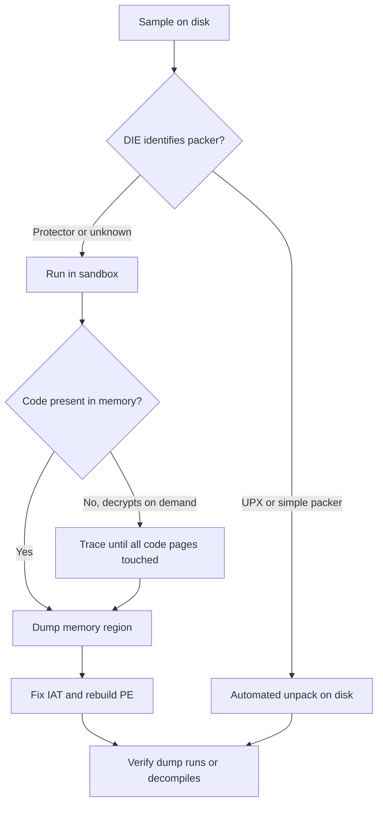
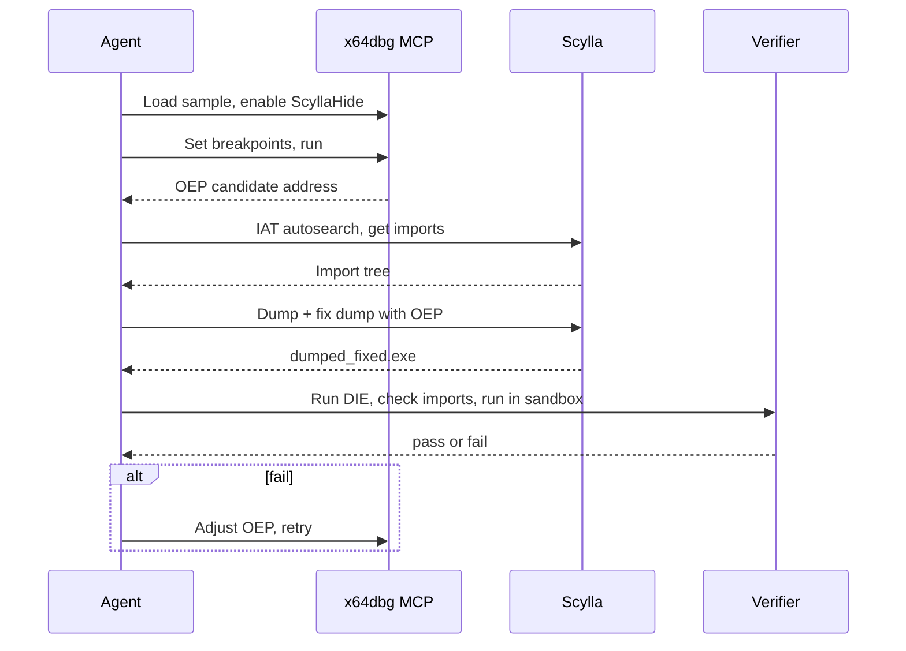

# Unpacking and Dumping at Runtime

> Tags: unpacking, pe-sieve, scylla, scyllahide, x64dbg, frida, de4dot, iat-fix, hollows_hunter | Difficulty: intermediate | Prerequisites: `../01-setup/malware-isolation.md`, `../07-advanced/anti-analysis.md`, `../03-decomp/triage-and-mapping.md`

## Overview

Packers compress or encrypt the real code so the file on disk is not the code that runs. The unpacker stub sits at the entry point. It decompresses or decrypts the original sections into memory. It then jumps to the original entry point, the OEP. Static analysis of the packed file shows you the stub. It does not show you the payload.

The fix is to dump the process after the unpacker finishes. Then you rebuild the import table and fix the PE headers. You get a file a decompiler can read.

This page covers four cases:

1. Simple packers. UPX and friends. Automated tools finish the job.
2. Protector packers. VMProtect, Themida, custom cryptors. You need a debugger and memory forensics.
3. In-memory implants. Process hollowing, reflective DLL injection, shellcode. No file exists on disk to unpack.
4. .NET packers. The target is managed metadata and IL, not machine code. Different tools apply.



## Step-by-Step

### 1. Identify the packer first

Do not guess. Run identification before you choose a tool.

```bash
# Detect It Easy, CLI build
./diec -d sample.exe          # detect packer/protector signatures
diec -e sample.exe            # entropy report per section

# pe-sieve on the running process later, or on a live PID
pe-sieve64.exe /pid 1234 /json
```

DIE marks recognized packers such as `UPX`, `MPRESS`, `ASPack`, `VMProtect`, `Themida`, `Enigma`, `.vmp` sections. It also detects artifacts of Scylla and ImpRec reconstructions, so a sample that "looks packed" may already be a broken dump. Source: https://github.com/horsicq/Detect-It-Easy

Key numbers to record from DIE output:

- Section names. UPX uses `UPX0`/`UPX1`. Themida uses `.themida` or random names. VMProtect adds `.vmp0`/`.vmp1`.
- Section entropy. Packed sections sit near 8.0 bits per byte.
- Import table size. A packer stub imports only a handful of APIs. The real imports are resolved at runtime.
- Entry point location. If the EP sits in the last section or in a high-entropy section, the stub is there.

### 2. UPX and simple packers

UPX is the most common packer in the wild. Its compression is not encryption. The format is documented and the tool decompresses itself.

```bash
upx -d packed.exe -o unpacked.exe     # decompress in place semantics; writes unpacked
upx -t packed.exe                      # test integrity without decompressing
upx -l packed.exe                      # list packed info
```

Notes:

- UPX supports PE, ELF, Mach-O, and others. `upx -d` on an ELF works the same way.
- Some authors modify UPX output so `upx -d` fails. The error `CantUnpackException` or a checksum failure means tampering.
- For modified UPX, use a generic unpacker. `upx -d` variants exist, but the reliable fallback is the debugger dump in step 3. UPX unpacking is simple: it decompresses sections, rebuilds headers, jumps to the OEP. The OEP is usually the original EP stored in the UPX header.
- Other "simple" packers (ASPack, MPRESS, Petite) have the same shape: stub at EP, real code decrypted at runtime. Automated unpackers exist for some. When no tool exists, treat them like a protector: go to step 3.

The general rule: if DIE says UPX, try `upx -d` first. It takes one second. If it fails, move on.

### 3. The debugger dump workflow: x64dbg plus ScyllaHide plus Scylla

This is the standard manual pipeline for Windows PE protectors. It works for VMProtect and Themida user-mode samples that unpack fully in memory.

Install set:

- x64dbg. https://github.com/x64dbg/x64dbg
- ScyllaHide plugin. https://github.com/x64dbg/ScyllaHide — anti-anti-debug. Hides the debugger from the target.
- Scylla plugin inside x64dbg. https://github.com/x64dbg/Scylla — the IAT rebuilder and dumper.

#### Step 3.1: Load and hide

1. Start x64dbg. Load the sample.
2. Enable ScyllaHide. Open Plugins, ScyllaHide Options. Enable the profile that matches your debugger. For VMProtect choose the VMProtect profile. For unknown protectors start with the "basic" or "VMProtect" profile and add options as checks fire.
3. Set x64dbg to ignore or pass exceptions the protector expects. ScyllaHide handles most debugger checks. Check the ScyllaHide profile for "TLS callbacks" and "PEB" options.

ScyllaHide supports x64dbg through its plugin. It hooks `IsDebuggerPresent`, `NtQueryInformationProcess`, `CheckRemoteDebuggerPresent`, hardware breakpoint checks, and timing checks. It runs in user mode. Kernel-mode protectors need TitanHide instead. Source: https://github.com/x64dbg/ScyllaHide

#### Step 3.2: Find the OEP

The OEP is where the stub jumps after unpacking. You need it for the dump. Three methods, in order of reliability:

Method A — break on the jump. Most stubs end with a jump or call into the unpacked code. Set a breakpoint on the entry point instruction. Run. The stub executes. Watch for the moment execution leaves the stub section.

Method B — memory breakpoint on the stub section. After the stub finishes, it often does not return. Set a hardware breakpoint on write or execute over the first bytes of the original `.text`. When the unpacker writes the original code there, you catch the tail of unpacking.

Method C — API breakpoints. Break on `VirtualProtect`, `VirtualAlloc`, `NtProtectVirtualMemory`. Protectors flip page permissions when they finish decrypting a region. The last `VirtualProtect` before the jump to OEP is a good OEP candidate.

Practical x64dbg sequence for a typical protector:

```
# In x64dbg command bar
bphws 0x401000 , x        # hardware exec bp on candidate OEP region
run
# ... stub runs, decrypts, jumps ...
# when bp fires, you are at or near OEP
```

If the protector decrypts sections on demand, no single OEP exists for all code. Dump what is decrypted at the moment you stop. See Pitfalls.

#### Step 3.3: Dump with Scylla

Scylla runs as an x64dbg plugin. It has three tabs: IAT Autosearch, Get Imports, and Dump/Fix.

1. Make sure the process is at the OEP or past it, with all code decrypted.
2. Open Scylla: Plugins, Scylla.
3. In the Scylla window, the module list shows the main module. Select it.
4. Click IAT Autosearch. Scylla scans memory for the Import Address Table.
5. Click Get Imports. The import tree populates. Check it: kernel32, user32, ws2_32 entries should show names, not `<<<INVALID>>>`.
6. Enter the OEP address in the OEP field. This is the address you found in step 3.2.
7. Click Dump. Scylla writes a raw memory image of the module.
8. Click Fix Dump on the dumped file. Scylla rebuilds the import table inside the dump.
9. Save the fixed dump.

The Scylla workflow in keyboard terms: `CTRL+D` dump, `CTRL+F` fix dump, `CTRL+R` PE rebuild, `CTRL+I` IAT autosearch, `CTRL+G` get imports. Source: https://github.com/x64dbg/Scylla

#### Step 3.4: Verify the dump

A dump that loads is not a dump that works. Verify in this order:

```bash
# 1. Does DIE still see a protector?
diec -d dumped.exe

# 2. Does it have imports?
objdump -x dumped.exe | grep -A2 "Import Table"   # or use pestudio / CFF Explorer

# 3. Does it run?
./dumped.exe    # in the sandbox, with network sinkholed

# 4. Does it decompile?
# Open in Ghidra or IDA. Check that functions look like real code, not garbage.
```

If the dump crashes at the OEP, the OEP address is wrong or the dump was taken before all sections decrypted. If imports show `<<<INVALID>>>`, Scylla picked the wrong IAT base. Re-run IAT Autosearch or use the "Pick DLL" and API resolve options.

### 4. In-memory implants: pe-sieve and hollows_hunter

Sometimes there is no file to unpack. The implant lives only in a remote or hollowed process. pe-sieve finds it.

pe-sieve (https://github.com/hasherezade/pe-sieve) scans a process and recognizes:

- Replaced or injected PE images
- Shellcode
- Inline hooks
- In-memory patches
- Hollowed processes, process doppelgänging, reflective DLL injection

It dumps the malicious material to disk. Output is a set of dump files plus a JSON report.

```bash
# Scan a running process
pe-sieve64.exe /pid 1234 /json /dir out/

# Scan all processes
pe-sieve64.exe /all /json /dir out/

# HollowsHunter scans the full system, not just one process
hollows_hunter64.exe /json /dir out/
```

Workflow for an agent:

1. Detonate the sample in the sandbox.
2. Run pe-sieve on the sandbox VM after a delay. The implant may inject after a few seconds.
3. Collect the dump files.
4. Run DIE and capa on each dump.
5. Feed the cleanest dump to the decompiler.

pe-sieve is built on libPEConv. The DLL version exposes an API for integration. HollowsHunter is the multi-process wrapper. Source: https://github.com/hasherezade/pe-sieve

### 5. Frida-based dumpers

Frida gives you scripted memory access. Use it when x64dbg is not available, when the target is Linux or Android, or when you want the agent to drive the dump.

Basic Frida dump pattern for a PE:

```javascript
// dump.js — run with frida -f target.exe -l dump.js
// or frida -n target.exe -l dump.js for an attached process

var range = Process.enumerateRanges({ protection: 'r-x', coalesce: true });
// or scan for MZ headers in memory
var mz = Memory.scanSync(Process.enumerateRanges({ protection: 'r--' })[0].base,
                          Process.enumerateRanges({ protection: 'r--' })[0].size,
                          '4d 5a'); // 'MZ'
```

A more practical approach: hook the function that signals unpacking is done.

```javascript
// Hook VirtualProtect or similar to catch the moment pages become executable
var vp = Module.findExportByName('kernel32.dll', 'VirtualProtect');
Interceptor.attach(vp, {
  onEnter: function(args) {
    // args[0] = address, args[1] = size, args[2] = newProtect
    // PAGE_EXECUTE_READ = 0x20, PAGE_EXECUTE_READWRITE = 0x40
    var prot = args[2].toInt32();
    if (prot === 0x20 || prot === 0x40) {
      console.log('VirtualProtect to exec: ' + args[0] + ' size ' + args[1]);
      // dump the region
      var data = Memory.readByteArray(args[0], args[1].toInt32());
      var f = new File('/tmp/dump_' + args[0] + '.bin', 'wb');
      f.write(data);
      f.close();
    }
  }
});
```

For .NET, hook `Assembly.Load` or scan for decrypted metadata. See section 6.

Frida can also dump specific modules:

```javascript
var m = Process.getModuleByName('target.exe');
var data = m.base.readByteArray(m.size);
var f = new File('/tmp/module_dump.bin', 'wb');
f.write(data);
f.close();
```

This dumps the raw module image. It does not fix the IAT. Run the result through Scylla or a PE rebuilder.

Kahlo-mcp and other Frida MCP servers let the agent attach, spawn, and run scripts without manual Frida CLI. See `../05-tools/mcp-catalog.md`.

### 6. .NET unpacking

.NET packers work differently from native packers. The assembly on disk is a valid .NET file with encrypted or stubbed method bodies. The CLR loads it. The packer stub decrypts method bodies at runtime or on first call.

Two operations are needed:

1. **Dump the decrypted assembly from memory.** Tools: MegaDumper, ExtremeDumper, or a Frida script that hooks `Module.Load` / `Assembly.Load` and writes the bytes.
2. **Deobfuscate the managed code.** Tools: de4dot, de4dot-cex, or ILSpy for manual cleanup.

MegaDumper and ExtremeDumper are video-tutorial tools by 0xd4d. They automate the memory dump for .NET Reactor, Themida, and similar .NET packers. No public repository exists. The workflow is: run the packed exe, attach the dumper, it writes the decrypted assembly. Source: unverified, tool is distributed via video.

de4dot is the standard .NET deobfuscator. The original repository at github.com/de4dot/de4dot is archived and read-only. Use a maintained fork:

- ViRb3/de4dot-cex — full ConfuserEx support, x86 native mode. https://github.com/ViRb3/de4dot-cex
- de4dot-cex is the most current fork for ConfuserEx-protected assemblies.

For .NET Reactor, de4dot has partial support. The reactor slab method decrypts strings and resources. Some .NET Reactor versions need manual dumping first.

Managed vs native unpacking differences:

| Aspect | Native PE | .NET assembly |
|---|---|---|
| What is encrypted | Machine code sections | Method bodies, strings, resources, metadata |
| When decryption happens | At load, before OEP | Per-method on first JIT, or at module load |
| Dump target | Process memory image | Loaded assembly bytes in memory |
| IAT equivalent | Import Address Table | Metadata token resolution, P/Invoke stubs |
| Rebuild tool | Scylla, PE-bear, CFF Explorer | de4dot, dnlib-based scripts |
| Decompiler | Ghidra, IDA | ILSpy, dnSpyEx, ilspycmd |
| Verification | Does the PE run? | Does the assembly load in dnSpy? Does it decompile? |

For .NET, the "unpack" step is often just dumping the module from memory after it has fully loaded. The "fix" step is de4dot or manual metadata repair.

### 7. Automating the dump-fix-verify loop with an agent

The manual loop is: identify, run, find OEP, dump, fix IAT, verify. An agent can drive this if you give it the right tools and a verification gate.

Pattern:



Agent prompt template:

```
You are unpacking a PE sample. The sample is at /samples/target.exe.
DIE identified it as [packer name].

Steps:
1. Open in x64dbg with ScyllaHide profile [profile].
2. Find the OEP. Try: break on VirtualProtect, watch for exec-protect transitions.
   Candidate OEP is the address where execution leaves the packer stub section.
3. Run Scylla: IAT Autosearch, Get Imports, Dump, Fix Dump.
4. Save as /samples/target_unpacked.exe.
5. Verify: run diec -d on the output. It must not detect [packer].
   Check imports are not all INVALID.
   Run the binary in the sandbox for 10 seconds.
6. If verification fails, report the failure mode and try one adjustment.
   Do not loop more than 3 times.
```

The verification gate is the key. Without it, the agent will produce a dump that looks plausible but crashes on the OEP. The gate is deterministic: DIE output, import table inspection, and a sandbox run.

For Frida-based dumps, the agent writes the script, runs it, collects the dump files, and runs the same verification. The script is code. Treat it as such. Run it in the sandbox.

## Pitfalls

- **Dumping too early.** The stub decrypts sections on demand. If you dump before all pages are touched, parts of the code are still encrypted. The dump decompiles to garbage in those regions. Fix: run the sample longer, or use a memory breakpoint on every section to confirm it was written.

- **Wrong OEP.** Scylla needs the OEP to rebuild the PE header correctly. A wrong OEP produces a dump that loads but crashes immediately. The entry point field in the PE header points to garbage.

- **Themida and VMProtect anti-dump.** Both erode or corrupt the PE header after unpacking. Scylla's "dump" may produce a file with a broken header. Fix: use Scylla's "dump memory regions" option and rebuild manually, or use PE-bear / CFF Explorer to repair sections.

- **IAT not found.** Scylla's IAT Autosearch can fail if the protector uses a custom import resolution scheme. Themida and VMProtect often build the IAT in a non-standard location. Fix: use Scylla's "Pick DLL" and manual API resolve, or trace the import calls and rebuild by hand.

- **TLS callbacks.** Some protectors run code in TLS callbacks before the entry point. If you break at the OEP but the TLS callback already ran anti-debug checks, the process may have exited. Fix: ScyllaHide's TLS callback option, or break on `LdrpCallTlsInitializers`.

- **.NET Reactor slab.** .NET Reactor encrypts method bodies and decrypts them on first JIT. A memory dump before all methods are called has encrypted bodies. Fix: run the application through its main paths, or use MegaDumper which hooks the JIT.

- **ConfuserEx constants.** de4dot-cex decrypts constants by invoking methods. If the assembly is malware, de4dot-cex executes it. Run in a VM. Source: https://github.com/ViRb3/de4dot-cex

- **UPX modified headers.** `upx -d` fails on modified UPX. The stub may have a corrupted checksum or renamed sections. Fix: use a debugger dump. UPX is simple enough that the stub finishes quickly.

- **Agent hallucination on OEP.** An agent asked to "find the OEP" may guess an address that looks like code. The verification gate catches this: if the dump crashes at the entry point, the OEP was wrong.

## See Also

- `../07-advanced/anti-analysis.md` — anti-debug and anti-dump checks you must bypass first
- `../05-tools/mcp-catalog.md` — Frida MCP servers for agent-driven instrumentation
- `./frida-deep-dive.md` — Frida scripting patterns
- `../03-decomp/triage-and-mapping.md` — identify packer before you dump
- `../03-decomp/verification-loop.md` — verification gates for agent output
- `../06-topics/deobfuscation.md` — VMProtect, Themida, OLLVM deobfuscation
- `../06-topics/managed-code-re.md` — .NET, Java, Go decompiler workflows
- `../06-topics/malware-analysis.md` — malware triage pipeline
- `../01-setup/malware-isolation.md` — sandbox setup for running packed samples

## References

- UPX: https://upx.github.io/
- Detect It Easy: https://github.com/horsicq/Detect-It-Easy
- x64dbg: https://github.com/x64dbg/x64dbg
- Scylla: https://github.com/x64dbg/Scylla
- ScyllaHide: https://github.com/x64dbg/ScyllaHide
- pe-sieve: https://github.com/hasherezade/pe-sieve
- de4dot (archived): https://github.com/de4dot/de4dot
- de4dot-cex: https://github.com/ViRb3/de4dot-cex
- Frida: https://github.com/frida/frida
