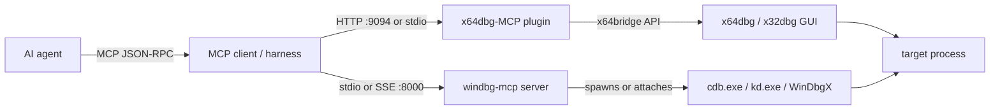
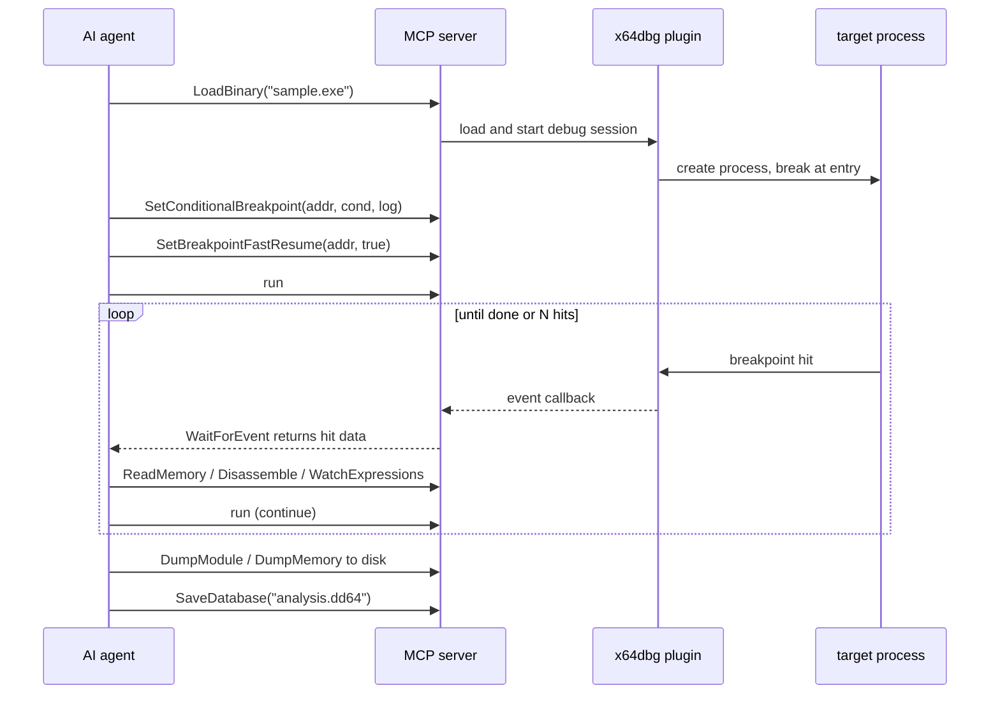

# x64dbg and WinDbg Automation

> Tags: x64dbg, windbg, mcp, breakpoints, dynamic-analysis, automation | Difficulty: intermediate | Prerequisites: basic Windows reversing, an MCP-capable agent client, `../05-tools/mcp-catalog.md`

## Overview

Two Windows debuggers cover almost all dynamic work. x64dbg handles user-mode PE targets. WinDbg handles crash dumps, drivers, and kernel debugging. Neither shipped with agent support. Community MCP servers changed that.

The two main options in 2026:

| Server | Target debugger | Transport | Maturity |
|---|---|---|---|
| duty1g/x64dbg-mcp-server | x64dbg and x32dbg | HTTP + SSE | About 2,800 stars, reported |
| mnemonic-re/WinDbgX-MCP | WinDbg, WinDbgX, cdb, kd | stdio + SSE | Pre-1.0, PRs closed |

Both let an agent set breakpoints, read memory, step, dump modules, and run debugger commands. Both still need a real Windows host. x64dbg is a GUI application, so its MCP plugin lives inside the GUI process. WinDbg MCP drives console debuggers (`cdb.exe`, `kd.exe`) and can attach to a live WinDbgX GUI window.

Use x64dbg MCP for interactive user-mode work: unpacking, license checks, protocol reversing on desktop apps. Use WinDbg MCP for dumps, kernel drivers, and anything that needs symbols and `!` extension commands.

## Setup

### x64dbg-MCP Server (duty1g)

The plugin is a native Zig binary. It has no runtime dependencies. It builds for both x32 and x64 from one command.

1. Download a release from github.com/duty1g/x64dbg-mcp-server/releases, or build it:

```bash
zig build -Doptimize=ReleaseSafe --prefix dist
```

Zig 0.16-dev or later is required. The build cross-compiles from Linux, macOS, or WSL.

2. Copy the contents of `dist/` into your x64dbg root folder. The layout mirrors x64dbg:

```text
dist/
├── x32/plugins/x64dbg-MCP-Server.dp32
└── x64/plugins/x64dbg-MCP-Server.dp64
```

3. Launch x64dbg. The MCP server starts automatically.

Default ports:

- x64dbg: `0.0.0.0:9094`
- x32dbg: `0.0.0.0:9095`

4. Configure the bind address and token. Open `Plugins > x64dbg-MCP Server > Configure MCP Server`. Set `127.0.0.1` for local-only access. `0.0.0.0` is needed for WSL or remote access.

A Bearer token is generated on first run. It is required on every request. It is stored in `mcp_config.json` next to `x64dbg.exe`. The server returns `401 Unauthorized` without it. Click `Generate` to rotate it.

5. Add the server to your MCP client config:

```json
{
  "mcpServers": {
    "x64dbg": {
      "type": "http",
      "url": "http://localhost:9094/",
      "headers": {
        "Authorization": "Bearer YOUR_TOKEN_HERE"
      }
    }
  }
}
```

For legacy clients, use the SSE endpoint at `http://localhost:9094/sse`. The server implements MCP spec 2024-11-05 with Streamable HTTP and SSE transports.

### WinDbgMCP (mnemonic-re)

WinDbgMCP is a Python package. It bundles pre-compiled `de.dll` binaries for x64 and x86.

```bash
pip install https://raw.githubusercontent.com/mnemonic-re/WinDbgX-MCP/main/WinDbgMCP/dist/windbg_mcp-0.1.0-py3-none-any.whl
```

Or install from source:

```bash
pip install git+https://github.com/mnemonic-re/WinDbgX-MCP.git#subdirectory=WinDbgMCP
```

The console entry point is `windbg-mcp`. Run `python scripts/install_mcp.py` to auto-detect `cdb.exe` or `kd.exe`, create `C:\Symbols`, and write configs for Claude Code, Cursor, Codex, Cline, and others under `configs/`.

Two transport modes:

```bash
python -m windbg_mcp              # stdio, default for desktop clients
python -m windbg_mcp --sse --port 8000   # network mode
```

Stdio mode needs no firewall rules. Use SSE mode only on a trusted network. The HTTP transport is for remote or web-based agents.

### KDNET kernel debugging

WinDbgMCP exposes kernel targets through `open_kd_session_tool`. It accepts three transports: KDNET (`net:`), a VM named pipe (`com:pipe:`), and serial.

KDNET setup on the target machine:

```text
bcdedit /debug on
bcdedit /dbgsettings net hostip:<debugger-ip> port:<port> key:<key>
```

Reboot the target. On the host, connect with `kd.exe` or WinDbgX over the network transport, then let the agent attach through WinDbgMCP. Hyper-V and VMware named pipes work the same way for local VMs. Verify the exact `bcdedit` syntax against current Microsoft documentation before use. Kernel debugging over KDNET requires the target to trust the host key.

Kernel mode bypasses most user-mode anti-debug checks. See `../07-advanced/anti-analysis.md` for when that matters.

## How It Works



### x64dbg-MCP internals

The plugin loads inside x64dbg at startup. It resolves debugger API symbols at runtime from `x64bridge.dll` and `x64dbg.dll`. It runs an HTTP server on a background thread. Each MCP tool maps to one x64dbg SDK call. There is no polling and no external process.

The tool surface covers the full debugging workflow. The README lists 72 session tools. The feature summary claims 84. Treat the count as approximate and query `ListCommandsByCategory` for the live list.

Key tool groups:

- Session: `GetDebugState`, `LoadBinary`, `AttachProcess`, `WaitForEvent`, `WaitForPause`, `GetEventLog`.
- Execution: `run`, `StepInto`, `StepOver`, `StepOut`, `PauseDebug`, `StopDebug`, `RestartDebug`, `RunToAddress`.
- Breakpoints: `SetBreakpoint`, `SetHardwareBreakpoint`, `SetConditionalBreakpoint`, `SetMemoryBreakpoint`, `SetExceptionBreakpoint`, `SetBreakpointCommand`, `SetBreakpointFastResume`, `ListBreakpoints`, `DeleteAllBreakpoints`.
- Inspection: `Disassemble`, `DisassembleFunction`, `ReadMemory`, `GetAllRegisters`, `GetCallStack`, `GetThreads`, `GetMemoryMap`, `GetStrings`, `FindPattern`, `GetReferences`, `GetFunctions`, `AnalyzeCode`.
- Patching: `WriteMemToAddress`, `Assemble`, `AllocateMemory`, `FreeMemory`, `GetPatches`, `RestorePatches`.
- Artifacts: `DumpModule`, `DumpMemory`, `GetImports`, `GetExports`, `AnalyzeModule`, `DetectOEP`, `GetPEB`, `GetSEHChain`, `SaveDatabase`.
- Tracing: `TraceInto`, `TraceOver`, `FollowPointer`, `WatchExpressions`, `SearchForStrings`.
- Escape hatch: `ExecuteDebuggerCommand` runs any native x64dbg command.

Twenty-two debugger event callbacks cover init, stop, breakpoint, exception, step, attach, detach, and DLL load events. `WaitForEvent` long-polls for them.

### Scriptable breakpoints

Three tools turn breakpoints into an automation primitive:

- `SetConditionalBreakpoint` takes a condition expression and an optional log string. The breakpoint fires only when the condition holds.
- `SetBreakpointCommand` attaches a debugger command to a breakpoint address. The command runs on each hit.
- `SetBreakpointFastResume` enables auto-continue. The target keeps running after the command finishes.

Together they implement "break, log, continue" traces without agent round-trips per hit. This is the main pattern for automated dynamic analysis. See the sequence diagram below.

### x64dbg's own scripting

x64dbg has three native layers below the MCP server:

- Debugger commands. Every GUI action maps to a command such as `bp`, `bph`, `bpm`, `run`, and `bc`. `ExecuteDebuggerCommand` exposes all of them to the agent.
- A simple script engine in the dbg core (`src/dbg/_scriptapi_*.cpp`, `simplescript.cpp`). Community scripts live in github.com/x64dbg/Scripts.
- `.dd32` and `.dd64` database files. These are not scripts. They store breakpoints, comments, labels, and bookmarks per target. `SaveDatabase` writes them. Load one on a fresh session to restore the agent's annotations.

For real Python inside x64dbg, the x64dbgpy plugin (now under github.com/x64dbg/x64dbgpy) exposes the debugger API to Python scripts. It is community-maintained with a Python 2 heritage. Verify it works with your x64dbg build before depending on it. The MCP server is the better-supported path.

### WinDbgMCP internals

WinDbgMCP is a FastMCP server. It manages multiple debug sessions at once: user-mode dumps, remote `cdb` targets, kernel `kd` targets, and live process attaches. `list_sessions` and `switch_session` multiplex between them.

Two tools give unrestricted command access:

- `run_cdb_command` runs any user-mode command: `k`, `r`, `u`, `dt`, `!heap`, `bp`, `.reload`.
- `run_kd_command` runs any kernel-mode command: `!process 0 0`, `!thread`, `vertarget`.

The package also ports the DebugExt (`de.dll`) command set as `!de.*` commands. Examples: `!de.disasm` for colored disassembly, `!de.dq` for memory dumps, `!de.bt` for call stacks, `!de.peb` for anti-debug audit, `!de.args` for calling-convention arguments.

Built-in analysis engines cover work a raw debugger does not do well:

- `translate_offset` converts between RVA, raw file offset, and virtual address (`fo2va`, `va2fo`, `rva`).
- `generate_signature` makes relocatable AOB patterns (`makesig`, `findsig`).
- `scan_hooks_and_injections` finds inline detours, IAT hooks, and shellcode.
- `audit_pe_security` checks ASLR, DEP, CFG, PEB anti-debug flags, and TEB stack limits.
- `unpack_dynamic_pe` scans memory for PE headers and exports payloads.
- `diff_memory_snapshots` compares two memory dumps byte by byte.
- `reconstruct_struct` rebuilds C structs and ReClass schemas from live memory.
- `triage_crash_report`, `find_rop_gadgets`, `audit_heap_corruption`, `audit_kernel_integrity`, `scan_stack_spoofing` cover crash RCA, exploit primitives, and kernel rootkit checks.

For live GUI viewing, run `.server tcp:port=5005` inside WinDbgX, then call `open_cdb_remote` with `tcp:Port=5005,Server=localhost`. The agent drives the session while you watch. Pass the optional `reasoning` parameter to stream intent banners into the WinDbg console. `annotate_session` writes milestone blocks.

## Step-by-Step: Breakpoint-Trace Session

This is the core automated dynamic-analysis pattern. The agent sets a logging breakpoint, lets the target run, and harvests hits.



Concrete session:

1. Load the target. `LoadBinary` or `AttachProcess` by PID.
2. Pick the choke point. `GetImports`, `GetFunctions`, and `AnalyzeModule` map the surface. For packers, `DetectOEP` finds the real entry point after the stub runs.
3. Set the trace breakpoint. Use `SetConditionalBreakpoint` with a condition such as "only when the size argument exceeds 0x1000". Add a log string with the registers you need.
4. Enable fast resume. `SetBreakpointFastResume` keeps the target running. Without it, every hit waits for an agent round-trip.
5. Run and harvest. `run`, then `WaitForEvent`. On each hit, call `ReadMemory`, `Disassemble`, or `WatchExpressions` for the values the log did not capture.
6. Bound the trace. Cap hits in the agent loop. A breakpoint on a hot path can produce millions of events.
7. Save artifacts. `DumpModule` and `DumpMemory` write unpacked payloads to disk for the static pipeline. `SaveDatabase` persists breakpoints, comments, and labels into a `.dd64` file.
8. Feed results back. Hand dumps and traces to the decompiler side. See `../03-decomp/decompile-workflow.md`.

A WinDbg equivalent uses `attach_live_process`, then `run_cdb_command` with `bp`, `g`, and `dd`/`r` reads. WinDbg breakpoints are command-driven rather than event-driven, so the agent polls output between `g` commands.

## When Automation Beats Manual

Automation wins on mechanical, repetitive, or long-running work:

- Sweeps across many call sites. "Break on every `VirtualProtect` call and log the protection flags" is one conditional breakpoint, not an hour of clicking.
- Long traces. `TraceInto` and `TraceOver` record thousands of instructions with disassembly. No human sits through that.
- String, pattern, and xref hunts. `GetStrings`, `FindPattern`, and `GetReferences` scan whole modules deterministically.
- Unpacking dumps. `DetectOEP`, `DumpModule`, and WinDbgMCP's `unpack_dynamic_pe` pull decrypted payloads to disk for static analysis.
- Crash triage at scale. `triage_crash_report` and `!analyze -v` summarize dumps without opening the GUI.
- Reproducible sessions. `.dd64` databases and WinDbg scripts replay exactly what the agent did.

Manual work still wins on judgment:

- Deciding which anti-debug check is real versus a decoy.
- Novel obfuscation that needs hypothesis pivots mid-session.
- Interactive unpacking where each step depends on the last screen of output.
- Anything where a wrong automated patch corrupts evidence you cannot rebuild.

The practical split: automate the harvest, keep the human on the decisions. See `../03-decomp/verification-loop.md` for the trust gate.

## Pitfalls

- **x64dbg MCP is not headless.** The plugin lives inside the x64dbg GUI process. You need a Windows session, an RDP session, or a VM console. There is no `x64dbg --headless` mode. For batch detonation, use CAPEv2 or a sandbox instead. See `../01-setup/malware-isolation.md`.
- **HTTP is unencrypted.** The Bearer token is mandatory, but the traffic is plaintext. Run on localhost, tunnel through SSH, or firewall the port. The default bind `0.0.0.0` exposes full memory read/write of the debuggee. Treat open access as remote-code-execution-equivalent.
- **Breakpoints are visible to the target.** Software breakpoints write `0xCC` bytes that anti-debug scans look for. Timing checks also fire because breakpoint traps and agent round-trips are slow. Use `SetHardwareBreakpoint` (DR0-DR7), memory breakpoints, or logging breakpoints with fast resume. For heavy protection, go to kernel mode. See `../07-advanced/anti-analysis.md`.
- **One debuggee per instance.** A single x64dbg process debugs one target at a time. Run multiple x64dbg instances and change ports in the config dialog for parallel sessions.
- **Do not double-attach.** `DebugActiveProcess` allows one debugger per process. A second attach fails. Detach cleanly or restart the session.
- **`.dd32`/`.dd64` are databases, not scripts.** They restore breakpoints and comments. They do not replay actions. Do not expect them to re-run a trace.
- **WinDbgMCP is pre-1.0.** Pull requests are closed. The tool list and behavior may shift between releases. Pin the wheel version.
- **WinDbgMCP spawns real debuggers.** `open_cdb_remote` and `attach_live_process` run `cdb.exe` as a child process. Symbols must resolve. Set `_NT_SYMBOL_PATH` or expect slow first breaks.
- **Debugger output is untrusted input.** Strings, symbol names, and memory contents flow back into the agent context. A hostile binary can embed prompt-injection text. See `../07-advanced/ai-security-threats.md`.
- **x64dbgpy is stale-adjacent.** The Python plugin moved to the x64dbg org and keeps a Python 2 heritage. Test against your build. Prefer the MCP server for agent work.
- **Model choice matters for long traces.** Trace dumps are large. Chunk them. Feed the agent slices, not megabytes of disassembly. See `../02-collab/context-engineering.md` and `../07-advanced/model-selection.md`.

## See Also

- `../07-advanced/anti-analysis.md` — anti-debug checks and how debugger choice affects them
- `../05-tools/mcp-catalog.md` — full MCP server catalog including debugger entries
- `../05-tools/tool-catalog.md` — debugger comparison across x64dbg, WinDbg, gdb, lldb
- `../05-tools/mcp-catalog.md` — Frida MCP servers for scripted instrumentation
- `./frida-deep-dive.md` — Frida scripts against Android and desktop targets
- `../01-setup/malware-isolation.md` — CAPEv2, REMnux, and cloud sandboxes
- `./emulation-unicorn-qiling.md` — emulation as a verification oracle
- `../06-topics/malware-analysis.md` — where dynamic analysis fits in triage
- `../01-setup/malware-isolation.md` — safe detonation environments
- `../07-advanced/ai-security-threats.md` — prompt injection through debugger output
- `../03-decomp/verification-loop.md` — verifying what dynamic analysis claims

## Sources

- https://github.com/duty1g/x64dbg-mcp-server — x64dbg-MCP Server README, tool list, config
- https://github.com/mnemonic-re/WinDbgX-MCP — WinDbgMCP README, tool catalog, transports
- https://github.com/x64dbg/x64dbg — x64dbg source, script API, bridge
- https://github.com/x64dbg/x64dbgpy — x64dbg Python plugin
- https://github.com/x64dbg/Scripts — community x64dbg scripts
- https://github.com/x64dbg/ScyllaHide — anti-anti-debug plugin for x64dbg
