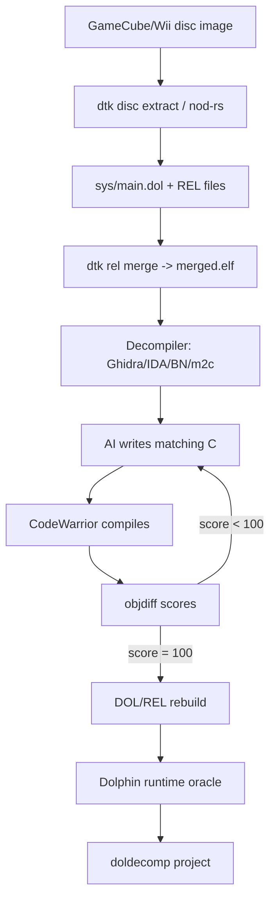
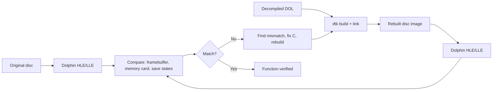

# GameCube and Wii Decompilation

> Tags: gamecube, wii, powerpc, gekko, broadway, decompilation, matching-decomp, dolphin, disc-images | Difficulty: Advanced | Prerequisites: [Matching decompilation](matching-decomp.md), [Decompiler workflow](../03-decomp/decompile-workflow.md), [Verification loops](../03-decomp/verification-loop.md)

## Overview

The GameCube and Wii run the same PowerPC CPU family with different clock speeds and feature sets. They share a disc format, a filesystem, a memory-card format, and a large common library base called the Dolphin SDK. That shared base makes the two platforms unusually productive for decompilation work.

The CPU is the reason this page exists. It is not a modern PowerPC. It is a custom IBM chip called Gekko on GameCube and Broadway on Wii. The toolchain is Metrowerks CodeWarrior for GameCube/Wii, not GCC. Code is mostly C++ with templates, inline functions, and vendor-specific intrinsics for the CPU's unique features.

In 2026 the GameCube/Wii decomp scene is healthy and active. The `doldecomp` GitHub organization hosts most of the matching-decomp projects. `doldecomp/melee` is the flagship: the Super Smash Bros. Melee decompilation is at high coverage and is one of the most complete PPC decomp projects ever. `doldecomp/sms` (Super Mario Sunshine) is also very active. The Wii side has `doldecomp/forecast` (the Forecast Channel) and `doldecomp/ogws` (Wii Sports, work in progress). The Wii U Virtual Console port of the same games is a different project space.

AI fits this work the same way it fits every matching decomp: the model writes C, the compiler produces bytes, objdiff scores the diff. The GameCube/Wii-specific challenges are the PowerPC calling convention, CodeWarrior C++ codegen, and the large Dolphin SDK library that every game shares. Once the SDK library is matched, every new game gets much easier.

This page covers:

- The Gekko and Broadway CPU, including what makes it different from a normal PowerPC.
- The decomp.me and doldecomp lineage for Melee and the broader GameCube/Wii scene.
- The `encounter/decomp-toolkit` toolchain for splitting discs, extracting DOL and REL files, and scoring matches.
- Disc images: GCM, ISO, RVZ, GCZ, WIA, WBFS, CISO, NFS, and TGC.
- Save formats: raw `.raw` memory-card files and the Dolphin emulator's `MemoryCardA` directory.
- The Dolphin emulator as a runtime oracle, including `dolphin-tool` for image conversion and the Lua scripting API.
- AI-assisted techniques for PPC assembly to C and for symbol recovery from DOL sections.

## How It Works

### The CPU: Gekko and Broadway

GameCube uses the Gekko CPU. Wii uses Broadway. They are 32-bit big-endian PowerPC chips with several nonstandard features:

| Feature | Gekko | Broadway | Notes |
|---|---|---|---|
| Clock | 485 MHz | 729 MHz | Single core |
| Endianness | Big-endian | Big-endian | All multi-byte data is BE |
| Vector unit | No AltiVec | AltiVec | Broadway adds AltiVec and more instructions |
| L1 cache | 32 KB instruction + 32 KB data | 32 KB instruction + 32 KB data | Write-through |
| L2 cache | 256 KB shared | 256 KB shared | |
| MMU | Software-managed | Software-managed | No hardware page table for games |
| FPU | Yes | Yes | Single-precision only, no double-precision |
| Timebase | Yes | Yes | `mftb`/`mftbu` for timers |

Gekko is close to a standard PowerPC 750 but with custom instructions for the GameCube's memory controller and graphics pipeline. Broadway adds AltiVec (128-bit vector registers) and more DSP-like instructions. Most game code does not use AltiVec directly; the SDK wraps it in intrinsics.

The important consequence for decompilation: the CPU is not x86 and not ARM. Disassembly tools need PowerPC support. Ghidra has `PowerPC:BE:32:default` and a GameCube loader extension. Binary Ninja has PPC support. radare2 and rizin support PPC. The CodeWarrior assembler produces different codegen patterns than GCC, so flag matching is critical.

### The toolchain: Metrowerks CodeWarrior

The original games were built with Metrowerks CodeWarrior for GameCube/Wii. The compiler is `mwccppc.exe` (C++) or `mwcc.exe` (C). The versions used across titles range from 1.0 through 1.7, per decomp.wtf documentation.

The community cannot distribute CodeWarrior legally. The `doldecomp/mweppc` project is a decompilation of the CodeWarrior toolchain itself, which means the community is slowly rebuilding the compiler from scratch. Until that completes, projects rely on a leaked or reconstructed CodeWarrior distribution, which each project documents separately.

The CodeWarrior C++ compiler produces distinctive code patterns:

- Heavy inlining of template functions.
- Aggressive register allocation.
- `bl` calls for short functions that GCC would inline.
- Specific prologue/epilogue sequences.
- `mfspr`/`mtspr` for saving special-purpose registers.

Matching C for CodeWarrior is harder than for GCC because the compiler's optimization decisions are less predictable. C++ templates add another layer. A matched function in Melee is not just C that compiles; it is C that produces the exact same instructions that CodeWarrior produced in 2001.

### The Dolphin SDK library

Every GameCube and Wii game links against the Dolphin SDK. The SDK provides:

- `OS` functions: threads, messages, interrupts, memory.
- `GX` functions: the graphics API (60+ entry points).
- `DVD` functions: disc reading.
- `AR`/`AX`/`AS` audio libraries.
- `CARD` functions: memory card access.
- `SI`/`PAD` functions: controller input.
- `VI`/`AI` functions: video and audio interfaces.
- `EXI`/`IPC` functions: external interfaces.

The SDK is a static library linked into every game. Different games may use different SDK versions, but the core functions are stable. Once the SDK library is decompiled and matched, every new game's non-matched functions become mostly game-specific code.

`doldecomp/dolsdk2001` and `doldecomp/dolsdk2004` are decompilation projects for specific SDK versions. `doldecomp/forecast` uses the SDK to decompile the Wii's Forecast Channel.

### The decomp lineage: decomp.me to doldecomp

The GameCube/Wii decomp scene grew from the same roots as every other console decomp. This diagram shows the data flow from disc image to runnable decompiled game:



The loop between `F` and `H` is the human-plus-agent iteration. The compiler and objdiff are the oracle. The AI proposes C. The diff decides.

1. **decomp.me** (decomp.me, github.com/decompme/decomp.me) is the collaborative platform. It hosts GameCube and Wii targets including Melee. The platform compiles C server-side with the original compiler and flags, then diffs against the original object.
2. **decomp-toolkit** (github.com/encounter/decomp-toolkit) is the GameCube/Wii-specific framework. It provides `dtk` commands for splitting discs, extracting DOL and REL files, linking decompiled code, and scoring matches.
3. **doldecomp** (github.com/doldecomp) is the GitHub organization that hosts the projects. `melee` is the flagship. `sms` is Super Mario Sunshine. `brawl` is Super Smash Bros. Brawl. `forecast` is the Wii Forecast Channel.

The workflow is the same as every matching decomp: split the ROM, pick a function, write C, compile, diff, iterate. The GameCube/Wii-specific parts are the disc format, the DOL/REL file structure, and the CodeWarrior toolchain.

### Project M and the Melee ecosystem

Project M is not a decomp project. It is a fan-made mod for Melee that runs on the decompilation. It provides custom stages, characters, and online play. It requires the `doldecomp/melee` source to build. The relationship is:

```
GameCube/Wii disc -> DOL/REL files -> doldecomp/melee source -> Project M mods -> Dolphin
```

Project M's existence proves the Melee decomp is complete enough to build a working game. The decomp produces a binary that runs in Dolphin. Project M adds features on top.

### wibo and wii-use

`wibo` is a minimal Win32 binary translator for Linux and macOS (github.com/decompals/wibo). It is not a GameCube emulator. It is used in decomp workflows to run Windows-only tools like CodeWarrior on Linux. `wii-use` is the Wii Remote library (github.com/wiiuse/wiiuse) used by homebrew, not a decomp tool. Neither is required for the decomp workflow itself.

### Dolphin emulator as the RE surface

Dolphin is the GameCube/Wii emulator. It is also the runtime oracle for decomp projects. The decomp produces a DOL file that should run identically to the original. Dolphin's job is to prove it does.

Dolphin is a large C++ codebase with its own decompilation value. Its CPU emulator (JIT and interpreter) implements Gekko/Broadway. Its HLE (high-level emulation) layer implements the Dolphin SDK. Its LLE (low-level emulation) layer runs the actual game code on the emulated CPU.

For decomp work, Dolphin provides:

- A reference implementation of the CPU and SDK.
- `dolphin-tool` for disc image conversion (ISO to RVZ, etc.).
- A Lua scripting API for runtime inspection.
- A debugger pane for breakpoints and memory watches.
- Save-state support for deterministic testing.

Dolphin is GPLv2+. It runs on Windows, Linux, macOS, and Android.

## Setup

### Install decomp-toolkit

`encounter/decomp-toolkit` is the GameCube/Wii decomp framework. It provides the `dtk` command.

```bash
git clone https://github.com/encounter/decomp-toolkit.git
cd decomp-toolkit
cargo build --release
# dtk is in target/release/dtk
```

Or install from source with `cargo install --path .` if you want it on your PATH.

`dtk` provides subcommands for the full workflow:

```bash
dtk disc info game.iso          # disc information
dtk disc extract game.iso out/  # extract files
dtk disc convert game.wia game.iso  # convert image format
dtk dol info main.dol           # DOL file info
dtk rel info file.rel           # REL file info
dtk rel merge main.dol rels/*.rel -o merged.elf  # merge into ELF
dtk vfs ls 'disc.rvz:files/'    # list disc filesystem
dtk rarc list input.arc         # list RARC archive
dtk nlzss decompress input.bin.lz  # decompress NLZSS
dtk shasum -c game.sha1         # verify checksums
```

### Install a decomp project

Pick a project from doldecomp or decomp.me. The Melee project is the best-documented:

```bash
git clone https://github.com/doldecomp/melee.git
cd melee
# Follow the project's README for toolchain setup
# Requires: CodeWarrior (project-specific), decomp-toolkit, objdiff
```

Each project has its own build system. `decomp-toolkit` projects use `ninja`. The Melee project has its own Makefile and configuration. Read the project's README before building.

### Install Dolphin

Dolphin is available for all major platforms. For decomp work, you need the latest development build or the stable release.

```bash
# Windows: download from dolphin-emu.org
# Linux: build from source or use a package
git clone --recurse-submodules https://github.com/dolphin-emu/dolphin.git
cd dolphin
mkdir build && cd build
cmake .. -DCMAKE_BUILD_TYPE=Release
make -j$(nproc)
```

For decomp work, you also need `dolphin-tool` for image conversion. It is built as part of Dolphin.

### Install Ghidra with GameCube support

Ghidra does not ship with a GameCube/Wii loader by default. You need a community extension.

```bash
# Cuyler36/Ghidra-GameCube-Loader
git clone https://github.com/Cuyler36/Ghidra-GameCube-Loader.git
# Build the extension and install it in Ghidra's Extensions directory
```

Or use `encounter/aurora`, a source-level GameCube/Wii compatibility layer that can analyze DOL files directly.

### Install m2c for PPC assembly to C

`matt-kempster/m2c` is a decompiler for PowerPC assembly that produces C code. It supports CodeWarrior C++ demangling.

```bash
git clone https://github.com/matt-kempster/m2c.git
cd m2c
python3 m2c.py --target ppc-mwcc-c++ input.asm
```

`m2c` is not a matching decompiler. It produces plausible C, not byte-matching C. It is useful for first drafts and for understanding what a function does.

## Usage

### Split a disc into functions

The first step is to split the disc image into DOL and REL files, then into individual functions.

```bash
# Extract the disc
dtk disc extract game.iso extracted/

# The main executable is in sys/main.dol
dtk dol info extracted/sys/main.dol

# REL files are in files/*.rel or files/RELS.arc
# Extract RELs from the archive if needed
dtk rarc extract extracted/files/RELS.arc rels/

# Merge DOL and RELs into a single ELF for analysis
dtk rel merge extracted/sys/main.dol rels/*.rel -o merged.elf
```

The merged ELF is what you feed to Ghidra, IDA, or Binary Ninja. It contains all the code from the DOL and all REL modules in one file.

### Decompile a function with m2c

For a quick first draft, use `m2c` to convert PPC assembly to C:

```bash
# Disassemble the function first (using Ghidra or r2)
# Then feed the assembly to m2c
python3 m2c.py --target ppc-mwcc-c++ function.asm
```

The `--target ppc-mwcc-c++` flag tells m2c to use PowerPC assembly syntax and CodeWarrior C++ demangling. The output is C++ code that is plausible but not necessarily matching.

### Match a function with decomp-toolkit

The matching workflow uses `dtk` for scoring:

```bash
# Build the project
dtk build

# Score a single function
dtk test src/function.cpp --json

# Score the whole project
dtk verify --compare --json
```

The `--json` flag gives machine-readable output for agent consumption. The score is a percentage. 100 means byte-identical.

### Use Dolphin as the runtime oracle

After building a decompiled DOL, run it in Dolphin to verify it works:

```bash
# Convert the built DOL to a disc image or run it directly
dolphin-tool convert built.iso output.rvz

# Run in Dolphin
Dolphin.exe output.rvz
```

For automated testing, Dolphin supports `--batch` mode and save states. You can script a comparison between the original and the decompiled version.

### Use Dolphin's Lua API for runtime inspection

Dolphin supports Lua scripting for runtime hooks. This is useful for verifying that a decompiled function behaves correctly.

```lua
-- In Dolphin's Lua console
local base = 0x80000000

-- Read memory at an address
local value = memory.read_u32(base + 0x1234)

-- Write memory
memory.write_u32(base + 0x1234, 0xdeadbeef)

-- Hook a function
memory.hook_write(base + 0x1234, function(addr, size, value)
  print(string.format("Write to 0x%x: 0x%x", addr, value))
end)
```

The Lua API is not a replacement for a debugger, but it is faster for quick checks.

## AI-Assisted Techniques

### PPC assembly to C

The main AI task is converting PowerPC assembly to C that compiles with CodeWarrior. The challenges are:

- **Calling convention**: PPC uses `r3`-`r10` for arguments, `r3` for return value. The stack frame layout is specific.
- **Delay slots**: PPC has branch delay slots. The instruction after a branch executes before the branch takes effect.
- **Condition register**: `cr0`-`cr7` hold comparison results. Branches test these.
- **Special registers**: `lr` (link register), `ctr` (count register), `xer` (fixed-point exception register).
- **AltiVec**: Broadway has 32 vector registers `v0`-`v31`. Most code does not use them directly.

Prompt template for PPC assembly to C:

```
You are writing C that must compile to byte-identical PowerPC assembly.

Compiler: Metrowerks CodeWarrior for GameCube/Wii (mwccppc)
Version: 1.2 (or whichever the project uses)
Flags: -O4,p -enum int -Cpp_exceptions off -RTTI off -fp hard -str reuse -DSDK_IPC -sym on -i ./include -i ./include/REPLACEMENT -lang c++ -gccext,on -msgstyle gcc -Cpp_exceptions off

Target function: 0x80001234
Architecture: PowerPC Gekko/Broadway (32-bit big-endian)

Disassembly:
<paste disassembly>

Callers:
<paste caller list>

Data references:
<paste globals, rodata, jump tables>

Already-matched reference functions:
<paste 1-3 matched functions for style>

Write the C. Do not write comments explaining the assembly. Write plausible source.
Compile it. Run objdiff. Read the diff.
Iterate until score 100 or until you have tried 25 builds.
```

The key is giving the agent the exact compiler version and flags. CodeWarrior's codegen is version-specific. A flag mismatch makes every function unmatchable.

### Symbol recovery from DOL sections

DOL files have a specific section structure:

```
DOL header
.text   - code section
.data   - initialized data
.bss    - uninitialized data
.rodata - read-only data
.extab  - exception table
.extabindex - exception table index
.debug   - debug info (if present)
```

The DOL header contains offsets and sizes for each section. You can parse it to recover section boundaries.

For symbol recovery:

1. Parse the DOL header to get section offsets and sizes.
2. Disassemble each section.
3. Identify function boundaries from the disassembly (prologues, `bl` targets).
4. Recover function names from:
   - Debug info (if present, rare).
   - String references (error messages, function names in logs).
   - Cross-references from known SDK functions.
   - Pattern matching against known library code.
5. Recover data symbols from:
   - `.data` section references.
   - `.rodata` string tables.
   - Global offset table (GOT) entries.

`encounter/cwdemangle` can demangle CodeWarrior C++ symbols. This is useful when the binary has mangled names.

### AI-assisted SDK library matching

The Dolphin SDK is shared across games. Once you match the SDK library for one game, you can reuse the matched functions for other games. The workflow:

1. Pick a game with a large SDK library (Melee is good).
2. Match the SDK functions first.
3. Export the matched SDK as a library.
4. For new games, link against the matched SDK library.
5. Only match game-specific code.

This is how the Melee project accelerated: the SDK functions were matched once, then reused.

### AI-assisted REL module analysis

REL files are relocatable modules. They contain code that is loaded at runtime. Each REL has its own relocation table. The AI can help by:

1. Parsing the REL header to get section offsets.
2. Identifying the relocation entries.
3. Applying relocations to get absolute addresses.
4. Decompiling the relocated code.

`dtk rel merge` does this automatically. It merges DOL and RELs into a single ELF.

### Dolphin runtime verification

The decompiled DOL is not done until it runs in Dolphin. The verification loop compares the decompiled binary against the original:



Dolphin's HLE (high-level emulation) implements the SDK directly. Its LLE (low-level emulation) runs the actual CPU code. For decomp verification, HLE is faster and more stable. LLE is more accurate for timing-sensitive code.

## Pitfalls

### CPU and toolchain

- **PowerPC is not x86.** Do not use x86 disassemblers. Use Ghidra with PPC support, IDA with PPC, or radare2.
- **CodeWarrior is not GCC.** The codegen patterns are different. Flag matching is critical. A GCC-style flag set will not work.
- **Big-endian everywhere.** All multi-byte data is big-endian. This affects string parsing, pointer dereferencing, and struct layouts.
- **AltiVec on Broadway.** Wii games may use AltiVec instructions. Gekko does not have AltiVec. Do not assume AltiVec is available on GameCube.
- **Delay slots.** PPC has branch delay slots. The instruction after a branch executes before the branch takes effect. This confuses decompilers.

### Disc and file formats

- **GCM is the raw format.** ISO is a synonym. RVZ is a compressed format. GCZ is another compressed format. WIA is Wii's format. WBFS is a Wii backup format. CISO is a compressed ISO. NFS is Wii U VC. TGC is a special format.
- **DOL is not ELF.** DOL is the GameCube/Wii executable format. It is not ELF. You need `dtk dol` or `dtk rel merge` to convert it.
- **REL files are relocatable.** REL files contain code that is loaded at runtime. They need relocation before analysis.
- **RARC archives.** Game files are often in RARC archives. Use `dtk rarc` or `dtk vfs` to extract them.
- **NLZSS compression.** Many files are NLZSS-compressed. Use `dtk nlzss decompress`.

### Save formats

- **Memory card files are `.raw`.** The raw format is 8 MB per card (or 16 MB for some games). The header is at offset 0.
- **Dolphin's `MemoryCardA` directory.** Dolphin stores memory cards as `.raw` files in `~/Library/Application Support/Dolphin Emulator/` on macOS, `%APPDATA%/Dolphin Emulator/` on Windows, or `~/.local/share/dolphin-emu/` on Linux.
- **Save file structure varies by game.** There is no universal save format. Each game has its own structure. Use Dolphin's debugger to inspect memory card access.
- **Wii saves are different from GameCube saves.** Wii saves use a different format with encryption. The `.raw` file contains the encrypted data.

### AI-specific pitfalls

- **Do not feed raw PPC assembly to the LLM.** Feed decompiler pseudocode or m2c output. The LLM cannot parse raw PPC assembly reliably.
- **Do not ask for "clean readable code".** Ask for byte-matching C. The goal is compilation to identical bytes.
- **Cap the build budget.** 25 builds per function is the Retrobench standard. Without a cap, agents thrash.
- **Feed the diff back each round.** An agent that only sees its own C and not the objdiff output cannot converge.
- **Do not let the agent edit build scripts.** Build scripts, linker scripts, and assembly files are off-limits.
- **Watch for fakematching.** Hacks that game the verifier without producing real source. Check project rules.

### Legal and community

- **Read the project's contribution rules.** Some projects ban AI contributions. Check before submitting.
- **Do not publish ROMs or extracted assets.** Decomp projects host only source and build files.
- **Do not use leaked source code.** White-room only: the binary plus public projects.
- **Do not share CodeWarrior binaries.** They are proprietary. Projects document their own toolchain setup.

## See Also

- [Matching decompilation](matching-decomp.md)
- [Decompiler workflow](../03-decomp/decompile-workflow.md)
- [Verification loops](../03-decomp/verification-loop.md)
- [Batch decompilation](../03-decomp/batch-decompilation.md)
- [Context engineering](../02-collab/context-engineering.md)
- [Tool catalog](../05-tools/tool-catalog.md)
- [Firmware RE](../06-topics/firmware-iot-re.md)
- [Deobfuscation](../06-topics/deobfuscation.md)
- [Real-world recipes](../08-case-studies/real-world-recipes.md)
- https://github.com/doldecomp/melee — Melee decompilation
- https://github.com/doldecomp/sms — Super Mario Sunshine decompilation
- https://github.com/encounter/decomp-toolkit — GameCube/Wii decomp toolkit
- https://github.com/encounter/aurora — GameCube/Wii compatibility layer
- https://github.com/dolphin-emu/dolphin — Dolphin emulator
- https://github.com/matt-kempster/m2c — PPC assembly to C decompiler
- https://github.com/encounter/cwdemangle — CodeWarrior symbol demangler
- https://github.com/encounter/nod-rs — Disc image library
- https://github.com/Cuyler36/Ghidra-GameCube-Loader — Ghidra GameCube loader
