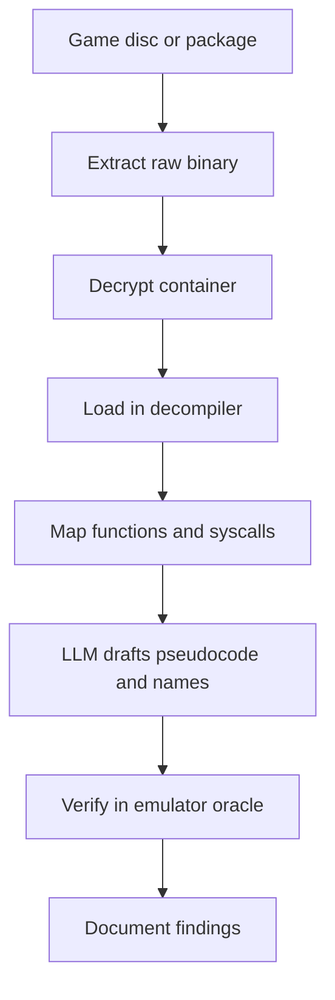
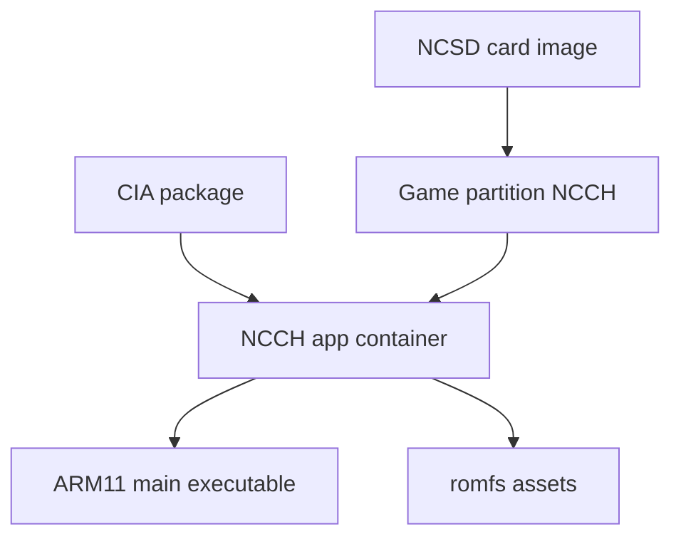

# Handheld Consoles: PSP, PS3/Vita, 3DS, Switch Lite

> Tags: game-reverse-engineering, handheld-consoles, psp, ps-vita, nintendo-3ds, switch-lite, ppsspp, luma3ds, henkaku, vpk, cia, ncch | Difficulty: Advanced | Prerequisites: [Matching decompilation](matching-decomp.md), [Decompiler workflow](../03-decomp/decompile-workflow.md), [Firmware recomp](../07-advanced/firmware-recomp.md)

## Overview

This page covers four handheld consoles and their binary formats. Each console has a different CPU, a different file container, and a different jailbreak ecosystem. The AI-assisted workflow is the same on all four. Extract the binary. Decrypt it. Load it in a decompiler with the right processor module. Feed function slices to a model. Verify claims against the emulator oracle.

| Console | CPU | Main binary | File format | Emulator oracle |
|---|---|---|---|---|
| PSP | MIPS Allegrex, up to 333 MHz | EBOOT.BIN / PRX / PSP ELF | ISO9660 UMD, EBOOT.BIN, PSP ELF | PPSSPP |
| PS Vita | ARM Cortex-A9 quad-core (PICA200) | SELF / VPK packages | VPK, SELF, SPRX | Vita3K (experimental) |
| Nintendo 3DS | ARM11 MPCore, ARM9, ARM7 | NCCH app, CIA container | CIA, NCCH, NCSD, SD save data | Azahar (Citra successor) |
| Switch Lite | NVIDIA Tegra X1, ARMv8 AArch64 | NSO / NRO, firmware modules | NSP, XCI, NRO, NCCH family | Ryujinx / Yuzu lineage (reported) |

Switch Lite is covered on this page because it shares the Switch CPU. Its only difference is the missing recovery mode port. See the Switch Lite section.

The 2026 state of the console RE world has three stable facts:

- Static recompilation is the dominant console workflow. PSP recomp projects appeared in 2025-2026 for Killzone, Metal Gear Acid 2, Ridge Racer, and Ghost of War. See [Firmware recomp](../07-advanced/firmware-recomp.md).
- Ghidra processor extensions now cover the obscure handheld CPUs. `kotcrab/ghidra-allegrex` adds the PSP Allegrex processor. `Adubbz/Ghidra-Switch-Loader` adds Switch format loading. No equivalent extension is verified for Vita or 3DS. Those targets use Ghidra's generic ARMv7.
- Custom firmware on all four consoles is mature. PSP runs PRO CFW and kxploit. Vita runs HENkaku Enso. 3DS runs Luma3DS. Switch Lite needs a physical workaround. See per-console sections.

The one unreliable input is emulator coverage. PPSSPP covers PSP almost completely. Vita3K is experimental. Azahar is the maintained 3DS emulator after Citra. Switch emulators are legally contested and unstable. Treat emulator output as a partial oracle.



The pipeline is identical on all four consoles. Only the extraction and decryption tools differ.

## How It Works

All four consoles run custom firmware with a custom file container. The analysis workflow follows three phases.

1. **Container extraction.** The game or app ships inside a package. PSP uses ISO9660 UMD images. Vita uses VPK or SELF. 3DS uses CIA wrapping NCCH. Switch uses NSP or XCI wrapping NCCH. Each package is parsed by a community tool before you touch code.
2. **Decryption.** Retail binaries are encrypted. PSP EBOOT.BIN uses per-title keys. Vita SELF uses IDPS-derived keys. 3DS NCCH uses console-OTP-derived keys. Switch NSP uses title keys. Custom firmware on each console decrypts at install or load time. Without CFW you need dumped key material.
3. **Static analysis.** The decrypted binary is an ELF or a raw executable for the target CPU. Ghidra handles the CPU with a processor module. The emulator provides the behavioral oracle.

Custom firmware paths differ per console:

| Console | CFW entry point | Current CFW | Dumps NAND |
|---|---|---|---|
| PSP | kxploit / PRO CFW | CFW 6.60 | Yes, via memstick |
| PS Vita | henkaku exploit on 3.60, then HENkaku Enso | HENkaku Enso | Yes, via VitaShell |
| Nintendo 3DS | boot9strap via arm9loaderhax | Luma3DS | Yes, via GodMode9 |
| Switch Lite | No RCM port. Needs pre-softmodded SD or eMMC dump | Atmosphere (reported) | Only with hardware access |

## Step-by-Step: PSP

The PSP is the simplest target on this page. The CPU is MIPS Allegrex, a variant of MIPS II with a VFPU and a few Sony-specific instructions. Almost every binary is a decrypted PSP ELF or a PRX.

### Get the binary

You need a decrypted EBOOT.BIN or the raw ISO contents. Three paths exist:

1. UMD ISO plus CFW. Mount the ISO on a CFW PSP, copy the decrypted EBOOT from the game partition. PRX files can also be decrypted on-device with the `prxtool` and `psardumper` tool family.
2. Homebrew / PPSSPP memstick dumps. PPSSPP decrypts EBOOT.BIN at load time. Enable developer tools to dump the running PRX or memory image. The output is a PRX file, not a clean ELF.
3. Online decrypted dumps. Several archive projects host decrypted EBOOT.BIN files for retail games. Treat these as untrusted. Hash-check against a second source.

### Decrypt the EBOOT

If you have an encrypted EBOOT.BIN and a PSP on firmware 6.60, the PSP itself decrypts it. Tools like `prxtool` and `psardumper` extract the key material. Both names are reported in the community. No single canonical repo was verified for this page. PPSSPP can also decrypt it at load time. Once decrypted you have a PSP ELF with program headers. Feed that to Ghidra.

PSP ELF specifics:

- Little-endian MIPS32 with Allegrex extensions.
- Entry point is usually `0x08804000` region for games. Kernel modules load near `0x88000000`.
- The `PSP ELF` loader must parse relocation types A and B. Standard ELF tools do not.
- PRX files are relocatable. Their entry point is the same but addresses are relative.

### Load in Ghidra

Use `kotcrab/ghidra-allegrex`. It adds a `PSP Executable (ELF)` processor and handles PSP ELF relocation types A and B. Install it through Ghidra's `Install Extensions` dialog.

Set the image base to `0x08804000` for game binaries. For kernel modules, set `0x88000000`. Run auto analysis. Use the `PpssppImportSymFile` script after saving a `.sym` file from PPSSPP's Debug menu. This imports PPSSPP's function labels into Ghidra.

If the extension is not available for your Ghidra version, the stock `MIPS:LE:32:default` processor works for disassembly. Decompilation quality drops on VFPU instructions. PPSSPP's VFPU is a subset of MIPS IV with Sony-specific register groups. The `ghidra-allegrex` extension handles it better.

### Reverse engineer the kernel

The PSP kernel is the real target for system RE. Retail games are thin. The kernel modules hold the syscall table, the HLE handlers, and the module loader.

Kernel modules are PRX files. They live in `flash0:/` on the memory stick. To get them you need a CFW dump of the flash partition or a NAND dump from a service console. The `ghidra-allegrex` extension can export kernel modules as object files. This lets you link them into a custom kernel for research.

The PSP syscall interface is table-driven. Each syscall has a number. The kernel resolves it through the syscall table. The LLM can map syscall numbers to names if you give it the import table from `psp.h` or `psploadcore.h`. See [Assembly crash course](../00-fundamentals/assembly-crash-course.md).

### Verify with PPSSPP

PPSSPP is the verification oracle. If a function you decompiled has a behavioral claim, test it in PPSSPP. Enable the debugger to set breakpoints and watch registers. Save the memory state after a call. Compare with the decompiled pseudocode.

## Step-by-Step: PS Vita

The Vita is a quad-core ARM Cortex-A9 handheld built on the Marvell PICA200 SoC. It is architecturally related to the PS3 cell. The main binary format is VPK and SELF.

### Get the binary

Retail games ship as `*.pkg` files. Those install to the Vita as VPK packages or SELF executables. To get the raw binary you need:

1. A CFW Vita. HENkaku Enso is the current jailbreak. Install it through the `henkaku` web exploit on firmware 3.60, then use `VitaDeploy` or USB to transfer homebrew.
2. A decrypted VPK or SELF. Tools like `VitaShell` can dump the installed package. `vitadecrypt` and `maiatsukai`-style parsers extract keys. Both names are reported. Names are unverified.
3. A self-contained ELF. Some homebrew and leaked builds ship as ELF directly. These are easiest to analyze.

### Understand the CPU

The Vita CPU is ARMv7-A Cortex-A9, quad-core at up to 444 MHz. Ghidra's generic `ARM:LE:32:v8` processor works. The four cores are symmetric. Most game code runs on core 0. The GPU is a PowerVR SGX543MP4+ and is driven by proprietary modules.

### Decrypt the SELF

SELF files are encrypted and compressed. The key is derived from the console's IDPS and the application's title ID. You need the key before static analysis. On CFW, `VitaShell` and `ftpsrv` can extract decrypted files. Without CFW, you need the console's IDPS and the app key.

VPK is a container. It holds SELF executables, assets, and metadata. Parse it with `vita-parse` or a VPK reader. The ELF inside is what you feed to Ghidra. The request named "Maiatsukai" as a Vita tool. No repository by that name could be verified during this page's research. Treat any tool with that name as unverified.

### Load in Ghidra

Use the stock ARMv7 processor. Set the base address to `0x100000` for user code. Run auto analysis. Vita uses a custom syscall interface. The `Sce*` functions are library calls. Map them to names using the vitasdk headers or the leaked HENkaku sources.

The Vita kernel is not public. Kernel modules are encrypted SPRX files. They live in `ur0:` and `ux0:`. To analyze them you need a CFW dump of the flash partition.

### Verify with Vita3K

Vita3K is an experimental emulator. It can run homebrew and some retail games. Use it to verify function behavior. It is not stable enough for full dynamic analysis. For dynamic analysis on hardware, use the HENkaku GDB stub or a custom debugger on CFW.

## Step-by-Step: Nintendo 3DS

The 3DS is the most complex handheld on this page. It has two ARM11 cores, a custom OS called Horizon, and a layered security model. The main binary format is NCCH inside CIA.



### Get the binary

Retail games install as CIA files or as NCCH files on the SD card. To get the raw binary:

1. Dump the NAND. Use `GodMode9` on Luma3DS CFW to dump the NAND to SD. This gives you the full `nand.bin` including all NCCH partitions.
2. Extract the NCCH. Use `GodMode9` or `makerom` to extract the game's NCCH. NCCH is the executable container. It holds the ARM11 code, ARM9 code, and assets.
3. Use `Azahar` or `Lime3DS` to extract game files from a CIA. `makerom` is the tool for building NCCH, `ctrtool` for extraction.

### Understand the CPUs

The 3DS has two main processors:

- ARM11 MPCore. Runs the games and the OS services.
- ARM9. Runs the bootloader, the secure monitor, and some system services.

The ARM11 code is the main target. It is ARMv6K. Ghidra's `ARM:LE:32:v6` processor works. The ARM9 code is harder to obtain and analyze. It is protected by the secure boot chain.

### Decrypt the NCCH

NCCH files have a header with encryption flags. Retail games are encrypted with a key derived from the console's OTP and the title ID. On CFW, `GodMode9` can decrypt them. Without CFW, you need the console's OTP and the title key.

CIA is a container for NCCH. It is encrypted with the same scheme. Parse it with `ctrtool` or `makerom`. The NCCH inside is what you analyze.

### Load in Ghidra

Use the ARMv6 processor for ARM11 code. Set the base address to `0x00100000` for application code. Run auto analysis.

The 3DS OS uses a service-based IPC model. Services are accessed through `srv:` handles. Map service names to function calls using the 3dbrew wiki or leaked Horizon sources.

The kernel is `arm11` kernel. It is a modified Linux kernel. The syscall table is public on 3dbrew. Kernel modules are SPRX-like files.

### Verify with Azahar

Azahar is the maintained 3DS emulator. It can run homebrew and retail games. Use it to verify function behavior. It is more stable than Vita3K but less than PPSSPP. For dynamic analysis, use the 3DS's built-in GDB stub or a custom debugger on CFW.

## Step-by-Step: Switch Lite

Switch Lite shares the Switch's Tegra X1 CPU. The only difference is the missing recovery mode port. This affects dumping, not analysis.

### Why Lite is different

The Switch has a USB-C port that supports Recovery Mode (RCM). Fusée Gelée exploits RCM to load unsigned code. The Lite does not have RCM. It cannot run the standard Fusée Gelée exploit.

To dump a Lite you need:

1. A pre-softmodded Switch. Move the SD card from a hacked Switch to the Lite. This works if the firmware versions match.
2. An eMMC dump. Open the Lite, dump the eMMC chip with a reader. This is hardware work.
3. A borrowed Switch. Dump the games on a hacked Switch, then analyze them on the Lite.

### Get the binary

Switch games are NSP or XCI files. XCI is a NAND image. NSP is a package. Both contain NCCH partitions with NSO executables.

To dump:

1. Use `hactool` to extract the NSP or XCI.
2. Use `hactool` or `nsp` tools to extract the NSO from the NCCH.
3. Use `nx-nsp` or `switch_tools` to parse the package.

### Load in Ghidra

Use `Adubbz/Ghidra-Switch-Loader`. It supports NSO, NRO, and firmware modules. Set the base address to `0x710000000` for user code or `0x800000000` for kernel code.

The Switch uses AArch64. Ghidra's `AARCH64:LE:64:v8A` processor works. The OS is Horizon, a modified FreeBSD. The kernel is in the firmware modules.

### Verify with emulators

Ryujinx and Yuzu are the main Switch emulators. Both are legally contested. Use them for verification only. For dynamic analysis, use the Switch's built-in GDB stub on Atmosphere CFW.

## AI-Assisted Workflow

The workflow is the same on all four consoles:

1. Extract the binary. Use the tools above.
2. Decrypt it. Use CFW, emulator dumps, or key extraction.
3. Load in Ghidra. Use the right processor module.
4. Generate a function map. Use `decompile-workflow.md` or `triage-and-mapping.md`.
5. Feed function slices to the LLM. Use the prompt patterns in `prompt-patterns.md`.
6. Verify with the emulator oracle. PPSSPP, Vita3K, Azahar, or Ryujinx.
7. Document the results. Use `notes-and-evidence.md`.

### Prompt template for MIPS Allegrex

```
Here is PSP Allegrex assembly for a function. Rewrite it as readable C.
Note: MIPS delay slots, Allegrex-specific instructions (mfhi1, mtlo1, etc.),
and VFPU instructions may appear. Preserve semantics exactly.

<assembly>
```

### Prompt template for ARMv7

```
Here is ARMv7 assembly for a Vita or 3DS function. Rewrite it as readable C.
Note: Thumb-2 instructions may appear. Preserve exact semantics.

<assembly>
```

### Prompt template for AArch64

```
Here is AArch64 assembly for a Switch function. Rewrite it as readable C.
Note: NEON instructions and SVE may appear. Preserve exact semantics.

<assembly>
```

### Where AI helps

- **Function naming.** LLMs name functions based on strings, calls, and patterns.
- **Syscall mapping.** LLMs map syscall numbers to names using headers.
- **Documentation.** LLMs generate documentation from pseudocode.
- **Format parsing.** LLMs write parsers for NCCH, VPK, and CIA formats.

### Where AI fails

- **Kernel internals.** Kernel code is obfuscated and encrypted. LLMs hallucinate.
- **VFPU code.** PSP VFPU is poorly documented. LLMs invent instructions.
- **Encrypted modules.** Without keys, LLMs guess at structure.
- **Behavioral claims.** LLMs cannot verify claims without an oracle.

## Pitfalls

### PSP pitfalls

- **EBOOT.BIN is encrypted.** You need CFW or a key dump. PPSSPP decrypts it at load time but does not expose the key.
- **PRX files are relocatable.** They have no fixed base address. Set the base manually.
- **VFPU is undocumented.** Ghidra's decompiler treats VFPU as function calls. Read the assembly directly.
- **Kernel modules are rare.** Most dumps only have game code. Kernel dumps need service console access.

### PS Vita pitfalls

- **SELF files are encrypted.** You need the console IDPS and the app key.
- **VPK is a container.** Parse it first. The ELF inside is what you analyze.
- **Vita3K is unstable.** It crashes on many games. Use it for verification only.
- **Kernel is proprietary.** Kernel modules are encrypted SPRX. You need CFW to dump them.

### 3DS pitfalls

- **NCCH is complex.** It has multiple partitions and encryption layers. Use `ctrtool` or `makerom`.
- **CIA is a container.** Parse it first. The NCCH inside is what you analyze.
- **ARM9 is secure.** ARM9 code is protected by the secure boot chain. You need a NAND dump.
- **Azahar is young.** It is the maintained emulator but less stable than PPSSPP.

### Switch Lite pitfalls

- **No RCM.** You cannot use Fusée Gelée. You need a pre-softmodded Switch or an eMMC dump.
- **NSP is encrypted.** You need the console keys or a CFW dump.
- **Emulators are contested.** Ryujinx and Yuzu have legal issues. Use them carefully.
- **AArch64 is new.** Ghidra's AArch64 support is good but not as mature as MIPS or ARMv7.

### General pitfalls

- **Do not trust LLM output without verification.** Always verify with the emulator oracle.
- **Do not analyze encrypted binaries.** Decrypt first.
- **Do not ignore the OS.** Kernel and system modules are the real target.
- **Do not skip the map document.** A function map saves hours of LLM time.

## See Also

- [Matching decompilation](matching-decomp.md) — byte-exact matching workflow
- [Decompile workflow](../03-decomp/decompile-workflow.md) — the human+AI loop
- [Verification loop](../03-decomp/verification-loop.md) — deterministic checks
- [Firmware recomp](../07-advanced/firmware-recomp.md) — static recompilation landscape
- [Nintendo 64 decompilation](n64-decomp.md) — MIPS matching decomp
- [PS1/PS2 decompilation](ps1-ps2-decomp.md) — MIPS recompilation
- [PS3/PS4/PS5](ps3-ps4-ps5.md) — Cell and x86-64 consoles
- [Xbox recompilation](xbox-recomp.md) — PowerPC recompilation
- [ROM hacking](rom-hacking.md) — ROM patching and translation
- [Format RE](../07-analysis/format-re-file-formats.md) — binary format analysis
- [Emulation and Unicorn](../04-dynamic/emulation-unicorn-qiling.md) — function-level emulation
- [Frida deep dive](../04-dynamic/frida-deep-dive.md) — dynamic instrumentation
