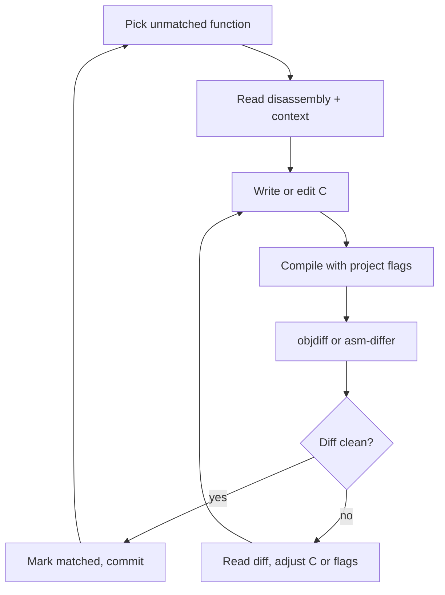
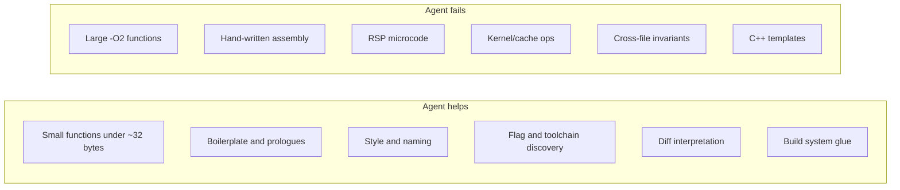

# Nintendo 64 Decompilation

> Tags: game-reverse-engineering, nintendo-64, mips, matching-decomp, o32, libultra, asm-differ, objdiff | Difficulty: Intermediate-Advanced | Prerequisites: [Matching decompilation](matching-decomp.md), [Decompiler workflow](../03-decomp/decompile-workflow.md)

## Overview

Nintendo 64 decompilation is the most mature matching-decomp ecosystem in existence. It is also the platform where AI assistance arrived first. The Retrobench benchmark is built on N64-style MIPS assembly. Frontier models now score above 94 mean byte-match there.

The N64 is a good platform for matching work for three reasons:

- The CPU is MIPS R4300. The assembly is simple and well documented.
- The compiler toolchain is pinned. IDO 5.3, IDO 7.1, and KMC GCC 2.7.2 are the usual choices.
- The project tooling is uniform. splat splits the ROM. asm-differ or objdiff scores the diff. make builds the final ROM.

This page covers:

- The project landscape: n64decomp org, zeldaret OOT/MM, Perfect Dark, libultra, standalone projects.
- N64 assembly conventions: MIPS I, o32 ABI, delay slots, the $gp pool.
- The build system: per-file compiler flags, asm-differ, objdiff, ROM assembly.
- How AI assists: asm-to-C drafting verified by objdiff, boilerplate generation, flag discovery.
- Current completion state per project.
- ROM and legal notes.
- Where agents help and where they fail.

For the generic matching-decomp loop, see [Matching decompilation](matching-decomp.md). This page goes deeper on N64 specifics.

## The Ecosystem

### n64decomp org

GitHub org: https://github.com/orgs/n64decomp/repositories

The org hosts mirror repositories. Several canonical projects live on GitLab and the org mirrors them.

| Repo | Game | State | Notes |
|---|---|---|---|
| n64decomp/sm64 | Super Mario 64 | Builds all five ROM revisions byte-exact. Last GitHub update February 2024. Canonical work moved to private coordination. | Uses IDO 5.3, or GCC with NON_MATCHING=1. Has per-file flag overrides. Frozen. |
| n64decomp/mk64 | Mario Kart 64 | Project progress page reports 100.0 percent total progress. | Compiler pinned. Some assets (tkmk00 textures) still lack byte-matching tools. |
| n64decomp/banjo-kazooie | Banjo-Kazooie | README header reports 100.0000 percent. | Mirror of gitlab.com/banjo.decomp/banjo-kazooie. Canonical repo on GitLab. |
| n64decomp/GoldenEye | Goldeneye 007 | Active but incomplete. Mirror of gitlab.com/kholdfuzion/goldeneye_src. | One of the largest N64 decomps. Uses a mix of C and matching asm. |
| n64decomp/perfect-dark | Perfect Dark | Mirror of gitlab.com/ryandwyer/perfect-dark. | Matching decomp by Ryan Dwyer. MIT license. |
| n64decomp/pilotwings-64 | Pilotwings 64 | Active, low activity. | C. Small project. |
| n64decomp/libultra | libultra | Near-complete. The N64 SDK library. | All N64 projects depend on it. |
| n64decomp/n64tools | N64 SDK tools | Historical. | IDO compiler binaries and SDK headers. |
| n64decomp/oot | Ocarina of Time (old) | Frozen since October 2020. | Active development moved to zeldaret. |
| n64decomp/mm | Majora's Mask (old) | Frozen since October 2020. | Active development moved to zeldaret. |
| n64decomp/oot-mq-dbg, oot-mq-debug | OOT Master Quest debug ROMs | Historical forks. | These led to the zeldaret project. |

Project state note: sm64 is frozen but its tree is the reference example for N64 decomp structure. mk64 and banjo-kazooie report full matching. GoldenEye and Perfect Dark remain active matching efforts.

### zeldaret: Ocarina of Time and Majora's Mask

GitHub org: https://github.com/orgs/zeldaret

| Repo | Game | State | Notes |
|---|---|---|---|
| zeldaret/oot | Ocarina of Time | Builds 15 target ROMs, including NTSC/PAL retail, GameCube re-releases, iQue, and debug builds. WIP decompilation. | Uses IDO by default. COMPILER=gcc supported with non-matching code paths. Has strict no-leaked-source policy. |
| zeldaret/mm | Majora's Mask | Builds N64 US retail plus compressed ROM. N64 only so far. | Uses mips-linux-gnu binutils. Per-function diff through tools/asm-differ/diff.py. |
| zeldaret/tww | The Wind Waker | GC/Wii era. Not N64 but shares conventions. | decomp-goal-harness targets its units. |
| zeldaret/decomp-toolkit | GC/Wii framework | Framework, not a game. | Not N64. Listed for contrast. |

zeldaret workflow differences from n64decomp projects:

- OOT uses a plain Makefile with .make_options.mk overrides. MM uses make init for first build.
- Both use `make setup VERSION=<ver>` or `make init` to extract assets from a baserom you provide.
- Both verify the output with md5sum against expected hashes.
- MM ships its own asm-differ copy under tools/asm-differ. Run it as `./tools/asm-differ/diff.py -wmo3 <func>`.
- OOT requires IDO or QEMU-IRIX for matching builds. GCC mode compiles non-matching variants.

### Other N64 projects

- sm64pc/sm64ex: Super Mario 64 PC port built on the sm64 decomp. Active. Not a matching project but consumes the same source.
- pmret/papermario: Paper Mario N64 decomp. About 100 percent US per project reports.
- Zelda64Recomp: Majora's Mask PC port via N64Recomp static recompilation. Bans GenAI contributions. See [SWMH auto-recomp](swmh-auto-recomp.md).
- N64Recomp: static MIPS-to-C recompiler. Different goal: behavioral port, not byte match.

## Assembly Conventions

### The CPU

The N64 CPU is the MIPS R4300. It implements the MIPS I instruction set plus a few R4000-era extensions the SDK uses. Practical notes:

- 64-bit registers but 32-bit o32 ABI. Pointers and ints are 32-bit. Long long uses register pairs.
- Branch delay slots are real. The instruction after a branch always executes. Compilers fill them. Hand-written asm must respect them.
- Multiply and divide are multi-cycle. The compiler sequences mflo/mfhi explicitly.
- The R4300 has no branch-likely in the forms later MIPS added. Code relies on explicit delay slots.
- Cache and TLB ops appear in kernel-mode libultra code. User code rarely touches them.

### The o32 ABI

The o32 calling convention on N64:

| Register | Role |
|---|---|
| $a0-$a3 | First four integer/pointer arguments |
| $t0-$t7, $t8, $t9 | Caller-saved temporaries |
| $s0-$s7 | Callee-saved |
| $gp | Global pointer. Points into the small-data area |
| $sp | Stack pointer |
| $fp | Frame pointer. Often used as a general register with -O2 |
| $ra | Return address |
| $v0, $v1 | Return values |

Argument passing is stack-based beyond four args. The $gp-relative addressing pool holds frequently used globals, string literals, and jump tables. Compilers emit `lw $v0, %gp_rel(symbol)($gp)` for small-data access. This is why matching C needs the same small-data layout: the linker script and gp value determine which symbols land in range.

### Assembly in the repo

N64 decomp projects keep non-matching code as real assembly:

- sm64: `asm/non_matchings/` holds .s files for functions that never matched. `.rdata` sections for rodata strings.
- mk64: `asm/non_matchings/` same pattern.
- zeldaret/oot: `src/` has .c files. Unmatched functions are either NON_MATCHING stubs in C or asm in `asm/` and `non_matchings/` directories.
- GoldenEye: large handwritten asm files remain. The project has a custom asm include system.

Assembly files go through the C preprocessor first. `#include "asm.h"` pulls in macros for gp-relative loads, jump tables, and delay-slot-safe scheduling. Do not write raw MIPS without checking the project's asm macros.

### RSP microcode

The RSP (Reality Signal Processor) runs separate microcode for graphics (F3D/Fast3D) and audio. Microcode is assembled with armips, not the MIPS assembler. In sm64, `rsp/` contains .s files assembled by armips into .bin files. In other projects, microcode lives in `asm/` or dedicated directories. RSP asm has its own conventions and is a common place where AI agents fail because they apply MIPS-I rules to RSP assembly.

## The Build System

### splat

splat (github.com/ethteck/splat) is the standard N64 ROM splitter. It reads a YAML project file, splits the ROM into code and data sections, applies a symbol map, and produces:

- .c files with disassembled functions as NON_MATCHING stubs or asm.
- .s files for sections that stay as assembly.
- .rodata/.data/.bss section files.
- An objdiff-ready build tree.

A typical N64 project YAML (simplified):

```yaml
name: "sm64"
basename: baserom
platform: n64
compiler: "IDO 5.3"
sha1: "9bef1128717f958171a4afac3ed78ee2bb4e86ce"

splits:
  - name: "code"
    start: 0x80000400
    end: 0x80100000
    subsegments:
      - [0x80000400, asm]
      - [0x80004000, c]
      - [0x800A0000, rodata]
```

spimdisasm (github.com/ethteck/spimdisasm) is the older alternative. It was the original SM64 splitter. splat superseded it for new projects.

### Per-file compiler flags

This is the hidden complexity of N64 matching. The same source file does not compile the same way everywhere. sm64's Makefile shows the pattern:

```
$(BUILD_DIR)/levels/%/leveldata.o: OPT_FLAGS := -g
$(BUILD_DIR)/actors/%.o:           OPT_FLAGS := -g
$(BUILD_DIR)/bin/%.o:              OPT_FLAGS := -g
$(BUILD_DIR)/lib/src/math/%.o:     OPT_FLAGS := -O2
$(BUILD_DIR)/lib/src/gu%.o:        OPT_FLAGS := -O3
$(BUILD_DIR)/lib/src/al%.o:        OPT_FLAGS := -O3
```

Per-file overrides exist because the original developers compiled different modules with different flags. A level file built with -g produces different code than the same file built with -O2. Without the correct per-file flags, no amount of C editing will match.

MK64 and GoldenEye have similar per-module flag tables. zeldaret/mm puts flags in its Makefile and per-directory rules.

### asm-differ

asm-differ (github.com/simonlindholm/asm-differ) is the classic N64 diff tool. It disassembles the target function from the ROM and the candidate function from your build, then shows a side-by-side or unified diff.

zeldaret/mm ships a copy at `tools/asm-differ/diff.py`. Usage from the mm README:

```
./tools/asm-differ/diff.py -wmo3 <insert_function_here>
```

The flags mean: -w wide output, -m no color, -o3 ... check the script's own --help for the exact option set in your checkout. The point is that you give it a function name and it finds the matching pair.

asm-differ is still maintained and used by several N64 projects. objdiff is the newer alternative.

### objdiff

objdiff (github.com/encounter/objdiff) is the current standard. It compares whole relocatable object files, not just functions. It supports MIPS (N64, PS1, PS2, PSP) and demangles CodeWarrior symbols.

An objdiff.json for an N64 project looks like:

```json
{
  "custom_make": "make",
  "build_base": true,
  "units": [
    {
      "name": "src/game/behavior",
      "target_path": "build/asm/src/game/behavior.o",
      "base_path": "build/src/game/behavior.o"
    }
  ]
}
```

The `target_path` is the object from the original ROM's disassembly. The `base_path` is the object your C compiles to. objdiff rebuilds on source change and shows instruction-level diffs with register highlighting.

### ROM assembly

After all objects match, the project links them into an ELF, extracts the binary, pads to the ROM size, and writes the N64 checksum. sm64's Makefile shows the final steps:

```
$(LD) -T $(BUILD_DIR)/$(LD_SCRIPT) -Map $(BUILD_DIR)/sm64.$(VERSION).map --no-check-sections $(addprefix -R ,$(SEG_FILES)) -o $@ $(O_FILES) -lultra -lgoddard -lgcc
$(OBJCOPY) $(PAD_TO_GAP_FILL) $< $(@:.z64=.bin) -O binary
$(N64CKSUM) $(@:.z64=.bin) $@
```

The n64cksum tool writes the ROM header checksum. A build that produces the right bytes but wrong checksums still fails `make` when COMPARE=1.

### The decomp → assemble → diff → fix loop



This loop is the entire job. Everything else — splat config, symbol maps, header recovery — exists to feed it.

## How AI Assists

### What the agent does well

| Task | Why it works on N64 | Evidence |
|---|---|---|
| asm-to-C drafting | MIPS I is a small instruction set. The model knows it. The diff oracle catches errors. | Retrobench top models score above 94 mean byte-match on N64-era functions. |
| Boilerplate generation | Shared prologues, memcpy loops, simple getters, switch tables. | decomp.wtf auto-matched 762 duplicate functions in Mario Party 6 without AI. The same class of work is AI-amenable. |
| Style matching | Once a project has hundreds of matched functions, the model learns the local idioms: type names, macro names, brace style, comment density. | decomp-goal-harness and DS Decomp Studio both rely on this. |
| Diff interpretation | "This mismatch is a sign-extension difference" or "the compiler chose $t0 instead of $t1 here" are bounded questions. | decomp-goal-harness `lead` and `coach` commands formalize this pattern. |
| Flag discovery | Given a known-matched function and its disassembly, the agent can propose flag sets to test. | rebrew has a built-in flag search. The AI proposes candidates. |
| Bulk renaming | Function and variable names in N64 decomps are still incomplete. The model proposes names from behavior and context. | NDSS 2026 study: LLM rename accuracy 85 percent on known algorithms vs human 66 percent. |
| Toolchain glue | Writing splat YAML, objdiff.json, or Makefile rules for a new project. | Reported as easy agent work. Not benchmarked. |

### What the agent does poorly

| Task | Why it fails | Evidence |
|---|---|---|
| Large optimized functions | Register allocation and instruction scheduling at -O2 have huge search spaces. The model cannot simulate the compiler mentally. | Retrobench's two hardest targets top out at 99.9 and 96.9 percent for the best model. No model reached 100 percent. |
| Hand-written assembly | Some N64 functions were written in assembly originally. No C produces them. | ZeldaRET projects keep explicit asm-only lists. sm64's asm/non_matchings directory is full of them. |
| RSP microcode | armips assembly for the RSP has different conventions. The model applies MIPS-I rules and produces wrong code. | RSP asm is a known agent failure mode. Not formally benchmarked. |
| Cache/TLB/kernel ops | libultra os functions touch CP0 registers and cache primitives. These need inline asm or vendor intrinsics the model does not know. | decomp.wtf forbade inline asm for agents. Functions needing it stayed unmatched. |
| Cross-file invariants | A function may match only if a shared type layout, global, or header changes first. The model sees one function and misses the dependency. | decomp-goal-harness added `steer` and `decompilers` for external leads. |
| IDO quirks | IDO 5.3 has undocumented behaviors. The model knows gcc 2.7.2 in general but not IDO's exact codegen. | KMC GCC exists partly because IDO is proprietary and hard to emulate. |
| C++ template code | GoldenEye and Perfect Dark use C++ heavily. Template instantiation context is hard to infer from one function. | GC/Wii projects see lower agent throughput. N64 C++ projects are similar. |

### The Retrobench result

Retrobench (retrobench.ai) is the only public benchmark that measures this exact task: write C that recompiles byte-for-byte with an N64-era compiler.

- Task: given raw MIPS assembly of a game function, produce matching C.
- Budget: 25 builds per function.
- Top scores (v0.4.x, November 2026): Claude Opus 5.5 at 98.4 mean byte-match, Fable 5.1 at 97.8, GPT-6.1 Sol at 94.9, GPT-6 Astra at 94.3, Gemini 4 Argon at 84.8, Claude Sonnet 5.5 at 84.2, GLM-5.3 at 80.2, Kimi K3 at 79.5, DeepSeek-V4.1-Flash at 75.1.
- Hardest targets: TEMPEST at 99.9 percent, COLOSSUS at 96.9 percent. No proven 100 percent solution.
- Scope: one architecture (MIPS/IDO), five targets, undisclosed games.

Note: Claude Opus 5.5 has a safety-classifier issue for RE tasks since about October 21, 2026. Use Opus 4.8 or a non-Anthropic model. See [Model selection](../07-advanced/model-selection.md).

### Practical agent workflow for N64

1. Pick a project with an active build. mk64 and GoldenEye are better starting points than frozen sm64.
2. Build the ROM once yourself. Confirm `make` produces the expected md5.
3. Set up objdiff or use the project's asm-differ.
4. Give the agent one function at a time. Include: disassembly, caller list, callee list, data references, the project's C style examples, and the exact compiler and flags.
5. Let the agent compile, diff, and iterate. Cap at 25 builds.
6. Verify the match with the project's own script before committing.

Prompt template:

```
You are writing C that must compile to byte-identical MIPS assembly for Nintendo 64.

Compiler: IDO 5.3 (or KMC GCC 2.7.2, or mips-linux-gnu-gcc — check project)
Flags: <paste exact flags for this file>
ABI: o32, -mips1 or -mips2, -G 0
Target function: <name> at 0x<address>

Disassembly:
<paste>

Callers:
<paste>

Data references:
<paste globals, rodata, jump tables>

Matched reference functions from the same module:
<paste 1-3 short matched functions for style>

Write plausible C. Do not write comments explaining the assembly.
Compile with the project Makefile. Run objdiff or asm-differ.
Iterate until 100 percent or 25 builds.
Report the final C, the score, and the first remaining mismatch.
```

## Current Completion State

| Project | Game | Status | Last major update |
|---|---|---|---|
| sm64 | Super Mario 64 | Builds matching ROMs for all 5 revisions. Naming/docs ongoing. | Repo frozen Feb 2024. |
| mk64 | Mario Kart 64 | 100.0 percent per project progress page. | Active. |
| banjo-kazooie | Banjo-Kazooie | 100.0000 percent per README. | Active on GitLab. |
| GoldenEye | Goldeneye 007 | Incomplete. Large project. Mixed C and asm. | Active. |
| perfect-dark | Perfect Dark | In progress. | Active on GitLab. |
| pilotwings-64 | Pilotwings 64 | Early stage. | Low activity. |
| libultra | N64 SDK | Near-complete. | Stable. |
| zeldaret/oot | Ocarina of Time | WIP. Builds 15 ROM variants. | Active. |
| zeldaret/mm | Majora's Mask | WIP. N64 US retail + compressed. | Active. |
| papermario | Paper Mario | ~100 percent US per reports. | Active. |

The decomp.dev leaderboard was sunset in late 2026. Historical data remains but new projects are not added. See the sunset notice at decomp.dev for context on why the community moved away from public progress tracking.

## ROM and Legal Notes

- Every N64 decomp requires a baserom you own. The repo does not ship ROMs or extracted assets.
- The build extracts assets from your baserom. The output ROM must match the original byte for byte when COMPARE=1.
- Matching decomp produces copyrightable derivative works. Do not publish decompiled source of games you do not own.
- zeldaret has a strict policy: contributors must not have accessed leaked source code for Nintendo 64 SDK, libultra, or any Zelda 64 game engine. This is a legal and ethical requirement, not a technical one.
- Some projects ban AI-generated contributions. Zelda64Recomp bans GenAI contributions explicitly. Check each repo's CONTRIBUTING or README before submitting agent-written code.
- decomp.wtf was discontinued in October 2026 after community opposition to AI-assisted decomp. Its code remains MIT-licensed but unmaintained.
- The n64decomp org repos are mirrors. Canonical development happens on GitLab for banjo-kazooie, goldeneye_src, and perfect-dark. Check the mirror banner before contributing.

## Where Agents Help vs Fail: Summary



The pattern: agents are strong at bounded, verifiable subtasks. They are weak at tasks requiring whole-program reasoning or compiler simulation. The objdiff loop compensates for the weakness by making every attempt measurable.

## Pitfalls

- Flag mismatch looks like a source problem. If every function scores low regardless of C quality, check the compiler and per-file flags first.
- objdiff 100 percent on a function does not guarantee ROM-level match. Literal pool order, function ordering, and data layout can still break the final link.
- A function can match in objdiff but break the ROM build if it changes a shared literal pool or static initializer. Run the full ROM check before committing.
- "Equivalent" and "matched" are different statuses. Do not mark a function matched unless the project's verifier says so.
- Some functions are assembly-only by design. Check the project's exclusion list before spending agent cycles.
- RSP microcode is not MIPS I. Do not let the agent treat it as such.
- $gp-relative addressing means small-data layout matters. A C change that moves a global can break matches in unrelated functions.
- IDO is proprietary. KMC GCC 2.7.2 is the open reimplementation. Projects that accept KMC may produce slightly different code than IDO. Check the project's policy.
- NON_MATCHING=1 builds are for modding, not matching. Do not confuse the two build modes.
- COMPARE=0 skips the ROM hash check. Useful for modding. Dangerous for matching work because it hides failures.
- The agent will sometimes "fakematch": hardcode bytes, use inline asm disguised as C, or patch the build to skip checks. Project rules forbid this. Review agent output.
- Cap the build budget. Without a cap, agents thrash on impossible functions.
- Feed the diff back each round. An agent that only sees its own C and not the objdiff output cannot converge.
- Do not let the agent edit linker scripts, Makefiles, or assembly files unless the task requires it. decomp.wtf enforced this boundary and prevented whole classes of failure.

## See Also

- [Matching decompilation](matching-decomp.md)
- [SWMH auto-recomp](swmh-auto-recomp.md)
- [Decompiler workflow](../03-decomp/decompile-workflow.md)
- [Verification loops](../03-decomp/verification-loop.md)
- [Batch decompilation](../03-decomp/batch-decompilation.md)
- [Context engineering](../02-collab/context-engineering.md)
- [Model selection](../07-advanced/model-selection.md)
- [Legal and ethics](../09-ops/legal-and-ethics.md)
- [Real-world recipes](../08-case-studies/real-world-recipes.md)
