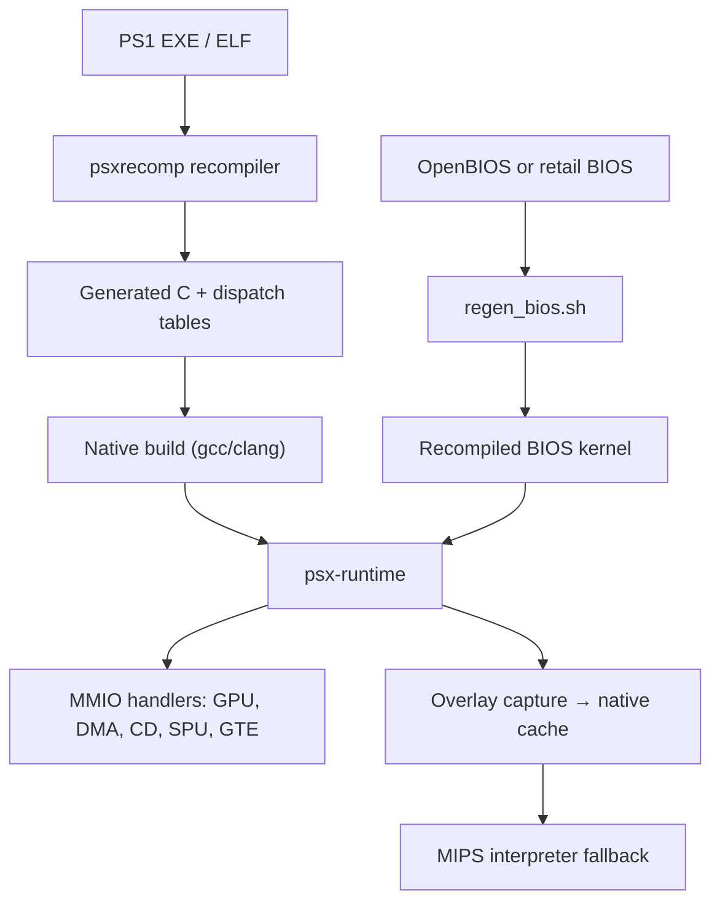

# PlayStation 1 and PS2 Decompilation and Recompilation

> Tags: playstation, ps1, ps2, game-reverse-engineering, recompilation, matching-decomp, mips | Difficulty: Advanced | Prerequisites: [Matching decompilation](matching-decomp.md), [Decompile workflow](../03-decomp/decompile-workflow.md), [Firmware recomp](../07-advanced/firmware-recomp.md)

## Overview

The PlayStation 1 and PlayStation 2 are the most documented console
recompilation targets after the Nintendo 64. Both use MIPS CPUs, both have
mature community toolchains, and both now have static recompilers that turn
entire game executables into native code.

This page covers the full landscape:

- The PS1 toolchain: PSY-Q compiler lineage, `mipsel-linux-gnu`, `aspsx` and
  `mips2c`, and the open SDK replacements.
- The PS2 Emotion Engine: R5900, 128-bit vector registers, VU0/VU1 microcode,
  scratchpad RAM, and the IOP coprocessor.
- The 2026 recomp projects: PSXRecomp, PS2Recomp, and related ports.
- The Tomba! project: the AI-assisted case study that started much of this.
- Where AI helps in PS1/PS2 work and where it fails. The hard part is VU
  microcode.
- How to run a matching-decomp workflow on PS1 and PS2 targets.

PS1 and PS2 differ in one important way. PS1 games are mostly single MIPS
executables with overlays. PS2 games are ELF binaries for a dual-CPU
system: the Emotion Engine (EE) and the I/O Processor (IOP). A PS2 port
must handle both CPUs, the Graphics Synthesizer (GS), and a large library
of SDK syscalls.

## The PS1 Hardware and Toolchain

### Hardware quick reference

The PlayStation CPU is a MIPS R3000A running at 33.8688 MHz. It is a
little-endian MIPS I processor with a 4 KB instruction cache and a 1 KB
data cache. It has no memory management unit paging. It runs in kernel
mode most of the time.

Key memory regions:

| Region | Address range | Size |
|---|---|---|
| Kernel RAM | `0x80000000` to `0x801FFFFF` | 2 MB main RAM |
| I/O scratchpad | `0x1F800000` to `0x1F8003FF` | 1 KB |
| BIOS ROM | `0x1FC00000` to `0x1FFFFFFF` | 512 KB |
| GPU registers | `0x1F801810` to `0x1F801C1F` | GPU command buffer |

The GPU (GTE is the geometry engine, GPU is the rasterizer) is programmed
through a packet buffer in RAM. Games build display lists and DMA them
to VRAM. Most PS1 games use fixed-point math in software. The GTE
(Geometry Transformation Engine) is a fixed-point vector coprocessor
accessed through 32 registers at `0x1F801080` to `0x1F8010A0`.

### PSY-Q era compilers

Original PS1 games were built with Sony's PSY-Q SDK. The compilers in use:

| Compiler | Notes |
|---|---|
| GCC 2.7.2 | Most common. The "SN Systems" and early Sony builds. |
| GCC 2.8.1 | Later PSY-Q releases. |
| GCC 2.6.3 | Used by some early titles and some homebrew toolchains. romdev ships this as WASM. |
| IDO-like? | No. PS1 did not use IDO. That was SGI/N64 only. |

Where to get them:

- **PSX toolchain**: `psxdev/psx-packer` and related repos host Linux
  binaries of GCC 2.6.3 through 2.8.1 configured for `mipsel` PSY-Q.
  See `github.com/psxdev`.
- **PCSX-Redux**: ships period compiler binaries for its decomp and
  recomp work. See `github.com/pcsx-redux/pcsx-redux`.
- **decomp.me**: hosts PS1 compilers server-side for its supported
  targets. You do not install them locally.
- **romdev**: ships PS1 GCC 2.6.3 as a WebAssembly binary. See
  `github.com/monteslu/romdev`.

### The `mipsel-linux-gnu` toolchain

For hand-written or homebrew code, the generic `mipsel-linux-gnu` GCC
works for most purposes. Install on Ubuntu:

```
sudo apt install gcc-mipsel-linux-gnu binutils-mipsel-linux-gnu
```

Use `-mips1` or `-mips2`, `-mno-abicalls`, and soft-float options to match
PSY-Q behavior. PS1 games use the o32 ABI with `$gp`-relative addressing
for small data. The ABI matters: `$gp` is set once at startup and all
small globals are accessed relative to it.

A typical PSY-Q compile line looks like:

```
mipsel-linux-gnu-gcc -O2 -G0 -mips2 -mno-abicalls -fno-builtin \
    -I$PSXSDK/include -c source.c -o source.o
```

`-G0` disables `$gp`-relative addressing for that file. Many PS1
projects use `-G0` because the original build did, or because it makes
matching easier.

### `aspsx` and `mips2c`

Two tools matter for PS1 assembly work:

- **aspsx**: an assembler for PSY-Q assembly syntax. It accepts the
  extended mnemonics and macros that Sony's `as` used. Source:
  `github.com/PCSX2/ps2sdk` or standalone `aspsx` repos. Used when you
  need to write PS1 assembly that matches the original toolchain.
- **mips2c**: a MIPS-to-C decompiler. Originally written for PS1/PS2
  work. It produces readable but not byte-matching C. It is a starting
  point, not a final answer. Related tools: Ghidra's MIPS sleigh
  specs, radare2's `pdc`, Binary Ninja's MIPS IL.

### Open SDK replacements

The PSY-Q SDK is proprietary. Open replacements exist:

- **psxsdk**: open headers and libraries implementing the BIOS syscall
  interface. See `github.com/psxdev`.
- **Net Yaroze**: the original public SDK. Its libraries are widely
  mirrored.

For decompilation work, you rarely need the SDK itself. You need the
compiler and the function signatures. The SDK headers help you name
things correctly.

## The PS2 Emotion Engine

### Hardware overview

The PS2 is a multi-processor system:

| Component | Description |
|---|---|
| Emotion Engine (EE) | MIPS R5900 at 294.912 MHz. 128-bit SIMD registers. 32 KB scratchpad RAM (SPR). |
| Vector Units | VU0 (integrated, macro mode or micro mode) and VU1 (standalone, micro mode only). |
| Graphics Synthesizer (GS) | 4 MB VRAM, separate from main RAM. |
| I/O Processor (IOP) | MIPS R3000A at 36.864 MHz. Runs IRX modules. |
| Scratchpad RAM | 16 KB on EE. Fast memory-mapped scratch space. |

### R5900 architecture

The R5900 is a 64-bit MIPS III derivative with SIMD extensions. Key
differences from standard MIPS:

- 128-bit general-purpose registers (`$v0`-`$t9`, `$s0`-`$ra`, etc.).
  Each register is 128 bits wide but only the low 64 bits are used for
  normal integer ops. The upper 64 bits are used by MMI (Multimedia
  Instructions) for SIMD operations.
- 32 128-bit multimedia registers (`$vf00`-`$vf31` style naming, but
  architecturally part of the GPR file).
- MMI instruction set: `PADDW`, `PSUBW`, `PMADDW`, `PEXTLW`, etc.
  These operate on packed 8/16/32-bit integers.
- FPU is 32-bit MIPS III compatible. No 64-bit FPU.
- Branch-likely instructions are supported.
- The EE has a 16 KB scratchpad RAM at `0x70000000`-`0x70003FFF`.
  VU0 microcode is often loaded here.

### VU0 and VU1

The Vector Units are the hard part of PS2 decompilation.

**VU0**: integrated into the EE pipeline. Can run in two modes:

- **Macro mode**: VU0 instructions are MIPS instructions. They appear
  in the EE instruction stream as `COP2` instructions. The EE can
  interleave VU0 macro ops with normal MIPS ops.
- **Micro mode**: VU0 runs standalone microcode from its own
  instruction memory. The EE writes microcode to VU0 memory, starts it,
  and reads results from VU0 data memory.

**VU1**: standalone vector processor. Runs only microcode. It has its
own instruction memory (4 KB) and data memory (4 KB). The EE uploads
microcode via DMA or direct writes, then triggers execution. VU1 is
used for skinning, lighting, and other vertex processing.

Microcode is not MIPS assembly. It is a separate ISA. Tools to
disassemble VU microcode:

- **Ghidra**: has VU0/VU1 sleigh modules (contributed by the PCSX2
  community).
- **PCSX2**: its source code contains VU interpreters and JITs that
  document the ISA.
- **vu0/vu1 disassemblers**: standalone tools exist in the ps2dev
  ecosystem.

### Scratchpad RAM (SPR)

The EE has 16 KB of scratchpad RAM at physical address `0x70000000`.
It is not cached. Access is fast. Games use it for:

- VU0 microcode storage (VU0 instruction memory is mapped here).
- Temporary buffers during decompression.
- DMA staging areas.
- Interrupt handlers and kernel data.

SPR access is through uncached loads/stores (`lw`, `sw` with `kseg1`
mapping or explicit `0x70000000` addresses). Decompilers must handle
this: SPR accesses look like normal memory accesses but have different
semantics.

### IOP and IRX modules

The IOP is a separate MIPS R3000A. It runs IRX (I/O module) binaries.
Common IRX modules:

- `SIO2MAN`, `PADMAN`: controller input
- `MCMAN`, `MCXMAN`: memory card
- `CDVDMAN`, `CDVDSTM`: disc access
- `LIBSD`, `SDRDRV`: audio
- `USBMAN`: USB

Each IRX is a separate ELF binary loaded by the IOP kernel. PS2Recomp
has a `ps2xIOP` module that executes IRX modules and provides HLE
fallbacks for common services.

## Recompilation Projects

### PSXRecomp (PlayStation 1)

- Repo: `github.com/RetroPortingToolKit/psxrecomp`
- License: PolyForm Noncommercial 1.0.0
- Status: Beta. Active development.

PSXRecomp is a static recompiler that translates PS1 MIPS R3000A code
into C, then compiles it as a native executable. It is part of the
RetroPortingToolKit (RPT) ecosystem, which also includes `recomp-ui`
(launcher), `psxmod` (mod packages), and game-specific projects.

Architecture:

- **Recompiler**: reads PS1 EXE or ELF, emits C functions and dispatch
  tables.
- **Runtime**: loads BIOS and game assets into emulated PS1 memory.
  Simulates GPU, DMA, timers, CD-ROM, MDEC, SIO0, memory cards, SPU,
  GTE, and interrupts through MMIO handlers.
- **BIOS**: recompiles either bundled OpenBIOS (MIT, from PCSX-Redux)
  or a compatible retail BIOS (SCPH1001.BIN) as the kernel. The
  recompiled BIOS is the correctness oracle.
- **Overlays**: PS1 games stream code from disc into reused RAM. PSXRecomp
  captures overlays at runtime, compiles them to native DLLs keyed by
  content hash, and caches them. A small MIPS interpreter handles
  not-yet-compiled code.
- **HLE tier**: optional high-level BIOS layer for boot-skip and common
  services. Falls through to LLE when not implemented.



Game projects include Mega Man X4 (with X/Zero co-op), Mega Man X5,
X6, Tomba!, Tomba! 2, Ape Escape, Tsumu Light, Jersey Devil, Um Jammer
Lammy, Battle Arena Toshinden, and Dragon Ball GT: Final Bout. Community
projects cover Mega Man Legends, Xenogears, and Gran Turismo 2.

Build requirements:

- Git, Python 3, CMake 3.20+, Ninja, C/C++ compiler (C++20 for
  recompiler, C99 + C++17 for runtime).
- SDL3 3.4+ (fetched automatically if not found).
- Optional: retail BIOS dump for SCPH1001.BIN.

Setup:

```
git clone --recurse-submodules https://github.com/mstan/psxrecomp.git
cd psxrecomp

# Build recompiler
cmake -S recompiler -B recompiler/build -G Ninja -DCMAKE_BUILD_TYPE=Release
cmake --build recompiler/build

# Generate BIOS C (OpenBIOS is bundled, MIT)
bash tools/regen_bios.sh --config bios/OpenBIOS.toml

# Build runtime
cmake -S runtime -B runtime/build -G Ninja -DCMAKE_BUILD_TYPE=Release \
    -DPSX_RECOMP_UI=OFF
cmake --build runtime/build --target psx-runtime
```

The Tomba! project (`TombaRecomp` in the RetroPortingToolKit org) was
the first major PSXRecomp title. It was built with Claude Code
assistance over about three weeks. See the case study below.

### PS2Recomp (PlayStation 2)

- Repo: `github.com/ran-j/PS2Recomp`
- License: not stated on the repo page checked
- Status: Active research. Early stage.

PS2Recomp statically recompiles PS2 ELF binaries into C++ and provides
a runtime. It is less mature than PSXRecomp.

Modules:

| Module | Function |
|---|---|
| `ps2xAnalyzer` | Scans ELF/functions, writes TOML config (stubs, skips, patches). |
| `ps2xRecomp` | Reads TOML + ELF, decodes R5900 instructions, generates C++. |
| `ps2xRuntime` | Hosts memory, function registration, syscall dispatch, hardware stubs. |
| `ps2xIOP` | R3000A IRX execution, virtual IOP kernel, HLE fallbacks. |

Features:

- Translates MIPS R5900 instructions to C++.
- PS2-specific MMI and VU0 macro support.
- Single-file or multi-file output.
- Configurable stubs, skips, instruction patches.
- Instruction-driven syscall handling.
- Relocation-symbol auto-binding at callsites.

Limitations (stated by the author):

- Performance is very bad for VU and GS.
- Hardware emulation is partial. Many paths are stubbed.
- VU1 microcode is not recompiled. It runs in a stub or interpreter.

Workflow:

1. Open the ELF in Ghidra.
2. Run `ps2xRecomp/tools/ghidra/ExportPS2Functions.java`.
3. Use the exported TOML and CSV map.
4. Recompile with `ps2_recomp config.toml`.
5. Build generated output and link with `ps2xRuntime`.

The generated code is very literal: each MIPS instruction maps to a
C++ operation. `addiu $r4, $r4, 0x20` becomes
`ctx->r4 = ADD32(ctx->r4, 0x20)`. This is correct but slow. Optimization
is a manual or AI-assisted step.

### PCSX-Redux (PS1 emulator, not a recompiler)

- Repo: `github.com/pcsx-redux/pcsx-redux`
- Role: PS1 emulator with REST API, Lua scripting, OpenBIOS.

PCSX-Redux is not a static recompiler. It is an emulator. It matters
for PS1 decomp work because:

- It provides period-accurate PS1 emulation for testing.
- It ships OpenBIOS, the open-source PS1 BIOS used by PSXRecomp.
- It has a REST API and Lua scripting that agents can use for dynamic
  analysis.
- It was used as the validation oracle in the Tomba! recomp project.

### Other PS1/PS2 projects

- **decomp.me**: hosts PS1 matching-decomp targets. Several commercial
  PS1 games have matching projects.
- **PS1 decomps**: scattered across GitHub. Notable examples found in
  search: Parasite Eve (source-only decomp), Megaman Legends, Brave
  Fencer Musashi, Legend of Mana, Crash Team Racing, Street Fighter III
  3rd Strike (PS2), Silent Hill (PS1), Driver 2 (PS2), PaRappa the
  Rapper 2 (PS2), Dark Cloud (PS2), Shin Megami Tensei: Persona 4
  (PS2), Final Fantasy VIII (PS1), Final Fantasy Tactics (PS1).
- **ps2recomp-era projects**: PS2Recomp is the main one. Others are
  research prototypes or abandoned.

## The Tomba! Case Study

The Tomba! PS1 recomp is the most documented AI-assisted console
recompilation project. Source: `1379.tech` blog post by Matthew
Stanley, the PSXRecomp author.

Timeline:

- **February 2026**: Started with Claude Code (Sonnet 4.6) analyzing a
  retail ISO directly. No Ghidra. Produced recognizable but ugly
  renderings after heavy token burn.
- **March 2026**: Integrated Ghidra with GhidraMCP. Added CLAUDE.md
  rules forcing Claude to validate every decision against Ghidra.
  Added screenshot capture, input replay, fast-forward, and memory
  logging tools.
- **March 2026**: Connected Claude to PCSX-Redux via a custom MCP
  server built on Lua scripting. PCSX-Redux has no native MCP.
- **Result**: Tomba! runs as a native Windows application. Intro FMV,
  main menu, new game, overworld, combat, menus, damage, quests.
  Softlocks and sound issues remain.

Key workflow patterns:

1. **Goal-level prompting**: instead of "fix this function", give
   Claude a goal like "make the overworld render correctly" and let
   it iterate.
2. **Ghidra as oracle**: every implementation decision must be
   validated against Ghidra disassembly. Claude cannot speculate.
3. **No hand-editing generated code**: Claude modifies recompiler
   inputs and regenerates. This prevents hidden debt.
4. **Autonomous loops**: with tools for screenshots, memory dumps,
   and fast-forward, Claude worked autonomously for 60-90 minute
   stretches.
5. **Determinism as validation**: the attract demo and scripted
   sequences provide repeatable test oracles.

Cost: the author reports regularly hitting Claude's $100/month usage
limit. Applied for the open-source Max plan.

## AI Assistance: Where It Works and Where It Fails

### What AI does well on PS1/PS2

| Task | Why it works |
|---|---|
| Small function decompilation | PS1/PS2 functions are often small. The model can hold the whole problem. |
| Syscall stub identification | PS2 SDK syscalls have known signatures. The model recognizes patterns. |
| Ghidra pseudocode cleanup | Ghidra's MIPS output is verbose. The model rewrites it into plausible C. |
| Overlay discovery | PS1 overlays have recognizable loader patterns. The model finds them. |
| Build system debugging | CMake, linker scripts, and Makefile issues are well within model capability. |
| VU0 macro instruction translation | VU0 macro ops are MIPS-like. The model handles them reasonably. |
| Runtime stub implementation | Hardware stubs (GPU, DMA, timers) are bounded problems with known behavior. |

### What AI fails at on PS1/PS2

| Task | Why it fails |
|---|---|
| VU microcode | VU0/VU1 microcode is a separate ISA. Models have little training data. Ghidra sleigh specs are incomplete. |
| Large optimized functions | R5900 `-O2` output has complex register allocation. The model cannot simulate the compiler. |
| GS register programming | The Graphics Synthesizer has hundreds of registers with undocumented interactions. |
| IOP IRX modules | Each IRX is a separate binary with its own syscall interface. The model lacks context. |
| Timing-sensitive code | PS1/PS2 games depend on cycle-accurate timing for copy protection and anti-piracy. The model cannot reason about cycles. |
| Hand-written assembly | Some games have assembly-optimized inner loops. No C produces those bytes. |

### The VU microcode problem

VU microcode is the single hardest part of PS2 decompilation. Reasons:

1. **Separate ISA**: VU0/VU1 instructions are not MIPS. They have their
   own opcodes, registers, and semantics.
2. **Sparse documentation**: The VU ISA is documented in Sony's EE
   User's Manual, but the manual is not machine-readable. Online
   documentation is incomplete.
3. **Limited training data**: Few open-source PS2 games use VU
   microcode in ways that appear in training corpora.
4. **Ghidra sleigh specs**: community-contributed VU sleigh modules
   exist but are incomplete. Many VU instructions fail to disassemble.
5. **No compiler**: there is no VU assembler in common use. Microcode
   is usually hand-assembled or generated by proprietary tools.

Practical approach for VU microcode:

1. Extract microcode from the ELF or overlay.
2. Disassemble with Ghidra VU sleigh or a standalone VU disassembler.
3. Translate to C by hand or with AI assistance for the parts that
   disassemble cleanly.
4. Validate against PCSX2's VU interpreter behavior.
5. Accept that some VU code will remain as embedded microcode blobs
   in the recompiled output.

## Matching Decomp on PS1/PS2

### PS1 matching decomp

PS1 matching decomps follow the standard loop:

1. Split the PS1 EXE into functions. Tools: `splat`, `spimdisasm`,
   or custom PS1 splitters.
2. Compile candidate C with PSY-Q GCC 2.7.2/2.8.1 or `mipsel-linux-gnu`.
3. Compare with `objdiff` or `asm-differ`.
4. Iterate until byte match.

PS1-specific challenges:

- **Overlays**: PS1 games load code overlays at runtime. Each overlay
  is a separate binary. Matching decomp must handle overlay boundaries.
- **BIOS calls**: games call BIOS functions through function pointers
  or syscall numbers. These are not in the game binary.
- **GTE instructions**: the Geometry Transformation Engine has its
  own instruction set accessed through `COP2` instructions. Ghidra
  handles these, but matching them in C requires inline assembly or
  intrinsics.
- **Delay slots**: MIPS has branch delay slots. The compiler fills
  them, but the original code may have specific scheduling.

### PS2 matching decomp

PS2 matching decomps are rarer. The EE is more complex:

- **R5900 128-bit registers**: matching requires understanding MMI
  instructions and vector register usage.
- **VU0 macro instructions**: `COP2` instructions that operate on VU0
  registers. These appear in the EE instruction stream.
- **Kernel vs user mode**: PS2 games run in kernel mode. Privileged
  instructions are common.
- **IOP communication**: EE code sends commands to IOP modules via
  SIF RPC. These calls are not simple function calls.

PS2 matching tools:

- **Ghidra**: with PS2 extensions (EE, VU0, VU1 sleigh specs).
- **PCSX2**: provides disassembly and debugging for PS2 binaries.
- **ps2recomp**: PS2Recomp's analyzer exports function maps for
  recompilation, which can also feed matching decomp.

### AI-assisted matching on PS1/PS2

The same AI patterns from [matching-decomp](matching-decomp.md)
apply:

- Give the agent one function at a time.
- Provide disassembly, calling context, and compiler/flags.
- Let it compile, diff, and iterate.
- Cap the build budget.

PS1/PS2-specific prompt additions:

```
Target: PS1 MIPS R3000A, GCC 2.7.2, -O2 -G0 -mips2 -mno-abicalls
Calling convention: o32, $gp-relative for small data
BIOS calls: use bios.h function names if known
GTE instructions: use inline assembly or GTE intrinsics if needed
Overlays: this function is in overlay 3, load address 0x80100000
```

For PS2:

```
Target: PS2 Emotion Engine, R5900, GCC 2.9-ee or 3.2-ee
128-bit registers: low 64 bits for integer, upper 64 for MMI
VU0 macro: COP2 instructions, see VU0 macro manual
VU1 microcode: not in this function, skip
IOP calls: SIF RPC, not direct function calls
```

## Setup Commands

### PS1 toolchain on Ubuntu

```
# Generic MIPS toolchain
sudo apt install gcc-mipsel-linux-gnu binutils-mipsel-linux-gnu

# PSX-specific tools
sudo apt install p7zip-full make gcc

# Clone PSX SDK replacement (example)
git clone https://github.com/psxdev/psxsdk.git
cd psxsdk && make

# Clone PSXRecomp
git clone --recurse-submodules https://github.com/mstan/psxrecomp.git
cd psxrecomp && mkdir build && cd build && cmake .. && make -j$(nproc)
```

### PS2 toolchain on Ubuntu

```
# PS2 SDK (ee-gcc)
git clone https://github.com/ps2dev/ps2sdk.git
cd ps2sdk && ./build.sh

# PS2Recomp
git clone --recurse-submodules https://github.com/ran-j/PS2Recomp.git
cd PS2Recomp && cmake -S . -B out/build && cmake --build out/build

# PCSX2 for testing
git clone https://github.com/PCSX2/pcsx2.git
cd pcsx2 && mkdir build && cd build && cmake .. && make -j$(nproc)
```

### Ghidra PS1/PS2 setup

```
# Ghidra 12.2 with PS2 extensions
# Install sleigh specs for EE, VU0, VU1
# Community sleigh specs: search "ghidra ps2 sleigh" on GitHub
# PS2Recomp includes Ghidra export script:
# ps2xRecomp/tools/ghidra/ExportPS2Functions.java
```

## Pitfalls

### Legal and community

- PSY-Q SDK and PS2 SDK are proprietary. Open replacements exist but
  may not be complete.
- Game binaries and BIOS images are copyrighted. PSXRecomp requires
  your own disc dump. Do not distribute ROMs.
- PSXRecomp is PolyForm Noncommercial. Commercial use requires a
  license from the author.
- Some decomp projects ban AI contributions. Check each project's
  rules.

### Technical

- **VU microcode is the wall**. PS2 games use VU1 heavily for
  graphics. Without VU1 recompiler support, PS2Recomp output will be
  incomplete or very slow.
- **IOP is a second binary**. A PS2 ELF is not the whole game. IRX
  modules contain critical code.
- **Overlays on PS1**. PS1 games load code at runtime. Static
  recompilation must handle overlay discovery.
- **BIOS dependency**. PS1 games call BIOS functions. PSXRecomp
  recompiles the BIOS as the kernel. You need a compatible BIOS dump.
- **Delay slots**. MIPS delay slots confuse decompilers. Ghidra
  handles them, but C output may have scheduling differences.
- **GTE instructions**. The PS1 GTE is a coprocessor with its own
  instruction set. C decompilation requires intrinsics or inline
  assembly.
- **128-bit registers on PS2**. R5900 GPRs are 128-bit. Most decompilers
  treat them as 64-bit. MMI instructions need special handling.

### AI-specific

- Do not ask the model to "decompile VU microcode" without providing
  the ISA documentation. It will hallucinate.
- Do not let the agent edit generated recompiler output. Fix the
  recompiler input and regenerate.
- PS2 syscall stubs need the PS2 SDK headers. Provide them or the
  model will invent function signatures.
- Timing loops and busy-waits are common in PS1/PS2 code. The model
  may "optimize" them away, breaking synchronization.

## See Also

- [Matching decompilation](matching-decomp.md)
- [SWMH auto-recomp](swmh-auto-recomp.md)
- [Decompile workflow](../03-decomp/decompile-workflow.md)
- [Verification loop](../03-decomp/verification-loop.md)
- [Firmware recomp](../07-advanced/firmware-recomp.md)
- [Tool catalog](../05-tools/tool-catalog.md)
- [Game engine RE](../06-topics/game-engine-re.md)
- [Real-world recipes](../08-case-studies/real-world-recipes.md)
