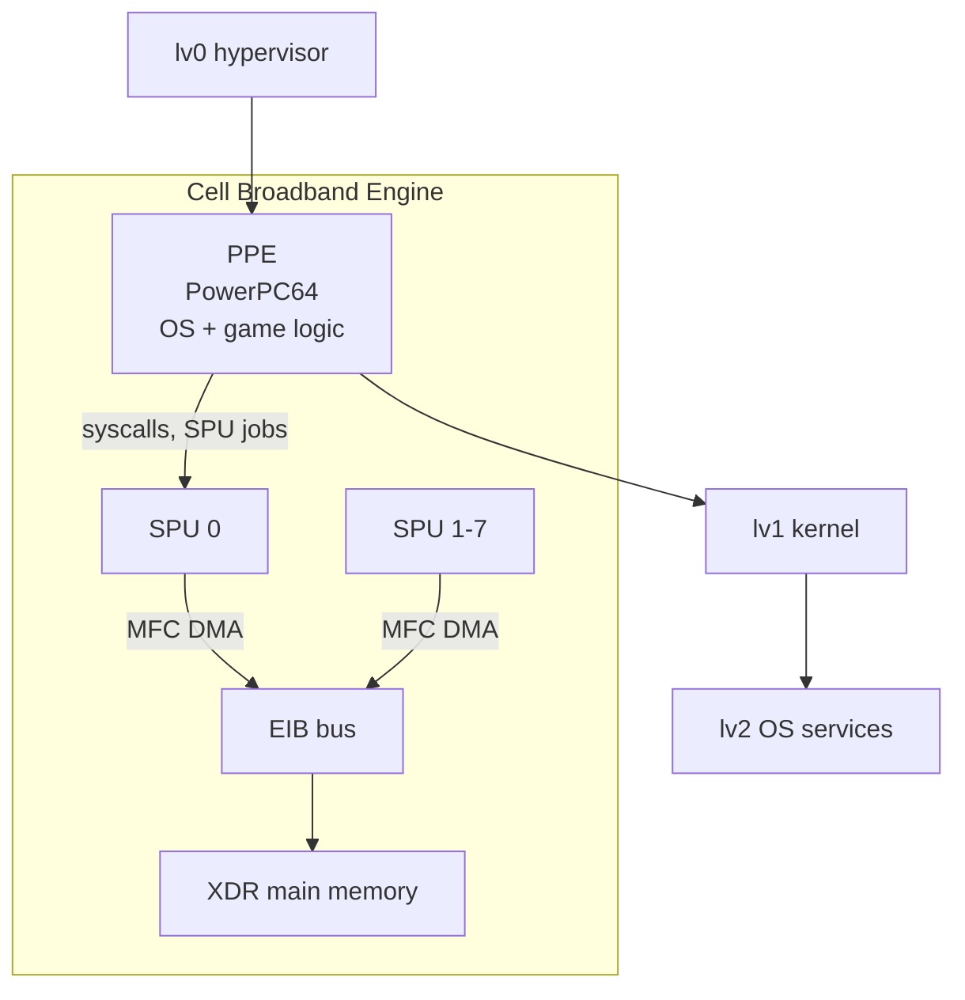

# PS3, PS4, PS5 Reverse Engineering

> Tags: console | ps3 | ps4 | ps5 | cell-be | x86-64 | hypervisor | homebrew | Difficulty: Advanced | Prerequisites: CPU architecture knowledge, ELF knowledge, x86-64 assembly, basic hypervisor concepts

## Overview

The three PlayStation generations give you three very different reverse engineering problems.

- PS3 (2006). IBM Cell Broadband Engine. A PowerPC host CPU plus eight SIMD coprocessors. A three-layer hypervisor stack (lv0, lv1, lv2). Public keys leaked in 2011. The homebrew scene is mature and stable.
- PS4 (2013). AMD x86-64 "Prospero" SoC. A FreeBSD 9.0-derived operating system. Jailbreaks exist for many firmwares. The homebrew SDK is old but functional. The emulator shadPS4 is young but runs real games.
- PS5 (2020). AMD Zen 2 plus RDNA 2 "Oberon" SoC. Reports name the system codename "Prospero". Public reverse engineering is thin. No public emulator exists as of 2026-11-05.

This page covers the hardware, the software stack, the scene tools, and where AI helps. Where a claim comes from the scene wiki or press and not from a primary source, it is marked "reported" or "unverified".

## PS3: Cell Broadband Engine

### Hardware architecture

The Cell Broadband Engine has two processor types.

| Unit | Count | Role |
|---|---|---|
| PPE (PowerPC Processing Element) | 1 | Host CPU. In-order PowerPC64. Runs the operating system and game logic. |
| SPU (Synergistic Processing Unit) | 8 | SIMD coprocessors. Run game workloads: physics, audio, graphics command generation. |

Each SPU has a 256 KB local store. It cannot address main memory directly. The MFC (Memory Flow Controller) DMA engine moves data between local store and XDR main memory through the Element Interconnect Bus (EIB). Game code on the SPU is assembly-heavy. SPU assembly uses a nonstandard syntax. Register files are named `$sp`, `$lr`, `$r0`-`$r127`. Most AI models have never seen it in training data.



### The hypervisor stack

The retail PS3 firmware splits into layers.

| Layer | Role |
|---|---|
| metldr / lv1ldr | Boot loaders. Chain-load the next stage. |
| lv0 | Hypervisor. Manages partitions, virtual memory, interrupts, I/O. Runs at the highest privilege. |
| lv1 | Kernel. Process management, syscalls, drivers. |
| lv2 | OS services. File system, networking, sound, graphics API (libgcm, RSX command generation). |
| lv2_kernel | Additional kernel services inside lv2. |

The layers communicate through syscall and hypercall interfaces. lv0 enforces isolation between the "OtherOS" partition and the game OS partition. Security research on this stack dates to the fail0verflow "Console Hacking 2011" talk at 27C3. Sources: media.ccc.de/v/27c3-4294-console_hacking_2011_ps3_epic_fail, github.com/fail0verflow.

### Keys history

The security chain works like this. Bootloaders verify signatures. lv0 verifies lv1. lv1 verifies lv2 modules. The keys that do this verification were Sony secrets.

| Event | What happened | Status |
|---|---|---|
| 2010 | GeoHot published a PS3 metldr exploit. Reported. | Historical |
| Jan 2011 | fail0verflow published the 27C3 talk and released tools. They broke lv0 signature checks on CFW-capable firmwares. | Verified by talk recording |
| 2011 | OtherOS++ released. Linux can run in a partition on CFW systems. | Verified, ps3dev community |
| 2011 | Scene released lv0/lv1/lv2 key material publicly on ps3devwiki and mirrors. | Verified historically |
| 2020s | Keys remain public. New keys for newer firmwares are not published by Sony. | Current state |

Do not confuse key release with legality. Using leaked keys and CFW violates the DMCA anti-circumvention provisions in most jurisdictions. See `../09-ops/legal-and-ethics.md`.

### RPCS3

RPCS3 is the reference PS3 emulator and debugger. It is written in C++. It runs on Windows, Linux, macOS, and FreeBSD. Source: github.com/RPCS3/rpcs3.

Relevant facts for reverse engineers:

- RPCS3 recompiles SPU assembly to LLVM IR at runtime. You can dump that IR. It is the closest thing to readable output for SPU code. Reported from RPCS3 source and documentation.
- RPCS3 has a PPU LLVM recompiler too. Game code is PowerPC64. Ghidra and IDA have PowerPC support but it is weaker than x86 support.
- RPCS3 has a built-in debugger and a remote debugger stub. You can attach to a running game.
- Build from source on Linux:

```bash
git clone --recursive https://github.com/RPCS3/rpcs3.git
cd rpcs3 && sudo apt install git cmake gcc g++ libcurl4-openssl-dev zlib1g-dev \
  libevdev-dev libasound2-dev libpulse-dev libudev-dev libhidapi-dev \
  qt6-base-dev qt6-svg-dev libwxgtk3.2-dev libvulkan-dev glslang-tools \
  libatomic1 libclang-dev llvm-dev
cmake -S . -B build -DCMAKE_BUILD_TYPE=Release -DUSE_CCACHE=ON
cmake --build build -j$(nproc)
```

- Run headless for analysis:

```bash
./rpcs3 --no-gui --installfw path/to/PS3UPDAT.PUP game_dir
```

- RPCS3 needs firmware files, game dumps in PKG or folder format, and a Vulkan-capable GPU for shader compilation. PS3 firmware updates are signed PUP archives. You can extract them with `pupunpack` (reported; part of the fail0verflow-derived scene tools).

### SPU assembly and decompilation

SPU code sits inside `.self` ELF files on the PS3 disc or in PKG payloads. A `.self` is a signed and encrypted ELF. On CFW or with RPCS3 you can get decrypted ELF output. RPCS3 writes decrypted ELF files to its `dev_hdd0` or cache directories when configured. Reported.

AI assist for SPU assembly:

- Feed SPU asm chunks to the model with the SPU ISA reference. ps3devwiki has an SPU instruction reference. The model will guess at first. Verify against the manual.
- Ask the model to translate SPU asm to C-like pseudocode, not to "explain" it. Explanation invites hallucinated register names.
- Use RPCS3's LLVM IR dump as ground truth for register and memory behavior.
- The SPU has 128 registers of 128-bit width. Vector ops dominate. Most games store hot loops on SPU and cold code on PPE. Expect heavy SIMD.

## PS4: Orbis OS on Prospero

### Hardware

The PS4 CPU is an AMD "Prospero" SoC. Eight Jaguar cores, x86-64, roughly 2.3 GHz reported. 8 GB GDDR5 shared between CPU and GPU. The GPU is an AMD GCN part, roughly Radeon HD 7000-series class, reported. These specs come from teardowns and press. Treat exact clock and shader counts as approximate.

The software stack:

| Component | Notes |
|---|---|
| Kernel | Orbis OS kernel. FreeBSD 9.0-derived. Reported, confirmed by ps4dev's `freebsd-include-mirror` repo. |
| Userland | FreeBSD-style libc plus Sony's `libSce*` libraries. |
| Executables | `.self` files. Signed ELF. Need decryption before standard tools can read them. |
| Game files | PKG or folder format under `/user/app/`. Title IDs like `CUSA01234`. |
| Firmware modules | `.sprx` shared objects. Many `libSce*.sprx` modules run as separate processes. |

### Scene tools

The PS4 scene grew out of the fail0verflow research release. psdevwiki.com/ps4 is the central reference. ps4devwiki is the older name. Both document the kernel, the exploit chains, and the SDK.

| Tool or project | What it does | Source |
|---|---|---|
| ps4toolchain | Cross compiler and SDK for PS4 homebrew. Reported; hosted at gitbrew.sh historically. | gitbrew.sh (currently unreachable, reported) |
| ps4sdk | Modular open-source SDK with user and kernel support. Last commits around 2017. | github.com/ps4dev/ps4sdk |
| elf-loader | Runs ps4sdk ELF files over TCP on a jailbroken PS4. | github.com/ps4dev/elf-loader |
| ps4debug | PS4 debugger for firmware 5.05. Debug Watch is a demo frontend. | github.com/SiSTR0/ps4debug |
| shadPS4 | PS4 emulator. Active development. | github.com/shadps4-emu/shadPS4 |
| PS4Debris | Debian Linux port for jailbroken PS4. Reported as discontinued. | Unverified current state |

PS4Debris lineage: the Debian port and the homebrew scene share the same jailbreak base. The "itemzflow" userland exploit chain is reported to work on a range of firmwares up to 9.x. Exact firmware coverage is unverified in public sources. Check psdevwiki/ps4/Jailbreak for the current table.

### shadPS4 current state

As of 2026-11-05, shadPS4 is an early but real emulator. Verified from its README:

- Runs on Windows, Linux, macOS, and FreeBSD.
- Runs games including Bloodborne, Dark Souls Remastered, Red Dead Redemption, Yakuza 0, DRIVECLUB, and Hatsune Miku Project DIVA Future Tone.
- Needs `.sprx` firmware modules dumped from a legal console. List includes `libSceAudiodec*.sprx`, `libSceAvPlayer.sprx`, `libSceJpegDec.sprx`, `libScePadTracker.sprx`, and others. Place them in `sys_modules`.
- The core has no GUI. The QtLauncher is a separate download.
- License is GPL-2.0.

shadPS4 was created by forking fpPS4 lineage tools and building fresh. fpPS4 (github.com/kakaroto/fpPS4, reported) was the earlier closed-source PS4 emulator project. shadPS4 credits fpPS4 for OS and library research help. The lineage matters for reverse engineers because fpPS4's research notes fed into the public kernel documentation.

### Working with decrypted PS4 binaries

A `.self` file is an encrypted ELF. Scene tools decrypt it. On a jailbroken console, tools like `itemzflow` loaders and `kstuff` payloads can dump decrypted binaries from memory. Reported.

For static analysis without a console:

1. Obtain a PKG. Extract with `pkg_view` or `orbis-pub-chk` (reported names; check psdevwiki).
2. The PKG contains `.self` or `.elf` files.
3. Decrypt the `.self`. Scene tools do this. There is no public clean-room decryptor that works on all firmwares.
4. Load the result in Ghidra or IDA as an x86-64 ELF. These are normal x86-64 binaries at this point.

AI assist for PS4:

- The heavy lifting is the same as any x86-64 ELF analysis. See `../03-decomp/decompile-workflow.md`.
- `libSce*` imports are the API surface. Build a stub library of signatures so the model names calls correctly.
- Sprx modules are shared objects. The kernel is `libkernel.sprx` / `libSceKernel*` family. Reported.
- Ghidra handles PS4 ELFs well after decryption. The main problem is getting the decrypted file, not analyzing it.

## PS5: Prospero / Oberon

### Hardware

PS5 uses an AMD "Oberon" SoC. Reported specs: Zen 2 CPU at up to 8 cores, RDNA 2 GPU, 16 GB GDDR6. The system codename reported by press and psdevwiki is "Prospero". Some sources call the SoC "Prospero2". Treat the codename as unverified.

### Software stack

Reports describe:

- FreeBSD-derived kernel, newer base than PS4.
- A hypervisor layer that manages game partitions. Details are not public.
- `.self` executables with a newer encryption scheme. Scene tools do not publicly decrypt retail PS5 executables as of 2026-11-05.
- No public jailbreak on all firmwares. Reported exploits exist for early firmwares and the BD-JB Blu-ray path on newer ones. Details are patchwork and change fast. Check psdevwiki/ps5 and the PS5 scene Discord for current state.

### Emulation

No public PS5 emulator exists as of 2026-11-05. Reported projects:

- "Prospero2" is reported as a PS5 emulator research project on GitHub. It is incomplete and has no game compatibility. Unverified beyond its existence.
- shadPS4 does not target PS5.
- RPCS3 does not target PS5.

Treat all PS5 emulator claims with skepticism. The hardware is too new and the encryption too strong for a community emulator yet.

### What is documented vs rumor

| Topic | Status |
|---|---|
| PS5 SoC is Zen 2 + RDNA 2 | Reported, widely confirmed |
| PS5 kernel is FreeBSD-derived | Reported, unverified publicly |
| PS5 hypervisor exists | Reported, details unverified |
| Public PS5 jailbreaks | Reported for specific firmwares, changes fast |
| Public PS5 emulator | None as of 2026-11-05 |
| PS5 keys published | Partial scene releases reported, not comprehensive |

## Scene tools summary

| Era | Key projects |
|---|---|
| PS3 | fail0verflow tools, ps3load, PSL1GHT SDK, ps3devwiki, RPCS3 |
| PS4 | ps4dev org, ps4toolchain, ps4sdk, elf-loader, ps4debug, itemzflow, kstuff, shadPS4, PS4Debris |
| PS5 | psdevwiki/ps5, partial key leaks, no mature SDK |

## AI assists

What actually helps:

- Translating SPU assembly to pseudocode. The model needs the SPU ISA doc in context. Output quality is low without it.
- Naming `libSce*` functions and structures. These are stable across games.
- Explaining x86-64 PS4 binaries after decryption. This is standard ELF work. See `../03-decomp/decompile-workflow.md`.
- Reading RPCS3's LLVM IR dump for SPU verification.
- Generating Ghidra scripts to apply function signatures in bulk.

What does not help:

- SPU decompilation to byte-exact C. The SIMD and DMA model is too different from what models know.
- PS5 binary analysis without decrypted input. You cannot analyze what you cannot read.
- Hallucinated syscall numbers. PS3 lv1/lv2 syscall tables are public on ps3devwiki. Always verify against the table, not the model.

## Pitfalls

- Do not feed encrypted `.self` files to a decompiler. You will get garbage or a load error.
- SPU assembly syntax is not PowerPC assembly. Do not let the model "fix" it into PPC syntax.
- RPCS3 firmware modules are copyrighted Sony files. You must dump them from your own console. Do not redistribute.
- PS4 jailbreak exploits are firmware-specific. A payload for 5.05 will not work on 9.00.
- psdevwiki is behind Cloudflare. Automated fetches get 403. Use the wiki in a browser or via a mirror.
- Scene claims move fast. Verify firmware coverage and exploit status on psdevwiki before you rely on them.
- Legal: see `../09-ops/legal-and-ethics.md` for DMCA and CFAA implications of jailbreak research.

## See Also

- [Matching Decompilation](matching-decomp.md)
- [SWMH Auto Recomp](swmh-auto-recomp.md)
- [Console and Firmware Recompilation](../07-advanced/firmware-recomp.md)
- [Binary Formats](../00-fundamentals/binary-formats.md)
- [Decompile Workflow](../03-decomp/decompile-workflow.md)
- [Legal and Ethics](../09-ops/legal-and-ethics.md)
- [Game Engine RE](../06-topics/game-engine-re.md)
