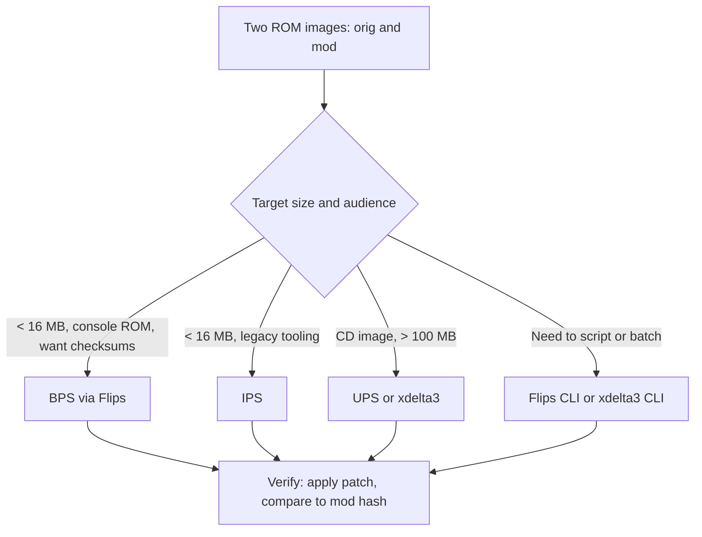
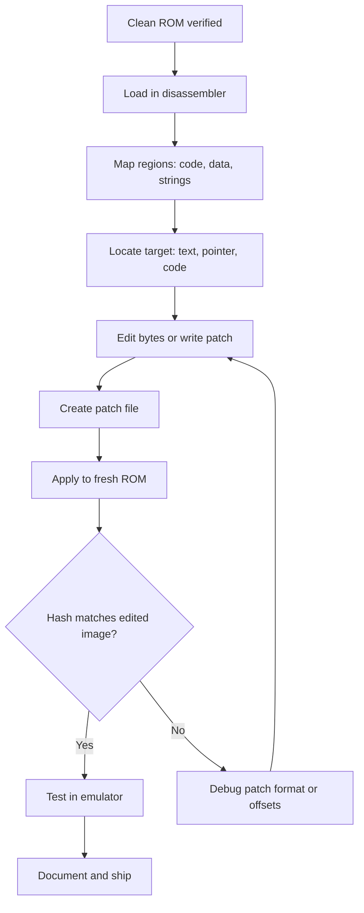

# ROM Hacking and ROM Reverse Engineering

> Tags: rom-hacking | patch-formats | console-roms | headers | text-encoding | pointer-hunting | compression | Difficulty: Intermediate | Prerequisites: hex editing, basic assembler, a legally dumped ROM, emulator basics

## Overview

ROM hacking is the practice of editing a game image on disk. You do not run the game while you edit. You produce a patch file or a modified ROM image. The patch file is the deliverable. It is small. It applies cleanly to anyone with the same clean ROM.

This is different from recompilation. A recompiler turns guest code into C++. A ROM hack changes a few bytes in the original image. See `./swmh-auto-recomp.md` for the recompilation side. See `./matching-decomp.md` for byte-exact reconstruction of console code.

The work splits into four layers:

1. **Format layer.** Patch files (IPS, UPS, BPS, xdelta3). Compression formats. ROM container headers.
2. **Data layer.** Pointer tables. Text encoding tables. String tables. ROM maps.
3. **Code layer.** Disassembly without symbols. Entrypoints. Cross-reference recovery.
4. **AI layer.** Encoding-table recovery. String extraction. Patch conflict resolution.

ROM hacking has a 30-year community history. The canonical knowledge base is romhacking.net. Its document library covers text hacking, pointer hacking, table files, assembly, and program-specific notes for dozens of consoles. Source: romhacking.net document categories (observed 2026-11-05).

## Patch Formats

Four formats cover nearly all of the scene. Each one encodes a list of byte ranges to replace.

### IPS

IPS is the oldest format. It stores patches as big-endian records.

```
"PATCH"                          5 bytes, magic
repeat:
  offset      3 bytes, big-endian, file offset
  size        3 bytes, big-endian, bytes in patch
  data        size bytes
"EOF"                             3 bytes, terminator
```

IPS cannot address offsets above 0xFFFFFF. It carries no checksum. It assumes the target is one fixed image. Source: romhacking.net patch format documentation.

Create an IPS with a short Python script. This example diffs two images and emits one record per changed run.

```python
def make_ips(orig: bytes, mod: bytes) -> bytes:
    assert len(orig) == len(mod)
    out = bytearray(b"PATCH")
    i = 0
    while i < len(orig):
        if orig[i] == mod[i]:
            i += 1
            continue
        start = i
        while i < len(orig) and orig[i] != mod[i]:
            i += 1
        end = i
        out += start.to_bytes(3, "big")
        out += (end - start).to_bytes(3, "big")
        out += mod[start:end]
    out += b"EOF"
    return bytes(out)
```

### BPS

BPS is the modern format. Floating IPS (Flips) creates BPS patches that are smaller than any other tool produces, per its README. BPS stores a CRC32 of the target ROM and of the result. The applier refuses a wrong base image. BPS also supports delta encoding for compression and multi-file patches.

BPS header layout, all values big-endian:

```
"BPS1"            4 bytes, magic
size              32-bit, size of the patched output
metadata size     32-bit, length of metadata blob
source checksum   32-bit CRC32 of the input ROM
target checksum   32-bit CRC32 of the output ROM
metadata          variable
patch data        action stream (see Flips source)
```

Flips applies IPS, BPS, and UPS files. It creates IPS and BPS. It runs from a GUI or from the command line. Source: github.com/Sir-Walrus/Flips (the project moved organizations; the Sir-Walrus fork is the maintained continuation of the original romhackingtools/Flips).

```bash
# Flips command line (build from source; see the README)
./flips --apply patch.bps target.nes out.nes
./flips --create orig.nes mod.nes out.bps
```

### UPS

UPS (Universal Patcher) uses little-endian fields and a delta encoding. The file stores a checksum of the target. Applying a patch copies unchanged regions and XORs deltas into changed regions. UPS handles large files better than IPS and was designed for CD-sized images.

UPS header, all values little-endian:

```
"UPS1"            4 bytes, magic
input size        32-bit
output size       32-bit
input file CRC32  32-bit
output file CRC32 32-bit
varint            input file name length, then name
varint            output file name length, then name
patch data        delta blocks
```

### xdelta3

xdelta3 is a general binary diff tool. It is not ROM-specific. It produces very small patches on large files because it finds long-range matches. It uses a git-style windowed encoding. You need the `xdelta3` binary to encode and decode.

```bash
xdelta3 -e -9 -S lzma orig.rom mod.rom patch.xdelta   # encode
xdelta3 -d -s orig.rom patch.xdelta out.rom           # decode
```

xdelta3 is the right choice for multi-megabyte CD images where patch size dominates. BPS handles large files too, but xdelta3's windowed matching usually produces smaller output on redundant data.

### Format choice



## ROM Headers

Every console family has a fixed header or a known container. The header tells you the mapper, the entrypoint, the checksums, and the memory layout. Read the header before you disassemble.

| System | Header location | Key fields | Notes |
|---|---|---|---|
| NES | Offset 0, 16 bytes | `4E 45 53 1A` magic, mapper low/high nibble, mirroring, PRG/CHR sizes | iNES format. Headerless dumps exist. Mapper number = (flags6 >> 4) or (flags7 & 0xF0) << 4. |
| SNES | Offset 0x7FC0, 512-byte copier header | `53 55 50 45 52 46 41 4D 49 43 4F 4D` "SUPERFAMICOM" at 0x7FC0 | HiROM or LoROM decided by header map mode. Country, licensee, game code, title at fixed offsets. |
| GBA | Offset 0x00 | ARM9 entrypoint, Nintendo logo at 0x04 (156 bytes), game code at 0xAC | Header CRC16 at 0xBD. Nintendo logo is a fixed bitmap; corruption means a bad dump. |
| Game Boy / GBC | Offset 0x100 | Nintendo logo at 0x104, title at 0x134, header checksum at 0x14D | XMODEM-style checksum over bytes 0x134–0x14C. Cartridge type at 0x147. |
| Nintendo 64 | Offset 0x00, 64 bytes | Magic `80 37 12 40` at 0x00, entrypoint at 0x04 | Header CRC and ROM CRC at 0x10–0x17 and 0x18–0x1F. Endianness depends on the dump tool. z64 vs v64 byte order. |
| PlayStation (PSX EXE) | Offset 0x800, aligned to 2048 | Magic `53 43 45` ("SCE") at 0x800 | Entry at 0x18, text/data sizes at 0x1C/0x20, stack pointer at 0x30. This is the executable inside the CD image, not the whole disc. |
| PlayStation 2 | ELF header at file start | ELF32, machine `0x0008` (R5900), entry point field | Entry is typically in the `0x00100000` range. Kernel modules differ. |
| Nintendo DS | Offset 0x00 | Game code at 0x0C, header CRC at 0x0E, secure area at 0xC0 | The ARM9 binary lives in the header area. Firmware and NitroFS overlays are separate. |
| 3DS | NCCH header at file start | Program ID at 0x00, media type at 0x30 | NCCH contains ExeFS and RomFS partitions. Partition encryption uses separate keys. |

Verify the dump before you edit. Bad dumps are the top source of "the patch does not work" reports. romhacking.net has an online ROM hasher. The `No-Intro` and `Redump` dat files list known-good CRCs and SHA-1s per game.

## Compression Formats

Compressed data hides the strings and pointers you need. Identify the compression before you hunt for tables.

### Yaz0 / Yay0 / Yaz2

Nintendo's LZ77 variant for GameCube, Wii, and Wii U archives. The magic is `"Yaz0"` or `"Yay0"` (byte-reversed for big-endian targets). The header is 16 bytes: 4 magic, 4 decompressed size, 4 compressed size, 4 reserved. Data is a stream of flag bytes followed by literal runs and back-references. Yaz2 is a dual-file variant. Source: Nintendo YAZ0/YAZ1 documentation and community tools such as GSCTool.

```bash
# Detect compression on a blob
xxd blob.bin | head -1   # look for "Yaz0" or "Yay0"
```

### LZ77 variants

Most consoles use custom LZ77 with different flag bit order, match lengths, and minimum match sizes. Common families:

| System | Variants | Notes |
|---|---|---|
| N64 | `lz78`, `lz77` in N64 SDK | Decompression functions in the SDK. ROM data itself is usually uncompressed. |
| SNES | StZ1, StZ2, StZ3, StZ4 | Community-documented in SMW Central hacking docs. Used for level and graphics data. |
| GBA | Multiple per-game LZ77 routines | No single standard. GBATEK and per-game disassembly docs are the reference. |
| PSX | BIOS `_LoadExec` overlay compression | The BIOS provides decompression for overlay loading. Games also ship custom routines. |
| PS2 | LZO1X in some modules | ELF sections may carry compressed payloads. Verify per game. |
| DS | LZ77/LZ10 in NitroFS and archives | Documented in DS homebrew communities. |
| 3DS | LZ11/LZSS in NCCH sections | NCCH media units can be LZ11-compressed. Reported in 3dbrew documentation. |

When the format is unknown, use a tool. Universal decompressors exist for Yaz0 and common LZ variants. For a one-off, the LLM can read the decompression routine from the disassembly and write an equivalent Python script. Verify against known decompressed data.

## Pointer and Pointer-Table Hunting

Pointers in ROMs are not like pointers in a PE. They are file offsets, word indices, or absolute addresses with a base. Find the encoding before you follow them.

### Encoding patterns

| Encoding | Example | Systems |
|---|---|---|
| Absolute address | `0x08012345` | GBA (base `0x08000000`), DS |
| Word offset | value * 4 + base | N64 (common in some games), some SNES |
| File offset | raw offset into the ROM | Many systems for compressed or banked data |
| Bank + offset | two separate fields | SNES LoROM/HiROM |

On N64, code runs at `0x80000000`-based addresses. Data pointers in ROMs often use 32-bit absolute addresses. MIPS jump tables use `jal` targets, not data pointers.

### Hunting pointers

1. Load the ROM in a disassembler. Identify the code range and the data range.
2. Scan for aligned 32-bit values that fall inside the data range.
3. Look for clusters. A string table or an array of records produces many pointers in a small file window.
4. Check monotonicity. A pointer table usually has increasing values with regular gaps.

Python sketch for a raw scan:

```python
import struct
rom = open("game.rom", "rb").read()
BASE = 0x08000000          # GBA example
CODE_END = 0x02000000      # adjust
hits = []
for off in range(0, len(rom) - 4, 4):
    v = struct.unpack_from("<I", rom, off)[0]
    if BASE <= v < CODE_END:
        hits.append((off, v))
# Cluster hits by file offset gaps < 0x100
```

### Pointer-table tools

Atlas is the standard SNES/GBA pointer editor. It scans for pointer tables and lets you edit them visually. GXFormats2 is the library behind modern GBA tooling. It defines formats for Pokémon, FireRed, and other games. Source: github.com/AetiasHax/GXFormats2 (unverified exact path; search "GXFormats2" on GitHub).

N64 Atlas is a separate Windows tool for N64 pointer and model editing. Its download host has changed over the years. Check the Project64 community resources. Reported as the canonical N64 Atlas.

## Text Encoding Tables

Text hacking is the most common entry point for new ROM hackers. Every game has a custom character encoding. You need the table before you can read or write strings.

### Finding the table

1. Find a known string. "PRESS START" or the game title is a good target.
2. Locate it in the ROM with a hex editor.
3. Map the bytes to characters.

For fixed-width encodings, each character is one byte. For variable-width encodings, characters may be 1–2 bytes with a length prefix or a terminator.

### Common encodings

| Game family | Encoding style |
|---|---|
| Pokémon Gen 1–6 | Custom charset with control codes, special glyphs, and a fixed table per game |
| Final Fantasy | Shift-JIS variant or custom charset |
| Zelda (SNES) | Custom charset with dictionary compression in later games |
| Mario games | Simple fixed charsets, one byte per character |

### AI-assisted encoding recovery

Give the model the hex bytes of a known string and the surrounding bytes. Ask for the most likely mapping. Then verify by decoding the whole region and checking that the output is readable.

Prompt template:

```
I have a ROM byte sequence that should contain the string "PRESS START".
Hex bytes: 12 34 56 ...
The charset appears to be 1 byte per character.
Propose a byte-to-character mapping for all values seen in this region.
Also list which byte values look like control codes (newline, wait, color change).
I will verify by decoding the whole table.
```

The model can guess common patterns (0x00 = null, 0xFF = terminator, printable ASCII range). It cannot know the game's custom glyphs. You verify with a round-trip decode.

## String-Table Extraction

String tables are lists of text entries. They often use length prefixes, null terminators, or pointer arrays.

### Manual extraction

1. Find one string.
2. Look for the next string. The gap between them tells you the record size or terminator.
3. Repetition confirms the pattern.

### AI-assisted extraction

Feed the model a hex dump of a candidate string region. Ask it to identify record boundaries, terminators, and control codes. Then write a Python parser and verify that every record decodes cleanly.

```
Analyze this hex dump. It should contain a table of item names.
Identify: record size, length prefix location, terminator byte,
and any control codes for icons or formatting.
Output a Python parser sketch.
```

## ROM Maps

A ROM map is a document that lists regions of the ROM: code, data, graphics, audio, strings. It saves you from re-discovering the layout every session.

Sources for maps:

- **romhacking.net documents** — game-specific and system-specific docs.
- **Project wikis** — SMW Central for SNES, PokeCommunity for Pokémon, Data Crystal for many systems.
- **Disassembly projects** — decomp projects like sm64decomp and pokeemerald publish symbol maps and region layouts.
- **Generated maps** — tools like Ghidra with manual analysis can produce function lists.

For N64, the decomp.me community maintains symbol files and matching projects. See `./matching-decomp.md`.

## Disassembly of ROMs

### With symbols

Some systems have leaked or community-built symbol maps. N64 IDO output, SNES ASM hacks, and GBA disassembly projects often include symbols. Load the symbol file into Ghidra or IDA. The decompiler then produces named functions.

### Without symbols

Raw ROMs need manual setup:

1. **Choose the processor.** MIPS for N64, ARM for GBA/DS, 65C816 for SNES, Z80/GB-CPU for Game Boy.
2. **Set the base address.** GBA code starts at `0x08000000`. N64 code at `0x80000000`. SNES LoROM at `0x8000`, HiROM at `0xC000`.
3. **Find the entrypoint.** The ROM header gives it for most systems.
4. **Identify code vs data.** Code has high instruction density. Data has pointer clusters and string patterns.
5. **Follow pointers.** Pointer tables lead to functions and data structures.

Ghidra can load raw binaries. Select the processor manually and set the base address. For SNES, use a dedicated loader or a `.sfc` file. For GBA, use mGBA's disassembly view or load the `.gba` file in Ghidra with ARM7TDMI.

### Emulator-assisted RE

Emulators are the fastest way to validate findings. mGBA for GBA, bsnes for SNES, Project64 or mupen64 for N64, and Beetle PSX for PlayStation all have debuggers and memory viewers. Breakpoints and watchpoints confirm pointer and string locations.

## AI Assists

AI helps at specific points. It does not replace verification.

### Encoding-table recovery

Show the model a hex dump of known strings. Ask for the charset. Verify by decoding the full region.

### String-table extraction

Show the model a candidate region. Ask for record boundaries and terminators. Write a parser. Verify every record.

### Patch-conflict resolution

When two patches modify the same bytes, diff their hunks. Show the model the conflicting ranges and the surrounding context. Ask whether to merge, choose one side, or write a custom patch. Apply the result and verify against a known-good hash.

### Pointer-table validation

Show the model a candidate pointer table. Ask it to identify the encoding and check monotonicity. Verify by following a few pointers to known strings or functions.

### What AI cannot do

- It cannot guess a custom charset without examples.
- It cannot resolve a patch conflict without knowing which behavior is correct.
- It cannot verify that a decompressed blob is correct without a reference.

## Tools

| Tool | Purpose | Link |
|---|---|---|
| Flips | Create and apply IPS/BPS patches | github.com/Sir-Walrus/Flips |
| xdelta3 | Binary diffs for large images | github.com/jmacd/xdelta |
| Lunar IPS | Simple IPS patcher | lunarmagic.org |
| romhacking.net | Documents, utilities, community | romhacking.net |
| Atlas | SNES/GBA pointer and text editor | atlas-tools.com (reported) |
| N64 Atlas | N64 pointer and model editor | Project64 community resources |
| GXFormats2 | GBA game format definitions | github.com/AetiasHax/GXFormats2 (reported) |
| mGBA | GBA emulator with debugger | mgba.io |
| bsnes | SNES emulator with debugger | bsnes.dev |
| Ghidra | Disassembly and decompilation | ghidra-sre.org |

## Step-by-Step Workflow

1. **Verify the clean ROM.** Check the hash against No-Intro or Redump. A bad dump wastes hours.
2. **Read the header.** Identify mapper, entrypoint, and memory layout.
3. **Load in a disassembler.** Set processor and base address. Mark code and data regions.
4. **Build a ROM map.** Document regions as you discover them.
5. **Find the data you need.** Strings, pointers, graphics, or code.
6. **Extract or edit.** Use the right tool for the format.
7. **Create a patch.** IPS for small changes, BPS for checksums, xdelta3 for large images.
8. **Verify the patch.** Apply it to a fresh copy of the clean ROM. Compare the result to your edited image.
9. **Test in an emulator.** Run the patched ROM. Check for crashes and regressions.
10. **Document.** Write down offsets, encodings, and patch notes for the next session.



## Pitfalls

- **Bad dumps.** Headerless ROMs, wrong byte order, and trimmed files cause silent failures. Verify the hash first.
- **Wrong base address.** GBA code at `0x08000000`, not `0x00000000`. N64 code at `0x80000000`. Wrong base breaks every pointer.
- **Compressed data.** Yaz0, LZSS, and custom LZ77 hide strings and pointers. Decompress before you search.
- **Pointer encoding.** Word offsets, bank+offset, and absolute addresses all look like 32-bit values. Check the encoding before you trust a hit.
- **Patch format mismatch.** IPS has no checksum. BPS refuses wrong bases. xdelta3 needs the exact base file. Use the right format for the audience.
- **AI hallucination.** The model will invent plausible charsets and pointer tables. Verify every byte.
- **Legal exposure.** Distributing patched ROMs is copyright infringement in most jurisdictions. Distribute patches only. See `../09-ops/legal-and-ethics.md`.
- **Region differences.** PAL, NTSC, and JP ROMs have different offsets and encodings. A patch for one region fails on another.

## See Also

- [Matching Decompilation](./matching-decomp.md) — byte-exact reconstruction for console decomp projects
- [Static Recompilers](./swmh-auto-recomp.md) — recompilation approach for console ports
- [Verification Loops](../03-decomp/verification-loop.md) — deterministic checks for AI output
- [Game Engine RE](../06-topics/game-engine-re.md) — asset formats and metadata recovery
- [Firmware RE](../07-advanced/firmware-recomp.md) — rehosting and format conversion
- [Daily Workflows](../09-ops/daily-workflows.md) — sustainable RE practice
- [Legal and Ethics](../09-ops/legal-and-ethics.md) — copyright and distribution rules
