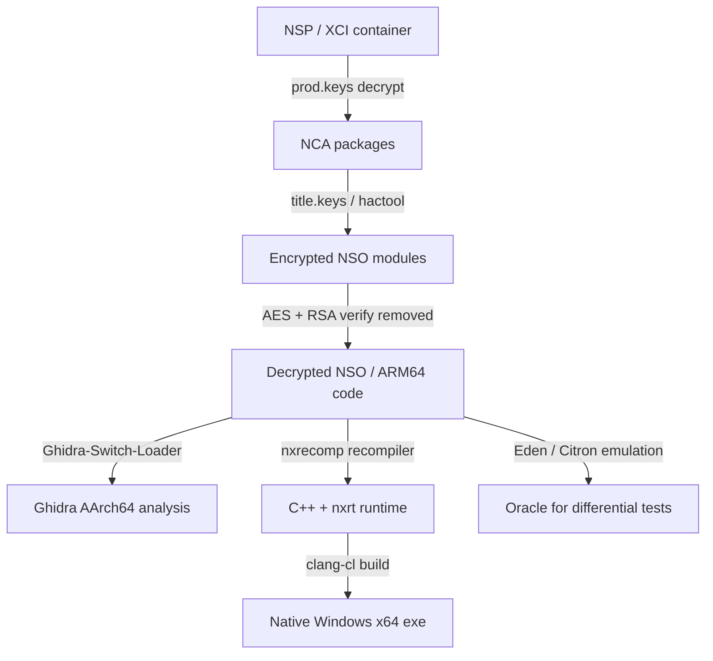
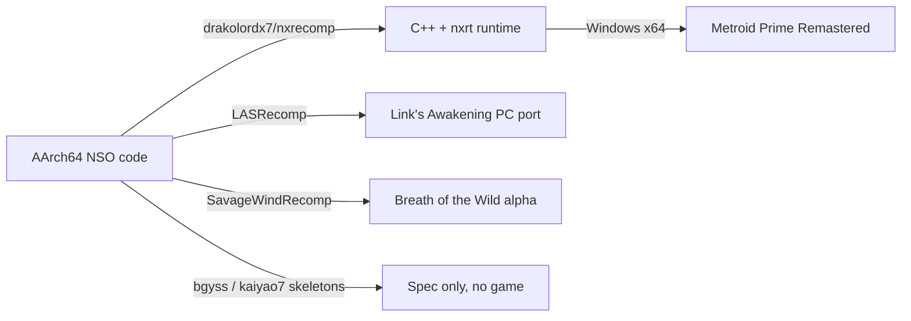

# Nintendo Switch Decompilation and Recompilation

> Tags: switch | nintendo | horizon-os | arm64 | static-recompilation | Atmosphere | custom-firmware | Difficulty: Expert | Prerequisites: ARM64 assembly, Horizon OS concepts, a legally owned dump and prod.keys

## Overview

The Nintendo Switch runs a customized Horizon OS on a 4-core NVIDIA Tegra X1 (Cortex-A57, ARMv8 AArch64). Game code ships as encrypted NSO modules inside NSP or XCI containers. Every layer is documented on the community SwitchBrew wiki. The hardware is well understood. The problem for reverse engineers is the protection stack, not the CPU.

This page covers four things:

1. How Horizon OS protects game binaries and where each layer is implemented.
2. How custom firmware (Atmosphere) and emulators (the Eden/Citron line from yuzu) handle those protections.
3. The state of static recompilation for Switch in 2026.
4. Where AI agents help: Ghidra/IDA analysis of ARM64 NSO modules, save-data format work, and recomp runtime services.

Static recompilation of a Switch game to PC exists. The most complete public example is nxrecomp plus the Metroid Prime Remastered port. Byte-exact matching decompilation of a Switch game is rare to nonexistent. Reported matching projects such as RD-OO7 no longer resolve on GitHub as of 2026-11-05. Treat large Switch decomps as unverified unless you check the repo yourself.



The diagram shows the two paths. Dynamic emulation runs the decrypted code in Eden or a Citron fork. Static recompilation translates it to C++ and links it against a runtime that reimplements Horizon OS services.

## Setup

### Legal inputs you must own

Recompiling or emulating a game requires files you legally possess. The typical analyst inputs:

| File | What it is | Where it comes from |
|---|---|---|
| `prod.keys` | The console's master key set. Decrypts NSP/XCI containers and NSO modules | Extracted from your own Switch |
| `title.keys` | Per-title keys | Generated from a cartridge or eShop dump using prod.keys |
| `.nsp` / `.xci` | Installable game containers | dump from your own cart or eShop |
| `.nro` / `.nso` | Homebrew executables or decrypted NSO modules | Build or extract |
| save data | Encrypted save partition from NAND | Your own console or a dumped save |

prod.keys is not a file you download. It is generated by fusee-gelee based key derivation from the console's own key material. Tools like Lockpick_RCM do this on a hacked or homebrew-capable console. fusee-nano (github.com/DavidBuchanan314/fusee-nano) is a minimal C reimplementation of the Fusée Gelée RCM exploit that boots payloads without a hardmod. See SwitchBrew (switchbrew.org/wiki) for the key derivation math.

### Sigpatches

Nintendo encrypts game code and checks firmware signatures. Without patches, the console refuses unsigned code and downgrade packages. Atmosphere provides two patch sets:

- `exefs_patches` (sigpatches). Patches es_validate and the ExeFS signature checks so unsigned binaries load.
- `stratosphere.ini` (older) or newer firmware-specific sigpatch files. Match the patch set to your firmware version.

Installing Atmosphere: copy `atmosphere/` to the SD card root, place the matching `exefs_patches`, and boot with Hekate or fusee via RCM. On Switch 2, Atmosphere's lineage continues under PegaSwitch (reported; verify current status).

### Container formats: NSP, XCI, and cart dumps

| Format | Origin | Notes for RE |
|---|---|---|
| NSP | eShop install, modded carts | Encrypted container. Decrypt with `nscb` or `hactool`. Contains NCA files |
| XCI | Carved NAND partition image | What hactool dumps from a cart. Largest format, contains the full game partition |
| `.nsz` / `.xcz` | Compressed NSP/XCI | Use `nspd` or `hactool` style tools with decompression |
| `.nro` | Homebrew executable | FatELF wrapper around an NSO |
| `.nso` | Raw encrypted/decrypted Switch module | The actual code. NSO header, optional LZ4 sections, RSA-2048 or RSA-4096 signature in original form |

Typical decryption flow:

```bash
# Decrypt a game container with prod.keys (tools vary; hactool/nscb class)
hactool -k prod.keys -t xci0 game.xci
# Extract title.keys for eShop titles
# Then extract NCA, then NSO modules:
# NSO files get decrypted to .nso-decrypted or raw ARM64 ELF-ish binaries
```

For Ghidra, feed the decrypted NSO's `.text` section. NSO sections are relocatable. Ghidra-Switch-Loader (github.com/Adubbz/Ghidra-Switch-Loader) automates this: it is a Ghidra extension supporting Switch file formats, including NSO loading. Install it via Ghidra's "Install Extensions" dialog. It needs JDK 21. Build with `./gradlew` and `GHIDRA_INSTALL_DIR` set. README: github.com/Adubbz/Ghidra-Switch-Loader.

IDA has no official Switch loader. Community scripts exist but are less maintained. Binary Ninja loads raw ARM64 binaries fine once you carve the section. The practical workflow is: decrypt NSO to flat binary, note the load base, set ARMv8-A little-endian, apply relocation info manually.

## Step-by-Step

### Install Ghidra-Switch-Loader

```bash
cd /opt/ghidra
export GHIDRA_INSTALL_DIR=/opt/ghidra
export JAVA_HOME=/usr/lib/jvm/java-21-openjdk-amd64
git clone https://github.com/Adubbz/Ghidra-Switch-Loader.git
cd Ghidra-Switch-Loader
./gradlew
```

The output is a zip in `dist/`. Install it in Ghidra via `File > Install Extensions`. Restart Ghidra. The loader handles NSO, NSP, XCI, NRO, and related formats. It decrypts NSO sections where keys are available. Source: github.com/Adubbz/Ghidra-Switch-Loader.

### Decrypt a game dump

You need prod.keys and title.keys. The exact tool depends on your setup. Common flow:

```bash
# 1. Extract keys from your own console (Atmosphere -> /switch/ prod.keys)
# 2. Decrypt the container
hactool -k prod.keys -t xci0 game.xci
# 3. For eShop titles, build title.keys first
#    title.keys is generated from cart keys or obtained alongside prod.keys
# 4. Extract NCA, then NSO:
#    hactool --exefsdir=exefs --romfsdir=romfs title.nca
```

The result is an `exefs` directory with decrypted `.nso` files. Each NSO is a relocatable ARM64 module with its own header.

### Load a decrypted NSO in Ghidra

1. File > Import File > select the `.nso` file.
2. If Ghidra-Switch-Loader is installed, it parses the NSO header and sections automatically.
3. If not, carve the `.text` section manually. Set the language to `AArch64:LE:64:v8A`.
4. The load base is typically `0x7100000000` for game NSO modules. Check the NSO header's text offset.
5. Run auto-analysis. NSO has no symbols. Expect thousands of `FUN_xxxxxxxx` functions.

### Analyze a function with an LLM

Export the function's disassembly and decompilation. Prompt:

```
This is a function from a Nintendo Switch NSO module (ARM64 AArch64).
Decompiled pseudocode is below. Identify:
1. Any svc #N instructions and their likely Horizon OS service.
2. Any HIPC IPC calls (look for patterns loading command IDs into registers).
3. The function's probable purpose based on callers and string references.
4. Struct fields accessed, if any.
Output a structured analysis. Flag uncertainty.
```

Verify every claim against the disassembly. LLMs hallucinate service names.

### Build nxrecomp for a new target

nxrecomp is not a general tool. It is built per game. The Metroid Prime Remastered project is the reference:

```bash
git clone --recursive https://github.com/drakolordx7/MetroidPrimeRemasteredRecomp.git
cd MetroidPrimeRemasteredRecomp
# nxrecomp is a submodule at nxrecomp/
# Build the recompiler (Python + C++), then the runtime (clang-cl, Windows)
# See nxrecomp/CONTRIBUTING.md for prerequisites
```

The runtime `nxrt` builds on Windows x64 with Visual Studio Build Tools, LLVM clang-cl, CMake, and Ninja. It is C++20. The recompiler checks output against Unicorn instruction by instruction. Source: nxrecomp README.

For a new game, you would need to:

1. Extract the game's NSO modules.
2. Write a module config mapping NSO files to lifted C++ modules.
3. Implement the Horizon services the game uses in `src/services/`.
4. Handle NVN graphics calls through the NVN-to-Vulkan front end.
5. Test against the emulator (Eden/Citron fork) for differential correctness.

This is months of work. LASRecomp and SavageWindRecomp show it is possible with AI assistance, but each took a dedicated effort.

## How the Emulator Lineage Works

The legal history of Switch emulation in 2026:

- **yuzu** (Citra team, Tropic Haze). Discontinued 2024-03-04 after Nintendo lawsuit settlement. Repo taken down; archived copies exist.
- **Suyu**. Fork of yuzu, self-hosted after GitLab DMCA. Ceased development 2025-02-13 per announcements.
- **Ryujinx** (C#). Shut down 2024-10-01 after Nintendo contact. Source pulled from GitHub.
- **Eden and Citron**. Current primary continuations of the yuzu codebase (Wikipedia, retrieved 2026-11). Eden is the PC emulator. Citron targets Android and other ports.
- **Torzu**. yuzu fork with development over Tor.
- **Sudachi, Sumi, Kenji-NX, MeloNX, Pine, Pomelo, Skyline**. Other forks listed in Nintendo's February 2026 GitHub DMCA notice (github.com/github/dmca, 2026/02/2026-02-12-nintendo.md).

The February 2026 notice is significant for RE work. Nintendo listed emulator networks Eden, Citron, Ryujinx forks, Sudachi, Suyu, Yuzu mirrors, and newer projects (Kenji-NX, MeloNX, Pine, Pomelo, Skyline, Sumi). GitHub processed 218 repository networks. If you cite an emulator repo, check whether it still resolves. Many upstream sources were taken down and only mirrors and nightly-build repos survive.

### Current emulator status

| Emulator | Language | Status | Notes |
|---|---|---|---|
| Eden | C++ (yuzu fork) | Active forks, upstream DMCA'd | PC. Closest to yuzu feature set |
| Citron | varies (yuzu fork) | Active forks | Android and multi-platform focus |
| Suyu | C++ | Development ceased 2025-02 | Self-hosted repo, DMCA history |
| Ryujinx | C# | Shut down 2024-10 | Source archived; forks exist |
| nxrecomp | C++ | Active | Static recomp, not emulator. See below |

Eden and Citron do dynamic emulation. They interpret and JIT guest ARM64 code, emulate the Tegra X1 GPU (Maxwell), and implement Horizon OS services. They are not recompilers. If a page claims "Eden recompiles Switch games," it is wrong.

For RE, the emulator is still the oracle. You run the game in Eden or a fork, observe service calls, memory state, and GPU command streams. nxrecomp's approach is different: it statically recompiles ARM64 to C++ and checks against Unicorn instruction by instruction.

## Static Recompilation for Switch

This is the least mature recomp area. As of 2026-11-05, three real projects exist:



### nxrecomp (most advanced)

github.com/drakolordx7/nxrecomp. The README states: "Tools for statically recompiling Nintendo Switch (AArch64) games into native Windows x64 programs." It has two halves:

- `recomp/`: AArch64 to C++ recompiler. Checks output against Unicorn instruction by instruction.
- `runtime/`: nxrt. Memory map, module loader (ELF64 and NSO with LZ4), threads, Horizon SVC and IPC handling, crash reports, NVN-to-Vulkan front end. Written in C++20, clang-cl, Windows x64.

The reference game is Metroid Prime Remastered: github.com/drakolordx7/MetroidPrimeRemasteredRecomp. It is an unofficial native Windows port of the Switch release v1.0.0. The launcher requires your own dump (NSP/XCI/NSZ/XCZ, version 1.0.0) and your own prod.keys. Setup takes about 5 minutes on a 16-core PC. Status: "Early." The runtime boots the game into its first level. Gaps are documented in `runtime/docs/`.

Key point for AI-assisted work: nxrt implements the Horizon OS service layer. Each service (sm, fs, am, pl, hid, audio_out, vi_nv, etc.) has a C++ file under `src/services/`. These are the functions an LLM can help write by studying emulator implementations.

### LASRecomp

github.com/peiikai/LASRecomp. Static recompilation of The Legend of Zelda: Link's Awakening (Switch, 2019) to native Windows/macOS/Linux. The README is unusually honest: "This project was made almost exclusively with AI." It uses Claude through Claude Code for code, tooling, RE, and docs, with a human directing and testing. This is the clearest documented example of an AI-built Switch recomp project.

### SavageWindRecomp

github.com/Revivedx/SavageWindRecomp. Work-in-progress recomp of Breath of the Wild (Switch v1.9.0) for Windows and Linux. Built on LASRecomp. The README states it plays the opening in the Shrine of Resurrection and Great Plateau at 60 fps, with one player reportedly completing Vah Ruta. It is an alpha. Rest of the game unconfirmed.

### Spec-driven research skeletons

- bgyss/SwitchRecomp (github.com/bgyss/SwitchRecomp). Draft specification set for a preservation-focused Switch recomp. Rust scaffolding. No game runs.
- kaiyao7/SwitchRecomp (github.com/kaiyao7/SwitchRecomp). Research skeleton. AArch64 to SSA-like IR to C11. ELF64 and NRO loaders, W^X page table memory manager, HLE service registry. 260+ tests but no commercial game. Status: "It does not run any commercial game."

### What does not exist

There is no general-purpose Switch static recompiler comparable to N64Recomp or XenonRecomp. nxrecomp is game-specific (Metroid Prime Remastered is the only shipped target). LASRecomp and SavageWindRecomp are single-game ports built on custom tooling. The Horizon OS service surface is the blocker. Implementing sm:, fs:, am:, pl:, and the NVN graphics stack is months of work per game family.

For the general recomp workflow, see `./swmh-auto-recomp.md`.

## Byte-Exact Decompilation

Matching decomp (source that recompiles byte-identical with original tools) is rare for Switch. Reasons:

- Games are compiled with Nintendo's proprietary toolchain (Clang-based, but with custom flags and libraries).
- NSO modules are relocatable. The original object layout is not preserved.
- The codebase is huge. Breath of the Wild is tens of millions of lines.
- The community focus shifted to recomp ports and emulation after the 2024 lawsuits.

Reported projects like RD-OO7 (a decomp org for Switch titles) do not resolve on GitHub as of 2026-11-05. Whether it was taken down or renamed is unverified. Check github.com/github/dmca for Nintendo notices targeting decomp repos.

The practical decomp target for Switch is homebrew and system modules, not commercial games. Homebrew NROs are often compiled with public toolchains and decompile cleanly in Ghidra.

## AI Assists

### ARM64v8 analysis in Ghidra and IDA

Switch NSO modules are AArch64. Ghidra supports ARMv8-A. The workflow:

1. Decrypt NSO to flat binary or use Ghidra-Switch-Loader.
2. Load as AArch64 little-endian, correct base address.
3. Apply function boundaries. NSO has no symbols. Use Ghidra's analysis or export from IDA.
4. Feed functions to an LLM one at a time. See `../03-decomp/decompile-workflow.md`.

Prompt pattern for service-call discovery:

```
This function is in a Switch NSO module. Identify all SVC calls
(svc #N instructions) and HIPC IPC calls. For each, name the service
and command if recognizable from Horizon OS conventions. Output a
table: address, instruction, service name, command ID, likely purpose.
```

Horizon OS IPC is the key structure. Every service call goes through HIPC (Horizon IPC) with a command ID. LLMs can recognize patterns from emulator source code (Eden, Citron forks, nxrt) and name services accurately.

For IDA, the equivalent is an IDC/Python script that scans for `svc` instructions and `mov x8, #imm` patterns (SVC numbers are passed in x8). IDA Pro 9.5 handles ARM64 well. Binary Ninja 6.0 also supports AArch64.

### Save-data format RE

Switch save files use the DISF/DPFS format documented on SwitchBrew (switchbrew.org/wiki/Savegames). Structure:

- 0x4000-byte header, two copies for commit/rollback.
- AES-CMAC header for integrity.
- DISF header with remap tables, duplex storage offsets, journal info.
- SaveFS layer with file allocation table and file table.

Saves on NAND are stored unencrypted at rest but integrity-protected. Dumped saves from a hacked console may be encrypted differently. The format is fully documented, so AI assistance is less needed for parsing. Where LLMs help:

- Writing parsers for the journal and remap layers.
- Identifying game-specific save structures inside the SaveFS files.
- Generating Kaitai struct definitions from the SwitchBrew spec.

### Recomp runtime services

nxrt's `src/services/` directory has one C++ file per Horizon service. LASRecomp and SavageWindRecomp have similar runtime code. An LLM can:

- Draft a service implementation from an emulator's HLE code (Eden/Citron forks).
- Name guest functions by studying callers and callees.
- Propose struct layouts for IPC command buffers.
- Debug crashes by mapping native stack traces back to guest addresses.

The recompiler itself is deterministic. LLMs assist at the edges: runtime services, function naming, boundary analysis, and bug triage. See `./swmh-auto-recomp.md` for the general pattern.

### What AI cannot do for Switch

- It cannot bypass prod.keys or sigpatches. You need a hacked console or homebrew-capable device.
- It cannot decrypt NSO without keys. The AES-XTS and RSA layers are standard crypto.
- It cannot verify timing. The Tegra X1's GPU pipeline and CPU-GPU synchronization are hard to match.
- It should not generate the recompiler for production. nxrecomp and kaiyao7's skeleton show the current state. LLM-generated recompilers for Switch are unverified.

## Pitfalls

- **prod.keys is not downloadable.** You must extract it from your own console. Downloaded keys are legally and practically risky.
- **Sigpatch mismatch.** exefs_patches must match your firmware version. Wrong patches cause bootloops.
- **NSO is not ELF.** It has its own header, section table, and optional LZ4 compression. Ghidra-Switch-Loader handles this. Raw section carving loses relocation info.
- **Emulator forks vanish.** Nintendo's DMCA campaign took down upstream repos in 2024 and again in February 2026. Cite repos by commit hash. Check github.com/github/dmca before assuming a URL is stable.
- **Eden/Citron are emulators, not recompilers.** Do not conflate dynamic emulation with static recompilation.
- **No byte-exact decomp.** Do not promise matching decomp for commercial Switch games. It does not exist publicly.
- **AI-written recomp is unverified.** LASRecomp and SavageWindRecomp use AI heavily but are single-game projects with human review. Do not assume AI-generated Switch recomp code is correct without testing.
- **Save data is not plaintext.** The AES-CMAC header and KEK derivation are required. SwitchBrew documents this.
- **Horizon OS is huge.** The service surface (sm, fs, am, pl, hid, audio, vi, nvdrv, etc.) is large. Budget for implementing only what your target game uses.

## See Also

- [./swmh-auto-recomp.md](./swmh-auto-recomp.md) — general static recompilation workflow and tool landscape
- [./matching-decomp.md](./matching-decomp.md) — byte-exact matching decompilation with objdiff
- [../03-decomp/decompile-workflow.md](../03-decomp/decompile-workflow.md) — human+AI decompilation loop
- [../03-decomp/batch-decompilation.md](../03-decomp/batch-decompilation.md) — headless decompiler pipelines
- [../03-decomp/verification-loop.md](../03-decomp/verification-loop.md) — differential testing against emulators
- [../07-advanced/firmware-recomp.md](../07-advanced/firmware-recomp.md) — firmware rehosting concepts
- [../06-topics/game-engine-re.md](../06-topics/game-engine-re.md) — game engine RE patterns
- https://github.com/drakolordx7/nxrecomp — Switch static recompilation tools
- https://github.com/drakolordx7/MetroidPrimeRemasteredRecomp — reference Switch recomp port
- https://github.com/peiikai/LASRecomp — AI-built Link's Awakening recomp
- https://github.com/Revivedx/SavageWindRecomp — Breath of the Wild recomp (alpha)
- https://github.com/Adubbz/Ghidra-Switch-Loader — Ghidra loader for Switch binaries
- https://github.com/DavidBuchanan314/fusee-nano — Fusée Gelée RCM exploit in C
- https://switchbrew.org/wiki/Savegames — save data format specification
- https://github.com/github/dmca/blob/master/2026/02/2026-02-12-nintendo.md — Nintendo DMCA notice listing emulator networks
- https://recomp.fyi — recompilation project registry
