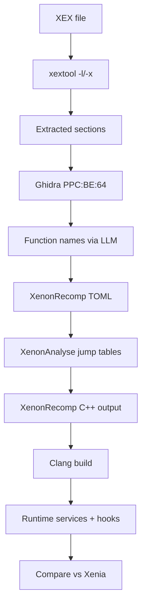
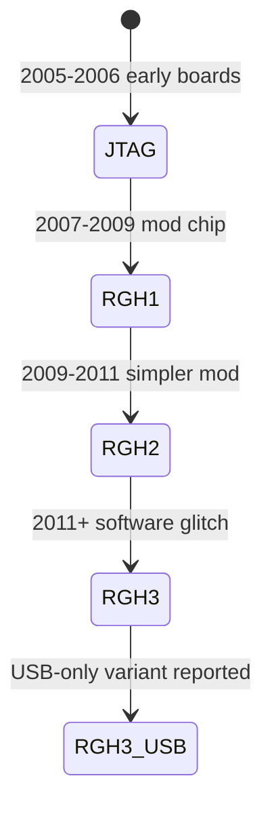

# Xbox and Xbox 360 Reverse Engineering

> Tags: consoles | xbox | xbox360 | ppc | xbe | xex | recompilation | Difficulty: Advanced | Prerequisites: [PPC disassembly knowledge](../03-decomp/decompile-workflow.md), [Recompilation landscape](swmh-auto-recomp.md), legal dump of game files

## Overview

Microsoft released two very different Xbox generations.

The original Xbox (2001) is a Pentium III-class machine. Its games are plain x86 PE-style executables wrapped in the XBE container. The toolchain is ordinary x86 reversing. The container format is the only special part.

The Xbox 360 (2005) is a 64-bit PowerPC machine (Xenon). Its games are XEX containers. The CPU code is big-endian PowerPC with VMX128 vector extensions. The GPU is Xenos. Both formats need container parsing before any real analysis starts.

The 360 scene has a large homebrew infrastructure built up over two decades. This page covers:

- The XBE and XEX file formats.
- The mod chip era: JTAG, RGH1, RGH2, RGH3.
- Current tools: nxdk, xbdm, Xenia, XenonRecomp.
- Game preservation projects.
- Where AI helps and where it fails.
- Legal notes.

Key sources used for this page:

- github.com/hedge-dev/XenonRecomp README
- github.com/hedge-dev/XenosRecomp README
- github.com/hedge-dev/UnleashedRecomp README
- xenia.jp project forks page
- github.com/xenia-project/wiki
- github.com/XboxDev/nxdk
- github.com/mLoaDs/XexTool and github.com/Team-Resurgent/XexTool
- xenia wiki documentation under xenia.jp

## Hardware and Formats

### Original Xbox

| Part | Detail |
|---|---|
| CPU | Intel Pentium III, modified, 733 MHz class |
| GPU | NVIDIA NV2A, a derivative of the GeForce 3 (NV20) |
| RAM | 64 MB unified DDR |
| Media | DVD, 8 GB HDD on later models |
| Executable | XBE (Xbox Executable) |
| Dev kit | XDK (Microsoft Xbox Development Kit) |
| Homebrew SDK | nxdk, community effort |

XBE files are not standard PE files. They carry an XBE header, a section table, and an import table. The code section is ordinary x86 PE code with some Microsoft-specific relocations. Ghidra and IDA both load the code body fine once you point them at the raw section.

Useful facts for analysis:

- The XBE header is at file offset 0. Magic is `XBEH` (`0x48454258` little-endian).
- Entry point is stored as a relative virtual address from the image base.
- Sections are described by name, virtual size, file offset, and virtual address.
- Imports are resolved through a title database. Kernel exports live at fixed addresses on retail hardware.
- Disassembly starts at the entry point. Call targets are absolute addresses into the 0x10000-0x9FFFFFFF range.

Scene tools for original Xbox:

- nxdk (github.com/XboxDev/nxdk) is the current cross-platform open-source SDK. It replaces the dead XDK. It includes host tools, kernel headers, and a remote debugging tool (`nxdk-rdt`).
- xbdm is the Xbox Debug Monitor protocol. Used by `xenon` tools, `xbcp`, and community dumpers. `xboxpy` (github.com/XboxDev/xboxpy) is a Python interface to XBDM.
- xemu and Cxbx-ReLoaded are the active original Xbox emulators. xemu is the reference. Cxbx-ReLoaded is a lighter alternative.
- XDV2 was the Xbox 360-era debug tool for symbol loading. It also supported original Xbox via xbdm. Reported historical status.

### Xbox 360

| Part | Detail |
|---|---|
| CPU | IBM PowerPC "Xenon", 3.2 GHz, 6 cores, big-endian, VMX128 |
| GPU | Xenos, 10 MB eDRAM, 512 MB GDDR3 |
| RAM | 512 MB unified GDDR3 |
| Media | DVD9 disc or HDD download |
| Executable | XEX (Xbox Executable) |
| Dev kit | XDK 2.x |
| Emulator | Xenia (Canary/Edge forks) |
| Recompiler | XenonRecomp, RexGlue-SDK based projects |

XEX is a container format. It encrypts the code with a per-title key. Retail XEX files are AES-encrypted. The CPU decrypts them at load time. Xenia and the recompilers contain the decryption logic.

XEX layout, simplified:

- Header at offset 0. Magic `XEX2` (`0x58455832`).
- Section headers describe code, data, and resource segments.
- The `.text` section holds PowerPC instructions.
- The `.rdata`, `.data`, `.pdata` sections hold constants, writable data, and function metadata.
- `.pdata` is important. XenonAnalyse uses it to find function boundaries.

PowerPC details that matter for reversing:

- Big-endian memory. XenonRecomp swaps endianness on every load/store.
- VMX128 vector registers. 32 vector registers of 32 bytes each.
- Floating point uses denormal flushing rules that differ from VMX. XenonRecomp documents this.
- The link register and condition registers follow the standard PPC ABI.
- Virtual function calls resolve through a 64-bit pointer table. XenonRecomp builds a perfect-hash table at runtime for this.
- Jump tables are common. XenonAnalyse detects them by scanning for `mtctr` followed by `bctr` patterns.

GPU reversing is a separate problem. Xenos command buffers are not well documented publicly. Xenia is the best reference implementation. XenonRecomp handles CPU code only. XenosRecomp converts shaders to HLSL.

## Mod Chip History

The Xbox 360 ran unsigned code only through exploits. The scene went through three hardware generations.

### JTAG (2005-2006)

Early motherboards had a JTAG port. The `JTAG` exploit read the CPU key from the security chip. This enabled homebrew and backup loading on pre-2008 consoles. Limited to early hardware revisions.

### RGH1 (2007-2009)

RGH1 (Reset Glitch Hack) used a timing glitch in the southbridge to bypass the security check. It required a mod chip soldered to specific points. The chip held the CPU key and emulated the security processor. More complex than JTAG but worked on more revisions.

### RGH2 (2009-2011)

RGH2 simplified the install. A small 2-wire or 4-wire mod chip connected to the southbridge. It used a different glitch timing. Easier to install than RGH1. Still required soldering.

### RGH3 (2011-present)

RGH3 uses a software glitch combined with a minimal hardware mod. It is the current standard for running unsigned code. Works on most 360 revisions including Slim and E models. Many boards now have RGH3 pre-installed from factory refurbishment.

### Related projects

- Xell is the hypervisor used by RGH methods. It boots unsigned code.
- Xell-Reloaded continues the original Xell work.
- Aurora is the custom dashboard used on modded consoles.
- Freestyle Dash is another popular dashboard.
- XeXMenu is the file manager for RGH3.
- The `RGH3 USB` method avoids soldering entirely on some revisions by using a glitchable USB port. Reported working on certain models.

## Current Tools

### nxdk (original Xbox)

github.com/XboxDev/nxdk is the main SDK. It provides:

- Kernel and user-mode headers.
- Cross-platform host tools.
- `nxdk-rdt` for remote debugging over xbdm.
- GPU and audio APIs matching the original hardware.

Build instructions are in the repository. It targets Windows, Linux, and macOS.

### xbdm tools

xbdm is the Xbox Debug Monitor protocol. It provides memory read/write, thread control, and breakpoint support over Ethernet or USB.

Current tools:

- `xboxpy` (github.com/XboxDev/xboxpy) — Python bindings for xbdm.
- `xbdm_gdb_bridge` (github.com/abaire/xbdm_gdb_bridge) — bridges xbdm to GDB RSP for remote debugging.
- `OGXbdmDumper` (github.com/Ernegien/OGXbdmDumper) — dumps Xbox memory via xbdm.
- `XBDM` (github.com/Experiment5X/XBDM) — C++ rewrite of the xbdm API.

### xextool (Xbox 360 XEX)

xextool is the standard XEX metadata tool. Original by xorloser. Current maintained forks:

- github.com/Team-Resurgent/XexTool — active fork.
- github.com/mLoaDs/XexTool — includes IDA script generation.
- github.com/XboxChef/XexToolGUI — GUI wrapper.
- github.com/mrtitanic777/XexTool-RE — clean-room C++17 rebuild.

What it does:

- Prints XEX header fields: title ID, version, sections, entry point.
- Extracts executable code and data sections.
- Alters XEX attributes (region, title flags).
- Creates IDA `.idc` scripts to load extracted sections.
- Decrypts XEX files when given the correct key file.

Typical usage:

```bash
xextool -l file.xex          # list sections and metadata
xextool -x file.xex -o out/  # extract sections
xextool -d file.xex          # decrypt
```

The `-x` option produces raw binary files you can load into Ghidra or IDA.

### Xenia (Xbox 360 emulator)

Xenia is the reference Xbox 360 emulator. It is research software. It requires you to dump your own game files.

Current forks (per xenia.jp):

- Xenia Master — original benvanik branch. Sporadic updates.
- Xenia Canary — community fork. Near-daily releases. Best compatibility.
- Xenia Edge — experimental. Vulkan renderer, Linux, future Mac/ARM64.
- Xenia Netplay — adds online multiplayer to Canary.

Xenia implements the full Xbox 360 kernel, Xenos GPU, and PPC CPU. It is the best source for understanding system calls, memory layout, and hardware behavior. The source is C++ and well organized.

Key directories in the Xenia source:

- `src/xenia/cpu/ppc/` — PPC interpreter and XEX loader.
- `src/xenia/gpu/` — Xenos GPU implementation.
- `src/xenia/kernel/` — Xbox 360 kernel emulation.
- `src/xenia/cpu/ppc/XEX.cpp` — XEX parsing and decryption. This file is the authoritative reference for the format.

### XenonRecomp (Xbox 360 static recompilation)

github.com/hedge-dev/XenonRecomp converts Xbox 360 XEX files to C++.

It is not a decompiler. It emits one C++ function per guest function. Each function takes a `PPCRegister` struct containing all PPC registers. The output is not human-readable. It is meant to be compiled and run.

Requirements:

- CMake 3.20+
- Clang 18+ (required, other compilers not supported)
- XEX file and optional XEXP patch file
- TOML config file

The TOML config specifies:

- Input XEX path.
- Optional XEXP patch path.
- Output directory.
- Jump table file from XenonAnalyse.
- Function boundaries for functions XenonAnalyse misses.
- Register restore/save function addresses.
- `setjmp`/`longjmp` addresses.
- Mid-asm hooks.
- Optimization flags.

XenonAnalyse is the companion tool. It scans an XEX for jump tables and outputs a TOML file. The recompiler uses it to emit real `switch` statements.

Known limitations (from the README):

- No exceptions support. The recompiler assumes no C++ exceptions.
- MMIO (memory-mapped I/O) is unimplemented. XMA audio decoding and other hardware ops need custom handling.
- Jump tables need per-game detection tweaks.
- Function boundary analysis struggles with functions containing jump tables.
- Indirect calls use a perfect-hash table. This works but adds overhead.

Active projects using XenonRecomp:

- UnleashedRecomp (Sonic Unleashed) — the flagship project. Windows and Linux. Full runtime implementation.
- MarathonRecomp (Sonic 2006) — sonicnext-dev.
- Crackdown (Xbox 360) — saulob.
- Perfect Dark Zero — nikolaygorb.
- Wet — nikolaygorb.
- FIFA World Cup 2014 — HossEz.
- Naruto Storm Generations — naruto-storm-generations-port-nativo.
- Project 8 (Tony Hawk) — PPrism.

XenosRecomp is the shader companion. It converts Xenos shader binaries to HLSL. It is designed for UnleashedRecomp but can be adapted. Output feeds DXC for DXIL or SPIR-V.

### RexGlue-SDK projects

Several recompilation projects use RexGlue instead of XenonRecomp. RexGlue is a more generic static recompilation framework. Projects include:

- Condemned 2: Bloodshot (psxrestore/Condemned2Recomp).
- Asura's Wrath (PauloUbirajara/asuras-wrath-recomp).
- Gears of War series (Shagg88/COGBox).

These are less mature than XenonRecomp but cover different games.

### Decompilation projects

Matching decompilation for Xbox 360 is less developed than for Nintendo consoles. Some projects exist:

- banjo360/bk360 — Banjo-Kazooie decompilation research.
- AleBello7276/xkrnl-decomp — Xbox 360 kernel decompilation.
- dptug/TerrariaXDK — Terraria Xbox 360 decompiled source.
- PPrism/TerrariaOGC — Terraria console decompilation.
- LCERD/Minecraft-Xbox-360-Decompilation — Minecraft Legacy rewrite.

These are early-stage. Most are partial. None are linked ROMs.

## How It Works





## AI Assistance

### What AI is good at here

- **XEX metadata parsing.** Feed the xextool output or raw header to an LLM. Ask it to identify sections, entry points, and suspicious fields. The format is well documented. AI handles it reliably.
- **Function naming.** PPC functions in XEX files have no symbols. AI can suggest names based on string references, API calls, and calling patterns. This works well for common patterns like file I/O, rendering, and audio.
- **Jump table explanation.** XenonAnalyse finds jump tables. AI can explain what each case does by reading the surrounding code.
- **Xenia source navigation.** Xenia is large. AI can answer "where is X implemented?" questions by searching the codebase.
- **Hook generation.** For XenonRecomp mid-asm hooks, AI can write the C++ hook function given the PPC context and the desired behavior.
- **Config generation.** Given a new game, AI can help fill in the XenonRecomp TOML: find restore/save function addresses, setjmp/longjmp locations, and function boundaries.

### What AI struggles with

- **PPC decompilation quality.** XenonRecomp output is already low-level. AI cannot make it more readable. It can rename registers and add comments, but the control flow stays flat.
- **Xenos GPU commands.** The GPU command buffer format is poorly documented. AI cannot invent the missing documentation. Xenia source is the only reference.
- **Anti-piracy verification.** XEX files have checksums and signatures. AI cannot bypass them. You need the correct keys.
- **Kernel internals.** The Xbox 360 kernel is complex. AI can summarize Xenia's implementation but cannot replace reading the source.

### Practical AI workflow

1. Extract the XEX with xextool.
2. Load the extracted code into Ghidra. Set the language to `PowerPC:BE:64:default`.
3. Run Ghidra's analysis. Let it find functions.
4. Export the decompiled C or the function list.
5. Feed chunks to an LLM. Ask for function names and summaries.
6. Use the names to build a XenonRecomp TOML.
7. Run XenonAnalyse for jump tables.
8. Run XenonRecomp.
9. Build the output with Clang.
10. Test against Xenia for behavioral equivalence.

For dynamic analysis, run the game in Xenia Canary. Use its logging and GPU capture features. Compare traces against the recompilation.

## Pitfalls

- **XEX encryption.** You cannot analyze a raw XEX without decrypting it. xextool handles this if you have the key file. Retail keys are not public. You need a dumped key or a devkit XEX.
- **Big-endian confusion.** PPC is big-endian. Ghidra and IDA handle this correctly if you select the right language. XenonRecomp swaps endianness automatically.
- **VMX128 instructions.** Standard PPC disassemblers may not know VMX128. Ghidra 12.2 has partial support. Check for unknown instructions.
- **XEX section alignment.** Sections are page-aligned. Do not assume contiguous memory. Use the section table.
- **XenonRecomp Clang requirement.** Other compilers produce broken output. The README says Clang 18+ is required. Do not use GCC or MSVC.
- **No exceptions.** XenonRecomp does not support C++ exceptions. If the game uses them, you need to patch the recompiler or the game.
- **MMIO gaps.** Hardware accesses through MMIO are not implemented. You must write custom handlers for XMA audio, GPU commands, and other hardware.
- **Jump table detection.** XenonAnalyse works for Sonic Unleashed but may miss tables in other games. Check the generated TOML.
- **Function boundaries.** XenonAnalyse uses `.pdata` and static analysis. It misses functions with jump tables. Add manual boundaries to the TOML.
- **Xenia legality.** Xenia is research software. You must dump your own games. Do not download pre-dumped XEX files.
- **Mod chip legality.** RGH/JTAG circumvents Xbox 360 security. This violates the DMCA anti-circumvention provisions in most jurisdictions. See [Legal and Ethics](../09-ops/legal-and-ethics.md).
- **nxdk maturity.** nxdk is newer than the XDK. Some APIs are incomplete. Check the documentation before assuming a function exists.
- **xbdm security.** xbdm has no authentication. Only use it on a trusted network. Never expose it to the internet.

## See Also

- [Static Recompilation Landscape](swmh-auto-recomp.md)
- [Matching Decompilation](matching-decomp.md)
- [Decompilation Workflow](../03-decomp/decompile-workflow.md)
- [Verification Loops](../03-decomp/verification-loop.md)
- [Firmware and IoT RE](../06-topics/firmware-iot-re.md)
- [Legal and Ethics](../09-ops/legal-and-ethics.md)
- [Tool Catalog](../05-tools/tool-catalog.md)
