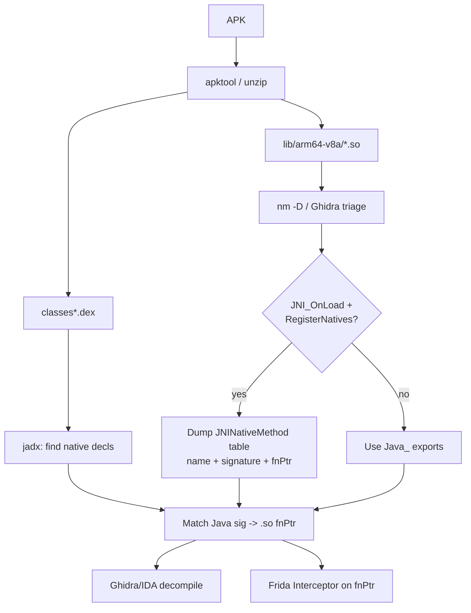

# Android Native (.so + JNI) RE

> Tags: android, native, so, jni, jni_onload, registernatives, frida, interceptor, arm64, extractnativelibs | Difficulty: Advanced | Prerequisites: [mobile-android-re.md](mobile-android-re.md) for the Java side, Ghidra or IDA, rooted device or emulator

Java-layer RE ends where the interesting code starts. Many Android apps move signing, crypto, license checks, and anti-tamper logic into a shared library under `lib/arm64-v8a/`. This page covers that boundary: finding the `.so` files, mapping JNI bridges, decompiling the native code, and hooking it live with Frida.

## Overview

An Android APK carries native libraries in `lib/<abi>/`. Each ABI has its own copy. `arm64-v8a` is the common case in 2026. `armeabi-v7a` survives for old devices and for apps that keep a 32-bit build for anti-analysis. `x86_64` appears on emulators.

Native code enters Java through the JNI bridge. There are two registration patterns:

1. **Static registration.** The `.so` exports symbols named `Java_com_example_app_Check_licenseCheck`. The runtime binds them by name at load time.
2. **Dynamic registration.** The library exports `JNI_OnLoad`. That function calls `RegisterNatives` on a `jclass` to bind Java method names to raw function pointers. This is the pattern packers and protectors use. Static symbols hide.

The AI fits the same way it fits desktop native RE: feed it one function or one bridge table at a time, and gate every claim with deterministic checks. The extra Android-specific work is bridge mapping — connecting a Java `native` method to a function pointer inside a stripped `.so` — and bridging Frida native hooks back into ART.



## Setup

### Extract the native libraries

```bash
apktool d target.apk -o target_apktool        # full decode, keeps lib/
unzip -o target.apk 'lib/*' -d target_unpacked # fast path: just the .so files

ls target_unpacked/lib/
# arm64-v8a  armeabi-v7a  x86_64  x86

find target_unpacked/lib -name '*.so' -exec file {} \;
```

The APK may contain only `arm64-v8a`. Emulator-only `.so` builds can exist under `x86_64` with different code. Check all ABIs before you conclude.

### ELF triage

```bash
SO=target_unpacked/lib/arm64-v8a/libtarget.so

file $SO
# ELF 64-bit LSB shared object, ARM aarch64, dynamically linked, stripped

readelf -h $SO | head -20          # ELF header, entry point, machine type
readelf -d $SO | grep NEEDED       # linked libraries: libc.so, libdl.so, liblog.so
readelf -sW $SO | grep -i jni      # exported JNI symbols
nm -D --defined-only $SO           # dynamic exports only
```

Key exports to look for:

| Symbol | Meaning |
|---|---|
| `JNI_OnLoad` | Runtime calls this on library load. Dynamic registration happens here. |
| `Java_<pkg>_<Class>_<method>` | Static JNI export. Name is mangled with underscores for dots. |
| `Java_<pkg>_<Class>_<method>__I` | Static export with signature suffix for overloads. |
| `RegisterNatives` import | Present means dynamic registration is likely. |
| `.init_array` entries | Constructors run before `JNI_OnLoad` callers can hook. |

### AArch64 tooling

Ghidra and IDA both handle ELF aarch64 out of the box. Ghidra 12.2 language is `AARCH64:LE:64:v8A`. IDA auto-detects. Binary Ninja 6.0 loads it as `aarch64`. For quick disassembly, rizin 0.9.1 handles it directly:

```bash
rizin -A $SO
afl~JNI_OnLoad      # find JNI_OnLoad
pdf @ sym.JNI_OnLoad
```

For 32-bit builds, `armeabi-v7a` `.so` files are ARM or Thumb-2. The ELF header flags tell you which. Ghidra language is `ARM:LE:32:v7` with the TMode setting. IDA asks the same. Thumb mode changes every function address — a hook written for ARM mode will crash in Thumb.

### Frida version alignment

The host `frida` Python package and the on-device `frida-server` binary must match major.minor. Frida 17.x is current. Check versions:

```bash
frida --version
adb shell "su -c '/data/local/tmp/frida-server --version'"
```

If they differ, `pip install frida-tools==17.x` to match the server, or download the matching server from github.com/frida/frida/releases. See [mobile-android-re.md](mobile-android-re.md) for the server push and start procedure.

## Step-by-Step

### 1. Map Java `native` declarations

Find every `native` method in the DEX. jadx marks them in decompiled output, and apktool keeps the smali.

```bash
# jadx batch decompile first (see mobile-android-re.md for MCP servers)
jadx -d jadx_out target.apk

grep -rn "native " jadx_out/sources/ | grep -v "//" | head -50
```

Smali is more reliable for this sweep. Native declarations appear as `.method ... native` in smali:

```bash
apktool d target.apk -o apktool_out
find apktool_out -name '*.smali' | xargs grep -l 'native' | head
```

Collect a table: Java class, method name, signature. For example `com.example.app.License.check(I)Z`.

### 2. Enumerate the .so exports

For each ABI directory, dump dynamic symbols:

```bash
for so in target_unpacked/lib/arm64-v8a/*.so; do
  echo "=== $so ==="
  nm -D --defined-only "$so" | grep -E 'Java_|JNI_OnLoad' || echo "(no Java_ exports)"
done
```

Three cases:

- **Case A: `Java_` exports exist.** Map names mechanically. `Java_com_example_app_License_check__I` binds `com.example.app.License.check(int)`. Underscores in the original package name become `_1` or appear literally depending on the JNI spec; jadx output usually shows the Java name directly so you can match by reading.
- **Case B: only `JNI_OnLoad`.** Dynamic registration. Go to step 3.
- **Case C: neither.** The library is loaded by another `.so` or reached through raw `dlopen`/`dlsym` from Java. Trace `System.loadLibrary` and `dlopen` calls in the Java layer first. In Ghidra, search for string references to the `.so` filename.

### 3. Dump the RegisterNatives table

Dynamic registration hides all method names in a data table inside `JNI_OnLoad` or a function it calls. The table is an array of `JNINativeMethod` structs:

```c
typedef struct {
    const char* name;      // Java method name, e.g. "check"
    const char* signature; // JNI signature, e.g. "(I)Z"
    void*       fnPtr;     // function pointer in this .so
} JNINativeMethod;
```

In Ghidra or IDA, find the `RegisterNatives` call inside `JNI_OnLoad`. It takes four arguments: `JNIEnv*`, `jclass`, `const JNINativeMethod* methods`, `jint nMethods`. The third argument points at the table. Each entry is three pointers on arm64: name pointer, signature pointer, function pointer. Read the strings at the name and signature pointers, then the function pointer is the target.

The index-login/MobileRE-Skill repo (github.com/index-login/MobileRE-Skill) documents this pattern and ships a Dex-to-C handoff for exactly this mapping step.

Ask the agent:

```text
This .so exports JNI_OnLoad. Find the RegisterNatives call inside it.
List each registered method name and its function pointer address.
Decompile the function at the fnPtr for method "check" and explain the return value.
```

Cross-check every address the model reports against the disassembler's own listing. LLMs hallucinate addresses confidently.

### 4. Decompile the native functions

Load the `.so` into Ghidra (language `AARCH64:LE:64:v8A`) or IDA. Steps that matter:

1. Apply the `JNIEnv` struct signature so calls like `env->FindClass` resolve to named functions instead of raw vtable offsets.
2. Rename bridge functions after the Java method they serve. `sub_1A4F0` becomes `Java_License_check`.
3. Mark `RegisterNatives` table entries as data so the decompiler shows the table as a struct array, not scattered pointers.
4. Feed one function at a time to the agent. Never dump the whole decompile listing into one prompt.

Prompt pattern:

```text
Function at 0x1A4F0 is the JNI bridge for com.example.License.check(int).
It calls sub_2BC00. Decompile sub_2BC00 and explain what it returns for input 0.
List every JNI function it calls (FindClass, CallObjectMethod, GetStringUTFChars).
```

### 5. Dynamic verification with Frida Interceptor

Once you know the function pointer, hook it directly. No Java layer needed.

```javascript
// hook_native.js — run with: frida -U -f com.example.app -l hook_native.js

// Resolve the export by name (static registration)
var check = Module.findExportByName("libtarget.so", "Java_com_example_app_License_check__I");
if (check === null) {
    // Dynamic registration: find JNI_OnLoad, then locate the fnPtr from the
    // RegisterNatives table. Easier path: hook RegisterNatives itself.
    var onLoad = Module.findExportByName("libtarget.so", "JNI_OnLoad");
    Interceptor.attach(onLoad, {
        onLeave: function(retval) {
            // After JNI_OnLoad returns, methods are registered.
            // Now resolve the registered fnPtr — see pattern below.
        }
    });
    // Hook RegisterNatives to capture the table at runtime.
    var reg = Module.findExportByName(null, "RegisterNatives"); // in libart.so
    Interceptor.attach(reg, {
        onEnter: function(args) {
            var env = args[0];
            var clazz = args[1];
            var methods = args[2];   // JNINativeMethod*
            var count = args[3].toInt32();
            for (var i = 0; i < count; i++) {
                var name = methods.add(i * Process.pointerSize * 3).readPointer()
                    .readCString();
                var sig = methods.add(i * Process.pointerSize * 3 + Process.pointerSize)
                    .readPointer().readCString();
                var fn = methods.add(i * Process.pointerSize * 3 + Process.pointerSize * 2)
                    .readPointer();
                console.log("registered: " + name + sig + " -> " + fn);
                Interceptor.attach(fn, {
                    onEnter: function(a) { console.log("called " + name + " args=" + a[2]); },
                    onLeave: function(r) { console.log(name + " returned " + r); }
                });
            }
        }
    });
} else {
    Interceptor.attach(check, {
        onEnter: function(args) {
            // JNI signature: JNIEnv* env, jobject thiz, jint arg
            this.arg = args[2].toInt32();
        },
        onLeave: function(retval) {
            console.log("check(" + this.arg + ") -> " + retval);
        }
    });
}
```

Run it:

```bash
frida -U -f com.example.app -l hook_native.js --no-pause
```

The `RegisterNatives` hook is the general solution. It works on stripped libraries because the table is built at runtime and handed to the runtime by pointer. `RegisterNatives` itself is exported by `libart.so` (Android runtime), so `Module.findExportByName(null, "RegisterNatives")` resolves it.

### 6. Bridge back into ART from native hooks

Native hooks see raw pointers. Java hooks see objects. Sometimes you need both: the native function receives a `jstring` and you want the Java string, or the native code calls `CallObjectMethod` and you want to see which method.

Two directions:

**Native hook → Java object.** Inside `Interceptor.attach` on a JNI function, `args[0]` is the `JNIEnv*`. Get the `JavaVM` from it, or use Frida's `Java` API directly — `Java.perform` already runs inside ART and can call `Java.use` on any class. The clean pattern: use `Interceptor` for the native side, `Java.perform` for the ART side, and correlate by timestamp or thread id.

```javascript
Interceptor.attach(fnPtr, {
    onEnter: function(args) {
        this.tid = Process.getCurrentThreadId();
        // args[2] is a jstring pointer for a (Ljava/lang/String;)V signature
        var env = Java.vm.getEnv();
        var jstr = env.getStringUtfChars(args[2], NULL);
        console.log("native got string: " + jstr.readCString());
        env.releaseStringUtfChars(args[2], jstr);
    }
});
```

`Java.vm.getEnv()` returns a `JNIEnv` wrapper that exposes `getStringUtfChars`, `callObjectMethod`, `findClass`, and the rest. This is Frida's built-in JNI bridge — documented in the JavaScript API under `Java` and `VM`. Alternatively call the vtable directly through `args[0]` if you need offsets Frida does not wrap.

**Java call → native trace.** To see which Java methods a native function invokes, hook the `JNIEnv` vtable entries. The `JNIEnv*` points at a function-pointer table. Index 33 is `CallObjectMethod`, index 34 `CallObjectMethodV`, and so on (the JNI spec fixes the order). Frida's `env` wrapper covers the common cases; for full coverage, read `args[0].readPointer()` and hook `table.add(index * Process.pointerSize)`.

### 7. ExtractNativeLibs and where the .so actually lives

Since Android 6.0 (API 23), `extractNativeLibs` defaults to `true` in the manifest merger unless the app sets `android:extractNativeLibs="false"`. With `true`, the `.so` files are extracted from the APK at install time to `/data/app/<pkg>-*/lib/arm64/`. With `false`, they stay inside the APK and are mapped directly from the zip — the file path on disk is the APK itself.

Practical consequences:

- `frida -U -f pkg` and `Module.findExportByName("libtarget.so", ...)` work either way. Frida reads the loaded ELF from memory.
- If you pull files with `adb pull`, `/data/app/.../lib/` only exists when `extractNativeLibs=true`. Otherwise pull `base.apk` and unzip `lib/` from it.
- Check the manifest: `apktool d` puts it at `apktool_out/AndroidManifest.xml`. Search for `extractNativeLibs` and `useEmbeddedDex`.
- Some protectors set `extractNativeLibs=false` to keep the `.so` inside the signed APK, making tampering with the extracted copy pointless.

```bash
# On device, check where libs live
adb shell "su -c 'ls -la /data/app/ | grep com.example'"
adb shell "su -c 'find /data/app -name \"libtarget.so\" 2>/dev/null'"
```

## Pitfalls

- **Arm64 vs arm32 is not just width.** arm64 uses AArch64 registers `x0`–`x7` for the first eight integer arguments. arm32 uses `r0`–`r3`. A Frida hook that reads `args[2]` works on arm64 for `(env, thiz, arg)` JNI functions but arm32 has a different calling convention for the second half of arguments (stack vs registers). Check the ABI before writing `args[N]` indexes.
- **Thumb mode on arm32.** `armeabi-v7a` functions can be Thumb-2. The function pointer has bit 0 set (`addr | 1`). Frida handles this in `Interceptor.attach` — do not mask the bit yourself. In Ghidra, set the TMode context register or the decompiler will show wrong instructions.
- **RegisterNatives signature matching.** The `JNINativeMethod.signature` field is the JNI signature string like `"(I)Ljava/lang/String;"`, not the Java signature. Match on both name and signature — overloaded methods share names.
- **Multiple .so files.** Apps ship several libraries. `libtarget.so` may call into `libhelper.so`. `JNI_OnLoad` in one library can register methods implemented in another via `dlsym`. When `RegisterNatives` yields function pointers outside the current module, resolve them with `DebugSymbol.fromAddress` in Frida or check `Module.findAddress`.
- **Anti-debug in native code.** `.so` files run `ptrace(PTRACE_TRACEME)`, check `/proc/self/status` TracerPid, scan for Frida ports (27042) and `frida-agent` strings, and check for `gum-js-loop` threads. See [anti-analysis.md](../07-advanced/anti-analysis.md) for bypass patterns. Native anti-debug is harder to patch than Java `isDebuggerConnected` checks because it lives in `.text`.
- **OLLVM and other obfuscators.** A protected `.so` shows control-flow flattening, bogus control flow, and string encryption. Do not deobfuscate by hand. See [deobfuscation.md](deobfuscation.md) for OLLVM tooling (`deflat`, `ollvm-unflattener`, `obpo-plugin`). The `RegisterNatives` table is usually not obfuscated — the bridge must stay functional.
- **JNIEnv vtable offsets differ by Android version.** ART's `JNIEnv` follows the JNI spec but vendor builds add extensions. Prefer Frida's `env` wrapper or resolve indices from `jni.h` for the API level you target.
- **`Java.perform` is not always safe inside Interceptor callbacks.** If the hook fires on a non-Java thread or during ART shutdown, `Java.perform` can deadlock. Use `Java.scheduleOnMainThread` or guard with `Java.available`.
- **Signature strings lie.** Obfuscators sometimes register a signature that does not match the Java declaration and rely on the runtime's lenient lookup. If `RegisterNatives` throws `NoSuchMethodError`, the app catches it and falls back. Check logcat for `JNI DETECTED ERROR`.
- **64-bit only assumption.** Some apps keep `armeabi-v7a` as the "real" implementation and ship a stub arm64 `.so` that delegates through JNI to the 32-bit lib via a secondary process. Check both ABIs before concluding the arm64 `.so` is empty.

## OLLVM-protected .so files

OLLVM (Obfuscator-LLVM) and its forks apply compiler-level transforms at build time:

- **Control-flow flattening.** All basic blocks jump through a dispatcher switch. The dispatcher is a single `while` loop with a state variable.
- **Bogus control flow.** Opaque predicates insert dead branches that look real.
- **Instruction substitution.** Arithmetic ops become equivalent but longer sequences.
- **String encryption.** String literals become encrypted blobs decrypted at runtime.

Detection in Ghidra: look for a function with one giant `switch` or computed `goto`, a state variable that increments each iteration, and calls to a decrypt function before string use. The `JNI_OnLoad` and `RegisterNatives` table stay intact — the bridge must work.

Deobfuscation tools:

| Tool | Repo | Target |
|---|---|---|
| deflat | github.com/cq674350529/deflat | angr-based OLLVM CFF deobfuscation |
| ollvm-unflattener | github.com/cdong1012/ollvm-unflattener | OLLVM CFF deobfuscation |
| obpo-plugin | github.com/obpo-project/obpo-plugin | OLLVM-CFF IDA plugin |
| D-810 ng | github.com/w00tzenheimer/d810-ng | IDA deobfuscation rules, z3 optional |

For AI-assisted deobfuscation, feed the model one flattened function at a time. Ask it to identify the dispatcher, list the state values, and reconstruct the original control flow as pseudocode. Then verify with `reverify` or manual review. See [deobfuscation.md](deobfuscation.md) for the full workflow and [verification-loop.md](../03-decomp/verification-loop.md) for the trust gate.

## AI Integration

The model's role in native Android RE is bounded:

1. **Bridge mapping.** Given `RegisterNatives` output and Java declarations, produce the name/signature/fnPtr table. Deterministic — do it in a script, not the model.
2. **Function explanation.** Feed one decompiled function plus its JNI signature. Ask what it computes, what JNI calls it makes, and what the return value means for the Java caller.
3. **Frida script generation.** Given a function pointer and a JNI signature, generate the `Interceptor.attach` skeleton. The model gets the argument indexes right most of the time for arm64 but verify against the JNI spec.
4. **Cross-reference.** Given a Java call site and a native function, trace the data flow: which `GetStringUTFChars` calls feed which crypto functions.

What the model cannot do:

- Read stripped symbol tables. There are none.
- Guess function boundaries in OLLVM-flattened code reliably.
- Verify that a hook fired. Only Frida events and logcat confirm that.
- Know Android version-specific `JNIEnv` layouts without being told the API level.

Prompt pattern for bridge explanation:

```text
This function is registered as JNI method "check" with signature "(I)Z".
It calls sub_2BC00 and sub_2BD80. Decompile both.
Explain: what does the int argument control, what does the boolean return mean,
and which JNI functions (if any) does it call on the JNIEnv?
```

## See Also

- [mobile-android-re.md](mobile-android-re.md) — Java layer, jadx, smali, unpacking, Frida on-device MCP servers
- [deobfuscation.md](deobfuscation.md) — OLLVM, VMProtect, control-flow flattening
- [anti-analysis.md](../07-advanced/anti-analysis.md) — anti-debug and anti-Frida in native code
- [triage-and-mapping.md](../03-decomp/triage-and-mapping.md) — first-look commands for any binary
- [verification-loop.md](../03-decomp/verification-loop.md) — deterministic checks for agent claims
- [tool-catalog.md](../05-tools/tool-catalog.md) — Ghidra, IDA, Binary Ninja, rizin entries
- [mcp-catalog.md](../05-tools/mcp-catalog.md) — Frida MCP servers (kahlo-mcp, frida-c2-mcp)
