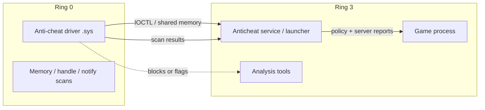
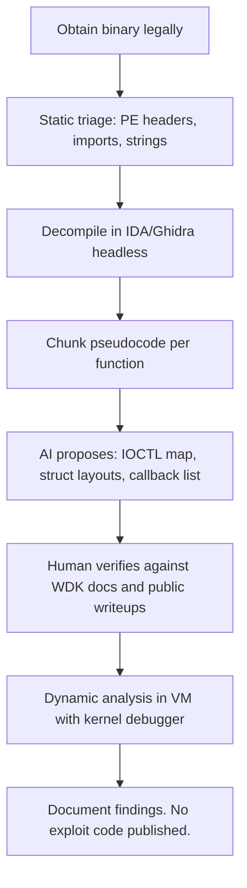

# Anti-Cheat Reverse Engineering

> Tags: anti-cheat, kernel-drivers, EAC, BattlEye, Vanguard, FACEIT, game-security | Difficulty: Advanced | Prerequisites: Windows kernel fundamentals, driver reverse engineering, IDA Pro or Ghidra on PE files. See `../07-advanced/anti-analysis.md` and `deobfuscation.md` first.

## Overview

Anti-cheat reverse engineering is the study of the software that protects a game. Most commercial anti-cheats run as Windows kernel drivers. They scan memory, detect hooks, and verify that the game process is clean. Some also validate hardware. Server-side heuristics make the final call on bans.

This page covers the major products, why they are hostile to analysis, what is public, and how to study them safely with AI assistance. It is a research-methodology page. It is not a bypass guide.

## Legal Warning

Read this before anything else.

- Reverse engineering for interoperability or security research has different legal standing per jurisdiction. In the United States, the DMCA has exemptions for security research, but they are narrow and contested. The 2024 exemption for video games covers "good faith security research" only when it does not violate other law. Circumventing anti-cheat may still violate the game's terms of service and can expose you to civil claims.
- Loading a third-party driver, patching kernel memory, or injecting code into a protected process on a machine that also holds your personal accounts is how people get banned, sued, or infected.
- Anti-cheat companies actively monitor public forums. Publishing exploit details or bypass source code is a fast way to get a cease-and-desist.
- The safe posture: study binaries you own on a machine dedicated to research, offline, with no game account logged in, and publish methodology rather than working exploits.

If your goal is to understand the technology, the rest of this page is enough. If your goal is to cheat in a live game, stop here. Nothing below helps with that, and the legal and account risks are real.

## The Landscape

### Commercial products

| Product | Vendor | Deployment | Known structure (public knowledge) |
|---|---|---|---|
| Easy Anti-Cheat (EAC) | Epic Games | Kernel driver plus usermode service. Per-game install. | `EasyAntiCheat.sys` / `EasyAntiCheat_EOS.sys`. Driver loads at game start, stays for the session. Usermode module communicates over a device object. |
| BattlEye (BE) | BattlEye Innovations | Kernel driver plus usermode service. Per-game. | `BEDaisy.sys` historically; current name varies by title. Strong reputation for kernel-level scanning and handle stripping. |
| Riot Vanguard | Riot Games | Always-on kernel driver for VALORANT and League. | `vgk.sys` loads at boot. Boot-start driver means it is present before the game launches. TPM/Secure Boot checks reported on Windows 11 installs. |
| FACEIT AC | FACEIT | Kernel driver for FACEIT-enabled CS2 and other titles. | Per-platform. Strong focus on DMA and input-device integrity. |
| XIGNCODE3, nProtect GameGuard, mhyprot | XIGNCODE / INCA Internet / miHoYo | Mostly kernel or hybrid. Common in Asian-market games. | Varies widely. Many are older designs with known bypass research. |
| VAC | Valve | Primarily usermode plus delayed server-side scanning. | `vac.dll` modules in the game process. VACnet bans come in waves. Historically the least kernel-invasive mainstream AC. |
| EA Javelin, Activision Ricochet | EA / Activision | Kernel-level on modern titles. | Ricochet has TPM 2.0 and Secure Boot requirements on some games. |

### Open-source and custom anti-cheats

| Project | URL | What it is |
|---|---|---|
| minecraft-anticheat (GrimAC) | [github.com/GrimAnticheat/Grim](https://github.com/GrimAnticheat/Grim) | The standard open-source Minecraft anticheat. Java usermode. Predictive movement checks. ~1,800 stars. |
| donnaskiez/ac | [github.com/donnaskiez/ac](https://github.com/donnaskiez/ac) | A teaching kernel-mode anticheat skeleton in C. ~686 stars. Good for learning the driver shape without touching commercial code. |
| NoMercy-ac/NoMercy | [github.com/NoMercy-ac/NoMercy](https://github.com/NoMercy-ac/NoMercy) | Open-source anticheat with kernel and usermode parts. ~636 stars. |
| UltimateAntiCheat | [github.com/AlSch092/UltimateAntiCheat](https://github.com/AlSch092/UltimateAntiCheat) | Usermode-only C++ anticheat aimed at common cheat vectors. ~653 stars. |
| niemand-sec/AntiCheat-Testing-Framework | [github.com/niemand-sec/AntiCheat-Testing-Framework](https://github.com/niemand-sec/AntiCheat-Testing-Framework) | Framework for testing any anticheat against known attack vectors. ~823 stars. Stale since 2022. |
| gmh5225/awesome-game-security | [github.com/gmh5225/awesome-game-security](https://github.com/gmh5225/awesome-game-security) | The best single index of game-security research, anticheat internals writeups, and tools. ~3,700 stars, actively maintained. Start here. |

Custom game-side anti-cheat also exists: many studios write their own checks inside the game binary (handle checks, timing checks, server-authoritative validation). These live in the game EXE, not a separate driver, and are analyzed like ordinary protected binaries.

## Why Anti-Cheat Is Hostile to RE

Anti-cheat systems are designed to make the analyst's job harder. They assume the analyst is an attacker.

1. **Kernel drivers.** A driver runs at ring 0. It can read and write any process memory. It can register process, thread, and image-load notify routines. It can strip access rights from handles to the game process. Static analysis of a `.sys` file is normal PE reversing. Dynamic analysis requires a test-signing setup or a VM.
2. **Boot-start and early load.** Vanguard loads at boot. EAC and BattlEye load when the game starts, before the game process exists. Your debugger attaches after the driver is already watching.
3. **Integrity checks.** The driver periodically scans its own code, the game binary on disk and in memory, and critical system structures. Modified bytes trigger flags. Timing checks detect breakpoints and single-stepping.
4. **Obfuscation.** Commercial drivers are heavily obfuscated. Control-flow flattening, junk code, encrypted strings, and VM-protected routines are standard. VMProtect or custom protectors wrap the interesting logic.
5. **Handle stripping.** The driver removes `PROCESS_VM_READ`, `PROCESS_VM_WRITE`, and `PROCESS_CREATE_THREAD` rights from handles other processes try to open on the game. Cheat Engine, x64dbg, and Frida all need one of these rights.
6. **Anti-debug and anti-VM.** Debug registers are cleared. `KdDebuggerEnabled` and `NtQueryInformationProcess` checks run. Hypervisor detection blocks analysis VMs unless you hide them carefully.
7. **Server-side validation.** Even a perfect client-side bypass fails if the server validates movement, hit registration, or timing. Most modern cheats are detected server-side. The client is only half the system.
8. **Signature and heuristic scanning.** Known cheat tool signatures (Cheat Engine drivers, common DLL names, suspicious memory patterns) are flagged. Renaming a tool does not help if the behavior matches.

## What Is Publicly Documented

Public knowledge comes from three sources: vendor documentation, security research writeups, and open-source reimplementations.

### Driver-to-usermode communication

Every commercial anticheat splits work between a kernel driver and a usermode service. The typical flow:



The kernel driver exposes a device object (for example `\\.\EasyAntiCheat_EOS` historically, names vary by version and game). The usermode service opens it and sends IOCTLs or writes to shared memory. Research writeups on the `awesome-game-security` list document the IOCTL interfaces for several products. BattlEye's usermode-kernel boundary has been analyzed in public posts. The exact control codes change per version.

### Usermode modules

The usermode service is a normal PE. It handles:

- Game launch and heartbeat.
- Ban-wave coordination with the vendor backend.
- Signature updates.
- Some client-side checks that do not need ring 0.

It is the easier target. It is also heavily protected by the same obfuscators.

### Known bypass categories (documented, not endorsed)

The public literature describes these attack classes. Knowing them helps you understand what the driver defends against:

- **Handle hijacking.** Duplicate an existing legitimate handle to the game process instead of opening a new one. The driver must check handle origins.
- **Manual mapping.** Inject a DLL without `LoadLibrary`. No module list entry, no `LdrLoadDll` call. Detected by VAD scans and thread-start checks.
- **Kernel callbacks abuse.** Register `PsSetCreateProcessNotifyRoutine` or `ObRegisterCallbacks` to intercept the anticheat's own operations.
- **DMA attacks.** A second PC with a PCIe FPGA card reads game memory over PCIe. No driver on the game PC. Detected by firmware checks and timing analysis on the host.
- **Hypervisor-based cheats.** Run the game under a custom hypervisor that hides memory reads. Detected by hypervisor detection and timing checks.
- **Signed vulnerable drivers.** Load a legitimately signed driver with a known vulnerability (BYOVD) to get ring 0. Microsoft maintains a vulnerable-driver blocklist. Anticheats check for it.

Each of these has public proof-of-concept code somewhere. Most are patched within weeks. The cat-and-mouse is the point: the driver you analyze today is not the driver that ships next month.

### Cat-and-mouse timeline (public record)

- **2018–2019.** BattlEye and EAC move to kernel mode. Public bypasses for usermode-only VAC-era tools stop working.
- **2020.** Vanguard launches with VALORANT. Boot-start driver. TPM requirements follow on Windows 11.
- **2021–2022.** DMA cheat hardware becomes cheap. Anticheats add firmware and device checks. FACEIT pushes back hard on DMA.
- **2023–2024.** Server-side ML detection improves. Client bypasses that worked in 2020 now produce ban waves weeks later.
- **2025–2026.** TPM 2.0 and Secure Boot become requirements on more titles. Hypervisor cheats get better; anticheat hypervisor detection gets better. The loop continues.

This timeline is reconstructed from public reporting and is approximate. Exact dates and versions vary by source.

## Setup for Authorized Study

Authorized study means: binaries you are permitted to analyze, on infrastructure you control, without a live game account.

### Dedicated research machine

Use a separate Windows PC or VM that never logs into a game account. Install test-signing mode for driver work.

```powershell
# Enable test signing (requires Secure Boot off in BIOS/UEFI)
bcdedit /set testsigning on
bcdedit /set nointegritychecks on
shutdown /r /t 0
```

After reboot, the desktop shows a "Test Mode" watermark. Load your own test driver with `sc create` or a tool like OSR Driver Loader. Never load a commercial anticheat driver on this machine.

### Offline targets

The safest binaries to study:

- **Older game versions** whose anticheat was usermode-only or absent. Many DRM-free classics have no anticheat at all. The `awesome-decomp-games` project catalogs games with active decompilation scenes, which implies distributable binaries.
- **Open-source anticheats** (GrimAC, donnaskiez/ac, NoMercy). You have full source. You can build, instrument, and break them freely.
- **Sample drivers** from Microsoft's WDK samples and the `donnaskiez/ac` skeleton. These teach the driver structure without legal exposure.
- **Captures and dumps** from research writeups. Many researchers publish IDA databases and Ghidra projects for older anticheat versions.

### VM isolation

A Windows VM with nested virtualization gives you snapshots and rollback. VMware Workstation and Hyper-V both support nested virt on modern hardware. Enable it in firmware and in the hypervisor settings.

For kernel debugging, use a second VM as the debugger host with KDNET or a named pipe. WinDbg preview is the standard debugger. The `mnemonic-re/WinDbgX-MCP` server (mentioned in the report) exposes WinDbg to MCP clients for agent-assisted debugging.

### What not to do

- Do not load EAC, BattlEye, or Vanguard drivers on a machine with personal accounts or saved credentials.
- Do not attach a debugger to a live game process. The anticheat will detect it and may flag the account.
- Do not submit anticheat binaries or game executables to cloud LLM APIs or public sandboxes without legal review. You are sending protected code to a third party.
- Do not publish working bypasses, IOCTL abuse code, or DMA firmware. Publish analysis and methodology.

## AI-Assisted Workflow

AI helps in specific places. It does not replace the need for a safe lab.

### Where AI helps

1. **Static triage.** Feed the driver PE to IDA or Ghidra, export the decompilation in chunks, and ask the model to identify IOCTL dispatch routines, callback registrations, and string-decryption loops. The model is good at pattern-matching known structures.
2. **Naming and struct recovery.** Kernel drivers use `DEVICE_OBJECT`, `IRP`, `IO_STACK_LOCATION`. The model can propose struct layouts from access patterns. Verify against MSDN and the WDK headers.
3. **IOCTL interface mapping.** Given a dispatch function, the model can enumerate the IOCTL codes and the buffers they touch. Cross-check against public writeups for the same product version.
4. **Obfuscation triage.** For VMProtect or custom-protected routines, the model can identify the VM entry, handler table, and bytecode format. It cannot devirtualize them. See `deobfuscation.md`.
5. **Report drafting.** The model summarizes findings into a structured report. You verify every claim against the binary.

### Where AI fails

- **Live kernel state.** The model cannot see what the driver is doing right now. It cannot read kernel memory, trace callbacks, or observe a scan in progress. That requires WinDbg, a kernel debugger, or manual instrumentation.
- **Hardware attestation.** TPM checks, Secure Boot state, and CPU-level features are not visible to static analysis alone. The model cannot tell you whether a driver will refuse to load on a given machine.
- **Bypass generation.** The model can write plausible-looking bypass code. It cannot test it against the live driver. It cannot know which patch the vendor shipped yesterday. Treat generated bypass code as pseudocode, not a tool.
- **Server-side logic.** The server binary is not available. The model cannot analyze what it cannot see.
- **Anti-cheat evasion of the AI itself.** Some anticheat-adjacent malware embeds prompt-injection strings in binaries (see `../07-advanced/ai-security-threats.md`). A driver full of obfuscated strings might contain text designed to manipulate an LLM analyst. Treat decompiled strings as hostile input.

### Recommended loop



The AI step is E. Steps B, C, F, and G are deterministic or human-verified. Do not skip them.

### Prompt patterns that work

For IOCTL enumeration:

```
This is a decompiled Windows kernel driver dispatch function.
List every IOCTL code it handles, the input buffer size it expects,
and what it does with the buffer. Cite the function address for each.
```

For callback identification:

```
Search this decompiled driver for calls to PsSetCreateProcessNotifyRoutine,
PsSetCreateThreadNotifyRoutine, PsSetLoadImageNotifyRoutine, and
ObRegisterCallbacks. For each hit, give the callback function address
and a one-line description of what the callback checks.
```

For string decryption:

```
This function builds a string at runtime. Identify the encoding
(XOR, RC4, AES, custom). Write a Python decoder. Do not guess the key;
find where it is loaded from.
```

Always include: "Cite the function address." Always exclude: "Write a bypass." The model will do the first well. It will do the second dangerously.

## Step-by-Step: Analyzing a Kernel Driver

This is the generic workflow for any `.sys` file. It applies to commercial anticheats and open-source ones alike.

### 1. Static triage

```bash
# On Linux with pefile or DIE
python3 -c "import pefile; pe=pefile.PE('driver.sys'); print(pe.OPTIONAL_HEADER.AddressOfEntryPoint)"
diec driver.sys    # Detect It Easy: packer, compiler, .NET?
```

Check for:

- Packer or protector signature (VMProtect, Themida, custom).
- Import table. Kernel drivers import from `ntoskrnl.exe`, `HAL.dll`, `wdmsec.sys`, etc. Missing imports mean dynamic resolution.
- Section names. `.text`, `.data`, `.pdata` are normal. Random names suggest packing.
- DriverEntry. This is the entry point. It calls `DriverEntry` which sets up dispatch routines.

### 2. Load in IDA or Ghidra

Use headless mode for batch work:

```bash
# Ghidra headless
analyzeHeadless /tmp/ghidra_proj AC_Project -import driver.sys \
  -postScript ExportDecompilation.java -scriptPath /path/to/scripts

# IDA headless (idalib)
idalib -A -S"script.py" driver.sys
```

For interactive work, load the `.sys` in IDA Pro 9.5 or Ghidra 12.2. Rename `DriverEntry` first. Then find `MajorFunction` dispatch table assignments in `DriverEntry`.

### 3. Map the dispatch table

`DriverEntry` calls `IoCreateDevice` and `IoCreateSymbolicLink`, then sets `MajorFunction[IRP_MJ_*]` handlers. The `IRP_MJ_DEVICE_CONTROL` handler is the IOCTL dispatcher. Decompile it.

The dispatcher typically looks like:

```c
NTSTATUS DispatchDeviceControl(PDEVICE_OBJECT DeviceObject, PIRP Irp) {
    PIO_STACK_LOCATION irpSp = IoGetCurrentIrpStackLocation(Irp);
    ULONG ioctl = irpSp->Parameters.DeviceIoControl.IoControlCode;
    PVOID buffer = Irp->AssociatedIrp.SystemBuffer;
    ULONG size = irpSp->Parameters.DeviceIoControl.InputBufferLength;

    switch (ioctl) {
        case IOCTL_GET_STATUS: ...
        case IOCTL_SCAN_MEMORY: ...
        case IOCTL_REGISTER_CALLBACK: ...
        default: ...
    }
}
```

The IOCTL codes are the interface. Map them all. Each one is a research question: what does this let the usermode service ask the kernel to do?

### 4. Identify kernel callbacks

Search for calls to:

- `PsSetCreateProcessNotifyRoutine` / `Ex`
- `PsSetCreateThreadNotifyRoutine` / `Ex`
- `PsSetLoadImageNotifyRoutine`
- `ObRegisterCallbacks` (handle stripping)
- `CmRegisterCallback` (registry)
- `KeStackAttachProcess` (cross-process memory access)

Each registered callback is a detection point. Decompile each callback function. Note what it checks: process name, image path, thread start address, handle access mask.

### 5. Dynamic analysis in a VM

Load the driver in your test-signing VM. Use WinDbg over KDNET or a named pipe.

```
# On the target VM (elevated cmd)
bcdedit /debug on
bcdedit /dbgsettings net hostip:<debugger-ip> port:50000

# On the debugger VM
windbg -k net:port=50000
```

Set breakpoints on `DriverEntry`, the dispatch routine, and each callback. Trigger the actions you want to observe (launch a test process, open a handle to it, load a DLL). Watch what the driver does.

For commercial anticheats, do not do this on a machine with a game account. Do not do it at all unless you have written legal permission.

### 6. Document

Write a report with:

- Driver version and hash.
- IOCTL map.
- Callback list with check descriptions.
- Memory regions scanned (if observable).
- Handle-stripping behavior.
- Communication protocol between driver and usermode service.
- Limitations and unknowns.

No exploit code. No bypass patches. No "how to disable X" sections.

## Pitfalls

- **Do not analyze a live anticheat driver on your daily driver.** The driver can see your debugger, your tools, and your account tokens. Use a dedicated VM.
- **Do not trust decompiled strings.** Anticheat binaries are full of decoy strings and encoded data. Verify every string by finding where it is used.
- **Do not assume the usermode service is the weak point.** The kernel driver is the enforcement layer. The usermode service is the reporting layer. Both are protected.
- **Do not publish IOCTL abuse code.** Documenting that an IOCTL exists is research. Publishing a tool that uses it to read game memory is a bypass.
- **Do not feed raw driver dumps to a cloud LLM.** You are sending protected code to a third party. Check the terms of service and your legal exposure first.
- **Do not expect AI to devirtualize the driver.** Commercial anticheats use VMProtect or custom protectors on key routines. AI can identify the VM. It cannot lift the bytecode.
- **Do not ignore server-side detection.** A client-side analysis that ignores the server protocol is incomplete. The server decides bans. The client only collects evidence.
- **Do not use Cheat Engine or x64dbg on a protected game.** The anticheat detects them by signature and by handle-access patterns. Use them only on your own test binaries.
- **Beware of fake anticheat research.** Some GitHub repos claim to be anticheat bypasses but are malware. Check the author, the commit history, and the code before running anything.
- **Version drift is real.** The driver you analyzed last month is not the driver shipping today. Pin your analysis to a specific version and hash.

## See Also

- `../07-advanced/anti-analysis.md` — anti-debug, anti-VM, anti-dump techniques the driver uses against you
- `deobfuscation.md` — VMProtect, Themida, and custom-protector deobfuscation
- `../07-advanced/ai-security-threats.md` — prompt injection from hostile binaries
- `../03-decomp/verification-loop.md` — verifying AI-generated claims about driver code
- `../05-tools/tool-catalog.md` — IDA, Ghidra, WinDbg, and kernel-debugging tools
- `../06-topics/malware-analysis.md` — the broader workflow for hostile binaries
- `https://github.com/gmh5225/awesome-game-security` — the best public index of game-security research
