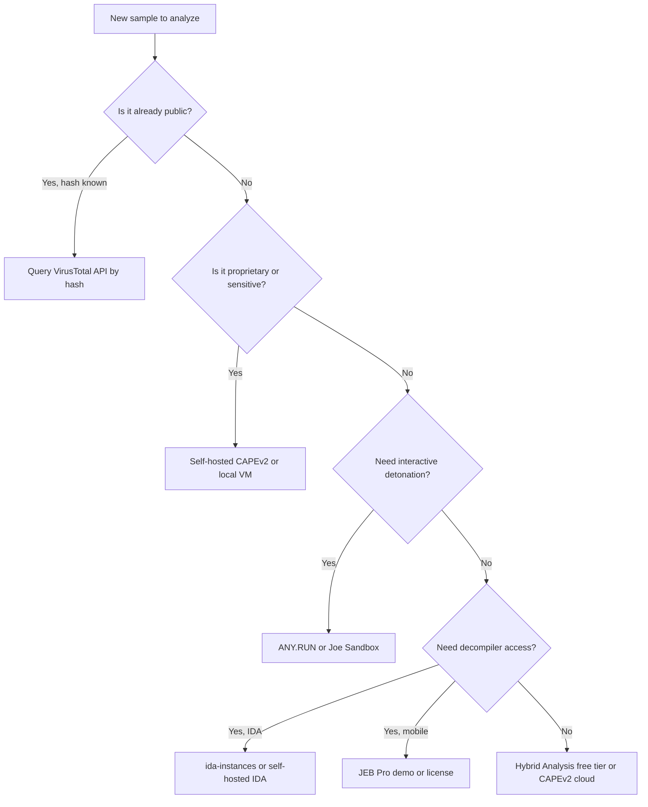
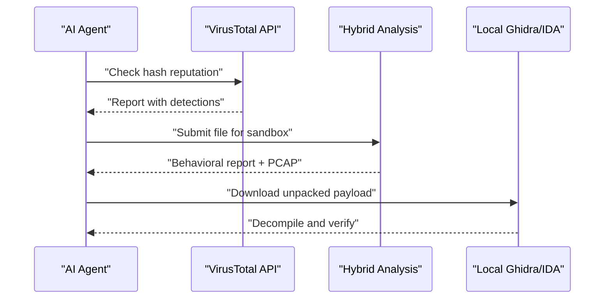

# Cloud and Remote Analysis Platforms

> Tags: cloud, sandboxes, IDA-Pro, hosted-analysis, API | Difficulty: Intermediate | Prerequisites: working API-key workflow. Read [`../01-setup/malware-isolation.md`](../01-setup/malware-isolation.md) first for the detonation layer.

## Overview

This page covers remote analysis platforms that an agent or an analyst can call over HTTP or MCP. The set falls into three groups.

| Group | Examples | What the agent gets |
|---|---|---|
| Hosted decompiler instances | ida-instances, GitHub Codespaces RE toolkit | A real IDA or Ghidra session on the cloud. Pseudocode over MCP |
| Cloud sandboxes | ANY.RUN, Joe Sandbox, Hybrid Analysis, CAPEv2 cloud | Dynamic reports, PCAPs, unpacked dumps |
| Intelligence front ends | VirusTotal AI and Code Insight, MalwareBazaar | Reports, IOCs, and LLM analyst text over REST or MCP |

All of these share one property. The sample leaves your network. On the other side of that line sit three risks.

1. Confidentiality. Third-party sample databases collect everything you submit.
2. Publication. Some platforms publish community submissions publicly. Private mode does not always cover every artifact.
3. Prompt injection. Sandbox report strings come from the malware author. The agent must treat report text as data, not instructions.

The decision rule from the field: submit known-bad or low-sensitivity samples to the public platforms. Keep proprietary or target-software binaries on self-hosted infrastructure. The rest of this page gives the platform details and the tradeoff matrix.

## Hosted IDA Pro: ida-instances

ida-instances (https://panel.idainstances.xyz) sells hosted, single-tenant IDA Pro containers. It is the most turnkey hosted IDA plus MCP offering found in research.

Reported facts, all verified against the public panel page on 2026-11-05:

| Fact | Value |
|---|---|
| IDA version | IDA Pro 9.4 with the Hex-Rays decompiler |
| Isolation | One dedicated container per user. No shared IDA process or filesystem |
| MCP tools | 66 tools, a stability-hardened fork of ida-pro-mcp |
| Time to first decompile | About 90 seconds |
| Upload ceiling | 110 MB |
| Idle reap | About 60 minutes |
| Egress | Outbound traffic dropped by default. Air-gapped until you allow it |
| GUI | Full IDA interface streamed to a browser tab |

The workflow is short.

1. Open the panel. Pick a username. Launch an instance.
2. The dashboard prints one JSON block. Paste it into Claude Code, Cline, or Cursor as an MCP server entry.
3. Upload the sample through the dashboard or drag it onto the page. It lands in `/opt/uploads`.
4. Ask the agent for `survey_binary`. Read the pseudocode that comes back.

The hardening is meaningful. Because egress is dropped by default, the sample cannot phone home during static analysis. The MCP fork adds a stable tool set for batch rename and type propagation. Use this when you need licensed IDA without buying a seat.

Cost and privacy. Each instance is billed per time. Samples sit on the vendor's infrastructure. Check the terms on the panel page before you upload proprietary binaries. For sensitive work, prefer a self-hosted instance or a self-hosted IDA license.

## Cloud Sandbox Services

### ANY.RUN

ANY.RUN (https://any.run) is a commercial interactive sandbox. Analysts click through a live VM. An agent submits files through the REST API at https://api.any.run/v1/analysis.

What the platform gives an agent:

- Full task reports: processes, registry, file writes, network connections.
- Interactive desktop control through the web UI. Useful when a human wants to click the unpacker dialog the agent cannot.
- An "AI" summary feature that narrates the process tree and Suricata hits. It is a convenience layer, not ground truth.
- Submissions are private by default on paid tiers. Free public tasks may be published to the community feed.

API pattern. Every submission returns a task UUID. The agent polls `/v1/analysis/{task_id}` until the report completes. Retrieve PCAPs and dropped files through `/v1/analysis/{task_id}/pcap` and related endpoints. The exact endpoint list lives in the docs linked from the web UI (https://any.run/docs). The community `anyrun-mcp-server` project wraps the API as an MCP server if you want a tool surface instead of raw REST.

Best for: interactive detonation, unpacking steps that need clicks, and reports a human reads alongside the agent.

### Joe Sandbox

Joe Sandbox Cloud runs at https://jbxcloud.joesecurity.org. It offers both classic sandbox reports and an agentic layer called Joe Reverser (https://www.joesecurity.org/joe-reverser).

Joe Reverser is a standalone LLM-driven agent. It reasons over a sample and picks tools dynamically. It performs static analysis, dynamic detonation, disassembly, decompilation, automated unpacking, and multi-vector analysis for files, URLs, documents, and email. It returns a structured report with code insights and IOCs. The marketing page says it "mimics a skilled human malware analyst". Treat that as a claim. Verify its IOCs against the sandbox artifacts.

The classic Joe Sandbox API is documented at https://support.joesandbox.com. Submissions use the `jbxcloud` endpoint with an API key. The official MCP server exists at https://github.com/joesecurity/joesandboxMCP. Install it with `uv`:

```bash
git clone https://github.com/joesecurity/joesandboxMCP.git
cd joesandboxMCP
uv venv
uv pip install -e .
```

Then wire it into your MCP client:

```json
{
  "mcpServers": {
    "JoeSandbox": {
      "command": "uv",
      "args": ["--directory", "/absolute/path/to/joesandboxMCP", "run", "main.py"],
      "env": {
        "JBXAPIKEY": "your-jbxcloud-apikey",
        "ACCEPTTAC": "SET_TRUE_IF_YOU_ACCEPT"
      }
    }
  }
}
```

`ACCEPTTAC=TRUE` means you accept the Joe Security Terms and Conditions (https://jbxcloud.joesecurity.org/resources/termsandconditions.pdf). The MCP server exposes tools for submission, report lookup, IOC extraction, process trees, unpacked PE downloads, and PCAP downloads.

Joe Sandbox also runs native physical machines. That matters for malware that checks for virtual machines. Joe Sandbox and Hybrid Analysis have both historically claimed native-metal or VM-aware detonation options. Verify current tiers on their pricing pages.

### Hybrid Analysis (now Falcon Sandbox)

Hybrid Analysis at https://www.hybrid-analysis.com rebranded to Falcon Sandbox in August 2026. The page metadata now says "Free automated malware analysis service powered by CrowdStrike Falcon Sandbox." It is owned by CrowdStrike.

The classic API lives under https://www.hybrid-analysis.com/api/v2/. Key endpoints:

- `POST /submit/file` — upload a file by hash or multipart form.
- `POST /submit/url` — submit a URL.
- `GET /report/{sha256}/summary` — verdict and score.
- `GET /report/{sha256}` — full JSON report.
- `GET /most-recent-submissions` — community feed.

API key and `User-Agent` header are required. Rate limits apply on the free tier.

What changed in 2026: the site moved to a Next.js frontend. The old blog URL `hybrid-analysis.blogspot.com` still carries threat research. The classic API remains the stable integration surface. New submissions default to private on paid tiers. Free community submissions may feed the public search.

### CAPEv2 cloud and self-hosted

CAPEv2 (https://github.com/kevoreilly/CAPEv2) is the open-source Windows sandbox that backs many private deployments. It is not a single cloud product. Operators run CAPEv2 on KVM hypervisors. Some vendors offer CAPE as a service. The public sites for commercial CAPE cloud offerings are inconsistent in 2026. Check whether your provider exposes the same REST API as self-hosted CAPEv2.

The CAPEv2 REST API endpoints are well documented in the project README. The standard flow:

```bash
# Submit a file to a CAPEv2 instance
curl -X POST "https://your-cape-instance.com/apiv2/tasks/create/file/" \
  -H "Authorization: Token $CAPE_API_KEY" \
  -F "file=@sample.exe"

# Get the task report
curl "https://your-cape-instance.com/apiv2/tasks/report/$TASK_ID/"
```

CAPEv2 reports include signature hits, dropped files, PCAPs, and YARA matches. CAPE-mcp (https://github.com/CAPESandbox/CAPE-mcp) wraps the API as an MCP server. CAPEsolo (https://github.com/CAPESandbox/CAPEsolo) is a standalone Windows monitor with a headless CLI. CAPEvm (https://github.com/CAPESandbox/CAPEvm) packages the whole stack as a pre-built KVM image. For agentic workflows, CAPE-v2 self-hosted is usually the cheapest path that keeps samples off third-party infrastructure.

## Intelligence Front Ends

### VirusTotal AI and Code Insight

VirusTotal AI lives at https://ai.virustotal.com. It is a free LLM service layered on the VirusTotal corpus. It reads reports and writes analyst-style summaries.

The 2026 release added an official MCP server. The repository is https://github.com/VirusTotal/virustotal-mcp. The package is `vt-mcp`. It connects agents to VTAI through OAuth or an Agent Token.

Key facts from the README:

- Remote endpoint: `https://ai.virustotal.com/mcp`.
- OAuth sign-in for Claude Code, Cursor, VS Code, ChatGPT, and others.
- `vt-mcp` on PyPI, version 0.9.9 as of 2026-11-05.
- Requires Python 3.12 or newer for the local stdio install.
- Works with file, URL, domain, and IP reports.
- Supports file and network analysis submission and receipt recovery.

Install for Claude Code:

```bash
claude plugin marketplace add VirusTotal/virustotal-mcp
claude plugin install virustotal@virustotal
```

Or add the HTTP endpoint manually:

```bash
claude mcp add --transport http virustotal https://ai.virustotal.com/mcp
```

For stdio, save your Agent Token to `~/.config/vt-mcp/token` and set `VTAI_TOKEN_FILE` to that path. Never paste the token into a prompt.

The deeper "Code Insight" feature in the main VirusTotal UI analyzes file decompilation. It reportedly uses a pruning-based HLIL summarizer that fits a whole binary into a Gemini 1M-token context window. See the research report for the source. This is a vendor claim. The exact architecture is not published. Treat its summaries as leads. Verify against the actual decompiler output.

The classic VT API v3 (https://virustotal.readme.io/reference/overview) remains the bulk-lookup path. It returns reports for files, URLs, domains, and IPs. The API key comes from your VirusTotal account page. Rate limits are per-key. Paid tiers raise quota.

### MalwareBazaar

MalwareBazaar (https://bazaar.abuse.ch) is the abuse.ch malware sample repository. It shares samples with researchers under a research-use license. The API is open and documented at https://bazaar.abuse.ch/api/.

The API supports:

- `query` by hash, file name, signature, tag, or YARA rule.
- `download` to fetch the sample ZIP.
- `recent` for the latest uploads.
- `signature` listing.

A typical agent workflow:

```bash
# Search MalwareBazaar for a recent Emotet sample
curl -s "https://mb-api.abuse.ch/api/v1/" \
  -d "query=get_recent&selector=emotet&limit=5"

# Download a sample by SHA-256
curl -s "https://mb-api.abuse.ch/api/v1/" \
  -d "query=get_file&sha256_hash=$SHA256"
```

The response returns a download URL for the sample ZIP. Extract it locally. Do not detonate it on the analysis host.

MalwareBazaar is the right source for training and benchmark samples. It is not a place to upload your own proprietary binaries. Submissions there feed the research community.

### BinaryAI and its status

BinaryAI was a commercial binary-analysis SaaS from Trend Micro. It used machine learning to detect malware families and packers. Trend Micro acquired it. VirusTotal later absorbed parts of its capability into the Code Insight feature.

The current status in November 2026 is unclear from public sources. The standalone BinaryAI API is not widely documented anymore. Code Insight inside VirusTotal is the surviving surface. Check https://www.virustotal.com/gui/intelligence/overview and the VT blog for current status. Treat any third-party "BinaryAI" service as suspect unless it links to an official Trend Micro or VirusTotal domain.

### JEB online demo

JEB Pro from PNF Software has a downloadable demo at https://www.pnfsoftware.com/jeb/demo. The demo includes most JEB Pro capabilities. It ships with all decompiler modules. Limitations:

- Decompilation is limited to a subset of code.
- Saving or loading projects is disabled.
- Clipboard use is disallowed.
- Time-limited sessions.
- Requires an internet connection.

The demo is not a hosted service. It is a local trial install. It is useful for evaluating JEB's Android, DEX, and native decompilers before buying a license. JEB Pro 5.48 shipped in October 2026 per the changelog. It includes a built-in MCP server and the VIBRE AI assistant.

For agent work, install JEB Pro and use the MCP integration. The community `jebmcp` project (https://github.com/flankerhqd/jebmcp) wraps JEB as an MCP server for earlier versions.

## API Access Patterns for Agents

Every platform above can be reached three ways.

| Pattern | How it works | Best for |
|---|---|---|
| REST API | Direct HTTP calls with an API key | Scripts, bulk lookups, custom pipelines |
| Official MCP server | MCP endpoint or local stdio process | Claude Code, Cursor, Codex, other agent harnesses |
| Community MCP wrapper | Third-party repo that wraps a REST API | Platforms with no official MCP yet |

### Direct REST submission

The pattern is the same everywhere. Authenticate, submit, poll for completion, download artifacts.

```python
import requests, time

VT_KEY = "your-vt-api-key"
HA_KEY = "your-ha-api-key"
JBX_KEY = "your-jbxcloud-apikey"

# VirusTotal file upload
resp = requests.post(
    "https://www.virustotal.com/api/v3/files",
    headers={"x-apikey": VT_KEY},
    files={"file": open("sample.exe", "rb")},
)
analysis_id = resp.json()["data"]["id"]

# Hybrid Analysis file submit
resp = requests.post(
    "https://www.hybrid-analysis.com/api/v2/submit/file",
    headers={"api-key": HA_KEY, "User-Agent": "my-re-agent/1.0"},
    files={"file": open("sample.exe", "rb")},
)
sha256 = resp.json()["sha256"]

# Joe Sandbox Cloud submit (jbxcloud)
# Endpoint paths are illustrative. Verify them in the current Joe Sandbox API docs.
resp = requests.post(
    "https://jbxcloud.joesecurity.org/api/upload",
    headers={"Authorization": f"Bearer {JBX_KEY}"},
    files={"file": open("sample.exe", "rb")},
)
webid = resp.json()["webid"]
```

After submission, poll the report endpoint until status is complete. Cache the report locally. Never let the agent parse raw API JSON in the same context window as the rest of the analysis. Save it to disk and read the relevant sections.

### MCP server configuration

For VirusTotal:

```bash
claude mcp add --transport http virustotal https://ai.virustotal.com/mcp
```

For Joe Sandbox, install the MCP server as shown above and add it to your MCP client config.

For ANY.RUN, use the community `anyrun-mcp-server` project or write a thin wrapper around the REST API. There is no official MCP server as of November 2026.

For Hybrid Analysis, the same applies. Use a community wrapper or write your own. The API is stable and well documented.

### Submission hygiene

Before any agent-driven submission:

1. Hash the sample. Check it against MalwareBazaar and VirusTotal first. If the report already exists, do not re-submit.
2. Decide on visibility. Public community feeds publish submissions. Use private mode on paid tiers.
3. Redact metadata. Some platforms store the uploader name and notes. Do not include client names or internal case IDs.
4. Set a timeout. Do not let an agent loop forever on a hung analysis.
5. Log the submission ID. You need it for audit and for deleting the sample later if the platform supports it.

## Cost and Privacy Tradeoffs

### Cost comparison

Prices change often. The following is a snapshot of the model, not exact pricing.

| Platform | Billing model | Rough cost signal |
|---|---|---|
| ida-instances | Per instance-hour | Mid-range. Cheaper than a full IDA seat for occasional use |
| ANY.RUN | Subscription plus per-task credits | Mid-range. Free tier exists with limits |
| Joe Sandbox | Subscription tiers | Mid-to-high. Physical machines cost more |
| Hybrid Analysis | Free community plus paid | Free for public submissions. Paid for private and API |
| CAPEv2 self-hosted | Hardware plus maintenance | Cheapest at scale. Requires a hypervisor host |
| VirusTotal AI | Free with limits | Free tier is generous for lookups. VTAI quota applies |
| MalwareBazaar | Free for research | Free. Research-use license only |

Check each vendor's pricing page before committing. Prices on sandbox platforms moved several times in 2025 and 2026.

### Privacy matrix

| Platform | Where the sample goes | Who can see it | Deletion possible |
|---|---|---|---|
| ida-instances | Vendor container | Vendor only. Single-tenant | Ask support. Container reaps after idle |
| ANY.RUN | Vendor cloud | Private on paid tiers. Public on free | Yes. Task deletion supported |
| Joe Sandbox | Vendor cloud | Private on paid tiers | Yes. Report deletion supported |
| Hybrid Analysis | Vendor cloud | Public community feed on free tier | Yes. Delete submission supported |
| CAPEv2 self-hosted | Your infrastructure | Your team only | You control retention |
| VirusTotal | Google/Mountain View infrastructure | VT community and VT Intelligence | File reports persist by hash. Cannot fully delete |
| MalwareBazaar | abuse.ch research corpus | Research community | No. Once shared, it propagates |

### The confidentiality test

Ask three questions before uploading.

1. Is this sample already public? If yes, any platform is fine.
2. Is this sample proprietary or customer-owned? If yes, use self-hosted infrastructure only.
3. Is this sample legally sensitive? If yes, check the jurisdiction and the terms of service. Some platforms share samples with law enforcement.

The worst outcome is uploading a client's proprietary binary to a public sandbox and having it appear in a community feed. That has happened. Treat every upload as permanent.

## Self-Hosted Versus Cloud Decision Matrix

Use this matrix to pick a platform.

| Need | Best choice | Why |
|---|---|---|
| Quick triage of a known hash | VirusTotal API | Fastest. No upload needed if hash is already known |
| Interactive detonation of suspicious file | ANY.RUN or Joe Sandbox | Live desktop. Human can click through dialogs |
| Automated bulk detonation | CAPEv2 self-hosted | Cheapest per-sample at scale. Full control |
| Need IDA Pro without buying a seat | ida-instances | Hosted IDA 9.4 with MCP. Air-gapped by default |
| Need IDA Pro with full data control | Self-hosted IDA + headless | License required. Full control over data |
| Malware research samples | MalwareBazaar | Free research corpus. Download, do not upload |
| LLM analyst report on existing VT data | VirusTotal AI MCP | Reads VT reports. Does not need raw sample |
| Decompile an APK or DEX | JEB Pro demo or license | Best-in-class mobile decompiler |
| Decompile a native PE | Ghidra or IDA | See [`../03-decomp/batch-decompilation.md`](../03-decomp/batch-decompilation.md) |
| Air-gapped analysis | Self-hosted everything | No cloud. Local models only. See [`../07-advanced/model-selection.md`](../07-advanced/model-selection.md) |

### Decision tree



### Hybrid pipeline

A common pattern combines cloud triage with local deep analysis.



The agent uses cloud services for breadth. It uses local tools for depth. The boundary is the sample upload step. Everything after download is under your control.

## Pitfalls

- **Treating AI summaries as ground truth.** VirusTotal Code Insight, Joe Reverser's report, and ANY.RUN's AI summary are all LLM outputs. Verify every claim against the raw artifacts.
- **Ignoring privacy defaults.** Hybrid Analysis free tier publishes community submissions. ANY.RUN free tier may do the same. Check the visibility setting before submit.
- **Re-submitting known samples.** Always hash first and query VirusTotal and MalwareBazaar. Re-submitting wastes quota and may flag your API key.
- **Letting the agent loop on API calls.** Set timeouts and retry limits. A stuck sandbox job can burn through credits.
- **Parsing raw JSON in context.** Sandbox reports are large. Save them to disk. Extract the sections the agent needs. Feed those sections, not the whole report.
- **Trusting community MCP wrappers.** Third-party MCP servers for ANY.RUN and Hybrid Analysis are community projects. Audit the code before giving them your API key. They handle credentials.
- **Forgetting the Terms of Service.** Joe Sandbox MCP requires `ACCEPTTAC=TRUE`. MalwareBazaar is research-use only. Commercial use of research samples may violate the license.
- **Assuming BinaryAI still exists.** The standalone product is gone or absorbed. Code Insight inside VirusTotal is the successor surface.

## See Also

- [`../01-setup/malware-isolation.md`](../01-setup/malware-isolation.md) — Detonation safety and environment choice
- [`../06-topics/malware-analysis.md`](../06-topics/malware-analysis.md) — End-to-end malware triage with agents
- [`../03-decomp/batch-decompilation.md`](../03-decomp/batch-decompilation.md) — Headless decompilation pipelines
- [`../05-tools/mcp-catalog.md`](../05-tools/mcp-catalog.md) — MCP server catalog including vendor and community servers
- [`../09-ops/cost-tracking.md`](../09-ops/cost-tracking.md) — Token and platform cost accounting
- [`../09-ops/legal-and-ethics.md`](../09-ops/legal-and-ethics.md) — Legal boundaries for sample handling and cloud submission
