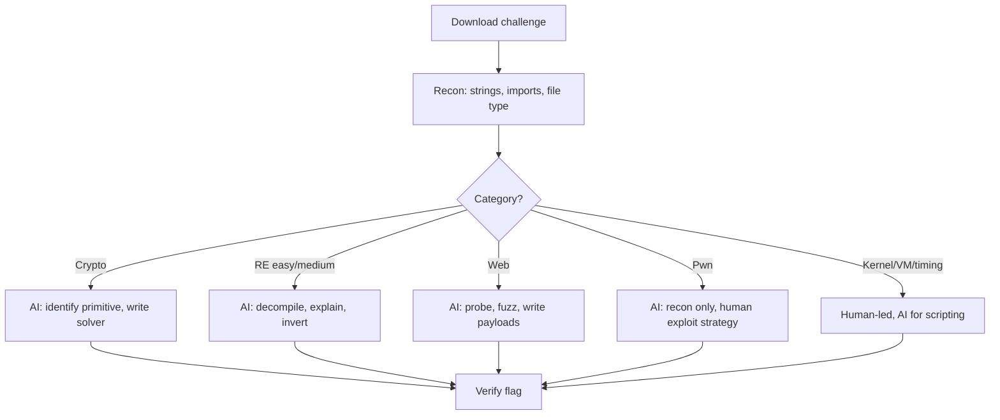
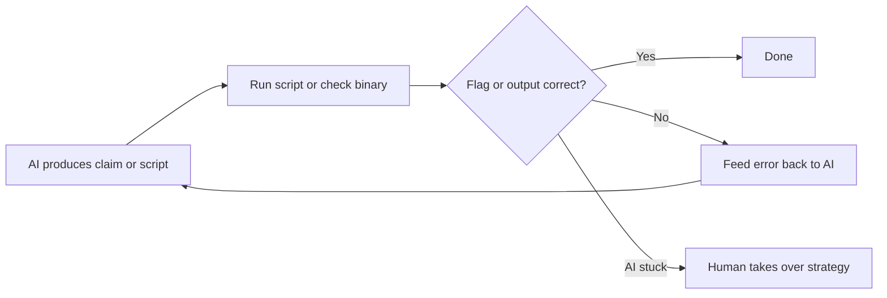

# CTF Challenges with AI

> Tags: ctf, benchmarks, agent-workflow, pwn, crypto, reverse-engineering | Difficulty: Intermediate | Prerequisites: basic RE and pwn skills. See [`../03-decomp/verification-loop.md`](../03-decomp/verification-loop.md) for verification habits.

## Overview

CTF challenges are the best public testbed for AI-assisted reverse engineering. They are self-contained. They have a flag as ground truth. They span every category an agent can touch.

The honest state in November 2026:

- Public CTFs are contaminated. Every frontier model trained before 2024 has seen most CSAW, picoCTF, and CTFtime archives. High scores on old challenges prove memorization, not skill.
- Generated and private corpora discriminate. CrackMeBench shows the gap: GPT-5.5 reached 92 percent pass@3 on generated crackmes but only 3 of 8 on the public calibration set. The public set was harder because it was memorized differently. See [arXiv 2605.10597](https://arxiv.org/abs/2605.10597).
- AI solves the bounded parts well. Recon, decompilation explanation, script generation, crypto algebra, web payload iteration.
- AI fails on the strategic parts. Kernel exploitation, custom VM reverse engineering, and timing side channels need human exploit strategy.

The split that works in practice: the AI does recon and scripting. The human owns the exploitation plan.

## Benchmark Landscape

| Benchmark | What it contains | Why it matters |
|---|---|---|
| NYU CTF Bench | 200 CSAW challenges. Agent gets bash access in a Kali container. Paper: [arXiv 2406.05590](https://arxiv.org/abs/2406.05590), site [nyu-llm-ctf.github.io](https://nyu-llm-ctf.github.io/) | The original scalable CTF benchmark. Challenges are public. Treat scores as memorization-inflated. |
| InterCode-CTF | CTF challenges in a bash-agent framework. [intercode-benchmark.github.io](https://intercode-benchmark.github.io/) | Saturated. Reported at 95 percent success. Too easy to discriminate. |
| Cybench | 40 professional-level CTF tasks from 4 competitions. Subtasks score partial progress. [cybench.github.io](https://cybench.github.io/) | Still used by model cards (Anthropic, xAI, Meta). Recent tasks reduce contamination. |
| CrackMeBench | 8 public calibration crackmes plus 12 generated tasks. Deterministic oracles in a no-network Docker sandbox. [arXiv 2605.10597](https://arxiv.org/abs/2605.10597) | Best contamination-controlled design found. Generated split separates real skill from recall. |
| AgentRE-Bench | 33 challenges. 13 Linux ELF plus 10 Windows PE programs, each PE scored stripped and unstripped. [agentre-bench.ai](https://www.agentre-bench.ai) | Best small-scale RE-specific board. No attempt got full credit in the published run. |

Key published numbers, all reported in secondary sources:

- InterCode-CTF success rates near 95 percent for frontier models. Saturated.
- CrackMeBench generated split: GPT-5.5 92 percent pass@3, Claude Opus 4.7 58 percent, Kimi K2 42 percent.
- AgentRE-Bench best scores near 87 percent on Windows PE with no full-credit solves.
- MalwareBench (real obfuscated malware, not CTF): 7.6 percent best@3. CTF skill does not transfer to hostile binaries.

Read benchmark scores with the contamination filter: if the challenge appeared on GitHub or CTFtime before the model's training cutoff, assume the model has seen it.

## What AI Solves

### Crypto

Crypto is the strongest category. The work is algebra and script writing. Models handle it well.

- Classic RSA: small `e`, Wiener, Hastad broadcast, Coppersmith small roots, Franklin-Reiter. All scriptable.
- Symmetric: ECB byte-at-a-time, CBC bitflip, padding oracles, GCM nonce reuse.
- ECC: small subgroup, invalid curve, ECDSA nonce reuse, Smart attack on anomalous curves.
- The failure mode is not math. It is misreading the challenge statement. Always paste the full description and ask the model to restate the problem before solving.

Example prompt pattern:

```
Read challenge.txt and the provided ciphertext files.
1. Restate the problem in your own words.
2. Identify which primitive and which attack class applies.
3. Write a pwntools/Python solver script.
4. Run it and show the flag.
```

### Reverse engineering, easy to medium

Stripped PE and ELF binaries up to moderate obfuscation are a good fit.

- The model reads decompiler pseudocode well. Feed it Ghidra or IDA output, not raw assembly.
- Function naming, string xref tracing, control-flow explanation, and "what does this check" questions are reliable.
- Custom VMs stop the model when the bytecode is undocumented. It can lift simple VM handlers but loses the thread on deep state machines.
- Anti-debug and packing add friction but the model can still narrate what it sees.

Bounded prompt that works:

```
Decompile function check_flag at 0x4012a0. Explain the algorithm.
Then write the inverse transformation in Python and verify against test_input.bin.
```

### Web

Web is strong because the agent can drive tools and iterate on live targets.

- SQLi, XSS, SSTI, SSRF, JWT, file upload, deserialization. All have large public corpora the model knows.
- The model writes Burp-style python-requests scripts well.
- It iterates on WAF bypasses better than most humans when given the error output.
- Local CTF web targets are safe to attack. Do not point the agent at production systems.

### Forensics and misc

- Disk and memory forensics: the model reads timelines and extracts IOCs well.
- Steganography: it knows common encodings and can write extraction scripts.
- Python jail (pyjail) challenges: the model is strong here because it knows Python internals deeply.
- OSINT: weakest category for local tools but the model's training knowledge helps.

## What AI Does Not Solve

### Kernel pwn

Kernel exploitation needs precise control over heap state, race conditions, and architecture-specific mitigations. The model can explain KASLR or SMEP in general terms. It cannot reliably produce a working exploit chain for a custom kernel module.

Use the model for recon: identify the attack surface, list the syscalls, explain the struct layout. The human writes the exploit.

### Custom VM reverse engineering

When a challenge ships a proprietary VM with an undocumented bytecode format, the model can describe the dispatcher loop but loses track of the semantics. It hallucinates plausible handler meanings.

The workflow that works: lift the VM handlers to pseudocode first. Then ask the model to annotate each handler. Verify each annotation by emulation.

### Timing side channels

Timing attacks need statistical measurement over many samples. The model cannot run the measurement loop reliably. It also cannot tell when noise dominates signal.

Write the measurement harness yourself. Use the model to interpret the results.

### Open-ended "find the bug"

The report documents this failure clearly. "Find the vulnerability" prompts produced hallucinated answers and cost 231 percent more wasted time in the NDSS 2026 study. See [BASE_REPORT.md](https://github.com/initialrise/REWiki/blob/main/BASE_REPORT.md) section 16.

## Contamination Warning

Public CTF corpora are memorized. This is the single biggest measurement error in AI CTF evaluation.

| Corpus | Contamination risk | Use for |
|---|---|---|
| CSAW archives (pre-2023) | High. In NYU CTF Bench and most training sets | Practice only. Do not benchmark. |
| picoCTF, OverTheWire, TryHackMe | High. Widely mirrored | Learning. Not evaluation. |
| CTFtime public writeups | High. Writeups are in training data | Reference for technique, not for solving. |
| CrackMeBench generated split | Low. Deterministic generator, private seeds | Real capability signal. |
| Self-authored challenges | None | Real capability signal. |
| Recent CTF events (last 6 months) | Medium. May be in training data | Directional signal only. |

Rules:

1. Never report a score on a public challenge as capability.
2. For private evaluation, use generated corpora or challenges you wrote yourself.
3. When benchmarking a model, hold out at least half the corpus. Do not let the model see writeups.
4. Check the model's training cutoff against the challenge publication date.

## AI-Assisted CTF Workflow

The pattern that works:

1. **Recon.** AI extracts strings, imports, function list, and file metadata. Fast and cheap.
2. **Triage.** AI classifies the challenge type and suggests the first tool.
3. **Deep dive.** AI explains specific functions or crypto constructions. Human verifies.
4. **Script.** AI writes the solver or exploit scaffold. Human reviews and fixes.
5. **Iterate.** Human runs the script, reads the error, feeds it back to the AI.
6. **Exploit strategy.** Human decides the attack plan. AI assists with gadget hunting and payload construction.



### Step-by-step example: a rev challenge

```bash
# 1. Recon
file chall
checksec --file=chall 2>/dev/null || true
strings -a chall | head -50
rabin2 -I chall 2>/dev/null || true

# 2. Load in Ghidra or IDA. Export the decompilation of main and check functions.
# 3. Feed the pseudocode to the agent.
```

Prompt for the agent:

```
Here is the decompiled output for functions main, check_flag, and decode.
1. Identify the algorithm used for the flag check.
2. Write a Python script that computes the correct input.
3. Explain any anti-debug or obfuscation tricks.
```

The agent will usually get the algorithm right on simple challenges. Verify the script output against the binary before trusting it.

### Step-by-step example: a pwn challenge

```bash
# Recon
checksec --file=chall
rabin2 -z chall | head -30
# Find the vulnerability type
```

Prompt:

```
This is a heap pwn challenge. The binary uses glibc 2.35.
1. List the functions that allocate and free memory.
2. Identify the vulnerability class.
3. Propose an exploitation strategy. Do not write the exploit yet.
```

The agent's strategy proposal is often wrong on hard heap challenges. Use it as a starting point. The human validates the primitive first.

### The verification loop

Every AI-produced claim gets a deterministic check before it counts.



## Resources

### Practice platforms

| Resource | URL | Notes |
|---|---|---|
| pwn.college | [pwn.college/dojos](https://pwn.college/dojos) | Gamified curriculum. Software Exploitation, Program Security, Cryptographic Exploitation, Linux Luminarium. No AI content. Best structured practice. |
| NYU CTF Bench | [nyu-llm-ctf.github.io](https://nyu-llm-ctf.github.io/) | 200 CSAW challenges. Contaminated. Use for agent benchmarking only. |
| Cybench | [cybench.github.io](https://cybench.github.io/) | 40 professional tasks. Recent. Used in model cards. |
| CrackMeBench | [arXiv 2605.10597](https://arxiv.org/abs/2605.10597) | Generated crackmes. Best contamination-controlled set. |
| crackmes.one | [crackmes.one](https://crackmes.one) | Community crackmes. Difficulty-rated. Many are old and memorized. |
| CTFtime archives | [ctftime.org/ctfs](https://ctftime.org/ctfs) | Historical challenges. High contamination. |
| pwncollege/ctf-archive | [github.com/pwncollege/ctf-archive](https://github.com/pwncollege/ctf-archive) | CTF archive maintained by pwn.college. |

### AI-specific CTF skills repos

| Repo | URL | Content |
|---|---|---|
| ljagiello/ctf-skills | [github.com/ljagiello/ctf-skills](https://github.com/ljagiello/ctf-skills) | CTF skill suite. `ctf-reverse` has 22 files covering VMs, WASM, Go/Rust/Android. `ctf-pwn` has 65 files. `ctf-crypto` has 19 files. `ctf-web` has 23 files. `ctf-forensics`, `ctf-osint`, `ctf-malware`, `ctf-misc`, `ctf-ai-ml`, `ctf-similar-search`, `ctf-writeup`. Orchestrator skill `solve-challenge`. |
| cyberkaida/reverse-engineering-assistant | [github.com/cyberkaida/reverse-engineering-assistant](https://github.com/cyberkaida/reverse-engineering-assistant) | ReVa Ghidra MCP plus Claude Code skills: `binary-triage`, `deep-analysis`, `ctf-rev`, `ctf-pwn`, `ctf-crypto`. Install via `claude plugin marketplace add cyberkaida/reverse-engineering-assistant`. |
| zhaoxuya520/reverse-skill | [github.com/zhaoxuya520/reverse-skill](https://github.com/zhaoxuya520/reverse-skill) | About 45 modules. Includes CTF and malware categories. 175-case regression benchmark. |
| wshobson/agents | [github.com/wshobson/agents](https://github.com/wshobson/agents) | Large cross-harness marketplace. `protocol-reverse-engineering` and `anti-reversing-techniques` skills. |

### Tools the agent drives

| Tool | Use in CTF |
|---|---|
| pwntools | Exploit development. The model writes pwntools scripts well. |
| Ghidra + GhidraMCP or bethington/ghidra-mcp | Decompilation for rev challenges. See [`../05-tools/mcp-catalog.md`](../05-tools/mcp-catalog.md). |
| IDA Pro + official Hex-Rays ida-mcp | Same for IDA. See [`../02-collab/claude-code-setup.md`](../02-collab/claude-code-setup.md). |
| x64dbg + x64dbg-mcp-server | Windows pwn debugging. See [`../04-dynamic/x64dbg-windbg.md`](../04-dynamic/x64dbg-windbg.md). |
| gdb + gef/pwndbg | Linux pwn. See [`../04-dynamic/gdb-gef-pwndbg.md`](../04-dynamic/gdb-gef-pwndbg.md). |
| Burp Suite + python-requests | Web challenges. The model writes request scripts. |
| Rizin + r2mcp | Lightweight static analysis. See [`../05-tools/tool-catalog.md`](../05-tools/tool-catalog.md). |

## Pitfalls

### Benchmark pitfalls

- Do not report public CTF scores as capability. They measure memorization.
- Do not compare models on InterCode-CTF. It is saturated.
- Do not assume a high score on crypto means high score on pwn. Categories are independent.
- Check the model's training cutoff before evaluating on a specific event.

### Workflow pitfalls

- Do not let the agent run exploits against systems you do not own. CTF targets are authorized. Real targets are not.
- Do not trust decompiled pseudocode without reading the assembly for critical checks.
- Do not let the agent write the exploit strategy for kernel or custom VM challenges. It will produce plausible nonsense.
- Do not skip the flag verification step. The model will sometimes produce a flag-shaped string that is wrong.
- Do not feed the agent the challenge author's intended solution. That defeats the purpose.

### Model pitfalls

- Claude Opus 5.5 has a safety classifier that halts RE requests. Use Opus 4.8 or a non-Anthropic model. See [`../07-advanced/model-selection.md`](../07-advanced/model-selection.md).
- Frontier models refuse 10 to 26 percent of malware-RE requests. CTF is less refused but still happens on exploit-heavy challenges.
- Context compaction loses track of multi-step exploits. Keep a notes file the agent can re-read.

## See Also

- [`../03-decomp/decompile-workflow.md`](../03-decomp/decompile-workflow.md) — the human+AI decompile loop
- [`../03-decomp/verification-loop.md`](../03-decomp/verification-loop.md) — deterministic verification of agent claims
- [`../07-advanced/model-selection.md`](../07-advanced/model-selection.md) — model tiers and benchmark scores
- [`../09-ops/daily-workflows.md`](../09-ops/daily-workflows.md) — daily RE practice with AI
- [`../08-case-studies/real-world-recipes.md`](../08-case-studies/real-world-recipes.md) — end-to-end RE recipes
- [`deobfuscation.md`](deobfuscation.md) — OLLVM, VMProtect, and JS deobfuscation
- [`malware-analysis.md`](malware-analysis.md) — malware triage with agents
