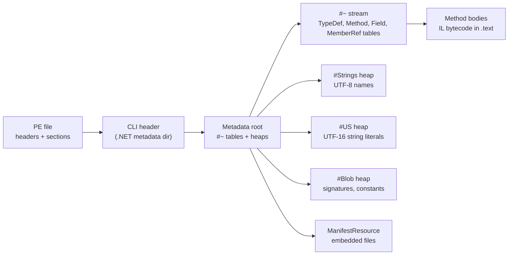

# .NET Reverse Engineering Deep Dive

> Tags: dotnet, csharp, ilspycmd, dnspyex, de4dot, confuserex, dotnet-reactor, mega-dumper, extreme-dumper, nativeaot, metadata, heaps | Difficulty: Intermediate | Prerequisites: `06-topics/managed-code-re.md` (overview and cross-language workflow), `03-decomp/verification-loop.md`, `07-advanced/ai-security-threats.md` (untrusted assemblies)

## Overview

A .NET assembly is a PE file with a managed payload. The PE headers describe the image. The CLI header points to metadata. Metadata holds every type, method, field, resource, and string the compiler emitted. Method bodies are IL bytecode, a stack machine that any decompiler reads cleanly.

This makes .NET the friendliest target in reverse engineering. You usually get near-source output. The work moves to three problems: deobfuscation, dumping protected assemblies, and knowing when there is no IL to read at all.

Three layers of tooling exist:

- **Read tools** turn metadata and IL into C#. ILSpy, ilspycmd, dnSpyEx, and dotPeek.
- **Rewrite tools** turn an obfuscated assembly into a cleaner one. de4dot and its forks.
- **Dump tools** extract assemblies from a live process. MegaDumper and ExtremeDumper.

A fourth case has no IL: NativeAOT binaries and single-file bundles that bypass managed loading. Those are native RE problems with .NET fingerprints.

## How It Works

### Assembly layout

A managed PE contains these parts:



Key facts for analysis:

- The `#Strings` heap holds identifiers: type names, method names, field names. UTF-8, null-terminated.
- The `#US` heap holds string literals used by `ldstr` instructions. UTF-16 with a compressed length prefix. This is where encrypted string lookups point.
- The `#~` stream holds the tables. `TypeDef`, `MethodDef`, `Field`, `Param`, `MemberRef`, `AssemblyRef`, `ManifestResource` are the ones you query first.
- `ManifestResource` entries can be embedded files. Deobfuscators encrypt them. dnlib can extract them.
- Every instruction that touches metadata uses a 4-byte token. The high byte is the table kind. `0x06` is MethodDef, `0x0A` is MemberRef, `0x70` is a user string in `#US`.
- `ilspycmd --dump-table <Name> --json` prints any metadata table as JSON. This is faster than reading hex.

Single-file .NET apps bundle every dependency into one apphost. ilspycmd exposes the embedded assemblies through `--bundle-entry`. Without it, the apphost is a thin native stub and the managed payload stays hidden.

### Read tools compared

| Tool | Interface | Scriptable | Deobfuscation | Debugging | License |
|---|---|---|---|---|---|
| ILSpy / ilspycmd | GUI + CLI | Yes, CLI | Limited | No | MIT (ILSpy), ilspycmd is part of the repo |
| dnSpyEx | GUI only | No | Community plugins | Yes, full debugger | GPLv3 |
| dotPeek | GUI only | No | No | Limited | Free, proprietary |
| dnlib | Library | Yes, code | Used by de4dot | No | MIT |

Choose by job:

- **ilspycmd** is the pipeline tool. It decompiles to a directory tree that an agent reads directly. Source: https://github.com/icsharpcode/ILSpy
- **dnSpyEx** is the interactive tool. Edit, debug, and inspect live processes. It works on Windows and under Wine. Source: https://github.com/dnSpyEx-Project/dnSpy
- **dotPeek** is a free second opinion. It is not scriptable. Source: https://www.jetbrains.com/decompiler/
- **dnlib** is the programmatic layer. de4dot, MegaDumper, and many unpackers are built on it. Source: https://github.com/0xd4d/dnlib

### de4dot and its forks

`de4dot/de4dot` is the canonical .NET deobfuscator. It is GPLv3, written in C#, and built on dnlib. The repository is archived. The last official builds cover a fixed list of obfuscators: Agile.NET, Babel.NET, CodeFort, CodeVeil, CodeWall, CryptoObfuscator, DeepSea, Dotfuscator, .NET Reactor, Eazfuscator.NET, ILProtector, MaxtoCode, MPRESS, SmartAssembly, Spices.Net, Xenocode, and others. Source: https://github.com/de4dot/de4dot

The original project is archived. For current work, use one of the maintained forks:

- `ViRb3/de4dot-cex` — full vanilla ConfuserEx support. Handles constants, resources, control flow, and proxy calls. It decrypts constants through method invocation, so it executes target code. Run it in a sandbox. The repository is archived but the code still works. Source: https://github.com/ViRb3/de4dot-cex
- `ViRb3/de4dot` — general de4dot updates. Check the repository for the current state before relying on it.

Other forks exist per obfuscator. Search GitHub for the protector name plus `de4dot` before writing your own unpacker.

What de4dot restores:

- Inline methods moved by the obfuscator.
- Encrypted strings, statically or by controlled execution.
- Encrypted constants and resources.
- Proxy methods that replaced direct calls.
- Control-flow deobfuscation for flattened methods.
- Symbol renaming to readable placeholders.
- Removal of anti-tamper and anti-debug code.
- Embedded files and encrypted resources.
- PE-to-.NET conversion when a native stub wraps the assembly.

What it cannot restore: original symbol names. Renaming produces `Class1`, `Method2`. The original identifiers are gone unless a PDB or symbol map survived.

### Dynamic deobfuscation and dumping

Some obfuscators decrypt methods in memory at runtime. Static tools see stubs. Dynamic tools dump the decrypted state.

- **MegaDumper** (`CodeCracker-Tools/MegaDumper`) is an ExtremeDumper-family dumper. It walks process memory and dumps managed assemblies. The repository description says "Dump native and .NET assemblies." It is Windows-oriented. Source: https://github.com/CodeCracker-Tools/MegaDumper
- **ExtremeDumper** (`wwh1004/ExtremeDumper`) is the canonical original. Single portable executable. Lists processes, highlights .NET ones, walks memory pages, dumps valid assemblies, hooks the assembly loader, and bypasses anti-dump. It can inject .NET assemblies into any process. Source: https://github.com/wwh1004/ExtremeDumper
- **Loader hook** in ExtremeDumper hooks `clr!AssemblyNative::LoadImage`. It saves raw byte arrays when assemblies load through `Assembly.Load(byte[])`. Rename the DLL to `version.dll` for DLL hijack mode.
- **dnSpyEx debugger** can also dump modules. Right-click a module in the debugger and use the memory windows. It saves decrypted byte arrays from variables windows.

The general pattern: run the target, let the protector decrypt, dump the assembly from memory, decompile the dump. This is slower than static de4dot but covers protectors that have no static unpacker.

### When .NET has no IL

Not every .NET-flavored binary carries IL:

- **NativeAOT** compiles C# to native code. There is no IL and no metadata tables. The binary looks like a stripped native PE with .NET runtime fingerprints (GC structures, exception tables). Use Ghidra or IDA. The report notes this as the boundary case where .NET RE becomes native RE.
- **ReadyToRun** is a hybrid. The assembly keeps IL and adds precompiled native code. Decompilers still work. The IL is authoritative for logic.
- **Single-file bundles** wrap assemblies in an apphost. Extract with ilspycmd `--bundle-entry` or a bundle extractor before decompiling.
- **Reflection.Emit and dynamic assemblies** generate IL at runtime. There is no on-disk IL to read. Trace with a debugger or instrument `System.Reflection.Emit` calls.
- **F# and VB.NET** produce IL with compiler-generated state machines and closures. The IL is real but the decompiled C# is ugly. Read the IL directly with `ilspycmd -il` when C# output confuses.

## Step-by-Step

### Decompile a clean assembly

1. Install ilspycmd.

   ```bash
   dotnet tool install -g ilspycmd
   ```

   ILSpy requires the .NET 11 SDK per the repository README. Source: https://github.com/icsharpcode/ILSpy

2. Decompile the whole project.

   ```bash
   ilspycmd -p -o out_dir/ --referencepath deps_dir/ target.dll
   ```

   `-p` writes one `.cs` file per type plus a project file. Feed that tree to the agent type-by-type.

3. Dump metadata when names look wrong.

   ```bash
   ilspycmd --dump-table TypeDef --json target.dll
   ilspycmd --dump-table Method --json target.dll
   ilspycmd --dump-table ManifestResource --json target.dll
   ```

4. Read raw IL for a member when C# output is ambiguous.

   ```bash
   ilspycmd -il -t Namespace.TypeName target.dll
   ilspycmd -m 06000123 target.dll   # by metadata token
   ```

### Deobfuscate with de4dot

1. Detect the obfuscator first.

   ```bash
   de4dot -d target.dll
   de4dot -d -r input_dir/ -ru
   ```

2. Deobfuscate all related assemblies together. References break if you rename only one file.

   ```bash
   de4dot -r input_dir/ -ru -ro output_dir/
   ```

3. For ConfuserEx, use de4dot-cex. It expects you to have unpacked the assembly first if methods are encrypted.

   ```bash
   # Windows binary, run under Wine on Linux
   wine de4dot-cex.exe target.dll -o cleaned.dll
   ```

   Check the repository README for current build targets. The project targets .NET 8-era runtimes per its build files.

4. If detection fails, force the obfuscator.

   ```bash
   de4dot target.dll -p un    # unknown/unsupported, preserves everything
   de4dot target.dll -p sa    # SmartAssembly
   ```

5. Preserve tokens when the obfuscator uses them.

   ```bash
   de4dot --preserve-tokens target.dll
   de4dot --keep-types --preserve-tokens target.dll
   ```

6. Decrypt strings dynamically when static recovery fails.

   ```bash
   de4dot target.dll --strtyp delegate --strtok 06012345 --strtok 060ABCDE
   ```

   This loads the assembly into memory. Run it in a sandbox.

### Dump a protected assembly

1. Run the target on Windows in a VM or analysis box. ExtremeDumper is Windows-only.
2. Open ExtremeDumper. Find the process. Right-click and dump all .NET modules.
3. If anti-dump is present, enable AntiAntiDump from the modules context menu.
4. If the assembly loads through `Assembly.Load(byte[])`, use the loader hook. Rename `ExtremeDumper.LoaderHook.dll` to `version.dll` next to the target.
5. Decompile the dumped files with ilspycmd.

### Extract resources and embedded files

```bash
# List resources
ilspycmd --dump-table ManifestResource --json target.dll

# dnlib-based extraction (C# script or dnSpyEx)
# In dnSpyEx: right-click assembly -> Resources -> save each entry
```

Many protectors encrypt `ManifestResource` entries. After de4dot runs, rerun resource extraction on the cleaned assembly.

## AI Assists

The model helps most where .NET metadata is rich but obfuscated.

### Rename via XML docs and metadata

If the target ships XML documentation files, ilspycmd uses them for comments. Feed the doc comments plus the decompiled type to the model. The doc text often names the original purpose even when identifiers are mangled.

For assemblies without docs, the model proposes names from evidence: string literals, called methods, field types, base classes. Output a JSON rename map. Apply it with dnlib or dnSpyEx. Verify by recompiling or diffing IL.

### Deobfuscation mapping

After de4dot or a manual unpack, feed the cleaned assembly to the model with this prompt shape:

```
Decompiled C# from a .NET assembly that was protected by <obfuscator>.
Original names were stripped and replaced with placeholders.
For each type below, propose a meaningful name and a one-line purpose.
Evidence: string literals, method calls, field accesses, base types.
Output JSON: {"types": [{"old": "...", "new": "...", "purpose": "..."}]}
```

Apply high-confidence renames automatically. Review low-confidence ones.

### Resource extraction

The model reads decompiled resource-access code and identifies what each embedded file is. A `ManifestResource` named `A.B.resources` that contains a PNG signature is a decoy or a payload. The model spots patterns like `Assembly.GetManifestResourceStream` calls and names the resource's role.

### IL-to-C# gap filling

When ilspycmd produces awkward C# for F# or VB.NET assemblies, the model reads `ilspycmd -il` output and explains the state machine or closure pattern in plain language. This is explanation, not decompilation. Mark it as inferred.

### What the model must not do

- Do not let the model execute de4dot or dumping tools without sandboxing. Both run target code.
- Do not trust LLM-proposed renames without verification. Recompile or diff IL.
- Do not feed the whole decompiled tree to one prompt. Chunk by type.
- Do not assume a dump is complete. Anti-dump protectors can corrupt metadata. Verify the dump loads in ilspycmd before analysis.

## Pitfalls

- **de4dot is archived.** The original `de4dot/de4dot` and `ViRb3/de4dot-cex` repositories are archived. They still work on their supported obfuscator list. Newer protectors need manual unpacking or newer forks.
- **ConfuserEx has many forks.** Vanilla ConfuserEx, ConfuserEx2, Confuser.Core forks, and private builds behave differently. de4dot-cex covers vanilla. Identify the exact fork before choosing a tool.
- **.NET Reactor and Eazfuscator update faster than de4dot.** Check the obfuscator version. Old de4dot builds fail on new string-encryption schemes.
- **Dynamic decryption executes code.** de4dot's `--strtok` mode and de4dot-cex's constant decryption call target methods. Malware in the assembly runs. Use a VM.
- **Single-file bundles hide assemblies.** Without `--bundle-entry`, ilspycmd sees only the apphost stub.
- **NativeAOT has no IL.** If `file` reports a native PE and ilspycmd fails with "not a .NET assembly," check for NativeAOT. Switch to Ghidra or IDA.
- **Reflection breaks naive renaming.** de4dot warns that XAML/WPF and reflection-heavy code break when symbols are renamed. Use `--dont-rename` or `--keep-names` if the cleaned assembly must still run.
- **PDB files leak names.** If a `.pdb` sits next to the assembly, ilspycmd uses it for variable names. In the wild, PDBs are usually absent.
- **dnSpyEx is Windows-first.** It runs under Wine but debugging under Wine is unreliable. Use Windows VMs for dynamic work.
- **MegaDumper and ExtremeDumper are Windows tools.** On Linux, run them in a Windows VM or use Wine with caution. They inject into processes, so containment matters.
- **#US heap strings are not plain text.** The heap stores length-prefixed UTF-16. `strings -e l` finds some of them. ilspycmd's decompiled output is more reliable.
- **Metadata tokens are per-assembly.** A token like `06012345` means nothing across assemblies. Always note which file it came from.

## See Also

- `06-topics/managed-code-re.md` — cross-language managed RE overview
- `06-topics/deobfuscation.md` — native and JS deobfuscation families
- `03-decomp/decompile-workflow.md` — general decompiler workflow
- `03-decomp/verification-loop.md` — verifying decompiler and LLM output
- `07-advanced/ai-security-threats.md` — prompt injection and untrusted binary handling
- `01-setup/malware-isolation.md` — sandboxing for dynamic deobfuscation
- `05-tools/tool-catalog.md` — tool inventory
