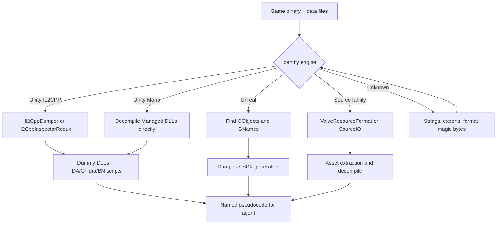
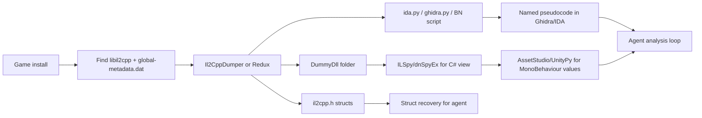

# Game Engine RE: Unity, Unreal, Custom

> Tags: game-engine, unity, il2cpp, unreal, source-engine, asset-formats, modding, anti-cheat | Difficulty: Intermediate | Prerequisites: general decompilation workflow (see `../03-decomp/decompile-workflow.md`), batch tooling (see `../03-decomp/batch-decompilation.md`)

## Overview

Game targets are different from normal RE targets. The logic lives in the engine runtime, not in the executable alone. The executable is a thin platform layer plus engine code. The game logic sits in data: managed assemblies, serialized objects, blueprints, or scripts.

Each engine family has a known metadata shape. Recovery tools exist for the big three. Most game RE work is metadata recovery first, then asset extraction, then targeted analysis of whatever is left.

The big families:

| Engine | Code layer | Data layer | First tools |
|---|---|---|---|
| Unity IL2CPP | `libil2cpp.so` or `GameAssembly.dll` compiled C++ | `global-metadata.dat` plus serialized assets | Il2CppDumper, Il2CppInspector(Redux), Cpp2IL |
| Unity Mono | `Managed/*.dll` (plain .NET) | Serialized assets | dnSpyEx, ILSpy, AssetStudio |
| Unreal Engine 4/5 | Native C++ plus Blueprint bytecode | `.pak`/`.ucas`/`.utoc` packages, `.uasset` objects | Dumper-7, UnrealPak, UModel |
| Source (GoldSrc, Source 1, Source 2) | Native C++, sometimes scripts | VPK, BSP, MDL, VRF formats | SourceIO, ValveResourceFormat, Crowbar |
| Custom (RE Engine, Frostbite, proprietary) | Varies | Varies | Per-game loaders, Kaitai templates, REFramework |

The rule: find the engine, run the engine's metadata recovery, then decompile or inspect the recovered structures. Only fall back to raw decompilation for code that metadata does not cover (engine internals, anti-cheat, custom codegen).



## Setup

Install the recovery tools you need. All of them are free and open source.

### Unity IL2CPP tools

Il2CppDumper is the classic tool. It takes the IL2CPP binary plus `global-metadata.dat` and produces dummy DLLs, IDA/Ghidra/Binary Ninja scripts, a `dump.cs` type listing, and an `il2cpp.h` struct header.

```bash
git clone https://github.com/Perfare/Il2CppDumper
cd Il2CppDumper
# Release builds are on the GitHub Releases page
# Windows binary: Il2CppDumper.exe
# Linux/macOS: dotnet build or use a prebuilt release

# Usage (CLI):
Il2CppDumper.exe <executable> <global-metadata.dat> <output-dir>
# Example for an Android game:
Il2CppDumper libil2cpp.so global-metadata.dat ./out
# Example for a Windows Steam game:
Il2CppDumper GameAssembly.dll global-metadata.dat ./out
```

Supported inputs per the README: ELF, ELF64, Mach-O, PE, NSO, and WASM. Unity versions 5.3 through 2022.2 are listed as supported. Source: https://github.com/Perfare/Il2CppDumper

Il2CppInspector (original, by djkaty) is suspended but historically important. It produces richer output: C# stubs, JSON address maps, C++ scaffolding for DLL injection, and plugins that defeat specific obfuscation (XOR-style metadata encryption used by miHoYo titles, Riot reordering, Wild Rift string encryption). Source: https://github.com/djkaty/Il2CppInspector

Il2CppInspectorRedux is the maintained continuation. It supports newer IL2CPP metadata versions (up to version 110, covering Unity 6000.7 alphas per its README) and outputs IDA, Ghidra, and Binary Ninja scripts. This is the default choice for current Unity versions. Source: https://github.com/LukeFZ/Il2CppInspectorRedux

```bash
dotnet tool install -g Il2CppInspector  # if published; otherwise build from source
Il2CppInspector -i libil2cpp.so -m global-metadata.dat -t Ghidra
```

Cpp2IL goes further than the dumpers. It attempts to recover actual IL bytecode from the compiled C++ back into .NET assemblies you can open in ILSpy or dnSpyEx. It is work in progress. Use `dll_il_recovery` as the output format to enable analysis. Expect messy but readable CIL. Source: https://github.com/SamboyCoding/Cpp2IL

```bash
# Download a CI or release build, then:
Cpp2IL --game-path "C:\Path\To\Game"
# or for an APK:
Cpp2IL --game-path path/to/game.apk
```

Zygisk-Il2CppDumper is the Android-on-device option. It runs inside the game process on a rooted phone and dumps `libil2cpp.so` plus metadata past most file-level protections. Source: https://github.com/Perfare/Zygisk-Il2CppDumper (verify current state before relying on it).

### Unreal Engine tools

Dumper-7 is the standard UE4/UE5 SDK generator. It is a DLL you inject into the running game. It finds `GObjects` and `GNames`, walks the object array, and emits a full C++ SDK (headers plus a Visual Studio project) under `C:\Dumper-7` by default.

```text
1. Compile Dumper-7 in x64-Release (Visual Studio, C++).
2. Inject Dumper-7.dll into the target game process.
3. SDK is generated to Settings::SDKGenerationPath (default C:\Dumper-7).
```

Configuration lives in `Dumper-7.ini` next to the game exe or in `C:\Dumper-7`. Key settings: `SleepTimeout` (delay before dump), `DumpKey` (hex virtual-key code that triggers the dump), `SDKGenerationPath`, `SDKNamespaceName`. Source: https://github.com/Encryqed/Dumper-7

If `GObjects` or `GNames` are not found automatically, you override offsets in `Generator::InitEngineCore()` inside `Generator.cpp`. The README documents the layout structs (`FFixedUObjectArrayLayout` for UE4.11–4.20, `FChunkedFixedUObjectArrayLayout` for UE4.21+). Object-array encryption can be handled with `InitObjectArrayDecryption`. This is where AI helps most: give the agent the crash dump or the decompiled `InitEngineCore` region and ask it to identify the correct offsets.

UnrealPak is the command-line tool for `.pak` files. It ships inside every UE install under `Engine\Binaries\Win64`. Use `-Extract` to unpack, or list contents first.

UModel (UE Viewer) by gildor extracts models, textures, animations, and meshes from UE games without full SDK recovery. It is the fast path for asset RE when you do not need code.

### Source engine tools

The Source family splits into three generations:

- **GoldSrc** (Half-Life 1, early mods): BSP, MDL, WAD formats. Tools: BSP Viewer, Crowbar (asset decompiler), hl tools.
- **Source 1** (Half-Life 2, TF2, CS:S, L4D): VPK archives, BSP v19–v21, MDL. Tools: `vpk` CLI, `bspzip`, `Crowbar` for models and maps, `SourceIO` libraries.
- **Source 2** (Half-Life Alyx, Deadlock, CS2, Dota 2 Underlords lineage): new binary formats. ValveResourceFormat (VRF) is the reference tool.

ValveResourceFormat parses VPK, BSP, VMAT, VTS, and related Source 2 formats and exports to open formats. It ships a GUI (Source 2 Viewer), a CLI decompiler, and a NuGet library. Source: https://github.com/ValveResourceFormat/ValveResourceFormat

SourceIO is the C# library family (`ValveKeyValue`, `ValvePak`, `ValveBsp`, `ValveFormats`) used by many tools. The canonical repo moved under SteamDatabase; check https://github.com/SteamDatabase for the current location before depending on a URL.

Crowbar is the asset decompiler for Source games. It converts compiled MDL/MDL2, VTF, and VMF-adjacent formats back into editable forms for Blender, Maya, and Hammer.

### Custom engine triage

When the engine is not one of the big three, identify it first:

1. Check strings for engine names (`RE Engine`, `Frostbite`, `Anvil`, `Decima`, `REDengine`, `Gamebryo`, `id Tech`).
2. Check imports and exports. Frostbite binaries reference EA-internal symbols. RE Engine games ship a consistent DLL set.
3. Check file magic bytes. Many engines use custom archive formats with a recognizable header.
4. Check community wikis. Nearly every shipped engine has a datamining community with documented formats.

Per-engine starting points:

- **RE Engine** (Resident Evil 2/3/4/7/8, Monster Hunter, Devil May Cry 5): REFramework is the mod loader and scripting platform. It exposes a Lua API for object manipulation. Source: https://github.com/praydog/REFramework
- **Frostbite** (Battlefield, FIFA, Star Wars Battlefront): community tools under the FrostyToolsuite umbrella (verify current maintenance status; the original repos have moved several times).
- **id Tech** (Doom, Quake, Rage): open-source history helps. id released Doom and Quake source under GPL. Rage-era binaries still need format RE.
- **Anvil/Decima/REDengine**: per-game; look for existing datamining repos before writing parsers.

## Step-by-Step

### Unity IL2CPP: full pipeline



1. Locate the two inputs. For Windows games: `GameAssembly.dll` plus `global-metadata.dat` under `*_Data/il2cpp_data/Metadata/`. For Android: `libil2cpp.so` inside the APK plus `assets/bin/Data/Managed/Metadata/global-metadata.dat`. Extract the APK with `apktool d` or `unzip`.
2. Run Il2CppDumper or Il2CppInspectorRedux.

   ```bash
   Il2CppDumper.exe GameAssembly.dll global-metadata.dat ./dump
   ```

   Outputs you care about: `DummyDll/*.dll`, `dump.cs`, `il2cpp.h`, `script.json`, `ghidra.py` or `ida_with_struct.py`.

3. Load the binary in Ghidra or IDA. For Ghidra: File > Parse C Source, import `il2cpp.h` with `-D_GHIDRA_` defined, then run the generated script. For IDA: Alt+F7, run `ida_with_struct.py`. Expect long analysis; the scripts create thousands of symbols.
4. Open the dummy DLLs in ILSpy or dnSpyEx for a readable C# view of every class, method signature, and field offset. This is the map the agent reads.
5. For asset values: point AssetStudio (or AssetStudioMod) at the game's data folder and give it the DummyDll folder as the assembly path. MonoBehaviour fields then deserialize correctly.
6. Feed the agent the `dump.cs` plus targeted `il2cpp.h` structs, not the whole binary.

Verify the Unity version when metadata parsing fails. Il2CppInspector accepts `--unity-version` or `--unity-version-from-asset`. Wrong version guesses produce plausible-looking but wrong offsets.

### Unreal Engine: SDK generation

1. Confirm the game is UE4 or UE5. Check the exe strings or the `.pak` layout.
2. Build Dumper-7 (x64-Release), inject the DLL, wait for `C:\Dumper-7` to fill with `SDK/` headers.
3. Open the generated `.sln` in Visual Studio. Compile the test script if needed.
4. Extract game data with UnrealPak or UModel for assets.
5. For Blueprint logic: the SDK gives you `UFunction` addresses and `ProcessEvent`. Blueprint bytecode lives in `.uasset` files and is a separate problem — see the uasset/UBT literature or community tools.

If Dumper-7 fails to find `GObjects`, the offsets changed. Use a tool like UnknownCheats' UE offset scanners or the Dumper-7 community Discord for the current game. Then patch `Generator.cpp`. AI can help: paste the decompiled `UGameEngine::Init` or the candidate `FUObjectArray` walk and ask the agent to identify the chunk size and encryption routine.

### Source engine: asset path

1. Find the VPK. Source 2 games ship `pak01_dir.vpk` plus numbered archives.
2. List contents: `vpk` CLI or VRF GUI.
3. Extract the files you need. For models: VRF exports to SMD/DMX/glTF. Crowbar converts to Blender-friendly formats.
4. For maps: VRF decompiles BSP to a readable structure; Hammer-format reconstruction is partial.
5. For logic: Source engine gameplay code is native. No metadata shortcut exists. Decompile `server.dll` or `client.dll` with Ghidra/IDA. The `SourceSDK` layout (entity classes, network tables) is community-documented and gives the agent a struct map.

### Custom engine: triage first

1. Run `file`, `strings`, `checksec` on the binary.
2. Identify engine via strings/imports/magic bytes.
3. Search for an existing community tool or datamining repo for that engine.
4. If none exists, write a Kaitai `.ksy` spec for the container format first. The Kaitai format gives you a parser and documentation in one file, and LLMs generate `.ksy` well. See `../06-topics/protocol-reverse.md` for the format-RE workflow.
5. Decompile the code layer only after the data layer is understood. Engine internals rarely matter for gameplay RE.

## AI Assists

The highest-value AI tasks in game RE are metadata mapping and struct recovery. Both are bounded problems with ground truth you can check.

### Metadata-to-symbol mapping

When Il2CppDumper or Dumper-7 produces a rename map, the agent's job is to apply it correctly and catch mismatches.

Prompt pattern:

```
I have a Ghidra project for GameAssembly.dll with IL2CPP metadata applied.
A method at 0x<addr> is named PlayerController::TakeDamage but the pseudocode
looks like it handles UI refresh. Possible causes: generic-method index mismatch,
wrong Unity version guess, or stale metadata. Here is the dump.cs entry and the
pseudocode. Diagnose which cause is most likely and what to check next.
```

The agent should compare the function signature in `dump.cs` against the decompiled argument count and types. Mismatches usually mean the IL2CPP version parser was wrong.

For Unreal, the equivalent task is mapping `UFunction`/`UProperty` names to `ProcessEvent` dispatch offsets. Dumper-7 output already gives you the SDK; the agent helps when the SDK generation crashed midway and you have a partial `GObjects` dump.

### Struct recovery from RTTI and vtables

When no dumper exists, you recover structs from the binary itself:

1. Find the vtable (RTTI in MSVC, `typeinfo` in Itanium ABI).
2. Identify virtual functions by their call sites.
3. Infer member offsets from field accesses in decompiled methods.

AI accelerates step 3. Feed the agent one class's vtable plus its most-accessed methods and ask for a `struct` proposal. Verify by recompiling a Frida script that reads the proposed offsets and checking values at runtime.

```python
# Frida probe: verify a recovered struct offset
import frida

session = frida.attach("game.exe")
script = session.create_script(r"""
Interceptor.attach(Module.getExportByName(null, "UpdatePlayer"), {
  onEnter(args) {
    // Guess: this pointer in rcx, health at offset 0x1C0
    const health = this.context.rcx.add(0x1C0).readFloat();
    console.log("health:", health);
  }
});
""")
script.load()
```

If the read value is a sane float that changes when you take damage, the offset is right. If it is garbage or a pointer, the struct layout is wrong.

### Asset format RE with AI

For custom formats, the agent is good at generating Kaitai specs or 010 Editor templates from sample files. Workflow:

1. Collect 5–10 sample files of the format.
2. Hex-dump the headers and look for magic bytes, length fields, and version fields.
3. Ask the agent to propose a `.ksy` spec. Include the hexdumps and any strings you found.
4. Validate the spec by parsing the samples and checking that fields land on plausible boundaries.
5. Iterate: fix endianness, alignment, or section order until all samples parse.

This is the same loop as protocol RE. See `../06-topics/protocol-reverse.md`.

### What to feed the agent

| Task | Feed | Do not feed |
|---|---|---|
| IL2CPP naming | `dump.cs` + `il2cpp.h` + one function | Whole `GameAssembly.dll` |
| UE offset recovery | `Generator.cpp` + crash dump + UE version | Whole SDK folder |
| Source entity mapping | `SourceSDK` headers + one `server.dll` function | All game DLLs at once |
| Custom format spec | Hexdumps + strings + one sample file | The whole archive |

The pattern from `../02-collab/context-engineering.md` applies: chunk the evidence, give the agent a map, let it work function-at-a-time.

### Prompt-injection caution

Game binaries and assets are hostile input. Strings inside them can carry injection payloads. Never let the agent write comments or names back into the binary or your analysis database without a human review step. See `../07-advanced/ai-security-threats.md`.

## Pitfalls

- **Il2CppDumper version drift.** The tool supports Unity 5.3 through 2022.2 per its README. Newer Unity versions (2023+, Unity 6) use newer IL2CPP metadata versions that Il2CppDumper does not handle. Use Il2CppInspectorRedux, which lists support up to metadata version 110.
- **Il2CppInspector is suspended.** The original project by djkaty is unmaintained. Redux is the successor. Do not build new workflows on the original.
- **Cpp2IL output is not clean C#.** It recovers IL structure but produces messy CIL that ILSpy renders poorly. Use it for structure recovery, not for reading game logic. Dummy DLLs from Il2CppDumper give cleaner signatures.
- **Dummy DLLs have no method bodies.** They contain metadata only. You cannot decompile game logic from them. Use them for names, signatures, and field offsets; use the native binary for logic.
- **Dumper-7 is a DLL injection.** It requires a writable process and will trip some anti-cheats. Single-player and offline games are fine. Online games with kernel anti-cheat will flag or crash. Do not inject into protected processes.
- **UE offset overrides are version-specific.** `GObjects` layout changes between UE4 minor versions and UE5. Dumper-7 auto-detects most cases. When it fails, you need the correct layout for that engine version, not a guess.
- **Source 2 formats are undocumented.** ValveResourceFormat is community RE. New games may ship formats VRF does not yet support. Check the VRF issue tracker for the specific game before writing your own parser.
- **Custom engines have no shortcuts.** If the engine is not Unity, Unreal, or Source, expect to write format parsers and find struct layouts yourself. AI helps with spec generation and struct inference, but the ground truth still comes from runtime observation.
- **AssetStudio/UnityPy need the right Unity version.** Serialized files embed a version number. If the tool does not recognize it, you get null fields or crashes. UnityPy has `FALLBACK_UNITY_VERSION`; AssetStudio has a version override in settings.
- **IL2CPP metadata can be encrypted.** Some games (miHoYo titles, certain mobile games) encrypt `global-metadata.dat`. Il2CppInspector has plugins for known schemes. Unknown schemes need manual decryption. Zygisk-Il2CppDumper bypasses file-level protection on rooted Android.
- **Modding vs cheating is not a technical distinction.** Both inject code into the game process. The difference is intent and anti-cheat policy. See the next section.

## Modding vs Cheating

The line is legal and ethical, not technical. Both activities use the same tools: DLL injection, Frida hooks, memory reads, SDK generation.

| Activity | Typical tools | Risk |
|---|---|---|
| Modding (single-player, offline) | BepInEx, MelonLoader, REFramework, UE4SS, VRF asset edits | Low. No anti-cheat in single-player. |
| Modding (multiplayer, permitted) | Same, plus official mod APIs where they exist | Medium. Server-side checks may reject modified clients. |
| Cheating (multiplayer) | Memory writes, aimbot/ESP overlays, packet manipulation | High. Anti-cheat bans, legal exposure. |
| Cheat development (research) | Same tools, isolated environment | Varies. Some jurisdictions treat cheat dev as CFAA-adjacent. |

BepInEx is the standard .NET mod loader. It works with Mono Unity games directly. For IL2CPP games, Il2CppInterop (part of BepInEx) generates interop assemblies from the dummy DLLs so plugins can call game code in C#. MelonLoader is an alternative loader with its own mod API.

UE4SS is the Unreal Engine 4/5 scripting platform. It injects a DLL, exposes UObject/UFunction APIs to Lua or C#, and is the standard for UE modding. It is also the same mechanism used for UE cheats, which is why anti-cheat vendors specifically detect it.

REFramework is the RE Engine mod loader. Lua scripting, object explorer, VR support. Used for both mods and cheats depending on the game.

Anti-cheat systems (Easy Anti-Cheat, BattlEye, Vanguard, FACEIT) run at kernel level in 2026. They detect DLL injection, memory scanning, and known cheat signatures. Kernel-level cheats exist but are a separate legal and technical problem. This wiki covers the analysis side, not cheat development for online games.

For offline or single-player targets, modding is a legitimate way to verify your RE work. If you recovered a health offset correctly, a mod that prints health proves it. If you parsed a texture format correctly, a mod that swaps textures proves it. Use the mod as the verification oracle.

## See Also

- `../03-decomp/decompile-workflow.md` — general decompilation workflow
- `../03-decomp/batch-decompilation.md` — bulk decompilation and naming pipelines
- `../03-decomp/verification-loop.md` — verifying struct recovery and decompiler output
- `../04-recomp/matching-decomp.md` — matching decompilation for console games
- `../04-recomp/swmh-auto-recomp.md` — static recompilation frameworks
- `../06-topics/protocol-reverse.md` — format RE and Kaitai spec workflow
- `../06-topics/managed-code-re.md` — .NET/Java/Go/Rust metadata recovery (applies to Unity Mono games)
- `../06-topics/mobile-android-re.md` — APK analysis for Android Unity/Unreal games
- `../07-advanced/anti-analysis.md` — anti-cheat and anti-tamper bypasses
- `../07-advanced/ai-security-threats.md` — prompt injection from game assets and binaries
- `../05-tools/tool-catalog.md` — decompiler and debugger catalog
