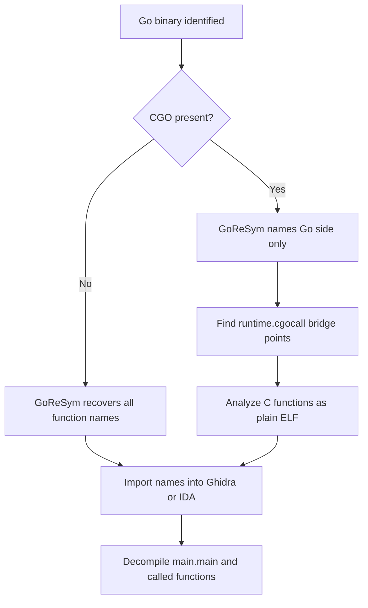

# Go and Rust Binary Reverse Engineering

> Tags: go, golang, rust, pclntab, goresym, mangled-names, cgo, allocator | Difficulty: Advanced | Prerequisites: ELF anatomy ([binary-formats.md](../00-fundamentals/binary-formats.md)), Ghidra or IDA, Linux sandbox ([linux-sandbox-base.md](../01-setup/linux-sandbox-base.md))

## Overview

Go and Rust both compile to native ELF. Both strip poorly.

A stripped Go binary still carries the Go runtime. The runtime needs `pclntab` (the program counter line table) for panics and stack traces. It also carries `moduledata` with type descriptors, interface tables, and file paths. Symbol names, function boundaries, and source paths are recoverable from these tables. No symbol table is needed.

A Rust binary keeps less metadata but still leaks structure. Panic messages embed source file paths and line numbers. Symbol names mangle cleanly to crate, module, and function names. Allocator symbols reveal which allocator was linked. Generic functions monomorphize into many near-identical copies.

The hard part is not identification. It is volume. A Go binary contains the full standard library. A Rust binary contains every generic instantiation. Tens of thousands of functions are normal. The analyst job is to find the boundary between your code and the runtime, then stay inside it.

This page is the deep dive. The short version lives in [managed-code-re.md](managed-code-re.md) and [linux-elf-re.md](linux-elf-re.md).

## Setup

Install the metadata recovery tools before you open the target.

### Go tools

```bash
# GoReSym: recovers functions, types, packages, file paths from Go binaries.
go install github.com/mandiant/GoReSym/cmd/goresym@latest

# Alternative: redress, maintained by the GoRe project.
go install github.com/goretk/redress/cmd/redress@latest

# CFG-similarity recovery for deliberately obfuscated Go binaries.
git clone https://github.com/volexity/GoResolver
cd GoResolver && go build -o GoResolver ./cmd/goresolver
```

GoReSym is maintained by Mandiant. Source: https://github.com/mandiant/GoReSym. `redress` is maintained under the goretk project. Source: https://github.com/goretk/redress. Both work on stripped binaries. Both fail on packed or heavily modified Go binaries. Run them before you conclude anything.

GoReSym bundles importer scripts in its repository:

- `IDAPython/goresym_rename.py` for IDA Pro and IDA Free.
- `GhidraPython/goresym_rename.py` for Ghidra.
- `BinjaPython/goresym_rename.py` for Binary Ninja.

Community scripts cover radare2 and Rizin. Examples: `HanEmile/radare2-GoReSym` and `doomedraven/rz-goresym`.

### Rust tools

```bash
# rustfilt: CLI demangler wrapping rustc-demangle.
cargo install rustfilt

# Test demangling on any symbol string.
echo '_ZN3std2rt10lang_start17h0123456789abcdefE' | rustfilt
```

`rust-lang/rustc-demangle` is the upstream library. Source: https://github.com/rust-lang/rustc-demangle. Ghidra has built-in Rust demangling since version 11. It handles both the legacy mangling scheme and the v0 scheme. The old GhidRust plugin is obsolete. Do not install it.

For Python pipelines, `teambi0s/rust_demangler` and `saber0x0/Rust-Demangler-py` expose demangling to scripts. Both are community projects. Verify maintenance before depending on them.

### Decompilers

Load the binary in Ghidra 12.2, IDA 9.5, or Binary Ninja 6.0. All three handle Go and Rust ELF binaries. Ghidra's decompiler produces pseudo-C for both. GoReSym names make Go pseudo-C readable. Rust names make Rust pseudo-C navigable. Neither tool produces Go or Rust source.

## Go: How the Metadata Works

### The pclntab table

Go binaries carry `pclntab`, the program counter line table. The runtime uses it to map instruction addresses to function names, source file names, and line numbers during panics. Stripping removes `.symtab`. It does not remove `pclntab`. The table is required for the binary to run.

`moduledata` sits next to it. It links the function table, type descriptors, interface tables (`itab`), and package data. This is why GoReSym can recover:

- Every function name and address.
- Every source file path and line.
- Type names and struct field names.
- Package and module paths.
- Interface-to-implementation mappings.

### Identifying a Go binary

```bash
file target
strings -a target | grep -m1 'Go build ID'
strings -a target | grep -m1E 'go1\.[0-9]+'
readelf -p .go.buildinfo target 2>/dev/null
```

Markers:

- `Go build ID:` followed by a hex string.
- Strings matching `go1.NN` where NN is the Go version.
- Function name strings like `main.main`, `net/http.(*Server).Serve`.
- A `.gopclntab` section on some builds, or the table embedded in `.text`/`.rodata` on others.

### CGO boundary

Pure Go binaries have a single runtime. CGO binaries link C code. The binary contains both Go runtime functions and C library functions. The C side uses normal symbols or no symbols at all.

Identify CGO:

```bash
strings -a target | grep -m1 'runtime/cgo'
go build info  # if you have the source
```

The practical difference:

- Pure Go: GoReSym recovers nearly everything. Function boundaries come from `pclntab`.
- CGO: the C functions sit outside `pclntab`. GoReSym names the Go side. The C side needs normal ELF analysis. The CGO call sites are the bridge. Find them by tracing calls into `runtime.cgocall`.



### Recovery workflow

```bash
# Recover everything: types, packages, paths, JSON output.
./goresym -t -d -p -j target > goresym.json

# Check what it found.
jq '.UserFunctions | length' goresym.json
jq '.BuildInfo' goresym.json
```

Flag meanings, from the GoReSym README:

- `-t` type names.
- `-d` standard and user package names.
- `-p` file paths.
- `-j` JSON output.

The JSON contains build info: Go version, module path, dependencies, architecture, build ID. Record the Go version. Runtime structure offsets depend on it.

Apply names to the analysis tool. Run the bundled importer inside Ghidra, IDA, or Binary Ninja. For radare2, use `HanEmile/radare2-GoReSym`.

### Deliberately obfuscated Go

Some Go binaries are post-processed to corrupt `pclntab`. `garble` mangles names at build time. `UPX` and custom packers compress or encrypt the binary.

Detection order:

1. Run GoReSym. If it recovers names, you are done.
2. If GoReSym returns partial or empty output, check entropy. High entropy suggests packing.
3. If packing is present, unpack first. See [unpacking-dumping.md](../04-dynamic/unpacking-dumping.md).
4. If the binary is unpacked but names are still gone, use GoResolver. It matches function control-flow graphs against known Go runtime functions. Source: https://github.com/volexity/GoResolver.
5. Feed GoResolver output to the model as rename candidates. Treat them as proposals, not ground truth.

GoResolver was last pushed in January 2026. It is active but not heavily maintained. Verify it handles your Go version before relying on it.

### Go strings

Go strings are length-prefixed byte sequences, not null-terminated. Standard `strings` still finds them because Go stores them contiguously. File paths, error messages, and format strings reveal package structure.

```bash
strings -a target | grep -E '\.go$' | sort -u | head -50
strings -a target | grep -E 'main\.|pkg/' | head -50
```

Source file paths in the binary look like `github.com/user/project/pkg/sub/file.go:123`. They reveal module structure directly.

### Type recovery

GoReSym's `-t` flag recovers type names. The type descriptors contain struct field names and offsets. This is the single most valuable output for struct inference. Feed the type JSON to the model alongside decompiled field accesses.

Interface tables (`itab`) link interface types to concrete implementations. GoReSym exposes them. Use them to answer "which concrete type satisfies this interface?" questions.

## Rust: How the Metadata Works

### Mangled names

Rust uses two mangling schemes:

- **Legacy** (pre-1.??): symbols look like `_ZN3std2rt10lang_start17h...E`. Length-prefixed path segments.
- **v0** (current default): symbols start with `_R`. More compact. Handles generics and lifetimes better.

Both demangle to readable paths: `std::rt::lang_start`, `mycrate::net::parse_packet`, `alloc::vec::Vec<T>::push`.

```bash
# Legacy scheme via rustfilt.
echo '_ZN3std2rt10lang_start17h0123456789abcdefE' | rustfilt

# v0 scheme via rustfilt (rustc-demangle handles both).
echo '_RNvC7mycrate3net12parse_packet' | rustfilt
```

Ghidra demangles both schemes automatically. IDA 9.5 also demangles Rust symbols. Binary Ninja has a Rust demangling plugin or uses `rustfilt` externally.

### Panic strings as anchors

Rust panics embed source file paths and line numbers in the binary. Strings look like:

```
src/main.rs:42
library/std/src/net/tcp.rs:312
called `Option::unwrap()` on a `None` value
index out of bounds: the len is 5 but the index is 10
```

These strings are gold for analysis:

- `src/main.rs:42` tells you the crate layout and where panics can fire.
- `Option::unwrap()` on `None` tells you the code assumed a value existed.
- File paths reveal module structure even when symbols are stripped.

Extract them:

```bash
strings -a target | grep -E '\.rs:[0-9]+' | sort -u
strings -a target | grep -E 'unwrap|expect|panic|index out of bounds' | head -30
```

Map panic strings to functions by finding which function references the string address. In Ghidra, search for the string address in xrefs. In radare2, `axt @ <string_addr>`.

### Allocator identification

Rust binaries link one of several allocators:

- **System malloc** (default on many platforms).
- **jemalloc** (older Rust default, still common).
- **mimalloc** (Microsoft's allocator, used by some crates).
- **Custom allocators** via `#[global_allocator]`.

Identify the allocator by symbols and strings:

```bash
strings -a target | grep -iE 'jemalloc|mimalloc|malloc' | head -20
nm -D target 2>/dev/null | grep -iE 'malloc|free|alloc' | head -20
```

Common symbols:

- `__rust_alloc`, `__rust_dealloc`, `__rust_realloc`, `__rust_alloc_zeroed` — the Rust allocator API.
- `malloc`, `free`, `calloc`, `realloc` — C allocator (system or jemalloc).
- `je_malloc`, `mi_malloc` — jemalloc or mimalloc prefixes.

Knowing the allocator matters for heap analysis and for understanding memory corruption bugs. It also tells you whether the binary uses the Rust global allocator or a custom one.

### Rust workflow

1. Load in Ghidra 12.2 or IDA 9.5. Confirm demangling works. Function names should show `crate::module::function` not `_ZN...`.
2. Extract panic strings. Map them to functions via string xrefs.
3. Identify the allocator. This tells you heap layout.
4. Find `main`. Rust binaries use `std::rt::lang_start` as the real entry. `main` is a closure passed to it. Search for `main` in demangled names.
5. Decompile. Expect pseudo-C with heavy inlining, monomorphized generics, and panic paths.
6. Feed functions to the model with demangled name, panic strings referenced, and callers. Ask for a Rust-level explanation.

### Rust generics and monomorphization

Generic functions like `Vec<T>::push` compile to a separate function for every type `T` used. A binary with `Vec<u8>`, `Vec<String>`, and `Vec<MyStruct>` has three `push` functions. They look identical in pseudo-C except for type-specific operations.

The model may merge them incorrectly. Keep function boundaries strict. Treat each monomorphized copy as a separate function. The demangled name includes the type parameter, which helps distinguish them.

## Step-by-Step: Full Workflow

### Identify the language

```bash
file target
strings -a target | grep -m1 'Go build ID' && echo "GO"
strings -a target | grep -m1E 'go1\.' && echo "GO"
strings -a target | grep -m1E '\.rs:[0-9]+' && echo "RUST"
strings -a target | grep -m1E '_ZN|_R[NC]' && echo "RUST (mangled symbols)"
```

If none match, it is probably C/C++. Go and Rust leave clear fingerprints.

### Go path

```bash
# 1. Recover metadata.
./goresym -t -d -p -j target > goresym.json

# 2. Check build info.
jq '.BuildInfo' goresym.json

# 3. Load JSON into analysis tool.
# Ghidra: run GhidraPython/goresym_rename.py
# IDA: run IDAPython/goresym_rename.py
# Binary Ninja: run BinjaPython/goresym_rename.py

# 4. Find main.
# In Ghidra: search for "main.main" in the symbol tree.
# In IDA: search for "main.main" in the names window.
# In radare2: afl | grep main.main

# 5. Decompile main.main and its callees.
# Feed to model with function names and type info.
```

### Rust path

```bash
# 1. Load in Ghidra or IDA. Demangling is automatic.

# 2. Extract panic strings.
strings -a target | grep -E '\.rs:[0-9]+' | sort -u > panic_strings.txt

# 3. Identify allocator.
strings -a target | grep -iE 'jemalloc|mimalloc|malloc' | head -20

# 4. Find main.
# Search for "main" in demangled names.
# Rust main is inside std::rt::lang_start closure.

# 5. Decompile and feed to model.
# Include demangled name, panic strings, callers.
```

### Verification

After naming functions and decompiling:

- Cross-check GoReSym names against actual function boundaries. `pclntab` gives addresses. The analysis tool's function list should match.
- For Rust, verify demangled names against panic strings. If `src/main.rs:42` panics in function `mycrate::foo`, the function at that address should be `mycrate::foo` or a function it calls.
- For both, spot-check struct field offsets against type descriptors (Go) or panic messages (Rust).

## Pitfalls

- **Treating Go binaries like C.** Go has no `main()` in the C sense. `main.main` is a Go function called by `runtime.main`. The real entry point is `runtime.rt0_go` or similar. Do not look for `__libc_start_main`.
- **Ignoring CGO.** A Go binary with CGO has two worlds. GoReSym names the Go side. The C side needs separate analysis. Find `runtime.cgocall` to locate the bridge.
- **Expecting GoReSym to work on packed binaries.** UPX, garble, and custom packers break it. Unpack first.
- **Merging Rust generic copies.** `Vec<u8>::push` and `Vec<String>::push` are different functions. Do not merge them.
- **Trusting panic strings blindly.** Panic strings reveal file paths but not logic. They tell you where panics can fire, not what the function does.
- **Forgetting allocator context.** Rust heap layout depends on the allocator. Heap overflow analysis without allocator knowledge is guesswork.
- **Feeding the entire binary to the model.** Go binaries contain the full standard library. Rust binaries contain every generic instantiation. Chunk by package or crate. See [context-engineering.md](../02-collab/context-engineering.md).
- **Letting the model write comments during untrusted analysis.** Strings in binaries can carry prompt-injection payloads. See [ai-security-threats.md](../07-advanced/ai-security-threats.md).

## AI Assists

### Go: symbol recovery prompts

When GoReSym recovers partial data or fails:

```
Function at 0x401230 in a Go binary (stripped).
GoReSym recovered: package "main", file "main.go"
Strings referenced: "usage: %s <file>", "error: %v"
Calls: fmt.Printf, os.ReadFile, bytes.Contains

Propose a function name and a one-line description.
Output: name, confidence (0-1), reasoning.
```

For bulk renaming, generate a rename map and apply it through the analysis tool's API.

### Go: struct inference from field offsets

GoReSym's type JSON gives struct field names and offsets. Feed it to the model:

```
Go struct type recovered by GoReSym:
Type: main.Config
offset 0: ServerAddr string
offset 16: Port int
offset 24: Timeout time.Duration
offset 32: TLS bool

Decompiled function accesses:
- *(param_1 + 0x10) compared to 0x1f90  # Port == 8080?
- *(param_1 + 0x18) used in time.Sleep  # Timeout

Explain what this function does.
```

### Rust: symbol recovery prompts

When demangling leaves gaps (stripped v0 symbols, or symbols lost to LTO):

```
Function at 0x402000 in a Rust binary.
Demangled name: mycrate::net::handle_packet (partial)
Panic strings referenced: "src/net.rs:87", "invalid packet length"
Calls: std::io::Read::read, mycrate::parse::decode

Propose a complete function name and description.
Output: name, confidence (0-1), reasoning.
```

### Rust: allocator-aware analysis

```
Rust binary uses jemalloc (identified by je_malloc symbols).
Function mycrate::net::process allocates 0x1000 bytes via Vec<u8>.
Decompiled code shows manual offset arithmetic on the buffer.

Is this likely a heap overflow? What allocator metadata should I check?
```

### What the model should not do

- Do not let the model write comments into your analysis database during untrusted-binary sessions.
- Do not trust LLM-proposed struct layouts without verifying against type descriptors or panic strings.
- Do not feed the entire decompiled tree to a single prompt. Chunk by package (Go) or crate (Rust).
- Do not assume the model knows Go or Rust runtime internals. Provide context: Go version, allocator type, panic strings.

## Size and Complexity Reality Check

Go and Rust binaries are large. A "hello world" Go binary is 2 MB. A real Go service is 20-50 MB. Rust binaries with dependencies are similar. The function count is in the thousands to tens of thousands.

This changes the workflow:

- **Bulk analysis is mandatory.** You cannot manually review every function. Use GoReSym or demangling to name everything first, then focus on `main` and its call tree.
- **Context windows are not enough.** Even 1M-token contexts cannot hold a full Go binary's decompilation. Chunk by package. See [context-engineering.md](../02-collab/context-engineering.md).
- **The model is good at naming, bad at volume.** Use it for rename proposals and logic explanation. Do not expect it to analyze 10,000 functions in one session.
- **Verification is harder.** More functions means more chances for the model to hallucinate. Keep the verification loop strict. See [verification-loop.md](../03-decomp/verification-loop.md).

## See Also

- [Managed and JIT Languages: .NET, Java, Go, Rust](managed-code-re.md) — .NET, Java, Go, Rust overview
- [Linux ELF and Shared Library RE](linux-elf-re.md) — ELF anatomy, stripped Go/Rust, glibc internals
- [Decompile Piece by Piece](../03-decomp/decompile-workflow.md) — the human+AI decompilation loop
- [Verification Loop](../03-decomp/verification-loop.md) — verifying decompiler and LLM output
- [Context Engineering](../02-collab/context-engineering.md) — chunking decompilation for LLMs
- [Unpacking and Dumping](../04-dynamic/unpacking-dumping.md) — unpacking packed Go binaries
- [AI Security Threats](../07-advanced/ai-security-threats.md) — prompt injection from binaries
