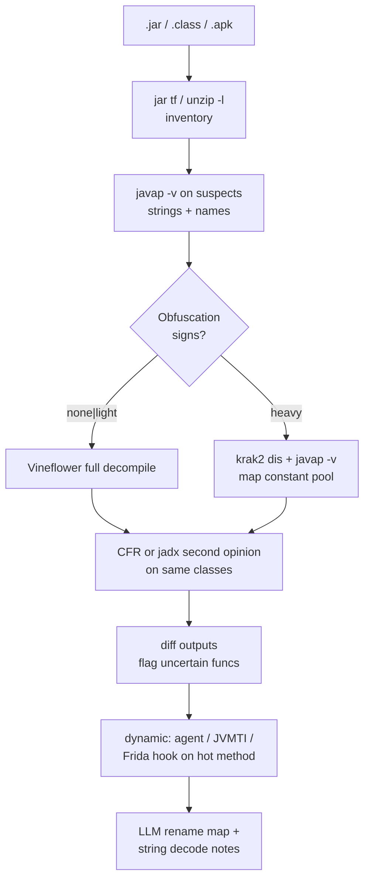

# Java and JVM Reverse Engineering

> Tags: java, jvm, bytecode, class-file, decompiler, proguard, obfuscation, jvmti, java-agent, frida | Difficulty: Intermediate | Prerequisites: `../00-fundamentals/reading-pseudocode.md`, `../06-topics/managed-code-re.md` (language survey), `../04-dynamic/frida-deep-dive.md` (Frida Java bridge API detail)

## Overview

JVM artifacts are the most legible compiled format in reverse engineering. A `.class` file keeps names, signatures, constant strings, and debug attributes. Decompilers return near-source Java. Obfuscators then strip names, encrypt strings, and flatten control flow.

This page covers the workflow end to end:

1. Inspect the raw class file anatomy.
2. Read bytecode with `javap` and Krakatau.
3. Pick and run a decompiler.
4. Identify obfuscation layers.
5. Attach dynamically with Java agents, JVMTI, or Frida.
6. Use the LLM for rename maps, string decryption, and cleanup.

The companion page `../06-topics/managed-code-re.md` surveys Java beside .NET, Go, and Rust. This page is the deep dive.

## Setup

### JDK

The JDK ships `javap`, `jar`, and `javac`. Install a current JDK.

```bash
# Ubuntu 24.04+
sudo apt install openjdk-21-jdk
javap -version   # expect "21 ..." or newer
```

Vineflower 1.11 and newer require Java 17 or later. jadx 1.5 requires Java 11 or later. Source: https://github.com/Vineflower/vineflower and https://github.com/skylot/jadx/releases

### Tools

```bash
# Vineflower (default Java decompiler). Get the release jar from:
# https://github.com/Vineflower/vineflower/releases
java -jar vineflower.jar target.jar out_dir/

# CFR (fast second opinion, latest release 0.152)
java -jar cfr.jar target.jar --outputdir out_dir/

# jadx (dex and class; ships CLI plus GUI plus plugins)
unzip jadx-1.5.6.zip -d jadx/
./jadx/bin/jadx -d out_dir/ target.apk
./jadx/bin/jadx-gui target.apk
```

Other useful tools:

- **Bytecode Viewer** (`Konloch/bytecode-viewer`) bundles six decompilers (Krakatau, CFR, Procyon, FernFlower, JADX, JD-GUI), two assemblers, and a GUI. Source: https://github.com/Konloch/bytecode-viewer
- **Krakatau v2** is a Rust binary `krak2`. It disassembles and reassembles class files, including heavily obfuscated ones. It claims support for the Java 27 bytecode spec. Source: https://github.com/Storyyeller/Krakatau
- **Enjarify** converts dex bytecode to JVM bytecode so JVM tools can read APKs. Source: https://github.com/Storyyeller/enjarify
- **Procyon** is effectively unmaintained. The last repository update was in 2022 (BASE_REPORT.md §7.10). Prefer Vineflower or CFR.
- **JD-GUI** is archived. Bytecode Viewer ships a fork.

Version notes as of 2026-11-05: Vineflower 1.12.0, jadx 1.5.6, CFR 0.152. CFR release cadence is slow, about one release per year. Source: https://github.com/leibnitz27/cfr/releases

## How It Works

### Class file anatomy

The `.class` file format is specified in JVMS §4.1. Source: https://docs.oracle.com/javase/specs/jvms/se21/html/jvms-4.html

Structure, in file order:

1. **Magic and version.** Bytes `CA FE BA BE`, then `minor_version` and `major_version`. Major version 69 is Java 25. Check with:

   ```bash
   xxd -l 16 target.class
   javap -verbose target.class | grep "major version"
   ```

2. **Constant pool.** A table of typed entries. Tag `1` is UTF-8. Tag `7` is a class reference. Tag `12` is a name-and-type descriptor. Tag `10` is a method reference. The constant pool holds every string literal and every referenced name.

3. **Access flags, this class, super class, interfaces.** `this_class` points into the constant pool.

4. **Fields.** Name, descriptor, access flags, attributes.

5. **Methods.** Name, descriptor, access flags, attributes.

6. **Class attributes.** `SourceFile`, `InnerClasses`, `EnclosingMethod`, `Signature`, `Deprecated`, `RuntimeVisibleAnnotations`, and custom attributes such as `Code`.

The `Code` attribute inside each method holds the bytecode array, the exception table, and nested attributes `LineNumberTable` and `LocalVariableTable`.

Interesting attributes for analysis:

- `SourceFile` reveals the original `.java` filename. Obfuscators often delete it.
- `LocalVariableTable` preserves parameter and local names when compiled with `-g`. ProGuard strips it.
- `InnerClasses` preserves nesting relationships even after class names are mangled.
- `Signature` preserves generics. Raw descriptors lose them.
- `RuntimeVisibleAnnotations` holds Kotlin `@Metadata`, Lombok markers, and framework annotations.
- `StackMapTable` holds type state at branch targets. Decompilers use it for type inference.

A jar is a zip of class files plus resources. Inspect it first:

```bash
jar tf app.jar | head -50          # or: unzip -l app.jar
unzip -p app.jar META-INF/MANIFEST.MF
```

### Reading bytecode

`javap` is the fastest bytecode reader. It ships with the JDK.

```bash
javap -c -p -v com/example/Foo.class          # bytecode, private members, constant pool
javap -c -p com.example.Foo                   # works on a classpath jar
javap -c -p -constants -l -s target.class
```

Useful flags:

| Flag | Meaning |
|---|---|
| `-c` | Disassemble method bodies |
| `-p` | Show private and package members |
| `-v` | Verbose: constant pool, flags, attributes |
| `-s` | Show internal signatures (descriptors) |
| `-l` | Line number and local variable tables |
| `-constants` | Show `static final` constant values |
| `-sysinfo` | Show system properties and classpath |

Krakatau disassembles to editable assembly text and reassembles:

```bash
# Build krak2: git clone https://github.com/Storyyeller/Krakatau && cargo build --release
krak2 dis --out dis/ target.jar
krak2 dis --roundtrip --out rt.jar target.jar   # bit-identical roundtrip
krak2 asm --out rebuilt.jar dis/
```

The Krakatau assembly syntax is a superset of Jasmin. The `--roundtrip` mode preserves constant pool order and low-level encodings. Use it when the class relies on nonstandard attributes.

Dex bytecode is different. jadx and baksmali handle it. baksmali disassembles dex to smali text; smali assembles it back. Both ship inside apktool and jadx.

### Decompilers

Pick one primary decompiler and one second opinion. They disagree on exactly the functions that matter.

| Tool | Input | Strength | Weakness |
|---|---|---|---|
| Vineflower 1.12.0 | class, jar, war | Best general output. Java 17+ runtime. Plugin API | Heavy on huge jars. Prototype Kotlin plugin |
| CFR 0.152 | class, jar, war | Fast. Obfuscation flags. Near-source fidelity | Sparse releases. Single maintainer |
| jadx 1.5.6 | dex, apk, jar, class, aab | Dex plus resources plus manifest. GUI plus CLI plus MCP plugins | Java bytecode support is secondary to dex |
| Procyon | class, jar | Clean output on simple code | Unmaintained since 2022 |
| Krakatau v2 (`krak2`) | class, jar | Obfuscation-proof disassembly and assembly | Decompiled output is v1 work-in-progress. No Java 8+ features like lambdas |
| Bytecode Viewer | class, jar, apk, dex | Six decompilers side by side. GUI | GUI-centric. CLI is thin |

Vineflower commands:

```bash
java -jar vineflower.jar app.jar out_dir/
java -jar vineflower.jar --only "com.example.secret.*" app.jar out/
java -jar vineflower.jar --method-to-decompile "com/example/Foo.bar" app.jar out/
java -jar vineflower.jar --decompile-generics --remove-bridge --elide-scala app.jar out/
```

The `--only` and `-e` options accept regex or comma-separated lists since 1.12.0. Source: Vineflower 1.12.0 release notes.

CFR commands:

```bash
java -jar cfr.jar app.jar --outputdir out/
java -jar cfr.jar app.jar --antiobf true --decodeenumswitch true --constobf true --outputdir out/
java -jar cfr.jar app.jar --comments false --showversion false --outputdir out/
```

CFR 0.152 release notes list anti-obfuscation features: `--antiobf` handles basic integer control-flow obfuscation, `--constobf` folds constant expressions, and enum-switch decoding exists. Source: https://github.com/leibnitz27/cfr/releases

jadx commands:

```bash
jadx -d out/ app.apk                    # decompile apk to java plus resources
jadx --deobf -d out/ app.apk            # rename obfuscated identifiers
jadx --deobf-min 3 -d out/ app.apk      # only deobfuscate names longer than 3
jadx --show-bad-code -d out/ app.apk    # keep code the decompiler could not fix
jadx --no-res -d out/ app.apk           # skip resources, faster
jadx-gui app.apk                        # interactive GUI
```

jadx `--deobf` renames identifiers using a heuristic dictionary. It writes a `jobf` mapping file. Treat the result as a navigation aid, not ground truth.

## Step-by-Step

### The standard loop



1. **Inventory.** `jar tf` or `unzip -l`. Count class files. Look for unusual top-level packages, single-letter packages (`a/`, `b/`), or giant jars.
2. **Triage strings.** `strings -a app.jar | less`, or unzip then `strings`. Look for license keys, URLs, crypto constants, "flag", "password".
3. **Spot-check with `javap -v`.** Pick a class that references an interesting string. Read the constant pool to map string constants to methods.
4. **Full decompile.** Run Vineflower (or jadx for dex). Keep the output directory intact.
5. **Second opinion.** Run CFR on the same jar. Diff the two trees. Where they disagree, trust neither yet.
6. **Obfuscation pass.** Identify which layers are present (below).
7. **Dynamic confirmation.** Hook the method with a Java agent, JVMTI agent, or Frida. See the dynamic section.
8. **AI cleanup.** Feed decompiled chunks to the model for rename proposals and string-decoder reconstruction.

### Obfuscation identification

Check these signals in order:

| Signal | What it means |
|---|---|
| `SourceFile` attribute missing or renamed | Standard obfuscator ran |
| Class names like `a.b.c`, `com.a.a.a` | Name obfuscation (ProGuard, Allatori, Zelix) |
| Method names `a()`, `b(I)Ljava/lang/String;` | Identifier renaming |
| `LocalVariableTable` absent | Debug info stripped |
| Strings like `\u0001\u0002` or base64 blobs in constant pool | String encryption |
| One giant method with a `while(true)` switch dispatcher | Control-flow flattening |
| Exception-table-heavy code with fake try/catch | Bogus control flow |
| `invokedynamic` bootstrap with string concat or lambdas | Normal Java 9+ output, not obfuscation |
| `Class.forName("...")` plus reflection everywhere | Reflection indirection |
| Native method declarations `native` in odd places | JNI bridge to native checks |

ProGuard is the most common. It is free for open-source projects and commercial otherwise. The obfuscation config uses `-keep`, `-renamesourcefileattribute`, `-dontobfuscate`, and the mapping file `mapping.txt` is written at build time. If you have `mapping.txt`, deobfuscation is a lookup. If not, you recover names inferentially.

Zelix KlassMaster is a commercial obfuscator with flow obfuscation, string encryption, and "ZKM Script" transformations. Zelix is known for aggressive flow obfuscation that survives naive decompilers. Source: https://www.zelix.com/klassmaster/

Allatori is a commercial obfuscator. Its feature list includes name obfuscation, flow obfuscation, string encryption, watermarking, and "line number obfuscation". Source: https://www.allatori.com/features.html

R8 is the Android counterpart to ProGuard. It ships with the Android Gradle plugin and performs the same shrinking, optimizing, and obfuscating. jadx handles R8 output the same way it handles ProGuard.

### String encryption

The standard pattern: a static `String[]` or `Map` holds ciphertext. A static initializer or a helper method decrypts entries on first use. The helper is usually one of:

- XOR with a fixed or derived key
- AES or DES with a key assembled from constants
- A custom cipher or lookup table
- Runtime key fetched from a remote endpoint or native method

Detection: grep the decompiled tree for `new String(`, `Cipher.getInstance`, `SecretKeySpec`, `Base64.getDecoder`, `MessageDigest.getInstance("SHA`, or a static block that fills a `String[]`.

Recovery options:

1. **Static decode.** Reimplement the cipher in Python. Feed the ciphertext constants. Get plaintext.
2. **Dynamic dump.** Hook the decrypt method. Log inputs and outputs. Fastest for many strings.
3. **Agent-assisted.** A Java agent calls `Instrumentation.retransformClasses` or uses a `ClassFileTransformer` to inject a logger at method entry. See below.
4. **LLM assist.** Feed the decryptor method to the model. Ask for a Python equivalent. Verify by re-encrypting known plaintext.

### Flow obfuscation

Flow obfuscators break the decompiler's control-flow recovery. Common techniques:

- **Control-flow flattening.** All logic moves into a dispatcher loop with a state variable.
- **Bogus control flow.** Dead branches with opaque predicates like `if (x * x >= 0)`.
- **Exception-based flow.** Real logic inside catch blocks. Normal returns are fake.
- **Method splitting.** One logical method becomes many tiny methods calling each other.
- **Opaque predicates.** Conditions that are always true or false but the decompiler cannot prove.

Decompilers struggle because they reconstruct structured Java from unstructured bytecode. Krakatau disassembly sidesteps this. Read the bytecode directly when decompiled output is unreadable.

### Dynamic instrumentation

Three layers, cheapest first:

#### Java agents (`java.lang.instrument`)

A Java agent is a jar with a `premain` or `agentmain` method and a `MANIFEST.MF` entry `Premain-Class` or `Agent-Class`. It gets an `Instrumentation` object that can:

- `addTransformer` to rewrite bytecode of loaded classes
- `retransformClasses` to reload already-loaded classes
- `redefineClasses` to swap class definitions
- `getAllLoadedClasses` to enumerate the VM

```bash
java -javaagent:agent.jar -jar target.jar
```

Attach to a running JVM requires the JDK `attach` mechanism. `jcmd <pid> JVMTI.agent_load <agent.jar>` is the simplest on HotSpot. Verify the exact subcommand with `jcmd -h` on your JDK.

Rules that bite:

- `retransformClasses` cannot change schema: no field or method signature changes.
- `redefineClasses` cannot add or remove methods or fields.
- Retransformed classes must keep the same method bodies' structural shape in some JVMs. Test.

#### JVMTI agents

JVMTI is the native C interface. Agents are shared libraries (`.so`) implementing `Agent_OnLoad`. They can receive events (method entry/exit, exceptions, class load) and call functions (`GetStackTrace`, `GetMethodName`, `SetEventNotificationMode`). The full spec is at https://docs.oracle.com/en/java/javase/21/docs/specs/jvmti.html

JVMTI is more powerful than `java.lang.instrument` but harder to write. Use it when you need native-level tracing without JNI overhead. JVMTI 21 added virtual-thread events. Deprecated heap functions are still present but flagged.

Load a JVMTI agent at startup:

```bash
java -agentpath:/path/to/agent.so=options target.jar
```

#### Frida

Frida's Java bridge works on desktop JVM and Android. On Frida 17.x the bridge is a separate npm package `frida-java-bridge`, not baked into GumJS. Bundle your script with esbuild or `frida-compile`. The full API surface is in `../04-dynamic/frida-deep-dive.md`.

Minimal desktop-JVM hook:

```javascript
// hook.js — bundle with esbuild, then: frida -n java -l hook.js
const Java = require('frida-java-bridge');

Java.perform(() => {
  const Foo = Java.use('com.example.auth.LicenseChecker');
  Foo.checkLicense.implementation = function () {
    console.log('[+] checkLicense called, returning true');
    return true;
  };
});
```

```bash
npm install frida-java-bridge esbuild
esbuild hook.js --bundle --outfile=hook.bundle.js --platform=node
frida -n java -l hook.bundle.js
```

Attach by process name `java` is ambiguous on a busy host. Attach by PID instead: `frida -p <pid> -l hook.bundle.js`.

Frida on desktop JVM is slower than on Android. Each `Java.use` call crosses the JNI boundary. Cache class wrappers. Do not hook hot loops.

### AI assists

#### Deobfuscation mapping

When names are stripped, the model proposes semantic names from evidence.

Prompt template:

```text
This Java class was decompiled from an obfuscated jar.
Original identifiers were renamed by ProGuard or a similar tool.
Here is the decompiled source and the strings it references.

Propose a rename map as JSON:
{
  "class": "com.example.Foo",
  "suggested_name": "LicenseValidator",
  "methods": {"a": "validate", "b": "checkExpiry"},
  "fields": {"c": "licenseKey", "d": "expiryDate"},
  "confidence": "high|medium|low",
  "reasoning": "one sentence"
}

Rules:
- Do not invent behavior not visible in the code.
- If a method is a getter/setter pair, say so.
- If a class is a DTO or record, say so.
- Mark confidence low if names are guesses.
```

Batch per class or per package. Apply high-confidence renames first. Keep the original jar untouched.

To apply renames in bytecode, use ASM or Krakatau. ASM (`org.objectweb.asm`) is the standard library for class file transformation. Krakatau's assembler accepts renamed `.j` files. Byte Buddy (`net.bytebuddy`) is the modern high-level alternative.

#### Bytecode-to-source cleanup

Decompiler output has systematic artifacts:

- `var10000` style synthetic variables
- Nested ternaries that should be if/else
- `finally` blocks duplicated or reordered
- Switch-on-string lowered to lookup tables
- Lambda metafactory calls shown as raw `invokedynamic`
- Generic casts inserted by the decompiler
- `Objects.requireNonNull` boilerplate

Feed one method at a time. Ask the model to produce clean Java, not to explain it. Verify by compiling the cleaned source and diffing `javap -c` output against the original class.

For bulk cleanup, use Vineflower's output as the base and CFR as a cross-check. Where both agree, the code is probably right. Where they disagree, inspect bytecode.

#### String decryption assistance

Show the model the decryptor method and a few ciphertext/plaintext pairs if you have them. Ask for a Python or Java reimplementation. The model is good at recognizing standard crypto patterns (AES-CBC, XOR loops, Base64) and bad at inventing custom ciphers correctly.

Always verify: encrypt a known plaintext with your reimplementation and compare to the binary's ciphertext.

## Pitfalls

- **Decompilers disagree on hard methods.** This is normal. The bytecode is the truth. Use `javap -c` when sources conflict.
- **Decompiled code does not always recompile.** Synthetic variables, missing casts, and finally-block reconstruction break `javac`. Krakatau reassembly is more reliable for round-tripping.
- **ProGuard mapping files are rarely shipped.** Without `mapping.txt`, name recovery is inferential. Treat recovered names as labels.
- **Flow obfuscation survives decompilers.** Zelix KlassMaster and Allatori flow obfuscation produce decompiled code that is technically Java but semantically unreadable. Krakatau disassembly is the fallback.
- **String encryption keys may live in native code.** Some apps call JNI to fetch keys. Pure Java decryption fails. Check for `native` methods and `.so` files in the jar.
- **JVMTI cannot change class shape.** `retransformClasses` forbids adding methods or fields. Plan instrumentation around that.
- **Frida desktop-JVM hooks are slow.** Do not hook hot paths. Prefer agents for high-frequency tracing.
- **`-javaagent` requires startup.** You cannot add a `java.lang.instrument` agent to an already-running JVM without the attach API, and attach requires the JDK not just the JRE.
- **Class file version mismatches.** A class compiled for Java 21 may reference APIs missing on a Java 11 runtime. Decompile with a current JDK.
- **Multi-release jars hide code.** `META-INF/versions/9/Foo.class` and friends override base classes on newer JVMs. Vineflower handles them. Plain `javap` does not.
- **Android dex is not JVM bytecode.** Do not feed `.dex` to Vineflower. Use jadx or baksmali. Enjarify converts dex to jar if you need JVM tools.
- **AI rename maps can break compilation.** A rename that collides with an existing method or changes a signature breaks `javac`. Verify by recompiling.

## See Also

- [Managed and JIT Languages: .NET, Java, Go, Rust](managed-code-re.md) — language survey and workflow comparison
- [Decompile Workflow](../03-decomp/decompile-workflow.md) — general human+AI decompilation loop
- [Verification Loop](../03-decomp/verification-loop.md) — deterministic checks for decompiler and LLM output
- [Frida Deep Dive](../04-dynamic/frida-deep-dive.md) — Frida Java bridge API and MCP servers
- [Deobfuscation](deobfuscation.md) — broader obfuscation landscape including native protectors
- [Mobile Android RE](mobile-android-re.md) — APK and dex workflow
- [Anti-Analysis](../07-advanced/anti-analysis.md) — anti-debug and anti-tamper techniques
