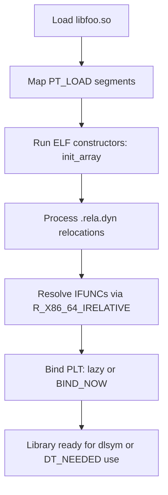

# Linux ELF and Shared Library RE

> Tags: elf, linux, shared-library, dlopen, ld-preload, glibc, strace, ltrace, core-dump, systemd, go, rust | Difficulty: Intermediate | Prerequisites: ELF format basics (see `../00-fundamentals/`), a static analysis tool such as Ghidra or radare2, a Linux sandbox (see `../01-setup/linux-sandbox-base.md`)

## Overview

Most Linux targets are ELF files: executables, shared libraries (`.so`), plugins, kernel modules, and language runtimes. ELF has more analyst-relevant structure than PE. Symbols, dynamic relocations, and interpreter metadata survive into shipped binaries more often than on Windows. Stripped does not mean empty.

The Linux-specific workflow differs from PE RE in five places:

1. **Shared libraries are first-class targets.** A `.so` is loaded by `dlopen` or by `DT_NEEDED`. Its exports (`dynsym`) and relocations (`rela.dyn`, `rela.plt`) are the API surface.
2. **The dynamic loader is part of the attack surface.** `LD_PRELOAD`, `LD_LIBRARY_PATH`, `DT_RUNPATH`, and IFUNC resolvers all run code or redirect lookups before `main`.
3. **glibc internals matter.** Memory hooks, `__libc_start_main`, IFUNC resolution, and `dlvsym` versioned symbols appear in crash stacks and hook points.
4. **Managed languages hide inside native ELF.** Stripped Go and Rust binaries still carry `pclntab`, module data, panic paths, and Rust symbol names. Recover them before decompiling.
5. **Runtime context is cheap to capture.** `strace`, `ltrace`, core dumps, and `journalctl` give you process state without a debugger license.

This page covers the parts of ELF work that are Linux-specific. For the format fundamentals see the fundamentals pages under `../00-fundamentals/`. For Go and Rust metadata recovery in depth see `../06-topics/managed-code-re.md`.

## Setup

Install the standard binutils and debug stack once. Everything below assumes Ubuntu 24.04 or a compatible Debian derivative.

```bash
sudo apt update
sudo apt install binutils elfutils gdb strace ltrace \
    dwarfdump cpio file libelf-dev \
    systemd systemd-coredump apport
```

Useful extras:

- `LIEF` — programmatic ELF parsing. Install with `pip install lief` or build from https://github.com/lief-project/LIEF. It parses ELF, PE, Mach-O, and more.
- `pyelftools` — pure-Python ELF parser for scripts. `pip install pyelftools`.
- `GoReSym` — Go symbol and metadata recovery. See `../06-topics/managed-code-re.md`.
- `rustfilt` — Rust symbol demangler. `cargo install rustfilt`.
- `vmlinux-to-elf` — rebuilds a kernel ELF from a `vmlinux` image via kallsyms. Source: https://github.com/marin-m/vmlinux-to-elf. Kernel module RE is a separate discipline; this page covers userspace ELF.

For decompilation itself, load the ELF in Ghidra, IDA, or Binary Ninja. All three handle ELF directly. Ghidra's ELF loader exposes sections, symbols, and relocations in the Symbol Tree. radare2 (`rizin 0.9.1`, `radare2 6.2.4` as of 2026-11) gives the fastest CLI triage:

```bash
rabin2 -I target        # ELF header info
rabin2 -E target        # exports
rabin2 -i target        # imports
rabin2 -R target        # relocations
rabin2 -l target        # linked libraries (DT_NEEDED)
rabin2 -z target        # strings in data sections
```

## How It Works

### ELF anatomy for analysts

Read the ELF header and program headers first, then the sections. The header tells you type and entry point. The program headers (`PT_LOAD`, `PT_INTERP`, `PT_DYNAMIC`, `PT_GNU_STACK`, `PT_GNU_RELRO`) tell you how the kernel and loader map the file.

```bash
readelf -h target          # ELF header: class, type, machine, entry
readelf -l target          # program headers
readelf -S target          # section headers
readelf -d target          # dynamic section: NEEDED, RPATH, RUNPATH, FLAGS
readelf -sW target         # symbol table (wide output)
readelf -rW target         # relocations
readelf -n target          # notes: build ID, ABI tag
readelf -V target          # version definitions and requirements
```

Key fields for triage:

| Field | What it tells you |
|---|---|
| `e_type` | `ET_EXEC` is a fixed-address executable. `ET_DYN` is PIE or a shared library. PIE binaries are `ET_DYN` with an interpreter. |
| `e_machine` | `EM_X86_64`, `EM_AARCH64`, `EM_386`, `EM_RISCV`. Check before you decompile. |
| `PT_INTERP` | Path to the dynamic loader, usually `/lib64/ld-linux-x86-64.so.2`. Its presence means dynamic linking. |
| `PT_GNU_STACK` | `RWE` means executable stack. `RW` means NX is on. Malware sometimes flips this. |
| `DT_FLAGS` / `DF_BIND_NOW` | `BIND_NOW` disables lazy binding. All PLT relocations resolve at load time. |
| `DF_1_PIE` | Confirms PIE for `ET_DYN` executables. |
| `DT_NEEDED` | Direct library dependencies. Does not list transitive deps. |
| `DT_RPATH` / `DT_RUNPATH` | Hardcoded library search paths. A writable `RUNPATH` is a hijack vector. |
| `DT_SONAME` | The name other binaries use to find this library. |

Section-level details that matter for `.so` work:

- `.dynsym` + `.dynstr` — the dynamic symbol table. This is the export/import surface. `nm -D` reads it.
- `.gnu.hash` — the symbol lookup hash. The loader uses it for `dlsym`. It does not list symbols; it accelerates lookup.
- `.gnu.version` / `.gnu.version_r` — symbol versioning. glibc exports versioned symbols like `memcpy@GLIBC_2.14`. Version requirements appear here.
- `.rela.dyn` — relocations for data objects and `GLOB_DAT`/`JUMP_SLOT` entries processed eagerly.
- `.rela.plt` — `JUMP_SLOT` relocations for PLT calls. Under lazy binding these resolve on first call.
- `.plt` / `.got` / `.got.plt` — the lazy-binding trampoline and the table the loader fills in.
- `.init` / `.init_array` / `.fini_array` — constructors and destructors. Malware and anti-debug code hides here.
- `.eh_frame` — unwind info. Preserves function boundaries even when symbols are stripped. Decompilers use it.
- `.note.gnu.build-id` — build ID. Use it to match against debug packages (`debuginfod`).

```bash
# Match a stripped binary to distro debug symbols
sudo apt install debuginfod-find
DEBUGINFOD_URLS=https://debuginfod.ubuntu.com \
    debuginfod-find debuginfo /usr/lib/x86_64-linux-gnu/libc.so.6
```

### Shared library analysis

A `.so` is an ELF with `ET_DYN` type and a `DT_SONAME`. Its public interface is `.dynsym`. Its imports are `UND` symbols in `.dynsym`.

List exports and imports:

```bash
nm -D --defined-only libfoo.so      # exported symbols
nm -D -u libfoo.so                  # undefined (imported) symbols
readelf --dyn-syms -W libfoo.so     # same, with versions and bindings
objdump -T libfoo.so                # dynamic symbol table, demangled-ish
```

Symbol binding tells you linkage:

- `GLOBAL DEFAULT` — normal exported function or object.
- `GLOBAL WEAK` — weak symbol. The linker may override it.
- `GLOBAL PROTECTED` — cannot be interposed by `LD_PRELOAD` or another definition. Check this before you plan a hook.
- `LOCAL` — not exported. Visible only inside the library.
- `IFUNC` — GNU indirect function. The symbol resolves through a resolver function at load time. See the IFUNC section below.

Relocations in a `.so` describe what the loader must fix at load time:

```bash
readelf -rW libfoo.so
```

Look for:

- `R_X86_64_GLOB_DAT` — data references resolved eagerly.
- `R_X86_64_JUMP_SLOT` — PLT slots for function calls.
- `R_X86_64_RELATIVE` — position-independent data fixups. Normal in PIE and `.so`.
- `R_X86_64_IRELATIVE` — IFUNC resolution slots.



**Finding who uses a library.** `DT_NEEDED` lists direct deps only. For the transitive view use `ldd`, or scan for reverse dependencies:

```bash
# Direct deps of a binary
readelf -d /usr/bin/foo | grep NEEDED
ldd /usr/bin/foo

# All libs that link against libfoo
find /usr/lib /lib -name '*.so*' -exec sh -c \
  'readelf -d "$1" 2>/dev/null | grep -q "libfoo" && echo "$1"' _ {} \;
```

`ldd` executes the loader. On untrusted binaries, prefer `readelf -d` or `LD_TRACE_LOADED_OBJECTS=1`. `ldd` on hostile input can run constructors.

### IFUNC resolvers

IFUNC (Indirect Function) is a glibc mechanism for runtime CPU dispatch. The symbol `memcpy` in libc is often an IFUNC. At load time the loader calls the resolver, which checks CPU features (`__builtin_cpu_supports`, `getauxval(AT_HWCAP)`) and returns the address of the best implementation — for example `__memmove_avx_unaligned` versus the generic version.

Why analysts care:

- IFUNC resolvers run before `main`. They are a place to hide anti-debug or environment checks.
- Stripped binaries still contain IFUNC relocations. `readelf -r` shows `IRELATIVE` entries.
- `LD_HWCAP_MASK` can disable CPU features and change which resolver path executes. Useful for forcing the generic path during debugging.

```bash
# Show IFUNC symbols
readelf --dyn-syms -W /lib/x86_64-linux-gnu/libc.so.6 | grep IFUNC
```

In Ghidra, IFUNC symbols appear as functions with names like `memcpy` plus `*` or as resolver stubs. The actual implementation is a separate function. Trace the resolver to see which variant it selects.

### Stripped Go and Rust binaries

ELF stripping removes `.symtab` but not the language runtime metadata. Go and Rust keep enough structure to recover most symbol names.

**Go.** The Go runtime embeds `pclntab` (program counter line table) and `moduledata` in the binary. These contain function names, file paths, and type information even when `.symtab` is gone. GoReSym reads them.

```bash
go install github.com/mandiant/GoReSym/cmd/goresym@latest
./goresym -t -d -p -j target > goresym.json
```

Flags (verified against the GoReSym README): `-t` type names, `-d` package names, `-p` file paths, `-j` JSON output.

The GoReSym repo ships importer scripts for IDA, Ghidra, and Binary Ninja under `IDAPython/`, `GhidraPython/`, and `BinjaPython/`. Community importers cover radare2 and Rizin. Full workflow in `../06-topics/managed-code-re.md`.

Quick identification:

```bash
strings -a target | grep -m1 'Go build ID'     # Go binary marker
strings -a target | grep -m1 'go1\.'           # Go version
readelf -p .go.buildinfo target 2>/dev/null    # build info section if present
```

**Rust.** Rust binaries embed panic messages with source file paths like `src/main.rs:42` and crate names. Symbol names are mangled but demangle cleanly. Ghidra 12 demangles Rust v0 and legacy schemes automatically. For CLI work:

```bash
echo '_ZN3std2rt10lang_start17h...' | rustfilt
```

Rust-specific ELF notes:

- `.eh_frame` preserves panic unwinding paths.
- `core::` and `std::` symbols survive stripping because they are needed for panics.
- Generic functions monomorphize into many copies. Expect duplicate-looking functions.

### glibc internals relevant to RE

Modern glibc (2.34+) removed the old malloc hooks. `__malloc_hook`, `__free_hook`, and `__realloc_hook` were deprecated in 2.34 and removed in 2.35. On current systems, do not look for them.

What remains useful:

- **`__libc_start_main`** — the real entry point for dynamically linked executables. The ELF entry point jumps to the loader, which calls `__libc_start_main`, which calls `main`. Break here to catch `main`'s arguments. glibc 2.34+ wraps this in `__libc_start_call_main`.
- **`_rtld_global`** — the dynamic linker's global state. Contains the link map, search paths, and loaded object list. Useful in gdb when inspecting `dlopen` state.
- **`dlvsym`** — versioned symbol lookup. Malware and packers use it to resolve specific glibc versions.
- **`environ` / `__environ`** — global pointer to the environment array. Find it via `readelf -s /lib/x86_64-linux-gnu/libc.so.6 | grep environ`.

Symbol interposition: any global symbol in an executable or earlier-loaded library can override a library's definition. This is how `LD_PRELOAD` works. Protected symbols (`STV_PROTECTED`) resist interposition.

### LD_PRELOAD interposition for dynamic analysis

`LD_PRELOAD` loads a shared library before all others. Its definitions take precedence in symbol lookup for subsequently loaded objects. This is the standard Linux hook mechanism.

Minimal hook library:

```c
// hook.c — intercept open() and log paths
#define _GNU_SOURCE
#include <dlfcn.h>
#include <stdio.h>
#include <fcntl.h>
#include <stdarg.h>

int open(const char *pathname, int flags, ...) {
    mode_t mode = 0;
    if (flags & O_CREAT) {
        va_list ap;
        va_start(ap, flags);
        mode = va_arg(ap, mode_t);
        va_end(ap);
    }
    fprintf(stderr, "[hook] open(%s, 0x%x)\n", pathname, flags);
    static int (*real_open)(const char *, int, ...) = NULL;
    if (!real_open) real_open = dlsym(RTLD_NEXT, "open");
    return real_open(pathname, flags, mode);
}
```

```bash
gcc -shared -fPIC -o hook.so hook.c -ldl
LD_PRELOAD=./hook.so ./target
```

Rules:

- Use `RTLD_NEXT` with `dlsym` to find the real function. `RTLD_DEFAULT` finds the first match, which may be yours.
- Match the exact signature. `open` is variadic. `open64`, `openat`, and `fopen` are separate symbols.
- Interposition only works for calls that go through the PLT. Direct `syscall` instructions bypass it.
- `STV_PROTECTED` and `STV_HIDDEN` symbols cannot be interposed.
- For C++ or Rust binaries, mangled names differ. Interpose at the C ABI boundary (`open`, `read`, `write`, `connect`) for portability.

`LD_AUDIT` is a deeper hook. It lets you audit bindings, relocations, and symbol lookups via a `.so` that implements `la_version`, `la_objopen`, `la_symbind`, and related callbacks. See `man dlopen` and the glibc manual. `ltrace` uses this internally.

## Step-by-Step

### Triage a `.so`

1. Confirm type and architecture.

   ```bash
   file libfoo.so
   readelf -h libfoo.so | grep -E 'Class|Type|Machine|Entry'
   ```

2. List dependencies and search paths.

   ```bash
   readelf -d libfoo.so | grep -E 'NEEDED|RPATH|RUNPATH|SONAME'
   ```

3. Dump exports, imports, and relocations.

   ```bash
   nm -D --defined-only libfoo.so > exports.txt
   nm -D -u libfoo.so > imports.txt
   readelf -rW libfoo.so | grep -E 'IRELATIVE|GLOB_DAT|JUMP_SLOT'
   readelf --dyn-syms -W libfoo.so | grep IFUNC
   ```

4. Load in Ghidra or radare2. Apply symbol names from `nm -D` output. Decompile exported functions first — they are the contract.

5. Check constructors.

   ```bash
   readelf -x .init_array libfoo.so
   ```

   Ghidra shows `.init_array` entries as functions. Review them for anti-debug or setup logic.

### Trace a binary with strace and ltrace

`strace` traces syscalls. `ltrace` traces library calls. They answer different questions.

```bash
# Syscall trace. Follow forks. Write to file.
strace -f -o trace.txt -e trace=%file,network,process ./target arg1 arg2

# Library call trace.
ltrace -f -o ltrace.txt -e 'open*+read*+write*+connect*' ./target
```

Run them separately. Running both at once is noisy.

`strace` output format:

```
12345 openat(AT_FDCWD, "/etc/passwd", O_RDONLY) = 3
12345 read(3, "root:x:0:0:...", 4096) = 1024
12345 connect(5, {sa_family=AF_INET, sin_port=htons(443), sin_addr=inet_addr("93.184.216.34")}, 16) = 0
```

Fields: PID, syscall name, arguments, return value. `-e trace=` filters. `%file` covers file syscalls. `%network` covers socket calls. `%process` covers fork/exec/exit.

`ltrace` shows library calls with arguments and return values. It is weaker on modern glibc because many calls are IFUNC-resolved or versioned. `-x` filters by symbol pattern.

For long traces, filter aggressively:

```bash
strace -f -e trace=openat,read,write,connect,sendto,recvfrom ./target 2>&1 | head -200
```

### Analyze a core dump

Enable core dumps and configure the pattern:

```bash
# Check current limits
ulimit -c
cat /proc/sys/kernel/core_pattern

# Set a local pattern for this shell
ulimit -c unlimited
echo '/tmp/core.%p' | sudo tee /proc/sys/kernel/core_pattern
```

On Ubuntu with `systemd-coredump` installed, cores go to the journal:

```bash
coredumpctl list
coredumpctl info <pid>
coredumpctl debug <pid>    # opens gdb on the core
```

Without systemd-coredump, the kernel writes a file matching `core_pattern`. Analyze it:

```bash
gdb ./target core.12345
(gdb) bt              # backtrace
(gdb) info registers
(gdb) x/20i $rip      # disassemble around the fault
(gdb) info proc mappings
```

Core dumps contain full memory: stack, heap, loaded libraries, and register state. They are the best source for post-mortem analysis of crashes, anti-debug failures, and exploit attempts.

### Reverse a systemd service

Systemd units are text. The binary is only part of the story.

```bash
systemctl cat suspicious.service
systemctl show suspicious.service -p ExecStart,ExecStartPre,ExecStartPost,Environment,User,Group,WorkingDirectory,NoNewPrivileges,ProtectSystem,PrivateTmp
```

Key directives for RE:

- `ExecStart=` — the main binary and arguments. May use specifiers like `%h` (home) or `%u` (user).
- `ExecStartPre=` / `ExecStartPost=` — setup and teardown scripts. Often shell one-liners that download or decode payloads.
- `Environment=` / `EnvironmentFile=` — config that changes behavior. `EnvironmentFile=-/path` means optional.
- `User=` / `Group=` — privilege context. `User=root` plus a writable path is a persistence vector.
- `NoNewPrivileges=`, `ProtectSystem=`, `PrivateTmp=` — sandboxing. Their absence tells you the service runs unsandboxed.
- `Restart=` — restart policy. `always` means the binary is expected to crash or be killed.
- `WatchdogSec=` — the service must ping systemd. Deadlocks trigger restarts.

Once you have the binary path from `ExecStart`, apply the ELF workflow above. For shell-script wrappers, read them first — they often contain the real payload URL or decode step. Trace startup behavior:

```bash
sudo strace -f -o /tmp/svc.trace -e trace=%file,network,process \
    systemctl restart suspicious.service
```

## AI Assists

### Symbol recovery for stripped ELF

Stripped ELF still has `.eh_frame`, `.init_array`, string references, and call graphs. The model can propose names from context.

Workflow:

1. Run `rabin2 -s` or `readelf --dyn-syms` to get dynamic symbols. These survive stripping.
2. For `.symtab`-stripped binaries, use Ghidra's auto-analysis. It recovers function boundaries from `.eh_frame`.
3. For each unnamed function, collect: strings referenced, calls made, callers, and the section it lives in.
4. Prompt the model:

   ```
   Function at 0x401230 in a stripped x86-64 ELF shared library.
   No symbol name. Strings referenced: "config loaded", "/tmp/.cache"
   Calls: malloc, fopen, strstr
   Called by: init_array entry at 0x402000

   Propose a function name and one-sentence description.
   Output JSON: {"name": "...", "description": "...", "confidence": "high|medium|low"}
   ```

5. Apply high-confidence names through Ghidra's script API or radare2's `afn` command. Keep a rename map.

For Go binaries, run GoReSym first. For Rust, Ghidra demangles automatically. Use the model only where metadata recovery leaves gaps.

### Config file discovery

ELF binaries reference config paths as strings. The model can find them faster than manual `strings` triage.

```bash
# Extract candidate paths
strings -a -t x target | grep -E '^ *[0-9a-f]+ .*/' | head -100

# Or use FLOSS for obfuscated strings
floss target > floss.txt
```

Feed the string list to the model:

```
These strings were extracted from a stripped ELF binary.
Identify which are likely config file paths, environment variable names,
or command-line flags. Output a table: string, type, likely purpose.
```

Cross-reference with `strace -e trace=openat` output. Strings that appear in both are confirmed config paths.

### Syscall trace interpretation

Raw `strace` output is verbose. The model reads it well if you give it a filtered slice.

Workflow:

1. Run `strace` with a narrow filter. File and network syscalls first.

   ```bash
   strace -f -o trace.txt -e trace=%file,network ./target
   ```

2. Post-process to group by PID and syscall.

   ```bash
   # Count syscall frequency
   grep -oP '^\d+\s+\K\w+' trace.txt | sort | uniq -c | sort -rn | head -20

   # Extract file paths opened
   grep -oP 'openat\([^,]+, "[^"]+"' trace.txt | sort -u
   ```

3. Feed a slice to the model:

   ```
   strace output from a suspicious ELF binary. PID 1234 is the main process.
   Summarize: what files does it open, what network connections does it make,
   and what processes does it spawn? Flag anything that looks like persistence
   or exfiltration.
   ```

4. Verify claims against the raw trace. The model will hallucinate syscall names and paths. Check every IOC it reports.

`ltrace` output is easier for the model because library call names carry semantic meaning (`SSL_write`, `curl_easy_perform`). Use it when `strace` shows socket activity but you need the library-level context.

### Decompilation prompts for ELF

ELF decompilation through Ghidra or IDA produces pseudo-C. The model translates it to readable logic.

Good prompt structure:

```
Decompiled function from x86-64 ELF (Ghidra pseudo-C).
Symbol: <name or address>
Section: .text
Strings: <list>
Calls: <list>

Explain what this function does in plain English.
Identify any anti-analysis checks (timing, debugger detection, environment checks).
If it is a constructor or destructor, say so.
```

For `.so` files, always tell the model whether the function is exported (`GLOBAL DEFAULT` in `.dynsym`) or internal. Exported functions are API. Internal functions are implementation.

## Pitfalls

- **`ldd` executes code.** `ldd` runs the dynamic loader, which runs constructors. On hostile binaries, use `readelf -d` or `LD_TRACE_LOADED_OBJECTS=1` instead. Never `ldd` an untrusted `.so`.
- **Lazy binding hides calls.** Under lazy binding, PLT slots resolve on first call. `LD_BIND_NOW=1` forces eager resolution. Use it when tracing to see all relocations upfront.
- **IFUNC resolvers run before your breakpoint.** If you break on `main`, you have already missed IFUNC resolution and `.init_array` constructors. Break on `_start` or the loader entry to catch everything.
- **`DT_RUNPATH` vs `DT_RPATH`.** `RUNPATH` applies only to direct dependencies. `RPATH` applies transitively. A writable `RUNPATH` is a local hijack vector. Check both.
- **Stripped Go binaries still have symbols.** `nm` shows nothing, but `pclntab` has everything. Run GoReSym before you conclude the binary is stripped.
- **Rust panic paths leak source layout.** Strings like `src/main.rs:42` reveal file structure even when symbols are gone. Use them to orient the decompiler.
- **glibc hooks are gone.** Do not look for `__malloc_hook` on glibc 2.35+. They were removed. Use `LD_PRELOAD` or `ltrace` instead.
- **`RTLD_NEXT` finds the next library, not the real function.** If your hook library loads before the target library, `RTLD_NEXT` skips yours and finds the next definition. If it loads after, you get the wrong symbol. Test with a known function first.
- **Protected symbols resist interposition.** `STV_PROTECTED` symbols cannot be overridden by `LD_PRELOAD`. Check `readelf --dyn-syms` for `PROTECTED` binding before you plan a hook.
- **`strace` misses direct syscalls.** Static binaries and some packers use `syscall` instructions directly. `strace` still catches them because it traces the kernel boundary, but `ltrace` misses them entirely.
- **Core dumps contain secrets.** Memory dumps include keys, tokens, and passwords. Handle cores with the same care as memory captures. See `../01-setup/malware-isolation.md`.
- **systemd services run with different privileges.** `User=` in the unit file changes the effective UID. `strace` without `sudo` may fail with `EPERM` on setuid binaries or services running as root.

## See Also

- `../00-fundamentals/` — ELF format fundamentals, assembly basics, calling conventions
- `../01-setup/linux-sandbox-base.md` — Ubuntu RE sandbox setup
- `../01-setup/malware-isolation.md` — safe dynamic analysis environment
- `../03-decomp/triage-and-mapping.md` — first-look triage commands
- `../03-decomp/decompile-workflow.md` — the human+AI decompilation loop
- `../03-decomp/batch-decompilation.md` — headless decompilation pipelines
- `../04-dynamic/` — Frida and debugger-based dynamic analysis
- `../06-topics/managed-code-re.md` — Go and Rust metadata recovery in depth
- `../06-topics/malware-analysis.md` — malware triage pipeline
- `../06-topics/deobfuscation.md` — OLLVM, VMProtect, Themida
- `../07-advanced/anti-analysis.md` — anti-debug and anti-VM techniques
