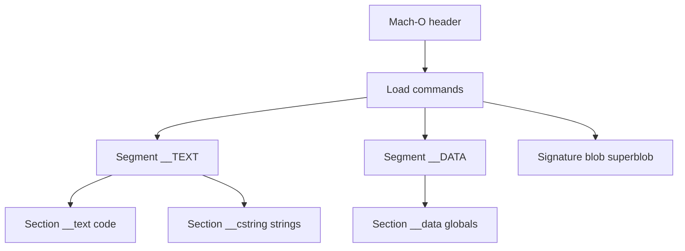
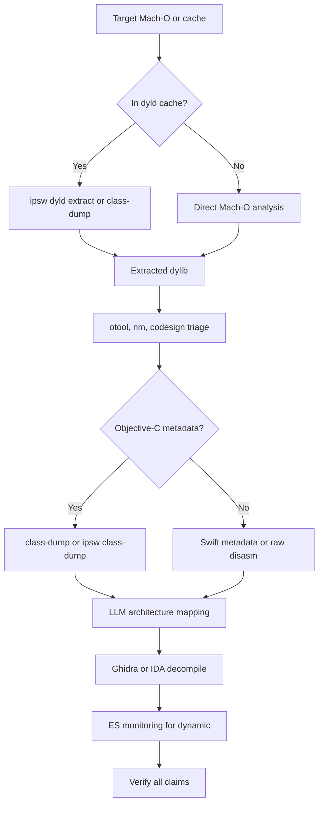

# macOS System Binary RE

> Tags: macos, mach-o, dyld, sip, hardened-runtime, entitlements, endpoint-security, gatekeeper, xpc, ipsw | Difficulty: Intermediate | Prerequisites: Unix process model, Mach-O basics, codesign tooling, a macOS VM or host

macOS system binaries differ from ordinary application binaries. Apple ships most system libraries inside dyld shared caches, not as standalone files. System Integrity Protection blocks debugging of platform binaries. The hardened runtime and entitlements control what an agent can attach to and what a signed binary can do. Endpoint Security gives a clean channel for behavior monitoring that does not fight SIP. For iOS and App Store targets, see [iOS/macOS RE](apple-ios-re.md).

## Overview

The macOS pipeline has four stages:

1. **Extraction.** Pull a dylib out of a dyld shared cache or an app bundle out of a signed `.app`.
2. **Static inspection.** Read load commands, imports, Objective-C metadata, Swift metadata, and entitlements.
3. **Runtime observation.** Monitor exec, file, and XPC events through Endpoint Security, or attach a debugger where SIP permits.
4. **Verification.** Check every AI claim against `otool`, `nm`, `codesign`, or the dyld cache itself.

AI fits well at metadata naming, entitlement triage, XPC discovery, and script generation. AI fits poorly at raw arm64e disassembly without a decompiler MCP.

## Mach-O Deep Dive

Mach-O is the object format for macOS, iOS, and related platforms. It replaces PE and ELF. A universal Mach-O file, called a fat binary, contains one or more architecture slices.

### File layout

A thin Mach-O file has this structure:



Key load commands you will meet:

| Load command | Purpose |
|---|---|
| `LC_SEGMENT_64` | Defines a mapped segment such as `__TEXT` or `__DATA` |
| `LC_SYMTAB` | Symbol table. Present only in non-stripped binaries |
| `LC_DYSYMTAB` | Indirect symbol table for stubs and lazy bindings |
| `LC_LOAD_DYLIB` / `LC_LOAD_WEAK_DYLIB` | Linked dylibs. Imports you did not compile |
| `LC_RPATH` | Runtime library search paths |
| `LC_CODE_SIGNATURE` | Points at the superblob with entitlements and hashes |
| `LC_MAIN` | Entry point for executables |
| `LC_BUILD_VERSION` | Minimum OS and SDK versions |

### Commands for triage

```bash
otool -lV /bin/ls                    # every load command, decoded
otool -L /bin/ls                     # linked dylibs only
otool -tV -arch arm64 /bin/ls        # disassemble text section
otool -ov /System/Library/Frameworks/Foundation.framework/Foundation | head -50
nm -arch arm64 /bin/ls                # symbols if the symbol table exists
otool -lV /bin/ls | grep -A4 LC_CODE_SIGNATURE
```

Fat binaries need `lipo`:

```bash
lipo -info /usr/bin/swift
lipo -thin arm64e /usr/bin/swift -output /tmp/swift.arm64e
```

### Links and imports

Mach-O does not have a dynamic symbol table like ELF `.dynsym`. Imports resolve through lazy binding stubs and the `__la_symbol_ptr` section. `dyld_info` gives a readable binding map:

```bash
dyld_info -dependents /bin/ls
dyld_info -imports /bin/ls
```

On macOS 12 and later, `dyld_info -cache` reports cache contents. Paths vary by version. Run `dyld_info` without arguments for usage.

### Python and tooling

For scripted parsing, use `macholib` (`pip install macholib`) or `lief` (`pip install lief`). Both parse Mach-O headers and fat files in Python. For macOS-specific work, use ipsw. See below.

## SIP and Hardened Runtime Constraints

Two separate mechanisms limit what you can do to a macOS binary. Do not confuse them.

| Mechanism | Scope | Effect on RE |
|---|---|---|
| System Integrity Protection (SIP) | Platform binaries under `/System`, `/usr`, `/bin`, `/sbin`, and signed system volumes | Blocks `task_for_pid`, `DYLD_INSERT_LIBRARIES`, debugger attach, and most runtime tampering on Apple binaries |
| Hardened Runtime | Per-binary flag set at signing time | Blocks `DYLD_INSERT_LIBRARIES`, unsigned code injection, and debugger attach unless the entitlement allows it |

### SIP

SIP ships enabled on all supported macOS releases. Disabling it requires Recovery or a configuration profile and may be locked on managed devices. Treat SIP-off machines as lab machines, never as production.

Useful commands:

```bash
csrutil status
csrutil disable        # must run from Recovery on modern macOS
```

SIP also protects the dyld shared cache. Find the cache with:

```bash
find /System/Volumes/Preboot -name 'dyld_shared_cache*' 2>/dev/null
ls /System/Library/dyld/ 2>/dev/null
```

### Hardened Runtime

The hardened runtime is a signing flag. Check whether a binary has it:

```bash
codesign -d --verbose=4 /bin/ls 2>&1 | grep -i flags
# Look for "runtime" in the flags line
```

Relevant runtime entitlements include:

| Entitlement | Effect |
|---|---|
| `com.apple.security.cs.debugger` | Allows debugger attach to this process |
| `com.apple.security.cs.allow-dyld-environment-variables` | Allows `DYLD_*` variables |
| `com.apple.security.cs.disable-library-validation` | Allows loading unsigned or differently-signed dylibs |
| `com.apple.security.cs.allow-unsigned-executable-memory` | Allows RWX memory regions |
| `com.apple.security.cs.allow-jit` | Allows JIT compilation |

A binary signed with the hardened runtime and without `com.apple.security.cs.debugger` will reject `lldb` attach. To analyze it dynamically you need one of:

1. Re-sign a copy with the entitlement added (requires your own signing identity).
2. Attach through a debugger entitlements-aware path such as lldb with `get-task-allow`.
3. Observe through Endpoint Security, which runs outside the target process.
4. Patch the binary and re-sign ad hoc (`codesign --sign -`).

For Apple platform binaries SIP blocks all of the above. For those, use static analysis and Endpoint Security monitoring.

## Entitlements and Provisioning

Entitlements live in the code signature superblob. They are a plist of key-value pairs. Dump them:

```bash
codesign -d --entitlements :- /bin/ls
codesign -d --entitlements :- /usr/libexec/sshd-keygen-wrapper
```

Entitlements come in three tiers:

| Tier | Who grants it | Example keys |
|---|---|---|
| Public | Any developer can self-sign | `com.apple.security.app-sandbox`, `com.apple.security.network.client` |
| Restricted | Apple-issued provisioning profile required | `com.apple.developer.*`, keychain access groups |
| Private | Apple internal only | `com.apple.private.*`, `com.apple.rootless.*` |

Provisioning profiles live in `embedded.mobileprovision` inside app bundles or in `/Library/Apple/System/Library/Profiles/`. Decode one:

```bash
security cms -D -i embedded.mobileprovision > profile.plist
plutil -p profile.plist | grep -A40 Entitlements
```

The profile contains the entitlements Apple actually granted, plus expiration and device lists. The binary's signature blob can claim entitlements the profile never granted. The kernel trusts the profile, not the blob, for restricted keys.

### AI-assisted entitlement triage

Feed the entitlement dump to an LLM:

```text
You are auditing macOS entitlements for attack surface. For each entitlement
key below, state: (1) what capability it grants, (2) whether it widens the
attack surface, (3) the risk if the binary is compromised. Flag
com.apple.security.cs.disable-library-validation,
com.apple.security.cs.allow-unsigned-executable-memory,
com.apple.security.cs.allow-jit, and any get-task-allow or
com.apple.developer.endpoint-security.client keys specifically. Cite the key
name for every claim. If you are unsure about a key, say "unverified".
```

Verify flagged keys with `codesign -d --entitlements` on the actual binary. LLMs hallucinate plausible entitlement names. The real list is short and documented at developer.apple.com.

## Dyld Shared Cache Extraction

Since macOS Catalina, Apple ships almost all system dylibs inside dyld shared caches. The files under `/usr/lib` are stubs or absent. You cannot `otool` a cache directly. You must extract.

Find the cache:

```bash
find /System/Volumes/Preboot -name 'dyld_shared_cache*' 2>/dev/null
find /System/Library/dyld -name 'dyld_shared_cache*' 2>/dev/null
# Typical result: .../usr/lib/dyld/dyld_shared_cache_arm64e plus numbered subcaches .01, .02, ...
```

### ipsw extraction

ipsw handles dyld caches on macOS, Linux, and Windows. It is the fastest path.

```bash
# List what is in a cache
ipsw dyld info /path/to/dyld_shared_cache_arm64e

# Extract one dylib
ipsw dyld extract /path/to/dyld_shared_cache_arm64e Foundation -o extracted/

# Extract everything
ipsw dyld extract /path/to/dyld_shared_cache_arm64e --all -o extracted/

# Dump Objective-C headers directly from the cache (no extraction step)
ipsw class-dump /path/to/dyld_shared_cache_arm64e Foundation --headers -o headers/
```

The `--all` flag can produce tens of gigabytes. Prefer extracting only the frameworks you need. Check `ipsw dyld --help` for your version's exact flags.

### dsc_extractor from Apple source

Apple publishes the dyld source including `dsc_extractor`. It lives in the dyld repository under `other-tools/`:

- Source: [apple-oss-distributions/dyld](https://github.com/apple-oss-distributions/dyld), file `other-tools/dsc_extractor.cpp`
- Build: part of the dyld Xcode project. Building the full dyld package is heavy. Most users should use ipsw instead.
- Usage when built: `dsc_extractor -e <dylib-path> <cache-file>` or `dsc_extractor <cache-file>` for all.

The dsc_extractor output format differs from ipsw. ipsw produces cleaner dylibs and has better Objective-C handling. Prefer ipsw unless you need Apple's exact extraction semantics.

### What extraction gives you

An extracted dylib is a normal Mach-O file. It may still reference symbols and Objective-C metadata that live in other cache entries. ipsw docs warn that extracted dylibs can still reference metadata stored elsewhere in the cache. For Objective-C class-dump, point `ipsw class-dump` at the cache file, not the extracted dylib.

## Objective-C Metadata

Objective-C binaries keep class names, method names, and protocol names even after stripping. This is the single biggest advantage of Apple binary RE.

### class-dump

`class-dump` is the classic tool. It reads `__objc_classlist`, `__objc_catlist`, and `__objc_protolist` sections and emits headers. Build from source with Xcode command-line tools:

```bash
git clone https://github.com/nygard/class-dump.git
cd class-dump && make
./class-dump -H -o headers/ /path/to/binary
./class-dump -H -C 'Auth|Login|Crypto' -o headers/ /path/to/binary   # filter classes
```

class-dump works on macOS binaries and extracted iOS binaries. It does not read dyld shared caches directly. Use ipsw for caches.

### What the LLM gets for free

Objective-C metadata gives the LLM class names, inheritance chains, method selectors, protocol conformance, category names, and instance variable names and types. Feed a class-dump header to an LLM and ask it to map the architecture. Output quality is far better than feeding raw disassembly because the LLM sees named methods, not anonymous addresses.

## Swift Metadata Recovery

Swift binaries keep metadata for reflection. It is less complete than Objective-C metadata but still useful. Swift symbols use mangled names that encode module, type, and function. Even stripped binaries keep enough metadata for `swift-demangle` to recover readable names.

```bash
# Demangle a single symbol
echo '$s4Test3FooC3barSSvg' | swift-demangle
# Output: Test.Foo.bar.getter : Swift.String

# Demangle a symbol table dump
nm /path/to/binary | awk '{print $NF}' | swift-demangle | head -50
```

### Tools

| Tool | Purpose | Status |
|---|---|---|
| `swift-demangle` | Ships with Swift toolchain. Demangles `$s...` symbols | Always available on macOS with Xcode CLT |
| `dsymutil` | Apple's tool. Reconstructs dSYM files from binaries | Works best when dSYM exists |
| ipsw | Has Swift metadata inspection in recent releases | Check `ipsw --help` for exact subcommand |

Swift metadata recovery is harder than Objective-C. Generic Swift binaries stripped of reflection metadata lose type names. The LLM will guess plausible names. Mark those guesses as unverified.

### Prompt pattern for Swift

```text
This Swift function has the mangled symbol $s4Auth8VerifierC9checkTokenySbSSF.
Demangle it, then explain what the function likely does based on the
surrounding call sites. The module is "Auth". The type is "Verifier".
Mark any inference you cannot confirm from the symbol as "unverified".
```

## Endpoint Security Framework

Endpoint Security (ES) is Apple's sanctioned monitoring API for macOS. It replaced many uses of kernel extensions. ES clients subscribe to event types and receive callbacks in userspace.

### What ES gives you

| Event category | Examples |
|---|---|
| Process | `ES_EVENT_TYPE_AUTH_EXEC`, `ES_EVENT_TYPE_NOTIFY_FORK`, `ES_EVENT_TYPE_NOTIFY_EXIT` |
| File | `ES_EVENT_TYPE_NOTIFY_OPEN`, `ES_EVENT_TYPE_NOTIFY_CREATE`, `ES_EVENT_TYPE_NOTIFY_UNLINK` |
| Network | `ES_EVENT_TYPE_NOTIFY_CONNECT`, `ES_EVENT_TYPE_NOTIFY_BIND` |
| Mach IPC | `ES_EVENT_TYPE_NOTIFY_MACH_LOOKUP` |
| Code signing | `ES_EVENT_TYPE_NOTIFY_CS_INVALIDATED` |

ES runs in a system extension or a standalone binary with the right entitlements. It sees events before they complete, so you can log, block, or modify behavior.

### Entitlements required

An ES client needs the `com.apple.developer.endpoint-security.client` entitlement plus either Full Disk Access (TCC approval) or a provisioning profile that grants the entitlement. For development, grant Full Disk Access to your test binary in System Settings > Privacy & Security > Full Disk Access.

### Minimal ES client skeleton

```c
// es_client.c — minimal Endpoint Security subscriber
#include <EndpointSecurity/EndpointSecurity.h>
#include <stdio.h>

static void handle_event(es_client_t *c, const es_message_t *msg) {
    if (msg->event_type == ES_EVENT_TYPE_AUTH_EXEC) {
        const es_event_exec_t *exec = msg->event.exec;
        printf("EXEC: %s (pid %d)\n", exec->executable->path.data, exec->process->audit_token.val[5]);
    }
}

int main() {
    es_client_t *client;
    es_new_client_result_t result = es_new_client(&client, ^(es_client_t *c, const es_message_t *msg) {
        handle_event(c, msg);
    });
    if (result != ES_NEW_CLIENT_RESULT_SUCCESS) {
        fprintf(stderr, "es_new_client failed: %d\n", result);
        return 1;
    }
    es_event_type_t events[] = { ES_EVENT_TYPE_AUTH_EXEC };
    if (es_subscribe(client, events, 1) != ES_RETURN_SUCCESS) {
        fprintf(stderr, "es_subscribe failed\n");
        return 1;
    }
    printf("Listening...\n");
    dispatch_main();
    return 0;
}
```

Build and run:

```bash
clang -o es_client es_client.c -framework EndpointSecurity -fobjc-arc
# Grant Full Disk Access to es_client in System Settings, then:
./es_client
```

### ES for malware triage

ES sees every process exec with full path and arguments, file opens and deletes, network connections, Mach service lookups, and code signature invalidation events. An LLM can consume ES logs and produce behavior summaries. Prompt:

```text
This is an Endpoint Security event log from a macOS process. Summarize the
behavior: files touched, processes spawned, network connections, Mach
lookups. Flag persistence, exfiltration, or defense evasion. Cite event
types and paths for every claim.
```

ES does not require disabling SIP or the hardened runtime. It is the safest dynamic analysis path on modern macOS.

## Gatekeeper and Notarization

Gatekeeper is the first-line defense for downloaded software. Notarization is Apple's malware scan for Developer ID signed software.

### How Gatekeeper works

When you open a downloaded app, macOS checks:

1. **Quarantine attribute** — set by the browser or downloader.
2. **Developer ID signature** — verifies the developer's certificate.
3. **Notarization ticket** — verifies Apple scanned the app for known malware.
4. **Gatekeeper assessment** — `spctl` evaluates the combination.

Commands to inspect:

```bash
# Check quarantine attribute
xattr -l /path/to/app.app | grep com.apple.quarantine

# Gatekeeper assessment
spctl -a -t exec -vv /path/to/app.app
```

### Notarization

Notarization is a process, not a property. The developer submits the app to Apple, Apple scans it, and Apple issues a ticket. The ticket is stapled to the app or fetched online.

For RE purposes, unsigned or ad-hoc signed binaries cannot be notarized and trigger Gatekeeper warnings. Notarized malware has passed Apple's scan but may still be malicious. Notarization is not a safety guarantee. Inspect tickets with `stapler`:

```bash
xcrun stapler validate /path/to/app.app
```

### Bypassing Gatekeeper for analysis

For lab analysis only, in a dedicated VM:

```bash
xattr -d com.apple.quarantine /path/to/app.app   # remove quarantine attribute
sudo spctl --master-disable                      # disable Gatekeeper entirely
```

These changes affect your system's security posture. Do not run them on a production machine.

## XPC Service Discovery

XPC is Apple's inter-process communication mechanism. Many macOS services run as XPC services inside app bundles or system frameworks. XPC service bundles live in `Contents/XPCServices/` inside `.app` bundles. System XPC services live in `/System/Library/Frameworks/` and `/usr/libexec/`.

### Finding XPC services

```bash
find /Applications/Example.app -name '*.xpc' -type d
plutil -p /path/to/Service.xpc/Contents/Info.plist
```

Each XPC `Info.plist` has `CFBundleIdentifier`, `CFBundleExecutable`, an `XPCService` dictionary (service type), and `MachServices` (Mach port names the service registers).

### AI-assisted XPC mapping

Feed an XPC service's plist and binary strings to an LLM:

```text
This XPC service is named com.example.helper. Its Info.plist declares
MachServices: ["com.example.helper.api"]. The binary imports
NSXPCConnection and NSXPCInterface. List the likely methods it exposes,
the data it might handle, and whether it runs with elevated privileges.
Mark all inferences as "unverified" unless confirmed by the binary.
```

XPC services often run with fewer sandbox restrictions than their parent app. They are high-value targets for privilege escalation analysis.

## AI Workflows for macOS System RE

### Recommended pipeline



### Prompt patterns

The entitlement, XPC, and ES prompts appear in their sections above. Two more worth keeping:

**Class-dump summarization:**

```text
This is a class-dump header for a macOS framework. Identify the main
classes, their responsibilities, and any security-relevant methods
(authentication, crypto, file access, network). Output a structured
summary with class names and method signatures.
```

### Verification checklist

Every AI claim needs a deterministic check:

- Entitlement exists: `codesign -d --entitlements :-` on the binary.
- Class exists: grep class-dump output for the class name.
- Method exists: grep class-dump output for the selector.
- Symbol exists: `nm` or `dyld_info -imports`.
- File path exists: `ls` or `find` on the actual filesystem.
- XPC service exists: `find` for the `.xpc` bundle.
- Behavior claim: ES log or `fs_usage` output.

## Pitfalls

- **SIP blocks debugging.** You cannot `lldb` attach to `/usr/libexec/` binaries on a SIP-enabled system. Use ES monitoring or a SIP-off lab VM.
- **Hardened runtime blocks injection.** `DYLD_INSERT_LIBRARIES` fails on hardened-runtime binaries unless they have the right entitlement. Re-sign a copy for analysis.
- **Dyld cache extraction is mandatory.** Most system dylibs do not exist as files. You must extract from the cache before Ghidra or IDA sees them.
- **Objective-C metadata survives stripping.** Do not assume a stripped binary has no class names. Run class-dump first.
- **Swift metadata is weaker.** Swift reflection metadata may be stripped. Demangled symbols help but type names may be lost.
- **Entitlements in the blob are not authoritative.** The provisioning profile grants restricted entitlements, not the signature blob. Check the profile.
- **Gatekeeper is not malware detection.** Notarized apps can still be malicious. Notarization means Apple found no known malware signature, not that the app is safe.
- **ES requires entitlements.** You cannot subscribe to ES events without `com.apple.developer.endpoint-security.client` and TCC approval.
- **arm64e pointer authentication.** Apple Silicon binaries use ARMv8.3 pointer authentication. Ghidra and IDA handle most of it, but raw disassembly shows `braa`/`blraa` instructions.
- **Prompt injection via Mach-O strings.** Binary strings can contain text that looks like instructions to the LLM. The Ghidra CFStrings RCE (GHSA-mc3p-mq2p-xw6v) is fixed in Ghidra 12.0.3+. Treat decompiled output as untrusted data.
- **LLM hallucination of entitlement keys.** LLMs invent plausible-sounding entitlement names. Verify every key with `codesign -d --entitlements`.

## See Also

- [iOS/macOS RE](apple-ios-re.md) — iOS-specific workflow, jailbreak toolkits, Frida on iOS
- [Decompilation workflow](../03-decomp/decompile-workflow.md) — general decompile loop that applies to Mach-O
- [Verification loop](../03-decomp/verification-loop.md) — deterministic checks for AI claims
- [Anti-analysis](../07-advanced/anti-analysis.md) — anti-debug and anti-tamper techniques
- [MCP catalog](../05-tools/mcp-catalog.md) — Ghidra and IDA MCP servers for Mach-O analysis
- [Tool catalog](../05-tools/tool-catalog.md) — binary analysis tools including ipsw and class-dump
- [Agent sandboxing](../01-setup/agent-sandboxing.md) — isolating the AI agent from hostile binaries
