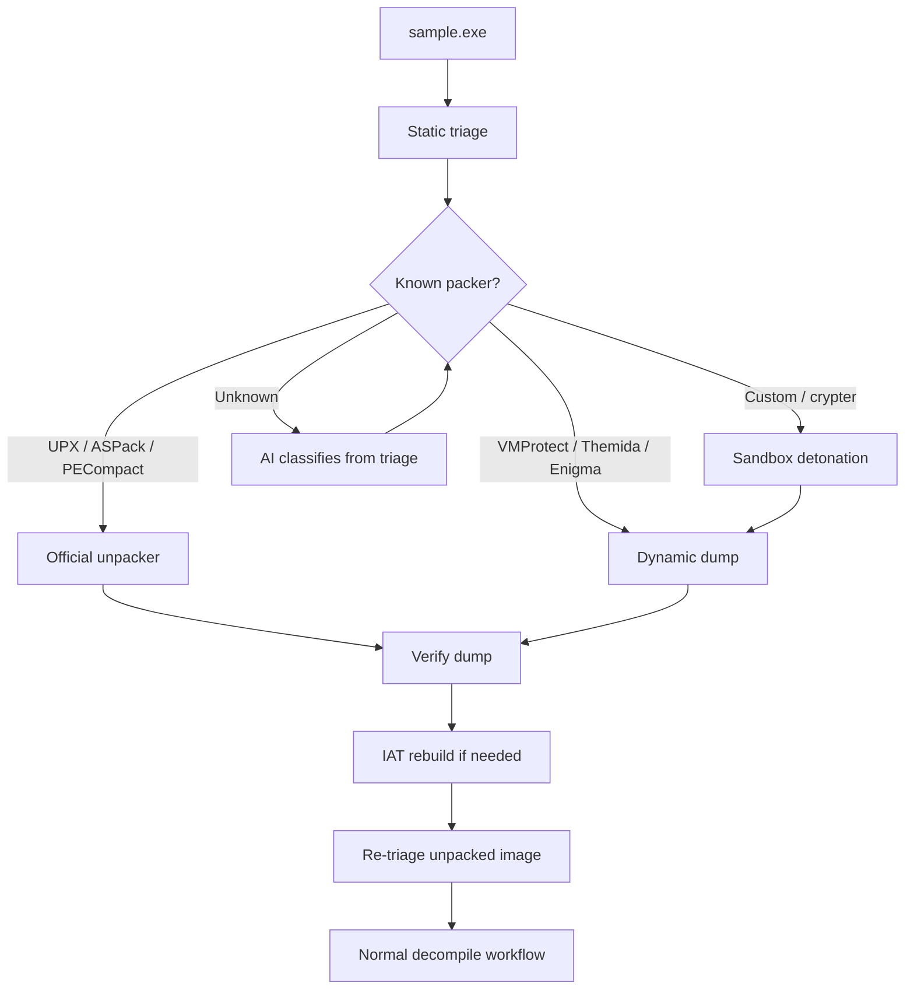
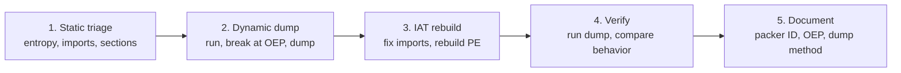

# Packed and Protected Binaries: The Unpacking Workflow

> Tags: packing | unpacking | UPX | VMProtect | Themida | IAT rebuild | entropy | Difficulty: Intermediate to Advanced | Prerequisites: [`../07-advanced/anti-analysis.md`](../07-advanced/anti-analysis.md) (anti-debug context), [`../01-setup/malware-isolation.md`](../01-setup/malware-isolation.md) (detonation sandbox), [`deobfuscation.md`](deobfuscation.md) (what happens after you dump)

## Overview

Packing compresses or encrypts a binary. The code is restored at run time. The unpacked image only exists in memory for a short window.

Protection is a wider term. It includes packing, plus anti-dump, anti-debug, virtualized code, and license checks.

The goal of this page is one workflow. It applies to every packer family:

1. Detect the packer from static signals.
2. Pick the cheapest path to the unpacked image.
3. Dump the process at the right moment.
4. Rebuild the import table.
5. Verify that the dump is complete and runnable.
6. Feed the result into the normal analysis pipeline.

AI helps at three points. It classifies the packer from triage output. It writes per-target scripts for dumping and rebuilding. It cleans up the dump after the fact. It does not replace the debugger. A packed binary defeats a model that has no access to the live process.

The page ends with [`unpacking-dumping.md`](../04-dynamic/unpacking-dumping.md) for the deep mechanics of dumpers, memory scanning, and IAT reconstruction on exotic targets.

## Packer Taxonomy

Read this table before detection. Each family needs a different workflow.

| Family | Examples | What it does | Best first move |
|---|---|---|---|
| Compressor packers | UPX, ASPack, PECompact, FSG, MEW | Compress sections. Stub decompresses at entry | Try the official unpacker. `upx -d` for UPX |
| Protector packers | VMProtect, Themida, Enigma, Obsidium, Armadillo | Compress, encrypt, virtualize, anti-debug | Dynamic dump. Static is hopeless for VM layers |
| Crypters | Themida/WinLicense loaders, custom crypters, FUD crypters | Encrypt the payload. Stub decrypts in memory | Sandbox detonation first. Dump at decrypt completion |
| .NET packers | ConfuserEx, Dotfuscator, .NET Reactor, Agile.NET, Babel | Rename, encrypt strings, inject IL stubs | `de4dot` or manual deobfuscation on managed code |
| Mobile packers | Bangcle,ijiami, SecNeo, Tencent Legu, DexProtector | Encrypt DEX or native libs. Unpack in memory on device | `frida-dexdump` or runtime DEX dump on a rooted device |
| ELF packers | UPX for ELF, custom Linux packers | Same model as PE, different stub | `upx -d`, or GDB dump at OEP |

Important distinctions:

- **Compressor packers keep the original code.** After `upx -d` you get a working binary. Decompression is reversible.
- **Protectors change the code.** VMProtect virtualizes hot functions. Themida mutates instructions. The dump you get is not the original binary. It is a runtime-decompressed version that still contains VM code.
- **Crypters are usually malware wrappers.** The packed payload is malicious. The outer stub is benign-looking. Always analyze in a sandbox.
- **.NET packers produce managed code.** You do not dump memory. You deobfuscate the IL. See [`managed-code-re.md`](managed-code-re.md).

## Detection Signals

Run these checks before you pick a path. Do not guess.

### File-level signals

| Signal | Tool | What it tells you |
|---|---|---|
| Section names | `pefile`, `rabin2 -S`, DIE | `.UPX0`, `.UPX1`, `UPX0`, `UPX1` mean UPX. Random names or a single huge `.text` mean a protector |
| Section entropy | `binwalk -E`, `ent`, `pefile` | High entropy (above ~7.2 bits/byte) means compressed or encrypted data. UPX sections sit near 7.9 |
| Import count | `pefile`, `rabin2 -i` | Few imports (under ~20) plus a normal-looking file is a classic packer signature. Packers resolve imports at run time |
| Entry point location | `pefile`, `rabin2 -E` | Entry point inside the last section, or in a tiny `.text` that only calls `VirtualAlloc` and `VirtualProtect`, means a stub |
| TLS callbacks | `pefile` (`DIRECTORY_ENTRY_TLS`), IDA, Ghidra | TLS callbacks run before `main`. Packers use them for early unpack. UPX and many protectors set them |
| Rich header | `pefile` or DIE | A missing or tiny Rich header means the file was rebuilt or packed |
| Overlay data | `pefile` `overlay` | A large overlay after the last section can hide the real payload |
| Strings | `floss`, `strings -a` | No useful strings in a binary that should have them means packing. `floss` decodes stack strings. Compare its output to `strings` |
| Packer signature | DIE, `exeinfope`, `peid`, capa | DIE has a signature DB for UPX, ASPack, VMProtect, Themida, Enigma and hundreds more |

### Quick commands

```bash
# Detect It Easy — packer/compiler signatures
diec sample.exe

# DIE interactive (better signatures than diec)
die sample.exe

# Section headers and entropy
rabin2 -S sample.exe          # section table
rabin2 -zz sample.exe         # strings
binwalk -E sample.exe         # entropy plot per block

# Python one-liner for section entropy and imports
python3 - <<'EOF'
import pefile, math
pe = pefile.PE("sample.exe")
print("entry:", hex(pe.OPTIONAL_HEADER.AddressOfEntryPoint))
print("imports:", sum(len(e.imports) for e in pe.DIRECTORY_ENTRY_IMPORT) if hasattr(pe,'DIRECTORY_ENTRY_IMPORT') else 0)
for s in pe.sections:
    data = s.get_data()
    if not data: continue
    from collections import Counter
    c = Counter(data); n = len(data)
    ent = -sum(v/n * math.log2(v/n) for v in c.values())
    print(s.Name.rstrip(b'\x00'), "vsize", hex(s.Misc_VirtualSize), "entropy", round(ent,2))
print("TLS callbacks:", bool(pe.OPTIONAL_HEADER.DATA_DIRECTORY[9].VirtualAddress))
EOF
```

### Interpretation cheat sheet

| Observation | Likely family |
|---|---|
| `.UPX0`/`.UPX1` sections, entry at UPX stub | UPX |
| High entropy sections, few imports, random section names | VMProtect or Themida |
| TLS callbacks, anti-debug strings, `.themida` or `.vmp` section names | Themida / VMProtect |
| Enigma section markers, `.enigma1`/`.enigma2` | Enigma Protector |
| .NET assembly with weird method bodies, `Confuser` attributes | .NET packer — switch to IL tools |
| ELF with UPX magic or `UPX!` strings | UPX for ELF |
| No packer signature but still no imports | Custom crypter. Go dynamic |

## How It Works



### The universal workflow

Every packer reduces to the same five stages. The tools change. The order does not.



#### Stage 1: Static triage

Collect the facts from the table above. Output a `triage/` directory with `die.txt`, `sections.txt`, `imports.txt`, `entropy.txt`, `strings.txt`. This directory is the input for both the AI classifier and your own decision.

#### Stage 2: Dynamic dump

Run the binary in an instrumented environment. Let the stub unpack. Break after the unpack. Dump the memory image.

For PE on Windows:

- x64dbg with ScyllaHide for anti-debug bypass. ScyllaHide is the standard plugin. It hooks the common anti-debug APIs.
- PE-sieve (`github.com/hasherezade/pe-sieve`) scans a live process and dumps implants. It detects process hollowing and in-memory patches without needing the OEP.
- Process dump tools: x64dbg's built-in dump, Process Hacker / System Informer memory dump, or a custom MiniDumpWriteDump script.

For ELF on Linux:

- `gdb` with a breakpoint on `execve` return or on the first `mprotect`/`mmap` after the stub. Or use `unipacker` which emulates the binary and dumps automatically.
- `unipacker` (`github.com/unipacker/unipacker`) is a Unicorn-engine-based unpacker. It runs the binary in emulation, detects when the original entry point is reached, and writes the unpacked image. Release 1.0.8 is from May 2024. It handles many UPX and custom packers.

For .NET:

- No memory dump. Run `de4dot` (`github.com/de4dot/de4dot`, archived but still the standard) or use dnSpyEx to inspect. Modern ConfuserEx forks need manual work.

For mobile:

- `frida-dexdump` (`github.com/hluwa/frida-dexdump`) scans memory for DEX headers and dumps them. Works on rooted Android.
- For iOS, `frida-ios-dump` or `bagbak` for IPA dumping. See [`apple-ios-re.md`](apple-ios-re.md).

#### Stage 3: IAT rebuild

A dumped process has a broken import table. The stub resolved imports at run time but did not write them back in PE format. You must rebuild.

For Windows PE:

- **Scylla** (`github.com/NtQuery/Scylla`) is the standard. Attach to the dumped process, use "IAT Autosearch", then "Get Imports", then "Dump" and "Fix Dump". It works on x86 and x64.
- **ExtremeDumper** is the maintained successor for newer Windows versions. Scylla targets Windows 7 era. Check current status before relying on it for Win10/11.
- **pe-unlock** and manual approaches: find the IAT in memory, rebuild the import descriptors, fix the PE header.

For ELF:

- IAT rebuild is simpler. `unipacker` and similar tools often produce a runnable ELF directly. If not, use `gdb` to find the GOT/PLT and patch manually.

The key insight: the IAT rebuild is deterministic. You can verify it by checking that the dump's imports resolve to valid addresses in loaded modules.

#### Stage 4: Verify

A dump that does not run is not done. Verify in this order:

1. **File structure.** `file dump.exe`, `pefile` section check, `diec dump.exe` to confirm packer is gone.
2. **Imports.** Count imports. Compare to expected. A rebuilt IAT should have dozens to hundreds of imports, not 3.
3. **Run it.** Execute the dump in a sandbox. Does it behave like the original? Check for the same network calls, file writes, registry changes.
4. **Compare.** If you have the original, run both under the same instrumentation. The behavior should match.
5. **Decompile.** Load the dump in IDA/Ghidra. Does the decompiler produce readable code? If it produces garbage, the dump is wrong.

#### Stage 5: Document

Record for the case file:

- Packer family and version.
- Detection signals that identified it.
- Dump method (tool, breakpoint, OEP address).
- IAT rebuild tool and any manual fixes.
- Verification result (runs? matches original? decompiles?).
- Any residual protection (VM code still present, anti-debug still active).

## Per-Packer Notes

### UPX

The easiest packer. Always try `upx -d` first.

```bash
upx -d sample.exe -o unpacked.exe
upx -t sample.exe          # test integrity
```

If `upx -d` fails:

- Modified UPX headers. The magic `UPX!` may be patched. Look for the stub pattern and patch the header back, or dump from memory.
- UPX with added sections. Some malware adds a section after UPX packing. `upx -d` refuses. Strip the extra section or dump dynamically.
- UPX for ELF. Same tool. `upx -d` works on Linux binaries.

Detection: `.UPX0`/`.UPX1` sections, `UPX!` magic in the stub, entry point in the last section.

### ASPack, PECompact, FSG, MEW

Older compressor packers. Less common in 2026 but still appear in legacy malware and crackmes.

- ASPack: try `aspack-die` or manual OEP finding. The stub is small. Break on the tail jump to OEP.
- PECompact: similar. Some versions have anti-debug.
- FSG: has a known unpacking tutorial. The stub decrypts section by section.
- MEW (MEW packer): older. Mostly in old game cracks.

For all of these: dynamic dump at OEP + IAT rebuild is the universal fallback.

### VMProtect

The hardest common protector. Three modes:

- **Packing only** (no virtualization). The stub unpacks. Dump works.
- **Mutation** (code obfuscation). Instructions are replaced with equivalents. Dump gives you mutated code. Deobfuscation is a separate problem. See [`deobfuscation.md`](deobfuscation.md).
- **Virtualization** (VMProtect's core feature). Selected functions run on a custom VM. The dump contains the VM interpreter and bytecode. Static decompilation of virtualized functions is research-grade.

Workflow for VMProtect:

1. Detect with DIE. VMProtect sections are often named `.vmp0`, `.vmp1`, `.vmp2`.
2. Dump at OEP if the binary is packed. The unpacked image still contains VM code.
3. For virtualized functions, use trace-driven analysis. `wul7chaos/vmp-reverse-skill` captures execution traces and lifts handlers to IR. See [`deobfuscation.md`](deobfuscation.md) for details.
4. Accept that full devirtualization is not solved. Budget time per function.

### Themida

Themida (and its sibling WinLicense) is VMProtect's competitor. Larger feature set, weaker public tooling.

- Sections often named `.themida`, `.winlice`.
- Anti-debug is aggressive. ScyllaHide helps but expect cat-and-mouse.
- `github.com/bobalkkagi/bobalkkagi` has Themida 3.x unpacking research. Status: stale-ish, devirt WIP.
- For Themida, the realistic path in 2026 is: dump the unpacked image, accept the VM layer as-is, and analyze the non-virtualized parts.

### Enigma Protector

Enigma is a mid-tier protector. Less common than VMProtect/Themida but still used.

- Sections: `.enigma1`, `.enigma2`.
- Has its own VM for license checks. The VM is simpler than VMProtect's.
- Dynamic dump at OEP usually works. IAT rebuild with Scylla or ExtremeDumper.
- Enigma's trial/license system adds a wrapper. The unpacked code may still check the license. Patch or bypass after unpacking.

### Crypters

Custom crypters encrypt the payload with a unique stub per sample. No public unpacker exists.

Workflow:

1. Detonate in a sandbox (CAPE, ANY.RUN, local VM).
2. Let the stub decrypt. The decrypted payload appears in memory.
3. Use PE-sieve or a memory scanner to find the PE header in memory.
4. Dump the process. Rebuild IAT.
5. The dumped payload is usually a standard PE. Re-triage it.

For fileless or shellcode payloads: the "dump" is the shellcode itself. Analyze it with a disassembler at the correct base address.

### .NET packers

.NET packers work on IL, not native code. The workflow is different.

| Packer | Tool |
|---|---|
| ConfuserEx | `de4dot` (archived), or manual with dnSpyEx |
| Dotfuscator | `de4dot` partial, or commercial deobfuscators |
| .NET Reactor | `de4dot` partial, or manual |
| Agile.NET | Manual. Less common. |
| Babel | `de4dot` supports it |

`de4dot` (`github.com/de4dot/de4dot`) is archived but still works on many ConfuserEx variants. For newer versions, the community maintains forks. Check `github.com/search?q=de4dot` for current forks.

Workflow:

1. `file sample.exe` confirms .NET (`PE32 executable for MS Windows, Intel 80386 Mono/.Net assembly`).
2. Try `de4dot sample.exe -o cleaned.exe`.
3. If de4dot fails, open in dnSpyEx. The obfuscation is visible in the IL. Rename, decrypt strings, remove anti-tamper manually.
4. For heavy ConfuserEx, tools like `NETReactorSlayer` or `ConfuserEx-Unpacker` exist but are hit-or-miss. Verify the repo before use.

### Mobile packers

Android packers encrypt the DEX or native libraries. The unpacked code only exists in memory after the stub runs.

Tools:

- `frida-dexdump` (`github.com/hluwa/frida-dexdump`) — scans memory for DEX magic (`dex\n035` etc.) and dumps. Works on most Android packers.
- `Exuvia` (`github.com/Huai-Tian/Exuvia`) — deterministic Android unpacking with LLM work packages. See report section on mobile.
- `MobileRE-Skill` (`github.com/index-login/MobileRE-Skill`) — has an unpacking pipeline. Memory DEX dump to dex-to-C handoff.

Workflow:

1. Root the device or use an emulator with root.
2. Install Frida server.
3. Run the target app.
4. `frida-dexdump -U -d <package>` or attach to PID.
5. Reassemble the dumped DEX files with `apktool` or feed to jadx.

For iOS: `frida-ios-dump` (`github.com/AloneMonkey/frida-ios-dump`) decrypts the App Store encryption. Then class-dump or use Ghidra on the decrypted binary.

## AI's Role

### Where AI helps

| Task | How |
|---|---|
| Packer classification | Feed `diec`, entropy, section names, import count to the model. Ask for family and confidence. The model is good at pattern matching on structured triage |
| Script generation | Ask the model to write a Frida script that hooks `VirtualAlloc`/`VirtualProtect` and dumps when the stub finishes. Or a Scylla automation script. Or a `pefile` script to fix a broken header |
| IAT analysis | After a dump, feed the broken import table to the model. Ask which imports are missing and what they likely resolve to. Verify against the loaded modules |
| Post-dump cleanup | The dump often has junk sections, wrong sizes, or leftover stub code. The model can propose a cleanup script. Verify by running the cleaned dump |
| Anti-debug bypass | Feed the anti-debug check code to the model. Ask for the patch or the hook. This is bounded and the model is good at it |
| Report writing | Summarize the unpacking process for the case file. The model formats well. You verify the facts |

### Where AI does not help

- **Finding the OEP.** This requires running the binary and watching memory. The model cannot do this without a debugger or emulator bridge.
- **Deciding when to dump.** The timing is target-specific. The model can suggest breakpoints but cannot know which one is correct without execution.
- **Devirtualizing VMProtect.** This is an open research problem. The model can help with handler classification (see `vmp-reverse-skill`) but cannot produce a full devirtualizer.
- **Bypassing novel anti-dump.** If the packer checks for Scylla's signature or detects the dump timing, the model needs the actual check code to reason about it.

### A safe AI workflow for unpacking

```text
1. Run deterministic triage (diec, pefile, entropy, strings).
2. Feed triage output to the model. Get packer family + confidence.
3. If confidence is high and packer is known (UPX, ASPack): try official unpacker.
4. If packer is a protector: go dynamic. Set up debugger/sandbox.
5. Ask the model for a dump script or breakpoint suggestion based on the packer family.
6. Run the dump. Verify the output.
7. Feed the broken IAT or weird sections to the model for cleanup suggestions.
8. Verify the cleaned dump runs.
9. Document everything.
```

The model proposes. The tools and the debugger decide.

## Pitfalls

- **Do not trust `diec` alone.** DIE signatures can be evaded. A custom crypter will show as "unknown" or as a generic compiler. Always check entropy and imports too.
- **UPX is not always clean.** Malware authors modify UPX headers, add sections, or wrap UPX in another layer. `upx -d` may refuse or produce a broken binary. Have a dynamic fallback.
- **A dump that runs once may not run twice.** Some packers use anti-dump tricks: corrupted PE headers that the loader fixes, IAT entries that point to stack addresses, or timing checks. Test the dump multiple times.
- **IAT rebuild is not magic.** Scylla works on standard Windows processes. It fails on: .NET assemblies (use IL tools), processes with heavy anti-debug, and dumps taken at the wrong moment. Know when to fix manually.
- **VMProtect dumps still contain VM code.** Do not expect a clean decompile after dumping a VMProtect binary. The virtualized functions remain virtualized. See `deobfuscation.md`.
- **Themida is harder than VMProtect.** The public tooling is thinner. Budget more time.
- **Mobile unpacking needs root.** `frida-dexdump` requires a rooted device or emulator. Plan for this.
- **.NET packers are not memory dumps.** Do not try to dump a .NET assembly's memory. Deobfuscate the IL instead.
- **Sandbox first for unknown samples.** A crypter stub can be malicious. Detonate in CAPE or ANY.RUN before analyzing on your workstation.
- **Scylla targets Windows 7.** For Windows 10/11, check if ExtremeDumper or a maintained fork is needed. Scylla may still work but verify.
- **Entropy alone is not enough.** High entropy can mean packing, encryption, or just compressed data (like a PNG inside the binary). Combine signals.
- **The OEP is not always the entry point.** Some packers jump through multiple stubs before reaching the real OEP. The "entry point" in the PE header is the stub's entry, not the original program's entry.
- **Do not feed the packed binary to the decompiler.** You will get the stub's code, not the program's. Always unpack first.

## Step-by-Step: A Complete Example

This is the workflow for an unknown PE that `diec` identifies as "VMProtect" but with suspicious entropy.

```bash
# 1. Static triage
mkdir -p case001/{triage,dump,notes}
diec sample.exe > case001/triage/die.txt
python3 pefile-triage.py sample.exe > case001/triage/sections.txt
strings -a -n 8 sample.exe > case001/triage/strings.txt
floss sample.exe > case001/triage/floss.txt

# 2. AI classification (optional but recommended)
# Feed triage/ to the model. Ask: "What packer family? What is the OEP strategy?"

# 3. Dynamic analysis
# Launch in x64dbg with ScyllaHide
# Set breakpoints on VirtualAlloc, VirtualProtect
# Run until the stub finishes (look for the OEP jump)
# At OEP: Scylla -> IAT Autosearch -> Get Imports -> Dump -> Fix Dump

# 4. Verify
file case001/dump/fixed_dump.exe
diec case001/dump/fixed_dump.exe
# Should show no packer. Run in sandbox. Compare behavior.

# 5. Document
cat > case001/notes/unpacking.md <<'EOF'
Packer: VMProtect 3.x (mutation mode, no virtualization on main path)
Detection: .vmp0/.vmp1 sections, high entropy, TLS callback
Dump method: x64dbg + ScyllaHide, OEP at 0x401000, Scylla IAT rebuild
Verification: dump runs, decompiles cleanly in IDA, no residual VM on hot path
Residual: 3 functions still virtualized. See deobfuscation.md for next steps.
EOF
```

## See Also

- [`unpacking-dumping.md`](../04-dynamic/unpacking-dumping.md) — deep dive on dumpers, memory scanning, IAT reconstruction mechanics
- [`deobfuscation.md`](deobfuscation.md) — what to do after unpacking when VM code remains
- [`../07-advanced/anti-analysis.md`](../07-advanced/anti-analysis.md) — anti-debug and anti-dump techniques the packer uses against you
- [`../06-topics/malware-analysis.md`](../06-topics/malware-analysis.md) — full malware triage pipeline including unpacking stage
- [`../06-topics/managed-code-re.md`](../06-topics/managed-code-re.md) — .NET deobfuscation tools (de4dot, dnSpyEx)
- [`../06-topics/mobile-android-re.md`](../06-topics/mobile-android-re.md) — Android unpacking with frida-dexdump
- [`../01-setup/malware-isolation.md`](../01-setup/malware-isolation.md) — sandbox setup for safe detonation
- [`../03-decomp/triage-and-mapping.md`](../03-decomp/triage-and-mapping.md) — what to do with the unpacked binary next
