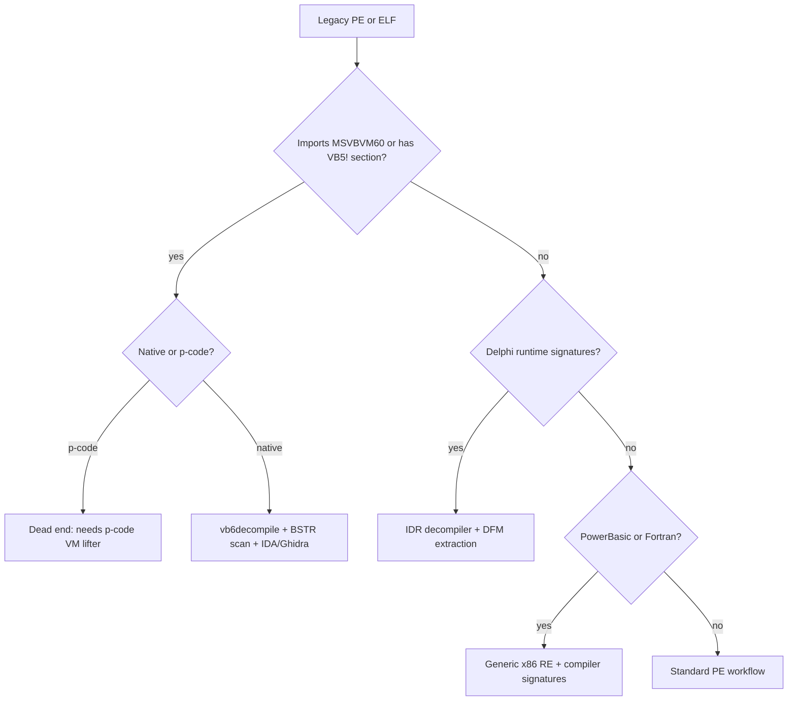

# Legacy Language RE: VB6, Delphi, PowerBasic, Fortran

> Tags: vb6, p-code, delphi, dfm, fortran, legacy, windows-pe | Difficulty: Advanced | Prerequisites: [`../00-fundamentals/binary-formats.md`](../00-fundamentals/binary-formats.md) and [`../00-fundamentals/assembly-crash-course.md`](../00-fundamentals/assembly-crash-course.md). Use [`../03-decomp/decompile-workflow.md`](../03-decomp/decompile-workflow.md) for the general loop.

## Overview

Legacy languages are alive in 2026. Industrial control software, OT and SCADA side tools, government desktop apps, and old malware families all still ship compiled VB6, Delphi, PowerBasic, and Fortran. The catch: almost none of these binaries decompile well in Ghidra or IDA. You get generic x86 pseudocode with no names, no form resources, and a UTF-16 string soup your ASCII scanners miss.

Why each language is in the pipeline:

| Language | Where it still lives | Native code? |
|---|---|---|
| VB6 | OT/SCADA front ends, ERP add-ons, museum-grade banking tools, old malware droppers | Yes for native builds. P-code builds run a VM |
| Delphi | Medical/industrial GUIs, Delphi-era commercial software, some drivers and tools | Always native, Kylix Pascal heritage |
| PowerBasic | DOS-era utilities, 16-bit/32-bit utilities, small custom tools | Always native, compiler-specific codegen |
| Fortran | Scientific and numerical payloads, old mainframe migrations, satellite/defense software | Always native, static or dynamically linked |

The honest 2026 state:

- VB6 has a real research gap. Commercial decompilers (VB Decompiler, Semi-VB-Decompiler, VBReFormer) recover fragments, not compilable code. Free tools recover forms and structure, not bodies. See the `47Hunter47/vb6decompile` project for the current open measurement of what is recoverable.
- Delphi has the best legacy decompiler story of the four: IDR (Interactive Delphi Reconstructor) reconstructs pseudo-Pascal for Delphi 2 through XE4, with a CBuilder build for XE11.
- PowerBasic and Fortran have no dedicated decompiler. You analyze them as ordinary x86/x64 or x86-16 with compiler-specific signatures.
- AI helps where structure exists to parse: .dfm resource text, VB6 BSTR literals, procedure tables, IDR output. AI does not recover names or types the compiler never wrote down.

This page covers detection, format quirks, extraction workflows, and where an agent actually earns its tokens.

## How It Works



### VB6: p-code versus native

VB6 compiles two ways. The compiler flag is `Compile to Native Code` in the project properties. You must know which you have before choosing a strategy.

**P-code builds.** The executable keeps VB bytecode in the `VB5!` resource section. At runtime `MSVBVM60.DLL` interprets it. The disassembly you see in IDA is the interpreter's C code, not your program. P-code bodies are not x86. Static tools cannot lift them without writing a VB p-code VM lifter. No maintained open lifter exists in 2026. Treat p-code as hard.

**Native builds.** The `VB5!` section holds object tables, form descriptors, and method metadata. Method bodies are ordinary x86. Calls go through `MSVBVM60` runtime functions rather than direct imports. Strings are `BSTR` objects: length-prefixed UTF-16LE stored inside `.text`.

Detection signals for VB6 in a PE:

| Signal | Where | Meaning |
|---|---|---|
| `MSVBVM60.DLL` import | Import table | VB6 runtime. Definite VB6 |
| `VB5!` resource section name | PE sections | VB6 code/data section, native or p-code |
| `__vba` / `rtc` / `__vbaStr` call targets | Disassembly | MSVBVM60 exports, VB6 native body |
| `BSTR` heap pointers with `-4` length prefix | `.text` | UTF-16 literals VB6 code reads |

Distinguish native from p-code inside the `VB5!` header. The header contains a flag word. The `vb6decompile` project documents the layout in `docs/formats.md`. p-code binaries are rarer in the wild but still appear in legacy enterprise installs.

### Delphi: forms, resources, and FastCall

Delphi compiles Pascal to native x86/x64. There is no VM and no bytecode. What survives compilation is form layout.

**Form resources live in the PE resource section.** Every `TForm` serializes as an `RCData` resource. The payload is a binary DFM stream. Delphi 2009 and later use Unicode strings inside the DFM. Earlier versions use ANSI. The resource name is numeric, not the form class name. The link from class to resource goes through the class's `ClassName` field and the `InitComponent` method.

**FastCall is the Delphi convention.** Registers EAX, EDX, ECX carry the first three arguments on 32-bit x86. This is not the Microsoft `__fastcall`. It differs from cdecl, stdcall, and Pascal convention. On x64, Delphi uses the Microsoft x64 ABI. FastCall matters because your decompiler's calling-convention detection will guess wrong on 32-bit Delphi binaries. You fix the signature manually.

**Strings.** Delphi's default `string` type maps to `System::AnsiString` on Delphi 2009 and earlier, or `System::UnicodeString` on later versions when `DefaultUnicode` is on. Both are reference-counted with a header before the pointer. `PChar` is a raw null-terminated pointer. `WideString` is a BSTR-compatible UTF-16 allocation. You see all three in one binary. A string at `esi-12` with a negative header is UnicodeString. A string at `eax-4` with a length prefix is AnsiString. A string read as raw bytes until `0x00` is PChar.

### PowerBasic and Fortran: compiler recognition only

**PowerBasic.** The modern PowerBasic 10/11 compiler is closed source and ships Windows binaries. There is no public compiler source and no open decompiler. Old DOS PowerBasic produces real-mode or 16-bit protected-mode EXEs. The `Hawkynt/PB-Compiler` project implements a PowerBASIC-family compiler in C# for analysis and DOSBox verification. It is a compiler, not a decompiler, but its grammar knowledge helps you read PB assembly idioms: `REG`, `FN`, `CALL` pointer tables, and B$ heap pointers.

**Fortran.** Gfortran, Intel Fortran, and Lahey/Compaq Fortran all emit native x86/x64 or x86-16. Static linking is common in scientific software, so the binary carries gfortran runtime symbols. You identify the compiler by runtime library names (`libgfortran`, `libifcore`, `f90`, `for_init`). Decompilation treats the binary as normal C-like x86. Arrays are column-major. Assumed-shape arrays pass a hidden descriptor block. Named common blocks appear as global data symbols when not stripped.

## Setup

### Tool matrix for legacy languages

| Tool | VB6 p-code | VB6 native | Delphi | PowerBasic | Fortran |
|---|---|---|---|---|---|
| IDA 9.5 | No p-code lifter. Loads native VB6 as x86 | Yes, generic x86 | Yes, plus Delphi sig files | Yes, generic x86 | Yes, generic x86 |
| Ghidra 12.2 | Same as IDA | Yes, generic x86 | Yes, plus `.dfm` scripts you write | Yes, generic x86 | Yes, generic x86; gfortran calling convention exists |
| Binary Ninja 6.0 | Same as IDA | Yes, generic x86 | Yes, generic x86 | Yes, generic x86 | Yes, generic x86 |
| VB Decompiler (commercial) | Yes | Yes | No | No | No |
| Semi-VB-Decompiler (free) | Partial | Partial, pseudo-source bodies | No | No | No |
| VBReFormer (free) | Partial | Forms and structure only | No | No | No |
| IDR (free) | No | No | Yes, Delphi 2-XE4 plus XE11 build | No | No |
| `vb6decompile` (free, Python) | No | Yes, structure and literals | No | No | No |

### IDA and Ghidra scripts for VB6

You do not get VB6 decompilation from IDA or Ghidra out of the box. You get two scripts that matter:

1. **`VB6_Importer` or equivalent loader.** Loads the `VB5!` section, parses the object table, and names method entry points. The object table is the only reliable procedure map. Without it, you have 34,000 anonymous functions.
2. **`BSTR` string harvester.** Scans `.text` for UTF-16LE sequences preceded by a `DWORD` length. VB6 stores literals inline in code, not in `.rdata`. A normal ASCII string scanner misses them.

The `vb6decompile` project's `literals` stage does the BSTR scan standalone:

```bash
git clone https://github.com/47Hunter47/vb6decompile
cd vb6decompile
python -m pip install -e .
vb6d literals /path/to/App.exe --out literals.json
```

For IDA, you can run the same logic as an IDAPython script. The core scan is simple:

```python
import idautils, ida_bytes, idaapi, struct

def scan_bstr(start, end):
    results = []
    ea = start
    while ea < end:
        # Look for length prefix followed by UTF-16LE data
        if ea >= 4:
            length = ida_bytes.get_dword(ea - 4)
            if 0 < length < 4096 and (length % 2 == 0):
                data = ida_bytes.get_bytes(ea, length)
                try:
                    text = data.decode('utf-16-le')
                    if all(0x20 <= ord(c) < 0x7F or c in '\r\n\t' for c in text):
                        results.append((ea, text))
                        ea += length
                        continue
                except UnicodeDecodeError:
                    pass
        ea += 2
    return results
```

This is approximate. The real BSTR layout has alignment and length quirks the `vb6decompile` project documents in `docs/formats.md`. Use it as a starting point, not a finished scanner.

### IDR for Delphi

IDR is the standard Delphi decompiler. It is a 32-bit Windows tool. It loads the PE, finds the Delphi runtime structures, and reconstructs pseudo-Pascal.

```bash
# Download IDR from https://github.com/crypto2011/IDR
# Requires Borland C++ Builder 6 or a prebuilt binary
# Needs kb*.7z knowledge bases for the target Delphi version
idr.exe target.exe
```

The `tbkb*.bin` and `kb*.7z` files map Delphi compiler versions to runtime signatures. You must match the knowledge base to the target's Delphi version. Die (`diec`) reports the compiler. If IDR cannot identify the version, you get garbage output.

For Delphi XE11 binaries, `tony2u/IDR-XE11` is a CBuilder XE11 build. For Delphi 2009 and later, the Unicode DFM format changes the resource layout. IDR handles it, but the .dfm extraction step is different.

### Extracting .dfm resources

Delphi forms live in `RT_RCDATA` resources. Extract them with `pescan` or a small Python script:

```python
import pefile, struct

def extract_dfm(pe_path):
    pe = pefile.PE(pe_path)
    for entry in pe.DIRECTORY_ENTRY_RESOURCE.entries:
        if entry.id == 10:  # RT_RCDATA
            for res in entry.directory.entries:
                name = res.name or res.id
                data_rva = res.directory.entries[0].data.struct.OffsetToData
                size = res.directory.entries[0].data.struct.Size
                data = pe.get_data(data_rva, size)
                # DFM binary starts with a signature byte 0xFF or 0xF0
                print(f"resource {name}: {size} bytes, sig={data[:4].hex()}")
```

The payload is a binary DFM stream. Delphi 2009+ uses UTF-16 strings inside. You parse it with a DFM parser or dump it raw and let an LLM read the text. The binary format is documented in the Delphi RTL source and in community parsers like `DeDe` (which is a different decompiler but has a DFM reader).

For form layout recovery, the fastest path is `DeDe` or `IDR` form reconstruction. Both emit `.dfm`-equivalent text: control trees, captions, geometry, event handler names. That text is what you feed the LLM for semantic labeling.

### PowerBasic and Fortran setup

PowerBasic and Fortran need no special setup. Load them in IDA or Ghidra as ordinary PE/ELF. The work is manual:

- **PowerBasic**: identify the compiler by section names and runtime library imports. PB 9/10/11 on Windows uses standard Win32. Old DOS versions produce `.com` or MZ executables with no PE header. Ghidra handles NE and LE executables poorly; use DOSBox or a dedicated 16-bit disassembler.
- **Fortran**: identify gfortran vs Intel Fortran by runtime symbols. `readelf -s` or `objdump -T` shows `GFORTRAN_` or `libifcore` references. For x86-16 Fortran, you need a real-mode disassembler and knowledge of the compiler's array descriptor layout.

## Usage

### VB6 triage workflow

```bash
# 1. Identify the target
file App.exe
diec App.exe
# Look for: "VB6", "MSVBVM60", "p-code" or "native"

# 2. Extract strings with BSTR awareness
vb6d literals App.exe > bstr_strings.txt
# Cross-check with a UTF-16 scan
strings -e l App.exe > utf16_strings.txt

# 3. Dump the PE structure
pefile -d App.exe > pe_info.txt
# Or use Detect It Easy for full compiler/packer info

# 4. Load into IDA/Ghidra
# For native VB6: run the BSTR scanner script
# For p-code: accept that you have a VM problem, not an x86 problem

# 5. Extract form resources (VB6 stores .frm as binary in resources)
vb6d frm --listings <decompiler_output_dir>
# This reads the decompiler's recovered .frm files
```

The `vb6decompile` pipeline is:

```
vb6d pe      <install_dir>     # surface scan: which binaries are VB6
vb6d procs   <app.exe>         # procedure inventory from object table
vb6d literals <app.exe>        # BSTR/UTF-16 literals with addresses
vb6d stitch  <listing_dir>     # join SQL fragments, classify gaps
vb6d frm     <listing_dir>     # .frm design recovery
vb6d blob    <app.exe>         # form geometry from binary blobs
vb6d datareport <install_dir>  # report layouts from DLLs
vb6d mask    .                 # credential redaction audit
```

### Delphi workflow

```bash
# 1. Identify compiler version
diec App.exe
# Look for: "Delphi", "Borland", version string

# 2. Try IDR
idr.exe App.exe
# Output: pseudo-Pascal with class names, method names, form references

# 3. Extract DFM resources
python extract_dfm.py App.exe > forms.txt
# Parse the binary DFM or feed raw to LLM with a format hint

# 4. If IDR fails (Delphi XE11+ or packed), fall back to Ghidra
# Ghidra with a Delphi signature pack
# Fix FastCall manually on 32-bit targets

# 5. Recover event handlers
# IDR maps resource IDs to class methods
# You match DFM control names to disassembled handler functions
```

### Fortran workflow

```bash
# 1. Identify compiler
readelf -p .comment libapp.so 2>/dev/null
objdump -T libapp.so | grep -i fortran
nm libapp.so | grep -i gfortran

# 2. Load in Ghidra
# Ghidra has a gfortran calling convention
# For Intel Fortran, use a custom convention or manual override

# 3. Recover array descriptors
# Fortran assumed-shape arrays pass a hidden first argument
# The descriptor layout differs between gfortran and Intel Fortran

# 4. Map common blocks
# Common blocks appear as large .bss/.data structures
# Use nm or readelf to find symbols
```

### AI assistance patterns

The useful AI tasks for legacy binaries:

| Task | Input | Prompt pattern |
|---|---|---|
| Form layout labeling | `.dfm` text or IDR output | "Label each control with its likely function. Flag controls whose names suggest business logic." |
| API call renaming | Disassembly with MSVBVM60 calls | "Map each `__vba*` call to its VB6 runtime function. Group calls by operation." |
| BSTR literal cleanup | Raw string dump | "Extract SQL statements, file paths, registry keys from this UTF-16 string list." |
| Delphi event mapping | IDR output + DFM resources | "Match each DFM control to its event handler method in the IDR output." |
| Fortran array recovery | Disassembly + symbol table | "Identify array descriptor arguments and recover the array bounds." |

**Do not ask the AI to:**
- Decompile the whole binary into compilable source. It will hallucinate.
- Recover VB6 p-code semantics. The VM is opaque without a lifter.
- Guess at Delphi RTTI for versions it does not know. Verify against the actual PE.

## Pitfalls

1. **P-code is not native.** If `vb6d procs` reports zero validated entry points, you probably have p-code. Stop and reassess.

2. **VB6 strings are BSTR, not C strings.** They live in `.text`, not `.rdata`. They are UTF-16LE. ASCII scanners miss them. UTF-16LE scanners without length-prefix validation produce false positives.

3. **Delphi FastCall is not stdcall.** EAX/EDX/ECX carry args. `__fastcall` in MSVC uses ECX/EDX. They are different. Get the convention wrong and your stack analysis is wrong.

4. **DFM resources are binary.** Delphi 2009+ uses UTF-16 inside the binary DFM. Pre-2009 uses ANSI. You must know the version to parse correctly.

5. **IDR needs the right knowledge base.** Wrong Delphi version means wrong output. Always check `diec` first.

6. **VB6 form blobs are not .dfm.** VB6 stores forms as binary property blobs in resources, not as Delphi-style DFM streams. The `vb6decompile` project's `blob` stage parses them.

7. **Fortran common blocks are not C globals.** They have compiler-specific layouts and alignment. Do not assume `.bss` offsets match source declarations.

8. **PowerBasic DOS binaries are not PE.** They are MZ, LE, or NE executables. IDA and Ghidra handle them poorly. Use DOSBox or a 16-bit disassembler.

9. **VB6 procedure names do not exist in native builds.** The object table gives addresses and method counts. Names come from decompiler guesses and `.frm` event bindings. Treat every name as a hypothesis.

10. **AI cannot recover what the compiler erased.** Type information, variable names, and source-level abstractions are gone. The AI can label what it sees. It cannot invent what was never there.

## See Also

- [`../03-decomp/decompile-workflow.md`](../03-decomp/decompile-workflow.md) — the general human+AI decompilation loop
- [`../03-decomp/triage-and-mapping.md`](../03-decomp/triage-and-mapping.md) — first-look commands for any binary
- [`../00-fundamentals/binary-formats.md`](../00-fundamentals/binary-formats.md) — PE sections, resources, imports
- [`../00-fundamentals/assembly-crash-course.md`](../00-fundamentals/assembly-crash-course.md) — x86 asm for pseudocode readers
- [`../05-tools/tool-catalog.md`](../05-tools/tool-catalog.md) — decompiler and debugger catalog
- [`../06-topics/managed-code-re.md`](../06-topics/managed-code-re.md) — .NET, Java, Go, Rust (the modern counterpart to legacy native)
- [`../06-topics/deobfuscation.md`](../06-topics/deobfuscation.md) — when legacy binaries are packed or protected
- [`../09-ops/legal-and-ethics.md`](../09-ops/legal-and-ethics.md) — DMCA and license issues with legacy software RE
