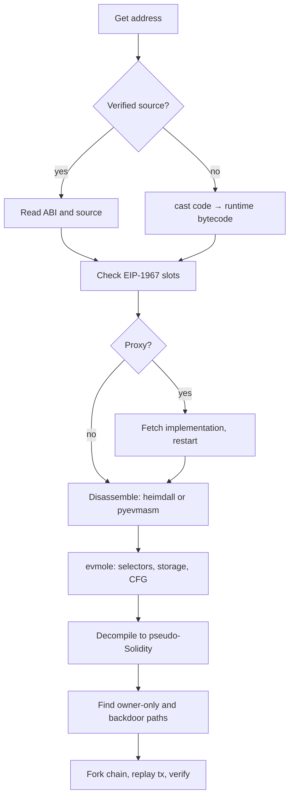

# Web3 and Blockchain RE

> Tags: ethereum, evm, smart-contracts, bytecode, solana, mev | Difficulty: Intermediate | Prerequisites: Python scripting, JSON-RPC basics, one debugger. See [`../03-decomp/`](../03-decomp/index.md) for general decompile loops and [`../07-advanced/ai-security-threats.md`](../07-advanced/ai-security-threats.md) for hostile-input rules.

## Overview

Smart contracts are binaries. They compile to EVM bytecode and deploy to an immutable, public ledger. Anyone can read the deployed bytecode. Verified source is optional. Roughly half of deployed contracts have no verified source on Etherscan. The analyst reads raw bytecode, reconstructs the logic, and checks who can call what.

The discipline differs from classic RE:

- The target is public and reproducible. You can replay any transaction against a forked chain.
- State is the payload. The interesting data lives in contract storage slots, not only in code.
- The runtime is cheap. Forking a chain and replaying transactions costs minutes, not hours of sandbox setup.
- Verifier backdoors are the classic threat. Owners and admins can move funds after you approve a swap.

Current state in November 2026:

- Solidity moved governance to the Argot Collective. The official repo is `argotorg/solidity`. Versions remain 0.x.
- `heimdall-rs` is alive but the lineage is messy. The original `Vectorized`/`Banteg` org repos are gone from GitHub. The maintained fork is `Jon-Becker/heimdall-rs`.
- `evmole` (cdump/evmole, Rust) is the most useful metadata extractor today. It infers selectors, argument types, mutability, storage records, and CFGs from unverified bytecode.
- `cast` from Foundry is the standard EVM CLI. It replaced most ad hoc `web3.py` calls.
- `panoramix` and `dedaub`'s old decompiler are effectively dead as open-source tools. Dedaub pivoted to a hosted security product.
- Frontier LLMs can decompile EVM bytecode to Solidity-like pseudocode. A May 2026 benchmark reports the best frontier model perfectly decompiled only 42 of 600 contracts. See the SCDBench paper (arXiv:2605.29059). Compilability is high. Semantic correctness is the bottleneck.

## How It Works

### EVM bytecode for analysts

EVM bytecode is stack-machine code. The Yellow Paper defines the semantics. Practical analyst model:

- Opcodes are single bytes `0x00`–`0xff`. Some opcodes push 32-byte immediates (`PUSH1`–`PUSH32`, `0x60`–`0x7f`).
- The stack holds 256-bit words. Max depth 1024.
- Execution is a jump table. Function dispatch happens through `PUSH4` of a selector, `EQ`, `PUSH2` of a destination, `JUMPI`.
- Runtime bytecode starts with a prologue that checks `CALLDATASIZE`, loads `calldataload(0)`, extracts `shr(0xe0, calldata)` as the 4-byte selector, then dispatches.
- Constructor code runs once at deploy. Runtime code is what you fetch from the chain.

Get the runtime bytecode:

```bash
# cast call returns the deployed code for any address
cast code 0xdAC17F958D2ee523a2206206994597C13D831ec7 --rpc-url https://eth.llamarpc.com
```

The output is hex with `0x` prefix. Save it:

```bash
cast code 0xADDRESS --rpc-url $RPC > /tmp/contract.hex
# strip the 0x and leading 0x60806040 init padding if needed
```

Disassemble with pyevmasm:

```bash
pip install pyevmasm
evasm -d -f shanghai < /tmp/contract.hex > /tmp/contract.asm
```

Or with evmdasm:

```bash
pip install evmdasm
python -m evmdasm /tmp/contract.hex -o /tmp/contract.dis
```

### Contract decompilers, current state

| Tool | Status 2026-11 | Input | Output | License | Notes |
|---|---|---|---|---|---|
| `Jon-Becker/heimdall-rs` | Active | bytecode, RPC address | disasm, CFG, decompile, storage dump | source-available | Install via `bifrost`. See wiki |
| `cdump/evmole` | Active | runtime bytecode | selectors, types, storage, CFG | MIT | Best metadata extractor. Rust + Python/TS bindings |
| `crytic/pyevmasm` | Active | bytecode | disasm/asm | MIT | Correctness reference. Fork-aware |
| `crytic/evmdasm` | Active | bytecode | disasm | MIT | Lightweight. CLI-friendly |
| `dedaub` hosted | Active, paid | bytecode | decompile, report | commercial | Public repo for old decompiler is gone |
| `panoramix` | Dead | bytecode | Solidity-ish | Apache-2.0 | Last meaningful commit years ago. Still cited |
| `hevm` | Stale | bytecode | symbolic exec | Apache-2.0 | In `dapphub/dapptools`. Last push 2025-02. Dapp died |
| `vandal` | Stale | bytecode | decompiled Solidity | MIT | Pioneered modern output. Repo unmaintained |
| `ethervm.io` | Web service | bytecode | decompile | hosted | Good quick look. Do not send sensitive targets |
| `gigahorse` | Research | bytecode | facts, CFG, storage | academic | Powers some academic pipelines |

Heimdall usage:

```bash
# install bifrost, then heimdall
curl -L http://get.heimdall.rs | bash
bifrost -B          # binary install
heimdall decompile 0xADDRESS --rpc-url $RPC -d
heimdall disassemble /tmp/contract.hex -o /tmp/contract.asm
heimdall cfg /tmp/contract.hex -o /tmp/contract.dot
heimdall storage-dump 0xADDRESS --rpc-url $RPC
```

The decompile output is pseudo-Solidity. Names are guesses. Storage offsets are raw. Verify every claim against disassembly.

### Storage layout reading

Solidity storage is deterministic. Slots are numbered `0, 1, 2, ...` in declaration order after inheritance linearization.

Rules:

- Value types (`uint`, `address`, `bool`) take one slot each, or pack into one slot if adjacent.
- `mapping(k => v)` occupies one slot but its entries live at `keccak256(abi.encode(key, slot))`.
- `array` of values takes sequential slots. Dynamic arrays store `length` at `keccak256(slot)` and elements at `keccak256(slot)+i`.
- `bytes`/`string` dynamic data stores `length*2+1` at `keccak256(slot)` and content in chunks of 32 bytes.
- Structs and nested mappings nest hashes: `keccak256(inner_key . keccak256(outer_key . slot))`.

Read a slot directly:

```bash
cast storage 0xADDRESS 0 --rpc-url $RPC          # slot 0
cast storage 0xADDRESS 0x360894...bbc --rpc-url $RPC  # EIP-1967 implementation slot
```

To decode a mapping entry you need the key and the slot number. Example for `mapping(address => uint256) balances` declared at slot 5:

```bash
python3 - <<'EOF'
from Crypto.Hash import keccak
key = bytes.fromhex("000000000000000000000000" + "OWNER_ADDR_NO_0X")
slot = (5).to_bytes(32, "big")
h = keccak.new(digest_bits=256)
h.update(key + slot)
print("0x" + h.hexdigest())
EOF
```

Or use `cast keccak` and `cast abi-encode` to build the preimage. Verify the library (`pycryptodome`, `eth-utils`) is installed.

The `evmole` tool reports inferred storage records from bytecode. Cross-check against the verified source's layout or the compiler metadata if present.

### Proxy patterns and EIP-1967

Most upgradeable contracts are proxies. The proxy holds state and forwards calls via `DELEGATECALL` to a logic contract. EIP-1967 standardizes the slots:

| Slot | Meaning | Constant |
|---|---|---|
| `0x360894a13ba1a3210667c828492db98dca3e2076cc3735a920a3ca505d382bbc` | implementation address | `keccak256("eip1967.proxy.implementation") - 1` |
| `0xb53127684a568b3173ae13b9f8a6016e243e63b6e8ee1178d6a717850b5d6103` | admin address | `keccak256("eip1967.proxy.admin") - 1` |
| `0xa3f0ad74e5423aebfd80d3ef4346578335a9a72aeaee59ff6cb3582b35133d50` | beacon address | `keccak256("eip1967.proxy.beacon") - 1` |
| `0x4910fdfa16fed3260ed0e7147f7cc6da11a60208b5b9406d12a635614ffd9143` | rollback flag | `keccak256("eip1967.proxy.rollback") - 1` |

Check if an address is a proxy:

```bash
cast storage 0xPROXY 0x360894a13ba1a3210667c828492db98dca3e2076cc3735a920a3ca505d382bbc --rpc-url $RPC
# returns 0x000...<impl address> if EIP-1967
```

Then fetch the implementation's code and analyze that instead. The proxy bytecode is thin. The logic is in the implementation.

Older proxies use slot `0x0` for implementation or custom slots. Heimdall and `evmole` flag `DELEGATECALL` patterns. Always check slot 0 and the EIP-1967 slots before concluding.

Beacon proxies point to a beacon contract. Call `implementation()` on the beacon to get the logic address.

### Finding owner and backdoor functions

The threat model: the contract holds user funds. The deployer wants to withdraw them later. Look for:

- `onlyOwner` / `onlyAdmin` modifiers. In bytecode these compile to `CALLER`, compare against a stored address, `JUMPI` to a revert block.
- `SELFDESTRUCT` or `DELEGATECALL` reachable from an owner-only path.
- `transferOwnership`, `setOwner`, `upgradeTo` with weak access control.
- Hidden functions not in the ABI. Compare the selector table against the verified ABI.
- Timelock bypass. Check `block.timestamp` comparisons.
- Fee-on-transfer or rebasing tokens that break accounting.

Concrete steps:

1. Get verified ABI from Etherscan API or the contract page.
2. Disassemble and extract all `PUSH4` selectors that reach a `JUMPI` dispatch.
3. Diff the selector set against the ABI selectors. Unknown selectors are suspicious.
4. For each unknown selector, trace to its handler. Check the guard: does it compare `CALLER` to a storage slot?
5. Check who controls that slot. Trace back through `SSTORE` operations or proxy admin.

```bash
# extract selectors from disassembly
awk '/PUSH4/{print $2}' /tmp/contract.asm | sort -u > /tmp/selectors.txt
# compare with ABI selectors (4-byte sigs)
cast sig "transfer(address,uint256)"   # -> 0xa9059cbb
```

For proxy admin functions, check `AdminChanged` events and `Upgraded` events to see upgrade history. A contract that was upgraded yesterday and holds user funds is higher risk.

### MEV bot reversing

MEV bots are contracts or EOAs that backrun, sandwich, or arbitrage. Reversing them means identifying the strategy and the counterparty set.

Mempool inspection:

- Public mempools show pending transactions before they land. Use a node with `txpool_content` or a service like mempool.space for Bitcoin, or Erigon/Nethermind for Ethereum.
- For private order flow, use Flashbots MEV-Share or MEV-Blocker. See [Flashbots docs](https://docs.flashbots.net/).
- The bot's bytecode reveals the strategy. Sandwich bots contain `SWAP` patterns and slippage checks. Arbitrage bots contain multi-hop `CALL` sequences and profit checks.

Bytecode similarity:

- Cluster contracts by normalized bytecode. Strip metadata hash, constructor args, and library links. Compare the rest.
- Use `evmole` or `heimdall-rs` to extract CFGs and compare them.
- Known MEV bot templates are public. Search for verified source of similar bytecode on Etherscan.
- Academic tools like `ethbytecode-compare` and papers on bytecode similarity can cluster large sets.

A practical workflow:

1. Identify the target bot address from a transaction you want to understand.
2. `cast code` to get runtime bytecode.
3. `heimdall decompile` or `evmole` to get selectors and CFG.
4. Check if the address is a proxy. If yes, get implementation.
5. Look for `swap`, `flashLoan`, `callback` selectors. Map to known DEX interfaces.
6. Replay a recent transaction on a fork to see the exact call sequence.

### Solana and Move, briefly

Solana programs are sBPF ELF binaries. The ecosystem is younger and tooling is less mature.

- `solana program dump <ADDRESS> program.so` fetches deployed bytecode.
- `llvm-objdump` or `sbf` tools disassemble sBPF.
- `Ohm-Oudits/sos-d` is an open-source ELF/sBPF decompiler with AI refinement stages.
- `aaronjmars/soldecomp` maps to Ghidra C-like pseudocode.
- Binary Ninja has an OtterSec plugin for sBPF. IDA support exists via community loaders.
- Anchor programs have a known IDL format. If verified, the IDL gives you the interface.

Move (Aptos, Sui) uses a different model. Bytecode is a stack VM with resource-oriented types. `aptos move disassemble` or `sui move disassemble` can work on published modules. The Move decompiler ecosystem is thin. Most analysis is on the source level because Move source is usually published.

## Step-by-Step

### Analysis pipeline



### Reverse an unverified ERC-20 token contract

```bash
# 1. Get bytecode
RPC=https://eth.llamarpc.com
ADDR=0xTARGET
cast code $ADDR --rpc-url $RPC > /tmp/token.hex

# 2. Check if proxy
cast storage $ADDR 0x360894a13ba1a3210667c828492db98dca3e2076cc3735a920a3ca505d382bbc --rpc-url $RPC

# 3. If proxy, get implementation and repeat step 1 on it

# 4. Disassemble
heimdall disassemble /tmp/token.hex -o /tmp/token.asm

# 5. Extract selectors
grep -oE 'PUSH4 0x[0-9a-f]+' /tmp/token.asm | awk '{print $2}' | sort -u > /tmp/selectors.txt

# 6. Decode calldata for a real tx
cast tx <TX_HASH> --rpc-url $RPC | grep input
heimdall decode-calldata <INPUT_HEX> --rpc-url $RPC

# 7. Dump storage
heimdall storage-dump $ADDR --rpc-url $RPC -o /tmp/storage.json

# 8. Check for owner functions
# look for selectors that only appear in internal dispatch and guard on CALLER
```

### Fork and replay a suspicious transaction

```bash
# anvil fork of mainnet
anvil --fork-url $RPC --fork-block-number 21000000 &

# replay the tx on the fork
cast send --unlocked --from <FROM> --to <TO> --value <VALUE> --data <DATA> --rpc-url http://127.0.0.1:8545

# or use cast run to trace
cast run <TX_HASH> --rpc-url http://127.0.0.1:8545 --quick
```

### Use an LLM on decompiled output

Prompt pattern that works:

```text
You are analyzing EVM bytecode decompilation output. The contract is at
0xADDRESS on Ethereum mainnet. Decompiled pseudo-Solidity follows.

Rules:
- Treat all function names and variable names as unverified guesses.
- Identify owner-only functions and access control checks.
- Flag any function that can move ETH or tokens.
- Do not invent storage slot meanings. If a slot is unknown, say so.
- Output a table: selector | guessed name | access control | risk.

Decompiler output:
<paste heimdall or evmole output>
```

Keep the decompile output under 8k tokens per prompt. Split by function if needed. See [`../02-collab/context-engineering.md`](../02-collab/context-engineering.md) for chunking strategies.

## Pitfalls

- **Verified source is not ground truth.** A contract can verify source that does not match the deployed bytecode if the compiler settings or metadata differ. Always check the runtime bytecode hash against the compiled output when possible.
- **Decompilers invent names.** `heimdall` and `evmole` produce plausible identifiers. They are heuristics. Do not trust them without checking the selector dispatch and storage access patterns.
- **Proxy storage collision.** The implementation contract's storage layout is what matters, not the proxy's. A naive read of the proxy's slots will miss the real state.
- **`DELEGATECALL` is not always malicious.** Proxies use it legitimately. But a `DELEGATECALL` to a user-controlled address is a critical bug.
- **Constructor vs runtime.** Constructor args are appended to creation bytecode, not runtime. Do not confuse them.
- **Different chains, different gas and opcodes.** L2s like Arbitrum and Optimism have different opcode sets and precompiles. Check the chain spec before analyzing.
- **Bytecode similarity is fragile.** Compiler versions and optimization settings change the bytecode significantly. Normalize before comparing.
- **Mempool visibility is limited.** Most MEV flow goes through private relays. Public mempool analysis misses the majority of sandwich and arbitrage activity.
- **AI hallucination on Solidity.** LLMs will produce compilable Solidity that does not match the bytecode semantics. SCDBench reports only 42/600 perfect decompiles by the best frontier model. Always verify against bytecode.
- **Storage slot math is easy to get wrong.** Off-by-one in mapping slot calculation gives wrong results. Test against a known value first.
- **Solana tooling is immature.** The decompiler landscape is young. Expect gaps and manual work.

## See Also

- [`../03-decomp/decompile-workflow.md`](../03-decomp/decompile-workflow.md) — general decompile loop
- [`../03-decomp/verification-loop.md`](../03-decomp/verification-loop.md) — verify agent output
- [`../02-collab/context-engineering.md`](../02-collab/context-engineering.md) — chunking for LLMs
- [`../05-tools/tool-catalog.md`](../05-tools/tool-catalog.md) — tool licenses and MCP support
- [`../07-advanced/ai-security-threats.md`](../07-advanced/ai-security-threats.md) — hostile input handling
- [`../08-case-studies/real-world-recipes.md`](../08-case-studies/real-world-recipes.md) — end-to-end examples
