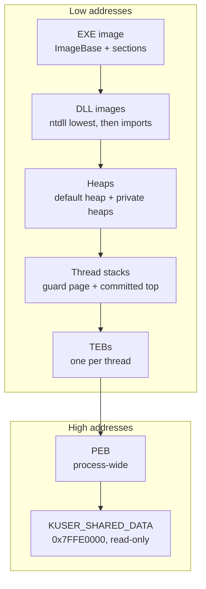
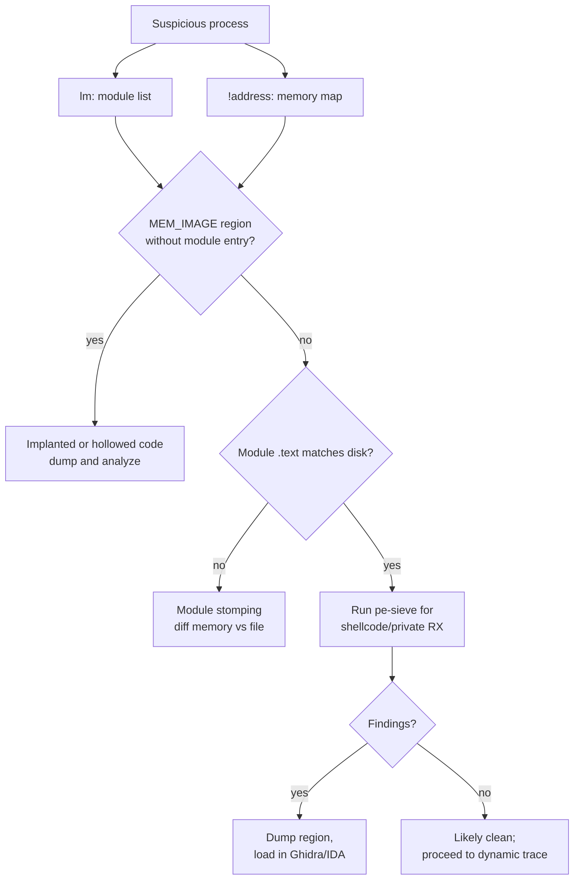

# Windows Internals for Reverse Engineers

> Tags: windows, pe, peb, teb, heap, ntdll, syscall, etw, process-hollowing, system-informer, windbg | Difficulty: Intermediate | Prerequisites: PE format basics (see [`../00-fundamentals/binary-formats.md`](../00-fundamentals/binary-formats.md)), x64 assembly basics, a Windows 10/11 analysis VM (see [`../01-setup/malware-isolation.md`](../01-setup/malware-isolation.md))

## Overview

The PE file is not the process. The loader, ntdll, the kernel, and the runtime each transform the file before your code runs. Reverse engineers who skip that layer misread offsets, miss injected memory, and get fooled by anti-debug checks that live outside the binary.

This page covers the Windows user-mode internals that matter for analysis:

1. **PE loading and memory layout.** Sections map at `ImageBase + RVA`. ASLR, DEP, CFG, and page protections change what you see in a debugger versus a hex editor.
2. **Heap internals.** The process heap is a segmented allocator with an LFH front-end. Chunk headers, safe unlinking, and heap cookies are why heap bugs look the way they do.
3. **The ntdll syscall layer.** Every `kernel32`/`kernelbase` API ends at a thin `ntdll!Nt*` stub that executes `syscall`. Tracing at the wrong layer misses direct syscalls and hooked stubs.
4. **PEB and TEB abuse.** Both structures carry debug flags, loader lists, stack bounds, and TLS slots. Malware reads and clears them. Analysts read them too.
5. **Module stomping and hollowing detection.** Malicious code hides in legitimate module memory. Detection means comparing the module list against the VAD map.
6. **ETW and kernel callbacks.** EDRs and malware both use them. You need to know which events survive user-mode tampering.

AI assistants are strong at struct recovery and API call-chain explanation on Windows targets. They are weak at version-sensitive offsets and syscall numbers. Section "AI Assists" gives prompts that account for that.

## Setup

Work in a Windows 10 or Windows 11 VM with a snapshot. Do not analyze hostile samples on your host. See [`../01-setup/malware-isolation.md`](../01-setup/malware-isolation.md) for isolation tiers.

Required tools:

| Tool | Purpose | Source |
|---|---|---|
| WinDbg / WinDbgX | User-mode debugger, `!heap`, `!peb`, `dt`, symbol loading | Microsoft Store "WinDbg" or Windows SDK debugging tools |
| CDB | Console WinDbg for scripted sessions | Windows SDK "Debugging Tools for Windows" |
| System Informer | Process viewer, memory/VAD map, handles, services | https://github.com/winsiderss/systeminformer (MIT, Windows 10+) |
| x64dbg | Alternative debugger with scriptable UI | https://github.com/x64dbg/x64dbg |
| GFlags | PageHeap and verifier flags per process | Ships with Windows SDK debugging tools |
| pe-sieve | Detects hollowed and implanted modules in running processes | https://github.com/hasherezade/pe-sieve |
| WinDbgX-MCP (optional) | MCP bridge: 38 tools, `!de` extensions, `reconstruct_struct` | https://github.com/mnemonic-re/WinDbgX-MCP |

Symbol setup. Do this once in WinDbg or CDB:

```
.sympath srv*C:\Symbols*https://msdl.microsoft.com/download/symbols
.reload
```

Or set the environment variable permanently:

```powershell
[Environment]::SetEnvironmentVariable('_NT_SYMBOL_PATH', 'srv*C:\Symbols*https://msdl.microsoft.com/download/symbols', 'Machine')
```

GFlags location: `C:\Program Files (x86)\Windows Kits\10\Debuggers\x64\gflags.exe`. Enable full page heap on a target:

```
gflags /p /enable target.exe /full
gflags /i target.exe /hpa
```

Page heap makes every allocation get its own page with guard pages. Heap overflows crash immediately at the faulting instruction. Run the target, reproduce the crash, then analyze the dump in WinDbg with `!analyze -v`.

WinDbgX-MCP install (optional, enables agent-driven sessions):

```powershell
pip install https://raw.githubusercontent.com/mnemonic-re/WinDbgX-MCP/main/WinDbgMCP/dist/windbg_mcp-0.1.0-py3-none-any.whl
python scripts\install_mcp.py   # after clone; auto-registers into AI client configs
```

The MCP exposes `run_cdb_command`, `attach_live_process`, `audit_pe_security` (PEB anti-debug and TEB stack audit), `audit_heap_corruption`, and `reconstruct_struct`. Treat it as an accelerator, not a replacement for understanding the structures.

## How It Works

### PE loading and process memory layout

The Windows loader (`ntdll!LdrpInitialize` and friends) maps the PE into the process address space before `main` or `wWinMain` runs.

What the loader does:

1. Creates the process and its initial thread suspended.
2. Maps `ntdll.dll` first. Every process has it.
3. Maps the EXE at its preferred `ImageBase`, or at a relocated base when ASLR picks another address.
4. Maps each `LoadLibrary` dependency recursively.
5. Applies base relocations when the load address differs from `ImageBase`.
6. Resolves imports through the IAT.
7. Calls TLS callbacks, then `DllMain`s, then the entry point.

The result in memory differs from the file in four ways:

- **RVA to VA.** File offsets become virtual addresses: `VA = module_base + RVA`. Section raw data may be padded or realigned. Use `!lmi` or `lm` to get module bases.
- **Relocations applied.** Absolute addresses in the image are rewritten. Static analysis of a relocated-on-disk value misleads you.
- **Per-section protections.** `.text` is RX, `.data` is RW, `.rdata` is R. The section characteristics in the PE header become page protections. Executable+writable pages are a red flag.
- **ASLR.** Image bases randomize per boot (system ASLR) and per process where supported. Never hardcode a module base across runs.

A typical x64 process layout, low to high addresses:



Inspect the real map in WinDbg:

```
lm                          # loaded modules with base addresses
lm m target                 # detailed info for one module
!address                    # full virtual memory map
!lmi target                 # load module info: entry point, sections
```

`!address` output is the ground truth for what is committed, reserved, and what protection each region has. Compare it against `lm`. A MEM_IMAGE region with no matching module entry is injected or hollowed code. See the hollowing section below.

Key PE fields that shape runtime behavior:

| Field | Effect at runtime |
|---|---|
| `ImageBase` | Preferred load address. Relocation table must exist for ASLR to work. |
| `DllCharacteristics` | `DYNAMIC_BASE` = ASLR. `NX_COMPAT` = DEP. `GUARD_CF` = CFG. `HIGH_ENTROPY_VA` = 64-bit ASLR entropy. |
| Section `Characteristics` | `IMAGE_SCN_MEM_EXECUTE` + `IMAGE_SCN_MEM_WRITE` = RWX page. Suspicious. |
| `SizeOfImage` | Total mapped size. Heap or injected code past this range is not part of the module. |
| TLS directory | TLS callbacks run before `DllMain`. A common injection and anti-debug spot. |
| Import directory | Only names the loader resolves eagerly or lazily. Delayed imports appear later. |

### Heap internals

Windows has two user-mode heap families. Do not confuse them.

- **NT heap** (`ntdll!RtlAllocateHeap`). The classic heap. Used by `HeapCreate`, the process default heap (`PEB->ProcessHeap`), and most native code.
- **UCRT heap** (`ucrtbase!malloc` family). The C runtime heap. Separate bookkeeping. `!heap` extensions in WinDbg target the NT heap. UCRT heap analysis needs different tooling.

NT heap structure:

- A heap is a set of **segments** committed from reserved address space.
- Allocations live in chunks inside segments.
- The **front-end** decides fast paths. On x64 the default front-end is the **LFH** (Low Fragmentation Heap), introduced in Windows Vista. LFH serves small allocations (rough to about 16KB, exact cutoff reported as size-dependent) from pre-carved subsegments with per-bucket granularity.
- The **back-end** is the VS (variable size) segment allocator. It handles large allocations, LFH misses, and non-LFH heaps.
- Windows 10 19H1 introduced the **Segment Heap** as an alternative backend for some processes (UWP apps by default, opt-in for others). It is not universal. Check which backend a target uses before reasoning about chunk layout. Reported behavior varies by build.

Chunk layout on x64 NT heap: a 16-byte header precedes user data. The header encodes size and flags. Heap cookies and safe unlinking protect free-list pointers. Safe unlinking (introduced with Windows XP SP2 hardening) validates that a free chunk's `Flink`/`Blink` point back into the heap before unlinking. That killed the classic unlink write primitive. Modern heap exploitation moved to LFH metadata corruption, adjacent-object overwrite, and UAF on application objects.

Heap debugging commands in WinDbg:

```
!heap -s                     # summary of all heaps in the process
!heap -p -a <addr>           # which allocation owns this address
!heap -x "pattern"           # allocations whose content matches a pattern
!heap -stat -h               # per-heap statistics
!heap -a <addr>              # detailed chunk info at an address
```

`!heap -p -a` is the first command for any heap corruption crash. It walks backwards from the faulting address to the owning allocation and prints the stack trace of the allocating call if page heap or heap tracing was on.

Heap flags worth knowing:

| Flag / check | Where | What it does |
|---|---|---|
| Tail fill / free fill | Heap flags via `HeapSetInformation` | Fills allocated/freed blocks with patterns. Catches over-read and use-after-free. |
| Page heap (`gflags /full`) | Per-process | One allocation per page, guard page after. Slower, catches linear overflows. |
| Heap validation | `gflags /v` or Application Verifier | Checks heap consistency on every operation. |
| LFH vs back-end | Visible in `!heap -s` output | LFH chunks lack per-chunk back-end headers. Reasoning about "the chunk header" is wrong for LFH allocations. |

When reading decompiled heap code, remember the layering: application calls `malloc`/`new` or `HeapAlloc`, the UCRT or ntdll front-end picks LFH or VS, and the back-end commits segments from `NtAllocateVirtualMemory`. AI models often flatten this into one "heap" concept. Ask explicitly which layer a function touches.

### The ntdll syscall layer

Every documented Win32 API bottoms out in `ntdll.dll`. A typical stub looks like this in disassembly (x64):

```
NtCreateFile:
    mov  r10, rcx          ; first arg moves to r10 for syscall ABI
    mov  eax, <SSN>        ; syscall service number, build-specific
    syscall                ; enter kernel
    ret
```

Facts that matter for analysis:

- **SSNs are per-build.** The number in `mov eax, N` changes between Windows builds. Never hardcode one. Resolve it at runtime or read it from the target's own ntdll.
- **WOW64.** 32-bit processes on 64-bit Windows go through `wow64cpu`/`xtajit` before reaching the kernel. Syscall numbers differ. There is a separate wow64 syscall path.
- **Direct syscalls.** Malware can skip the ntdll stub and execute `syscall` itself with a manually resolved SSN. This bypasses user-mode API hooks (EDR hooks live on ntdll stubs). It does not bypass kernel callbacks or ETW-TI.
- **Hook detection.** EDRs and some protectors inline-hook ntdll stubs (patch first bytes to `jmp`). To check, dump the on-memory stub and compare against ntdll on disk. A clean stub is ~20 bytes ending in `syscall; ret`.

Syscalls most relevant to RE work:

| Syscall | Why analysts care |
|---|---|
| `NtQueryInformationProcess` | `ProcessDebugPort`, `ProcessDebugObjectHandle`, `ProcessDebugFlags` — the classic anti-debug trio. |
| `NtSetInformationThread` | `ThreadHideFromDebugger` — hides a thread from the debugger. |
| `NtCreateThreadEx` | Remote thread creation, the hollowing/injection primitive. |
| `NtAllocateVirtualMemory` / `NtProtectVirtualMemory` | RWX allocation and protection flips. |
| `NtWriteVirtualMemory` / `NtReadVirtualMemory` | Cross-process memory access. Injection and dumping. |
| `NtUnmapViewOfSection` | Process hollowing: unmap the original image before writing the payload. |
| `NtCreateSection` / `NtMapViewOfSection` | Shared memory and module mapping. |

When an API behaves differently under a debugger, breakpoint the `ntdll!Nt*` stub rather than the `kernel32`/`kernelbase` wrapper. The stub is where arguments are already in syscall ABI form (`r10` holds arg1, args in `rdx`, `r8`, `r9`, stack).

### PEB and TEB — structures analysts abuse

The **PEB** (Process Environment Block) is per-process. The **TEB** (Thread Environment Block) is per-thread. Both live at the top of user address space and are reachable without symbols:

- WinDbg: `!peb`, `dt ntdll!_PEB`, `!teb`, `dt ntdll!_TEB`.
- In code: `NtCurrentTeb()` returns the TEB; `NtCurrentTeb()->ProcessEnvironmentBlock` gives the PEB on x64.
- In x64dbg: the PEB/TEB are viewable via the memory map and the `peb`/`teb` context in plugins.

PEB fields that drive analysis:

| Field | Use |
|---|---|
| `BeingDebugged` | Byte flag. `CheckRemoteDebuggerPresent` and friends read it. Malware clears it. |
| `NtGlobalFlag` | Heap debug flags set when a process starts under a debugger (`FLG_HEAP_ENABLE_TAIL_CHECK`, `FLG_HEAP_ENABLE_FREE_CHECK`, `FLG_HEAP_VALIDATE_PARAMETERS`). A nonzero value is an anti-debug signal. |
| `ImageBaseAddress` | Where the EXE is actually loaded. Differs from preferred base under ASLR. |
| `Ldr` | `PEB_LDR_DATA` pointer. The module lists live here. |
| `ProcessParameters` | `RTL_USER_PROCESS_PARAMETERS`: command line, image path, DLL search path, window title. |
| `OSMajorVersion` / `OSMinorVersion` / `OSBuildNumber` | Runtime OS version checks. Useful when a binary branches on build. |
| `SessionId` | Session isolation checks. |

`PEB_LDR_DATA` contains three module lists, all listing the same `LDR_DATA_TABLE_ENTRY` records in different orders:

- `InLoadOrderModuleList`
- `InMemoryOrderModuleList` (most commonly walked)
- `InInitializationOrderModuleList`

Each entry carries `DllBase`, `SizeOfImage`, `FullDllName`, `BaseDllName`. Manual module enumeration (what malware and EDRs both do) walks `InMemoryOrderModuleList` starting at `PEB->Ldr`. The list is a doubly-linked list. Unlinked modules hide from this walk but still have VADs — that gap is a detection primitive.

TEB fields that matter:

| Field | Use |
|---|---|
| `StackBase` / `StackLimit` | Committed stack range. Stack pivot detection and ROP analysis start here. |
| `DeallocationStack` | Stack to return to on thread exit. |
| `TlsSlots` / `TlsLinks` | Thread-local storage. Packers and some protectors stash state here. |
| `Self` (x64: `NtCurrentTeb()`) | The TEB's own address, stored at offset 0. Used for self-location without imports. |
| `ClientId` | Owning process and thread IDs. |

Anti-debug checks you will see in decompiled code, mapped to their source:

| Check | Mechanism |
|---|---|
| `IsDebuggerPresent` | Reads `PEB->BeingDebugged`. |
| `CheckRemoteDebuggerPresent` | `NtQueryInformationProcess(ProcessDebugPort)`. |
| Heap flags check | Reads `PEB->NtGlobalFlag`. |
| ThreadHideFromDebugger | `NtSetInformationThread` on own thread; debugger stops getting events. |
| Self-read TEB/PEB timing | `GetTickCount`/`QueryPerformanceCounter` around `NtQueryInformationProcess` — timing side channel. |
| Debug object check | `NtQueryInformationProcess(ProcessDebugObjectHandle)` returns a handle only under a debugger. |

Offsets differ between x86 and x64 and across Windows builds. Use symbols (`dt ntdll!_PEB`) rather than memorized offsets. The WinDbgX-MCP `audit_pe_security` tool automates the PEB anti-debug and TEB stack audit.

### Module stomping and hollowing detection

Injection techniques that hide code inside legitimate-looking memory:

| Technique | Mechanism | Detection signal |
|---|---|---|
| Process hollowing | `CreateProcess` suspended, `NtUnmapViewOfSection` or overwrite, write payload, `SetThreadContext`/`NtCreateThreadEx` resume | Entry point outside any module. VAD image region with no matching LDR entry. |
| Module stomping (DLL hollowing) | `LoadLibrary` a legitimate DLL, then overwrite its `.text` in memory | `.text` bytes differ from disk. RX region whose content does not match the file. |
| Reflective DLL injection | No `LoadLibrary` call. Manual map via `NtAllocateVirtualMemory` + copy | MEM_PRIVATE RX region, no LDR entry, no backing file. |
| Process doppelgänging / ghosting | Transacted or deleted-file mapping tricks | Similar VAD anomalies; newer variants reported through 2024-2025. |
| Early Bird APC | Queue an APC to a suspended process's main thread | Suspended thread with pending APC; unusual start address. |

Detection workflow:

1. Get the module list. `lm` in WinDBG, or System Informer's process view.
2. Get the memory map. `!address` in WinDbg, or System Informer's Memory tab which shows VAD-backed regions.
3. Cross-check. Every MEM_IMAGE region should map to a module in `lm`. Every module's `.text` should match its on-disk bytes.
4. For stomped modules, dump the in-memory `.text` and diff against the file on disk.
5. Run pe-sieve for automated detection:

```
pe-sieve64.exe /pid <pid> /json
```

pe-sieve reports implanted PE, replaced PE (hollowed), and shellcode regions. It is the fastest first pass before manual `!address` work.

WinDbgX-MCP adds `scan_hooks_and_injections` (inline detours, IAT hooks, unmapped executable pages, reflective DLLs) and `unpack_dynamic_pe` (finds MZ/PE headers in dynamic memory) on top of raw commands.



### ETW and kernel callbacks relevant to RE

Two layers observe process behavior. Know which layer you are looking at.

**ETW (Event Tracing for Windows).** Kernel and user-mode providers emit events that tools like `logman`, `xperf`, `wpr`, and `tracerpt` consume.

```
logman query providers                          # list registered providers
logman query -ets                               # active sessions
logman create trace -p "Microsoft-Windows-Kernel-Process" 0xff 5 -o proc.etl
logman start trace
# ... run target ...
logman stop trace -ets
tracerpt proc.etl -o proc.csv
```

Providers relevant to RE: `Microsoft-Windows-Kernel-Process` (process/thread/image load), `Microsoft-Windows-Kernel-File`, `Microsoft-Windows-Kernel-Network`, and the threat-intelligence provider used by EDR products. Elastic Research documented the **ETW-TI** provider (GUID `{F4B1D40B-D744-4C96-9A65-1C8D6F8EAF6B}`, reported) which surfaces kernel-observed events such as image loads, memory allocation with execute intent, and thread creation with start-address anomalies. User-mode code cannot unregister or block it. See https://www.elastic.co/security-labs for the original write-up.

**Kernel callbacks.** Drivers register callbacks that fire regardless of what user-mode hooks do:

| Callback API | What it observes |
|---|---|
| `PsSetCreateProcessNotifyRoutine` | Process creation/termination. |
| `PsSetCreateThreadNotifyRoutine` | Thread creation. Sees remote-thread creation. |
| `PsSetLoadImageNotifyRoutine` | DLL/EXE image loads, including manual-mapped ones in some cases. |
| `ObRegisterCallbacks` | Handle operations on processes/threads. EDRs strip `PROCESS_VM_WRITE`/`PROCESS_CREATE_THREAD` access here. This is why `OpenProcess`+`WriteProcessMemory` injection fails on EDR-monitored hosts even when user-mode hooks are bypassed. |
| `CmRegisterCallback` | Registry operations. |
| Minifilter (`FltRegisterFilter`) | File system I/O. ransomware and infostealer detection. |

Implication for dynamic analysis: a user-mode hook on `NtWriteVirtualMemory` sees nothing if the target uses a direct syscall or a kernel driver. Kernel callbacks see the operation anyway. If your instrumentation goes silent but the behavior continues, suspect a lower layer — direct syscall, kernel callback path, or a driver.

## Usage

### Workflow: attach and map a suspicious process

1. Launch the target in the VM. Note the PID.
2. Attach WinDbg: `windbgx -p <pid>` or `cdb -p <pid>`.
3. Load symbols and get oriented:

```
.reload
!peb
lm
!address
!heap -s
```

4. Walk the module list and check for unbacked image regions (the mermaid flow above).
5. If the target crashes, enable page heap first (`gflags /p /enable target.exe /full`), reproduce, then `!analyze -v` on the dump.

### Workflow: trace an API to its syscall

1. `bp ntdll!NtCreateFile` (or the relevant `Nt*`).
2. `g` to continue. When it hits, `r` shows args in syscall ABI (`r10` = arg1 pointer).
3. `u ntdll!NtCreateFile` shows the stub. Confirm `mov r10, rcx; mov eax, SSN; syscall`.
4. If a hook is present, first bytes will be a `jmp` or `mov rax` trampoline instead.

### Workflow: heap corruption triage

1. Reproduce under page heap or normal heap.
2. On crash: `!analyze -v`, then `!heap -p -a <faulting_address>`.
3. If page heap was on, the faulting instruction is the culprit and the allocation stack is printed.
4. Without page heap, `!heap -p -a` still identifies the owning allocation if the address is inside a chunk.

### AI assists

**Struct recovery.** When a target has no PDBs and decompiled code shows raw offsets, feed the debugger output to the model:

```
Here is WinDbg output for a live process:

!peb
0:000> dt ntdll!_PEB
   +0x000 InheritedAddressSpace : Uint8B
   +0x001 ReadImageFileExecOptions : Uint8B
   +0x002 BeingDebugged : Uint8B
   ...

And here is decompiled code accessing offsets +0x018, +0x020 into a structure:

<decompiled snippet>

Recover a plausible C struct definition for the accessed object.
State which fields you inferred from which offsets.
Mark any field you could not determine as UNKNOWN_<offset>.
Do not invent field names that imply semantics you cannot support.
```

WinDbgX-MCP automates this with `reconstruct_struct`, which builds C/C++ struct definitions and ReClass.NET schemas from live memory. Ghidra/IDA data types can then be applied from the recovered layout. See [`../03-decomp/decompile-workflow.md`](../03-decomp/decompile-workflow.md) for the batch workflow.

**API call-chain explanation.** Feed the wrapper and the stub together:

```
Explain the call path from CreateFileW to the kernel.
Include: kernel32/kernelbase/kernelappcore forwarding layers,
the ntdll!NtCreateFile stub, the syscall ABI (which register holds
arg1), and which kernel callbacks or ETW providers observe it.
Flag any place where a direct syscall would bypass this path.
```

Models handle this well because the pattern is stable across builds. The SSN number itself is build-specific — ask the model to describe the pattern, not the number.

**Version-sensitive offsets.** PEB/TEB/LDR offsets change across Windows builds. When the model quotes an offset, verify with `dt` in the live debugger before trusting it. The model's training data mixes Windows 7 through 11 offsets.

## Pitfalls

- **Never hardcode PEB/TEB offsets.** They differ x86 vs x64 and across builds. Use `dt ntdll!_PEB` against the target's own symbols.
- **Never hardcode SSNs.** Syscall numbers change per build. Resolve from the target's ntdll or read `mov eax, N` at runtime.
- **`!heap` does not see the UCRT heap.** `malloc`/`free` in MSVC binaries go through `ucrtbase`. `!heap` only covers NT heap allocations.
- **Segment Heap vs NT heap.** Windows 10 19H1+ uses Segment Heap for some processes. Chunk-header reasoning that works on NT heap may not apply. Check `!heap -s` output for the backend.
- **LFH allocations have no per-chunk back-end header.** Reasoning about "the chunk header at userptr - 0x10" is wrong for LFH blocks.
- **Module list walking misses unlinked entries.** Malware can unlink itself from `InMemoryOrderModuleList`. Cross-check `lm`/`!address` against the LDR lists.
- **Direct syscalls bypass user-mode hooks.** A clean `NtWriteVirtualMemory` breakpoint does not prove the write did not happen. Check ETW-TI or kernel callbacks for ground truth.
- **`ObRegisterCallbacks` strips handle rights.** `OpenProcess` may succeed but `PROCESS_VM_WRITE`/`PROCESS_CREATE_THREAD` get removed. Injection fails silently. This is an EDR control, not a bug in your tooling.
- **RWX pages are not automatically malicious.** JITs (JavaScript engines, .NET, some games) legitimately allocate RWX. Correlate with module membership before flagging.
- **WinDbgX-MCP is pre-1.0.** Its extended commands are convenient but treat `reconstruct_struct` output as a hypothesis to verify, not ground truth.

## See Also

- [x64dbg and WinDbg Automation](../04-dynamic/x64dbg-windbg.md) — debugger scripting and MCP bridges
- [Unpacking and Dumping](../04-dynamic/unpacking-dumping.md) — runtime dumping workflows that rely on these internals
- [Frida Deep Dive](../04-dynamic/frida-deep-dive.md) — user-mode hooking at the ntdll layer
- [Windows Kernel Driver RE](../06-topics/windows-kernel-drivers.md) — the kernel side of callbacks and IRPs
- [Malware Analysis](../06-topics/malware-analysis.md) — triage pipeline that uses these structures
- [Packed Binaries](../06-topics/packed-binaries.md) — manual-mapped and hollowed payloads
- [Binary Formats](../00-fundamentals/binary-formats.md) — PE anatomy before runtime
- [Tool Catalog](../05-tools/tool-catalog.md) — full debugger and analysis tool list
- [Malware Isolation](../01-setup/malware-isolation.md) — safe Windows analysis environments
