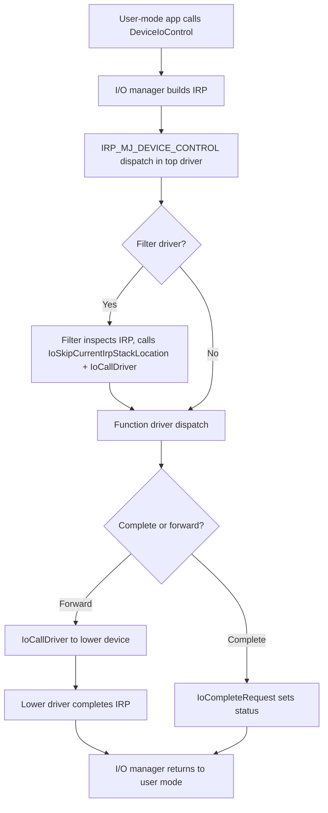

# Windows Kernel Driver Reverse Engineering with AI

> Tags: windows, kernel, drivers, WinDbg, IOCTL, pool-tag, PatchGuard | Difficulty: Advanced | Prerequisites: solid usermode x64/x86 RE, Windows internals, IRP basics. See [`../05-tools/tool-catalog.md`](../05-tools/tool-catalog.md) for the static-analysis tool catalog and [`../07-advanced/anti-analysis.md`](../07-advanced/anti-analysis.md) for driver-level anti-debugging.

## Overview

Windows kernel driver reverse engineering (RE) differs from usermode PE work in four ways:

1. No usermode context. There is no process memory map to browse like a PE in IDA. The driver maps into `ntoskrnl.exe` address space. You debug against a live kernel.
2. Requests arrive as IRPs. User-mode APIs (`DeviceIoControl`, `ReadFile`, `WriteFile`) do not call driver functions directly. They build an I/O Request Packet (IRP) that the I/O manager dispatches.
3. The bug class changes. You hunt for double frees, use-after-free on IRPs, unchecked IOCTL codes, pool tag confusion, and type confusion in `MmMapIoSpace` and `MmProbeAndLockPages`.
4. Anti-analysis is stronger. PatchGuard, Hypervisor-Protected Code Integrity (HVCI), Kernel-Mode Code Integrity (KMCI), Driver Verifier, and kernel anti-debug checks make casual dynamic work dangerous. An unhandled kernel crash bluescreens the target machine.

AI assistants help with driver RE, but the loop is different from usermode work:

- Static analysis in Ghidra or IDA maps the `.sys` file: `DriverEntry`, dispatch routines, IRP handlers, and IOCTL decode.
- Dynamic analysis uses WinDbg over KDNET, serial, or a VM debug port. An MCP bridge lets an agent send WinDbg commands and read output.
- Verification is harder. A wrong kernel hypothesis can crash the target. Keep the kernel debugger attached. Keep Driver Verifier settings minimal until the driver is understood.

Honest state in November 2026: AI tools are good at naming IRP handlers, decoding IOCTL switch statements, and explaining WDF object lifecycle. They are poor at safe kernel debugging. Do not let an agent run arbitrary WinDbg commands against a live kernel without a human watching the first session.

## Driver Types

| Type | Abbreviation | Entry point | Who calls dispatch | Use case |
|---|---|---|---|---|
| Windows Driver Model | WDM | `DriverEntry` sets `MajorFunction` table | I/O manager via IRP_MJ_* | Legacy drivers, filesystems, lowest layer |
| Kernel-Mode Driver Framework | KMDF | `DriverEntry` calls `WdfDriverCreate`; queue callbacks | KMDF dispatches to queue callbacks | Most new drivers 2010–2020 |
| User-Mode Driver Framework | UMDF | `DriverEntry` in a user process | Host process (`WUDFHost.exe`) talks to kernel reflector | USB, sensors, devices that can crash safely |

### WDM

The classic model. `DriverEntry` fills `PDRIVER_OBJECT->MajorFunction[IRP_MJ_*]` with dispatch routine pointers. Each dispatch routine calls `IoCompleteRequest` or forwards the IRP down the stack with `IoCallDriver`.

```c
NTSTATUS DriverEntry(PDRIVER_OBJECT DriverObject, PUNICODE_STRING RegistryPath) {
    DriverObject->MajorFunction[IRP_MJ_CREATE] = CreateDispatch;
    DriverObject->MajorFunction[IRP_MJ_DEVICE_CONTROL] = IoctlDispatch;
    DriverObject->MajorFunction[IRP_MJ_CLOSE] = CloseDispatch;
    // create device object with IoCreateDevice
    return STATUS_SUCCESS;
}
```

### KMDF

KMDF wraps WDM. The driver registers an `EvtDeviceAdd`, queues, and `EvtIoDeviceControl` callbacks. The framework owns the IRP plumbing. You rarely see `MajorFunction` in KMDF source, but you still see it in compiled code.

```c
NTSTATUS DriverEntry(PDRIVER_OBJECT DriverObject, PUNICODE_STRING RegistryPath) {
    WDF_DRIVER_CONFIG config;
    WDF_DRIVER_CONFIG_INIT(&config, EvtDeviceAdd);
    return WdfDriverCreate(DriverObject, RegistryPath, WDF_NO_OBJECT_ATTRIBUTES, &config, NULL);
}
```

In the binary, KMDF callbacks appear as function pointers in `WDF_OBJECT_CONTEXT` structures. Look for calls into `wdf01000.sys` (the KMDF runtime). Match functions that the framework calls indirectly.

### UMDF

UMDF drivers are ordinary PE files loaded into `WUDFHost.exe`. They talk to a kernel reflector driver (`wudfrd.sys` or `wdf01000.sys` reflection layer). You can analyze them in usermode. The kernel side is the reflector plus a small INF-declared lower filter.

Detection: if the `.sys` imports `Wdf*` functions and runs as a service inside `WUDFHost`, it is UMDF. If it has `DriverEntry` and `MajorFunction` in kernel context, it is KMDF or WDM.

## Entry Points and IRP Dispatch

### Static entry

Every WDM/KMDF driver exports `DriverEntry` (or `GsDriverEntry` when Control Flow Guard is on). `GsDriverEntry` calls `__security_init_cookie` and then `DriverEntry`. In Ghidra, set the entry point manually if auto-analysis picks `GsDriverEntry`.

### The dispatch table

`PDRIVER_OBJECT` is passed to `DriverEntry`. At offset `0x70` on x64, `MajorFunction` is an array of `IRP_MJ_MAXIMUM_FUNCTION + 1` pointers (28 entries). Each dispatch routine has signature:

```c
NTSTATUS Dispatch(PDEVICE_OBJECT DeviceObject, PIRP Irp);
```

The most important IRP major functions for driver RE:

| Code | Name | Trigger |
|---|---|---|
| `IRP_MJ_CREATE` (0x00) | Create | `CreateFile` |
| `IRP_MJ_CLOSE` (0x02) | Close | `CloseHandle` |
| `IRP_MJ_READ` (0x03) | Read | `ReadFile` |
| `IRP_MJ_WRITE` (0x04) | Write | `WriteFile` |
| `IRP_MJ_DEVICE_CONTROL` (0x0E) | IOCTL | `DeviceIoControl` |
| `IRP_MJ_INTERNAL_DEVICE_CONTROL` (0x0F) | Internal IOCTL | Other drivers |
| `IRP_MJ_PNP` (0x1B) | PnP | Power management, surprise removal |
| `IRP_MJ_POWER` (0x16) | Power | Sleep, resume |

### IOCTL codes

`IRP_MJ_DEVICE_CONTROL` handlers decode the IOCTL from `IrpSp->Parameters.DeviceIoControl.IoControlCode`. The standard layout:

```
31    30 29   28      16 15      14 13    2 1   0
| DeviceType | Access | Function | Method | TransferType |
```

Use `CTL_CODE(DeviceType, Function, Method, Access)` to generate codes. `FILE_DEVICE_UNKNOWN` is `0x22`. Vendor drivers often use `0x8000` ranges.

AI prompt that works for IOCTL decoding:

```text
This function is the IRP_MJ_DEVICE_CONTROL dispatch for a Windows driver.
Identify the switch on IoControlCode. For each case, report:
1. The IOCTL code in hex and CTL_CODE form.
2. The input buffer size check.
3. The output buffer size check.
4. Whether the handler copies to user buffer with ProbeForWrite or MmMapLockedPagesSpecifyCache.
5. Any obvious missing access checks.
```

### IRP flow

An IRP travels through the driver stack. The I/O manager allocates it, fills `Tail.Overlay.CurrentStackLocation` with parameters, and calls the top driver's dispatch routine.



## Tooling

### WinDbg kernel debugging

WinDbg is the primary kernel debugger. Two modes matter:

1. **Local kernel debugging** (`bcdedit /debug on` + reboot) — limited, no breakpoints in ring 0 on some builds.
2. **Remote kernel debugging** — KDNET over Ethernet, serial, or USB. This is the standard for driver work.

#### KDNET setup

On the target VM:

```cmd
bcdedit /debug on
bcdedit /dbgsettings net hostip:192.168.56.1 port:50000 key:1.2.3.4
```

The `key` is a four-part KDNET key. Generate it on the host with:

```cmd
windbg -kl
```

Or use `kdnet.exe` from the Windows Driver Kit (WDK). The host runs WinDbg and connects:

```cmd
windbg -k net:port=50000,key=1.2.3.4
```

For VMware/VirtualBox, a virtual serial port works too:

```cmd
bcdedit /dbgsettings serial debugport:1 baudrate:115200
```

Host side: `windbg -k com:port=\\.\pipe\kd,baud=115200,reconnect`.

#### Essential WinDbg commands

| Command | Purpose |
|---|---|
| `!analyze -v` | Crash analysis. Run first on a bluescreen |
| `!irpfind` | Find all IRPs in the system |
| `!irp <address>` | Dump one IRP |
| `!devstack <device>` | Show device stack for a device object |
| `!devobj <device>` | Dump device object |
| `!drvobj <driver>` | Dump driver object and MajorFunction table |
| `!thread`, `!process` | Thread and process context |
| `lm` | List loaded modules |
| `dt nt!_IRP` | Dump IRP structure |
| `bp nt!IofCompleteRequest` | Break on IRP completion |
| `g` | Go |
| `kb` | Kernel stack trace |

#### Driver Verifier

Driver Verifier catches kernel bugs early. Enable it on the test driver only:

```cmd
dv /add MyDriver.sys dv /standard /all
```

Or through the GUI: `verifier.exe` → Create custom settings → select driver → enable all checks.

Critical checks for driver RE:

- **Special pool** — puts driver allocations in a guarded page. Catches overflows.
- **Pool tracking** — tags every allocation. `!poolused` shows tags.
- **Force IRQL checking** — catches IRQL violations.
- **I/O verification** — validates IRP handling.

Do not enable Driver Verifier on production drivers. It is slow and can cause boot failures.

### WinDbgX-MCP

[WinDbgX-MCP](https://github.com/mnemonic-re/WinDbgX-MCP) is an MCP server for WinDbg/WinDbgX. It supports KDNET kernel debugging. Status is pre-1.0. The project claims prompt-injection hardening.

Install pattern (check the repo for current instructions):

```json
{
  "mcpServers": {
    "windbg": {
      "command": "uvx",
      "args": ["windbgx-mcp"]
    }
  }
}
```

The server exposes tools like `windbg_execute`, `windbg_break`, `windbg_step`, and `windbg_read_memory`. Verify the exact tool names in the repo before relying on them.

### Ghidra and IDA for kernel analysis

Both tools load `.sys` files as PE binaries. The analysis is similar to usermode, with these differences:

- Imports from `ntoskrnl.exe`, `hal.dll`, and `wdf01000.sys` are unresolved. Use Ghidra's "PE Windows kernel" loader or IDA's kernel module setup.
- Calling conventions differ. `__fastcall` is standard. `DRIVER_INITIALIZE` is the entry signature.
- No `main`. The entry is `DriverEntry` or `GsDriverEntry`.
- KMDF callbacks are indirect. Look for `WdfDriverCreate` and trace the config structure.

Ghidra headless for batch analysis:

```bash
analyzeHeadless /tmp/ghidra_proj DriverRE \
  -import target.sys \
  -postScript DriverAnalyzer.py \
  -deleteProject
```

IDA headless:

```bash
idat64 -A -S"script.idc" target.sys
```

### Pool tag analysis

Windows drivers allocate pool memory with tags. Each tag is a 4-character identifier. `!poolused` in WinDbg shows tag usage. Common tags: `MmSt`, `Ntfs`, `Thre`, `Proc`.

Driver-specific tags are often the driver's name in uppercase. A driver named `MyFilter.sys` might use `'yFlM'` or `'MyFi'`. Search the binary for the tag bytes:

```bash
strings -a -t x target.sys | grep -i "tag"
xxd target.sys | grep -i "4d7946"  # "MyF" in hex
```

In Ghidra, search for immediate constants that look like pool tags (4 printable ASCII bytes, often reversed). `ExAllocatePool2` calls take a tag in `R8`.

AI prompt for pool tag analysis:

```text
Find all calls to ExAllocatePool2 and ExAllocatePoolWithTag in this driver.
For each call, report the pool tag constant, the allocation size, and the function name.
Identify which tag belongs to this driver versus shared kernel tags.
```

### AI-assisted IRP handler naming

LLMs are good at naming dispatch routines once they see the pattern. Feed the decompiled `IRP_MJ_DEVICE_CONTROL` handler and ask:

```text
Name this dispatch routine based on the IOCTLs it handles.
Suggest names like IoctlGetVersion, IoctlSetConfig, IoctlReadRegister.
Explain the naming convention.
```

This works because dispatch routines have repetitive structure: decode IOCTL, validate buffer, call helper, complete IRP.

## AI Workflows for Driver RE

### Static triage pipeline

1. Load `.sys` in Ghidra or IDA.
2. Run `DriverEntry` analysis. Identify `MajorFunction` table population.
3. Export each dispatch routine to pseudocode.
4. Feed each routine to an LLM with the IOCTL decoding prompt.
5. Cross-check IOCTL codes against the driver INF or public documentation.

### Dynamic verification

1. Boot target VM with KDNET enabled.
2. Attach WinDbg from host.
3. Set breakpoints on dispatch routines: `bp MyDriver!IoctlDispatch`.
4. Trigger IOCTL from usermode test client.
5. Inspect IRP parameters: `dt nt!_IRP @$thread` or `dt nt!_IO_STACK_LOCATION irp->Tail.Overlay.CurrentStackLocation`.

### Batch analysis

For multiple drivers, use Ghidra headless with a script that:

- Imports each `.sys`.
- Runs auto-analysis.
- Exports function list and strings.
- Writes a JSON summary for the LLM.

```bash
for f in /path/to/drivers/*.sys; do
  analyzeHeadless /tmp/ghidra_proj DriverBatch \
    -import "$f" \
    -postScript ExportFunctions.java \
    -scriptPath /path/to/scripts \
    -deleteProject
done
```

## Pitfalls

### No usermode context

The driver runs in ring 0. There is no `main`, no stack cookies in the usermode sense, and no easy "run to breakpoint" from a usermode debugger. You must use WinDbg kernel mode or a hypervisor-level debugger.

### PatchGuard

Kernel Patch Protection (PatchGuard) detects modifications to kernel code and critical structures. It runs on a randomized schedule. If your analysis modifies `ntoskrnl.exe` or SSDT entries, PatchGuard will bluescreen the machine. Do not patch the kernel for RE purposes. Use breakpoints in WinDbg instead.

### HVCI and VBS

Hypervisor-Protected Code Integrity (HVCI) and Virtualization-Based Security (VBS) protect kernel memory. Even with kernel debugging, some memory is not readable. HVCI prevents execution of unsigned or modified kernel code. On Windows 11, HVCI is often enabled by default on new hardware.

Check status:

```cmd
msinfo32
```

Look for "Virtualization-based security" and "Hypervisor-protected code integrity".

### Driver Verifier crashes

Driver Verifier is aggressive. Special pool can exhaust memory. Force IRQL checking can flag false positives in drivers that touch paged memory at DISPATCH_LEVEL. If the target crashes under Driver Verifier, disable it:

```cmd
dv /remove MyDriver.sys
```

### IRQL violations

Drivers run at various IRQLs. `PASSIVE_LEVEL` (0) is normal. `DISPATCH_LEVEL` (2) is used in DPCs. At `DISPATCH_LEVEL`, you cannot touch paged memory, take certain locks, or call functions that wait. Many driver bugs are IRQL violations. WinDbg's `!irql` extension shows the current IRQL.

### KMDF indirect calls

KMDF drivers do not have a visible `MajorFunction` table. Callbacks are stored in `WDF_OBJECT_CONTEXT` structures and invoked through function pointers. Static analysis must trace `WdfDriverCreate`, `WdfDeviceCreate`, and `WdfIoQueueCreate` to find the callback addresses.

### Pool tag confusion

Pool tags are not guaranteed unique. A driver might use a tag that collides with a system tag. `!poolused` shows aggregate usage. To attribute a pool allocation to a specific driver, check the driver object or use Driver Verifier's pool tracking with per-driver tags.

### Anti-debugging in drivers

Drivers can check for kernel debuggers via `KdDebuggerEnabled`, `KdDebuggerNotPresent`, or `NtQuerySystemInformation(SystemKernelDebuggerInformation)`. They can also use `KeBugCheckEx` to crash if a debugger is detected. Breakpoints on these checks can reveal the anti-debug logic.

## See Also

- [`../03-decomp/triage-and-mapping.md`](../03-decomp/triage-and-mapping.md) — First-look static triage commands
- [`../03-decomp/verification-loop.md`](../03-decomp/verification-loop.md) — Verify AI output before trusting it
- [`../05-tools/tool-catalog.md`](../05-tools/tool-catalog.md) — Ghidra, IDA, WinDbg tool details
- [`../05-tools/mcp-catalog.md`](../05-tools/mcp-catalog.md) — MCP servers including WinDbgX-MCP
- [`../07-advanced/anti-analysis.md`](../07-advanced/anti-analysis.md) — Anti-debug and anti-VM techniques
- [`../07-advanced/model-selection.md`](../07-advanced/model-selection.md) — Model choice for RE tasks
- [`../06-topics/malware-analysis.md`](../06-topics/malware-analysis.md) — Malware triage pipeline (drivers often ship with malware)
- [`../06-topics/deobfuscation.md`](../06-topics/deobfuscation.md) — Driver packers and VMProtect on kernel binaries
