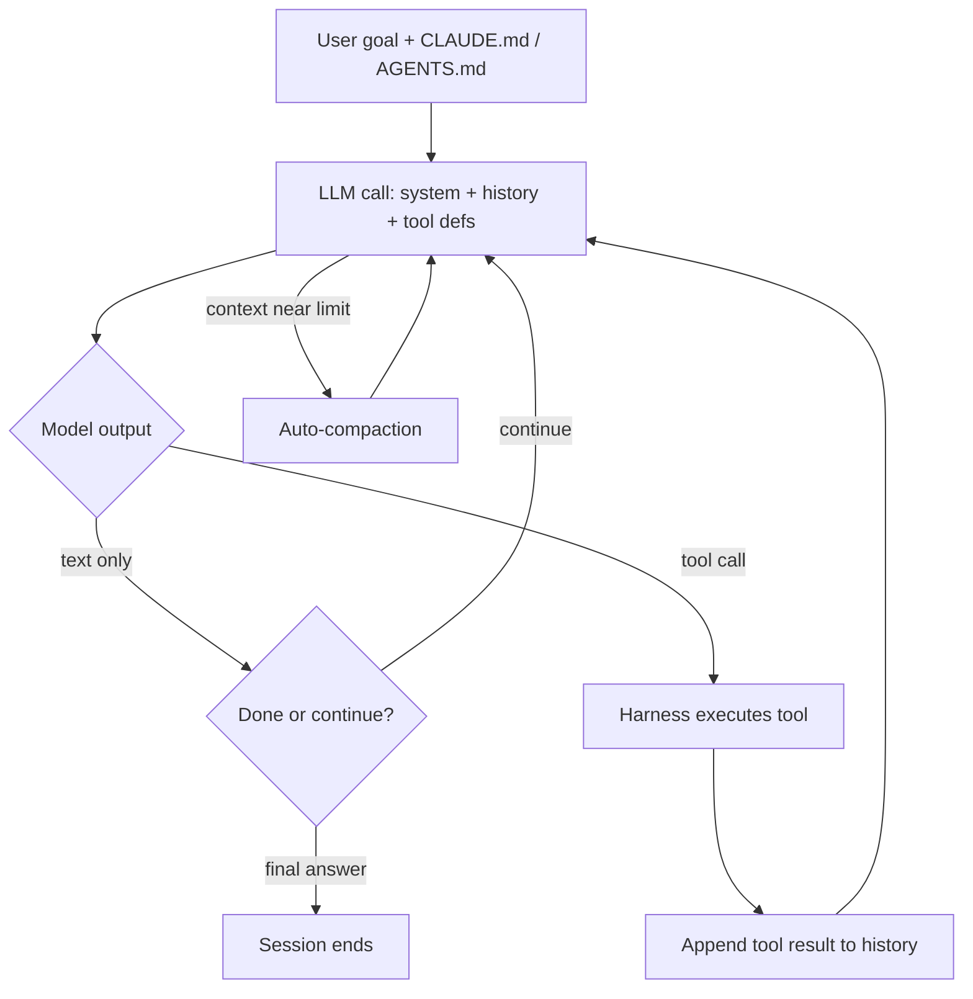

# How RE Agents Actually Work

> Tags: agent-internals, agent-loop, context, compaction, tool-budget, trajectories, debugging | Difficulty: Intermediate | Prerequisites: `02-collab/agent-orchestration-tools.md`, `02-collab/context-engineering.md`

## Overview

An agent is a loop, not a model. The model answers one prompt. The harness turns one answer into thousands of actions.

Every coding-agent harness runs the same skeleton:

1. Build the prompt from the system prompt, memory files, and the conversation history.
2. Send it to the model with a list of tools.
3. The model replies with text, a tool call, or both.
4. The harness executes the tool call and appends the result to history.
5. Repeat until the model stops calling tools or a limit fires.

For RE work, the tools are MCP servers and shell commands. A Ghidra decompile is a tool call. A `strings` dump is a tool call. A Frida attach is a tool call.

This page explains the loop, why context fills and then breaks, how budgets work, and how to read agent transcripts when a run fails.

## How It Works

### The agent loop



The loop has three exits:

- The model emits text with no tool call. The harness treats this as the final answer.
- A budget fires. Token budget, tool-call budget, wall-clock budget, or turn limit.
- The user interrupts, or a permission prompt blocks.

One tool call is one iteration. A "30-minute triage" recipe can mean 80 to 300 iterations. SentinelLABS' "Sol Searching" malware study reported 23 billion tokens across all runs, with one GLM-5.2 run costing $100 for 267 million tokens (sentinelone.com/labs/frontier-models-tackle-autonomous-long-horizon-malware-analysis). Long RE sessions are expensive because the loop is long.

### ReAct versus plan-execute

Two patterns dominate agent design.

**ReAct** interleaves reasoning and action every step. The model thinks, calls one tool, observes, thinks again. The original paper is arXiv:2210.03629 ("ReAct: Synergizing Reasoning and Acting in Language Models", Yao et al., 2022). Most coding-agent harnesses are ReAct underneath. Claude Code, Codex CLI, and Gemini CLI all emit one tool call per model turn and loop. radare2's `r2ai` plugin exposes an explicit ReAct mode (github.com/radareorg/r2ai).

**Plan-execute** splits the work. A planner model writes a plan. An executor model runs it. Some designs add a verifier. `criticic/reagent` (github.com/criticic/reagent) uses this shape with markdown-defined agents. Rikugan and the Claude Code `Plan` subagent are lighter versions.

Which pattern works for RE?

| Pattern | Strength | Weakness |
|---|---|---|
| ReAct | Adapts when evidence surprises it. Good for open-ended triage. | Greedy fetching. Burns context on broad retrieval. |
| Plan-execute | Keeps the plan stable. Easier to audit. Easier to budget per phase. | Planner guesses wrong early. Executor cannot recover without replanning. |
| Hybrid | Plan once, then ReAct within phases | Most real harnesses do this. Plan mode, then autonomous mode. |

For RE, hybrid wins in practice. Plan the analysis path once (triage, map, decompile, verify). Then let the loop run inside each phase. Claude Code plan mode and Codex plan mode implement this split.

### Context compaction and why it loses evidence

Model context windows are finite. When history approaches the limit, the harness compacts it. It replaces old turns with a summary.

SentinelLABS reported that compaction cut input tokens by about 86 percent but degraded recovery of higher-level objects (reported, sentinelone.com/labs). The model forgets what it was doing. It loses the thread of unfinished work. It re-fetches evidence it already had. It contradicts earlier conclusions.

The "Humans versus Machines" study (arXiv:2610.14960) measured this on real binaries. Agents showed "greedy fetching": broad retrieval with no revisits. They pull decompilation dumps, fill the window, compact, then pull again. The compaction loop amplifies the problem because the summarizer also has to compress tool outputs it never fully read.

What compaction destroys, specifically:

- Exact addresses. A summary says "the parser function" instead of `FUN_00401230`.
- Negative results. "Checked string 0x4a2010, not referenced" is low-salience and gets dropped.
- Partial hypotheses. "Maybe this is a CRC" survives poorly if the next turn moved on.
- Tool-call provenance. The model cannot tell which claim came from Ghidra versus a guess.

Mitigations that work:

- **Write evidence outside the window.** Append claims to `ledger.jsonl` or `notes.md` after every finding. The file survives compaction. See `../02-collab/context-files-and-memory.md` and `../09-ops/notes-and-evidence.md`.
- **Use a cheap fast model for compaction.** `criticic/reagent` uses `REAGENT_FAST_MODEL` for context compaction while the main model does analysis.
- **Compact on purpose, not at the limit.** Ask for a session summary every 50 findings, then start a fresh session. `../02-collab/context-engineering.md` recommends this.
- **Keep retrieval selective.** One function at a time beats a bulk dump. See `../02-collab/context-engineering.md`.

### Tool-call budgets

A budget is a hard stop on iterations. Benchmarks enforce them. AgentRE-Bench (agentrebench.ai) uses a fixed 25-call tool budget per challenge. The SRE-Bench study found budget and safeguards dominated solve rates (arXiv:2608.11469).

Budget types in real harnesses:

| Budget | Where it lives | Example |
|---|---|---|
| Max turns | Harness setting | Gemini CLI exit code 53 on turn limit |
| Max tokens | API parameter or `--max-budget-usd` | Claude Code `--max-budget-usd <n>` |
| Max tool calls | Benchmark harness or wrapper | AgentRE-Bench 25 calls |
| Per-worker calls | Orchestrator config | `2233admin/reverse-skill-evolver` explicit call budgets |
| Wall clock | `timeout` wrapper | `timeout 1800 claude -p ...` |

Set a budget before a run. An agent without a budget on a hard binary will spend until the context dies or the bill does.

### Subagent isolation

Subagents are separate loops with separate context. The parent writes a prompt. The subagent runs its own plan-tool-observe loop. It returns only a final message.

This isolation is the main defense against context saturation. A 10,000-line Ghidra decompile lands in the subagent's window, not yours. The parent sees a 200-token summary.

Costs and limits:

- Subagent token spend counts against the same account. Claude Code docs note subagent requests count toward the same usage limits.
- Each subagent re-reads its own context files. That is duplicate cost.
- Nested depth is limited. Claude Code allows three layers. Gemini CLI blocks recursion entirely.
- Background subagents get reduced built-in tools but keep MCP tools.

See `../02-collab/agent-orchestration-tools.md` for per-harness subagent configuration.

## Step-by-Step

### Read an agent transcript to debug a failure

When a run fails, the transcript is the evidence. Find it, then read it in order.

**Claude Code.** Sessions are JSONL files under `~/.claude/projects/<project-slug>/`. Each line is one event: user message, assistant message, tool call, tool result. Headless runs print `session_id` in the JSON output. Resume with `claude -p --resume <session-id>`.

**Codex CLI.** `codex exec --json` streams JSONL events to stdout. Save the stream to a file. Session rollout files live under `~/.codex/sessions/` (reported, verify on your version). `--ephemeral` skips session files entirely, so do not use it when you need the transcript.

**Cursor.** Background subagent output lands under `~/.cursor/subagents/`. Foreground transcripts are in the chat UI. The agent CLI supports `--output-format stream-json`.

**Gemini CLI.** `gemini -p --output-format json` gives a single JSON result. `stream-json` gives events. Checkpoint files live under `~/.gemini/` (reported).

What to look for, in order:

1. **The first divergence.** Find the first tool call that returned unexpected output. Everything after that is downstream noise.
2. **Greedy fetch bursts.** Long runs of `decompile_function` or `list_strings` calls with no synthesis between them. This is the greedy-fetching signature.
3. **Compaction events.** A sudden drop in history length followed by repeated fetches of the same evidence. The agent forgot.
4. **Hallucinated addresses.** Tool calls that reference addresses never returned by any tool. Check against the ledger.
5. **Refusal or truncation.** Model output cut mid-sentence, or a safety refusal. See `../07-advanced/model-selection.md` for the Opus 5.5 classifier issue.
6. **Budget exhaustion.** The last events before termination. Was the budget too small, or did the agent loop?

A quick transcript audit script:

```bash
# Count tool calls by type in a Claude Code JSONL session
jq -r 'select(.type=="assistant") | .message.content[]? | select(.type=="tool_use") | .name' \
  ~/.claude/projects/*/<session>.jsonl | sort | uniq -c | sort -rn
```

### LLM assists for failed runs

When a trajectory fails, use the model to help debug it. Three patterns work.

**Self-critique prompt.** Feed the transcript tail back to the model with a structured critique request:

```
You are reviewing your own agent trajectory. The task was: <goal>.
The run failed because: <symptom>.
Below is the last 30 events. Identify:
1. The first tool call that went wrong.
2. Any address or claim not backed by a tool result.
3. Where context was wasted on irrelevant retrieval.
4. What you would do differently in the next 10 steps.
```

This works because the model can see its own reasoning in the transcript. It cannot see its own weights, but it can pattern-match the failure.

**Trajectory summarization.** Compress a long transcript into a structured summary before resuming:

```
Summarize this agent session as JSON:
{
  "goal": "...",
  "verified_findings": [{"claim": "...", "evidence": "addr 0x...", "status": "verified|unverified"}],
  "dead_ends": ["..."],
  "open_questions": ["..."],
  "next_steps": ["..."]
}
```

Write the summary to `session-summary.md`. Start a fresh session that reads the summary plus the ledger. This is manual compaction with a schema. It beats auto-compaction because you control what survives.

**Adversarial review.** Spawn a second agent with a different model to review the first agent's claims. The multi-agent patterns page covers this in detail. See `../02-collab/multi-agent-patterns.md`.

## Pitfalls

- **Do not confuse the model with the agent.** The model is one LLM call. The agent is the harness loop. When a run fails, debug the loop first: budgets, compaction, tool definitions, permission prompts.
- **Do not trust auto-compaction.** It cuts tokens by about 86 percent (reported) but loses addresses, negative results, and hypotheses. Keep your own ledger outside the window.
- **Do not run without a budget.** Set `--max-budget-usd`, a turn limit, or a `timeout` wrapper before every session. Long-horizon RE is where costs explode.
- **Do not feed bulk decompilation to the main context.** One function per call. Use subagents for bulk extraction. See `../02-collab/context-engineering.md`.
- **Do not skip transcript review.** When an agent produces a wrong answer, the transcript shows why. Without it you are guessing.
- **Do not assume ReAct is always running.** Some harnesses batch tool calls, some plan first, some use structured workflows. Read the harness docs for your tool.
- **Do not let subagents write to the shared database during untrusted-binary sessions.** Context isolation does not stop persistent injection. See `../07-advanced/ai-security-threats.md`.

## See Also

- [Context Engineering for Binary Analysis](../02-collab/context-engineering.md)
- [Multi-Agent Patterns](../02-collab/multi-agent-patterns.md)
- [Claude Code Setup](../02-collab/claude-code-setup.md)
- [Codex, Cursor, and Other Harnesses](../02-collab/codex-cursor-setup.md)
- [Agent Orchestration Tools](../02-collab/agent-orchestration-tools.md)
- [Verification Loop](../03-decomp/verification-loop.md)
- [Decompilation Orchestration](../03-decomp/decomp-orchestration.md)
- [Context Files and Memory](../02-collab/context-files-and-memory.md)
- [Cost Tracking](../09-ops/cost-tracking.md)
- [Model Selection](../07-advanced/model-selection.md)
- [AI Security Threats](../07-advanced/ai-security-threats.md)
