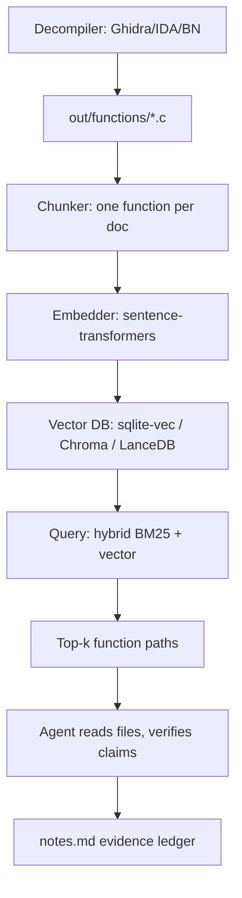

# Embeddings and RAG Over Binary Content

> Tags: rag, embeddings, vector-db, sqlite-vec, chromadb, lancedb, semantic-search | Difficulty: Intermediate | Prerequisites: one working decompiler (Ghidra, IDA, or Binary Ninja) and a directory of decompiled output, see `../03-decomp/batch-decompilation.md`

## Overview

RAG over a binary means this: you embed every function, store the vectors in a database, and retrieve the top-k functions that match a query before you ask the LLM anything.

The payoff is scope. A medium binary decompiles to far more tokens than any context window holds. See `../02-collab/context-engineering.md` for the scale math. Retrieval lets you answer "which functions touch the network" or "find the crypto" without dumping the whole decompile into the prompt.

The cost is precision. Embedding models were trained on prose and code, not decompiler output. Pseudocode with auto-generated names like `DAT_00401000` and `*(int *)((char *)&PTR_x_00 + i)` embeds worse than clean C. Retrieval misses the function that matters. You compensate with hybrid search and deterministic verification.

This page covers what to embed, which store to pick, how to chunk code, and the grounding rules that keep retrieval honest.

## Setup

### What to embed

Pick one granularity per index. Do not mix granularities in one collection.

| Unit | What you embed | Good for | Bad for |
|---|---|---|---|
| Function pseudocode | The decompiled C text, stripped of `FUN_` names | Semantic search: "find the parser" | Exact API names, short helpers |
| Function signature plus first lines | Prototype, first 10-20 lines | Cheap pass over huge binaries | Functions where the logic is deep |
| Disassembly mnemonics | Raw or lightly formatted asm | When the decompiler is wrong or packed code survives | Anything semantic. Asm embeds poorly |
| Strings and xrefs | String text plus the list of functions referencing it | Triage: "what uses this URL" | Code structure questions |
| Call-graph neighborhood | Function plus one-line summaries of callees | Tracing intent across boundaries | Precise questions |

Rules that matter:

1. **Pseudocode beats assembly.** Decompiler output is closer to the code the embedding model saw in training. Assembly mnemonics embed badly because `mov`, `lea`, and register names dominate the text.
2. **Strip auto-generated names before embedding, or keep them — then pick one.** A function full of `FUN_00401a30` calls embeds as noise. Either strip them or preface the chunk with a cleaned summary. Test both on your corpus before committing.
3. **Embed one function per chunk.** A chunk that spans two functions teaches the model nothing about either boundary.
4. **Keep the source path in metadata.** Every chunk must map back to `out/functions/func_0x401000.c` or an address. Retrieval without a citation is useless for verification.

### Embedding models

Local models keep binary-derived text off third-party APIs. That matters for malware work. See `../07-advanced/ai-security-threats.md`.

| Model | Size | Notes |
|---|---|---|
| google/embeddinggemma-300m | 300M params | 768-dim output, Matryoshka truncation to 512/256/128. 2048-token context. MTEB Code v1 score 68.76 at 768d (vendor card). Runs on CPU. Install via `sentence-transformers` |
| Qwen3-Embedding-0.6B/4B/8B | 0.6B-8B | Stronger code retrieval, reported. Heavier. Check current availability on Hugging Face |
| Nomic embed | small | Works through Ollama and `sqlite-rembed`. Convenient, weaker on code |

```bash
pip install "sentence-transformers>=5" sqlite-vec
```

Load EmbeddingGemma:

```python
from sentence_transformers import SentenceTransformer

model = SentenceTransformer("google/embeddinggemma-300m")
# encode_query for search strings, encode_document for stored chunks
q = model.encode_query("function that decrypts a buffer with a key schedule")
docs = model.encode_document([open(p).read() for p in chunk_paths])
```

Notes from the model card: use float32 or bfloat16, not float16. Use the query prompt `task: code retrieval | query: ...` for query-side encoding when hunting code. This is documented on the model card at huggingface.co/google/embeddinggemma-300m.

### Vector stores

| Store | Install | Fit for RE work |
|---|---|---|
| sqlite-vec | `pip install sqlite-vec` | Best default. One `.db` file per binary. No daemon. vec0 virtual tables, metadata columns, partition keys |
| ChromaDB | `pip install chromadb` | Good when you already have a Python pipeline and want the richer query API. `chromadb.EphemeralClient()` needs no server |
| FAISS | `pip install faiss-cpu` | Fastest raw ANN. You build the index yourself and manage metadata in a side table. More code, best at 100K+ chunks |
| LanceDB | `pip install lancedb` | Embedded columnar store. Vector plus full-text search in one table. Good when you want hybrid search without writing it yourself |

sqlite-vec is pre-v1. Expect breaking changes. That is acceptable because the whole index rebuilds from source files in minutes.

## How It Works

### The pipeline



### Index build

1. Decompile every function to `out/functions/func_<addr>.c`. See `../03-decomp/batch-decompilation.md` for headless pipelines.
2. Build `out/index.json`: address, name, file path, size, caller count.
3. Embed each file. Store `{rowid, embedding, func_addr, func_name, file_path}`.
4. Optionally build an FTS5 table over the same text for BM25.

sqlite-vec schema. Verified against sqlite-vec 0.1.9:

```python
import sqlite3, sqlite_vec

conn = sqlite3.connect("analysis/out/vec.db")
conn.enable_load_extension(True)
sqlite_vec.load(conn)

conn.execute("""
CREATE VIRTUAL TABLE functions USING vec0(
    embedding float[768],
    func_addr TEXT,          -- metadata column: usable in WHERE
    func_name TEXT,
    file_path TEXT,
    module TEXT PARTITION KEY,    -- shards KNN per module/binary
    size_tokens INTEGER
)
""")
```

vec0 column types: `TEXT`/`INTEGER`/`FLOAT`/`BOOLEAN` columns are `metadata` columns and can appear in KNN `WHERE` with `=`, `!=`, `>`, `>=`, `<`, `<=`. `PARTITION KEY` shards the index and makes `module = 'main'` filters fast. `+column` auxiliary columns hold any type but cannot appear in KNN `WHERE`. Join them in a subquery instead. Documented at alexgarcia.xyz/sqlite-vec/features/vec0.html. A partition key needs hundreds of vectors per value, so do not partition on function address.

Insert:

```python
conn.execute(
    "INSERT INTO functions(rowid, embedding, func_addr, func_name, file_path, module, size_tokens) "
    "VALUES (?, ?, ?, ?, ?, ?, ?)",
    (addr_int, sqlite_vec.serialize_float32(emb), addr_hex, name, path, mod, n)
)
```

sqlite-vec accepts JSON arrays or compact BLOBs for vectors. `sqlite_vec.serialize_float32(vec)` produces the compact form. JSON works for prototyping.

Query:

```sql
SELECT func_addr, func_name, file_path, distance
FROM functions
WHERE embedding MATCH :query_vec
ORDER BY distance
LIMIT 20;
```

Distance is L2 by default in vec0. For normalized embeddings, cosine and L2 rank identically. EmbeddingGemma outputs are normalized by `sentence-transformers`, so either works.

### Chunking strategies for code

Code is not prose. Sloppy chunking produces junk retrieval.

1. **Function boundary is the chunk.** Never split mid-function unless the function exceeds the model's 2048-token context. If it does, split at basic-block boundaries and store `func_addr + block_label` as the chunk ID.
2. **Oversize functions.** Truncate the middle, not the ends. Keep the signature, the first 30 lines, and the last 20 lines. Mark the elision with a comment line so the embedder does not read it as code.
3. **Tiny functions.** Merge thunks and one-line wrappers into their caller's chunk, or keep them but expect them to rank low. A 3-line `jmp` wrapper has no semantic content.
4. **Strings and xrefs as separate chunks.** Store each string as its own document with metadata `type=string`, plus the list of referencing function addresses. This gives you two indexes in one table.
5. **Versioned binaries.** When you index v1 and v2 of the same binary for diffing, store `version` as a metadata column and query each version separately, then compare top-k sets.

### Hybrid BM25 + vector

Vector search misses exact identifiers. BM25 misses paraphrase. Use both.

sqlite-vec has no built-in BM25. Pair it with SQLite FTS5:

```python
conn.execute("""
CREATE VIRTUAL TABLE functions_fts USING fts5(
    func_addr UNINDEXED, func_name, body,
    tokenize = "porter unicode61"
)
""")
```

Query both, merge with reciprocal rank fusion:

```python
def rrf(vector_hits, fts_hits, k=60):
    scores = {}
    for rank, row in enumerate(vector_hits):
        scores[row["func_addr"]] = scores.get(row["func_addr"], 0) + 1 / (k + rank + 1)
    for rank, row in enumerate(fts_hits):
        scores[row["func_addr"]] = scores.get(row["func_addr"], 0) + 1 / (k + rank + 1)
    return sorted(scores.items(), key=lambda x: -x[1])
```

LanceDB does vector plus full-text in one table and has `rerank` support. ChromaDB supports `where` metadata filters on query. FAISS gives you no metadata, so you join against a SQLite side table by rowid.

When hybrid pays off: searching for a known API name (`CryptDecrypt`, `recv`, a mutex name) where the exact token matters. Pure vector search buries exact-match hits under semantically similar noise.

### Semantic function search use cases

1. **Find the crypto.** Query: "function implementing a block cipher round with S-box lookups and XOR key schedule." Vector search surfaces candidates. You verify by reading the top 5.
2. **Find the parser.** Query: "length-prefixed message parser that reads a header then dispatches on a type field." Works on protocol code even when symbols are stripped.
3. **Find similar functions across versions.** Embed v1 and v2 separately, or in one table with a `version` partition key. Query with a known function from v1, get top-k from v2. This finds renamed and refactored functions that survived recompilation. Reported as a working pattern in Binary Ninja Sidekick's semantic search and in ReCopilot's homology search (`../07-advanced/model-selection.md` has the tool list).
4. **Triage a large binary.** "Which functions reference the network?" becomes a retrieval query plus an FTS query on import names, not a 2M-token dump.
5. **Locate the license check.** Query: "function comparing an input string against a computed value and branching to a failure path." Then verify deterministically.

### LLM assists: query formulation and ranking

The LLM helps at two points. It does not replace retrieval.

1. **Query formulation.** Give the agent the triage notes and ask for 3-5 retrieval queries in embedding-friendly language. "Find functions that implement RC4 or a Feistel cipher" beats "crypto stuff." Iterate: if top-k is noise, reformulate and re-query. This is cheap. Do it before any deep analysis.
2. **Result ranking.** Retrieval returns candidates, not answers. Feed the top-k paths and one-line summaries to the model and ask it to rank by likelihood, with reasons. The model's ranking is a hypothesis. Verification decides.
3. **Query expansion.** For a known-bad hit, ask the model what identifiers or API names that function probably calls, then run an FTS query on those names. This bridges the vocabulary gap between your query and the binary's symbols.

## Step-by-Step

### Procedure: build a searchable index for one binary

1. **Decompile to files.**

```bash
# Ghidra headless example. Adapt to your bridge.
analyzeHeadless /tmp/proj proj -import target.exe \
  -postScript DumpDecompile.py /tmp/analysis/out/functions
```

Every function lands in `out/functions/func_<addr>.c`.

2. **Build the index JSON.**

```python
import json, os
index = []
for f in sorted(os.listdir("out/functions")):
    addr = f.split("_")[1].split(".")[0]
    path = f"out/functions/{f}"
    index.append({"addr": addr, "path": path,
                  "size": os.path.getsize(path)})
json.dump(index, open("out/index.json", "w"))
```

3. **Embed and load.**

```python
import sqlite3, sqlite_vec
from sentence_transformers import SentenceTransformer

model = SentenceTransformer("google/embeddinggemma-300m")
conn = sqlite3.connect("out/vec.db")
conn.enable_load_extension(True)
sqlite_vec.load(conn)
conn.execute("""CREATE VIRTUAL TABLE IF NOT EXISTS functions USING vec0(
    embedding float[768], func_addr TEXT, func_name TEXT,
    file_path TEXT, module TEXT)""")

for entry in json.load(open("out/index.json")):
    text = open(entry["path"]).read()
    emb = model.encode_document(text[:8000])  # cap input
    conn.execute("INSERT INTO functions(rowid, embedding, func_addr, func_name, file_path, module) VALUES (?,?,?,?,?,?)",
                 (int(entry["addr"], 16), sqlite_vec.serialize_float32(emb),
                  entry["addr"], entry["path"], entry["path"], "main"))
conn.commit()
```

4. **Query.**

```python
q = model.encode_query("task: code retrieval | query: function that decrypts a buffer with a key schedule")
rows = conn.execute(
    "SELECT func_addr, file_path, distance FROM functions "
    "WHERE embedding MATCH ? ORDER BY distance LIMIT 10",
    (sqlite_vec.serialize_float32(q),)).fetchall()
for addr, path, dist in rows:
    print(addr, path, dist)
```

5. **Read top-k files, write findings to `notes.md`.** Every claim gets an address and a verification status. See `../03-decomp/verification-loop.md`.

### Procedure: cross-version function matching

1. Index v1 into `vec_v1.db`, v2 into `vec_v2.db`. Same model, same chunking.
2. Embed each v1 function. Query v2's index. Take the top-1 match per v1 function.
3. Filter by distance threshold. Pairs below threshold are rename candidates.
4. Verify a sample by hand before bulk-renaming. Embedding similarity is not proof of equivalence.

## Pitfalls

- **Embedding decompiler artifacts.** `DAT_`, `FUN_`, `*(undefined4 *)`, `in_FS_OFFSET` dominate the text. The model learns the artifact distribution, not the logic. Mitigate: strip auto-names, prepend a cleaned signature, or embed pseudocode plus a one-line analyst summary.
- **Retrieval is recall-limited.** The right function can rank 50th. Mitigate: hybrid BM25, larger k, query reformulation, and reading more files rather than trusting top-3.
- **Stale index after renames.** If you rename functions in Ghidra after indexing, the stored `func_name` is wrong. The vectors themselves are unaffected, but your citations lie. Rebuild metadata or re-embed after bulk renames.
- **Chunk drift across versions.** Different decompiler versions produce different pseudocode for the same function. Cross-version matching degrades. Use the same decompiler version for both indexes, or embed assembly-normalized features instead.
- **Vector DB is not a verifier.** A retrieved function is a candidate. Prompt injection can live in strings you indexed. Retrieval returns attacker-controlled text to the agent. Treat every retrieved chunk as untrusted input. See `../07-advanced/ai-security-threats.md`.
- **sqlite-vec is pre-v1.** The `vec0` constructor and column semantics change between releases. Pin the version. Rebuild the index after upgrades.
- **Metadata filter syntax is strict.** vec0 metadata columns accept only `=`, `!=`, `>`, `>=`, `<`, `<=`. `LIKE`, `IS NULL`, and scalar functions in a KNN `WHERE` error out or return wrong results. Auxiliary `+columns` cannot appear in KNN `WHERE` at all. Join them in a subquery instead.
- **Cost of embedding large corpora.** A 50K-function binary at ~2K tokens each is ~100M tokens of embedding input. Local models make this free but slow on CPU. Batch with `model.encode(list, batch_size=64)`.
- **Do not embed the whole decompile dump.** Chunk first, embed second. Embedding a 5MB concatenated file produces one meaningless vector.
- **Reverify-style grounding.** Every retrieval hit that becomes a claim needs a deterministic check: re-read the file, confirm the address exists, run the verification loop. The vector DB tells you where to look. It does not tell you what is true.

## See Also

- `../02-collab/context-engineering.md` — chunking strategy, RAG vs 1M-context decision, dump-to-file patterns
- `../03-decomp/verification-loop.md` — reverify and deterministic claim checks
- `../03-decomp/batch-decompilation.md` — headless decompile pipelines that feed the index
- `../03-decomp/triage-and-mapping.md` — building the function map before embedding
- `../07-advanced/ai-security-threats.md` — prompt injection via retrieved binary content
- `../05-tools/mcp-catalog.md` — existing Ghidra/IDA/BN MCP servers with built-in semantic search (OGhidra, pyghidra-mcp, Sidekick)
- `../09-ops/notes-and-evidence.md` — evidence ledger for retrieval-backed findings
