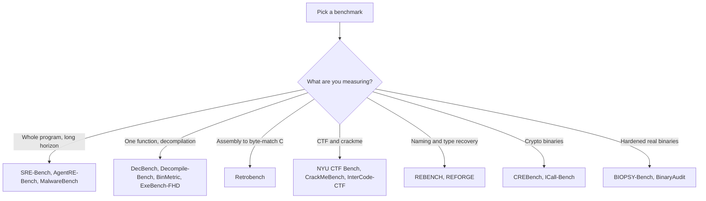

# RE Benchmarks and Evals Reference

> Tags: benchmarks, evals, model-selection, leaderboards | Difficulty: intermediate | Prerequisites: basic agent usage. See [Model Selection](../07-advanced/model-selection.md) and [Verification Loops](../03-decomp/verification-loop.md).

## Overview

The 2026 benchmark landscape for AI reverse engineering has two layers.

The first layer is academic paper benchmarks. Papers introduce tasks, run a
handful of models, and publish scores. Most of these are not runnable by
you. They still carry information. Read the task design and the caveats.

The second layer is living benchmarks and open harnesses. These update
leaderboards and ship runnable code. Examples: DecBench, AgentRE-Bench,
Retrobench, MalwareBench, BIOPSY-Bench. These are the ones you can run
against your own model or agent stack.

This page covers every benchmark in the current landscape. For each one it
states what is measured, how contaminated it is, and whether it still
discriminates between models in November 2026.



## The Landscape

### Tier 1 — whole-program agentic RE

| Benchmark | Source | What it measures | Contamination | Discriminates in 2026 |
|---|---|---|---|---|
| SRE-Bench | https://daplab.cs.columbia.edu/benchmarks/sre-bench — arXiv:2608.11469 | 19 private real-world programs, 262 binary instances, 1,572 graded tasks, 44 anti-analysis mechanisms | Private programs. Low contamination. | Yes. Best model fully solves about 27 to 32 percent of instances with safeguards on. |
| AgentRE-Bench | https://github.com/agentrebench/AgentRE-Bench — https://agentre-bench.ai | 33 binaries (13 ELF, 10 PE as stripped and unstripped pairs). Fixed 25-call tool budget. Deterministic scorer. | Binaries are public. Models may memorize them. | Yes. Best score 87.37/100. No attempt got full credit. Scores cluster within a few points at the top. |
| MalwareBench | https://malwarebench.com — https://github.com/arimlabs/malware-bench | 12 real obfuscated malware cases across PE, ELF, Mach-O, APK. Agent produces behavioral analysis plus a reusable extractor. | Private ground truth on indicators. Samples are real malware, not in training data. | Yes, and it is hard. Best@3 is 7.6 percent for GPT-6.1 Sol. Most models fail. |
| BIOPSY-Bench | https://github.com/CLAY-JYB/BIOPSY-Bench | 25 hardened tasks built from real open-source projects. Five scenarios: protection assessment, malware analysis, protocol reconstruction, firmware analysis, patch diffing. | Generated tasks with deterministic verifiers. | Yes. All six models score 0.01 to 0.035 pass rate per instance. Near the floor. |

### Tier 2 — function-level decompilation

| Benchmark | Source | What it measures | Contamination | Discriminates in 2026 |
|---|---|---|---|---|
| DecBench | https://decbench.com — https://github.com/Noelo-Lab/decbench | Three metrics: CFG graph edit distance, type correctness against DWARF ground truth, recompilation byte-match. Living leaderboard. | Dataset is public on HuggingFace. Sample-set is small. | Yes. LLM agents score 56 to 60 union perfect-score. Traditional decompilers cap near 35. |
| Decompile-Bench | arXiv:2505.12668 | 2M binary-source function pairs from permissively licensed GitHub. Eval split uses post-2025 repos to limit leakage. | Leakage-controlled eval split. | Partly. It measures re-executability, not exact source. Useful for training data, less for agent ranking. |
| DecompileBench | arXiv:2505.11340 | 23,400 functions. LLM-as-judge for analyst usability. | Public corpus. | Weak. LLM-judge scoring is noisy for ranking. |
| BinMetric | arXiv:2505.07360 | 1,000 questions over 20 projects. Six binary-analysis tasks. | Paper benchmark. | Moderate. Questions are fixed and small. |
| ExeBench-FHD | arXiv:2610.28212 | Audit of ExeBench. Found nine fidelity issues. 38.9 percent of ExeBench functions carry at least one warning flag. | ExeBench itself is contaminated for frontier models. | It is a correction, not a leaderboard. Read it before trusting any ExeBench number. |
| REBENCH | arXiv:2604.27319 | Function-name and type recovery on stripped binaries. Procedural, fair-by-construction. | Procedural generation limits memorization. | Moderate. Narrow task: names and types only. |
| REFORGE | arXiv:2607.07738 | Decompiled function naming benchmark. | Paper benchmark. | Moderate. Narrow task. |

### Tier 3 — CTF and crackme

| Benchmark | Source | What it measures | Contamination | Discriminates in 2026 |
|---|---|---|---|---|
| Retrobench | https://retrobench.ai | Agents get raw MIPS assembly of N64-era game functions. Write C that recompiles byte-for-byte with the original IDO compiler. 25-build budget. | Split into leaked and non-leaked targets. Non-canonical leaked variant punishes recall. | Yes, with caveats. One architecture, five targets, run variance in low double digits. |
| CrackMeBench | arXiv:2605.10597 | Crackme tasks with deterministic oracles. 8 public calibration plus 12 generated tasks. No-network Docker sandbox. | Generated split is clean. Public calibration is memorized. | Partly. Pass@3 on generated split: GPT-5.5 92 percent, Claude Opus 4.7 58 percent, Kimi K2 42 percent. Top models saturate. |
| NYU CTF Bench | https://github.com/NYU-LLM-CTF/NYU_CTF_Bench — https://nyu-llm-ctf.github.io | 200 CSAW CTF challenges across six categories. Dockerized. `pip install nyuctf`. | Heavily contaminated. CSAW challenges are public and old. | No. Reports describe memorization-driven scores. Do not use for model ranking. |
| InterCode-CTF | https://intercode-benchmark.github.io | Terminal-interaction CTF tasks from picoCTF-style environments. | Public CTF content. | No. Reported saturated near 95 percent success. The public leaderboard still shows older models only. Treat the 95 percent figure as reported, not verified on this page. |
| Cybench | https://cybench.github.io | 40 professional-level CTF tasks from four competitions. | Public challenges. | Partly. Harder than picoCTF. Still public and aging. |

### Tier 4 — specialized RE

| Benchmark | Source | What it measures | Contamination | Discriminates in 2026 |
|---|---|---|---|---|
| CREBench | arXiv:2604.03750 | Crypto-binary RE. 432 challenges from 48 algorithms. Four sub-tasks from algorithm ID to flag recovery. | Generated challenges. | Yes, for crypto. Best model GPT-5.4 scores 64.03/100 and recovers the flag in 59 percent of challenges. Humans still dominate. |
| ICall-Bench | arXiv:2610.37871 | Interprocedural reasoning. Indirect-call target recovery in compiled binaries. | Paper benchmark. | Yes. Program-level success spans 23 to 81 percent across models. Wide spread. |
| RE-Bench | https://github.com/METR/RE-Bench — arXiv:2411.15114 | METR AI R&D tasks: kernel optimization, fine-tuning, scaffolding. Not a reverse-engineering benchmark. | Password-protected solutions. | Not applicable. Included here only because the name collides. The repo is deprecated. Do not use it for RE model selection. |

### Adjacent benchmarks worth knowing

| Benchmark | Source | What it measures |
|---|---|---|
| BinaryAudit | https://github.com/QuesmaOrg/BinaryAudit — https://quesma.com/benchmarks/binaryaudit | Backdoors hidden in ~40MB real binaries. Ghidra and Radare2 available. 33 tasks. |
| HWREBench | https://hwrebench.com | Hardware and firmware RE agent evaluation. |
| Kong XZ benchmark | referenced in BASE_REPORT.md | Backdoor reconstruction. Reported $6.63 per full run for one model. Single-source, unverified. |

## What Each Benchmark Actually Measures

Scores on different benchmarks do not transfer. Read the task before you
compare numbers.

| Benchmark family | Unit of work | Scoring | What a high score proves |
|---|---|---|---|
| SRE-Bench | Whole program, many tasks | Deterministic grading per task | The agent can sustain analysis across a large binary with anti-analysis |
| AgentRE-Bench | One binary, 25 tool calls | Field-level F1 against rubric | The agent finds specific techniques and extracts keys or strings |
| MalwareBench | One malware sample | Recall on indicators of compromise | The agent locates and decodes C2 material |
| BIOPSY-Bench | One hardened project | Deterministic verifier, pass/fail | The agent can defeat real protection chains end to end |
| DecBench | One function | GED, type match, byte-match | The decompiler or agent recovers exact source structure |
| Retrobench | One function | Byte-match of recompiled object | The agent writes C that rebuilds to identical machine code |
| NYU CTF / CrackMeBench | One challenge | Flag or oracle check | The agent solves a self-contained puzzle |
| CREBench / ICall-Bench | One challenge | Flag or call-target check | The agent reasons about crypto logic or interprocedural calls |

A model that scores 87 on AgentRE-Bench can still score 7.6 on
MalwareBench. The tasks differ. AgentRE-Bench gives 25 calls and a fixed
toolset on synthetic binaries. MalwareBench gives a shell and real
obfuscated malware.

## Contamination

Contamination is the main reason public benchmark scores overstate real
capability.

### Public corpora are memorized

- NYU CTF Bench uses CSAW challenges. These are public and old. Models
  trained on writeups and solutions score well without doing RE.
- CrackMeBench public calibration split is much harder than the generated
  split in practice. Public crackmes are memorized. Generated split
  pass@3 for GPT-5.5 is 92 percent. Public calibration is 3/8, 2/8, 1/8
  across three models.
- InterCode-CTF uses picoCTF-style tasks. Saturated.
- Decompile-Bench addresses this directly. Its eval split uses GitHub
  repos released after 2025.

### Retrobench handles it explicitly

Retrobench splits targets into leaked and non-leaked. One leaked target
is a non-canonical variant. Recalling the famous source produces the
wrong answer. Memorization scores 20. Verification-driven models score
91 to 100. This is the cleanest contamination design in the current
landscape.

### Private and generated benchmarks resist it

- SRE-Bench uses 19 private real-world programs.
- MalwareBench ground truth is held out. Samples are real malware.
- BIOPSY-Bench generates tasks from real projects with deterministic
  verifiers. Anti-cheating invariants keep ground truth out of plaintext.
- AgentRE-Bench binaries are public. The README warns they may appear in
  training data. Treat its absolute scores with caution.

## What Discriminates in 2026

Not every benchmark separates models anymore.

### Saturated or near-saturated

- InterCode-CTF. Reported 95 percent success. Public CTF content.
- NYU CTF Bench. Memorization-driven. Do not rank models on it.
- CrackMeBench generated split. Top models pass@3 above 90 percent.
- Generic CTF leaderboards. High-school difficulty is solved.

### Still discriminative

- SRE-Bench. Best full-solve rate about 27 to 32 percent with safeguards.
  Wide cost spread from $0.50 to $42.5 per instance.
- MalwareBench. Best@3 7.6 percent. Real malware is unsolved.
- BIOPSY-Bench. All models near zero. Discriminates at the floor, not at
  the top.
- AgentRE-Bench. Top scores cluster within a few points. Confidence
  intervals overlap. Use it for regression testing, not fine ranking.
- Retrobench. Byte-match spread is wide on hard targets. One architecture
  only.
- DecBench. LLM agents clearly beat traditional decompilers. Among LLM
  agents the spread is narrower.
- ICall-Bench. 23 to 81 percent spread. Interprocedural reasoning is not
  solved.
- CREBench. 64.03/100 best. Humans still dominate.

### The practical read

If you want one number for "can this model do RE work", SRE-Bench is the
most rigorous. If you want a runnable local check, use AgentRE-Bench or
DecBench. If you want to know if a model handles real malware, use
MalwareBench. If you want to check decompilation quality, use DecBench.
If you want to check byte-exact reconstruction, use Retrobench.

Do not average scores across benchmarks. They measure different things.

## How to Run a Local Eval

Most benchmarks are not `pip install` and go. Each has a different
harness. This section gives the runnable ones.

### AgentRE-Bench

Repo: https://github.com/agentrebench/AgentRE-Bench

Requirements: Python 3.10+, Docker for sandboxed tools, gcc and binutils
on Linux x86-64, MinGW-w64 for PE builds.

```bash
git clone https://github.com/agentrebench/AgentRE-Bench.git
cd AgentRE-Bench
cp .env.example .env            # add provider keys
docker build --platform linux/amd64 -t agentre-bench-tools:latest -f Dockerfile.tools .
python run_benchmark.py --task level1_TCPServer --provider anthropic -v
python run_benchmark.py --all --manifest version3/tasks_v3.json \
  --max-tool-calls 25 --max-tokens 16000 \
  --provider openai --model gpt-5.6-sol --reasoning-effort xhigh
```

Provider env vars: `ANTHROPIC_API_KEY`, `OPENAI_API_KEY`, `GOOGLE_API_KEY`,
`DEEPSEEK_API_KEY`, `MOONSHOT_API_KEY`, `GLM_API_KEY`.

Output goes to `results/` with `benchmark_report.json` and per-task
transcripts. The standalone scorer is `scorer.py`.

### DecBench

Repo: https://github.com/Noelo-Lab/decbench
Site: https://decbench.com
Dataset: https://huggingface.co/datasets/noelo-lab/decbench-dataset

Requirements: Python, Rust Joern built from source for GED, Ghidra for the
Ghidra decompiler harness.

```bash
git clone https://github.com/Noelo-Lab/decbench
cd decbench
pip install -e ".[dev]"
git clone https://github.com/Noelo-Lab/rust-joern
cd rust-joern && cargo build --release && cd ..
pip install -e ./rust-joern
cd ..

# run on a project
decbench run projects/sailr/coreutils.toml

# or evaluate one binary
decbench evaluate binary.elf -s source.c
```

To compete externally on the 250-function sample set, download the eval
kit, decompile each function, and send results to the DecBench team.

### BIOPSY-Bench

Repo: https://github.com/CLAY-JYB/BIOPSY-Bench

Requirements: Harbor (https://github.com/harbor-framework/harbor).
Each task directory is a Harbor task package.

```bash
git clone https://github.com/CLAY-JYB/BIOPSY-Bench
cd BIOPSY-Bench
harbor run --dataset protection-assessment/ddnet-19.9-license-gate \
  --agent <agent> --model <model>
```

Five scenario directories: `protection-assessment`, `malware-analysis`,
`protocol-reconstruction`, `firmware-analysis`, `patch-diffing`. Budget is
two hours per attempt. pass@5 is the reported metric.

### MalwareBench

Repo: https://github.com/arimlabs/malware-bench
Site: https://malwarebench.com

The repo contains 12 tasks, 121 ground-truth indicators, and 252 recorded
runs. Each task gives an agent one malware sample and a shell. The agent
writes findings to `/workspace/iocs.json`. `tests/score.py` scores recall.

Code is Apache-2.0. Task data and trajectories are CC-BY-4.0.

### NYU CTF Bench

Repo: https://github.com/NYU-LLM-CTF/NYU_CTF_Bench
Agents repo: https://github.com/NYU-LLM-CTF/nyuctf_agents

```bash
pip install nyuctf
python3 -m nyuctf.download
```

Load challenges with `CTFDataset(split="test")`. The test split has 200
challenges. The development split has 55. Use development for agent
tuning. Do not tune on test.

Warning: this benchmark is contaminated for frontier models. Use it only
for harness debugging, not model ranking.

### BinaryAudit

Repo: https://github.com/QuesmaOrg/BinaryAudit
Site: https://quesma.com/benchmarks/binaryaudit

33 tasks. Hidden backdoors in ~40MB real binaries. Ghidra and Radare2
available to the agent. Check the repo README for the run procedure.

### CrackMeBench

arXiv:2605.10597. Check the paper for the sandbox and oracle details. The
generated split is the clean one. The public calibration split is
contaminated.

### What you cannot easily run locally

- SRE-Bench. Private programs. The harness is not public.
- Retrobench. Closed leaderboard. The task set is undisclosed. You submit
  through their harness.
- InterCode-CTF. Public but saturated.
- CREBench, ICall-Bench, REBENCH, REFORGE, BinMetric, DecompileBench,
  ExeBench-FHD. Paper benchmarks. Data may be on HuggingFace or in the
  paper repo. Check each paper for release status.

## Using Benchmarks to Pick Models

Benchmarks are evidence, not verdicts. Use them in three steps.

### Step 1: match the benchmark to your task

| Your work | Best-matching benchmark |
|---|---|
| Whole-program analysis of a large binary | SRE-Bench, AgentRE-Bench |
| Real malware triage and IOC extraction | MalwareBench, BIOPSY-Bench malware-analysis |
| Function decompilation quality | DecBench, Decompile-Bench |
| Byte-exact recompilation | Retrobench |
| Protocol or crypto reverse engineering | CREBench, BIOPSY-Bench protocol-reconstruction |
| Firmware or hardware | HWREBench, BIOPSY-Bench firmware-analysis |
| Naming and type recovery at scale | REBENCH, REFORGE |
| Crackmes and CTF for harness debugging | NYU CTF Bench, CrackMeBench |

### Step 2: read the caveats

- Check the contamination section above.
- Check the budget. SRE-Bench shows budget dominates score. A model with
  $42.5 per instance is not comparable to one with $0.50.
- Check the harness. AgentRE-Bench gives 25 tool calls. MalwareBench
gives a shell. Real work gives neither.
- Check the refusal rate. Claude Opus 5.5 refuses 22 percent of
  AgentRE-Bench attempts and 26 percent of MalwareBench rollouts. A low
  score may be a refusal, not a capability failure.
- Check the variance. Retrobench run-to-run variance on hard targets is
  low double digits. Close scores are ties.

### Step 3: run a local check on your own data

Public benchmarks tell you what a model did on someone else's tasks.
Your binaries are different. Build a small private eval:

1. Pick 5 to 10 binaries you have already solved by hand.
2. Write the ground-truth answers: function names, IOCs, protocol fields,
   keys.
3. Run each candidate model through the same harness and prompt.
4. Score deterministically where possible.
5. Track cost per task.

This is the only eval that predicts your real work. See
[Verification Loops](../03-decomp/verification-loop.md) for scoring
methods.

## Pitfalls

- Do not compare scores across benchmarks. An 87 on AgentRE-Bench and a
  64 on CREBench measure different skills.
- Do not trust public CTF or crackme scores for frontier models.
  Contamination is documented.
- Do not assume a leaderboard update means capability improved. Harness
  changes, budget changes, and model routing changes all move scores.
  Retrobench v0.4 exists because earlier rows were not comparable.
- Do not ignore refusal rates. A model that refuses 26 percent of
  attempts will look worse than it is on capability, and better than it
  is on safety.
- Do not run malware benchmarks on your analysis workstation. Use the
  sandbox from [Malware Isolation](../01-setup/malware-isolation.md).
- Do not feed benchmark binaries to a model without checking the license.
  Some benchmarks restrict training use. RE-Bench explicitly asks people
  not to train on its tasks.
- Do not treat a single benchmark as sufficient. A model can be strong on
  function naming and weak on whole-program reasoning. Run at least two
  benchmarks that match your task type.
- Do not ignore cost. SRE-Bench per-instance cost ranges from $0.50 to
  $42.5. DecBench per-function cost ranges from $1.0 to $6.6. Budget
  dominates score more than raw capability on long tasks.

## See Also

- [Model Selection](../07-advanced/model-selection.md) — benchmark scores by model tier, cost per task, local models
- [Verification Loops](../03-decomp/verification-loop.md) — deterministic checks for agent claims
- [Malware Analysis](../06-topics/malware-analysis.md) — MalwareBench context and safe detonation
- [Decompile Workflow](../03-decomp/decompile-workflow.md) — the human+AI loop benchmarks try to measure
- [Prompt Patterns](../02-collab/prompt-patterns.md) — prompts that affect benchmark scores
- [Cost Tracking](../09-ops/cost-tracking.md) — token cost anatomy per task type
- [Agent Orchestration Tools](../02-collab/agent-orchestration-tools.md) — harnesses used by benchmarks
