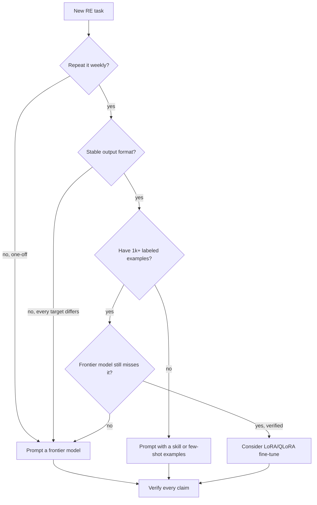

# Fine-Tuning Models for RE

> Tags: fine-tuning, LoRA, QLoRA, function-naming, decompilation, local-models | Difficulty: advanced | Prerequisites: ../02-collab/context-engineering.md, ../03-decomp/batch-decompilation.md, ../07-advanced/model-selection.md

## Overview

Fine-tuning trains a model's weights on your own examples. Prompting keeps
the weights fixed and changes only the input text.

Most RE work in 2026 does not need fine-tuning. Frontier models reached
most bounded RE tasks already. The measured cases where fine-tuning wins
are narrow:

- You repeat the same task on hundreds or thousands of similar binaries.
- The task has a stable output format that prompting keeps missing.
- You have thousands of labeled examples.
- You need cheap local inference at volume.

The classic example is function naming. You know the ground-truth names
for a library family. You want a small local model that outputs names in
your house style for every stripped binary you open.

The second example is a decompilation refiner. Ghidra emits the same
classes of errors. You collect pairs of Ghidra output and corrected C.
A tuned model learns your project's conventions.

Everything else — one-off malware triage, protocol guessing, obfuscated
code, novel targets — is better served by prompting a frontier model
plus a verification loop. Fine-tuning does not fix hallucination. It only
shifts the output distribution toward your data.

## When Fine-Tuning Beats Prompting



Prompting wins when:

- The task is one-off or the target family changes.
- The corpus is small. Under about 1,000 examples, a few-shot prompt
  usually beats a tuned small model.
- The work needs reasoning, not formatting. Naming a function is format
  work. Explaining why a check exists is reasoning work.
- A frontier model already solves it. Reported benchmark results in
  [model-selection.md](../07-advanced/model-selection.md) show agentic
  models solve most bounded RE tasks without any tuning.

Fine-tuning wins when:

- The input distribution is stable. Same compiler, same obfuscator,
  same vendor library family.
- Volume makes per-call cost or latency matter. A local 7B model
  answering in milliseconds beats an API call for bulk renaming.
- Output style must be consistent. Your naming conventions, your
  comment format, your severity vocabulary.
- Prompt length is the bottleneck. If you need 8,000 tokens of examples
  to get the style right, a tuned adapter is cheaper.

## What to Train

Two tasks have published evidence. Start with one of them.

### Task 1: Function-name recovery

Input: decompiled pseudocode plus lightweight context (callers, callees,
string references, import usage).
Output: a semantic function name such as `decrypt_aes_cbc` or
`parse_http_headers`.

Why it works:

- The output space is narrow. One identifier per function.
- Ground truth exists in unstripped binaries and open-source builds.
- Research systems already prove the approach. SymGen (NDSS 2025) used
  a LoRA-fine-tuned Code Llama for function naming on stripped
  binaries. ReSym (ACM 2024) paired two fine-tuned models with Prolog
  cross-function reasoning. DIRTY and VarBERT (USENIX Security 2022,
  TSE 2024) did variable naming and type recovery with transformers.
  ReCopilot (github.com/XingTuLab/recopilot) ships a 7B binary-analysis
  LLM for name, type, and struct recovery.

Measured accuracy is honest but limited. An NDSS 2026 study reported
LLM rename accuracy of about 85 percent on known algorithms versus 66
percent for humans, but only about 57 percent versus 65 percent overall.
Names are plausible, not verified. Check them.

### Task 2: Decompile refinement

Input: Ghidra or IDA pseudocode.
Output: cleaner C that preserves behavior.

Why it works:

- The error distribution is stable. Decompilers repeat the same
  mistakes: lost types, flattened loops, wrong signedness, dead code.
- Datasets exist. LLM4Decompile publishes a Ref series trained on
  Ghidra pseudocode to source pairs (github.com/albertan017/LLM4Decompile).
- Research systems prove the pattern. CodeInverter
  (github.com/LiuPeiP-CS/CodeInverter) adds CFG and data-flow context.
  Decaf (github.com/AlexShypula/decaf) samples candidates and ranks by
  byte distance. ASAP (arXiv 2610.06900) refines assembly-aligned
  pseudocode. SK2Decompile splits the job into structure recovery then
  identifier naming.

This is a harder task than naming. The input is long. Token budgets
matter. Start with naming.

### What not to train

- Whole-program reasoning. Fine-tuned small models are weak here.
- Malware classification from scratch. Use existing triage pipelines.
- Anything you cannot verify. A tuned model that confidently emits
  wrong names is worse than a frontier model that hedges.

## Data Sources

Fine-tuning is a data problem first. Budget most of your time here.

### BinDiff and symbol pairs

The standard trick for naming data:

1. Take an unstripped binary with symbols. Debug builds, distro
   packages, open-source releases.
2. Strip it or take the stripped variant of the same build.
3. Align functions across the pair with BinDiff
   (github.com/google/bindiff) or Diaphora
   (github.com/joxeankoret/diafragor).
4. The symbol in the unstripped copy is your label.
5. The decompiled pseudocode from the stripped copy is your input.

This gives clean supervision: input is what the analyst sees, label is
the truth. One library family yields thousands of pairs.

Sources of unstripped-plus-stripped pairs:

- Distro packages. Debian and Fedora ship both `.debug` files and
  stripped binaries.
- Your own builds. Compile open-source projects at O0 through O3.
  That also covers the compiler distribution you care about.
- crackmes.one has community solutions but few labeled pairs.
  Use it for eval, not training.

### Open-source with symbols

Clone projects, build them, keep the symbol table. The label is the
function name in the symbol table. The input is the decompilation of
the stripped `.so` or `.exe`.

Good corpus choices:

- C libraries with stable APIs: zlib, libpng, sqlite, openssl.
- Protocol stacks: curl, nss, mbedtls.
- Your own codebase. If you reverse your vendor's SDKs often, their
  open-source siblings are the best corpus.

### LLM4Decompile datasets

The LLM4Binary Hugging Face org
(huggingface.co/LLM4Binary) publishes:

- `decompile-bench`: about 2.3M binary-source function pairs
  condensed from 100M. GCC O0 to O3, Linux x86_64.
- `decompile-eval`: about 75.6K function pairs for evaluation.
- `decompile-bench-makefile`: Makefile-based build recipes.

The GitHub repo
(github.com/albertan017/LLM4Decompile) documents the format and ships
training scripts. A single A100 40G trained the 100K subset in about
3.5 hours for under $20 in reported cloud cost.

These datasets are assembly-to-C, not pseudocode-to-C. For a refiner,
you still need Ghidra-output-to-C pairs. The `ghidra` folder in the
repo covers the V2 Ref models.

### Your own corrections

Every time you fix a decompiler mistake by hand, log the pair:

```json
{"input": "<ghidra pseudocode>", "output": "<your corrected C>",
 "binary": "target.exe", "function": "0x401000", "verified": true}
```

A few hundred verified corrections beat a million unverified scraped
pairs for a narrow task. See ../09-ops/notes-and-evidence.md for the
ledger format.

### Data hygiene

- Dedupe by function body hash. Recompiled copies of one function are
  near-duplicates.
- Split by binary, not by function. Hold out whole binaries so the
  eval measures generalization, not memorization.
- Filter by token length. LLM4Decompile caps at 4,096 tokens. Keep your
  examples inside your model's window.
- Keep the license. GPL-licensed source pairs can constrain what you
  publish. Training for internal use is a different question than
  releasing weights. See ../09-ops/legal-and-ethics.md.

## LoRA and QLoRA on Consumer GPUs

Full fine-tuning of a 7B model needs far more VRAM than a consumer GPU
has. Parameter-efficient methods train small adapter matrices instead.

| Method | What it trains | VRAM for 7B (bf16, seq 2048) | Notes |
|---|---|---|---|
| Full FT | All weights | 60GB+ | Not for consumer GPUs |
| LoRA | Low-rank adapters on attention and MLP | 16-24GB | Standard choice. Good quality |
| QLoRA | LoRA on a 4-bit quantized base | 8-12GB | Fits a 12-16GB card. Small quality loss |
| DoRA / others | Variants | Similar to LoRA | Marginal gains. Not worth the complexity first |

Reported rule of thumb: LoRA rank 8 to 32 covers most narrow tasks.
Higher rank helps when the output format is complex. Rank 16 is the
usual starting point.

### Stack options

**Unsloth** (github.com/unslothai/unsloth) is the fastest path. It
claims about 2x faster training and about 70 percent less VRAM than
naive PyTorch, with no accuracy loss in their tests. Install:

```bash
curl -LsSf https://astral.sh/uv/install.sh | sh
uv venv unsloth_env --python 3.13
source unsloth_env/bin/activate
uv pip install unsloth --torch-backend=auto
```

Unsloth also ships a desktop app and a web UI (`unsloth studio`) if you
prefer no code.

**Hugging Face PEFT + TRL** is the transparent path. More code. Easier
to audit. Use it when you need exact control over packing and eval.

```bash
pip install "transformers>=4.51" "peft>=0.14" "trl>=0.15" \
            "datasets" "accelerate" "bitsandbytes" "torch"
```

bitsandbytes provides the 4-bit quantization for QLoRA on NVIDIA GPUs.

### Training script skeleton (PEFT + TRL)

```python
import torch
from datasets import load_dataset
from peft import LoraConfig, get_peft_model, prepare_model_for_kbit_training
from transformers import AutoModelForCausalLM, AutoTokenizer, BitsAndBytesConfig
from trl import SFTTrainer, SFTConfig

BASE = "Qwen/Qwen2.5-Coder-7B-Instruct"

tokenizer = AutoTokenizer.from_pretrained(BASE)
tokenizer.pad_token = tokenizer.eos_token

bnb = BitsAndBytesConfig(
    load_in_4bit=True,
    bnb_4bit_quant_type="nf4",
    bnb_4bit_compute_dtype=torch.bfloat16,
)
model = AutoModelForCausalLM.from_pretrained(
    BASE, quantization_config=bnb, device_map="auto",
    torch_dtype=torch.bfloat16,
)
model = prepare_model_for_kbit_training(model)

lora = LoraConfig(
    r=16, lora_alpha=32, lora_dropout=0.05,
    target_modules=["q_proj", "k_proj", "v_proj", "o_proj",
                    "gate_proj", "up_proj", "down_proj"],
    task_type="CAUSAL_LM",
)
model = get_peft_model(model, lora)

ds = load_dataset("json", data_files="train.jsonl")

trainer = SFTTrainer(
    model=model, tokenizer=tokenizer, train_dataset=ds["train"],
    args=SFTConfig(
        output_dir="./out",
        per_device_train_batch_size=4,
        gradient_accumulation_steps=8,
        num_train_epochs=3,
        learning_rate=2e-4,
        lr_scheduler_type="cosine",
        logging_steps=10,
        save_strategy="epoch",
        bf16=True,
        report_to="none",
        max_length=4096,
        packing=True,
    ),
)
trainer.train()
trainer.save_model("./name-recoverer-lora")
```

Train JSONL format:

```json
{"messages": [
  {"role": "system", "content": "You name stripped-binary functions."},
  {"role": "user", "content": "<decompiled pseudocode and context>"},
  {"role": "assistant", "content": "parse_config_ini"}
]}
```

### Which base model

- Qwen2.5-Coder-7B-Instruct or Qwen2.5-Coder-14B-Instruct: proven
  code models. The LLM4Decompile team built on Yi-Coder and Qwen
  variants.
- Qwen3-Coder-30B-A3B: MoE. Strong code quality. Heavier to train but
  only 3B active parameters makes inference cheap.
- CodeLlama variants: older. SymGen used Code Llama. Prefer current
  Qwen for new work.
- Do not start from a chat model you already tuned for chat. Start
  from the instruct base.

### Serving the adapter

Merge or serve with LoRA weights:

```python
from peft import PeftModel
from transformers import AutoModelForCausalLM, AutoTokenizer

base = AutoModelForCausalLM.from_pretrained("Qwen/Qwen2.5-Coder-7B-Instruct",
                                            torch_dtype="auto", device_map="auto")
model = PeftModel.from_pretrained(base, "./name-recoverer-lora")
tok = AutoTokenizer.from_pretrained("Qwen/Qwen2.5-Coder-7B-Instruct")
```

Or export to GGUF for llama.cpp/Ollama. The GGUF path lets you plug the
model into the same MCP harnesses you already use. See
../05-tools/tool-catalog.md.

## Step-by-Step: Build a Naming Adapter

1. Pick one target family. Example: all functions in `libcurl` builds.
   Do not mix PE and ELF in one model.
2. Collect pairs. Build curl at O0, O1, O2, O3. Strip each binary.
   Align stripped to unstripped with Diaphora or BinDiff.
3. Decompile the stripped functions with Ghidra headless
   (`analyzeHeadless`). Export pseudocode per function.
4. Write the prompt template. Keep it fixed:

   ```
   <pseudocode>
   # Callers: foo, bar
   # Callees: memcpy, strlen
   # Strings: "Content-Type", "%d"

   Name this function. Return one identifier, snake_case.
   ```

5. Build `train.jsonl` and `eval.jsonl`. Split by binary so eval holds
   out whole builds.
6. Train with the script above. Start with QLoRA on a 7B model. Expect
   a few hours on a 16GB card for 5-20K examples (estimate, unverified
   on your hardware).
7. Evaluate before you trust it. See the next section.
8. Export. Merge the adapter or export GGUF.
9. Wire it into the workflow. Batch naming through an MCP server or a
   headless script. Keep the frontier model for reasoning tasks.

## Evaluation

Hold out functions before you train. Measure on data the model never
saw.

### Splits that matter

| Split | What it tests |
|---|---|
| Random function split | Easy. Catches nothing. Do not use alone |
| Hold out whole binaries | Generalization to new builds of known libraries |
| Hold out whole projects | Generalization to new codebases |
| Hold out compiler or arch | Real-world robustness. Usually fails |

Always do at least the second split. The third if you can.

### Metrics for naming

- Exact match against ground truth. Strict but honest.
- Token-level F1 or BLEU against ground truth. Forgiving of synonyms.
- Human spot-check on 50 random outputs. Automated metrics miss
  plausible-but-wrong names.

Reported baseline: frontier models through prompting reach roughly
57-85 percent depending on the study and the corpus. Your tuned 7B
must beat the prompted frontier model on your held-out set to be
worth deploying.

### Metrics for the refiner

- Re-executability. Compile the output and run the test assertions.
  LLM4Decompile uses this metric. 9B-V2 reports 64.9 percent.
- Recompilation rate. Does the output compile at all.
- Human diff review. Read 50 outputs side by side.

### The rule

A tuned model is not verified output. It is a faster way to produce
candidates. The same verification loop applies:

- Names: check against strings, xrefs, and behavior before you commit
  them to the IDB.
- Recompiled C: compile, run, diff behavior against the original.
- See ../03-decomp/verification-loop.md.

## Pitfalls

- **Distribution shift.** Train on GCC O2 Linux x86_64. Test on MSVC
  Windows PE or OLLVM-flattened code. Expect failure. Match your
  training distribution to your real targets.
- **Memorization.** The model memorizes the training binaries. Your
  eval must hold out whole binaries or it will lie to you.
- **Overfitting the label style.** If all your labels come from one
  codebase's naming style, the model learns that style and nothing
  else.
- **Prompt drift.** If your inference prompt differs from training,
  quality drops. Freeze the template.
- **Thinking the adapter fixes reasoning.** LoRA teaches format and
  vocabulary. It does not add capability the base model lacks.
- **Publishing weights trained on GPL or proprietary code.** Check
  licenses. Internal use and release are different questions.
- **Skipping the baseline.** Always benchmark the prompted frontier
  model on the same held-out set first. If it wins, do not deploy the
  adapter.
- **Training on unverified pairs.** A wrong label teaches wrong names
  at scale. Verify a sample before you scale.
- **Expecting it to replace the agent.** The tuned model is one tool.
  The agent harness, MCP bridge, and verification loop still matter.
  See ../03-decomp/decomp-orchestration.md.

## Honest Assessment

Fine-tuning is a specialist tool. In 2026 it pays off in three cases:

1. You reverse the same vendor's binaries every week.
2. You need bulk renaming or comment generation at a scale where API
   cost hurts.
3. You have a labeled corpus already, from your own projects or from
   open-source builds.

Outside those cases, prompting wins. The research systems that make
fine-tuning look easy train on millions of pairs across thousands of
GPU-hours. A weekend LoRA on 2,000 examples will not match a frontier
model on novel binaries.

The recommended order:

1. Master prompting with a frontier model and a skill pack.
2. Add deterministic verification.
3. Log your corrections as training data for six months.
4. Only then fine-tune, and only on the task where prompting measurably
   fails.

Fine-tuning is not the first move. It is the move you make after
prompting has proven insufficient on a stable, high-volume task.

## See Also

- [Choosing Models for RE Tasks](../07-advanced/model-selection.md)
- [Verification Loop](../03-decomp/verification-loop.md)
- [Batch Decompilation](../03-decomp/batch-decompilation.md)
- [Context Engineering](../02-collab/context-engineering.md)
- [Tool Catalog](../05-tools/tool-catalog.md)
- [Notes and Evidence](../09-ops/notes-and-evidence.md)
- [LLM Workflows and Recipes](../02-collab/llm-workflows-recipes.md)
