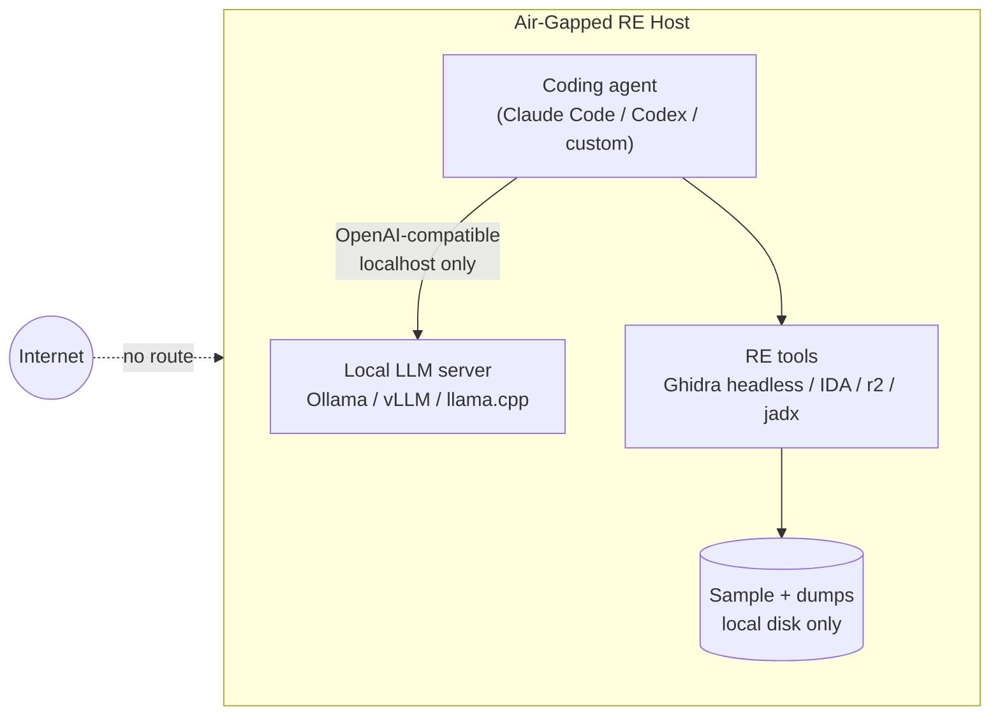

# Running RE Models Locally

> Tags: local-models, ollama, vllm, llama.cpp, quantization, air-gapped, gpu, self-hosted | Difficulty: intermediate | Prerequisites: ../07-advanced/model-selection.md, a machine with a GPU you control

## Overview

Local inference keeps hostile binaries off third-party infrastructure.
It also runs bulk decompilation without an API bill. The tradeoff is
real: local open-weight models are weaker than frontier models on
obfuscated code, and no published benchmark compares them head-to-head
on real binaries.

This page covers the three serving stacks (Ollama, vLLM, llama.cpp),
the model picks for reverse engineering, quantization tradeoffs, VRAM
math, batch throughput, air-gapped deployment, and MCP integration
through an OpenAI-compatible endpoint.

The short version:

- Ollama for a single-user workstation. vLLM for batch or multi-client
  serving. llama.cpp for the smallest footprint and GGUF-only models.
- Qwen3-Coder-Next is the standard local pick for a general RE agent.
- LLM4Decompile and CodeInverter handle bulk function-level work on a
  single consumer GPU.
- Everything above the ~30B class needs real VRAM or CPU offload. Offload
  is slow.

## Serving Stacks

### Ollama

Ollama is a model runner with a built-in OpenAI-compatible HTTP server.
Install from https://ollama.com/download. It manages model files,
quantized variants, and exposes `/api/chat` plus `/v1/chat/completions`.
Pull and serve:

```bash
ollama pull qwen3-coder-next
ollama pull qwen2.5-coder:32b
ollama serve   # daemon by default
ollama list
```

Query it with the OpenAI API shape:

```bash
curl http://localhost:11434/v1/chat/completions \
  -H "Content-Type: application/json" \
  -d '{
    "model": "qwen3-coder-next",
    "messages": [{"role": "user", "content": "Rename this function: int f(int a,int b){return a<b?a:b;}"}],
    "temperature": 0.2
  }'
```

Ollama properties that matter for RE work:

- Zero-config. One binary, model store under `~/.ollama/models`.
- Concurrent requests queue. Ollama serializes per model by default.
  Throughput is fine for interactive use and poor for fan-out batch jobs.
- Tool calling works through the OpenAI-compatible endpoint on supported
  models. Verify on your model before you build a workflow on it.
- GPU auto-detection. It uses CUDA or ROCm if present, CPU otherwise.

Integrations that already speak Ollama: GhidrAssist accepts any
OpenAI-compatible endpoint (https://github.com/symgraph/GhidrAssist).
OGhidra is an Ollama-plus-Ghidra bridge from LLNL
(https://github.com/llnl/OGhidra). r2ai supports local models through
Ollama or any OpenAI-compatible server
(https://github.com/radareorg/r2ai). Malyzer drives an Ollama agentic
loop aimed at FlareVM (https://github.com/zrnge/Malyzer).

### vLLM

vLLM is a production inference server. It implements continuous batching,
paged attention, and an OpenAI-compatible API. It shines when several
requests run at once, which is exactly what a batch decompilation job
does.

Install and serve (Python 3.10+, NVIDIA GPU recommended):

```bash
pip install 'vllm>=0.15.0'
vllm serve Qwen/Qwen3-Coder-Next \
  --port 8000 \
  --tensor-parallel-size 1 \
  --enable-auto-tool-choice \
  --tool-call-parser qwen3_coder \
  --max-model-len 32768
```

Notes:

- `vllm>=0.15.0` is the documented minimum for Qwen3-Coder-Next. See
  https://huggingface.co/Qwen/Qwen3-Coder-Next
- `--max-model-len` defaults high and eats KV-cache VRAM. Set it to what
  your task needs. Function-level tasks rarely need more than 32K.
- `--tensor-parallel-size` splits the model across GPUs. Use 2+ only when
  one GPU cannot hold the weights.
- vLLM serves FP16 or FP8 checkpoints natively. For GGUF files use
  llama.cpp or Ollama instead.
- Quantized serving: AWQ and GPTQ Int4 checkpoints run in vLLM. Marlin
  kernels give good throughput on Ampere and newer.
- Endpoint shape is identical to Ollama's: POST `/v1/chat/completions`
  on the same port.
- Use vLLM when several agents or a batch script hit the same model, or
  when you serve the model to a small team.

### llama.cpp

llama.cpp is the reference GGUF runtime. It runs on CPU, CUDA, Metal,
Vulkan, and SYCL. It is the fallback when nothing else fits your hardware.
Build and serve:

```bash
git clone https://github.com/ggml-org/llama.cpp
cd llama.cpp
cmake -B build -DGGML_CUDA=ON
cmake --build build -j --config Release
./build/bin/llama-server \
  -m /models/Qwen3-Coder-Next-Q4_K_M.gguf \
  --port 8080 -c 32768 --threads 8 -ngl 99
```

- `-ngl 99` offloads all layers to the GPU. Lower it to leave VRAM for
  other work.
- `-c` sets context size. KV cache scales with context and model.
- llama-server exposes `/v1/chat/completions` and a web UI on the same
  port.
- Tool calling works on supported architectures through `--jinja` and
  chat templates. Confirm your model's template before relying on it.
- GGUF is the llama.cpp and Ollama native format. You pick the
  quantization at download time. See Quantization below.

## Model Picks for RE

Pick the model for the task class, not for the benchmark table. See
../07-advanced/model-selection.md for the benchmark evidence.

### General-purpose code models (agent backbone)

| Model | Parameters | Context | Best for | Notes |
|---|---|---|---|---|
| Qwen3-Coder-Next | 80B total, 3B active (MoE) | 262K native | Local agent backbone for RE | Best local/private option per the research report. Hybrid Gated DeltaNet + attention layout. Non-thinking mode only |
| Qwen2.5-Coder | 1.5B to 32B dense | 32K to 128K | Smaller GPUs, simpler tasks | Mature GGUF ecosystem. 32B Q4 needs about 20GB VRAM |
| DeepSeek-Coder-V2 | 236B total, 21B active (MoE) | 128K | Long-context code reasoning | Large. Needs multi-GPU or heavy offload for full precision |
| CodeLlama | 7B to 34B dense | 16K to 100K | Legacy fallback | Older generation. Weaker than Qwen coder models on current evals |

Notes on the top pick:

- Qwen3-Coder-Next is 80B total parameters with only 3B active per token.
  MoE means weights are large but per-token compute is small. It is the
  backbone of AutoDecompiler-30B, per the research report. Sources:
  https://huggingface.co/Qwen/Qwen3-Coder-Next and
  https://arxiv.org/abs/2606.16162
- Official serving requires vLLM >= 0.15.0 or SGLang >= 0.5.8 for the
  full model. Ollama and llama.cpp support GGUF builds, reported by the
  model card.
- It produces no `<think>` blocks. It is non-thinking only.
- Expect weaker results on obfuscated code. That is the documented gap
  between local and frontier models.

### Specialist decompilation models

These models are trained for one job: turn assembly or decompiler
pseudocode into cleaner C. They are not chat models. Feed them their
training format.

| Model | Size | Input | Output | Source |
|---|---|---|---|---|
| LLM4Decompile v2 series | 1.3B, 6.7B, 9B, 22B | Ghidra pseudocode | Refined C | https://github.com/albertan017/LLM4Decompile |
| LLM4Decompile v1.5 / End | 1.3B, 6.7B | Disassembly | C source | Same repo |
| SK2Decompile | varies | Binary or pseudocode | Two-phase: skeleton then naming | Same repo, HF LLM4Binary org |
| CodeInverter (CIM) | 1.3B, 6.7B | Assembly + CFG + data map | C | https://github.com/LiuPeiP-CS/CodeInverter |

Published re-executability numbers on the LLM4Decompile benchmark: 9B-v2
scores 64.9 percent, 22B-v2 scores 63.6 percent, 6.7B-v2 scores 52.7
percent. V2 models refine Ghidra output. End models decompile
disassembly directly. These are self-reported figures on one benchmark.
Treat them as ordering evidence, not guarantees. The 9B-v2 model fits in
roughly 6-8GB VRAM at Q4 and 10-12GB at Q8. Estimates. Measure.

Use specialists for bulk passes: rename-and-clean sweeps over thousands
of functions, re-executability checks, first-pass decompilation. Then feed
their output to a stronger model for reasoning, or to a human for
verification.

### What not to run locally

- Do not expect a 7-9B local model to handle obfuscated or VM-protected
  binaries. The research report states this plainly.
- Do not run real malware analysis on a small local model alone.
  MalwareBench shows even frontier models score in low single digits.
- Do not use a local model as the verifier in a verification loop. The
  verifier should be a different model or a deterministic check.

## Quantization

Quantization trades accuracy for memory and speed. For code tasks the
ordering is consistent: higher bits, better fidelity, slower.

| Format | Bits per weight | Typical size for 30B-class | Quality | Speed |
|---|---|---|---|---|
| FP16 / BF16 | 16 | ~60GB for 30B | Reference | Baseline |
| FP8 | 8 | ~30GB for 30B | Near-lossless on modern hardware | Fast on Ada/Hopper |
| Q8_0 | 8 | ~30GB for 30B | Very close to FP16 | Fast |
| Q6_K | ~6.5 | ~25GB for 30B | Good | Medium |
| Q4_K_M | ~4.8 | ~18-20GB for 30B | Usable, small loss on code | Fast |
| Q3 and below | ~3-4 | ~12-15GB for 30B | Noticeable degradation | Fastest |

Guidance for RE work:

- Code is more sensitive to quantization than prose. Identifier names,
  operator boundaries, and magic constants degrade first. Prefer Q6_K or
  Q8_0 for decompilation and naming work where the output is code.
- Q4_K_M is the sweet spot for fitting a 30B-class model on a 24GB card.
  Accept it for triage and bulk renaming. Re-verify any critical output.
- Below Q4, code quality drops fast. A Q3 model that hallucinates a
  function name is worse than no model.
- MoE models like Qwen3-Coder-Next have unusual quantization behavior.
  Few active parameters per token means Q4 MoE often beats Q8 dense of
  similar total size on speed. Measure.
- GGUF quants are made by the community. Prefer quants from the model
  author or well-known quantizers (bartowski, unsloth). Reported
  practice, not a guarantee.

VRAM math shortcut: VRAM_GB ~= params_B * bits_per_weight / 8 * 1.15
overhead, plus KV cache. A 30B model at Q4_K_M needs roughly 18-20GB for
weights. A 32K context adds several GB of KV cache. An 80B-total MoE at
Q4 needs roughly 45-50GB for weights even though only 3B is active per
token.

## VRAM Requirements

These are planning numbers. Measure on your exact model file and context
length.

| Model class | Weights VRAM (Q4) | Weights VRAM (Q8/FP16) | Fits on |
|---|---|---|---|
| 7-9B dense | 5-6GB | 14-18GB | 8-16GB card or CPU+RAM |
| 14B dense | 9-10GB | 28GB | 12-16GB card at Q4, 24GB+ at Q8 |
| 27-32B dense | 18-20GB | 55-60GB | 24GB card at Q4, 48GB+ at Q8 |
| 70B dense | 40-43GB | 140GB | 48GB card at Q4 barely, multi-GPU or offload otherwise |
| Qwen3-Coder-Next 80B-A3B | 45-50GB | 160GB | Multi-GPU or CPU offload at Q4 |
| LLM4Decompile 9B | 6-7GB | 18GB | Single 8-12GB card at Q4/Q8 |

CPU offload rules:

- llama.cpp `-ngl` controls how many layers go to GPU. The rest run on CPU.
- Each layer offloaded to CPU costs roughly 2-4x latency per token on a
  modern desktop. A 30B model half-offloaded is usable for batch jobs,
  painful for interactive chat.
- MoE models offload well because only active experts need fast memory.
  This is why Qwen3-Coder-Next is the recommended large local model.
- Unified-memory machines (Apple Silicon) blur the line. A 64GB Mac can
  run a 30B Q4 model entirely in memory through Metal. Reported practice.
- Ghidra also needs RAM. A headless job can eat 4-16GB. Budget system
  RAM separately from model VRAM.

## Batch Throughput

Bulk decompilation is a throughput problem. One function per request is
the wrong shape for a local GPU.

### Throughput anatomy

Local throughput depends on active parameters per token (MoE wins),
quantization (Q4 generates faster than Q8), context length (KV cache
grows linearly), batch size, and memory bandwidth (the real bottleneck
on consumer GPUs).

vLLM continuous batching is the right tool when you have many small
requests. llama.cpp and Ollama serialize more aggressively.

### Practical batch patterns

Pattern 1: Specialist model sweep (recommended for bulk)

- Run LLM4Decompile-Ref or CodeInverter over the whole function list.
- These models take one function per call and return refined C.
- A 9B model on a single mid-range GPU processes functions in seconds
  each. A 10,000-function binary is days of GPU time. See the cost table
  in ../03-decomp/batch-decompilation.md.
- Verify a random sample. Re-executability tests catch silent failures.

Pattern 2: General model batch renaming

- Send 20-50 functions per request to Qwen3-Coder-Next via vLLM.
- Ask for JSON output: name, purpose, params, notes.
- Keep a human spot-check rate per batch. See
  ../03-decomp/batch-decompilation.md for the prompt shape.

Pattern 3: Two-tier pipeline

- Tier 1 (local specialist): clean pseudocode, recover names, first-pass
  decompile.
- Tier 2 (frontier API or bigger local): reason over the cleaned output,
  answer questions, write analysis.
- This matches the research report: specialists for bulk, frontier for
  reasoning.

### Numbers to expect

No public benchmark measures local RE throughput directly. Reported
planning figures:

- A 9B Q4 model on a single consumer GPU generates roughly 30-60 tokens
  per second single-stream. Batched throughput is several times higher.
- A 30B-class MoE at Q4 on a 24-48GB card generates roughly 15-40 tokens
per second per stream. Reported ranges vary by quant and hardware.
- CPU-only inference on a 9B model is roughly 5-15 tokens per second on
  a modern desktop. Batch jobs become impractical.

Treat these as order-of-magnitude. Benchmark your own setup with a fixed
prompt set before you plan a 10,000-function job.

## Air-Gapped Setup

The air-gapped configuration keeps the binary, the model, and the agent
on one machine or one LAN with no egress. Topology:



Steps:

1. Build the host per ../01-setup/linux-sandbox-base.md.
2. Install Ollama or vLLM. Pull or copy model files onto removable media.
   There is no download path once egress is closed.
3. Install the RE tools: Ghidra, IDA, Binary Ninja, radare2, jadx. See
   ../05-tools/mcp-catalog.md for MCP servers.
4. Point every MCP client at `http://localhost:11434/v1` (Ollama),
   `http://localhost:8000/v1` (vLLM), or `http://localhost:8080/v1`
   (llama.cpp).
5. Close egress with nftables. See ../01-setup/network-isolation.md.
6. Accept the capability gap. Local models are weaker on obfuscated code.

Model files to stage in advance:

- Qwen3-Coder-Next GGUF (Q4_K_M for 24GB cards, Q8 for 48GB+)
- LLM4Decompile-Ref 9B GGUF
- A small fast model for triage (Qwen2.5-Coder-7B or similar)

Licensing note: check each model's license before redistribution. Most
Qwen and DeepSeek weights are permissive for commercial use.
LLM4Decompile is MIT plus DeepSeek license per its repo. Verify before
you ship an image to a client site.

## MCP Integration

Every major RE MCP server talks to an LLM through an OpenAI-compatible
endpoint. Point that endpoint at localhost and the whole stack runs
air-gapped.

MCP servers that spawn their own LLM client (GhidrAssist, r2ai,
jadx-ai-mcp) carry the endpoint in the server config. Example entry for
a Ghidra assistant that accepts OpenAI-compatible endpoints:

```json
{
  "mcpServers": {
    "ghidrassist": {
      "command": "java",
      "args": ["-jar", "/opt/ghidrassist/ghidrassist-mcp.jar"],
      "env": {
        "OPENAI_API_BASE": "http://localhost:11434/v1",
        "OPENAI_API_KEY": "ollama",
        "OPENAI_MODEL": "qwen3-coder-next"
      }
    }
  }
}
```

Exact env var names differ per server. Check each server's README. The
pattern is always: base URL, dummy API key, model name.

Harnesses such as Codex CLI accept a provider block in their config that
points at any OpenAI-compatible endpoint. Example shape for Codex CLI
`config.toml`:

```toml
[model_providers.local]
name = "Local Ollama"
base_url = "http://localhost:11434/v1"
wire_api = "chat"

[profiles.re]
model = "qwen3-coder-next"
model_provider = "local"
```

The exact schema depends on the harness version. See your harness docs.

### Direct API use

Most batch scripts and custom MCP servers use the OpenAI Python client
or plain HTTP. The only change for local is the base URL:

```python
from openai import OpenAI

client = OpenAI(base_url="http://localhost:8000/v1", api_key="EMPTY")
resp = client.chat.completions.create(
    model="Qwen/Qwen3-Coder-Next",
    messages=[{"role": "user", "content": prompt}],
    temperature=0.2,
    max_tokens=4096,
)
```

`api_key="EMPTY"` works on vLLM and llama.cpp. Ollama ignores the key but
accepts any non-empty value.

### Network isolation between agent and model

Keep the model endpoint on loopback or a dedicated interface. Do not
expose ports 11434, 8000, or 8080 to the sample zone. A hostile binary
that reaches the model port can attempt prompt injection through tool
output. See ../07-advanced/ai-security-threats.md and
../01-setup/network-isolation.md.

## When Local Is Good Enough

Local is good enough when:

- The binary is sensitive and cannot leave your infrastructure.
- The task is bounded: rename this function, explain this loop, write
  this Frida script, summarize this module.
- You need bulk throughput more than peak reasoning. Specialists handle
  the bulk. A human or frontier model handles the hard 5 percent.
- The target is not heavily obfuscated. Straightforward PE, ELF, APK, or
  firmware decompiles fine on a 30B local model.
- You have the hardware. A 24GB card runs Qwen3-Coder-Next at Q4. A 48GB
  card runs it at Q8.

Local is not enough when:

- The binary uses VMProtect, Themida, OLLVM, or custom obfuscation.
  Local models fail here at much higher rates than frontier models.
- You need whole-program reasoning across hundreds of functions.
- You need verified decompilation. The verification loop matters more
  than the model.
- You are analyzing real malware. Even frontier models score poorly.
- You need a model with no safety classifier. Local models comply more
  freely, but lack frontier reasoning to recover from dead ends.

Decision rule: start local for bulk and sensitive work. Escalate to a
frontier model for the functions the local model cannot resolve. Log the
escalation rate. If more than 20-30 percent of functions need escalation,
the local model is not earning its keep on that target.

## Pitfalls

- Do not run a 30B+ model on CPU and expect interactive speed. It works.
  It is slow. Use it for overnight batch jobs only.
- Do not set `--max-model-len` to 256K by default in vLLM. The KV cache
  allocation will eat VRAM you need for weights. Start at 32K.
- Do not use Q4 for the final decompilation pass you plan to compile and
  diff. Use Q8 or FP16 for verification.
- Do not trust Ollama's concurrent request handling for batch jobs. It
  serializes per model. Use vLLM for parallel throughput.
- Do not feed raw assembly to a general code model when a decompiler
  exists. Feed Ghidra or IDA pseudocode. See
  ../03-decomp/decompile-workflow.md.
- Do not expose the model port beyond loopback. A hostile binary can
  inject prompts through decompiler output that reaches the model.
- Do not assume tool calling works on every GGUF. Chat templates vary.
  Test one tool call before building a workflow.
- Do not skip the verification loop because the model is local. Local
  models hallucinate function names and plausible pseudocode at similar
  rates to cloud models. The difference is cost, not reliability.
- Do not run two large models on one GPU. VRAM does not work that way.
  Use a mux to hot-swap or run them on separate machines.
- Do not ignore power and thermals. A 30B model at full batch saturates
  a consumer GPU for hours. Ensure cooling and stable power.

## See Also

- ../07-advanced/model-selection.md
- ../07-advanced/ai-security-threats.md
- ../03-decomp/batch-decompilation.md
- ../03-decomp/decompile-workflow.md
- ../03-decomp/verification-loop.md
- ../09-ops/cost-tracking.md
- ../01-setup/network-isolation.md
- ../05-tools/mcp-catalog.md
