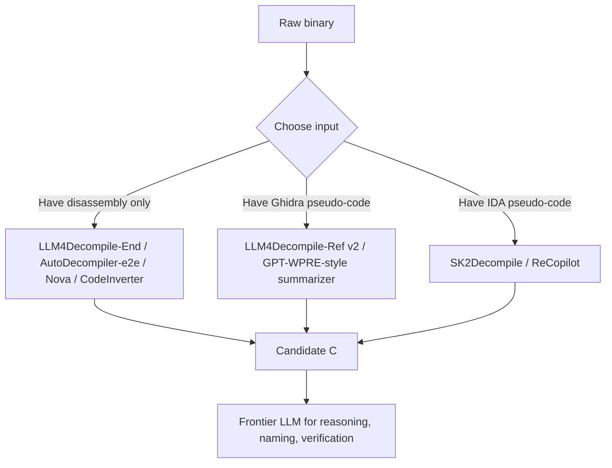
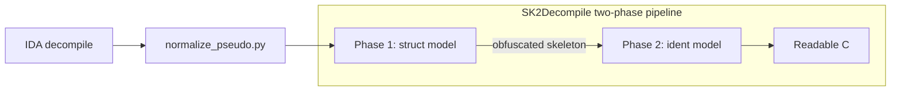

# ML Models Built for RE

> Tags: neural-decompilation, specialist-models, local-inference | Difficulty: intermediate | Prerequisites: ../03-decomp/decompile-workflow.md, ../07-advanced/model-selection.md

## Overview

Frontier LLMs are generalists. A second family of models exists that was
trained only on binary code. These specialist models do one narrow job:
assembly to C, or Ghidra pseudocode to C, or symbol recovery.

They do not reason about a whole program. They do not hunt for
vulnerabilities. They win on bounded tasks: one function at a time,
measured by re-executability and edit similarity.

This page catalogs the specialist zoo as of 2026-11-05. For the general
model tiers, see ../07-advanced/model-selection.md.

### The zoo

| Model | Repo / weights | Size | Input | Output | Task |
|---|---|---|---|---|---|
| LLM4Decompile v1.5 | github.com/albertan017/LLM4Decompile, HF LLM4Binary | 1.3B, 6.7B | Disassembly (objdump) | C | Assembly to C, end to end |
| LLM4Decompile v2 (Ref) | same, HF LLM4Binary | 1.3B, 6.7B, 9B, 22B | Ghidra pseudo-code | C | Pseudocode refinement |
| SK2Decompile | same repo, `sk2decompile/` folder, HF LLM4Binary | 6.7B x 2 | IDA pseudo-code | C with identifiers | Two-phase skeleton then naming |
| CodeInverter (CIM) | github.com/LiuPeiP-CS/CodeInverter, HF CodeInverter | 1.3B, 6.7B | Assembly plus CFG and data map | C | CFG-aware decompilation |
| AutoDecompiler | arxiv.org/abs/2606.16162, HF AutoDecompiler | 1.3B, 6.7B, 30B | Assembly (e2e) or pseudo-code (pscode) | C | RL multi-turn refinement |
| Nova | github.com/lt-asset/nova, HF lt-asset | 1.3B, 6.7B | Assembly | C, similarity scores | Assembly-pretrained code LLM |
| ReCopilot | github.com/XingTuLab/recopilot, hosted API | 7B (reported) | IDA pseudo-code | Names, types, docs | Symbol and type recovery |
| GPT-WPRE | github.com/moyix/gpt-wpre | davinci-003 (retired) | Ghidra decompilation | Whole-program summaries | Call-graph map-reduce summarization |
| BinMetric | arxiv.org/abs/2505.07360 | benchmark, not a model | Binary analysis questions | Answers | Evaluation harness |
| FidelityGPT | NDSS 2026 (unverified) | unknown | Decompiler output | Corrected output | Distortion-type fixer |

All models in this table are open weights except ReCopilot, which ships as
an IDA plugin against a hosted API.

### Where each one fits





## Setup

### Common requirements

- Linux x86-64 targets only for almost every model in the zoo.
- C source compiled with GCC at O0 through O3 is the training
  distribution.
- A GPU with 8GB+ VRAM runs the 1.3B models comfortably. The 6.7B models
  want 16GB. The 22B and 30B models want 24GB+ or heavy CPU offload.
- Python 3.9 to 3.10, PyTorch, transformers. Some repos pin older
  versions.

### LLM4Decompile family

Repo: https://github.com/albertan017/LLM4Decompile
Weights: https://huggingface.co/LLM4Binary
Paper: arxiv.org/abs/2403.05286

Setup:

```bash
git clone https://github.com/albertan017/LLM4Decompile.git
cd LLM4Decompile
conda create -n llm4decompile python=3.9 -y
conda activate llm4decompile
pip install -r requirements.txt
```

The repo splits into folders. `End` models take raw disassembly. `Ref`
models take Ghidra pseudo-code and refine it. `sk2decompile/` holds the
two-phase pipeline.

Minimal inference for a v2 Ref model:

```python
from transformers import AutoTokenizer, AutoModelForCausalLM
import torch

model_path = "LLM4Binary/llm4decompile-6.7b-v2"
tokenizer = AutoTokenizer.from_pretrained(model_path)
model = AutoModelForCausalLM.from_pretrained(
    model_path, torch_dtype=torch.bfloat16
).cuda()

with open("func_O0.pseudo") as f:
    prompt = f.read()
inputs = tokenizer(prompt, return_tensors="pt").to(model.device)
with torch.no_grad():
    outputs = model.generate(**inputs, max_new_tokens=2048)
print(tokenizer.decode(outputs[0][len(inputs[0]):-1]))
```

For SK2Decompile, the HF model cards give the working command:

```bash
python normalize_pseudo.py --input_json reverse_sample.json \
    --output_json reverse_sample.json
python sk2decompile.py \
    --dataset_path reverse_sample.json \
    --model_path LLM4Binary/sk2decompile-struct-6.7b \
    --recover_model_path LLM4Binary/sk2decompile-ident-6.7b
```

Prerequisites: IDA to produce the pseudo-code, vllm, transformers,
clang-format. The model card warns that performance degrades on
languages and architectures outside Linux-x64 C with IDA pseudo-code.

### CodeInverter (CIM)

Repo: https://github.com/LiuPeiP-CS/CodeInverter
Weights: https://huggingface.co/CodeInverter/CIM-1.3b and
https://huggingface.co/CodeInverter/CIM-6.7b
Dataset: https://huggingface.co/datasets/CodeInverter/CID
Paper: arxiv.org/abs/2503.07215

The repo ships training code, the 8.69M-sample CID dataset, and
inference scripts under `code4metrics/`. The input is not plain assembly.
The CIW workflow augments the prompt with a control-flow graph and a
memory-to-data mapping. Use the repo's own scripts. Hand-rolled prompts
lose the structural context that produces the paper's gains.

```bash
git clone https://github.com/LiuPeiP-CS/CodeInverter.git
cd CodeInverter
# weights load as standard LlamaForCausalLM checkpoints
# see code4metrics/humaneval/re-exe&re-com/agent_6.7B.py for inference
```

CIM models report 62 percent re-executability on HumanEval 64-bit versus
30.9 percent for the LLM4Decompile baseline at the same size. Reported
figures from the repo README.

### AutoDecompiler

Paper: arxiv.org/abs/2606.16162 (v2, 2026-10-03)
Weights: https://huggingface.co/AutoDecompiler

Six checkpoints. Two input modes times three sizes:

| Checkpoint suffix | Input | Backbone |
|---|---|---|
| `-e2e` | Raw assembly | DeepSeek-Coder (1.3B, 6.7B), Qwen3-Coder MoE (30B) |
| `-pscode` | Decompiler pseudo-code | Same |

The 30B checkpoints are Qwen3-MoE architectures. Verified from
`config.json` on the HF repo.

The paper reports no dedicated inference script and no public GitHub
repo at research time. Load the safetensors with transformers or vLLM.
The `-e2e` and `-pscode` variants need different prompts. Read the paper
for the prompt format. Treat end-to-end use as experimental until the
authors publish tooling.

### Nova

Repo: https://github.com/lt-asset/nova
Weights: https://huggingface.co/lt-asset/nova-1.3b,
nova-1.3b-bcr, nova-6.7b, nova-6.7b-bcr
Paper: ICLR 2025, arxiv.org (see repo citation)

Nova is an assembly-pretrained LLM with hierarchical attention and
contrastive learning. The `-bcr` checkpoints are instruction-tuned for
binary code recovery. The repo includes `inference_bcr.py` for
HumanEval-Decompile evaluation and `evaluate.py` for scoring.

```bash
conda create -n nova python=3.10 -y
conda activate nova
pip install -r requirements.txt
python inference_bcr.py   # evaluates on HumanEval-Decompile
```

Nova is older than the LLM4Decompile v2 line. Use it when you want the
assembly-similarity head or when reproducing ICLR 2025 baselines.

### ReCopilot

Repo: https://github.com/XingTuLab/recopilot
Paper: arxiv.org/abs/2505.16366
API: https://tqgpt.qianxin.com/recopilot/

ReCopilot is not a local model in practice. It is an IDA Pro plugin that
calls a hosted API. The plugin supports IDA Pro 9.0+ and Python 3.8 to
3.13. Install the plugin directory into `$IDA_INSTALL_DIR/plugins/`,
install requirements, then configure the model endpoint in
Edit to ReCopilot-Settings.

The reasoning model is `recopilot-v0.1-beta-dpo` at
`https://tqgpt.qianxin.com/recopilot/v1`. The SimAI homology search uses
`https://tqgpt.qianxin.com/simai/analyze`. An API token comes from the
project website.

The HF repo `XingTuLab/recopilot-v0.1-beta-dpo` contains only a README.
The card names Qwen2.5-Coder-7B as the base model, which explains the
"7B" figure in the report. The full weights are not published. Treat
ReCopilot as a service, not a local model.

Tasks it does well: function-name recovery, variable-name recovery,
variable type and struct recovery, doc generation, and semantic homology
search against a known-codebase index.

### GPT-WPRE (historical)

Repo: https://github.com/moyix/gpt-wpre

A 2023 prototype by Moyix. It does not decompile. It summarizes. The
script extracts the call graph and Ghidra decompilations, topologically
sorts the call graph, and asks GPT-3 (text-davinci-003, now retired) for
a one-sentence summary of each function, feeding callee summaries into
caller prompts. Oversized functions are chunked into 100-line pieces.

Cost example from the README: $16.60 for a 466-function libpng at
davinci-003 pricing. The same pattern with a modern model and a 1M
context window is the ancestor of the map-reduce summarization in
../02-collab/context-engineering.md.

### BinMetric

arxiv.org/abs/2505.07360, IJCAI 2025.

BinMetric is a benchmark, not a model. It holds 1,000 questions over 20
real open-source projects across 6 binary-analysis tasks including
decompilation, summarization, and assembly generation. Use it to compare
models on binary tasks. Do not confuse it with a decompiler.

### FidelityGPT

Reported as an NDSS 2026 paper in the research report. It post-processes
decompiler output and labels distortion types. No public repo or weights
were found at research time. Treat as unverified. Search NDSS 2026
proceedings before citing.

## Usage

### When a specialist beats a frontier model

Use a specialist when all of these hold:

- The task is one function or a small batch of functions.
- The input is clean compiler output, not obfuscated or VM-protected
  code.
- The target is Linux x86-64 C, matching the training distribution.
- You need volume. Local inference costs electricity, not tokens.

Use a frontier model when any of these hold:

- The binary is stripped, packed, obfuscated, or written in Rust, Go, or
  C++ with heavy templates.
- The task needs cross-function reasoning or whole-program context.
- The target is Windows PE, macOS Mach-O, or ARM.
- You need naming, types, or vulnerability reasoning, not just
  pseudocode shape.

The measured pattern from DecBench and SRE-Bench: frontier agents beat
specialists on whole-program tasks. Specialists beat frontier models on
raw function-level re-executability per dollar. See
../07-advanced/model-selection.md for the benchmark numbers.

### Recommended pipeline

1. Decompile with IDA, Ghidra, or Binary Ninja first. Specialists refine
   decompiler output better than they replace it.
2. Run the specialist locally on each function. SK2Decompile if you have
   IDA pseudo-code. LLM4Decompile-Ref if you have Ghidra pseudo-code.
   CIM if you can build the CIW structural input.
3. Feed the specialist output to a frontier model for naming,
   summarization, and verification.
4. Verify by recompiling and diffing. See
   ../03-decomp/verification-loop.md and
   ../03-decomp/batch-decompilation.md.

### Example: batch-refine a Ghidra export

```bash
# 1. Export pseudo-code per function from Ghidra headless
#    (see ../03-decomp/batch-decompilation.md)

# 2. Run llm4decompile-6.7b-v2 over each .pseudo file
#    (transformers script above, or wrap in a loop)

# 3. Score candidates: recompile each output, objdiff against original
```

The specialists produce candidate C. They do not prove correctness. The
verification loop stays mandatory.

## Pitfalls

- Do not feed Windows PE, Mach-O, or ARM binaries to these models.
  Training is Linux x86-64 GCC output. Output quality degrades silently.
- Do not expect obfuscated or VM-protected code to work. The models saw
  clean compiler output. OLLVM, VMProtect, and packed binaries are out
  of distribution.
- Do not trust re-executability scores on HumanEval or ExeBench as
  transfer to real binaries. Those benchmarks are GCC-compiled C
  functions. Real targets have external calls, structs, and
  architecture-specific idioms.
- Do not skip the decompiler step. SK2Decompile and LLM4Decompile-Ref
  need pseudo-code input. Only the End and e2e variants take raw
  assembly, and they score lower.
- Do not assume the 33B LLM4Decompile exists on HF. The repo README
  table lists up to 22B-v2 and mentions a 33B Ref variant. The HF org
  listing shows no 33B checkpoint at research time. Verified via the
  HF API on 2026-11-05.
- Do not treat AutoDecompiler as production-ready. The paper is v2 from
  2026-10-03. No inference repo was found. The HF weights load, but the
  prompt format and multi-turn loop come from the paper.
- Do not send hostile binaries to hosted APIs. ReCopilot sends your
  pseudo-code to qianxin.com servers. Malware samples go to local models
  only. See ../07-advanced/ai-security-threats.md.
- Do not confuse BinMetric with a model. It is a benchmark. It measures
  LLMs. It does not decompile.
- Watch licenses. LLM4Decompile is MIT plus DeepSeek license. CodeInverter
  ships a LICENSE-MODEL file. Nova and ReCopilot are GPL-3.0 adjacent.
  Check before commercial use.
- Model sizes in the research report said "1.3B to 33B." Verified range
  on HF is 1.3B to 30B (AutoDecompiler) plus 22B (LLM4Decompile). The
  33B figure is unverified.

## See Also

- ../03-decomp/decompile-workflow.md
- ../03-decomp/batch-decompilation.md
- ../03-decomp/verification-loop.md
- ../07-advanced/model-selection.md
- ../07-advanced/ai-security-threats.md
- ../02-collab/context-engineering.md
- ../00-fundamentals/reading-pseudocode.md
