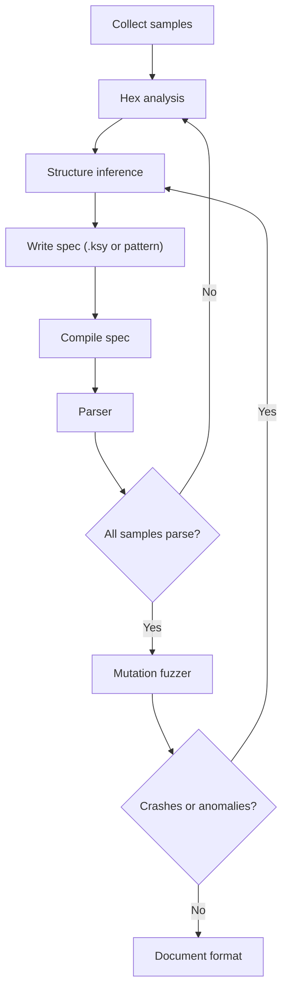

# File Format Reverse Engineering

> Tags: file-format | Kaitai | ImHex | parser | hex | LLM-assisted | Difficulty: intermediate | Prerequisites: hex editing, Python 3.11+, an MCP-compatible agent client

File format RE means recovering the byte-level structure of a file you do not own: game saves, replay files, network captures, proprietary assets, cache blobs, config files. In 2026 the practical workflow has three artifacts. You infer a structure description, you write it down in a declarative spec, and you compile that spec into a working parser. The declarative spec is the point. Kaitai Struct `.ksy` files and ImHex pattern files are both declarative. The LLM writes the spec. Deterministic tools verify it.

The LLM does not parse the file. The parser parses the file. The LLM proposes the grammar. Your parser and your test corpus decide if the grammar is right.

## Overview

### The three artifacts

Every format RE task produces three things:

| Artifact | What it is | Tool |
|---|---|---|
| Sample corpus | Real files that must parse | Your target, your captures |
| Structure description | A declarative spec of bytes | `.ksy` file, ImHex pattern, Kaitai, or plain Python |
| Parser | Code that reads the file using the spec | Compiled Kaitai module, ImHex pattern, or hand-written Python |

### Tool comparison

| Tool | Spec language | Strength | Weakness | License |
|---|---|---|---|---|
| Kaitai Struct | `.ksy` YAML | Compiles to 12 languages. Mature format corpus. Web IDE | Spec must be written by hand or by LLM | Compiler GPLv3+. Runtime libs MIT/Apache |
| ImHex | Pattern Language (C-like) | Live hex view. Visual diffing. Pattern DB with auto-load | GUI-first. Harder to use headless | GPLv2 |
| kaitai_struct_formats | Community `.ksy` library | 200+ ready formats. Start from nearest neighbor | Quality varies per file | Per-file licenses |
| 010 Editor | Binary Template `.bt` | Mature template ecosystem | Commercial. No free headless | Commercial |
| Custom Python parser | Python code | Full control. Easy to fuzz and test | No reusable spec | Your code |

### When each tool fits

Use Kaitai when you want a spec that compiles to a real parser you can ship. Use ImHex when you want to explore the bytes visually and iterate on a pattern. Use a plain Python parser when the format is small, has heavy logic, or needs streaming or mutation support that a declarative spec cannot express.

## Setup

### Install Kaitai Struct

The compiler is `ksc`. Current stable version is 0.11.

```bash
# Debian/Ubuntu
curl -fsSLO https://github.com/kaitai-io/kaitai_struct_compiler/releases/download/0.11/kaitai-struct-compiler_0.11_all.deb
sudo apt-get install ./kaitai-struct-compiler_0.11_all.deb

# macOS
brew install kaitai-struct-compiler

# Universal .zip or source: https://github.com/kaitai-io/kaitai_struct_compiler/releases
```

Check the install:

```bash
ksc --version
ksc --help
```

### Install ImHex

ImHex is a hex editor for reverse engineers. It has a C-like pattern language that parses files into structures and highlights fields. It requires OpenGL 3.0. Software-rendered `-NoGPU` builds exist for Windows and macOS.

Download from `https://github.com/WerWolv/ImHex/releases`. On Linux, use the AppImage, Flatpak, or Snap. On macOS 15+, the release binaries require manual Gatekeeper approval because they are unsigned.

The pattern database lives at `https://github.com/WerWolv/ImHex-Patterns`. It contains ready patterns for common formats plus libraries for the pattern language.

### Clone the format corpus

The Kaitai format gallery is the best reference for spec style.

```bash
git clone https://github.com/kaitai-io/kaitai_struct_formats.git
# Browse at https://formats.kaitai.io/
# Or load specs into the Web IDE at https://ide.kaitai.io/
```

### Install the Python runtime

Kaitai generates Python that needs the `kaitaistruct` runtime package.

```bash
pip install kaitaistruct
```

## How It Works

### The pipeline



### Step 1: Sample collection

You need many real samples. One sample is not enough. You need samples that vary in the fields you care about.

For save files: collect saves from different game states, different play times, different player names, different inventory contents.

For replay files: collect replays of different matches, different durations, different player counts.

For network captures: capture the same protocol across multiple sessions. Use different clients, different servers, different payloads.

For proprietary assets: collect assets of different sizes, different types, different compression levels.

Store samples in a directory structure that preserves provenance:

```
samples/
  save/
    save_001.bin   # short game, 1 player
    save_002.bin   # long game, 1 player
    save_003.bin   # short game, 2 players
    ...
  replay/
    replay_001.bin
    replay_002.bin
    ...
```

### Step 2: Hex analysis

Open samples in ImHex or `xxd`/`hexdump`. Look for:

- **Magic bytes.** A fixed header that identifies the format. For example `GIF8`, `PK\x03\x04`, `RIFF....WAVE`.
- **Length fields.** 2-byte, 4-byte, or 8-byte integers that match file size or section size.
- **Endianness.** Are integers little-endian or big-endian? Check by comparing a known value to its byte representation.
- **Strings.** ASCII or UTF-16 text that reveals field names or format version.
- **Compression markers.** `zlib` headers (`0x78 0x9C`, `0x78 0xDA`), LZ4 frame magic (`0x04 0x22 0x4D 0x18`), gzip (`1F 8B`).
- **Checksums.** A trailer that looks random but changes with content. Could be CRC32, Adler32, or a custom hash.
- **Offsets.** Absolute or relative pointers into the file. In 64-bit formats, look for 8-byte values that point within the file bounds.

Use ImHex's built-in analyzers: byte type distribution, entropy graph, highest and average entropy. High entropy regions suggest compression or encryption. Low entropy regions suggest structure.

### Step 3: Structure inference

Start with the header. Work forward. For each field, ask:

1. What is the width? (1, 2, 4, 8 bytes, or variable?)
2. What is the endianness?
3. Is it signed or unsigned?
4. Is it a fixed value (magic, version, type)?
5. Is it a length or offset?
6. Does it repeat? (array, list, chunked data?)
7. Does it depend on a previous field? (conditional, switch on type?)

Write down your hypotheses in a table before you write any spec:

| Offset | Width | Type | Meaning | Confidence |
|---|---|---|---|---|
| 0x00 | 4 | u4 | Magic `0xDEADBEEF` | High |
| 0x04 | 2 | u2 | Version | High |
| 0x06 | 4 | u4 | Header size | Medium |
| 0x0A | 4 | u4 | Data size | Medium |
| ... | ... | ... | ... | ... |

### Step 4: Write the spec

This is where Kaitai or ImHex comes in. Write the spec in the declarative language.

### Step 5: Compile and parse

Compile the spec into a parser. Run it on all samples. Check that every sample parses without error and that the parsed fields match your hex analysis.

### Step 6: Mutation fuzzing

Once the parser works on real samples, generate mutants. Flip bytes, truncate, extend, swap fields. Run the parser on each mutant. Look for crashes, infinite loops, or absurd values. These reveal format edge cases your spec does not handle.

## Step-by-Step

### A. Kaitai Struct tutorial flow

This is the canonical workflow for a new format.

#### 1. Collect samples

```bash
mkdir -p myformat_samples
# Copy your samples into myformat_samples/
# You need at least 5-10 samples that vary in the fields you care about.
```

#### 2. Explore in the Web IDE

Go to `https://ide.kaitai.io/`. Upload a sample. Load a similar spec from the format gallery if one exists. Start writing your `.ksy` spec.

The Web IDE shows a hex view alongside the parsed structure. You can see which bytes map to which fields. This is faster than writing blind.

#### 3. Write the `.ksy` spec

Here is a minimal example for a hypothetical save file:

```yaml
meta:
  id: my_save
  title: My Game Save File
  file-extension: sav
  endian: le

seq:
  - id: magic
    contents: 'MYGS'
  - id: version
    type: u2
  - id: header_size
    type: u4
  - id: player_count
    type: u4
  - id: players
    type: player
    repeat: expr
    repeat-expr: player_count
  - id: checksum
    type: u4

types:
  player:
    seq:
      - id: name
        type: str
        size: 32
      - id: level
        type: u2
      - id: score
        type: u8
      - id: inventory_count
        type: u2
      - id: inventory
        type: u2
        repeat: expr
        repeat-expr: inventory_count
```

Key syntax:

- `seq` defines a sequence of fields.
- `type` specifies the field type. Built-in types include `u1`, `u2`, `u4`, `u8`, `s1`, `s2`, `s4`, `s8`, `f4`, `f8`, `str`, `bytes`.
- `endian` at the top level sets default endianness. Override per-field with `endian: be` or `endian: le`.
- `repeat: expr` and `repeat-expr` create arrays.
- `contents` asserts a fixed byte sequence. If the bytes do not match, parsing fails.
- `types` defines reusable sub-structures.
- `switch-on` and `cases` handle tagged unions.
- `instances` computes derived values.
- `enums` maps integer values to names.

#### 4. Compile to Python

```bash
ksc -t python my_save.ksy
# Produces my_save.py
```

#### 5. Write a test parser

```python
#!/usr/bin/env python3
import sys
from my_save import MySave

for path in sys.argv[1:]:
    try:
        save = MySave.from_file(path)
        print(f"{path}: version={save.version} players={save.player_count}")
        for p in save.players:
            print(f"  {p.name.rstrip(chr(0))}: level={p.level} score={p.score}")
    except Exception as e:
        print(f"{path}: PARSE ERROR: {e}")
```

#### 6. Run on all samples

```bash
python3 test_parser.py myformat_samples/*.sav
```

Every sample must parse. If one fails, your spec is wrong or the sample is corrupt. Check the offset where parsing stopped.

#### 7. Iterate

Fix the spec. Recompile. Re-test. Repeat until all samples parse.

#### 8. Generate parsers for other languages

```bash
ksc -t java my_save.ksy
ksc -t go my_save.ksy
ksc -t cpp_stl my_save.ksy
# ... and 9 more targets
```

### B. ImHex pattern workflow

ImHex patterns are C-like. They define structs, unions, enums, bitfields, and arrays.

#### 1. Open a sample in ImHex

Load the file. The hex view shows bytes. The data inspector shows values.

#### 2. Write a pattern

Create a `.hexpat` file:

```
#pragma endian little

struct Player {
    char name[32];
    u16 level;
    u64 score;
    u16 inventory_count;
    u16 inventory[inventory_count];
};

struct SaveFile {
    char magic[4];
    u16 version;
    u32 header_size;
    u32 player_count;
    Player players[player_count];
    u32 checksum;
};

SaveFile file @ 0;
```

#### 3. Apply the pattern

In ImHex, go to the pattern language view. Load your `.hexpat` file. The pattern parses the file and highlights fields in the hex view.

#### 4. Iterate

If the pattern fails, ImHex shows the error location. Fix the pattern. Re-apply.

#### 5. Use the pattern database

Check `https://github.com/WerWolv/ImHex-Patterns` for existing patterns. If your format is similar to a known one, start from that pattern and modify it.

### C. When to write a parser instead of a spec

Write a parser when:

- The format has complex logic that declarative specs cannot express. For example, a virtual machine bytecode, a script, or a state machine.
- You need streaming parsing. Kaitai specs assume random access. Parsers can read from streams.
- You need mutation or generation. Kaitai has limited write support (added in 0.11 but still limited). A parser can write files.
- The format is small enough that a spec is overkill. A 50-byte header does not need a spec.
- You need custom error handling or recovery.

Write a spec when:

- You want a reusable, language-independent description.
- You want to compile parsers for multiple languages.
- The format is stable and well-understood.
- You want the Web IDE or format gallery for documentation.

### D. LLM-assisted spec generation

This is where AI helps most in format RE. The LLM writes the spec. You verify it.

#### Prompt pattern for spec generation

```
You are writing a Kaitai Struct .ksy spec for a binary file format.

Here is the hex dump of the first 256 bytes of a sample file:
<hex dump>

Here is a second sample with different content:
<hex dump>

Here is my analysis of the format:
- Magic bytes at offset 0x00: ...
- Version field at offset 0x04: ...
- I believe offset 0x08 is a length field because ...
- ...

Write a .ksy spec that parses this format. Use these rules:
- Start with the header.
- Use seq for sequential fields.
- Use types for reusable sub-structures.
- Use repeat-expr for arrays.
- Use switch-on for tagged unions if needed.
- Use contents to assert magic bytes.
- Do not invent fields you cannot justify from the hex dump.
- Mark uncertain fields with a comment.

Output only the .ksy YAML. No explanation.
```

#### Prompt pattern for format documentation

```
You are documenting a binary file format.

Here is the Kaitai .ksy spec:
<spec>

Here are sample parses:
<parser output>

Write documentation that includes:
1. Format overview (purpose, version, endianness).
2. Field-by-field description with offsets, widths, types, and meanings.
3. Constraints and invariants.
4. Example hexdump with annotations.
5. Parsing pseudocode.

Use tables for field descriptions. Be precise. Do not invent information not in the spec or samples.
```

#### Prompt pattern for mutation fuzzer generation

```
You are writing a mutation fuzzer for a binary file parser.

Here is the Kaitai .ksy spec:
<spec>

Here is the Python parser:
<parser>

Write a Python script that:
1. Loads a sample file.
2. Generates mutants by:
   - Flipping random bytes.
   - Truncating at random offsets.
   - Extending with random bytes.
   - Swapping two random byte ranges.
   - Setting length fields to boundary values (0, 1, max, max-1).
3. Runs the parser on each mutant.
4. Reports crashes, exceptions, or absurd values.
5. Saves crashing mutants to a directory.

Use only Python standard library plus kaitaistruct. No external dependencies.
```

### E. Examples

#### Save files

Game save files are usually structured binary blobs. They have a header with magic and version, followed by serialized game state. Kaitai specs work well. The main challenge is compression or encryption of sections. If sections are compressed, your spec needs a `process` step or you decompress before parsing.

#### Replay files

Replay files record inputs over time. They have a header, a list of frames or events, and sometimes a checksum. The structure is often simple. The challenge is variable-length records. Use `repeat-expr` for frame counts and `switch-on` for event types.

#### Network captures

PCAP files have a well-known format. Kaitai has a spec. But application-layer protocols inside packets need their own specs. For protocol RE, see `../06-topics/protocol-reverse.md`.

#### Proprietary assets

Game assets, font files, texture atlases, and audio banks often have custom formats. They may be compressed, encrypted, or obfuscated. Start with entropy analysis. If entropy is high, look for compression. If entropy is low but structure is unclear, look for encryption or encoding.

## Pitfalls

- **One sample is not enough.** A spec written from one sample will fail on the second. Collect many samples that vary in the fields you care about.
- **Endianness mistakes.** Check endianness early. A wrong endianness assumption will produce absurd values that look plausible.
- **Length fields lie.** A length field might be the compressed size, the uncompressed size, or the total record size including header. Verify by checking if the next field starts at the claimed offset.
- **Compression hides structure.** If a section is compressed, you cannot parse it until you decompress. Kaitai has `process: zlib` for common cases. For custom compression, decompress first.
- **Checksums are not fields.** A checksum is a field, but it is computed from other fields. Your spec should parse it but not try to validate it during parsing. Validate separately.
- **Offsets are relative to what?** Absolute file offset? Relative to section start? Relative to end of file? Check by comparing the offset value to actual positions in multiple samples.
- **Variable-length strings.** A string might be null-terminated, length-prefixed, or fixed-width. Check by looking at the bytes after the string. If the next field starts immediately after the null terminator, it is null-terminated.
- **Alignment and padding.** Some formats align fields to 2, 4, or 8 bytes. Kaitai has `align` for this. Check by looking for zero padding between fields.
- **Version differences.** A format might have multiple versions with different layouts. Use `switch-on` on the version field to handle each version.
- **LLM hallucination.** The LLM will invent fields that look plausible but are not in the data. Always verify the spec against the hex dump. Every field must be justified by bytes you can point to.
- **Parser-sample mismatch.** A parser that works on your samples might fail on new samples. Test on samples you did not use to write the spec.
- **Mutation fuzzer noise.** Random mutations often produce invalid files that fail early. Focus on mutations that preserve the header and vary the body. Use the spec to guide mutations.
- **Spec maintenance.** Formats change. Version 2 might have a different layout. Keep the spec versioned. Use `meta.version` to track spec versions.
- **Legal and ethical boundaries.** Reverse engineering file formats may violate license agreements or anti-circumvention laws. Check local law and the target's license before you analyze. See `../09-ops/legal-and-ethics.md`.

## See Also

- `../06-topics/protocol-reverse.md` — protocol RE from pcaps. Related but different input.
- `../03-decomp/verification-loop.md` — the general verify-before-trust pattern for agent output.
- `../05-tools/tool-catalog.md` — tool catalog including Kaitai and ImHex.
- `../02-collab/prompt-patterns.md` — prompt patterns for LLM-assisted RE.
- `../09-ops/legal-and-ethics.md` — legal boundaries for reverse engineering.
- `../06-topics/game-engine-re.md` — game asset formats and engines.
