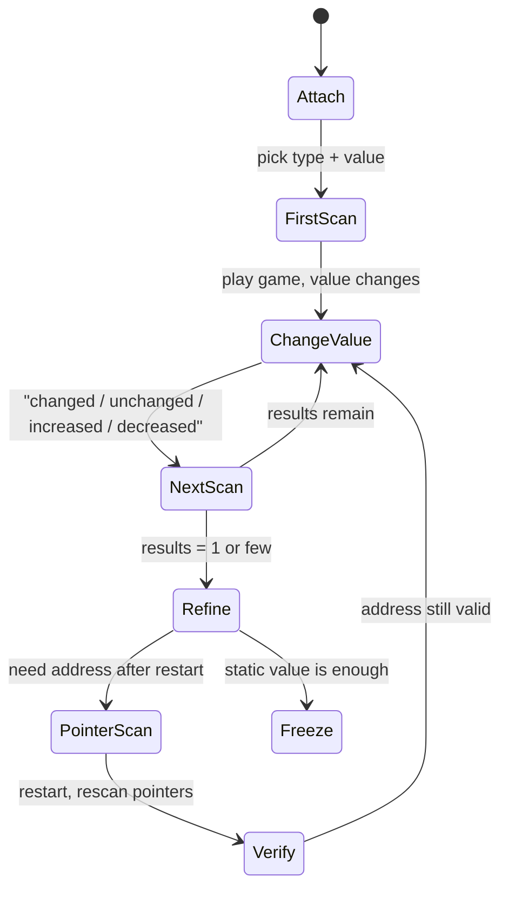
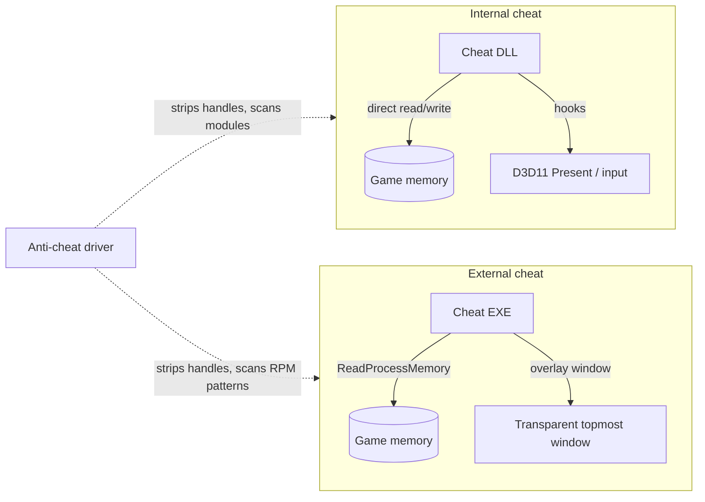
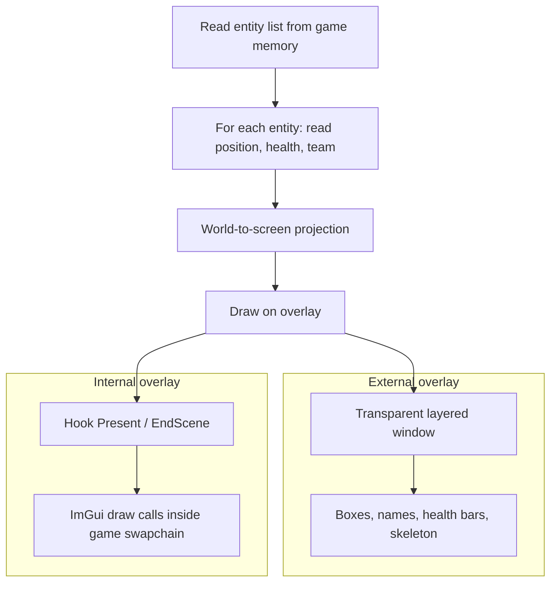

# Game Hacking and Cheat Development

> Tags: game-hacking, cheat-engine, memory-scanning, dll-injection, esp, anti-cheat, single-player | Difficulty: Intermediate to Advanced | Prerequisites: `../00-fundamentals/assembly-crash-course.md`, `../04-dynamic/frida-deep-dive.md`, `../06-topics/anti-cheat-re.md` for multiplayer targets

## Overview

Game hacking is the practice of modifying a running game to gain an advantage or to learn how it works. It covers single-player trainers, modding, speedruns, and multiplayer cheats. The tools overlap with general reverse engineering. The legal and safety situation does not overlap. Read this page as engineering documentation. Multiplayer cheating against live services is against terms of service in every jurisdiction we cover, and anti-cheat vendors treat it as hostile activity.

This page covers:

- Memory scanning with Cheat Engine.
- Pointer scanning and pointer chains.
- Code injection: DLL injection and manual mapping.
- ESP and wallhack architecture.
- Internal versus external cheats.
- AI assistance for pattern scanning, struct recovery, and hook generation.
- The legal reality and the single-player versus multiplayer boundary.

Companion pages: `../06-topics/game-engine-re.md` for engine metadata recovery (Unity IL2CPP, Unreal GObjects), `../06-topics/anti-cheat-re.md` for anti-cheat internals and authorized-study methodology, `../09-ops/legal-and-ethics.md` for the law.

## Legal and ToS Reality

Cheat development has a split legal landscape. Know the split before you start.

**Single-player and offline games.** Modifying a game you own for personal use is broadly tolerated. It can violate the EULA but almost never produces litigation. Trainers for single-player games are a commercial industry. Distribution of a cheat that disables DRM or license checks can still raise anti-circumvention issues under DMCA 1201 and equivalents. See `../09-ops/legal-and-ethics.md`.

**Multiplayer games.** Every major publisher forbids cheats in its terms of service. ToS violation is a contract matter. It becomes litigation when the cheat damages the service, the publisher, or other players. Courts have upheld claims against cheat sellers and distributors. Known examples include Bungie v. AimJunkies (sold Wallhacks) and Riot v. Leaguesharp. Cheats that bypass anti-cheat add anti-circumvention claims. The EU Video Game Directive (2009/24/EC) does not help here because it covers interoperability, not advantage cheats. Several jurisdictions now have specific anti-cheat or game-modification statutes. Korea criminalizes cheat distribution under its Game Industry Promotion Act amendments. China prosecutes cheat sales under computer-crime law. The United States has no federal cheat statute, but CFAA and copyright claims are used.

**The bright line.** Building a trainer for a game you own, offline, for yourself is legal engineering practice in most places. Building, selling, or distributing a cheat for a live multiplayer game is a ToS violation at minimum and a litigation target in practice. This page describes both because the techniques are identical. It does not describe how to defeat a specific anti-cheat.

## Single-Player Versus Multiplayer

The distinction changes everything about tooling.

| Concern | Single-player | Multiplayer |
|---|---|---|
| Anti-cheat present | Rare, usually Denuvo-class DRM only | EAC, BattlEye, Vanguard, FACEIT, VAC, or custom |
| Detection pressure | You control the environment | Kernel driver scans memory, handles, threads, timing |
| Legal exposure | Low, mostly EULA | High, ToS plus possible litigation |
| Account risk | None | Permanent ban plus hardware bans on some games |
| Goal of the work | Usually legit: mods, RE learning, speedrun | Usually advantage: ESP, aimbot, radar |

The technical content below is the same for both. The difference is the threat model. Against a live anti-cheat, every read primitive you use must evade a kernel scanner. That is a different problem than finding a health value in a trainer target. For multiplayer research, the only safe posture is authorized study on owned binaries in a VM. See `../06-topics/anti-cheat-re.md` for the methodology.

## How It Works

### Memory scanning workflow

Cheat Engine (CE) is the standard tool. Source: https://github.com/cheat-engine/cheat-engine. Current stable line is 7.x with builds tracking master. The workflow is a state machine:



Practical commands and steps:

1. Open the game process in CE. Use `Open Process` and pick the EXE. On Windows, CE uses `OpenProcess` with `PROCESS_ALL_ACCESS` or a subset.
2. First scan. Pick the value type. `4 Bytes` for most health, ammo, and position floats. `Float` for coordinates. `Double` for modern engines. `Array of byte` for signatures.
3. Change the value in game. Re-scan with `Changed value`, `Unchanged value`, `Increased value`, or `Decreased value`.
4. Repeat until one or a few addresses remain. Lock the address to verify the game reacts.
5. If the address changes every launch, run `Pointer scan`. CE saves a `.CT` table with pointer chains like `game.exe + 0x1A2B3C -> 0x10 -> 0x28`.

Common CE hotkeys: F5 attach, Ctrl+F5 first scan, F6 next scan, F7 pointer scan window, Ctrl+Alt+T table. The Lua engine inside CE lets you script scans:

```lua
-- CE Lua: scan a process for an int32 value
aobScanModule('health.dll', '89 45 FC 8B 45 FC 89') -- example AOB inside a module
local ms = createMemScan()
ms.firstScan(soExactValue, vtDword, nil, '100', nil, 0, 0, 0, fsmNotAligned, '99999999', true, true, false, false)
```

Treat CE Lua as a scripting interface to the same engine. It does not bypass anything.

### Pointer scanning

A pointer scan finds a stable chain from a module base to a dynamic address. The chain survives restarts because ASLR only shifts the module base. CE's pointer scanner requires you to enter the target address and choose a max level (usually 5 or 6) and max offset (usually 2048). It produces candidate chains. You verify by restarting the game and checking that the final address still contains the value.

Pointer maps live in the `.CT` file. They are XML plus binary. The format is documented in the CE wiki (wiki.cheatengine.org). Community tools parse them: **Cheat Engine Table files** are often shared as `.CT` or zipped. Do not run tables from strangers. A CE table can contain Lua that executes with full user privileges.

Static analysis angle: pointer chains correspond to global object hierarchies. In Unity IL2CPP, the chain usually ends inside a managed object recovered via Il2CppDumper. In Unreal, it ends inside a `UObject` reachable from `GObjects`/`GNames`. See `../06-topics/game-engine-re.md` for the metadata recovery step that replaces blind pointer scanning.

### Internal versus external cheats

**Internal cheat.** A DLL loaded inside the game process. It calls game functions directly, reads memory at native speed, and hooks render or input. Advantages: full access, fast, can call internal functions. Disadvantages: must defeat module-list scans, must handle the anti-cheat's handle checks, crashes kill the game, and any anti-cheat thread scan sees your threads.

**External cheat.** A separate process that uses `OpenProcess` + `ReadProcessMemory` / `WriteProcessMemory`, or a driver that maps memory. Advantages: simpler, survives game crashes, no injection. Disadvantages: slower, cannot call functions easily, `OpenProcess` is exactly what anti-cheats monitor and strip.



Most commercial cheats are internal. Most trainers and research tools are external.

### Code injection

Three tiers, from easiest to hardest:

1. **`LoadLibrary` injection.** Classic. Create a remote thread that calls `LoadLibraryA("cheat.dll")`. Works when nothing monitors thread creation. Detected by any anti-cheat that watches `PsSetCreateThreadNotifyRoutine` or checks the loader list. Tooling: any injector, GuidedHacking's OpenGL/DX hooks, Extreme Injector.
2. **Manual mapping.** Map the DLL's sections into the target without `LoadLibrary`. No `LdrLoadDll`, no module list entry. The DLL's imports must be resolved manually. Relocations applied manually. TLS callbacks handled manually. Detected by VAD scans (private committed memory that looks like an image), thread-start address checks, and memory signature scans. Public implementations exist in GuidedHacking's manual-map tutorial and various GitHub repos. Treat them as reference code. They are also the exact pattern anti-cheats look for.
3. **Kernel or hypervisor.** A driver reads or writes game memory at ring 0. A hypervisor hides the reads entirely. This is the tier commercial cheats use and the tier anti-cheats are built to catch. Out of scope for this page beyond naming it.

Frida is the analysis-time alternative. It injects its own agent and exposes `Interceptor.attach` for hooks. For cheat development it is better as a research tool than as the payload, because `frida-agent` is signatured and its threads are visible. See `../04-dynamic/frida-deep-dive.md`.

### ESP and wallhack architecture

ESP draws information about other players on screen. The classic architecture:



**External ESP.** The cheat reads positions via `ReadProcessMemory` and draws on a separate transparent, click-through, topmost window positioned over the game. It needs the game's view matrix (a 4x4 float matrix) to project world coordinates to screen. You find the view matrix by scanning for a matrix that changes when you move the camera. It is the standard beginner architecture. It cannot see through the game's own rendering because it never runs inside it.

**Internal ESP.** The DLL hooks the game's render function (for example `IDXGISwapChain::Present` in D3D11 or the equivalent in D3D12/Vulkan) and draws with ImGui inside the game's own frame. It has access to internal data structures, bone positions, and can render through walls using depth-test-disabled shaders. It is the standard commercial architecture. It is also the easiest to detect because the hook and the ImGui strings are in process memory.

World-to-screen math, for reference:

```cpp
// clip = viewProj * vec4(worldPos, 1)
// ndc  = clip.xyz / clip.w
// screen.x = (ndc.x * 0.5 + 0.5) * screenW
// screen.y = (1.0 - (ndc.y * 0.5 + 0.5)) * screenH
```

### Anti-cheat interaction

Any cheat aimed at a protected game meets the anti-cheat. The anti-cheat page (`../06-topics/anti-cheat-re.md`) covers the products and methodology. The cheat-side facts:

- Kernel anti-cheats strip `PROCESS_VM_READ`, `PROCESS_VM_WRITE`, `PROCESS_CREATE_THREAD`, and `PROCESS_DUP_HANDLE` from handles opened on the game. External cheats lose their only primitive.
- They enumerate modules via `PsLoadedModuleList` cross-checks and VAD scans. Manual-mapped DLLs show up as private image-like memory.
- They check thread start addresses. A thread starting outside a known module is suspicious.
- They heartbeat with the game and server. Missing or tampered heartbeats flag the account even if the cheat itself was never seen.
- Signature scans catch known tools: Cheat Engine's driver, common injector names, Frida's agent strings, ReClass.NET memory patterns.

Against a live anti-cheat, cheat development is an arms race you will lose as a solo researcher. The engineering value is in the techniques: memory scanning, struct recovery, hooking, rendering. Apply them to single-player games, your own binaries, crackmes, and CTF targets.

## Step-by-Step

### Step 1: Pick a target you own

Single-player game, your own compiled binary, or a crackme. No live multiplayer service. Confirm the binary is not protected by anti-cheat beyond DRM. `diec` or Detect It Easy tells you the packer.

### Step 2: Find values with Cheat Engine

```bash
# On Windows, launch CE and attach. On Linux analysis of a Windows game,
# use Wine only for static work. CE itself is Windows-only.
# CE is distributed as installer or portable build from cheatengine.org
# and github.com/cheat-engine/cheat-engine/releases
```

Scan for a value you can change in game. Health, ammo, score, money. Narrow by type. Use `Float` for positions. Lock the address and verify.

### Step 3: Stabilize with pointer scan

Restart the game. Run `Pointer scan` on the locked address. CE produces a list of pointer chains. Sort by "offset must be X". Pick chains with low offset counts. Restart again and verify the chain resolves to the same live value.

If pointer scan fails, the object is heap-allocated with no stable global root, or the game uses an encrypted pointer table. In that case, recover the struct from engine metadata (Unity: Il2CppDumper output, Unreal: Dumper-7 SDK). See `../06-topics/game-engine-re.md`.

### Step 4: Recover structures with ReClass.NET

ReClass.NET (https://github.com/ReClassNET/ReClass.NET) attaches to the process and lets you define classes over live memory. You browse pointers, see offsets in real time, and generate C++/C# struct definitions. This is the bridge between "address 0x12345678 holds my health" and "this is `Player + 0x340` inside `GameManager->LocalPlayer`".

Workflow:

1. Attach ReClass.NET to the game.
2. Add a class at a known address.
3. Browse pointer fields. ReClass resolves them live.
4. Name fields as you identify them (health, position, team).
5. Use `Code Generator` to emit the struct.

### Step 5: Build an external trainer first

An external trainer is the safest first artifact. C++ with `OpenProcess`/`ReadProcessMemory`/`WriteProcessMemory`, or C# with a simple overlay. It does not inject. It cannot crash the game by bad pointers in-process. It teaches you the memory layout without the injection risk.

```cpp
HANDLE h = OpenProcess(PROCESS_VM_READ | PROCESS_VM_WRITE | PROCESS_QUERY_INFORMATION, FALSE, pid);
ReadProcessMemory(h, (LPCVOID)addr, &value, sizeof(value), NULL);
```

Freeze values by writing them on a timer. Add hotkeys. This is a complete trainer for single-player work.

### Step 6: Move internal only when you need it

Internal is required for: calling game functions, hooking render, reading engine internals not exposed as plain values, speedrun tools that need frame-perfect input. It is also where all the detection surface lives.

Build order for an internal DLL:

1. MinGW or MSVC DLL project. `DllMain` spawns a thread.
2. Pattern-scan for the function you want to hook (see below).
3. Install the hook (Microsoft Detours, MinHook, or a manual trampoline).
4. Draw with ImGui inside the render hook.
5. Test on a non-protected game first.

### Step 7: Pattern scanning

Game updates break fixed addresses. Pattern scanning finds code by byte signature instead. Signature = bytes with wildcards for relocatable operands.

```cpp
// Simple IDA-style pattern scanner (concept)
uintptr_t FindPattern(uintptr_t start, size_t size, const char* sig, const char* mask) {
    for (size_t i = 0; i < size; ++i) {
        bool found = true;
        for (size_t j = 0; j < strlen(mask); ++j) {
            if (mask[j] == 'x' && *(uint8_t*)(start + i + j) != (uint8_t)strtol(sig + j*2, nullptr, 16)) {
                found = false; break;
            }
        }
        if (found) return start + i;
    }
    return 0;
}
```

Generate signatures in IDA or Ghidra from unique instruction sequences near your target. Include enough surrounding bytes to be unique across game builds. Avoid bytes that encode addresses or offsets. Wildcard them (`?`).

AI assist: paste the disassembly of a function into an LLM and ask for a signature that survives register allocation changes. Verify the signature is unique in the current build before trusting it.

## AI-Assisted Development

AI helps in four specific places in cheat development. Each has a verification step.

### 1. Pattern scanning

Give the model the disassembly of a target function and ask for byte signatures. Good prompt:

```
This is x64 disassembly of a game function that calculates damage.
Propose 3 byte signatures that would uniquely identify this function
across recompiles. Use ? for bytes that encode addresses or offsets.
Explain which instructions each wildcarded byte belongs to.
```

Verify: search the signature against the current binary. It must return exactly one match. A signature that returns zero matches after a patch is useless. A signature that returns many matches is worse.

### 2. Struct recovery

Feed the model decompiled code that accesses a struct and ask for the field layout. Example prompt:

```
This decompiled function reads entity->position and entity->health.
Based on the offsets used, propose a C++ struct. Mark which fields
are confirmed by the offsets and which are guesses.
```

Verify: check every offset against the disassembly. The model will invent plausible field names. Names are cosmetic. Offsets are load-bearing. Do not trust a name without a citation to the instruction that uses it.

For Unity IL2CPP, the real struct recovery comes from Il2CppDumper output, not the LLM. Feed the LLM the dumper's `dump.cs` and it can map field names to offsets. That is reliable because the data is real metadata. See `../06-topics/game-engine-re.md`.

### 3. Hook generation

Models are good at writing MinHook/Detours boilerplate and ImGui draw code. They are bad at knowing which virtual function index a game uses or which present function a given engine calls. Give the model the hook site (address, signature, calling convention) and it produces the trampoline correctly.

```
Write a MinHook wrapper for this function signature:
void __fastcall UpdatePlayer(void* this, float dt)
Install it in DllMain, unhook in a cleanup thread on DLL_PROCESS_DETACH.
```

Verify: the hook must preserve register state. x64 Windows uses a single calling convention but the model sometimes mixes SysV assumptions. Check the prologue bytes at the hook site. Check that the trampoline length does not split an instruction.

### 4. World-to-screen and projection math

The math is standard. The model knows it. The hard part is finding the view matrix in memory. That is a scanning problem, not an AI problem. Use CE to find the matrix by its float pattern, or read it from the engine's camera object via metadata recovery.

### Where AI fails

- Finding the entity list root. This is a pointer-chain or metadata problem. AI cannot see live memory.
- Defeating anti-cheat. The model does not know what the current driver checks. It will generate plausible-looking bypass code that does not work and may itself be signatured.
- Kernel-level work. AI-assisted driver development is possible but the verification loop is manual kernel debugging.
- Anything requiring a live game session. The model cannot click, move, or observe. You are the sensor.

## Pitfalls

- **Do not run untrusted CE tables.** `.CT` files execute Lua with your user privileges. Download only from sources you trust. Read the table XML before loading.
- **Do not paste game binaries into cloud LLMs.** You are sending copyrighted code to a third party. Check the provider terms and the game's EULA first. See `../09-ops/legal-and-ethics.md`.
- **Do not trust pointer chains across patches.** Every game update can reorder allocations. Re-run pointer scan after each patch.
- **Do not confuse file offset with virtual address.** CE shows virtual addresses. IDA/Ghidra show both. `ReClass` uses virtual. Pointer chains use virtual. Static signatures use file offsets mapped through PE sections.
- **Do not write to memory you have not verified.** A wrong write crashes the game or corrupts state. Read first, verify the value looks right, then write.
- **Do not assume external cheats are safer than internal.** They are safer for the game process but they are the loudest signal to anti-cheat because `OpenProcess` on a protected game is itself an event.
- **Do not publish working multiplayer cheats.** This is the line between research and trafficking. Methodology and single-player tools are publishable. Live-service cheats are not.
- **Do not let the AI write the injection primitive blind.** Manual mapping has dozens of edge cases: relocations, imports, TLS, SEH, CFG. The model will produce code that works on one build and crashes on another. Test each step.
- **Beware of fake "AI cheat" tools.** The cheat scene is full of malware distributed as trainers. Anything that asks for your game login, your Discord token, or disables your antivirus is stealing credentials, not helping you cheat.
- **Version drift in signatures.** A signature that works on build 1.04 fails on 1.05. Keep a signature database keyed to build version. Log which signature matched which build.

## See Also

- `../06-topics/anti-cheat-re.md` — anti-cheat products, kernel drivers, authorized-study methodology
- `../06-topics/game-engine-re.md` — Unity IL2CPP, Unreal, Source engine metadata recovery
- `../04-dynamic/frida-deep-dive.md` — Frida instrumentation for game analysis
- `../03-decomp/verification-loop.md` — verifying AI-generated reverse engineering claims
- `../09-ops/legal-and-ethics.md` — DMCA, CFAA, ToS, and publication boundaries
- `../05-tools/tool-catalog.md` — debugger and decompiler inventory
- `../00-fundamentals/assembly-crash-course.md` — x86/x64 assembly for reading game code
- Cheat Engine: https://github.com/cheat-engine/cheat-engine
- ReClass.NET: https://github.com/ReClassNET/ReClass.NET
- GuidedHacking forums: https://guidedhacking.com — community tutorials on internal/external cheats (use for learning on owned targets only)
