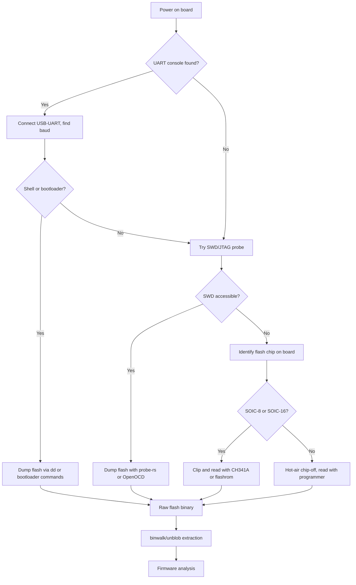

# Hardware RE: UART, JTAG, SWD, Chip-off

> Tags: hardware, uart, jtag, swd, chip-off, firmware-extraction, logic-analyzer | Difficulty: intermediate–advanced | Prerequisites: basic electronics, serial protocol concepts, `../06-topics/firmware-iot-re.md`

## Overview

Hardware reverse engineering extracts firmware and secrets from physical boards. Three families of access exist:

1. **Serial consoles.** Most boards expose a UART debug header. A UART gives a shell, a bootloader prompt, or AT commands. UART access is cheap, safe, and non-destructive.
2. **Debug probes.** JTAG and SWD attach a CPU-level debugger. They halt the core, read memory, step code, and dump flash without removing anything. They are the fastest path to firmware and live secrets.
3. **Chip-off.** When debug interfaces are disabled or locked, the flash chip itself is the target. You clip or desolder the flash and read it with an external programmer.

AI helps in two specific places. A vision-capable model can identify pin headers and chips from board photos. A text model can decode protocol captures and annotate raw hex dumps. The model cannot probe a board. You do the physical work and the safety checks.

This page covers each access method, the tools that matter in 2026, and the firmware extraction workflow that ties them together.

## Setup

### Cheap bench kit

| Item | Price tier | Purpose |
|---|---|---|
| USB-UART adapter (FT232RL, CP2102, CH340) | low | UART console access |
| 3.3V logic multimeter | low | Identify power rails and pin voltages |
| Logic analyzer (see below) | low–mid | Protocol sniffing and baud discovery |
| SOIC-8 test clip | low | In-circuit SPI flash reads |
| CH341A programmer + clip | low | SPI flash dump and write |
| Bus Pirate v4 | mid | UART, SPI, I2C, 1-Wire, JTAG-ish bitbang |
| ST-Link V2 or cheap CMSIS-DAP probe | low–mid | SWD on ARM Cortex-M |
| J-Link EDU Mini or clone | mid | JTAG/SWD on ARM, Cortex-M/R |
| Hot air rework station | mid–high | Chip-off desoldering |

A working baseline: one USB-UART adapter, one multimeter, one logic analyzer, one CH341A with a SOIC-8 clip, and one SWD probe. That covers most boards you will meet.

### Software

Install the host tools first. The hardware is useless without them.

```bash
sudo apt install minicom picocom screen flashrom openocd
cargo install probe-rs-tools   # gives cargo-flash, cargo-embed, and the probe-rs CLI
pip install esptool           # Espressif chips over UART
```

- **minicom / picocom / screen.** Serial console clients. picocom is the lightest and most scriptable.
- **flashrom.** In-system flash read/write through SPI, parallel, and some LPC controllers.
- **OpenOCD.** Open-source JTAG and SWD debugger. Supports a wide range of targets and cheap adapters.
- **probe-rs.** Modern Rust-based debug probe stack. Replaces OpenOCD for many Cortex-M and RISC-V targets.
- **esptool.py / espflash.** Espressif ROM bootloader over UART. Reads flash, writes images, monitors output.
- **STM32CubeProgrammer.** STM32 flash read/write through ST-Link, useful when you need mass erasure or option-byte access.

### Logic analyzers

Pick based on channel count, sample rate, and software quality.

| Analyzer | Channels | Max sample rate | Software |
|---|---|---|---|
| Saleae Logic 8 | 8 digital | 500 MS/s (claimed) | Saleae Logic 2, free |
| DSLogic Plus | 16 digital | 400 MS/s (claimed) | PulseView (sigrok) |
| KingstVIS VIS-N logical | up to 32 digital | varies | PulseView / vendor |

PulseView (from sigrok, sigrok.org) decodes dozens of protocols out of the box: UART, SPI, I2C, 1-Wire, CAN, USB, and more. Use it for any capture where you need protocol decode rather than raw waveforms.

## How It Works

### UART: find the console

A UART console exposes boot logs, login prompts, or a shell on two pins: TX (transmit, from board to you) and RX (receive, from you to board), plus GND.

**Pin identification.** Debug headers are usually 2–4 pins in a row, labeled TX, RX, GND, 3V3 or VCC. If labels are missing:

1. Power the board.
2. Measure each pin against GND with a multimeter.
3. The TX pin toggles between 0V and the IO voltage during boot. Watch it on the multimeter or the logic analyzer while you reset the board.
4. TX is the pin that moves. RX is usually adjacent. GND is usually the pin that reads 0V and has continuity to a ground pour or mounting hole.

**Voltage levels.** Most embedded boards use 3.3V logic. Some use 1.8V or 5V. Connecting a 5V UART to a 3.3V pin can damage the board. Connect only the analyzer or adapter TX through a level shifter or series resistor if you are unsure. The adapter RX pin is high-impedance and safe at 3.3V input. The dangerous direction is adapter TX driving board RX.

**Baud rate.** Standard rates: 9600, 19200, 38400, 57600, 115200, 230400, 460800, 921600. Try them in order. Most firmware uses 115200. Bootloader consoles often use 115200 or 57600.

```bash
# Quick test at 115200
picocom -b 115200 /dev/ttyUSB0
# Exit with Ctrl-A then Ctrl-X
```

If nothing appears, reset the board while listening. Boot messages often appear once and then the console goes quiet. If the baud rate is unknown, capture the TX line on a logic analyzer and let PulseView decode UART automatically. It tries common rates and shows which one produces readable text.

**Brute-forcing baud.** A script can cycle through rates and look for printable output:

```bash
#!/bin/bash
for baud in 9600 19200 38400 57600 115200 230400 460800 921600; do
  echo "=== $baud ==="
  timeout 3 picocom -b $baud /dev/ttyUSB0 2>/dev/null | head -5
done
```

This is crude. For a real brute-force, capture with the logic analyzer first. Software UART detection is unreliable because the receiver must lock onto the signal within the first few bytes.

**Login and shells.** Once you have a console:

- Try common credentials: `root`/`root`, `admin`/`admin`, `root`/blank. Check firmware strings first.
- Many embedded Linux boards drop to a BusyBox shell without login if the image is misconfigured.
- Vendor bootloaders (U-Boot, UEFI, CFE) often expose `printenv`, `boot`, and memory read commands without authentication.

### JTAG: boundary scan and full debug

JTAG (IEEE 1149.1) is a four-wire debug interface: TCK (clock), TMS (mode select), TDI (data in), TDO (data out), plus optional TRST and GND.

**Boundary scan.** JTAG's original purpose was testing PCBs by scanning flip-flops at chip boundaries. You can use it to verify solder joints, identify chips by their IDCODE, and trace board connectivity without a schematic. OpenOCD exposes boundary-scan commands:

```bash
openocd -f interface/ftdi/olimex-arm-usb-tiny-h.cfg -f target/stm32f1x.cfg
# In the telnet or GDB session:
> scan_chain
```

`scan_chain` lists every TAP (test access port) on the chain with its IDCODE. Compare IDCODEs against vendor tables to identify chips.

**Full debug.** For MCU firmware work, JTAG is usually overkill. SWD is the modern two-wire alternative. Use JTAG when:

- The chip only supports JTAG (older ARM7/ARM9, some FPGAs, CPLDs).
- You need boundary-scan board verification.
- You need to debug the boot ROM before any firmware runs.

**Adapters.** Cheap FTDI-based JTAG adapters (FT2232H, FT4232H) work with OpenOCD. Dedicated probes like J-Link, ST-Link, and Black Magic Probe are faster and better supported. For a new setup, buy a CMSIS-DAP or ST-Link probe and use probe-rs.

### SWD: two-wire ARM debugging

SWD (Serial Wire Debug) is ARM's two-wire debug protocol for Cortex-M and Cortex-A. It uses SWDIO (data) and SWCLK (clock), plus GND and 3.3V. It is faster than JTAG for Cortex-M and needs fewer pins.

**Finding SWD pads.** Look for unpopulated headers or test points near the MCU. Common labels: SWDIO, SWCLK, GND, 3V3. Some boards route SWD to a 10-pin or 20-pin ARM Cortex Debug Connector. Check the board silkscreen and any FCC ID internal photos.

**Connecting.** Most Cortex-M dev boards expose SWD on a 2×5 0.05" header. The standard pinout (ARM Cortex Debug Connector) is:

| Pin | Signal |
|---|---|
| 1 | VTref |
| 2 | SWDIO/TMS |
| 3 | GND |
| 4 | SWCLK/TCK |
| 5 | GND |
| 6 | SWO/TDO |
| 7 | KEY |
| 8 | NC |
| 9 | GNDDetect |
| 10 | nRESET |

Wire VTref to 3.3V, GND to GND, SWDIO to SWDIO, SWCLK to SWCLK. Leave SWO unconnected unless you want trace output.

**Tools.**

- **probe-rs.** `cargo install probe-rs-tools`, then `probe-rs info` to detect the chip. `probe-rs run --chip STM32F407VG firmware.elf` flashes and runs.
- **OpenOCD.** `openocd -f interface/stlink.cfg -f target/stm32f4x.cfg`.
- **pyOCD.** Python-based, good for scripting.
- **ST-Link + STM32CubeProgrammer.** STM32-only, easiest GUI path.
- **J-Link.** Commercial, excellent device support, useful for non-ST chips.

**Reading flash over SWD.** With probe-rs or OpenOCD you can dump the MCU's internal flash without chip-off:

```bash
# probe-rs: read 1 MiB from flash at 0x08000000
probe-rs read --chip STM32F407VG --probe 0483:374e firmware.bin 0x08000000 0x100000
```

This works even when readout protection is off. If the chip has RDP level 1 or 2 enabled, SWD can halt and debug but cannot read flash. You need chip-off or a bootloader exploit.

### Chip-off: SOIC-8 clips and programmers

Chip-off is the last resort. It is slow, risky, and can destroy the chip. Use it when:

- Debug interfaces are disabled or fused off.
- The flash is a standalone SPI NOR or NAND chip.
- You need the raw flash contents, not just the running firmware.

**SOIC-8 clip.** A SOIC-8 test clip grabs the flash chip without desoldering. Align pin 1 (marked by a dot or notch) with the clip's pin 1 indicator. Connect the clip to a programmer.

**CH341A.** The most common cheap SPI programmer. It supports SPI NOR flash up to 25 MHz (claimed). It does not support 1.8V NAND or eMMC without a level shifter or adapter board. Always verify the chip's voltage before powering it.

```bash
# Read a 16 MiB SPI flash with flashrom through CH341A
sudo flashrom -p ch341a_spi -r firmware.bin
# Or use the vendor tool: CH341A Programmer (Windows) or ch341a-cli
```

**Bus Pirate.** A multi-protocol tool that bit-bangs SPI, I2C, UART, 1-Wire, and more. Slower than CH341A but more flexible. Good for identification and small reads.

```bash
# Bus Pirate SPI read
# 1. Connect clip to Bus Pirate.
# 2. Open a serial terminal at 115200.
# 3. Type: m 5  (SPI mode)
# 4. Type: W 25  (25 MHz clock — start lower if unstable)
# 5. Type: c       (chip select)
# 6. Type: r       (read)
```

**Chip identification.** Before reading, identify the chip. The marking on the package (e.g., `W25Q128JV`, `GD25Q128C`, `MX25L25635F`) tells you the capacity, voltage, and protocol. Look up the datasheet. Common voltages: 3.3V for most SPI NOR, 1.8V for newer high-density parts, 3.0–3.6V for some NAND.

**Hot air rework.** For chips that will not read in-circuit (bad solder joints, conformal coating, or BGA packages), desolder with hot air at 300–350°C. Use solder wick or a desoldering braid. Clean the pads with isopropyl alcohol. Do not exceed the flash chip's maximum reflow temperature.

### Logic analyzers for protocol sniffing

Logic analyzers capture digital signals and decode protocols. They are essential for:

- Finding UART baud rates.
- Sniffing SPI flash traffic during boot.
- Decoding I2C EEPROM or sensor buses.
- Verifying JTAG/SWD signal integrity.

**Workflow.**

1. Connect the analyzer channels to the signals you want to watch.
2. Set the sample rate to at least 4× the expected baud or clock rate.
3. Trigger on a reset or a known signal edge.
4. Capture the boot sequence.
5. Open PulseView or Saleae Logic. Add a UART, SPI, or I2C decoder.
6. Let the decoder try all baud rates or clock phases.

**AI assist.** Feed the decoded output to the model:

```
Read this UART capture.
Group lines by boot stage: ROM bootloader, kernel, userspace init.
Flag any lines containing credentials, URLs, or error messages.
```

The model can summarize and search, but it cannot see the raw waveform. Always keep the PulseView session open for verification.

## Firmware Extraction Workflow

This is the end-to-end path from a bare board to a firmware image.



### Step-by-step

1. **Photograph the board.** Take high-resolution photos of both sides. Note all connectors, test points, and chip markings. Feed the photos to a vision-capable model with the prompt: "Identify all debug headers, flash chips, and test points. Mark likely UART TX/RX pins and SWD pads."

2. **Find UART.** Look for 2–4 pin headers near the MCU or SoC. Try 115200 baud first. If you get output, explore the console.

3. **Try SWD.** If UART fails or gives only a locked bootloader, look for SWD pads. Connect a probe and run `probe-rs info`. If the chip is detected and not read-protected, dump flash.

4. **Identify the flash chip.** If software access fails, look for the SPI flash chip near the MCU. Read the part number. Check the datasheet for voltage and protocol.

5. **Clip and read.** Attach a SOIC-8 clip. Use flashrom or the CH341A software to read the chip. Save the raw binary.

6. **Chip-off if needed.** Desolder the flash chip with hot air. Clean the pads. Read the chip directly with a programmer.

7. **Extract.** Run `binwalk3 -e firmware.bin` or `unblob firmware.bin` to find filesystems, kernels, and executables. See `../06-topics/firmware-iot-re.md` for the full extraction pipeline.

8. **Analyze.** Load extracted binaries into Ghidra or Binary Ninja. Use `../03-decomp/decompile-workflow.md` for the decompilation loop.

## AI Assists

### Pinout identification from photos

A vision-capable model (Claude, GPT-4V, Gemini) can identify components from board photos. It can:

- Label UART TX/RX/GND pins on unmarked headers.
- Identify flash chip part numbers.
- Find SWD test points near the MCU.
- Suggest likely connector pinouts based on silkscreen text.

**Prompt pattern:**

```
Look at this PCB photo.
Identify: the MCU or SoC, all flash chips, UART debug headers, SWD/JTAG pads.
For each item, give the marking text and its approximate location.
Mark which pins are likely TX, RX, GND on each header.
Do not guess beyond what you can see.
```

Verify every identification with the multimeter or datasheet before connecting.

### Protocol decode

Feed PulseView or Saleae decode output to the model:

```
This is a SPI flash read capture.
The chip select goes low at frame 3.
Decode the command bytes and identify the flash operation.
```

The model can interpret hex dumps and suggest what a register write means. It cannot measure voltages or timing. Use the logic analyzer for that.

### Firmware triage

After extraction, ask the model to:

- List interesting strings (passwords, URLs, crypto keys).
- Identify the OS and architecture.
- Suggest which binaries to analyze first.
- Flag suspicious or custom crypto routines.

See `../06-topics/firmware-iot-re.md` for the AI-assisted extraction workflow.

## Pitfalls

### Voltage levels

Never assume 3.3V. Measure first. A 1.8V flash chip powered at 3.3V will be destroyed. A 5V UART connected to a 3.3V MCU can kill the UART receiver. Use a multimeter or logic analyzer to verify levels before connecting.

### 1.8V flash

Modern high-density SPI NOR and NAND flash often run at 1.8V. The CH341A does not support 1.8V natively. You need:

- A level shifter on the data lines.
- A programmer that supports 1.8V (XGecu T48/T56, Dediprog, FlashCatUSB).
- A SOIC-8 adapter board with voltage selection.

Check the chip marking and datasheet before applying power.

### EMMC and BGA packages

Many IoT devices use eMMC or BGA-packaged flash. These cannot be read with a SOIC-8 clip. You need:

- A BGA rework station and programmer.
- A board-level probe (e.g., eMMC reader with a socket adapter).
- Desoldering and reballing, which is advanced and risky.

For eMMC, look for a CMD, CLK, DAT0–DAT7, VCC, and GND pinout. Some devices expose eMMC on a test pad or edge connector.

### Locked debug interfaces

Many production devices fuse off JTAG/SWD or enable readout protection. You cannot bypass this with software. Your options:

- Exploit a bootloader vulnerability (see `../07-advanced/anti-analysis.md`).
- Use a glitching attack (voltage or clock glitching) to bypass the lock. This is advanced and device-specific.
- Chip-off the flash. The flash chip itself is not protected by the MCU's debug lock.

### Conformal coating

Many boards have conformal coating over the debug headers and flash chips. It insulates and protects the board. Remove it carefully with isopropyl alcohol or a specialized conformal coating remover. Do not scrape with metal tools.

### Wrong baud rate

If UART output is garbled, you have the wrong baud rate or voltage. Check the multimeter first. A 3.3V signal at the wrong baud looks like noise. Capture with a logic analyzer and let PulseView decode.

### AI hallucination on hardware

Models will confidently identify chips and pinouts that are wrong. Always verify with:

- The multimeter.
- The logic analyzer.
- The datasheet.
- The actual signal on the pin.

A wrong guess can short pins or damage the board. Treat AI identifications as hypotheses, not facts.

### Writing firmware

Reading flash is safe. Writing flash is not. A bad write can brick the device permanently. Before any write:

- Dump the original flash and verify the readback.
- Use the correct programmer and voltage.
- Write only to a test device, never production hardware.
- Keep the original image for recovery.

## See Also

- `../06-topics/firmware-iot-re.md` — firmware extraction pipeline after hardware access
- `../03-decomp/decompile-workflow.md` — decompiling extracted firmware binaries
- `../07-advanced/anti-analysis.md` — bypassing readout protection and anti-debug
- `../04-dynamic/emulation-unicorn-qiling.md` — emulating firmware without hardware
- `../05-tools/mcp-catalog.md` — MCP servers for flashprobe-mcp and jlink-mcp
- `../06-topics/protocol-reverse.md` — protocol analysis after capture
