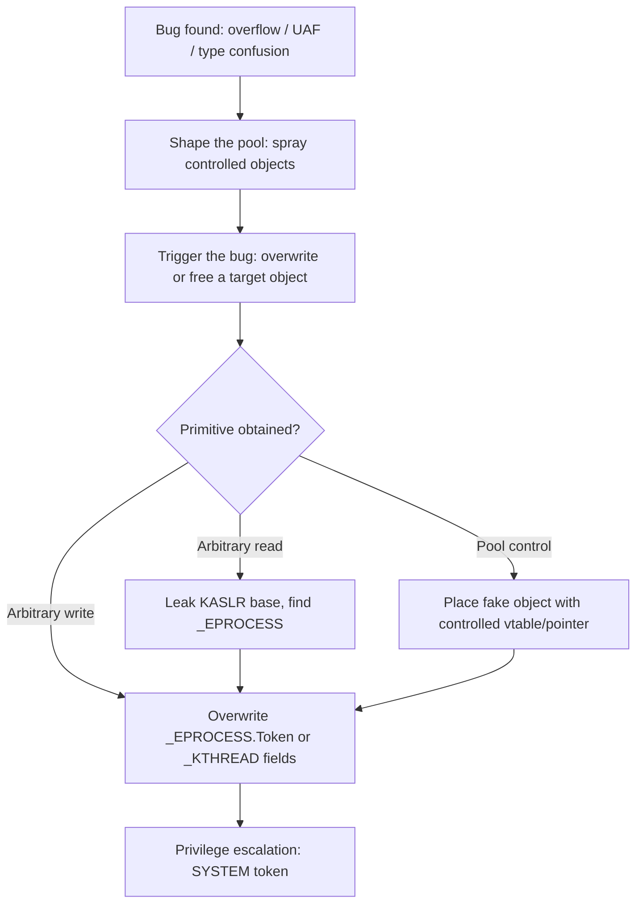

# Kernel Exploitation Concepts for Reverse Engineers

> Tags: kernel-exploitation, windows, linux, ioctls, pool, EoP, syzkaller, winDbg, gdb | Difficulty: Advanced | Prerequisites: `../06-topics/windows-kernel-drivers.md` (driver RE), `../04-dynamic/x64dbg-windbg.md` (debuggers), `../03-decomp/verification-loop.md` (verification). Target OS: Windows 11 + Linux 6.x as of 2026-11-05.

## Overview

Kernel exploitation turns a bug in kernel code into an elevated-privilege primitive. For a reverse engineer, the goal is usually one of these:

1. Understand how a shipped driver or kernel module can be abused. Vulnerability research on drivers, anti-cheat components, and syscall implementations.
2. Build an exploit for a class you found during driver or kernel RE. The RE work produces the map. The exploit work produces the proof.
3. Harden or audit a target. Read the driver, list the IOCTLs, find the bad copy or bad free, and write the detection.

This page covers the exploitation concepts that kernel RE produces. It does not cover exploitation primitives in general. For usermode exploitation, see `../00-fundamentals/assembly-crash-course.md` for the register and calling-convention basics.

The core loop is the same as usermode work, with one dangerous difference:

- Static analysis finds the bug class. Bad bounds check, double free, type confusion, race.
- Dynamic analysis confirms it. A controlled kernel crash or a leaked pointer.
- The primitive gets built. Arbitrary read or arbitrary write, or a pool allocation under attacker control.
- Privilege escalation follows. On Windows, overwrite the process token. On Linux, overwrite `cred` or `modprobe_path`.

A wrong step in step 2 can bluescreen the target. Keep the kernel debugger attached. Keep snapshots. Do not fuzz a production machine.

## Why Kernel RE Differs From Usermode RE

### No usermode context

The code runs in ring 0 (Windows) or ring 0 with a task struct (Linux). There is no `main`, no `argc`/`argv`, and no easy entry from a user-mode debugger. Requests come in through fixed interfaces:

- Windows: IRPs dispatched through `MajorFunction`, IOCTLs through `IRP_MJ_DEVICE_CONTROL`.
- Linux: syscalls, `ioctl()` on file descriptors, netlink messages, `procfs` and `sysfs` handlers.

The attack surface is the interface. Map the interface first. In Ghidra, IDA, or Binary Ninja, find the dispatch tables before you read function bodies. See `../06-topics/windows-kernel-drivers.md` for the Windows IRP model.

### IRQL and preemption (Windows)

Windows kernel code runs at an Interrupt Request Level (IRQL). The level controls what the code may do.

| IRQL | Name | What you cannot do |
|---|---|---|
| 0 | PASSIVE_LEVEL | Normal context. Most driver code runs here. |
| 1 | APC_LEVEL | Cannot wait on most objects. |
| 2 | DISPATCH_LEVEL | Cannot touch paged memory. Cannot take certain locks. Timer/DPC context. |
| 15 | HIGH_LEVEL | Almost nothing. |

A driver that calls a function which waits at `DISPATCH_LEVEL` is a bug. Many real driver bugs are IRQL violations. The exploit does not care. It cares that the bug gives you control. See `!irql` and `!thread` in WinDbg.

On Linux the analog is context and locking. Sleeping while atomic is the equivalent bug class. Check `in_atomic()`, spinlock context, and `might_sleep()` sites.

### PatchGuard and kernel integrity (Windows)

Kernel Patch Protection (PatchGuard, "KPP") periodically verifies kernel code and critical structures. Modifying `ntoskrnl.exe` code, the SSDT, or the IDT on a live system triggers a bugcheck (typically `CRITICAL_STRUCTURE_CORRUPTION`, `0x109`). Practical rules:

- Do not patch kernel code for RE or for exploit delivery on a stock target. Use breakpoints in WinDbg instead.
- Breakpoints are also risky on some structures. Prefer data breakpoints on your target object over code patches.
- PatchGuard timing is randomized. Do not assume a quiet window.

### HVCI and VBS

Hypervisor-Protected Code Integrity (HVCI) and Virtualization-Based Security (VBS) move kernel code integrity checks into the hypervisor. Effects on exploitation:

- HVCI blocks execution of unsigned or modified kernel code. Classic shellcode-in-kernel is dead on HVCI systems.
- HVCI makes kernel memory read-only for write primitives where the hypervisor enforces it. Arbitrary write still exists in many cases but the target set shrinks.
- VBS isolates the kernel from the hypervisor's view. Some exploit paths that relied on reading kernel memory from user mode are blocked.
- Windows 11 enables VBS/HVCI on new hardware by default. Check `msinfo32` for "Virtualization-based security" and "Hypervisor-protected code integrity".

On Linux, the equivalents are `CONFIG_CFI_CLANG` (kernel control-flow integrity), `CONFIG_KASAN`/`KFENCE` (debug allocators, not production), and SMEP/SMAP (CPU features, always on in modern kernels). `CONFIG_STATIC_USERMODEHELPER` blocks the classic `modprobe_path` overwrite.

### Memory-safety mitigations

Modern kernels add mitigation layers that change what a primitive is worth:

- Windows: Kernel Control Flow Guard (kCFG) limits indirect call targets. Kernel Address Space Layout Randomization (KASLR) randomizes `ntoskrnl.exe` base. Secure Pool separates pool types.
- Linux: KASLR, `CONFIG_SLAB_FREELIST_HARDENED`, `CONFIG_SLAB_FREELIST_RANDOM`, `CONFIG_INIT_ON_ALLOC_DEFAULT_ON`, `CONFIG_STATIC_USERMODEHELPER`, `CONFIG_CFI_CLANG`.

A bug that was exploitable on a 2019 kernel may not be on a 2026 kernel. Always identify the target kernel version and its config before you write the exploit.

## Driver Attack Surface (Windows)

### Where the bugs live

Driver RE produces a list of attack surfaces. Rank them by reachability:

| Surface | Reachability | Typical bugs |
|---|---|---|
| `IRP_MJ_DEVICE_CONTROL` IOCTLs | Any user can open the device if the ACL allows | Bad buffer-size check, missing probe, type confusion in METHOD_* |
| `IRP_MJ_READ`/`WRITE` | Same | Length confusion, signedness |
| WDF queue callbacks (`EvtIoDeviceControl`) | Same | Same bugs, hidden behind framework |
| `IRP_MJ_PNP`/`POWER` | PnP events, harder to trigger | Race in surprise removal |
| IOCTLs gated by a second check | Needs a handle or a prior IOCTL | Logic bugs, confused deputy |

Start with IOCTLs. They are the widest surface and the easiest to fuzz.

### IOCTL decoding for exploit work

Each IOCTL is a 32-bit value:

```
31      30 29    28        16 15     14 13       2 1    0
| DeviceType | Access | Function | Method  | TransferType |
```

The fields that matter for exploitation:

- `Method` (`METHOD_BUFFERED`, `METHOD_IN_DIRECT`, `METHOD_OUT_DIRECT`, `METHOD_NEITHER`). `METHOD_NEITHER` is the dangerous one. The driver gets raw user pointers. It must probe and lock them itself. Missing probes are the classic bug.
- `Function` — the subcommand index inside the handler. Large `Function` ranges with sparse switch cases are suspicious.
- `Access` — `FILE_ANY_ACCESS` vs `FILE_READ_DATA`/`FILE_WRITE_DATA`. `FILE_ANY_ACCESS` means no permission check at the IOCTL layer.

Generate codes with `CTL_CODE(DeviceType, Function, Method, Access)`. The WDK macro is in `wdm.h` / `winioctl.h`.

AI prompt for IOCTL handler analysis (see `../02-collab/prompt-patterns.md` for the general template):

```text
This function is the IRP_MJ_DEVICE_CONTROL dispatch for a Windows kernel driver.
The input is the decompiled C for the dispatch routine and its callees.

For each IOCTL case report:
1. The IOCTL code in hex.
2. The CTL_CODE(DeviceType, Function, Method, Access) expansion.
3. Input buffer size check. Cite the comparison.
4. Output buffer size check. Cite the comparison.
5. Copy primitive used: memcpy, ProbeForRead/ProbeForWrite, MmMapLockedPagesSpecifyCache.
6. Whether user pointers are dereferenced without a probe.
7. Whether the handler frees or reallocates a buffer the caller still references.

Mark every claim CONFIRMED (visible in code), INFERRED (likely but not proven), or UNKNOWN.
```

### Arbitrary read/write primitives

The exploit-relevant outcomes of IOCTL analysis:

- **Arbitrary write**: an IOCTL that takes an address and a value and writes to it. Look for `METHOD_NEITHER` handlers that do `*(PULONG)InputBuffer = Value` where `InputBuffer` comes from user mode without a probe.
- **Arbitrary read**: same shape, read instead of write.
- **Pool write**: an IOCTL that allocates a pool buffer and copies user data into it with a size the user controls. Size confusion gives a pool overflow.
- **Object overwrite**: an IOCTL that writes into a kernel object at a user-controlled offset. Look for `MmMapIoSpace`, `MmMapLockedPagesSpecifyCache`, or direct `*(type*)((char*)obj + offset)` patterns.

Once you have a primitive, you escalate. See "Privilege escalation flow" below.

## Pool Exploitation Basics (Windows)

Windows drivers allocate memory from the kernel pool. Pool bugs are the most common exploitable class.

### Pool types

| Type | IRQL | Used for | Notes |
|---|---|---|---|
| NonPagedPool (Nx) | Any | Driver structures that must stay resident | Most exploit targets. NX bit set, no execute. |
| NonPagedPoolNx | Any | Same, explicit NX | Default on modern Windows. |
| PagedPool | PASSIVE_LEVEL only | Large buffers, file I/O | Cannot be accessed at DISPATCH_LEVEL. |
| Session pool | Session space | Per-session allocations | Isolated per session. |

`ExAllocatePool2` takes a `POOL_FLAG_*` and a tag. `ExAllocatePoolWithTag` is the older API. Both show up in driver binaries.

### Pool tags

Every allocation carries a 4-byte tag. Tags are not unique. A driver named `MyFilter.sys` might use `'yFlM'` or `'MyFi'`. Kernel tags like `'MmSt'`, `'Ntfs'`, `'Thre'`, `'Proc'` are shared.

Find driver-specific tags in the binary:

```bash
strings -a -t x target.sys | grep -iE "tag|pool"
python3 -c "
import re
data = open('target.sys','rb').read()
# 4 printable ASCII bytes, often stored little-endian
for m in re.finditer(rb'[ -~]{4}', data):
    s = m.group().decode()
    if s.isupper() or s.islower():
        print(hex(m.start()), s)
" | sort -u | head -50
```

In Ghidra, look for immediate constants at `ExAllocatePool2`/`ExAllocatePoolWithTag` call sites. The tag is usually the third argument (`R8` on x64 fastcall, or second on x86 stdcall). Cross-check against `!poolused` output in WinDbg.

### Common pool bug classes

- **Pool overflow**: copy into a pool buffer with a user-controlled size larger than the allocation. Look for `memcpy`/`RtlCopyMemory` where the size argument is not checked against the allocation.
- **Pool use-after-free**: free a pool buffer, then use it. Look for `ExFreePoolWithTag` followed by a write or read of the same pointer. IRP cancellation races are a common source.
- **Pool type confusion**: allocate as one type, free as another, or interpret a pool buffer as the wrong struct. Look for casts on pool pointers without type checks.
- **Pool spray**: allocate many objects of a controlled type to fill the pool with attacker-controlled data. Used to turn a UAF or overflow into a controlled pointer.

### Pool exploitation flow



The `_EPROCESS` structure holds the process token. Overwriting the token pointer of your own process with a SYSTEM process token is the classic Windows EoP. On modern Windows with HVCI, the write must target data, not code. kCFG limits indirect-call targets, so vtable hijacking is harder but not dead.

## Linux Kernel Exploitation Concepts

### Attack surface

Linux kernel bugs live in:

- Syscalls (`sys_*` functions). Reachable from any process.
- `ioctl()` handlers on device files (`/dev/*`). Same model as Windows IOCTLs.
- Netlink sockets. `NETLINK_GENERIC` and friends expose kernel objects to user mode.
- `procfs`/`sysfs` handlers. Often assume root, but some are world-writable.
- Filesystem code. `ioctl`s on filesystems, `sendfile`, `splice`, `io_uring`.
- Kernel modules (`.ko`). Loadable drivers, same model as Windows `.sys`.

### Common bug classes

- **copy_to_user/copy_from_user overflows**: size not checked. Classic.
- **Use-after-free in RCU or refcounted objects**: `kfree` while a pointer remains.
- **Race conditions**: `io_uring`, `userfaultfd`, `FUSE` give user mode control over timing.
- **Type confusion in netlink or ioctl**: cast a user-controlled struct to a kernel type.
- **Integer overflow in size calculation**: `kmalloc(size * count)` where `size * count` wraps.

### Privilege escalation primitives

| Primitive | Target | Notes |
|---|---|---|
| Arbitrary write | `modprobe_path` | Classic. Overwrite with path to your script. Trigger by executing a file with unknown magic. Blocked by `CONFIG_STATIC_USERMODEHELPER`. |
| Arbitrary write | `core_pattern` | Similar. Trigger via crash. |
| Arbitrary write | `cred` struct | Overwrite `uid`, `gid`, `cap_effective`. Need to find your process's `cred`. |
| Arbitrary write | `init_cred` or another process's `cred` | Cross-process. |
| Arbitrary call | Function pointer in a kernel struct | kCFG/CFI may block. |
| Userfaultfd + FUSE | Race window control | Not a primitive itself, but enables reliable races. |

### Linux kernel debugging

`gdb` plus QEMU is the standard setup:

```bash
# Build or download a kernel with debug symbols
qemu-system-x86_64 \
  -kernel bzImage \
  -initrd initrd.img \
  -append "console=ttyS0 nokaslr" \
  -nographic \
  -s -S   # -s = gdb stub on :1234, -S = halt at start
```

Attach gdb:

```gdb
target remote :1234
symbol-file vmlinux
hbreak start_kernel
continue
```

For a running system, `kgdb` over serial or `kdb` gives in-kernel debugging. For production kernels, use `/proc/kallsyms` (if `kptr_restrict` allows) or extract symbols with `vmlinux-to-elf` (github.com/marin-m/vmlinux-to-elf) which rebuilds an ELF from `kallsyms` embedded in the kernel image.

## Fuzzing the Kernel Attack Surface

### syzkaller (Linux, and a raw Windows port)

google/syzkaller (github.com/google/syzkaller) is the standard coverage-guided kernel fuzzer. It supports Linux, FreeBSD, Fuchsia, gVisor, NetBSD, OpenBSD, and Windows.

Important caveat: the Windows port is marked "very raw and preliminary" in `docs/windows/README.md`. The Windows backend fuzzes user-mode syscalls, not kernel drivers. For kernel driver fuzzing on Windows, use kAFL or a custom harness.

Linux setup:

```bash
git clone https://github.com/google/syzkaller
cd syzkaller
make
# Build a kernel with syzkaller coverage (CONFIG_KCOV) or use syz-manager with a VM
```

Key tools:

- `syz-extract` — extract syscall descriptions from kernel headers.
- `syz-declextract` — extract declarations from kernel source.
- `syz-sysgen` — generate Go descriptions.
- `syz-manager` — the fuzzer orchestrator.
- `syz-execprog` — replay a single program.
- `syz-fuzzer` — the coverage-guided fuzzer inside the VM.

The description language (`sys/linux/*.txt`) is how syzkaller knows syscall argument types. For exploitation work, reading these descriptions teaches you the syscall surface. Each line describes one syscall with its arguments, resources, and return values.

### kAFL (Windows drivers, firmware, kernels)

IntelLabs/kAFL (github.com/IntelLabs/kAFL, formerly Nyx) is a hardware-assisted fuzzer for x86 VMs. It uses Intel VT, PML, and PT for coverage feedback. It supports Windows drivers as a target.

Requirements: Intel Skylake or later, a patched host kernel, ~2GB RAM per CPU. The setup installs a modified host kernel.

kAFL is the right tool for fuzzing a Windows driver inside a VM. It snapshots the VM, feeds mutated inputs, and uses coverage to guide mutations. The Windows driver tutorial is in `docs/source/tutorials/windows/`.

### IOCTL fuzzing on Windows

For IOCTL-specific fuzzing without full kernel fuzzing:

- **IOCTLbf / ioctlbf** — brute-force IOCTL codes and buffer sizes. Simple but effective for shallow bugs.
- **kAFL** — coverage-guided, finds deeper bugs.
- **WinAFL / kAFL-style drivers** — user-mode fuzzers that call `DeviceIoControl` with mutated buffers. These run in user mode and exercise the driver through the normal path.

A minimal IOCTL fuzzer in C:

```c
// Pseudocode: open device, loop IOCTLs, vary buffer size and content
HANDLE h = CreateFileW(L"\\\\.\\MyDevice", GENERIC_READ|GENERIC_WRITE,
                       0, NULL, OPEN_EXISTING, 0, NULL);
BYTE in[4096], out[4096];
for (DWORD code = 0x220000; code < 0x230000; code += 4) {
    DWORD ret;
    DeviceIoControl(h, code, in, sizeof(in), out, sizeof(out), &ret, NULL);
}
```

This is naive. Real fuzzers use coverage feedback, structure-aware mutations, and parallelism. But it finds shallow bugs fast.

### AI-assisted fuzzing

LLMs can help with:

- Generating syzkaller descriptions for a new syscall or ioctl.
- Writing the user-mode harness that calls `DeviceIoControl` or `ioctl`.
- Triaging crashes: feed the WinDbg `!analyze -v` output or the Linux `dmesg` oops to an LLM and ask for the bug class.
- Naming the vulnerable function and the primitive it gives.

LLMs cannot:

- Replace coverage feedback. A fuzzer without coverage is a random tester.
- Guarantee a crash is exploitable. Most crashes are null derefs or asserts.
- Safely run kernel fuzzers. The fuzzer itself can crash the target.

## Privilege Escalation Flow

Once you have a kernel primitive, the EoP path is:

1. **Leak**: get a kernel address. KASLR hides `ntoskrnl.exe` base (Windows) or `kernel_text` base (Linux). Arbitrary read or a side channel leaks it.
2. **Locate target**: find `_EPROCESS` (Windows) or `cred` (Linux) for your process.
3. **Write**: overwrite the token or cred fields.
4. **Verify**: spawn a shell or check `whoami`/`id`.

### Windows token overwrite

`_EPROCESS.Token` is a pointer to an `_EX_FAST_REF` token. The token contains the SID and privileges. Overwriting it with a SYSTEM token gives SYSTEM.

Modern complication: Windows 11 uses `KUSER_SHARED_DATA` and other mitigations. HVCI prevents writing to read-only kernel memory. kCFG limits where you can redirect execution. The write primitive must target writable data.

### Linux cred overwrite

`struct cred` holds `uid`, `gid`, `cap_effective`, `cap_permitted`, etc. Overwriting `uid` to 0 and clearing capability checks gives root. Or overwrite `modprobe_path` to point to your script.

`CONFIG_STATIC_USERMODEHELPER` (enabled on many distros) blocks `modprobe_path` and `core_pattern` overwrites by making usermode helpers run through a fixed kernel-controlled path. Check the target config.

### Post-exploitation

- Windows: you are SYSTEM. Dump SAM/SYSTEM hives, load a driver, or move laterally.
- Linux: you are root. Read `/etc/shadow`, load a kernel module, or persist.

For a reverse engineer, the exploit is proof. The RE is the product. Document the bug, the primitive, and the EoP path. Do not deploy.

## AI Workflows for Kernel Exploitation

### Static analysis pipeline

1. Load the `.sys` or `.ko` in Ghidra/IDA/Binary Ninja.
2. Find the dispatch table. Windows: `DriverEntry` → `MajorFunction`. Linux: `module_init` → ioctl table.
3. Export each handler to pseudocode.
4. Feed each handler to an LLM with the IOCTL analysis prompt.
5. Cross-check IOCTL codes against the INF or header file.
6. Verify claims against the binary. See `../03-decomp/verification-loop.md`.

### Dynamic verification

Windows:

1. Boot the target VM with KDNET enabled (`bcdedit /debug on`).
2. Attach WinDbg from the host.
3. Set breakpoints on dispatch routines: `bp MyDriver!IoctlDispatch`.
4. Trigger IOCTLs from a user-mode test client.
5. Inspect IRP parameters: `dt nt!_IRP @$thread`.

Linux:

1. Boot the kernel in QEMU with `-s -S`.
2. Attach gdb with `vmlinux` symbols.
3. Set breakpoints on the syscall or ioctl handler.
4. Trigger from user mode.
5. Inspect registers and memory.

### AI-assisted struct recovery

Kernel structs are often stripped or partially defined. LLMs can recover field layouts from usage patterns:

```text
This function accesses fields of a kernel object at these offsets:
+0x00: pointer (used as list head)
+0x08: DWORD (compared to constant)
+0x10: pointer (passed to ExFreePoolWithTag)
+0x18: DWORD (used as size in memcpy)

Recover the struct definition. Name fields by their likely purpose.
Mark uncertain fields UNKNOWN.
```

For Windows, cross-check against public symbols (`nt!_EPROCESS`, `nt!_ETHREAD`) from Microsoft symbols or the WDK. For Linux, use `pahole` on `vmlinux` with BTF (BPF Type Format) if available.

### AI-assisted exploit generation

Once you have the primitive, an LLM can draft the exploit. Give it:

- The bug description (overflow size, UAF trigger).
- The target kernel version and config.
- The primitive type (arbitrary write, pool control).
- The desired outcome (SYSTEM token, root cred).

The LLM writes C or Python. You verify each step in the debugger. Do not run LLM-generated kernel exploits on a machine you cannot restore.

## Pitfalls

### Treating kernel bugs like usermode bugs

A usermode crash gives you a debugger prompt. A kernel crash gives you a bluescreen. There is no "continue" after a bad pointer dereference in ring 0. Test in a VM. Keep snapshots.

### Ignoring IRQL

A bug that only triggers at `DISPATCH_LEVEL` is harder to hit but still real. A bug that corrupts pool at `PASSIVE_LEVEL` is easier. Check the IRQL of the handler before you write the trigger.

### Forgetting KASLR and CFI

An exploit that assumes a fixed kernel base fails on a KASLR system. An exploit that hijacks a function pointer fails under CFI/kCFG if the target is not a valid call target. Leak first. Check the target's mitigations.

### Fuzzing without coverage

Random IOCTL fuzzing finds shallow bugs. Coverage-guided fuzzing (kAFL, syzkaller) finds deep bugs. Use the right tool for the depth you need.

### Trusting AI exploit code

LLMs hallucinate kernel offsets, struct layouts, and API names. Verify every constant against the target binary or symbols. A wrong offset in a kernel exploit is a bluescreen, not a segfault.

### Windows syzkaller expectations

syzkaller's Windows port is raw. It does not fuzz kernel drivers. Do not expect it to find driver bugs. Use kAFL or a custom harness for driver fuzzing.

### Pool tag assumptions

Pool tags are not unique. A tag you find in the driver might be a shared kernel tag. Verify attribution with `!poolused` and Driver Verifier before you build a spray around it.

### Legal and ethical boundaries

Kernel exploitation research on systems you own or are authorized to test is legal in most jurisdictions. Testing on production systems, distributing working exploits, or targeting systems you do not own is not. See `../09-ops/legal-and-ethics.md`.

## See Also

- [`../06-topics/windows-kernel-drivers.md`](../06-topics/windows-kernel-drivers.md) — Windows driver RE: IRP dispatch, IOCTL decoding, KMDF, WinDbg kernel debugging
- [`../04-dynamic/x64dbg-windbg.md`](../04-dynamic/x64dbg-windbg.md) — WinDbg and WinDbgX-MCP for kernel debugging
- [`../04-dynamic/gdb-gef-pwndbg.md`](../04-dynamic/gdb-gef-pwndbg.md) — gdb scripting for Linux kernel debugging
- [`../03-decomp/verification-loop.md`](../03-decomp/verification-loop.md) — Verify AI claims before trusting them
- [`../02-collab/prompt-patterns.md`](../02-collab/prompt-patterns.md) — RE prompt templates including kernel analysis
- [`../07-advanced/anti-analysis.md`](../07-advanced/anti-analysis.md) — Anti-debug and anti-VM techniques that apply to kernel targets
- [`../06-topics/anti-cheat-re.md`](../06-topics/anti-cheat-re.md) — Anti-cheat kernel drivers as a research target
- [`../09-ops/legal-and-ethics.md`](../09-ops/legal-and-ethics.md) — Legal boundaries for security research
