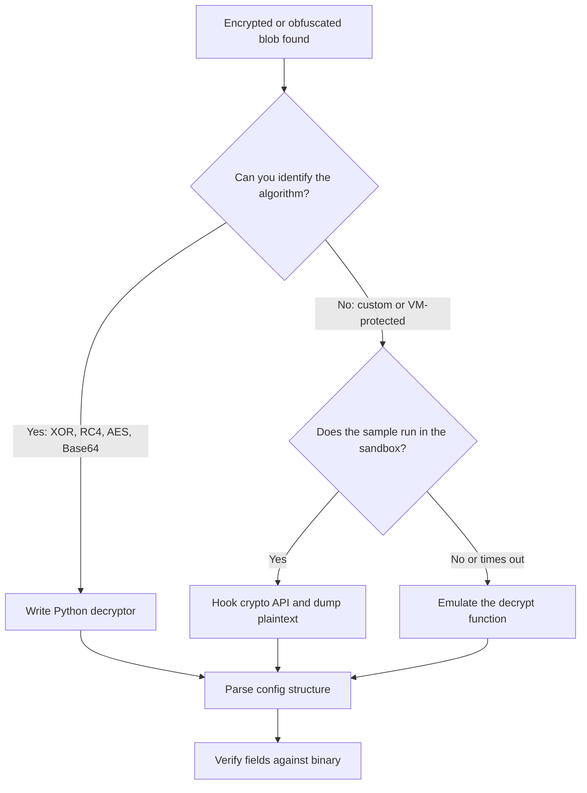
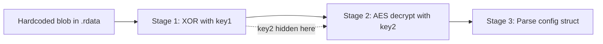

# Malware Configuration Extraction and Decryption

> Tags: malware, config-extraction, crypto-identification, capa, floss, yara, frida | Difficulty: Intermediate | Prerequisites: [`../06-topics/malware-analysis.md`](../06-topics/malware-analysis.md) for the triage pipeline, [`../01-setup/malware-isolation.md`](../01-setup/malware-isolation.md) for a detonation sandbox

## Overview

Most Windows malware carries a configuration block. The config holds C2 domains, ports, encryption keys, mutex names, and campaign IDs. Analysts want that block early. It is the fastest path to IOCs, family attribution, and detection rules.

The extraction problem has three layers:

1. **Find the blob.** The config sits in `.data`, `.rdata`, a PE resource, or a resource embedded in a dropped file. It may be a fixed-size array, a delimited string, or a structured record.
2. **Decode or decrypt it.** The blob is often XOR-obfuscated, RC4-encrypted, AES-encrypted, or built by a custom routine at runtime.
3. **Parse the result.** The plaintext may be a flat list of strings, a protobuf blob, an INI file, JSON, or a custom packed struct.

"FLOSS++" appears in some analyst notes and task descriptions. No public FLOSS++ tool exists as of 2026-11-05. A GitHub repository search for `mandiant/fLOSSplusplus` and `alienlabs/fLOSSplusplus` returns 404. FLOSS v3.2.0 released 2026-10-16 is the current stable release from `github.com/mandiant/flare-floss`. capa v10.0.0 released 2026-10-16 is the current `mandiant/capa` release. Treat FLOSS++ references as unverified or as a misunderstanding of FLOSS v2.

The strategy that works:

1. Run deterministic tools first. FLOSS for strings, capa for capability hints, YARA for known family signatures.
2. Identify the crypto before you write a decryptor. Match constants and APIs, not guesses.
3. Prefer dynamic extraction when the sample decrypts its own config. Hook the decrypt call and dump the output.
4. Write a Python decryptor only after you can name the algorithm and locate the key.
5. Verify every extracted field against the binary or the sandbox trace. Wrong endianness and off-by-one offsets produce plausible garbage.

## Setup

### Static analysis stack

Install the triage tools on the analysis box. See [`../06-topics/malware-analysis.md`](../06-topics/malware-analysis.md) for the full package list.

```bash
sudo apt-get install -y yara python3-pip pefile
git clone https://github.com/mandiant/flare-floss /opt/floss
pip install -e /opt/floss
pip install flare-capa pefile pycryptodome
```

`flare-capa` is the PyPI package for capa. `flare-floss` is the PyPI name for FLOSS because the plain `floss` name is taken. Source: `github.com/mandiant/flare-floss` and `github.com/mandiant/capa`.

Verify the tools:

```bash
capa --version          # expect v10.x as of 2026-11-05
floss --version
yara --version
python3 -c "import Crypto; print(Crypto.__version__)"   # PyCryptodome for AES/RC4
```

### Decompiler and debugger

For static work you need one decompiler with MCP or headless access. For dynamic work you need a snapshot-capable Windows VM. See [`../04-dynamic/x64dbg-windbg.md`](../04-dynamic/x64dbg-windbg.md) for debugger MCP setup and [`../01-setup/malware-isolation.md`](../01-setup/malware-isolation.md) for the VM.

Recommended order:

- **Ghidra 12.2** or **IDA 9.5** for decompilation and scripting. IDA has a free community edition for PE files.
- **x64dbg** with the `duty1g/x64dbg-mcp-server` plugin for scripted breakpoints and memory reads.
- **Frida 17.x** for API hooks inside the sandbox VM. See [`../04-dynamic/frida-deep-dive.md`](../04-dynamic/frida-deep-dive.md).
- **CAPEv2** or a manual Windows snapshot for detonation. CAPEv2 runs YARA config rules and stores results in JSON.

### Python environment

Create a dedicated virtual environment. Config extraction scripts often need `pefile`, `pycryptodome`, `construct`, `capstone`, and `lief`.

```bash
python3 -m venv ~/venvs/malconf
source ~/venvs/malconf/bin/activate
pip install pefile pycryptodome construct capstone lief yara-python
```

### YARA rule sources

Use public rule collections before writing your own. Update them regularly.

| Source | URL | Coverage |
|---|---|---|
| Yara-Rules | `github.com/Yara-Rules/rules` | General malware, packers, webshells |
| Malpedia | `malpedia.caad.fkie.fraunhofer.de` | Per-family rules and tags |
| CAPEv2 sigscan | `github.com/kevoreilly/CAPEv2` `config/` | Config extraction rules for known families |
| yarGen | `github.com/Neo23x0/yarGen` | Generate rules from your own samples |

CAPE's `sigscan` module runs YARA rules that target known malware families. When a rule matches, it runs the family-specific Python parser to extract the config. This covers a large share of commodity malware without manual work. Source: `github.com/kevoreilly/CAPEv2`, documentation under `docs/`.

## Usage

### Step 1: Map the strings and capabilities

Run FLOSS and capa before you open a decompiler. FLOSS finds stack strings, tight strings, and decoded strings that `strings` misses. capa identifies encryption and encoding namespaces.

```bash
CASE=cases/002-config
mkdir -p "$CASE"/{triage,static,dynamic,configs}

floss sample.exe > "$CASE"/triage/floss.txt
floss -j sample.exe > "$CASE"/triage/floss.json
capa -j sample.exe > "$CASE"/triage/capa.json
yara -r ~/rules/ sample.exe > "$CASE"/triage/yara.txt
```

Look for these capa signatures in `capa.json`:

| capa namespace | Meaning for config work |
|---|---|
| `data-manipulation/encoding/xor` | Custom XOR loop likely present |
| `data-manipulation/encoding/base64` | Base64 config blob |
| `data-manipulation/encryption` | Windows CryptoAPI or custom cipher |
| `data-manipulation/hashing` | Key derivation via MD5/SHA |
| `communication/http/client` or `communication/socket` | Likely C2 config fields |

FLOSS output often reveals config plaintext directly. Malware authors obfuscate strings to dodge signature engines. They still need the config as readable text at runtime.

```bash
# Only stack and tight strings, no static noise
floss --string-type stack tight sample.exe > "$CASE"/triage/floss_stack.txt
```

### Step 2: Choose static or dynamic extraction



Pick dynamic extraction when:

- The sample checks for a debugger or VM and you cannot bypass it quickly.
- The config is decrypted in multiple stages and the intermediate keys are hard to recover statically.
- The crypto routine is small but buried in a VM-protected function.
- You only need the IOC values, not a reusable decryptor.

Pick static extraction when:

- The algorithm is standard. RC4, AES-CBC, XOR with a repeating key.
- You can locate the key and blob offsets in the decompiler.
- You need a decryptor for a family. One script handles many samples.
- The sample does not run in the sandbox.

### Step 3: Dynamic extraction by hooking the crypto API

The fastest dynamic method hooks the decryption function and dumps its output. For Windows samples, the common targets are:

- `CryptDecrypt` and `CryptDeriveKey` from `advapi32.dll` for CryptoAPI users.
- `BCryptDecrypt` from `bcrypt.dll` for CNG users.
- `CryptUnprotectData` from `crypt32.dll` for DPAPI.
- Custom functions found by tracing calls to `VirtualAlloc` or `memcpy` after the config load.

Write a Frida script for the sandbox VM. Run it before the malware starts its main logic.

```javascript
// dump_crypto.js — hook CryptDecrypt and BCryptDecrypt
const targets = [
    { module: "advapi32.dll", name: "CryptDecrypt", args: ["BOOL", "HCRYPTKEY", "HCRYPTHASH", "DWORD", "BYTE*", "DWORD*"] },
    { module: "bcrypt.dll",  name: "BCryptDecrypt", args: ["BCRYPT_KEY_HANDLE", "PUCHAR", "ULONG", "VOID*", "PUCHAR", "ULONG", "ULONG*"] },
];

targets.forEach(({ module, name, args }) => {
    const addr = Module.findExportByName(module, name);
    if (!addr) return;
    Interceptor.attach(addr, {
        onEnter(args_) {
            this.outBuf = args_[5];       // CryptDecrypt: pbData
            this.outLen = args_[6].readU32(); // CryptDecrypt: pdwDataLen
            this.inBuf  = args_[4];       // CryptDecrypt: pbFinal
        },
        onLeave(retval) {
            if (this.outLen > 0 && this.outLen < 65536) {
                const data = this.outBuf.readByteArray(this.outLen);
                const path = `/tmp/dump_${name}_${Date.now()}.bin`;
                const f = new File(path, "wb");
                f.write(data);
                f.close();
                console.log("[dump]", name, this.outLen, "bytes ->", path);
            }
        }
    });
});
```

Run the script against the sample in the VM:

```powershell
frida -f sample.exe -l dump_crypto.js --no-pause
```

Check `/tmp/` for dumped blobs. Try `strings`, `file`, and `capa` on each dump.

For x64dbg, set a breakpoint on `CryptDecrypt` or `BCryptDecrypt`. When it hits, inspect the `pbData` buffer after the function returns. Use a PyBridge script to dump memory to disk automatically. See [`../04-dynamic/x64dbg-windbg.md`](../04-dynamic/x64dbg-windbg.md) for the MCP and PyBridge details.

For CAPEv2, the sandbox already collects API logs and memory dumps. Download the `.json` report and look for crypto API calls. Run capa against the report for a capability summary:

```bash
capa report.json -j > capa_dynamic.json
```

### Step 4: Identify the crypto algorithm

When the blob is encrypted and you cannot hook it, identify the algorithm from the binary. This is where the decompiler and capa help.

Look for these signatures in pseudocode or disassembly:

| Algorithm | Identifying features |
|---|---|
| RC4 | 256-byte S-box init loop, key-scheduling loop with swap, PRGA with i/j counters |
| AES | T-tables or `aeskeygenassist` / `aesimc` instructions, round constants `0x63 0x7c 0x77 0x7b` |
| XOR | Repeating-key loop, single-byte key, or key derived from a string |
| Base64 | Alphabet `A-Za-z0-9+/=`, decode before further processing |
| Custom stream cipher | LCG or xorshift state, byte-wise XOR with position-dependent key |
| RSA / ECC | Large integer math, bignum libraries, key blobs in `.rdata` |

capa identifies some of this. Its `data-manipulation/encryption` and `data-manipulation/encoding` namespaces flag relevant code regions. The `-vv` output shows the exact function addresses and matching features.

```bash
capa -vv sample.exe > capa_verbose.txt
# Search for "encrypt", "xor", "encoding", "hash" in the output
```

For AES, check for the standard S-box or T-tables in `.rdata`. Search for the byte sequence `63 7c 77 7b f2 6b 6f c5` or the inverse S-box. For RC4, look for a 256-byte initialization loop that writes to a stack array.

### Step 5: Write the Python decryptor

Once you know the algorithm and locate the key, write a standalone script. Keep it small and verifiable.

**XOR with a repeating key:**

```python
#!/usr/bin/env python3
import sys
from pathlib import Path

def xor_decrypt(data: bytes, key: bytes) -> bytes:
    return bytes(b ^ key[i % len(key)] for i, b in enumerate(data))

if __name__ == "__main__":
    blob_path = Path(sys.argv[1])
    key = sys.argv[2].encode() if len(sys.argv) > 2 else bytes.fromhex(sys.argv[2])
    blob = blob_path.read_bytes()
    out = xor_decrypt(blob, key)
    sys.stdout.buffer.write(out)
```

**RC4:**

```python
def rc4(key: bytes, data: bytes) -> bytes:
    S = list(range(256))
    j = 0
    for i in range(256):
        j = (j + S[i] + key[i % len(key)]) & 0xFF
        S[i], S[j] = S[j], S[i]
    i = j = 0
    out = bytearray()
    for byte in data:
        i = (i + 1) & 0xFF
        j = (j + S[i]) & 0xFF
        S[i], S[j] = S[j], S[i]
        out.append(byte ^ S[(S[i] + S[j]) & 0xFF])
    return bytes(out)
```

**AES-CBC with PyCryptodome:**

```python
from Crypto.Cipher import AES
from Crypto.Util.Padding import unpad

def aes_cbc_decrypt(key: bytes, iv: bytes, data: bytes) -> bytes:
    cipher = AES.new(key, AES.MODE_CBC, iv)
    return unpad(cipher.decrypt(data), AES.block_size)
```

Verify the output. Config plaintext usually contains readable strings: domains, IPs, file paths, mutex names. If the output is still garbage, check:

- Endianness of multi-byte fields.
- Off-by-one in the key or blob offset.
- Wrong mode. ECB, CBC, or CTR.
- Padding. PKCS7 versus zero padding.
- Key derivation. The raw key may be hashed or XORed before use.

### Step 6: Parse the config structure

The decrypted blob is rarely a flat string list. Common structures:

| Structure | How to parse |
|---|---|
| Length-prefixed strings | Read 4-byte little-endian length, then that many bytes |
| Null-separated strings | Split on `\x00` |
| Fixed-size records | Struct with known field sizes, iterate |
| Protobuf | Use `protobuf` or `blackboxprotobuf` to decode without schema |
| JSON / XML | Standard parsers |
| Custom packed format | Write a `construct` parser or manual byte reader |

For unknown binary formats, ask the LLM to infer the structure from a hex dump and a few sample fields. Give it the decrypted blob and any strings you already know. Ask for a `construct` or `struct` parser. Verify the parser output against known values.

```python
# Example: parse length-prefixed strings
import struct

def parse_lp_strings(data: bytes):
    strings = []
    off = 0
    while off + 4 <= len(data):
        (length,) = struct.unpack_from("<I", data, off)
        off += 4
        if length > len(data) - off or length > 4096:
            break
        strings.append(data[off:off+length])
        off += length
    return strings
```

### Step 7: YARA rules for config signatures

Once you extract a config, write a YARA rule that matches the encrypted blob or the decrypted structure. This detects future samples from the same campaign or family.

Use yarGen to bootstrap a rule from a sample. It extracts strings and opcode patterns, then filters against a goodware database.

```bash
git clone https://github.com/Neo23x0/yarGen
python3 yarGen.py -m sample.exe -o rules/ --nogood -a author
```

Review the generated rule. Remove strings that are too generic. Add the config magic bytes or the encrypted blob prefix as a hex string.

For config-specific rules, match the decrypted structure rather than the whole binary. CAPEv2's `sigscan` module uses this approach: YARA rules identify the family, then Python parsers extract the config.

Example YARA rule for a length-prefixed config block:

```yara
rule Malware_Config_LP_Strings {
    meta:
        description = "Detects length-prefixed config blob"
        author = "analyst"
    strings:
        $magic = { 01 00 00 00 0A 00 00 00 }  // example: two short length prefixes
        $domain = /[a-z0-9.-]+\.(com|net|org|io)/ ascii
    condition:
        uint16(0) == 0x5A4D and $magic and 2 of ($domain*)
}
```

Tune rules against goodware. A rule that matches legitimate software creates false positives in your detection pipeline.

## LLM-Assisted Config Extraction

LLMs help at three points in the pipeline. They do not replace the crypto work.

### 1. Identify the crypto algorithm

Feed the decompiled function to the model. Ask it to identify the algorithm and the key location.

```
Analyze this decompiled function. It appears to decrypt a configuration blob.
1. Identify the encryption algorithm. Name it specifically: RC4, AES-128-CBC, XOR, custom stream cipher, etc.
2. Locate the key. Is it a hardcoded array, derived from a string, or read from a resource?
3. Locate the encrypted blob. Is it in .data, .rdata, or a resource section?
4. Identify the output format. Is it a string list, protobuf, JSON, or custom struct?
5. Write a Python decryptor for the algorithm.
```

The model is good at recognizing standard patterns. It is bad at inventing constants. Always verify the key bytes and offsets against the binary.

### 2. Write and debug the decryptor

Once you have the algorithm, ask the model to write the Python script. Then run it and compare the output against known plaintext or IOCs.

```
Write a Python script that decrypts this blob using RC4 with the key "malwarekey123".
The blob is in config.bin. Output should be printable strings separated by null bytes.
```

If the output is garbage, feed the script and the first 64 bytes of output back to the model. Ask it to check endianness, padding, and key derivation.

### 3. Parse unknown config structures

For custom binary formats, give the model a hex dump and the list of strings you expect to find. Ask it to infer the record layout.

```
Here is the decrypted config blob in hex. I expect it to contain:
- A mutex name (printable string)
- A C2 domain (printable string)
- A port number (2-byte or 4-byte integer)
- A campaign ID (4-byte integer)

Infer the record structure and write a Python parser.
```

The model will produce a plausible parser. You must verify it against multiple samples. One sample proves nothing.

### Model selection for this task

| Task | Recommended model | Notes |
|---|---|---|
| Identify crypto constants and patterns | Claude Opus 4.8 or GPT-6 | Strong at pattern recognition in pseudocode |
| Write Python decryptor | Any frontier model | Low risk, easy to verify by running |
| Parse config structure | Claude Opus 4.8 or Kimi K3 | Needs reasoning over hex dumps and field inference |
| Long decompiled functions | Kimi K3 or Gemini 4 Argon | 1M context handles large functions without chunking |
| Avoid refusals | Kimi K3 | No safety classifier on malware RE tasks |

Avoid Claude Opus 5.5 for this work. Its safety classifier reportedly halts RE requests since about October 21, 2026. See [`../07-advanced/model-selection.md`](../07-advanced/model-selection.md).

## Pitfalls

### Decrypting the wrong blob

Not every encrypted blob is the config. Malware often encrypts strings, payloads, and anti-analysis data with the same routine. Confirm the output contains config-like fields before you write a parser.

### Key derivation chains

The key in the binary is rarely the final key. It may be hashed, XORed with a constant, or used to decrypt another blob that contains the real key. Trace the full derivation path.



### Endianness and alignment

Windows malware is little-endian. But config structs may pack fields without alignment. A 4-byte length field may be followed immediately by a 2-byte port. Check the actual bytes, not the assumed struct layout.

### Time-delayed decryption

Some malware decrypts the config only after a delay or a specific trigger. Static analysis shows the encrypted blob. Dynamic analysis before the trigger shows nothing. Set breakpoints on the decrypt function and let the sample run until it hits.

### Anti-debug on the decrypt path

The decrypt function may check `IsDebuggerPresent`, `CheckRemoteDebuggerPresent`, or timing. If your breakpoint never hits, the sample detected the debugger. Use ScyllaHide or a custom debugger build. See [`../07-advanced/anti-analysis.md`](../07-advanced/anti-analysis.md).

### FLOSS limitations

FLOSS targets PE files primarily. It does not handle ELF or Mach-O well. For Linux malware, use `strings` plus Ghidra's string analysis. For .NET malware, use `ilspycmd` or dnSpyEx. FLOSS does not decrypt AES or RC4. It only recovers strings that are constructed or decoded at runtime.

### YARA rule quality

Rules generated from a single sample overfit. They match that sample and nothing else. Add goodware testing. Run the rule against a corpus of legitimate files before you deploy it.

### LLM hallucination on constants

LLMs invent plausible-looking keys, offsets, and algorithm names. A decryptor that produces garbage is usually a hallucinated constant. Verify every byte against the binary before you trust the script.

## See Also

- [`../06-topics/malware-analysis.md`](../06-topics/malware-analysis.md) — full malware triage pipeline and agentic orchestrators
- [`../06-topics/packed-binaries.md`](../06-topics/packed-binaries.md) — unpacking before config extraction
- [`../04-dynamic/unpacking-dumping.md`](../04-dynamic/unpacking-dumping.md) — memory dumping and IAT rebuilding
- [`../04-dynamic/frida-deep-dive.md`](../04-dynamic/frida-deep-dive.md) — Frida hooks for crypto APIs
- [`../04-dynamic/x64dbg-windbg.md`](../04-dynamic/x64dbg-windbg.md) — debugger automation for breakpoints and dumps
- [`../03-decomp/triage-and-mapping.md`](../03-decomp/triage-and-mapping.md) — capa, FLOSS, and YARA triage commands
- [`../07-advanced/anti-analysis.md`](../07-advanced/anti-analysis.md) — anti-debug bypass for dynamic extraction
- [`../07-advanced/model-selection.md`](../07-advanced/model-selection.md) — model tiers and refusal rates
- [`../09-ops/notes-and-evidence.md`](../09-ops/notes-and-evidence.md) — evidence ledgers for extracted IOCs
