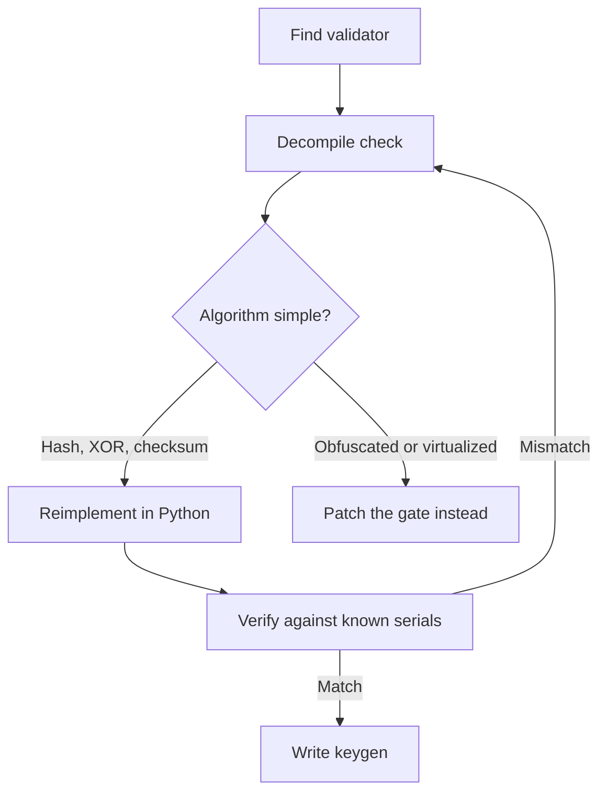

# Patching, Keygenning, and License-Check RE

> Tags: patching, keygenning, license-check, crackme, x64dbg, lief, pe-edit, anti-tamper | Difficulty: Intermediate to Advanced | Prerequisites: [`../00-fundamentals/binary-formats.md`](../00-fundamentals/binary-formats.md), [`../00-fundamentals/assembly-crash-course.md`](../00-fundamentals/assembly-crash-course.md), [`../04-dynamic/x64dbg-windbg.md`](../04-dynamic/x64dbg-windbg.md), [`../07-advanced/anti-analysis.md`](../07-advanced/anti-analysis.md)

## Overview

This page covers three related skills. The first is patching. You change bytes in a binary so a check passes. The second is keygenning. You recover the algorithm that validates a serial or license key and write a generator. The third is mapping license-check patterns. You learn where offline keys, online activations, trial timers, and hardware-ID bindings live inside a program.

Patch first. Keygen second. Patching is fast. A keygen is durable. A patched binary dies when the vendor re-signs, updates, or ships a new build. A keygen survives rebuilds if the algorithm did not change.

The legality boundary matters more here than on any other page. The [legal page](../09-ops/legal-and-ethics.md) covers it in detail. Read it before you distribute anything. The short version: private analysis of software you own or are authorized to test is often lawful. Distribution of cracked binaries, keygens, or circumvention tools is the prosecuted offense under DMCA section 1201(a)(2) and equivalent laws. Safe targets: your own software, CTF and crackme sites, interoperability work. Unsafe targets: third-party commercial software you intend to redistribute.

## How It Works

### Where license checks live

A license check is ordinary code. It reads input. It validates. It stores a result. The result gates features.

Common shapes:

| Check type | Where it lives | What it reads |
|---|---|---|
| Offline serial | Startup path or a `ValidateKey` function | Serial string the user typed |
| Offline file | Startup path | Key file on disk, registry value, `%APPDATA%` blob |
| Trial timer | Feature gate or startup path | Install date stored in registry or a file |
| Trial counter | Feature gate | Counter that decrements on each run |
| HWID binding | Activation flow | CPU ID, MAC, disk serial, SMBIOS UUID |
| Online activation | Network client code | Server response, signed token, challenge answer |
| Code integrity | Anywhere | Hash or CRC of the program's own sections |

The check usually returns a boolean or writes a flag. Find that point first. Everything else is noise.

### The three patch primitives

Patching reduces to three edits:

1. **NOP out the check.** Replace a conditional jump with NOPs, or replace a call to the validator with `xor eax, eax` style stubs.
2. **Force the branch.** Flip `jz` to `jnz`, or `je` to `jmp`, so the "licensed" path always runs.
3. **Return true.** Patch the validator's epilogue so it always returns the success value.

Each primitive has a cost. NOPs and forced jumps are fragile. They break if the vendor moves code. Return-true patches are more stable. They break if the function does more than return a flag, such as decrypting feature data.

### The keygen loop

Keygenning is a different discipline:

1. Find the validation function.
2. Recover the algorithm. The serial format, the hash, the crypto.
3. Reimplement the algorithm in a language you control.
4. Verify against known-good pairs. Crackmes usually ship with example serials.
5. Write the generator. A small program that prints valid serials.

Step 4 is where most keygens fail. An algorithm that looks right can be wrong in the padding, the endianness, or the character alphabet. Always verify against a real serial before you trust the reimplementation.



## Setup

You need one debugger and one binary editor.

| Tool | Role | Notes |
|---|---|---|
| x64dbg | Runtime patching, breakpoint work, patch export | See [`../04-dynamic/x64dbg-windbg.md`](../04-dynamic/x64dbg-windbg.md) |
| LIEF | PE file editing from Python | `pip install lief`, github.com/lief-project/LIEF |
| rizin or radare2 | Static disassembly and byte writes | `r2 -w target.exe`, then `wx` to write hex |
| Ghidra | Decompilation for algorithm recovery | Headless or GUI |

Install LIEF on the sandbox:

```bash
pip install lief
```

Check the version you got:

```bash
python3 -c "import lief; print(lief.__version__)"
```

LIEF parses PE, ELF, and Mach-O. It writes modified files without you hand-editing section headers. It does not fix checksum or signature problems. Windows does not require a valid checksum for user-mode EXEs. Authenticode signatures break on any byte change. See Pitfalls.

## Step-by-Step

### Step 1: Find the check

Run the target under x64dbg. Break on the input path.

For a serial-entry dialog, break on the button handler or the function that reads the text box. For a key-file check, break on `CreateFileW`, `RegOpenKeyExW`, or `CryptQueryObject`. For an online check, break on `WinHttpSendRequest` or `InternetOpenUrl`.

```text
; x64dbg
bp CreateFileW
bp RegOpenKeyExW
bp GetVolumeInformationW
bp GetAdaptersInfo
```

`GetVolumeInformationW` and `GetAdaptersInfo` are HWID sources. If the program calls them during activation, you found the binding.

Once the validator runs, find where it returns. The return value is usually `eax` or `al`. Trace back to the branch that decided it.

### Step 2: Pick the patch point

You want the narrowest patch that covers all paths to the gate.

| Patch point | Stability | Risk |
|---|---|---|
| Inside the validator, before `ret` | High | Function may also set state |
| The caller's branch after the call | Medium | Other callers of the validator stay broken |
| The gate itself, where the flag is tested | Highest | Many gates may test the same flag |

Prefer the gate. A flag like `g_isLicensed` gets tested in many places. Patch the test once. All features unlock.

### Step 3: Apply a runtime patch first

Never edit the file first. Edit memory. Confirm the check passes. Then write it to disk.

In x64dbg, patch in the memory view or with the assembler:

```text
; at the conditional jump, force the licensed path
; original: 0F 84 xx xx xx xx   jz somewhere
; patched:  E9 xx xx xx xx 90   jmp somewhere + nop
```

Or use x64dbg's patch workflow:

1. Navigate to the address.
2. Right-click, assemble, enter the new instruction.
3. The instruction shows in red as modified.
4. Patch → Patch file, or use the "Patch" view to export all changes.

x64dbg can save patches as a `.dp32` file. The file records byte ranges and new values. Apply it to the original EXE later.

For a return-true patch on a validator ending in `ret`, patch the last instructions:

```asm
; validator epilogue
mov eax, 1        ; B8 01 00 00 00
ret               ; C3
```

Or on x64 with `bool` return in `al`:

```asm
xor eax, eax
inc eax           ; al = 1
ret
```

### Step 4: Write the patch to disk with LIEF

When the runtime patch works, persist it. LIEF handles the PE structure for you.

```python
import lief

pe = lief.parse("target.exe")

# File offset of the patch point. Get it from the RVA:
# rva_to_offset conversion is automatic through section lookup.
rva = 0x401000          # the RVA you patched in x64dbg, rebased to PE RVA
size = 6
new_bytes = bytes([0xE9, 0x00, 0x00, 0x00, 0x00, 0x90])

# LIEF exposes section content; patch through the section's data
for section in pe.sections:
    if section.virtual_address <= rva < section.virtual_address + section.virtual_size:
        off = rva - section.virtual_address
        content = bytearray(section.content)
        content[off:off+size] = new_bytes
        section.content = bytes(content)
        break

pe.write("target-patched.exe")
```

Check the file loads:

```bash
python3 -c "import lief; lief.parse('target-patched.exe'); print('ok')"
```

Run it. If the patch was correct, the gate passes. If it crashes, you patched the wrong offset or the function did more than return a flag.

### Step 5: Keygenning — recover the algorithm

Keygenning starts where patching ends. You have the validator address. Now you read it.

1. Decompile the validator in Ghidra or IDA.
2. Identify the serial format. Length, charset, separators.
3. Identify the transform. Hash, XOR, table lookup, modular arithmetic, RSA signature check.
4. Identify known constants. Magic numbers, S-boxes, modulus values.
5. Write the reimplementation.

Common algorithm families in crackmes:

| Family | Signals in decompilation | Tools to confirm |
|---|---|---|
| CRC32 or checksum | Table of 256 constants, `0xEDB88320` polynomial | z3 for the inverse if needed |
| MD5 or SHA-1 | Init constants `0x67452301`, `0xEFCDAB89` | `hashlib` in Python |
| Custom block cipher | S-boxes, round loops, XOR chains | Symbolic execution with angr |
| RSA signature | Large modulus, `0x10001` exponent | `pycryptodome` |
| Simple XOR or add | Short function, no imports beyond `strlen` | Read it directly |

Verify the reimplementation against known pairs before you write the generator:

```python
# Suppose the algorithm is: serial = base32(md5(name + salt))[:16]
import hashlib, base64

def gen(name: str, salt: bytes) -> str:
    h = hashlib.md5(name.encode() + salt).digest()
    return base64.b32encode(h).decode().rstrip("=")[:16]

# Test vector from the crackme or a real serial
assert gen("TEST", b"salt") == "EXPECTED_SERIAL"
```

The assert is the gate. No assert, no keygen.

### Step 6: Keygenning — handle the hard cases

Some validators do not decompile cleanly.

**Obfuscated arithmetic.** The check uses MBA (mixed boolean-arithmetic) expressions. An LLM can often simplify them if you paste the expression and ask for the algebraic form. Verify the simplification against concrete inputs before trusting it.

**Anti-debug inside the validator.** The function checks `IsDebuggerPresent`, timing, or int3 bytes before validating. Patch those checks first, or run under a debugger that hides itself. See [`../07-advanced/anti-analysis.md`](../07-advanced/anti-analysis.md).

**Virtualized checks.** VMProtect or Themida turns the validator into bytecode for a custom VM. Static decompilation shows the VM dispatcher, not the check. Options: patch the VM's exit handler, hook the function that consumes the VM's result, or give up on keygenning and patch the gate. See [`../06-topics/deobfuscation.md`](../06-topics/deobfuscation.md).

**Online-only validation.** The serial is checked server-side. You cannot keygen what you cannot compute. The options are: patch the client to accept any response, emulate the server locally if the protocol is simple, or find a leaked serial and analyze its structure. Online checks get their own section below.

## License-Check Patterns

### Offline serial checks

The simplest pattern. The program takes a string, runs it through a transform, compares to a stored value or validates structure.

```text
user enters key
  -> strlen, charset check
  -> split on '-' or fixed-length chunks
  -> hash or transform each chunk
  -> compare to embedded constant or recompute checksum
  -> set flag
```

Patch point: the flag write, or the compare-and-branch after it.

Keygen point: the transform. If it is a hash of user input plus a constant, the keygen is `transform(input, constant)`.

### Offline file and registry checks

The program reads a key file or registry value at startup. The file contains an encrypted or signed blob.

```text
startup
  -> open key file or registry key
  -> read blob
  -> decrypt or verify signature
  -> parse expiry, HWID, features
  -> set flag
```

Patch point: the flag write after parse. Keygen point: harder. You need the file format and the crypto. If the blob is signed with a private key you do not have, you cannot forge it. Patch the verify function instead.

### Trial timers

Two subtypes:

**Date-based.** The program stores an install date and compares to today.

```text
startup or feature access
  -> read install date from registry/file
  -> GetLocalTime or time(NULL)
  -> diff in days
  -> if diff > trial_days: block
```

Patch: force the compare to always pass. Or set the stored date far in the future. Or hook `GetLocalTime`.

**Counter-based.** The program decrements a counter on each run.

```text
startup
  -> read counter
  -> if counter <= 0: block
  -> decrement counter
  -> write back
```

Patch: NOP the decrement. Or patch the `<= 0` check. Counter-based trials are the easiest to defeat because the state is a single integer.

### HWID binding

The license is tied to a machine fingerprint. The program collects hardware identifiers and either embeds them in the key or sends them to the server.

Common HWID sources on Windows:

| API | What it returns |
|---|---|
| `GetVolumeInformationW` | Volume serial number of the system drive |
| `GetAdaptersInfo` / `GetAdaptersAddresses` | MAC addresses |
| `GetComputerNameW` | NetBIOS name |
| WMI `Win32_Processor` | CPU ID |
| WMI `Win32_BaseBoard` | Motherboard serial |
| `GetSystemFirmwareTable` | SMBIOS UUID |

If the HWID is embedded in the serial, the keygen must reproduce the same HWID derivation. If it is sent to a server, the server computes the expected serial. You cannot keygen server-side validation.

Patch point for HWID checks: the comparison after HWID collection. Patch the compare, not the collection. The collection functions have other callers.

### Online activation

The program sends a request to a license server and checks the response.

```text
startup
  -> collect HWID and stored key
  -> HTTPS POST to license server
  -> receive response
  -> verify signature or parse status field
  -> set flag
```

Patch points:

1. The signature verification. Patch it to always return valid.
2. The status field check. Patch the branch on "activated" vs "trial".
3. The network call itself. Hook `WinHttpSendRequest` or `InternetReadFile` to return a canned response.

The cleanest patch is at the response parser. The program trusts the server's JSON or XML. If you can forge the response locally, you do not need to break crypto.

Emulating the server is harder. You need the protocol, the message format, and the signature scheme. Only do this if the client accepts self-signed or unsigned responses, which is rare.

### Code integrity and anti-tamper

Some binaries check their own code before running the license check. They hash `.text` and compare to a stored digest. If you patched the validator, the hash fails and the program exits.

Countermeasures:

| Defense | Bypass |
|---|---|
| CRC32 of `.text` | Patch the CRC routine, or the compare after it |
| Hash of `.text` with MD5/SHA | Same, but the hash function is harder to patch cleanly |
| Self-modifying decryptor | Dump after decrypt, patch the dump |
| Debugger detection | ScyllaHide, VM hardening, or static patching |
| Timing checks | Patch `rdtsc` reads or the comparison |

The order matters. Find the integrity check first. Neutralize it. Then patch the license check. If you patch the license check first, the integrity check fires and you learn nothing.

## LLM-Assists

Language models help at three points in this workflow.

**Identify the check logic.** Paste the decompiled validator and ask what it computes. The model can spot a CRC32 loop, an MD5 init, or a base64 decode faster than you can read assembly. It cannot always get the constants right. Verify against the disassembly.

```text
Prompt template:
"This function validates a license key. Identify:
1. The input format (length, charset, separators)
2. The transform applied to each part
3. The comparison target (constant, recomputed value, signature)
4. Any crypto primitives used (MD5, SHA, RSA, AES)
Paste the decompiled code and the disassembly of the comparison."
```

**Write the keygen skeleton.** Once you know the algorithm, the model writes the Python or C. You verify against known serials. The model does not know the serial format unless you tell it. Give it the decompiled code and the test vectors.

**Recognize API patterns.** The model knows that `GetVolumeInformationW` returns a volume serial, that `CryptVerifySignature` checks an Authenticode blob, that `BCryptVerifySignature` is CNG. It can map an unnamed import to its function faster than you can look it up.

**What the model cannot do.** It cannot see the binary. It cannot run the target. It cannot verify that a patch works. It cannot recover a private key. Treat its output as a hypothesis. The debugger and the test vectors are the truth.

## Anti-Tamper Interaction

Patching and anti-tamper are adversarial by design. The protector wants to detect your edit. You want the edit to survive.

### Timing

Patch after the integrity check runs, not before. If the check runs once at startup, patch the license validator after startup completes. The check already passed. The license gate still needs to pass.

This does not work for checks that run continuously or on every feature access. For those, you must neutralize the integrity check itself.

### Debugger vs file patch

Runtime patching in memory avoids file-level signature checks. Authenticode only validates the file on disk. If you never write the patched bytes back, the signature stays valid. The program runs patched in memory.

This fails if the program re-reads its own file from disk and compares to memory, or if it checks its own signature at runtime. Some protectors do both.

### Code caves

When the patch does not fit in the original bytes, you need a code cave. This is unused space in the binary, often at the end of a section or in padding between functions.

```text
original:  call validate_key   ; E8 xx xx xx xx
patched:  jmp code_cave        ; E9 xx xx xx xx
code_cave:
  ; your stub
  mov eax, 1
  ret
```

Finding a code cave requires section analysis. Look for `00` or `CC` padding at section ends. LIEF can extend a section, but that changes the PE layout and may break other things.

### Virtualized code

VMProtect and Themida virtualize selected functions. The bytes on disk are bytecode for a custom VM. Patching the bytecode does not change the semantics. You must patch the VM handler that implements the check, or patch the consumer of the VM's output.

This is advanced. See [`../06-topics/deobfuscation.md`](../06-topics/deobfuscation.md) for VM internals.

## Pitfalls

- **Patching the wrong offset.** RVA vs file offset vs VA. x64dbg shows VA. LIEF wants RVA. PE sections have raw and virtual sizes that differ. A patch at the wrong offset corrupts the file silently.
- **Breaking the stack or registers.** A forced jump that skips a `push` leaves the stack unbalanced. A `ret` patch that skips a `pop` corrupts the return address. Match the patch to the calling convention.
- **Checksum and signature.** Windows does not require a valid checksum for user-mode EXEs. Authenticode signatures break on any byte change. If the program checks its own signature, your patch fails.
- **Trial date in the future.** Setting the install date to 2099 works until the program notices the date is implausible. Some programs check for dates after the build date.
- **HWID changes.** If you patch the HWID comparison, the program still collects the HWID. If you change the HWID source, other checks may fail. Patch the compare, not the source.
- **Online checks with certificate pinning.** If the client pins the server's certificate, you cannot MITM the response without also patching the pin check. This is a second patch.
- **Assuming the model is right.** An LLM can produce a plausible keygen that fails on edge cases. The serial format may have a checksum digit the model missed. Verify against at least three known pairs.
- **Redistributing cracks.** This is the legal line. Private patches for personal study are one thing. Posting a keygen or a patched binary is trafficking under DMCA 1201(a)(2). See [`../09-ops/legal-and-ethics.md`](../09-ops/legal-and-ethics.md).
- **Ignoring 32-bit vs 64-bit.** Patch instructions differ. `jmp` rel32 is `E9` on both, but `call` and register usage differ. A patch written for x64 will not work on x86.
- **Packing.** If the binary is packed, the code you patch is compressed or encrypted. Unpack first. See [`../04-dynamic/unpacking-dumping.md`](../04-dynamic/unpacking-dumping.md) and [`../06-topics/packed-binaries.md`](../06-topics/packed-binaries.md).

## See Also

- [`../09-ops/legal-and-ethics.md`](../09-ops/legal-and-ethics.md) — DMCA, CFAA, interop defense, distribution rules
- [`../04-dynamic/x64dbg-windbg.md`](../04-dynamic/x64dbg-windbg.md) — debugger automation and MCP
- [`../07-advanced/anti-analysis.md`](../07-advanced/anti-analysis.md) — anti-debug, anti-VM, integrity checks
- [`../06-topics/deobfuscation.md`](../06-topics/deobfuscation.md) — VMProtect, Themida, OLLVM
- [`../04-dynamic/unpacking-dumping.md`](../04-dynamic/unpacking-dumping.md) — runtime unpacking before patching
- [`../06-topics/packed-binaries.md`](../06-topics/packed-binaries.md) — packer detection and IAT rebuild
- [`../03-decomp/verification-loop.md`](../03-decomp/verification-loop.md) — deterministic verification of agent claims
- [`../02-collab/llm-workflows-recipes.md`](../02-collab/llm-workflows-recipes.md) — license-check workflow recipe
- [`../00-fundamentals/assembly-crash-course.md`](../00-fundamentals/assembly-crash-course.md) — assembly for patch reading
- [`../00-fundamentals/binary-formats.md`](../00-fundamentals/binary-formats.md) — PE structure for offset math
