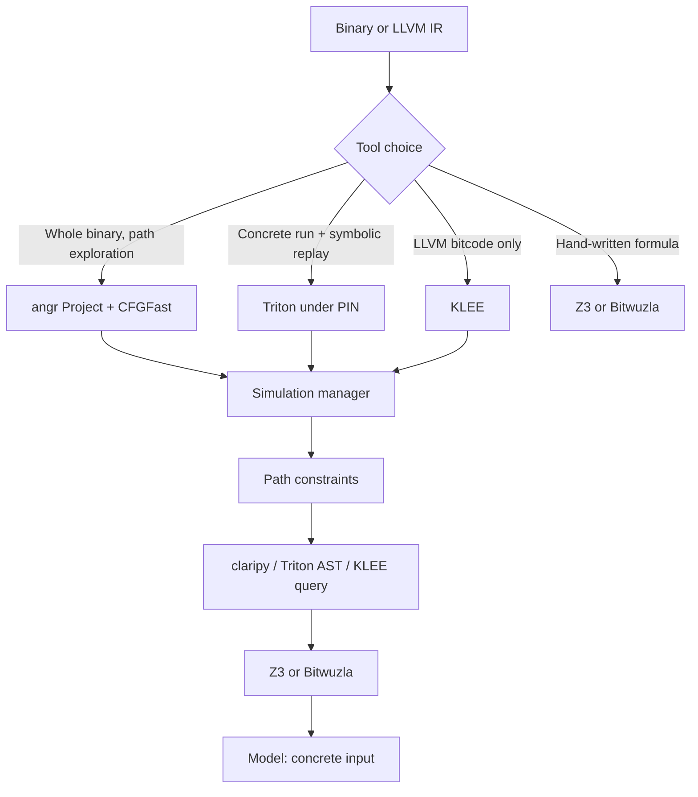

# Symbolic Execution and SMT Solving for RE

> Tags: symbolic-execution, angr, triton, klee, z3, bitwuzla, smt, concolic, path-exploration | Difficulty: advanced | Prerequisites: ../00-fundamentals/assembly-crash-course.md, ../03-decomp/verification-loop.md

## Overview

Symbolic execution runs a program with inputs as symbols, not concrete bytes. Each input byte becomes a variable. The solver tracks every path the code can take. Each branch adds a constraint to that path.

The output is a set of formulas. Each formula describes one reachable path. An SMT solver then answers questions about those formulas:

- Is this path reachable?
- What input reaches the success block?
- What input value makes this register equal `0xdead`?

This is the core idea. The tools differ in what they execute and what they lift:

| Tool | Executes | Input model | Solver backend | Best for |
|---|---|---|---|---|
| angr | Whole binary, lifted to VEX IR | Symbolic registers and memory | claripy on Z3 | Path exploration, CFG, decomp hooks |
| Triton | Concrete run under PIN, then symbolic replay | Tainted memory | Z3 or Bitwuzla | Concolic breaking of VMProtect/Themida |
| KLEE | LLVM bitcode | Symbolic args and globals | KLEE's own | Source or IR-level analysis |
| Z3 direct | None. You write the formula | Your formula | Z3 | Checking extracted constraints, small puzzles |
| Bitwuzla direct | None | Your formula | Bitwuzla | Bitvector-heavy formulas, faster than Z3 |

Use symbolic execution when the answer is a formula, not a trace. Examples:

- A license check. You want the key that passes `cmp` chains.
- A crackme. You want the input that reaches the `win` function.
- A small parser. You want the input that reaches a deep state.
- A deobfuscation step. You want the value a virtualized handler computes.

Do not use it as a general-purpose fuzzer or a whole-binary decompiler. It explodes on loops, syscalls, and large binaries. See the Pitfalls section.

## Setup

Install into a dedicated virtualenv. Do not mix angr and Triton with the agent's base environment.

```bash
python3 -m venv ~/venvs/se
source ~/venvs/se/bin/activate
pip install "angr[llm]"      # angr 10.0.5 + MCP deps
pip install triton-library   # 1.0.0rc4 (release candidate, pin it)
pip install z3-solver        # 5.3.3.0 (angr pins this version)
pip install bitwuzla         # 0.9.1, optional, faster bitvector queries
```

KLEE is not a pip package. Build it from source or use the KLEE Docker image at github.com/klee/klee. KLEE needs LLVM bitcode as input. It cannot load a PE or ELF directly.

Verify the install:

```bash
python3 -c "import angr; print(angr.__version__)"
python3 -c "import triton; print(triton.__version__)"
angr-mcp --help   # or: python -m angr.mcp --help
```

## Usage

### angr: project, CFG, explorer, veritesting

angr 10.x is the only symbolic engine with a first-party MCP server. It loads a binary, lifts it to VEX IR, builds a CFG, and runs path exploration.

#### Step 1: Load the project

```python
import angr

p = angr.Project('/path/to/binary', auto_load_libs=False)
```

`auto_load_libs=False` is critical. Simproc stubs for libc functions are faster and more predictable than simulating the real library. Without it, angr tries to lift the entire libc.

Set the base address and entry if needed:

```python
p = angr.Project('/path/to/binary', main_opts={'base_addr': 0x400000}, auto_load_libs=False)
```

#### Step 2: Build the CFG

```python
cfg = p.analyses.CFGFast(force_complete_scan=False, normalize=True)
print('functions:', len(cfg.kb.functions))
print('edges:', len(cfg.kb.cfg.edges))
```

`CFGFast` is the fast path. `CFGEmulated` is slower and more accurate for stripped binaries. `force_complete_scan=True` explores more aggressively but can hang on large binaries.

Get the function list:

```python
for addr, func in cfg.kb.functions.items():
    print(hex(addr), func.name, func.size)
```

#### Step 3: Run the explorer

The `simulation_manager` is the core loop. It maintains a set of active states and steps them forward.

```python
state = p.factory.entry_state()
simgr = p.factory.simulation_manager(state)

simgr.explore(
    find=lambda s: b'flag' in s.posix.dumps(1),   # stdout contains 'flag'
    avoid=0x401000,                              # avoid address
    num_find=1
)

if simgr.found:
    s = simgr.found[0]
    print('stdin:', s.posix.dumps(0))
    print('stdout:', s.posix.dumps(1))
```

`find` and `avoid` accept addresses, function objects, or predicates. A predicate gets the state and returns True/False.

Bound the run. Symbolic execution has no natural end.

```python
simgr.explore(find=target, avoid=bad, num_find=1)
# or step manually with a limit
for i in range(10000):
    simgr.step()
    if simgr.found:
        break
    if not simgr.active:
        break
```

#### Step 4: Veritesting

Veritesting is angr's path-merging mode. Instead of exploring one path at a time, it converts a whole region of code into a single formula and asks the solver for inputs that reach each branch. This is faster for straight-line code and small loops.

```python
simgr.use_technique(angr.exploration_techniques.Veritesting())
simgr.explore(find=target, avoid=bad)
```

Veritesting works best on small functions with few branches. It fails on loops and calls to complex library functions. Use it for crackmes and license checks, not for whole binaries.

#### Step 5: Extract the answer

Once a state reaches the target, ask the solver for a concrete input:

```python
s = simgr.found[0]
# stdin is symbolic; ask for concrete bytes
stdin_bytes = s.posix.dumps(0)
print('concrete stdin:', stdin_bytes)
```

If the input is at a fixed buffer address instead of stdin, symbolize it before exploration:

```python
state = p.factory.entry_state()
buf_addr = 0x404000  # input buffer
state.memory.store(buf_addr, claripy.BVS('input', 8*32))  # 32 symbolic bytes
simgr = p.factory.simulation_manager(state)
simgr.explore(find=success_func)

if simgr.found:
    s = simgr.found[0]
    print(s.solver.eval(state.memory.load(buf_addr, 32)))
```

#### The MCP interface

angr 10.x ships an MCP server. It exposes CFG and function-level tools to an agent.

```bash
pip install "angr[llm]"
angr-mcp   # console script
# or
python -m angr.mcp --transport stdio
```

The MCP tools include `load_binary`, `get_cfg`, `list_functions`, `get_basic_blocks`, `get_function`, and `close_project`. The agent can ask for the CFG and function list, then drive symbolic execution through the API. This is the only first-party agent interface for a symbolic engine.

There is also a angr-management plugin at github.com/sandbornm/angr_mcp that binds MCP tools to the live GUI session. Use it when you want the agent to see the same graph you do.

Source: https://github.com/angr/angr, https://docs.angr.io

### Triton: concolic execution

Triton is a concolic engine. It runs the binary concretely under Intel PIN, taints data, and builds symbolic expressions only for the paths you care about. This is faster than full symbolic execution for real binaries.

Install:

```bash
pip install triton-library   # 1.0.0rc4
```

The Triton Python API is low-level. You feed instructions one at a time. You provide memory and registers. Triton does not load an ELF or simulate syscalls.

```python
from triton import *

ctx = TritonContext(ARCH.X86_64)

# map code
ctx.setConcreteMemoryAreaValue(0x400000, code_bytes)
ctx.setConcreteRegisterValue(ctx.registers.rip, 0x400000)

# symbolize the input buffer
ctx.symbolizeMemory(MemoryAccess(0x7fff0000, CPUSIZE.QWORD), 'input')

# run instructions
for insn in disassemble(code_bytes):
    ctx.processing(Instruction(insn.bytes, insn.address))

# get path constraints
for pc in ctx.getPathConstraints():
    print(pc)

# solve for a target
model = ctx.getModel(ctx.getSymbolicRegister(ctx.registers.rax).getAst() == 0xdead)
print(model)
```

Triton shines on VMProtect and Themida. The `triton-dse` project at github.com/quarkslab/tritondse wraps the loop: pick a target, negate the blocking branch, solve, replay. Triton also supports Bitwuzla as a backend, which is faster than Z3 on bitvector-heavy queries.

Triton is not a fuzzer. It is a constraint engine. You drive the exploration.

Source: https://github.com/JonathanSalwan/Triton, https://triton-library.github.io

### KLEE: symbolic execution on LLVM IR

KLEE is a symbolic virtual machine for LLVM bitcode. It was built at Stanford and is used in academic and industrial verification. It cannot load a PE or ELF. It needs LLVM bitcode.

Install:

```bash
# build from source or use Docker
git clone https://github.com/klee/klee
cd klee && mkdir build && cd build
cmake .. && make -j$(nproc)
```

Run KLEE on a bitcode file:

```bash
klee --output-dir=klee-out --search=dfs ./target.bc
```

KLEE explores paths through the bitcode. It writes test cases to `klee-out` when it finds new coverage or an error. Each test case is a concrete input file.

KLEE is for source or IR-level analysis. If you have C or Rust source, compile to bitcode with `clang -emit-llvm -c` and run KLEE. If you have a binary, lift it to LLVM IR first. Mergen at github.com/NaC-L/Mergen does this for VMProtect and Themida.

KLEE's strength is POSIX emulation and coverage-guided search. Its weakness is that it only sees LLVM IR. Assembly-level details are lost in the lift.

Source: https://github.com/klee/klee

### Z3 and Bitwuzla: direct solver use

You do not need a symbolic engine to use an SMT solver. You can write the formula yourself.

Z3 is the standard SMT solver. Bitwuzla is faster on bitvector-heavy queries. Both are used as backends by angr, Triton, and Miasm.

Z3 Python API:

```python
from z3 import *

x = BitVec('x', 32)
y = BitVec('y', 32)

s = Solver()
s.add(x + y == 0xdead)
s.add(x > 0x1000)
s.add(y < 0x100)

if s.check() == sat:
    m = s.model()
    print('x =', hex(m.eval(x).as_long()))
    print('y =', hex(m.eval(y).as_long()))
```

Bitwuzla Python API:

```python
from bitwuzla import *

options = Options()
options.set(Option.PRODUCE_MODELS, True)
bz = Bitwuzla(options)

x = bz.mk_const(bz.mk_bv_sort(32), 'x')
y = bz.mk_const(bz.mk_bv_sort(32), 'y')

bz.assert_formula(bz.mk_term(Kind.BV_ADD, x, y) == bz.mk_bv_value(32, 0xdead))
bz.assert_formula(bz.mk_term(Kind.BV_UGT, x, bz.mk_bv_value(32, 0x1000)))
bz.assert_formula(bz.mk_term(Kind.BV_ULT, y, bz.mk_bv_value(32, 0x100)))

result = bz.check_sat()
print(result)
if result == Result.SAT:
    print('x =', hex(bz.get_value(x).value()))
```

Use direct solver calls when:

- You extracted a constraint by hand and want to check it.
- You want to verify an LLM's claim about a formula.
- You are writing a custom symbolic tool and need a backend.

The formula is the interface. angr and Triton are frontends that generate formulas from execution. Z3 and Bitwuzla solve them.

Source: https://github.com/Z3Prover/z3, https://github.com/bitwuzla/bitwuzla

### The pipeline diagram



## AI Use Cases

### Constraint extraction

The agent reads a function and writes the constraint formula. It does not run the solver. You verify the formula and solve it yourself.

Prompt pattern:

```
Function at 0x401234 in target.exe. It checks a 16-byte license key.
Extract the constraint as a Z3 Python formula. The key is at buffer 0x404000.
The function returns 1 on success, 0 on failure.
Do not solve. Output only the formula and a comment for each check.
```

The agent writes the formula. You check it against the disassembly. You solve it with Z3. This is faster and more reliable than asking the agent to run angr on the whole binary.

### Path summarization

The agent reads angr's path constraints and writes a human-readable summary. This is the RECON paper's approach (arXiv:2606.10264). The LLM extracts readable constraints from bytecode. The result is 5.8x faster than pure symbolic execution because the agent prunes irrelevant paths before solving.

Prompt pattern:

```
Here are the path constraints for the found state:
[path constraint list]
Summarize what input conditions lead to the target. Group by check type.
Flag any constraint that looks unsatisfiable or contradictory.
```

### LLM-guided symbolic execution

Several 2026 papers explore LLMs that plan bounded symbolic execution runs:

| Paper | arXiv | Technique |
|---|---|---|
| Agolic | 2608.06397 | LLM agent plans bounded SE runs |
| KLEECopilot | 2607.21676 | LLM marks vulnerable code and loop exits for KLEE. +42 percent block coverage |
| RECON | 2606.10264 | LLM extracts readable constraints from bytecode |
| POVGEN | 2608.04217 | LLM-guided constraint reasoning for proof-of-vulnerability |
| SymTEE | FORGE 2026 | LLM-assisted SE for TEE input validation |
| Ghost code | PACMSE 2026 | LLM generates lightweight stubs for SE to invert difficult fragments |

These are research papers, not shipped tools. The pattern is consistent: the LLM handles the parts symbolic execution is bad at (loop bounds, stub generation, path pruning), and the solver handles the parts it is good at (constraint solving).

### angr MCP for agent-driven exploration

The angr MCP server lets an agent load a binary, get the CFG, and list functions. The agent can then ask for a specific function's blocks and run symbolic execution on it. This is the only first-party agent interface for a symbolic engine.

Configure the MCP server in Claude Code:

```json
{
  "mcpServers": {
    "angr": {
      "command": "angr-mcp",
      "args": ["--transport", "stdio"]
    }
  }
}
```

The agent gets tools like `load_binary`, `get_cfg`, `list_functions`, `get_basic_blocks`, and `get_function`. It can explore the CFG and identify candidate functions for symbolic execution.

Source: https://github.com/angr/angr, https://github.com/sandbornm/angr_mcp

## Pitfalls

### Path explosion

Symbolic execution explores every feasible path. A function with 20 branches has up to 1,048,576 paths. A loop multiplies this by the iteration count. Real binaries have thousands of branches.

Mitigations:

- Use `avoid` to prune known-bad paths.
- Use veritesting for small regions.
- Use Triton concolic mode to follow a concrete trace and only branch where needed.
- Set a step limit or time limit.
- Symbolize only the input you care about. Do not symbolize all memory.

### Loop handling

Loops are the main killer. angr has loop seers and veritesting to bound them, but they fail on complex loops. Triton follows a concrete trace so it sees one iteration at a time. KLEE has its own loop handling but only on LLVM IR.

If the target has a loop that depends on symbolic input, symbolic execution will not finish. Use concrete execution to get the loop count, then bound the symbolic run to that count.

### Syscall and library emulation

angr uses SimProcedures to stub common libc functions. These are fast but incomplete. A binary that calls an unusual syscall or a custom library function will fail. Triton does not simulate syscalls at all. KLEE has POSIX emulation but only for LLVM IR.

Mitigation: hook the syscall or library call yourself. Return a canned value. Log every call and stub the ones you see.

### Constraint solver limits

Z3 and Bitwuzla are good but not magic. Bitvector formulas with many variables and nonlinear operations can take minutes or hours. angr's claripy layer adds overhead. Triton's AST can blow up on complex expressions.

Mitigation: simplify constraints before solving. Use Bitwuzla for bitvector-heavy queries. Split large formulas into smaller ones. Cache solver results.

### Binary size and architecture support

angr supports x86, x86-64, ARM, ARM64, MIPS, PPC, and SPARC through VEX. Triton supports x86 and x86-64. KLEE is architecture-independent but needs LLVM IR. Miasm has its own IR and supports many architectures.

Large binaries with thousands of functions are not practical. CFG construction alone can take hours. Symbolic execution on a whole binary is rarely feasible. Target a single function or a small region.

### State merging and path merging

angr's veritesting merges paths into formulas. This is fast but can produce incorrect results if the merge is too aggressive. Triton's concolic mode does not merge paths. KLEE has its own search strategies.

If you need exact path constraints, disable veritesting and explore one path at a time. If you need speed, use veritesting on small regions.

### MCP server limits

The angr MCP server exposes CFG and function-level tools. It does not expose full symbolic execution through MCP. The agent can inspect the binary but cannot run a full exploration without writing Python code. This is a limitation, not a bug. The MCP interface is for reconnaissance, not for solving.

## See Also

- `../04-dynamic/emulation-unicorn-qiling.md` — Unicorn and Qiling for concrete execution; Triton and angr for symbolic
- `../03-decomp/verification-loop.md` — use symbolic execution as an execution oracle for decomp claims
- `../06-topics/deobfuscation.md` — VMProtect and Themida deobfuscation with Triton and Miasm
- `../07-advanced/anti-analysis.md` — anti-debug and anti-VM checks that symbolic execution must bypass
- `../05-tools/mcp-catalog.md` — angr-mcp and other MCP servers
- `../05-tools/tool-catalog.md` — full tool comparison
- `../02-collab/prompt-patterns.md` — prompt templates for constraint extraction
- `../09-ops/daily-workflows.md` — when to use symbolic execution in the daily loop
