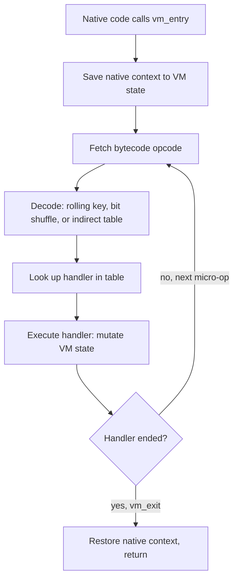

# Analyzing Custom VMs and Bytecode

> Tags: vm | devirtualization | VMProtect | Themida | bytecode | script-VM | LLM | Difficulty: Advanced | Prerequisites: `../00-fundamentals/assembly-crash-course.md`, `../04-dynamic/frida-deep-dive.md`, `../03-decomp/verification-loop.md`, `../06-topics/deobfuscation.md` (tool catalog)

## Overview

A custom VM is a small interpreter the author wrote inside the target. It replaces selected functions with bytecode plus handlers. The CPU executes the interpreter loop. The bytecode executes the program.

You meet this pattern in three places:

- Commercial protectors. VMProtect and Themida virtualize chosen functions. The handler set is large and version-specific.
- Game and script VMs. Lua, Unreal Blueprint VM, custom game engines, firmware script engines. The bytecode format is often recoverable in days.
- Managed protectors. .NET protectors that compile IL into their own bytecode, plus .NET dynamic methods and JIT'd code that never hits disk.

The analysis goal is always the same: recover the handler semantics, then lift bytecode sequences into readable pseudocode. The hard part is that the interpreter is ordinary machine code. It is not magic. It is just a loop you have to slice.

The AI role is narrower than in normal reversing. The model cannot see inside the bytecode blob. It can name handlers, disassemble bytecode streams once you give it the format, and propose semantics for handler fragments. Every claim still needs a deterministic check.

## How It Works

### VM anatomy

Every VM of this family has four parts:

- **Handler table.** An array or scattered set of code pointers. Each entry implements one virtual opcode.
- **Bytecode array.** The encoded instruction stream. Often embedded in `.data`, `.rdata`, or a protector section like `.vmp0`.
- **Dispatch loop.** The code that fetches the next opcode, maps it to a handler, and jumps. Often indirect through a register.
- **Virtual state.** Virtual registers or a virtual stack, a virtual program counter, and flags. Stored in the real CPU context or in a dedicated memory region.

The dispatch loop is the fixed point of analysis. Once you find it, everything else hangs off it.



### Virtual state models

Two state models dominate:

| Model | How it works | Who uses it |
|---|---|---|
| Virtual stack | Bytecode pushes and pops operands on a stack in VM memory | VMProtect x86, many custom script VMs |
| Virtual registers | Bytecode addresses fixed virtual registers | Themida variants, many game/script VMs |

VMProtect keeps its VM state inside the real register set plus a memory context block. Themida variants often use explicit virtual registers in a memory window. Custom VMs usually pick one and stay consistent. Identify the model early. It decides how you read handler behavior.

### Handler polymorphism

Protectors do not ship one handler per opcode. They ship several variants per semantic operation and pick one at random per virtualization pass. VMProtect mutates handler code with junk instructions and opaque predicates. Themida does the same plus control-flow tricks inside handlers.

The consequence: you cannot build the handler table by pattern matching code bytes. You must observe which handler runs for which opcode, or match handlers by behavior.

## Step-by-Step

### 1. Confirm it is a VM

Run the cheap checks first:

```bash
# Detect It Easy
diec target.exe

# DIE alternative inside Ghidra/IDA: check section names and entry stub
rabin2 -S target.exe | grep -iE 'vmp|themida|enigma|vm'
```

Signals: protector sections, an entry stub that sets up a context block and jumps into a loop, bytecode-looking data with high entropy, and a dispatch loop with an indirect jump through a computed address.

For custom VMs there is no signature. Look for the pattern instead: a loop that reads bytes from a data blob, indexes a table of code addresses, and jumps indirectly.

### 2. Locate the dispatch loop

Static approach in Ghidra or IDA:

1. Find `vm_entry`. It is the call target of virtualized functions, or the block right after the protector entry stub.
2. Follow it forward. The first big loop with an indirect branch is usually the dispatcher.
3. Mark the bytecode pointer and the opcode-fetch instruction. Everything the loop touches before the indirect jump is decode logic.

Dynamic approach when anti-analysis gets in the way: see step 3.

### 3. Find handler boundaries dynamically

Static slicing of handlers is hard when handlers share tail code or jump into each other. Dynamic tracing gives you exact boundaries.

With Frida on a running target:

```javascript
// Trace indirect jumps inside the dispatch loop.
// Set this on the dispatch instruction address you found statically.
Interceptor.attach(ptr("0x140001230"), {
  onInstruction() {
    // RIP-relative context: read VM state registers you identified
    console.log("dispatch ->", this.context.rip.toString(16),
                "target", this.context["r11"].toString(16));
  }
});
```

Better: use Stalker or a lightweight ptrace tracer to record every executed basic block inside the VM loop for one call. The trace segments itself at handler boundaries: each handler starts where the dispatch jump lands and ends where control returns to the dispatcher.

`wul7chaos/vmp-reverse-skill` implements exactly this on Linux x86-64 and ARM64. It captures a `ptrace` trace, finds the dispatcher, and slices handlers along the recorded stream. See `../06-topics/deobfuscation.md` for the install and the Z3 verification stage.

For a one-off manual trace on Windows, x64dbg trace or a TitanHide-assisted run works. Record until `vm_exit`, then group blocks by which dispatch jump produced them.

### 4. Decode the bytecode format

Once you have handler boundaries, you need the opcode encoding. Two routes:

- **Static.** Read the decode logic in the dispatch loop. It is usually 5–20 instructions: fetch byte, XOR with key, rotate, mask, index table. Write it down as pseudocode, then have the model transcribe it into Python.
- **Dynamic.** Break after decode, before dispatch. Log the decoded opcode value for every iteration. Feed the same input twice and diff the streams to find which byte positions are the opcode versus operands.

A worked prompt for the model:

```
Here is the dispatch decode routine in asm (pasted). Transcribe it to Python.
Inputs: rip, key register r14, bytecode pointer [r15].
Output: the decoded opcode index and the consumed byte count.
Do not simplify. Keep every shift, xor, and rotate.
```

Then verify the transcription by replaying a recorded trace: the Python decoder must reproduce every logged opcode for the recorded run. This is a cheap, strong check.

### 5. Classify handlers

You now have N handler bodies and a bytecode stream. The question per handler: what does it do to VM state?

Feed each handler's asm or IR to the model with this template:

```
Handler at 0x140002a10. VM state: vpc at [rbx+8], vsp at [rbx+16],
virtual regs window at [rbx+0x40].
Inputs: bytecode operand bytes at vpc.
Question: which primitive is this? One of: PUSH_IMM, LOAD_REG, STORE_REG,
ADD, SUB, XOR, SHL, SHR, JMP, CJMP, CALL_NATIVE, RET, NOP.
Show which VM-state fields it reads and writes. If none fit, say UNKNOWN.
```

Then verify each claim mechanically. Two checks work:

- **Differential.** Run the handler with two different input states. A correct semantic tag predicts the state delta for both runs.
- **Solver.** Lift the handler to IR and ask Z3 whether the proposed semantics match on symbolic inputs. This is what vmp-reverse-skill does; verdicts are PROVEN / REFUTED / FUZZED / UNVERIFIED.

Expect UNKNOWN for 10–30 percent of handlers on a mutated protector. Handlers that only touch junk state or anti-analysis counters can often be ignored if they never affect the recovered program semantics.

### 6. Lift bytecode to pseudocode

With handler semantics named, disassembly is mechanical. Write a bytecode disassembler: fetch opcode, consume operands per handler signature, emit a line per virtual instruction.

```python
# Skeleton: one line per virtual opcode
for ins in disasm(stream, handlers):
    name = handlers[ins.op].name        # "ADD", "LOAD_REG", ...
    ops  = ins.operands                  # decoded by handler signature
    print(f"{ins.addr:06x}: {name} {fmt(ops)}")
```

Feed the resulting listing to the model in chunks of one virtualized function. Ask for pseudocode, not for confidence. Then spot-check the riskiest lifts (calls into native code, indirect jumps) against the trace.

For whole-module lifting, the static tools do this without a trace:

- **Mergen** (`github.com/NaC-L/Mergen`): lifts assembly to LLVM IR, then uses `opt` to strip the VM layer. README claims VMProtect 3.4–3.8.1 and Themida. Build notes in `docs/BUILDING.md`. Verify version coverage on your sample before planning around it.
- **VTIL** (`github.com/vtil-project/VTIL`): a Virtual-machine Translation IL built for devirtualization. Lifts from any architecture including stack machines, keeps native registers addressable, and emits native code at chosen addresses. NoVmp (`github.com/can1357/NoVmp`) was the reference consumer; it is stale, but VTIL-core is the reusable part.
- **d810-ng** (`github.com/w00tzenheimer/d810-ng`): IDA plugin that rewrites microcode at decompile time. It is not a devirtualizer, but its MBA and substitution rules clean up handler code so the dispatcher and handlers decompile readably. Load with `Ctrl-Shift-D`.
- **Stale but canonical**: `JonathanSalwan/VMProtect-devirtualization` (Triton symbolic execution), `aftermathlabs/vmp2` (VMP 2), `chramiq/de4vmp` (.NET VMProtect), `jz0/tvm-devirt` (Tencent VM, active).

## Symbolic Execution Through the VM

The ambitious approach skips tracing. You symbolically execute the interpreter itself, letting the VM loop unroll over symbolic bytecode operands. The result is native-level semantics for the whole virtualized function.

PUSHAN (`arxiv.org/abs/2603.18355`) is the 2026 reference: trace-free, VPC-sensitive symbolic emulation targeting VMProtect, Themida, and Tigress. **No official artifact is public.** `github.com/NoAddr/yaps` is an open rebuild of that approach using SLEIGH p-code. It is AI-generated code and Windows-only per the project report. Budget debugging time.

Why this is hard: the dispatch loop multiplies paths. Every handler is a branch. A symbolic run through 50 virtual instructions can explode unless you prune on the virtual PC. PUSHAN's contribution is exactly that pruning: it treats the bytecode pointer as a sensitive path condition.

Practical advice:

- Try symbolic execution only when the trace-driven route fails, usually because the function is cold or anti-debug blocks it.
- Scope it to one function. Whole-binary symbolic execution through a VM is not realistic in 2026 tooling.
- Use Triton or angr as the engine. Write the path-pruning predicate yourself: constrain the symbolic vpc to the bytecode bytes you actually recorded or expect.
- Have the model generate the handler semantics table, then feed it to the symbolic executor as a shortcut: you can skip handlers you already proved and only symbolically execute unknown ones.

## LLM Assists

Where the model genuinely helps in VM analysis:

- **Handler semantic naming.** Paste one handler's decompiled asm or IR. Ask for the primitive and the state fields touched. Verify mechanically as in step 5.
- **Bytecode disassembly.** Once the format is known, the model writes the disassembler fast. Verify the decoder against a recorded trace before trusting output.
- **Handler clustering.** Mutated handlers that compute the same primitive look different in asm. The model can cluster them by behavior description. Confirm clusters with the differential check.
- **Pseudocode recovery.** Per-function lifting from the disassembly listing. Highest volume task. Always chunk by function and verify calls/jumps manually.
- **Anti-analysis triage.** VMs often hide checks inside handlers. The model can flag "this handler reads a debug register" style patterns faster than manual reading. Flag, then confirm.

Where it fails:

- It cannot invent the bytecode format. You must extract the decode logic first.
- It will confidently name a handler wrong. The Z3 or differential check is not optional.
- On Themida's mutated handlers, expect higher UNKNOWN rates than on VMProtect.

## Examples

### VMProtect

Layout: virtualized functions call a shared `vm_entry`. Bytecode sits in `.vmp0`/`.vmp1` sections, often encrypted with a per-build rolling key. Handlers are mutated per build.

Workflow: trace one call (step 3), decode the stream (step 4), classify handlers (step 5), disassemble (step 6). vmp-reverse-skill automates steps 3–6 with Z3 verdicts on Linux. Mergen attempts steps 4–6 statically for VMP 3.4–3.8.1.

Version matters. The dispatch pattern is fixed per major version, so a tool built for 3.5 may miss 3.8. Check `diec` output and the VMP version markers before choosing a tool.

### Themida

Same anatomy, different details. Larger handler set, more mutation, anti-debug woven into handlers. Public devirtualization tooling is thinner: yaps and Mergen claim coverage, bobalkkagi (`github.com/bobalkkagi/bobalkkagi`) covers Themida 3.x unpacking with devirt WIP.

Recommended order: unpack first (see `../06-topics/packed-binaries.md`), then treat the VM layer as a VMP problem with a different handler table. Budget more time than VMP. Reported community consensus: Themida devirtualization is research-grade in 2026.

### Custom game and script VMs

These are the friendliest targets. The bytecode format is usually simple (fixed-width operands, no encryption), handlers are clean, and the VM is one interpreter loop in one module.

Approach:

1. Find the interpreter. In Unity IL2CPP games, check `GameAssembly.dll` for the script VM entry; metadata recovery comes first (see `../06-topics/game-engine-re.md`).
2. Dump the bytecode blob. It is often a contiguous array referenced by a single base pointer.
3. Trace one script execution with Frida to confirm opcode boundaries.
4. Write the disassembler. Custom VMs rarely need symbolic execution — the format falls out in a day of work.
5. Use the model for handler naming and pseudocode recovery at volume.

Lua and LuaJIT are the extreme case: the format is public. Do not reverse the VM — use an existing parser and spend effort on the script logic.

### .NET dynamic methods and VMProtect .NET

Two distinct problems share a page:

- **Dynamic methods.** `System.Reflection.Emit` code and JIT-compiled bodies exist only in memory. Dump them with MegaDumper or ExtremeDumper (see `../06-topics/dotnet-deep-dive.md`), or hook `compileMethod`/`getCode` with Frida-Clr. The result is real IL or native code you can feed to ILSpy.
- **VMProtect .NET.** The protector compiles IL into its own bytecode and ships a .NET-side interpreter. `chramiq/de4vmp` is the dedicated devirtualizer; it is maintained-ish. The workflow is the same as native VMs but at IL level: find the interpreter loop in the protected assembly, classify handlers, lift bytecode. dnSpyEx or ILSpy give you readable C# for the interpreter itself, which is a big head start over native asm.

## Pitfalls

- **Handler boundaries from static analysis alone are unreliable.** Mutated handlers share tails and jump into shared stubs. Get boundaries from a trace.
- **The opcode decode may be per-instruction keyed.** A rolling key means byte N's decode depends on bytes 0..N-1. Your disassembler must carry key state, not decode each instruction independently.
- **Virtualized functions can call native functions.** Handlers of type CALL_NATIVE pass real addresses. Track these — they are your bridge back to meaningful API names.
- **Not every indirect jump is dispatch.** Protectors insert decoy indirect branches. Confirm the target set matches your handler table before treating a block as a handler.
- **Anti-debug lives inside handlers.** A handler that checks DR registers or timing will corrupt your trace. See `../07-advanced/anti-analysis.md` for bypass order: stealth debugger first, static lifting second.
- **Symbolic execution needs path pruning.** Without a constraint on the virtual PC, state space explodes within a few virtual instructions.
- **Mergen version coverage is per README.** VMP 3.4–3.8.1 claimed. Outside that, partial lifts. Verify before planning.
- **yaps is AI-generated and Windows-only.** Expect to debug the pipeline itself.
- **d810-ng cleans microcode, not the VM.** It makes handlers readable. It does not recover bytecode semantics.
- **LLM handler names are hypotheses.** Unverified names propagate into wrong pseudocode. Keep the PROVEN/REFUTED ledger discipline from `../03-decomp/verification-loop.md`.

## See Also

- [../06-topics/deobfuscation.md](../06-topics/deobfuscation.md) — VMProtect/Themida tool catalog and install commands
- [../03-decomp/verification-loop.md](../03-decomp/verification-loop.md) — Z3 claim verification pattern
- [../04-dynamic/frida-deep-dive.md](../04-dynamic/frida-deep-dive.md) — Interceptor and Stalker for trace capture
- [../04-dynamic/emulation-unicorn-qiling.md](../04-dynamic/emulation-unicorn-qiling.md) — Unicorn/Qiling harnesses for handler emulation
- [../04-dynamic/unpacking-dumping.md](../04-dynamic/unpacking-dumping.md) — dump dynamic methods and unpacked layers
- [../07-advanced/anti-analysis.md](../07-advanced/anti-analysis.md) — anti-debug inside VM handlers
- [../06-topics/game-engine-re.md](../06-topics/game-engine-re.md) — Unity IL2CPP and custom engine VMs
- [../06-topics/dotnet-deep-dive.md](../06-topics/dotnet-deep-dive.md) — .NET metadata, MegaDumper, ILSpy
- [../06-topics/packed-binaries.md](../06-topics/packed-binaries.md) — unpack before analyzing the VM layer
- github.com/NaC-L/Mergen — assembly-to-LLVM-IR lifter for VMProtect/Themida
- github.com/vtil-project/VTIL — VTIL core for devirtualization
- github.com/w00tzenheimer/d810-ng — IDA microcode deobfuscation plugin
- github.com/wul7chaos/vmp-reverse-skill — trace + IR + Z3 VMP pipeline
- arxiv.org/abs/2603.18355 — PUSHAN paper (no public artifact)
