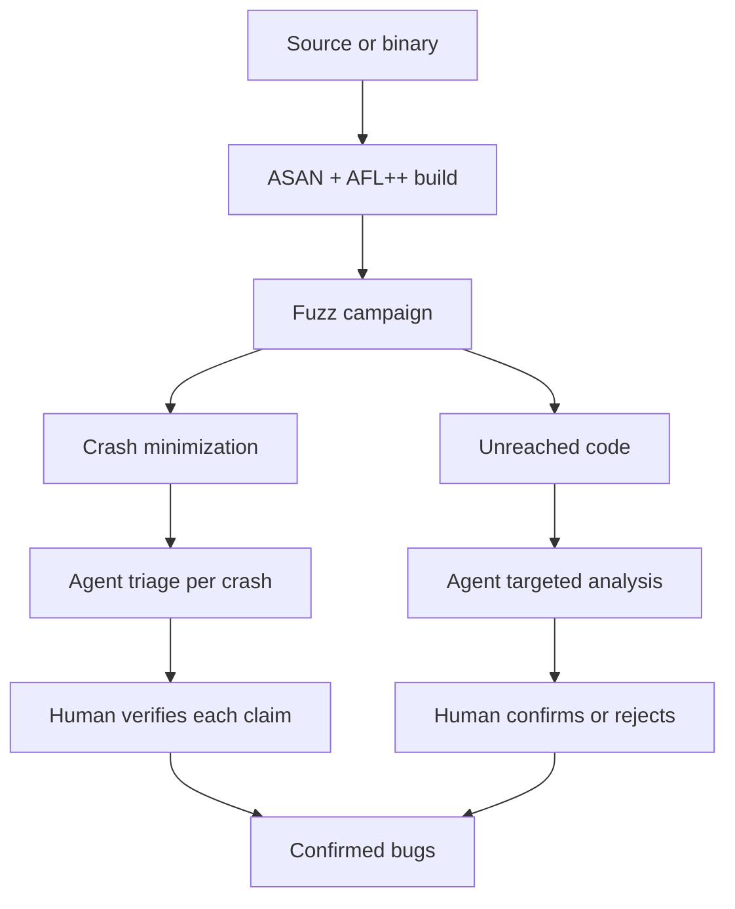
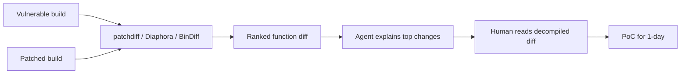

# Vulnerability Research with AI

> Tags: vulnerability-research, fuzzing, patch-diffing, 1-day, audit | Difficulty: advanced | Prerequisites: 03-decomp pages, 07-advanced/ai-security-threats.md

## Overview

Vulnerability research with AI is a pipeline, not a single prompt. The
evidence from 2026 benchmarks says the same thing about every layer:
agents are strong lead generators and weak proof machines.

Three facts frame the whole page:

- An agent can triage a crash stack, rank functions by attack surface,
  and explain a sanitizer report in seconds. This work is real and it is
  cheap.
- An agent asked to "find the vulnerability" without a bounded scope
  hallucinates buffer overflows. The measured study cited in the
  companion report found such prompts produced false claims and cost
  about 231 percent more wasted time. Keep the scope narrow.
- An agent audit finds shallow bugs well. Deep bugs need insight that
  the agent does not have. Treat every finding as a lead to verify, not
  as a confirmed vulnerability.

The winning pattern matches every other RE page in this wiki: extract
deterministic facts first, let the agent reason over them second, and
gate every claim through a deterministic check third.

## How It Works

### Bug classes an agent can find

Rate each bug class by how well agents perform on it today.

| Bug class | Agent fit | Why |
|---|---|---|
| Crash triage | Strong | Stack symbols, sanitizer output, and register state are text. The agent summarizes and proposes a root cause. Human still confirms |
| Memory corruption with a sanitizer hit | Strong | ASAN/MSAN/UBSAN give exact offsets and stacks. The agent maps them to source or pseudocode |
| Classic memory corruption without a crash | Medium | Missing length checks, off-by-one, UAF candidates are visible in pseudocode. Reachability reasoning is the hard part |
| Injection (SQL, command, path, format) | Strong | The pattern is textual. "User input reaches system()/execve" is a taint question the agent answers well |
| Logic bugs | Medium-weak | Requires intent. Agents miss authorization order, TOCTOU, and state-machine violations unless the protocol is spelled out |
| Crypto misuse | Medium | Weak constants and mode errors are visible. Novel construction flaws need protocol expertise |
| Concurrency bugs | Weak | Race conditions need interleaving reasoning. Agents describe races but rarely prove them |
| Deep kernel or VM bugs | Weak | The agent cannot hold the subsystem invariants in its head reliably |

### The methodology: fuzz first, then targeted analysis

Fuzzing beats reading for coverage. The agent cannot read a million
paths. A fuzzer can. The standard order is:

1. **Build with instrumentation.** Compile with `afl-cc` plus ASAN.
   Coverage feedback finds the shallow bugs before any agent looks.
2. **Run the fuzzer.** Let AFL++ or libFuzzer explore. Crashes land in
   `output_dir/crashes/`.
3. **Minimize and dedupe.** `afl-tmin`, then cluster by stack hash.
4. **Agent triage.** Feed the deduplicated crashes, the sanitizer
   reports, and the relevant pseudocode to the agent. Ask for a
   root-cause hypothesis per crash.
5. **Verify by hand.** Reproduce each claim. An agent crash report is a
   hypothesis until the crash replays on the unpatched build.
6. **Targeted analysis.** Use the remaining budget on functions the
   fuzzer could not reach. These are the deep bugs. This is where human
   insight matters most.

The agent's role changes by stage. Early: write the harness, generate
dictionaries, explain crashes. Late: reason about reachability and
exploitability. The agent never owns the verify step.



### Tools

#### AFL++

Source: https://github.com/AFLplusplus/AFLplusplus (release 5.03c,
dev branch 5.04a at the time of writing).

Build a target with coverage instrumentation:

```bash
CC=/path/to/afl-cc CXX=/path/to/afl-c++ ./configure --disable-shared
make clean all
```

Fuzz it:

```bash
./afl-fuzz -i seeds_dir -o output_dir -x dict.txt -- \
  /path/to/tested/program @@
```

Replay a crash:

```bash
cat output_dir/crashes/id:000000,* | /path/to/tested/program
```

AFL++ ships `afl-cc`, `afl-c++`, `afl-clang-fast`, `afl-tmin`, and
`afl-showmap`. The Docker image is `aflplusplus/aflplusplus`. AFL++
supports QEMU mode for binary-only targets, Unicorn mode for
emulation, and persistent mode for in-process fuzzing. For a full
treatment see the official docs at
https://github.com/AFLplusplus/AFLplusplus/blob/stable/docs/README.md.

#### Sanitizers

Compile with ASAN first. ASAN catches heap overflow, use-after-free,
stack overflow, and double free. UBSAN catches undefined behavior.
MSAN catches uninitialized reads but needs an instrumented libc.

```bash
CC=clang CXX=clang++ CFLAGS="-fsanitize=address,undefined -g -O1" \
CXXFLAGS="-fsanitize=address,undefined -g -O1" LDFLAGS="-fsanitize=address,undefined" \
./configure && make
```

For fuzzing builds, combine ASAN with AFL++:

```bash
export AFL_USE_ASAN=1
export CC=/path/to/afl-clang-fast
export CXX=/path/to/afl-clang-fast++
CFLAGS="-fsanitize=address -g -O1" ./configure && make
```

Sanitizer output is the best agent input you can give. It is structured
text with exact offsets and stacks.

#### libFuzzer and AFL++ LLVMFuzzer mode

If the target is a library, `afl-clang-fast` with `-fsanitize=fuzzer`
gives you an in-process fuzzer. It is faster than fork-server mode for
small harnesses. For C++ targets, write a `LLVMFuzzerTestOneInput`
function.

#### CodeQL for source

CodeQL is the strongest source-level option. It builds a semantic
database of the target and runs queries over it. The agent reads query
results, not raw source. This fits the deterministic-facts-first
pattern.

Setup:

```bash
codeql database create db --language=cpp --source-root=/path/to/src
codeql database analyze db codeql/cpp-queries --format=sarif-latest \
  --output=results.sarif
```

Feed `results.sarif` to the agent. Ask it to rank findings by
reachability. CodeQL produces candidate alerts, not confirmed bugs. The
agent helps you sort them. It does not replace a human reading the
query result.

#### BinaryAudit-style agent audits

The BinaryAudit benchmark measures agents that find backdoors in
compiled binaries. Source: https://github.com/QuesmaOrg/BinaryAudit.

Facts from the benchmark README and the companion report:

- Task: 33 tasks. Agents get stripped binaries of real open-source
  projects (lighttpd, dnsmasq, Dropbear, Sozu, Caddy) with injected
  backdoors. Tools available inside the container: Ghidra and
  Radare2.
- Best reported result: claude-opus-4.6 at 49 percent. Gemini-3.1-pro
  at 49 percent. gpt-5.2-codex-xhigh at 46 percent. Deepseek-v3.2 at
  12 percent. Grok-4.1-fast at 7 percent.
- Cost: gemini-3-flash did 37 percent for about $18 total. Gemini-3.1-pro
  did 49 percent for about $41. Reported figures.
- Harness: Harbor (`uv tool install harbor`). Docker isolation.
  Example command:

```bash
docker build --platform linux/amd64 -t binaryaudit-base:latest \
  -f docker/base.Dockerfile .
harbor run \
  --path tasks \
  --task-name lighttpd-backdoor-detect \
  --agent terminus-2 \
  --model anthropic/claude-opus-4-6-20260409
```

What this means for your work: agents find planted backdoors at about
a coin-flip rate on ~40MB binaries with two hours of tool time. That is
a useful lead rate for triage. It is not a substitute for a full audit.

#### HexGraph

Source: https://github.com/branover/hexgraph (AGPL-3.0, pre-1.0).

HexGraph is a self-hosted agentic vulnerability-research workbench. It
runs decompilation, strings, imports, and fuzzing inside a locked-down
Docker container. The agent sees tool output, not raw bytes. Every
finding is a typed node in a SQLite graph with an assurance level.
Coverage-guided fuzzing with AFL++, libFuzzer, qemu-mode, and boofuzz is
built in. PoC verification executes the target against a nonce oracle.

It is static-only by default. Dynamic execution, network egress, and
rehosting are separate opt-in tiers. This is the closest existing tool
to the methodology this page describes.

#### FirmAgent

Source: https://github.com/vul337/FirmAgent (NDSS 2026, per the
companion report).

FirmAgent targets firmware. It combines IDA pre-analysis, QEMU
rehosting, and an LLM that does taint analysis and generates a proof of
concept. It is the reference design for "agent proposes, sandbox
verifies" in firmware RE.

### LLM assists

#### Audit reports

The agent is good at structure. Give it a set of sanitizer outputs,
CodeQL alerts, and decompiled functions. Ask for a ranked report:

```
You are auditing a C parser for memory safety. Below are:
1. ASAN reports from AFL++ fuzzing (5 crashes, deduplicated)
2. CodeQL alerts (12 results, 4 high severity)
3. Decompiled functions for the top 3 CodeQL alerts

For each candidate:
- State the bug class
- Give the file and function
- Explain the input path that reaches the bug
- Rate confidence: confirmed / likely / speculative
- List what a human must check before reporting

Do not report a bug you cannot tie to a concrete input path.
```

The "do not report without a concrete input path" clause is load-bearing.
Without it the agent pads the report with plausible-sounding
hallucinations.

#### Taint reasoning

Taint analysis is the agent's strongest RE-adjacent skill. The pattern:

1. Identify the source. User input, network data, file content.
2. Identify the sink. `system()`, `execve()`, `strcpy()`, `sprintf()`,
   SQL query construction, file path join.
3. Ask the agent to trace the path between them in the decompiled
   pseudocode.
4. Verify each hop against the disassembly. Agents skip checks, merge
   variables, and miss sanitizers.

The agent produces a candidate path. The human checks each hop. This
cuts taint-tracing time by a large factor on medium-sized functions.
The agent does not replace interprocedural analysis tools. Use it to
prioritize which paths to check by hand.

#### Patch diffing for 1-days

When a vendor ships a security patch, the fix reveals the bug. The
workflow:

1. Obtain the vulnerable and patched builds. For open source, check
   out both commits and build them. For binaries, get both shipped
   versions.
2. Run a diff tool. Options:
   - BinDiff (IDA plugin, commercial)
   - Diaphora (Ghidra plugin, free)
   - `patchdiff` by AmerMrkaljevic: thin Ghidra-based tool. Matches
     functions by name or structural fingerprint, diffs decompiled
     pseudo-C, and ranks changes by security-relevant patterns (bounds
     literal changed, memcpy-family argument changed, new
     allocation/conditional). Source:
     https://github.com/AmerMrkaljevic/patchdiff. Tested on Ghidra 11.3.2.
     Example:

```bash
export GHIDRA_HOME=/path/to/ghidra_11.3.2_PUBLIC
./patchdiff.sh old_binary new_binary ./work --json --top 50
```

3. Feed the ranked diff to the agent. Ask it to explain what changed and
   why it matters. The agent reads the decompiled diff of the top N
   functions.
4. Write the exploit. The agent helps with PoC structure. The human
   validates reachability and writes the final payload.



The agent's role in patch diffing is explanation and prioritization. It
is not proof. A high patchdiff score means "read this function", not
"this is exploitable". That is exactly what the patchdiff README says:
it is a lead generator.

## Step-by-Step

### Step 1: pick the target class

Decide whether you have source or binary only.

- Source available: CodeQL + AFL++ + ASAN. Fastest path.
- Binary only: AFL++ QEMU mode or afl-fuzz on a harness you write around
  the binary's input surface. Then agent triage of crashes.
- Firmware: HexGraph or FirmAgent. QEMU rehosting plus agent analysis.

### Step 2: build the instrumented target

```bash
# Source target, AFL++ + ASAN
export AFL_USE_ASAN=1
CC=afl-clang-fast CXX=afl-clang-fast++ CFLAGS="-fsanitize=address -g -O1" \
  ./configure && make

# Or libFuzzer harness for a library
clang -fsanitize=fuzzer,address -g -O1 harness.c target.c -o fuzzer
```

### Step 3: generate seeds

Seeds decide coverage. Use:

- Valid input files from the project test suite
- Sample captures from the protocol or file format
- Dictionary entries for magic bytes and keywords
- Agent-generated seeds from the format spec

### Step 4: run the campaign

```bash
./afl-fuzz -i seeds -o out -x dict.txt -V 3600 -- ./target @@
```

`-V 3600` caps the campaign at one hour. Run multiple campaigns with
different seeds. AFL++ supports parallel fuzzing with `-M` and `-S`.

### Step 5: triage crashes

```bash
# Minimize each crash
afl-tmin -i out/crashes/id:000000,0 -o minimized < ./out/crashes/id:000000,0 \
  -- ./target @@

# Deduplicate by stack
# Use ASAN output or gdb batch mode to hash the top frames
```

Feed deduplicated crashes to the agent:

```
Here are 3 deduplicated ASAN crashes from AFL++.
For each:
1. Identify the bug class (heap overflow, UAF, stack overflow, etc.)
2. Map the crashing function to source or pseudocode
3. State whether this is likely exploitable or a null-deref DoS
4. List what input controls the overflow size and content
```

### Step 6: verify

For each agent claim:

1. Reproduce the crash on the uninstrumented or ASAN build.
2. Check reachability: can the input actually reach the bug in the
   shipped configuration?
3. Write a minimal PoC.
4. Check if the bug is already known (search CVEs, issue trackers).

Only confirmed bugs go in the report.

### Step 7: targeted analysis for deep bugs

The fuzzer missed something. Now what?

- Use the agent to rank unreached functions by attack surface.
- Feed the agent the decompiled pseudocode for the top functions.
- Ask for taint paths from input to dangerous sinks.
- Verify each path by hand.
- Use symbolic execution (angr, Triton, KLEE) for path feasibility when
  the agent's taint path looks promising but you cannot confirm it
  manually.

This is where human insight decides. The agent narrows the search space.
The human finds the bug.

### Step 8: patch diff for 1-days

When a patch drops:

```bash
# Get both versions
git clone https://example.com/target && cd target
git checkout <vulnerable-tag>
# build vulnerable
./patchdiff.sh vuln_build patched_build ./work --json
```

Read the top diffs. The agent explains them. You write the exploit.

## Pitfalls

- Do not ask "find the vulnerability" without a bounded scope. The
  measured result is hallucinated buffer overflows and wasted time.
- Do not trust agent crash reports without reproduction. Agents
  misattribute root causes and invent function names.
- Do not skip sanitizer instrumentation. Coverage-only fuzzing finds
  crashes you cannot classify. ASAN tells you what kind of bug it is.
- Do not feed raw assembly to the agent. Feed decompiler pseudocode.
- Do not assume the agent found all bugs. Fuzzing coverage is partial.
  Agent audits miss deep bugs. Plan for manual review of critical paths.
- Do not report a bug you cannot reproduce. A crash on your build may
  not reproduce on the target configuration. Check mitigations, input
  validation, and reachability.
- Do not use agent output as proof of exploitability. An agent saying
  "this looks exploitable" is not evidence. Write the PoC and test it.
- Do not expose the agent's sandbox to the target network without
  egress controls. See ../07-advanced/ai-security-threats.md.
- Do not let the agent write findings back to a shared database during
  untrusted-binary sessions. Persistent prompt injection is documented.
- Do not use Claude Opus 5.5 for this work. Its safety classifier
  reportedly halts RE and vulnerability requests. Use Opus 4.8 or a
  non-Anthropic model. See ../07-advanced/model-selection.md.
- Do not treat BinaryAudit scores as real-world audit accuracy. The
  benchmark uses planted backdoors in known binaries. Real audits have
  no ground truth.
- Do not skip patch diffing when a vendor ships a fix. The diff is the
  fastest path to a 1-day. But verify the bug is actually reachable in
  the patched version's deployment.
- Do not assume AFL++ found everything. Fuzzing is probabilistic.
  Increase campaign time, improve seeds, and use structure-aware
  mutators for complex formats.

## See Also

- [Verification Loop](../03-decomp/verification-loop.md)
- [Malware Analysis](../06-topics/malware-analysis.md)
- [AI Security Threats](../07-advanced/ai-security-threats.md)
- [Model Selection](../07-advanced/model-selection.md)
- [Prompt Patterns](../02-collab/prompt-patterns.md)
- [Protocol Reverse](../06-topics/protocol-reverse.md)
- [Deobfuscation](../06-topics/deobfuscation.md)
