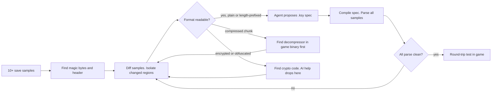
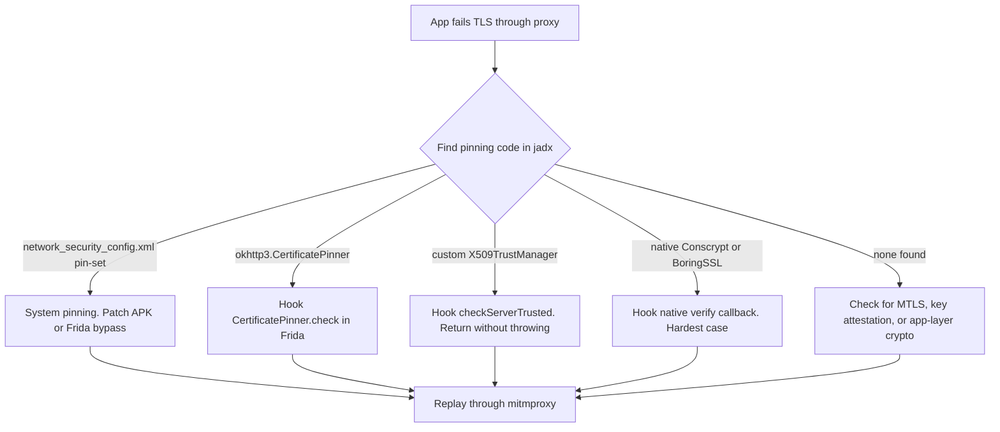

# More End-to-End Case Studies: Packed .NET, Kernel Drivers, File Formats, Mobile Pinning

> Tags: case-studies, recipes, .net, kernel-drivers, file-formats, mobile, pinning | Difficulty: Advanced | Prerequisites: [`../03-decomp/verification-loop.md`](../03-decomp/verification-loop.md), [`../04-dynamic/unpacking-dumping.md`](../04-dynamic/unpacking-dumping.md), [`../01-setup/agent-sandboxing.md`](../01-setup/agent-sandboxing.md)

## Overview

This page continues [`real-world-recipes.md`](real-world-recipes.md). It covers four scenarios that page did not cover. Each recipe has a concrete tool list, prompt sketches, a deterministic verification step, and an honest difficulty estimate.

The four recipes:

| # | Scenario | Primary engines | Honest difficulty |
|---|---|---|---|
| G | Analyze a packed .NET RAT loader end-to-end | MegaDumper or ExtremeDumper, ILSpy, sandbox | Medium. .NET metadata survives packing well |
| H | Recover a game anti-cheat driver IOCTL surface | Ghidra, WinDbg over KDNET, Frida | Hard. Kernel debugging is the bottleneck, not the AI |
| I | Reverse a custom file format from a game save | Kaitai Struct, hex inspection, format corpus | Medium. Bounded and verifiable. AI adds real value |
| J | Reconstruct a mobile app's certificate pinning and API protocol | jadx, apktool, Frida, mitmproxy | Medium to hard. Pinning bypass is solved. Protocol recovery is the real work |

All time and cost figures are estimates. They are not measured runs. Sources for the estimates are the same benchmark page that feeds [`real-world-recipes.md`](real-world-recipes.md): DecBench per-function costs of about $1 to $6.6, SRE-Bench instance costs of $0.50 to $42.5, and the general finding that agents handle bounded tasks well and open-ended tasks poorly.

## Setup

The baseline setup from [`real-world-recipes.md`](real-world-recipes.md#setup) applies here too. Four additions matter for these recipes:

1. **A Windows VM or a second Linux box.** Recipes G and H need Windows for .NET dumping and kernel debugging. Use Hyper-V, VMware, or QEMU with KVM. Snapshot before you start.
2. **A test device for recipe J.** An emulator or a rooted spare phone. Never run pinning bypasses on your daily device.
3. **A dedicated offline corpus for recipe I.** Collect many save files before you analyze one. One file is a guess. Twenty files reveal structure.
4. **Authorization.** Recipes H and J touch systems that may be legally sensitive. Read [`../09-ops/legal-and-ethics.md`](../09-ops/legal-and-ethics.md) before you start. Study your own files and your own device.

Model guidance stays the same: Claude Opus 4.8 or GPT-6 class for interactive work. Kimi K3, DeepSeek V4, or GLM-5.3 for private or hostile inputs. Avoid Claude Opus 5.5 for RE tasks. Its safety classifier reportedly halts RE requests since about October 2026.

## Recipe G: Analyze a Packed .NET RAT Loader End-to-End

### Goal

Determine what a .NET loader does. Recover the embedded payload. Identify the command-and-control protocol and any persistence mechanisms.

### Why this is tractable

.NET packers work at the assembly level. They encrypt or hide the real code but must still produce valid IL at run time. The CLR loads the assembly. The metadata tables, type names, and method signatures usually survive. You do not need to defeat a VM like VMProtect on native code. You need to dump the decrypted assembly from a live process.

This recipe covers a native-packed .NET loader too. Some loaders are native PE files that inject a .NET payload into another process. That variant needs recipe B territory for the native stub. The .NET payload stage is what this recipe covers.

### Tools

| Tool | Role | Source |
|---|---|---|
| MegaDumper | Dumps .NET assemblies from a live process, including obfuscated and packed ones | github.com/CodeCracker-Tools/MegaDumper (reported: Windows only, needs a target PID) |
| ExtremeDumper | Alternative .NET dumper. Works on .NET Framework and .NET Core | github.com/wwh1004/ExtremeDumper (reported) |
| ILSpy / ilspycmd | Decompile the dumped assembly to C# | github.com/icsharpcode/ILSpy |
| dnSpyEx | GUI decompile plus debug plus edit | github.com/dnSpyEx-Project/dnSpy |
| de4dot or forks | Deobfuscate renamed types, encrypted strings, control-flow obfuscation | github.com/de4dot/de4dot (stale). Active forks exist. Check the .NET topic page for current options |
| CAPEv2 | Sandbox detonation. Collect the network and file artifacts | github.com/kevoreilly/CAPEv2 |
| ANY.RUN or Joe Sandbox | Cloud sandbox alternative | any.run, joesandbox.com |
| API Monitor or ProcMon | Watch the loader's process and file activity | techpowerup.com / learn.microsoft.com |

### Procedure

1. **Static triage.** Run `diec` or Detect It Easy on the loader. Check whether it is a managed assembly or a native stub. `file` and `pedump` help. A .NET assembly has a CLI header. The `BSJB` signature appears in the metadata root.
2. **Sandbox detonation.** Run the loader in CAPE or ANY.RUN with network logging on. Capture the process tree, dropped files, and network destinations. Do not run it on your host.
3. **Find the .NET payload.** If the loader is managed, it may hold the payload as an encrypted resource or byte array. If it is native, it injects a managed assembly into a host process. Check the sandbox report for child processes and `clr.dll` loads.
4. **Dump the assembly.** Attach MegaDumper or ExtremeDumper to the process that holds the payload. Save the dumped `.dll` or `.exe`. Run `ilspycmd -p -o out/ dumped.dll` to get the source tree.
5. **Deobfuscate if needed.** If names look like `A.a()` or strings are encrypted, run a de4dot fork first. Then decompile again.
6. **Trace the C2 protocol.** Search the source for `HttpClient`, `Socket`, `TcpClient`, `WebSocket`, `Dns.GetHostEntry`, `FromBase64String`, and `Aes`/`Rijndael`. The agent can summarize each hit. You verify each one.

Prompt sketch for the C2 hunt:

```text
Here is the decompiled C# for the network layer of dumped_payload.dll.
<paste relevant classes>

Answer only these questions, each with file:line evidence:
1. What transport does it use (HTTP, raw TCP, DNS, WebSocket)?
2. How are messages framed (length prefix, delimiter, JSON, protobuf)?
3. Is the payload encrypted before send? Which algorithm and key source?
4. What is the C2 address or domain? How is it configured?
5. What commands does it accept? List each handler.

Mark anything unsupported as "unknown".
```

### Verification

- The dump must load. Open it in ILSpy and confirm the method bodies decompile without errors. A bad dump shows as empty methods or `// ISSUE` comments.
- Compare the dumped assembly's behavior to the original in the sandbox. Same network destinations, same file writes, same registry keys.
- For each claimed C2 endpoint, confirm it appears in the sandbox network log or in the binary's strings/resources.
- For crypto claims, find the key material in the decompiled source. If the agent says "AES with a hardcoded key," the key bytes must be in the code or resources.

### Time and cost estimate (estimate)

| Scope | Estimate |
|---|---|
| Managed .NET loader, no obfuscation | 2 to 6 hours. $10 to $40. |
| Packed or obfuscated .NET loader | Half a day to 2 days. $30 to $150. Add deobfuscation and manual IL reading. |
| Native stub plus .NET payload | Add the native stub analysis from [`../08-case-studies/real-world-recipes.md#recipe-b-unpack-a-vmprotected-dll-and-recover-the-payload`](real-world-recipes.md). Total effort is the sum of both stages. |

## Recipe H: Recover a Game Anti-Cheat Driver IOCTL Surface

### Goal

Map the usermode-to-kernel interface of a game anti-cheat driver. Recover the device name, the IOCTL codes, the input and output structures, and what each handler does.

### Why this is hard

Anti-cheat drivers are hostile to analysis. They check for debuggers, verify their own integrity, and may use custom obfuscation. The IOCTL surface is only part of the picture. The driver also registers callbacks, scans memory, and communicates with its usermode service through shared memory or other channels.

AI helps with the static side. It names dispatch routines, decodes IOCTL switch statements, and explains WDF object lifecycles. It does not help with safe kernel debugging. A wrong hypothesis can bluescreen the machine.

Read [`../06-topics/anti-cheat-re.md`](../06-topics/anti-cheat-re.md) for the legal and safety posture. This recipe assumes you are studying a driver on a dedicated research machine.

### Tools

| Tool | Role | Source |
|---|---|---|
| Ghidra 12.2 + headless MCP | Decompile `DriverEntry`, `IRP_MJ_DEVICE_CONTROL` dispatch, IOCTL handlers | See [`../03-decomp/batch-decompilation.md`](../03-decomp/batch-decompilation.md) |
| IDA Pro 9.5 + ida-mcp | Alternative static engine. Better FLIRT signatures for known libraries | hex-rays.com |
| WinDbg over KDNET | Kernel debugging. Breakpoints on `IofCompleteRequest`, `IoControlCode` decode | learn.microsoft.com/windows-hardware/drivers/debugger |
| WinDbgX-MCP | MCP bridge for WinDbg commands | github.com/mnemonic-re/WinDbgX-MCP |
| Frida | Hook the usermode service that talks to the driver | github.com/frida/frida |
| DeviceTree or WinObj | Find the device object and symbolic link names | github.com/MScholtes/TechNet-Articles or Microsoft Sysinternals |
| IRPMon or similar | Trace IRP activity without a kernel debugger | irpmon (older but still referenced) |

### Procedure

1. **Static map first.** Load the `.sys` file in Ghidra. Find `DriverEntry`. Follow it to `DriverObject->MajorFunction[IRP_MJ_DEVICE_CONTROL]`. That is the IOCTL dispatch routine.
2. **Decode the IOCTL table.** The dispatch routine switches on `IrpSp->Parameters.DeviceIoControl.IoControlCode`. Each case is one IOCTL. The agent can name each handler and guess the structure layout from the buffer accesses.
3. **Find the device name.** Look for `IoCreateDevice` or `IoCreateSymbolicLink` calls. The symbolic link name is what usermode `CreateFile` opens. Common patterns: `\\Device\\<name>` and `\\DosDevices\\<name>` or `\\.\<name>`.
4. **Find the usermode client.** The anti-cheat service or game launcher opens the device and sends IOCTLs. Decompile that binary too. Cross-reference the IOCTL codes.
5. **Dynamic confirmation.** On a test VM with KDNET, set breakpoints on the dispatch routine. Trigger the usermode client. Confirm which IOCTLs fire and what buffers look like.
6. **Map the surface.** Produce a table: IOCTL code, direction (METHOD_BUFFERED, METHOD_IN_DIRECT, METHOD_OUT_DIRECT, METHOD_NEITHER), input size, output size, handler function, purpose.

Prompt sketch for the IOCTL decode:

```text
Here is the decompiled dispatch routine for IRP_MJ_DEVICE_CONTROL
in driver.sys. It switches on IoControlCode.
<paste decompiled function>

For each case label:
1. Give the IOCTL code in hex and CTL_CODE form if decodable.
2. Name the handler function.
3. Describe what it does with the input and output buffers.
4. Flag any METHOD_NEITHER usage (dangerous, needs probing).

Return a table. Cite the case label address for each row.
```

### Verification

- Every IOCTL code must appear in both the driver dispatch and the usermode client, or you must explain why it is internal-only.
- Dynamic test: the breakpoint on the dispatch routine must fire with the expected `IoControlCode` when the usermode client runs.
- Structure verification: if the agent claims an input structure has a `ULONG ProcessId` at offset 0, confirm by reading the buffer in WinDbg at the breakpoint.
- Never let the agent run WinDbg commands against a live kernel without a human watching the first session. See the warning in [`../06-topics/windows-kernel-drivers.md`](../06-topics/windows-kernel-drivers.md).

### Time and cost estimate (estimate)

| Scope | Estimate |
|---|---|
| Static IOCTL map of one driver | 1 to 3 days. $50 to $200. Most time is manual verification. |
| Dynamic confirmation on a test VM | Add half a day to 2 days. Kernel debugging setup is the slow part. |
| Full anti-cheat surface (all IOCTLs plus shared memory plus callbacks) | Weeks. This is research-grade work. Budget accordingly. |

## Recipe I: Reverse a Custom File Format from a Game Save

### Goal

Recover the structure of a proprietary binary save file. Produce a parser or a Kaitai Struct spec that can read and write the format.

### Why this works well with AI

File formats are bounded. You have samples. You can diff them. You can mutate bytes and observe the effect in the game. The format either parses or it does not. This is one of the most verifiable RE tasks.

Kaitai Struct is the right tool. It produces a `.ksy` spec that compiles to parsers in many languages. The Kaitai format corpus at github.com/kaitai-io/kaitai_struct_formats has thousands of existing specs. Check there first. Your format may already be covered or have a close relative.

### Tools

| Tool | Role | Source |
|---|---|---|
| Kaitai Struct | Declarative binary format language. Web IDE, visualizer, compiler | kaitai.io |
| Kaitai format corpus | Existing .ksy specs for common formats | github.com/kaitai-io/kaitai_struct_formats |
| 010 Editor | Hex editor with binary templates. Good for manual structure discovery | 010editor.com |
| ImHex | Open-source hex editor with pattern language and data inspector | github.com/WerWolv/ImHex |
| xxd, hexdump, binwalk | Quick byte inspection and signature scanning | Standard Linux tools |
| Python + struct | Quick-and-dirty parsers for hypothesis testing | Standard library |
| The game itself or its save editor | Oracle: does the game accept your modified file? | Depends on the game |
| Ghidra or IDA | Find the save/load code in the game binary if you need semantics | See [`../03-decomp/decompile-workflow.md`](../03-decomp/decompile-workflow.md) |

### Procedure

1. **Collect samples.** Get at least 10 to 20 save files. Vary the game state: different levels, different items, different play times. Save files from the same game state are useless for structure discovery.


2. **Find the magic bytes.** `xxd save1.dat | head` and `binwalk save1.dat`. Look for a header signature, a version field, or a length prefix.
3. **Diff the samples.** Compare two saves that differ in one known way (for example, the player has one more coin). `cmp -l save1.dat save2.dat` or a Python script that finds differing byte ranges. The differing region is your target field.
4. **Hypothesize the structure.** Use the agent to propose a Kaitai spec based on the hex dumps and your observations. Feed it aligned hex views, not raw bytes.
5. **Write the .ksy spec.** Start with `seq`, `types`, and `instances`. Use `doc` fields to record what you think each field means.
6. **Verify by parsing.** Compile the spec with `kaitai-struct-compiler` and run it against all your samples. Every sample must parse without errors.
7. **Verify by round-trip.** If the format is writable, parse a save, modify a field, write it back, and confirm the game accepts it.

Prompt sketch for the format hypothesis:

```text
Here are hex dumps of three save files from the same game.
They differ in player level, inventory count, and play time.
<aligned hex dumps>

Propose a Kaitai Struct .ksy spec for this format.
For each field, state your confidence and the evidence:
- Which bytes change when level changes?
- Which bytes look like a checksum or CRC?
- Is there compression or encryption?

Return the .ksy YAML. Mark uncertain fields with a comment.
```

### Verification

- Parse all samples with the compiled spec. Zero errors.
- Field-level check: change a byte you believe is the player level. Parse again. Confirm the parsed value changed as expected.
- Game-level check: load the modified save in the game. If the game crashes or rejects it, your structure is wrong or incomplete.
- Checksum check: if you claim a field is a checksum, recompute it over the claimed coverage for all samples. It must match.

### Time and cost estimate (estimate)

| Scope | Estimate |
|---|---|
| Simple uncompressed format, clear magic bytes | Half a day to 2 days. $10 to $50. |
| Compressed or chunked format | Add decompression stage. 2 to 5 days. |
| Encrypted or obfuscated format | Add key recovery. Days to weeks. This is where AI help drops off. |
| Format with no samples (only one save file) | Not enough data. Get more samples first. |

## Recipe J: Reconstruct a Mobile App's Certificate Pinning and API Protocol

### Goal

Intercept and understand the HTTPS API of an Android app that uses certificate pinning. Recover the request and response formats, authentication scheme, and any custom encryption.

### Why this is a two-part problem

Certificate pinning is the gate. Once you bypass it, you can proxy the traffic. But the API protocol itself may be protobuf, a custom binary format, or encrypted at the application layer. Pinning bypass gets you the ciphertext. Protocol recovery gets you the plaintext.

AI helps with both. It writes Frida scripts for pinning bypass. It summarizes jadx output to find the network layer. It helps you interpret captured traffic.

### Tools

| Tool | Role | Source |
|---|---|---|
| jadx 1.5.6 + jadx-mcp-server | Decompile the APK. Find the network layer and pinning code | github.com/skylot/jadx, github.com/zinja-coder/jadx-mcp-server |
| apktool | Decode resources and smali for manifest and native library inspection | bitbucket.org/iBotPeaches/apktool |
| Frida 17.x | Runtime hooking. Bypass pinning, hook SSL, intercept native crypto | github.com/frida/frida |
| objection | Frida-based toolkit with built-in pinning bypass commands | github.com/sensepost/objection |
| apk-mitm or similar | Patch the APK to disable pinning statically | github.com/shroudedcode/apk-mitm (reported) |
| mitmproxy | Intercept HTTPS traffic after pinning bypass | mitmproxy.org |
| HTTP Toolkit or Charles | Alternative proxy with nicer UI | httptoolkit.com, charlesproxy.com |
| Frida scripts for common pinning | Hook `checkServerTrusted`, `CertificatePinner`, OkHttp, TrustManager | Various GitHub gists and repos |

### Procedure

1. **Static recon.** Decompile the APK with jadx. Search for `checkServerTrusted`, `X509TrustManager`, `CertificatePinner`, `SSLSocketFactory`, `TrustKit`, `network_security_config`. The manifest's `networkSecurityConfig` attribute points to the pinning configuration.
2. **Identify the pinning type.**



- **System pinning:** The app uses Android's `network_security_config.xml` with `<pin-set>`. You can patch the APK or use a Frida script.
   - **OkHttp CertificatePinner:** The app calls `CertificatePinner` with pins. Hook `check()` in Frida.
   - **Custom TrustManager:** The app implements `X509TrustManager` and overrides `checkServerTrusted`. Hook that method.
   - **Native pinning:** The app uses a native library (Conscrypt, BoringSSL) for TLS. This is harder. You may need to hook the native `SSL_CTX_set_custom_verify` or similar.
3. **Bypass pinning.** Use objection's `android sslpinning disable` or a targeted Frida script. For OkHttp, hook `okhttp3.CertificatePinner.check`. For custom TrustManagers, hook `checkServerTrusted` and return without throwing.
4. **Proxy the traffic.** Set the device's proxy to mitmproxy. Install the mitmproxy CA certificate. If the app still fails, you missed a pinning layer.
5. **Analyze the API.** Look at the captured requests. Are they JSON, protobuf, or custom binary? Check the `Content-Type` header. If protobuf, use `protoc --decode_raw` or a tool like protobuf-inspector.
6. **Recover the protocol.** If the body is encrypted or encoded, find the encryption code in jadx. Search for `AES`, `encrypt`, `Base64`, `gzip`. Hook the encryption function in Frida to see plaintext before encryption.

Prompt sketch for the pinning hunt:

```text
Here is the jadx output for the app's network security configuration
and TLS setup code.
<relevant files>

1. What pinning mechanism does this app use?
2. Which classes or methods implement it?
3. Is there a fallback or debug flag that disables pinning?
4. What native libraries are involved in TLS?

Return file:line citations for each claim.
```

Prompt sketch for the protocol recovery:

```text
Here is a captured HTTPS request and response after pinning bypass.
<request/response>

The body appears to be <JSON/protobuf/binary/encrypted>.
Here is the jadx output for the class that builds this request.
<relevant code>

1. What is the request format?
2. How is the body encoded or encrypted?
3. What headers carry authentication?
4. Can you reconstruct a minimal valid request?
```

### Verification

- Pinning bypass: the app must complete a TLS handshake through mitmproxy. If you see certificate errors in logcat, the bypass failed.
- Protocol recovery: replay a captured request through your reconstructed client or script. The server must accept it and return a valid response.
- Encryption claims: hook the encryption function in Frida. The plaintext input must match what you claim.
- If the app uses certificate transparency or key pinning at the OS level, you may need a rooted device with a modified system image. This is the hard case.

### Time and cost estimate (estimate)

| Scope | Estimate |
|---|---|
| Standard OkHttp or TrustManager pinning | 2 to 4 hours. $10 to $30. Well-documented bypasses exist. |
| Custom or native pinning | Half a day to 2 days. $30 to $100. Requires Frida script writing and possibly native hooking. |
| Protocol recovery after bypass | Add 1 to 3 days depending on complexity. Protobuf is easier than custom binary. Encrypted bodies add key recovery time. |
| Total for a typical app | 1 to 5 days. $50 to $200. |

## Pitfalls

These apply to all four recipes.

### General

- **Do not skip the sandbox.** Recipe G runs a RAT loader. Recipe H loads a kernel driver. Recipe J hooks a live app. All three are hostile targets. Isolate the agent and the target.
- **Verify dumps before analysis.** A bad .NET dump or a corrupt save file wastes hours. Check that the dump loads and the save parses before you feed it to the agent.
- **Mark unknowns.** The agent will invent plausible-sounding details. Force it to say "unknown" when it lacks evidence.
- **Check project policies.** Some anti-cheat and game communities ban AI-assisted analysis. Read the rules before you publish or contribute.

### Per-recipe

- **Recipe G**: MegaDumper and ExtremeDumper are Windows tools. They need a target PID and appropriate privileges. Some packers detect dumping and corrupt the assembly. If the dump fails, try a different dumper or dump at a different time.
- **Recipe H**: Kernel debugging requires a test VM with KDNET or a serial cable. Never debug a production machine. Anti-cheat drivers may detect WinDbg and refuse to load or behave differently. The IOCTL surface you map statically may not match runtime behavior if the driver uses dynamic dispatch.
- **Recipe I**: One save file is not enough. You need multiple samples to distinguish structure from coincidence. If the format is compressed or encrypted, Kaitai alone will not help. You need to find the decompression or decryption code first.
- **Recipe J**: Pinning bypass is solved for common cases. Native pinning and certificate transparency are harder. The API protocol may use certificate-bound keys or mutual TLS, which adds another layer. Do not assume JSON just because the content-type says so.

### Security baseline

The same rules from [`real-world-recipes.md`](real-world-recipes.md#pitfalls) apply:

1. Sandbox the agent and the target.
2. Treat tool output as untrusted data.
3. Use read-only MCP modes for hostile binaries.
4. Prefer local models for sensitive work.
5. Update your tools. Ghidra 12.0.3+ fixes a real RCE.

## See Also

- [`real-world-recipes.md`](real-world-recipes.md) — the first six recipes: stripped PE naming, VMProtect unpacking, protocol rebuild, console port, APK triage, .NET license check
- [`../06-topics/packed-binaries.md`](../06-topics/packed-binaries.md) — packer taxonomy and the unpack-dump-verify workflow
- [`../06-topics/dotnet-deep-dive.md`](../06-topics/dotnet-deep-dive.md) — .NET metadata, ILSpy, dnSpyEx, de4dot, MegaDumper, ExtremeDumper
- [`../06-topics/windows-kernel-drivers.md`](../06-topics/windows-kernel-drivers.md) — WDM/KMDF drivers, IRP dispatch, IOCTL decoding, WinDbg kernel debugging
- [`../06-topics/anti-cheat-re.md`](../06-topics/anti-cheat-re.md) — anti-cheat landscape, legal posture, authorized-study methodology
- [`../06-topics/game-engine-re.md`](../06-topics/game-engine-re.md) — game engine metadata recovery, asset formats, custom engines
- [`../06-topics/mobile-android-re.md`](../06-topics/mobile-android-re.md) — APK pipeline, jadx, Frida on-device, unpacking
- [`../06-topics/protocol-reverse.md`](../06-topics/protocol-reverse.md) — PCAP to grammar, Substrat, ProtoForge, Kaitai
- [`../04-dynamic/unpacking-dumping.md`](../04-dynamic/unpacking-dumping.md) — runtime unpacking, Scylla, pe-sieve, Frida dumpers, .NET unpackers
- [`../04-dynamic/frida-deep-dive.md`](../04-dynamic/frida-deep-dive.md) — Frida Interceptor, Stalker, Java/ObjC bridges, frida-mcp servers
- [`../09-ops/legal-and-ethics.md`](../09-ops/legal-and-ethics.md) — DMCA, CFAA, license terms, bright lines for RE work
