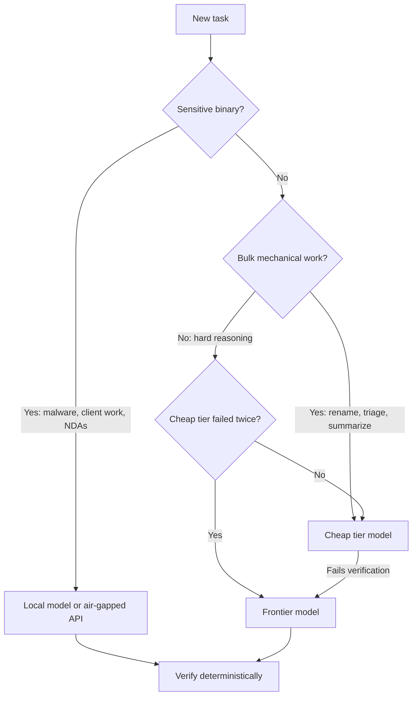

# Cost Tracking and Budgeting for RE Agents

> Tags: cost, budget, tokens, tracking, models | Difficulty: intermediate | Prerequisites: model-selection page, a working agent setup

## Overview

LLM cost in reverse engineering is dominated by context, not by the number of
functions you process. A decompile dump is expensive because pseudocode is
token-dense. An agent that fetches whole modules burns orders of magnitude
more tokens than one that works function-at-a-time.

This page covers:

- Where tokens go in RE work.
- Published per-task costs from 2026 benchmarks.
- Model tier strategies: cheap for bulk, frontier for hard, local for
  sensitive.
- How to cache decompile output so it is paid for once.
- Budget caps per session and per task.
- Tracking patterns: spreadsheet and CLI.
- When a $50 run beats a $5 run.

Prices change fast. Verify current model prices at the provider pricing
pages before you budget. Links appear in the tables below.

## Token Cost Anatomy

### Why decompile dumps are expensive

Decompiled C is token-dense relative to assembly or prose. Rules of thumb
from the wiki's context-engineering page:

- Decompiled C runs roughly 1 token per 3 to 4 characters.
- One small function produces about 200 to 2,000 tokens of pseudocode.
- Call it 300 tokens per function on average.
- One medium binary produces 500K to 5M tokens of full decompile output.
- A 5 MB stripped binary can decompile to hundreds of megabytes of
  pseudocode.

An agent that pulls a whole-module dump into context pays for those tokens
on every subsequent turn. Prompt caching discounts reads to about 10 percent
of input price on Anthropic models and 5 percent on OpenAI cached input, but
each new uncached tool result still costs full price.

### Where the money actually goes

Measured 2026 figures:

| Observation | Source |
|---|---|
| DecBench agent runs: about $1.0 to $1.2 per function for gpt-6-astra. About $6.6 for claude-opus-4-8. These are agent runs with tool use, not bare decompile calls. | decbench.com |
| SRE-Bench per-instance cost: GPT-6-Astra $13.5. GPT-5.6-Sol $42.5. Claude Fable 5.1 $34.7. DeepSeek-V4.1-Flash $0.50 at only 0.8 percent solved. | arXiv:2608.11469 |
| One GLM-5.2 agent run consumed $100 for 267 million tokens. Context bloat, not function count, was the driver. | SentinelLABS "Sol Searching" field report |
| SentinelLABS Sol Searching used 23 billion tokens across all runs. | Same report |
| GPT-WPRE (2023): $16.60 for a 466-function library at davinci-003 pricing. | GPT-WPRE paper |
| Kong XZ benchmark: $6.63 for a full backdoor reconstruction from stripped liblzma. | Kong Labs benchmark |
| Claroty Team82: $6 and 28 minutes for a Danfoss controller vulnerability reproduction. | Claroty blog |

The pattern: agent sessions cost 10 to 100 times more than bare per-function
prompts for the same work. Tool loops, retries, and context re-reads are the
difference.

### Current list prices for reference

Verified 2026-11-05 from provider pages:

| Model | Input per MTok | Cached input | Output per MTok | Source |
|---|---|---|---|---|
| Claude Opus 4.8 | $5 | $0.50 | $25 | claude.com/pricing |
| Claude Sonnet 4.6 | $3 | $0.30 | $15 | claude.com/pricing |
| Claude Haiku 4.5 | $1 | $0.10 | $5 | claude.com/pricing |
| GPT-6 Astra | $10 | $1.00 | $50 | developers.openai.com/api/docs/pricing |
| GPT-6.1 Sol | $2 | $0.10 | $10 | developers.openai.com/api/docs/pricing |
| GPT-6.1 Terra | $1 | $0.05 | $5 | developers.openai.com/api/docs/pricing |
| GPT-6 Luna | $0.10 | $0.01 | $0.50 | developers.openai.com/api/docs/pricing |

Modifiers that matter:

- Anthropic Batch API: 50 percent off input and output. GPT batch and Flex:
  50 percent off. Claude prompt caching: cache read at 0.1x base input
  (Opus 4.8 family) after a 1.25x five-minute write.
- OpenAI cached input: 5 percent of input rate. Cache writes: 1.25x for
  30-minute, 2.5x for 12-hour writes.
- OpenAI long context: prompts over 272K input tokens on GPT-6 family pay
  2x input and 1.5x output for the whole request.
- Claude Code subscription plans (Pro, Max, Team, Enterprise) are not
  per-token billed. Enterprise average reported at about $13 per developer
  per active day, $150 to $250 per month
  (docs.claude.com/en/docs/claude-code/costs).

## Model Tier Strategy

Cost-effective RE work routes each task to the cheapest model that can do it.
The evidence from benchmarks:

| Tier | Models | Best for | Evidence |
|---|---|---|---|
| Frontier agentic | GPT-6 Astra, GPT-6.1 Sol, Claude Opus 4.8, Gemini 4 Argon | Hard whole-program tasks, verification of agent claims, deobfuscation | Top scores on SRE-Bench, DecBench, Retrobench. Highest cost per unit |
| Mid-tier agentic | Claude Sonnet 4.6, GPT-6.1 Terra, GLM-5.3, Kimi K3, DeepSeek V4 Pro | Bulk renaming, triage, call-graph summaries, bounded function analysis | Retrobench 66 to 80 range. Open models have 1M context and no refusal classifiers |
| Cheap bulk | GPT-6 Luna, Claude Haiku 4.5, DeepSeek V4.1 Flash, GLM-5.3 Flash | Classification, string triage, import analysis, first-pass naming | HWREBench reported $0.08 per task for V4.1 Flash. SRE-Bench $0.50 per instance but only 0.8 percent solved |
| Local | Qwen3-Coder-Next (30B-A3B), LLM4Decompile v2 (1.3B to 33B), CodeInverter | Sensitive binaries you cannot send to an API, offline work | Free per token, GPU-bound. Weaker on obfuscated code |

### The escalation pattern



Rules:

- Never send malware samples, client binaries, or NDA-covered targets to a
  hosted API. Use local models or a self-hosted vLLM endpoint.
- Run cheap models first on bulk work. Escalate only failures to frontier.
  This is the same pattern as model-selection.md recommends, applied to
  cost.
- Frontier models pay off on tasks where cheap models loop without
  converging. A $5 run that fails three times costs more than one $20 run
  that succeeds once.

## Caching Decompile Output

The single biggest cost lever in RE work is exporting decompilation once
and reusing it. Decompiler output is deterministic for a fixed IDB state.
Regenerating it through an MCP tool on every agent turn re-pays the token
cost each time.

### Export once, query many

Headless export patterns (details in
../03-decomp/batch-decompilation.md):

```bash
# Ghidra 12.x headless decompile-all
analyzeHeadless /data/ghidra proj -import target.bin \
  -postScript export_hlil.py -scriptPath scripts/ \
  -analysisTimeoutPerFile 600

# IDA headless
idat64 -A -S"export_all.py" -Lida.log target.bin
```

Store the export as files on disk. Then:

- Grep the export for strings, imports, and call sites before any LLM call.
- Feed the agent file paths, not content. Claude Code and Codex agents can
  Read/Grep files at near-zero marginal context cost.
- Re-export only when you rename functions or change types in the IDB. Keep
  the export store separate from the analysis database so re-exports do not
  overwrite manual renames.

### Prompt caching for repeated context

If you run many agent turns against the same binary, structure the session
so the stable prefix stays cacheable:

- Put the binary map, function list, and conventions at the top of the
  system prompt or CLAUDE.md. They cache.
- Put per-function pseudocode in user turns. It does not.
- On Anthropic, a 5-minute cache write costs 1.25x and a read costs 0.1x.
  A long interactive session amortizes the write quickly.
- On OpenAI, cached input is 5 percent of input price on GPT-6 family.
  Long agent sessions with stable prefixes benefit the same way.

### Batch API for offline bulk work

Bulk jobs that do not need interactive latency belong on the Batch API:

- Anthropic Batch: 50 percent off input and output tokens.
- OpenAI Batch and Flex: 50 percent off Standard rates.
- Use it for whole-library rename passes, function summarization, and
  bulk classification. Do not use it for interactive triage where you need
  answers in seconds.

### Local models for repeat work

If you process the same corpus repeatedly, local inference has zero marginal
token cost:

- Qwen3-Coder-Next (30B-A3B): best open code model for local RE per the
  model-selection page. Needs about 20 to 24 GB VRAM at Q4.
- LLM4Decompile v2 and CodeInverter: specialist decompilation models,
  1.3B to 33B. Run through Ollama, llama.cpp, or vLLM.
- Hardware rules of thumb: 7 to 9B Q4 on 8 to 16 GB, 27 to 32B Q4 on
  20 to 24 GB, 70B+ on 48 GB or heavy CPU offload.

## Budget Caps

Set caps at three levels: per call, per session, per project.

### Per-call caps

- Claude Code: `--max-budget-usd <n>` on `claude -p` headless runs. The cap
  counts the session cost figure, which is computed locally at list price.
- OpenAI API: there is no per-request dollar cap. Cap by
  `max_output_tokens` and `max_tool_calls` where the API supports them, and
  by monitoring usage.
- Specialist pipelines: cap `max_new_tokens` on local models. LLM4Decompile
  demos use `max_new_tokens=2048` and warn the cap must stay under the
  model's range.

### Per-session caps

- Claude Code `/usage` shows the Session block with token counts and a
  dollar estimate. On subscription plans it also shows plan-limit
  attribution per skill, subagent, plugin, and MCP server (v2.1.222+).
- Claude Code `/usage` usage-credits row shows spend against your monthly
  spend limit when you set one.
- Claude Code headless JSON output includes `total_cost_usd` per run:

```bash
claude -p --output-format json --max-budget-usd 5 \
  "Triage samples/target.exe and write reports/target.json"
```

- Codex CLI and Gemini CLI have their own usage reporting. Check `codex`
  docs for current flags; Gemini CLI reports per-session token counts.

### Per-project budget

Track cumulative spend in a ledger. Every headless run appends one line:

```bash
#!/bin/bash
# run_agent.sh — run a capped headless agent and log cost
PROMPT="$1"; TAG="$2"; CAP="${3:-5}"
OUT=$(claude -p --output-format json --max-budget-usd "$CAP" "$PROMPT")
COST=$(echo "$OUT" | jq -r '.total_cost_usd // 0')
echo "$(date -Is),$TAG,$COST,$PROMPT" >> costs.csv
```

`costs.csv` columns: timestamp, task tag, dollars, prompt summary. Sum it
weekly. The tag lets you compare cost per binary, per function batch, or
per workflow.

### What the caps protect against

- Greedy fetching: agents pull broad decompilation dumps and saturate
  context. The "Humans versus Machines" study (arXiv:2610.14960) measured
  this on real binaries. Caps force spill-to-file behavior.
- Compaction loss: context compaction cut input tokens 86 percent in
  SentinelLABS testing but degraded recovery of higher-level objects.
  Cheaper to re-fetch evidence than to lose track of the task.
- Runaway loops: a stuck agent can burn a frontier model's weekly budget in
  an hour. `--max-turns` plus `--max-budget-usd` bounds both.

## Tracking Patterns

### Spreadsheet pattern

One row per task. Columns that matter:

| Column | Example | Why |
|---|---|---|
| Date | 2026-11-05 | Trend over time |
| Binary | target.exe sha256:ab12... | Per-target cost |
| Task type | triage / rename / deobfuscate / verify | Cost by task class |
| Model | claude-opus-4-8 | Per-model cost |
| Harness | claude-code -p | Headless vs interactive |
| Input tokens | 1,240,000 | From JSON output or /usage |
| Output tokens | 84,000 | Same |
| Cache read tokens | 980,000 | Cache efficiency |
| Cost USD | 6.62 | From `total_cost_usd` or computed |
| Wall time | 42 min | Throughput |
| Outcome | success / fail / partial | Cost per success |

The outcome column is the one people skip. Cost per successful task is the
number that matters. A $0.50 run that fails costs more than a $5 run that
succeeds.

### CLI pattern

For headless pipelines, log structured output per run:

```bash
claude -p --output-format json --max-budget-usd 10 "$PROMPT" \
  | jq '{cost: .total_cost_usd, session: .session_id, result: .result}' \
  >> runs.jsonl
```

For API-direct work, the response `usage` object carries
`input_tokens`, `output_tokens`, and cache fields. Multiply by the current
price table and append.

For subscription plans, `/usage` inside Claude Code shows the Session block
and plan attribution. Export it manually per session if you need history.

### Per-worker budgets in swarms

When you fan out to parallel workers (see
../03-decomp/decomp-orchestration.md), give each worker a hard cap:

- `--max-turns 15` per worker. A rename worker needs decompile plus a few
  edits. 12 to 15 turns is generous.
- `--max-budget-usd 2` per worker for bulk mechanical batches.
- A coordinator-level cap of `workers * per-worker cap`. Six workers at $2
  each is a $12 batch ceiling.
- Log each worker's `total_cost_usd`. The ledger already tracks work items.
  Add a `cost_usd` column.

### Alert thresholds

Set soft and hard thresholds:

- Soft: 50 percent of session budget. Prompt the agent to wrap up or dump
  state to disk.
- Hard: 100 percent. Kill the run. Partial results in the ledger survive.
- Per-day: a cron job that sums `costs.csv` and warns at your daily limit.

## When a $50 Run Beats a $5 Run

Cheap is not always cheaper. The $50 run wins when:

1. **The task is genuinely hard.** SRE-Bench shows budget and safeguards
   dominate scores. GPT-6-Astra at $13.5 per instance solved far more than
   DeepSeek-V4.1-Flash at $0.50 per instance. The cheap run cost less per
   attempt but produced almost nothing.

2. **Cheap models loop without converging.** If a $5 Sonnet run fails
   verification twice and a $20 Opus run succeeds once, the Opus run is
   cheaper per success. Track cost per success, not cost per attempt.

3. **The alternative is your time.** A $50 agent run that replaces four
   hours of manual reversing pays for itself if your time is worth more
   than $12.50 per hour. For a consultant at $150/hour, the math is
   obvious.

4. **Verification is expensive.** Recompiling, diffing, and testing costs
   engineer time. A higher-quality first pass reduces verification cycles.
   DecBench shows frontier agents score 56 to 60 percent union
   perfect-score versus 35 percent for the best traditional decompiler.

5. **The binary is large or obfuscated.** Local models and cheap API tiers
   degrade on VMProtect, Themida, and heavy obfuscation. See
   ../06-topics/deobfuscation.md. Frontier models handle these better.
   The cost difference is real but so is the success-rate difference.

6. **You need the audit trail.** Frontier models produce more coherent
   reasoning chains. When the output feeds a report, a patent, or a client
   deliverable, the extra cost buys defensibility.

The $5 run wins when:

- The task is mechanical: rename, triage, classify, summarize.
- You will verify the output anyway. Cheap model plus deterministic check
  beats expensive model plus the same check.
- The binary is sensitive and must stay local. A free local run beats any
  paid API run.
- You are exploring. Cheap probes tell you whether the binary is worth a
  frontier run.

## Pitfalls

- **Do not confuse list price with subscription cost.** Claude Pro/Max
  plans are flat-rate. The `/usage` dollar figure is an estimate at list
  price, not what you pay. Track plan-limit consumption separately.
- **Do not ignore cache misses.** The first request after a break longer
  than the cache lifetime reprocesses your full context. Long sessions
  with idle gaps pay full price repeatedly.
- **Do not feed raw decompile dumps to the model.** Export once, grep
  first, feed paths. See ../02-collab/context-engineering.md.
- **Do not run unbounded swarms.** Six workers at $5 each is $30 per
  batch. Twenty batches is $600. Cap per worker and per batch.
- **Do not track cost without outcome.** A cheap model that fails 90
  percent of the time is the most expensive option. Log success rate
  alongside cost.
- **Do not assume prices are stable.** Model names and prices change
  monthly. Verify at the provider page before each budget cycle. The
  table above is accurate as of 2026-11-05.
- **Do not send sensitive binaries to hosted APIs.** Malware samples,
  client work, and NDA-covered targets belong on local models or
  air-gapped infrastructure. Cost is irrelevant if the data leaks.
- **Do not skip the Batch API for offline work.** A 50 percent discount on
  bulk rename or summarization jobs is free money. The only cost is
  latency.
- **Do not let compaction hide cost.** Context compaction reduces tokens
  per request but can degrade task recovery. A compacted session that
  re-does work costs more than one that never compacted.

## See Also

- ../07-advanced/model-selection.md
- ../02-collab/context-engineering.md
- ../02-collab/claude-code-setup.md
- ../03-decomp/batch-decompilation.md
- ../03-decomp/decomp-orchestration.md
- ../06-topics/deobfuscation.md
- ../06-topics/malware-analysis.md
